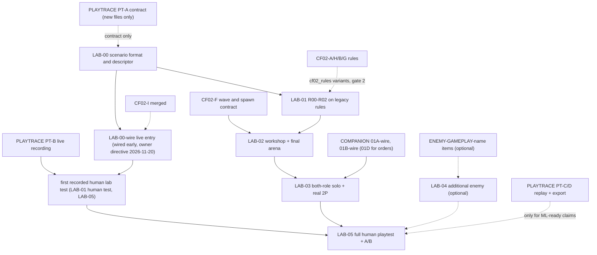

# COMBAT-LAB-01 — Floor 01 mid-floor combat lab (combat and verticality playtest)

**Status:** design contract / proposed level; **not implemented or game-feel accepted** (2026-11-20). Adopted defaults LAB-Q01..LAB-Q15 are in [section 8](#8-adopted-defaults-and-open-questions) (orchestrator, under the owner's design-defaults directive, from two independent top-tier reviews of PR #140).
**Tagline:** one playable 8–12 minute combat laboratory, individually restartable rooms and a repeatable final arena; **combat-first, not a puzzle-platformer**.
**Recording prerequisite:** [PLAYTRACE-01](../03-tech/playtrace-01-session-capture.md) PT-B gates calling any lab attempt "recorded" and the **first human lab test** (LAB-Q01 profile runs only through the live lab entry point, which records by default per PT-Q12). PT-B does not block the CF02-A/B owner game-feel playtest. Until PT-B merges, a lab attempt is reported as not recorded.

## 1. Design authority and evidence

Owner direction after DEMO-01: ordinary combat felt repetitive (3/5), goblin-to-goblin contact 1/5, solo swap and AI Donut 2/5, camera sometimes jerked, vertical geometry too simple and spectacular death modes not observed. See [owner results](../04-production/demo-01-playtest-2026-11-20.md), [CF02](combat-fun-02-post-demo01-proposals.md), [combat-first encounters](combat-first-encounter-design.md) and [character progression horizon](character-progression-horizon.md).

**Horizon fit (living-horizon review rule, consulted 2026-11-20, horizon unchanged):** the lab builds on Floor 01 reference-path steps 2–5 (post-biscuit Donut, hazards in the workshop, consolidation of known moves); it adds **no new action, button, unlock or enemy type**; it affects solo and 2P equally. "Mid-floor" here means the middle of Floor 01, **not** the horizon's "Mid campaign" (later floors). The horizon needs no edit. A horizon example is not an approval to implement it; gameplay signoff still applies.

COMBAT-LAB-01 **does not replace** the smaller `cf02_microarena` (1152×660, 40–60 s). That arena stays the short A/B regression for CF02 and is a dependency/building block. The new lab is a **larger, multi-room evaluation scenario**, separate from the starting story route and entered only through its own entry point (LAB-Q01, LAB-Q03). The DEMO-01 hall and existing goldens remain byte-compatible.

**Relationship to CAMERA-LAB (#96, merged; [camera lab](../03-tech/camera-lab.md)).** COMBAT-LAB-01 runs on the authoritative `CombatState`/`PartyState`, **not** the camera-lab sim. It may reuse camera-lab layouts (six data-driven rooms, including a workshop with a support-to-weight link and "The Juicer's Gym") and its reachability-test approach as **geometry references**. It uses the existing scene camera with the existing party separation wall (`PartyTuning::max_separation_px`, 448 px at a 640 px view, Q7; `src/party.rs`). The CAMERA-LAB 416 px leash lives only in `src/camera_lab/` and is a reference only. The lab adds **no new camera operator** (LAB-Q11). Camera-lab foes (scatterer, troglodyte, juicer) and breakable props are lab-local, **unapproved hypotheses**, not approved behaviour.

Already implemented / known from main: Bevy/Rust deterministic fixed-step battle simulation and fixtures, party-mode simulation, Donut swat (pre-biscuit), pounce and Magic Missile with mana, the Juicer boss arena (`--scene boss_f01`, #120), native `autoplay-episode/1` for Carl-only. **Not assumed integrated:** all CF02 combo/air/morale upgrades, complete companion combat/nav/commands, a multi-room scenario runner, enemy production art in Bevy, gameplay for every approved visual enemy. Every room declares its minimum capabilities and reports a missing dependency, rather than pretending incomplete mechanics work.

The approved controller grammar remains movement, jump, primary, physical, equipped special when unlocked, interact and solo swap; no mandatory grab/dodge/sprint/new combat button. Carl does not grab enemies; Donut is more agile; cinematic death slow-motion is rare and genuine skill-dependent; viewers/sponsors exist **only** if an experimental capability profile explicitly simulates their story unlock (none of the baseline profile does).

## 2. Core design hypotheses

1. **Baseline pleasure:** a fight against one goblin is satisfying before any gimmick. Heightened moves/AI cannot conceal poor basic hit/impact feedback.
2. **Authorable causality:** enemy-to-enemy collision, wall slam and support collapse create understandable follow-up choices and a visible outcome; explosive chains join **once a story-earned explosive exists** (LAB-Q02).
3. **Verticality is combat space:** high/low positioning allows flanking, air attacks, cover, target priority and risk, **not just jumping to the exit**.
4. **Distinct, honest enemies:** a new enemy archetype is kept only if it visibly changes a tactical choice, not because its concept art is attractive.
5. **Both leads have agency:** human Carl + AI Donut, human Donut + AI Carl and real local 2P must all make the same main path possible; P2 is never a passive observer.
6. **The same fight yields different plans:** direct melee, environment interaction and coordinated attack are each viable; at least one decisive encounter supports three meaningfully different completions.
7. **Probe without narrative damage:** any post-unlock powers, floor modifiers and audience mechanics use a test-only capability profile with an unmistakable banner; no campaign progression/save alteration.

## 3. Suggested lab layout (six rooms, final challenge optional)

This is a **design allocation**, not literal LDtk coordinates or approved level art. First create a geometry-only greybox using original approved ENV kits, 16px material grammar where compatible, safe camera framing and true gameplay-scale Carl/Donut sprites. Determine actual lengths/heights from jump arcs, collider geometry, 640×360 and 640×400 screenshots; do **not** infer larger world-visible width merely because the output is upscaled to 1080p or 4K.

| ID | Name | Approx aim | Gameplay question | Starting roster / implementation gate |
| --- | --- | --- | --- | --- |
| R00 | The Setup Cage | 30–60 s | Can testers pick a valid profile, mode and variant from a fixed list without tutorials or narration? | No hostiles; **dev-only selection screen** with menu controls only (LAB-Q08): no in-world equipment, no per-ability toggles, no item UI, no difficulty; safe warmup |
| R01 | Impact Pit | 60–90 s | Do jab/kick/down/stomp/contact/wall and enemy morale tell a consistent story? | Three goblins, distinct seeded temperaments. Builds on the legacy rules first; the `cf02_rules` variants need CF02-A/B/G/H (and CF02-F for the wave contract) |
| R02 | Broken Scaffold | 60–90 s | Do elevation, short routes, cover, aerial hits and shared camera improve combat? | Goblins + Bad Llama; the Rat only after its own behavior/gameplay acceptance (LAB-04, optional) |
| R03 | Collapsing Workshop | 60–120 s | Does terrain destruction open attacks and generate spectacular legible kills? | Goblins + the authored shore-style support collapse and falling block (LAB-Q02); Bomb Bard **only when designed and implemented** |
| R04 | Pressure Chamber | 60–120 s | Can players respond to melee/ranged/multiple threats and benefit from companion help? | Existing goblins + llama for first implementation; Troglodyte/Scatterer gated until gameplay-ready |
| R05 | The Gauntlet | 120–180 s | Can players choose at least three different routes/kill chains within a shared 2P/solo camera? | Waves from the CF02-F wave and spawn contract mixing proven archetypes; at most **4** concurrently active enemies by default (LAB-Q04) |
| R06 | Optional: The Juicer | Variable | Can players apply learned movement/combos/support to a boss without camera clutter? | **Link to the existing `boss_f01` arena** (`--scene boss_f01`, #120), no lab copy (LAB-Q09). Known #120 follow-ups F9 (AI Donut never jumps ripples) and F11 (respawn does not reset the boss) are R06 blockers |

The length aims are hypotheses (LAB-Q05), not target timers that force content padding. Total first-play target **8–12 minutes**, with quick retries and direct room entry for focused tests. Time each room via recorded ticks and human feedback before changing density/size.

### Room geometry and interaction contract

- **R01:** a low flat brawl lane bounded by a real impact wall, a protected nook and one reversible opportunity to knock enemies into another or a wall; no visual overlap without actual damage/stagger consequence. Every goblin has readable windup/recovery and differentiated morale.
- **R02:** at least two reachable vertical tiers and a third Donut-favored position; a low route that both can use, protected and exposed upper attack positions, clear return/descent routes, one safe refuge from llama spit. No required separate equal-length routes. A high spot must not create a trivial invulnerable turret; give enemies a meaningful reaction or positional cost. **Until AI goblins can navigate between levels, use anchored ground enemies and the ranged llama, never claim vertical enemy navigation was validated.** Solo R02 before COMPANION 01B-wire means "human switch-through; the AI partner (today's `follower.rs`, which has no platform graph) may stay grounded"; it is **not** a companion result.
- **R03:** one weak supporting column with telegraphed falling mass built only from the existing authored hazards (the `src/shore.rs` support and falling block with CF02-F's hero damage and goblin self-own, Q41/Q42; CF02-B wall and body slams; the boss-style drop-hazard pattern), one indestructible protected route and a chain that can hurt a careless hero. Destructible cover and explosive traps are **gated** (LAB-Q02): the room declares them as minimum capabilities and runs without them. Destruction is bounded and deterministic; no arbitrary debris gameplay or impossible return path. Carl has an offensive reason to interact, Donut a useful position/displacement opportunity.
- **R04:** place ranged pressure against melee approach, a safe but time-costly fallback path, enough vertical geometry for escape, and at least one moment where swapping or a companion command creates a real combat advantage (the orders criterion is **not tested** until COMPANION 01D merges). Do not introduce enemies whose mechanics are only approved as visual concepts.
- **R05:** wider arena with left/right rebound surfaces, a central support (a destructible bridge only once TERRAIN-L1/L3 exist, LAB-Q02), a modest upper walkway and two safe ground pockets. Waves spawn via visible authored cues **within camera bounds** using the CF02-F wave contract; no unseen instant damage. Three routes: (a) all-direct ground combat; (b) aerial/positioning plus cover; (c) environmental chain and duo assist. A direct route must remain feasible when terrain interactions are skipped; route diversity must be measured, not scripted by hidden prompts.
- **R06:** optional/segregated: the existing boss fixture. No new custom boss logic is owned by this PR.

**Platform collision policy:** start with existing solid platforms/slabs and walk-off transitions. Drop-through/one-way/moving platforms are **a separate experiment**, not a silent assumption of the current collision system. Avoid head-bumps or trap geometry that makes basic jumps unreliable. Sample all surfaces at gameplay scale and preserve camera headroom above both heroes. Test after destruction, at stage reset, with Donut controlled, Carl controlled and two humans; a mandatory gate may require one hero, but must not softlock the pair or separate 2P beyond the camera rules.

### Enemy roster and gating

Art readability sets merged on main are **not integrated in Bevy and carry no gameplay**: RAT-01 (#58) and SCAT-01 (#59) (merged as packets, design pending), BROOD-01 (#64), BARD-01 (#66), SLIME-01 (#69), ROT-01 (#70), TROG-02 Basher (#81) and VFX-01 bomb/burst (#76). LAB-04 reuses these sets and does not re-commission art.

| Archetype | Role | Approval / implementation policy |
| --- | --- | --- |
| Goblin A/B brawler/coward/show-off | Melee, panic, pincer, punish | Existing native goblin sprites; CF02 morale/move integration gate |
| Bad Llama | Ranged telegraph and control | Existing combat logic; validate integrated art and Carl/Donut collision |
| Dungeon Rat | Fast low threat, positional pressure | Owner-approved concept plus RAT-01 readability set (#58). Behavior (run/leap/bite), damage, collision and Bevy integration are a **new proposal** requiring separate review |
| Goblin Bomb Bard | Visible timed area denial, potential chain | Owner-approved concept plus BARD-01 (#66) and VFX-01 (#76). Do not assume bomb mechanics, timer or self-explosion are approved |
| Troglodyte Basher | Slow readable heavy threat / punish recovery | Approved visual study plus TROG-02 (#81); **provisional gameplay role**, move timings must be specified |
| Scatterer / Guardian | Spatial/pack pressure | Approved visual study plus SCAT-01 (#59) and BROOD-01 (#64); **provisional gameplay role**, never assume death explosion without approval |
| Rot Sticker / Slime | Optional later traversal/crowd experiments | ROT-01 (#70) and SLIME-01 (#69) readability sets; no requirement for LAB-01 proof of fun; distinct mechanics must justify adding |
| The Juicer | Optional boss (R06) | Implemented in #120 (`src/boss.rs`, `src/boss_scene.rs`, `--scene boss_f01`, 13 boss fixtures including 2P and AI Donut); the lab links to it |

Initial implementation must be playable with **goblins + llama**, not blocked on any additional enemy. New archetypes are separate `ENEMY-GAMEPLAY-<name>` backlog items (LAB-Q14); later add one at a time and compare actual changes in strategy, camera readability and performance; any candidate duplicating an existing tactical role is deferred.

## 4. Capability profiles, control modes and variants

Baseline `floor01-postbiscuit-lab-v1` (LAB-Q01) is a **test-only capability set** pinned at "Floor 01, after the Guild biscuit, before the Juicer":
- Carl: all *currently implemented and verified* jab/haymaker/kick; CF02 follow-through, grounded stomp, dive/air kick and bail-out **only under `cf02_rules` and after their opt-in rule is integrated**. Dynamite, the gauntlet fist and any explosive are **off** (the dynamite special gets a new profile id when its PR lands).
- Donut (post-biscuit): Primary = **Magic Missile** with real `DonutMana` (1 charge per cast; a **dry press** at 0 mana, per [Q10 section 3](../02-art/donut-moveset-q10.md)); Physical = **Pounce**. **No swat.** Advanced Donut spells and Puddle Jumper are not fabricated. A pre-biscuit swat + pounce profile is a separate, labelled profile (`floor01-prebiscuit-lab-v1`) and is not part of the baseline.
- No conventional gear inventory (ADR-0010). AUDIENCE stays locked as on main; floor boons and momentum are **off**, and any later experiment toggle is a separately labelled profile, never active in baseline.
- No forced shoulder mode, Mongo, new dodge button, audience/viewer HUD or sponsor grants.
- All special capabilities are validated at load time against actual ability implementation, action binding and story/test flags; unsupported configurations are rejected with a descriptive error.

**Leak guard (a mechanism, not only intent).** The profile is selectable **only** through the lab entry point. `--demo`, the story route and plain `--cf02` reject any lab profile argument. The post-biscuit state comes through the **existing test path** that `--donut-biscuit` (`donut_biscuit` in `src/bin/floor01_scene.rs`) already uses, not a new unlock mechanism. LAB-00 adds a unit test showing that the story and demo entries cannot load the profile.

Every room supports these mode/probe combinations in **the same game world**:
- `solo_carl`: Carl human, Donut AI with declared policy/version.
- `solo_donut`: Donut human, Carl AI with declared policy/version.
- `coop_local`: P1 Carl and P2 Donut, two independent pads.
- `sandbox`: direct room select, configured enemies/positions/hazards, explicit reset and cheats only as tagged probes.
- `stress`: tagged density/VFX/physics probe; not used unlabelled as natural player demonstration data. There are no difficulty presets in v1 (LAB-Q08); density varies only through tagged `stress` or `sandbox` probes.

Required variations for R01/R05 only (LAB-Q07): fixed scenario seed for A/B (the CF02-Q58 effective seed, `--cf02-seed`, no lab RNG, LAB-Q06); at least **three** reproducible temperament/layout variants for repeated human play, plus one **held-out geometry variant** for ML generalization. A/B comparisons keep build/input profile/roster/seed/camera identical while changing one mechanic. Never generate random unreachable platforms to inflate diversity.

## 5. Player interface and pacing

Use existing native HUD and approved hero plates. Lab-only control strip: mode, test-only capability profile, seed/variant, room index, recording status. The strip and the REC indicator live in a **lab-owned overlay module** and never edit `src/hud.rs` or `src/hud_draw.rs` (owned by COMPANION 01D). Keep instrumentation toggles out of the in-combat HUD except a minimal unobtrusive recording/error indicator. The story audience counters and specials remain gated, and individual hero credit never turns AI actions into P2.

At room end show a short readable **factual** panel (damage, elapsed ticks, named `DefeatCause`s and assists from existing events) **without interrupting in-progress telegraphs**. "Best combo opportunities" is out of v1 (no system owns that analysis). Ratings and annotations are **not** in-game in v1: they go in the protocol's out-of-game form, keyed by session, episode and tick range (LAB-Q10). Provide immediate retry, next room and A/B toggle at safe boundaries. A successful run never requires answering a survey.

Session recording from PLAYTRACE-01 spans all rooms and failures. Each room has an encounter ID; the final arena can be retried independently without discarding the prior history.

## 6. Acceptance plan: human + machine

**Focus targets (hypotheses, not claims):** basic kill >=4/5, meaningful body contact >=4/5, evasion and swap/companion >=4/5, camera/level legibility >=4/5, multiple visually distinct and readable defeat causes, no mandatory 2P softlock, and repeat the final arena three times with genuinely different observed strategies/enemy reactions. No single scalar "fun" metric replaces the owner judgment. A clean 2P session needs real two-pad evidence.

Telemetry is **derived offline** from PLAYTRACE events plus AUTOPLAY diagnostics (`src/autoplay/diagnostics.rs`, AP-Q14 attribution) and the CF02 scorecard; **no new in-game telemetry harness** (COMPANION CA-31 "no second harness"; LAB-Q13). Minimum quantitative measures per room/episode: actual action inventory, move attempts/hits/whiffs, canceled/buffered inputs, time airborne, player damage, deaths/retries, enemy attack tell interruptions, enemy-to-enemy and wall impacts with real consequences, environment kills and self-owns, camera target/zoom/pan jitter, Donut/Carl hit and kill attribution, companion assist opportunities/successful assists, mana/special availability, uncovered/invalid actions, time stuck or without progress, performance frame-time percentiles and recorder completeness/replay verification.

**Do not optimize for inflated viewership, rewards or RL score.** A skilled kill deserves a rare cinematic event when genuinely eligible. To assess reproducibility, store the precise rule flags and replay proof for each visually significant event; a rendered effect alone is not authoritative.

Hard gates:
1. Clear R00–R02 in solo and co-op **on the legacy rules and the existing roster** (geometry-only; does not wait for CF02 rules; the live human clear needs LAB-00-wire, wired before CF02-I by owner directive 2026-11-20); prove basic movement and two-character visibility, no permanent obstacle to solo switching. Solo R02 before 01B-wire is a human switch-through, not a companion result.
2. After CF02-F merges: clear R01/R05 with `cf02_rules` selected and verify all original legacy `--demo`/goldens unchanged.
3. Verify every room from its checkpoint and after partial terrain destruction (using only the destruction that exists, LAB-Q02); safe retry, camera continuity, all roles reachable; record failures honestly.
4. **PLAYTRACE-01:** an actual human-driven attempt of every mode is recorded (PT-B), verified (PT-C) and exported to observation/action transitions (PT-D), or the test is marked *not recorded* / *not ML-ready*.
5. **When LAB-04 adds an archetype** (optional, LAB-Q14), compare the same geometry with and without it to show it changes decisions and remains readable; do not silently add HP-sponge enemies.
6. Collect actual human ratings on controller (including Deck-class capture if available); include 640×360, 640×400 and upscaled 1080p evidence at real 1× gameplay speed.
7. **Role-assignment parity (LAB-Q12):** both role assignments (human Carl + AI Donut; human Donut + AI Carl) complete the same main path with no softlock and no unearned resources. The efficacy gap (time, damage taken, assists) is **measured and reported, not required to be zero**: COMPANION CA-37 limits v0 AI Carl to jab and push kick with no Down, air or explosive moves, and CA-19 keeps `ca19_kill_policy = never` through 01D. Changes to AI behaviour go to COMPANION-AI-01.

## 7. Dependency graph and small implementation PRs

Ownership: the lab workstream owns new level/scenario assets, layout validation, diagnostics and playtest protocol, in **new files only** (LAB-Q03). CF02 owns combat rules, wave/spawn contract and `src/cf02.rs`; COMPANION-AI owns companion control/navigation; AUTOPLAY owns training env/reward baselines; PLAYTRACE owns recording/data schema; the `terrain` role owns the gated TERRAIN-L1/L3 work. Do not independently rewrite these systems in the lab PR. Lab test knobs are a capability profile, **never changes to the story route**.

Read the [agent work order](../07-agents/combat-lab-01-workorder.md) and [playtest protocol](../04-production/combat-lab-01-playtest-protocol.md) before implementing. All numeric values in this document are defaults subject to documented game-feel review.

## 8. Adopted defaults and open questions

Adopted by the orchestrator under the owner's design-defaults directive (AGENTS.md, 2026-11-19) from the reviewers' recommended options. The owner may change any value in a follow-up PR.

| ID | Question | Adopted value | Reason |
| --- | --- | --- | --- |
| LAB-Q01 | Which story point does the profile pin, and how does it not leak? | Profile `floor01-postbiscuit-lab-v1`: Floor 01 after the Guild biscuit, before the Juicer; Carl base kit plus CF02 moves only under `cf02_rules`; dynamite, gauntlet, Puddle Jumper, AUDIENCE, boons and momentum off. Selectable only through the lab entry point; `--demo`, story and plain `--cf02` reject it; biscuit state through the existing `--donut-biscuit` test path; a LAB-00 unit test proves the story and demo entries cannot load it. Post-biscuit Donut has Magic Missile and Pounce, **no swat** (Q10 section 3). | "Mid-progression" clashed with the horizon's "Mid campaign", and a swat contradicts the adopted Q10 moveset. |
| LAB-Q02 | Destruction scope | R03/R05 v1 use only existing authored hazards: the `src/shore.rs` support and falling block with CF02-F's shore hero damage and goblin self-own (Q41/Q42), CF02-B wall and body slams, the boss-style drop-hazard pattern. Destructible cover, destructible bridges and explosive traps are a gated dependency `TERRAIN-L1/L3` (design PR owned by the `terrain` role under ADR-0003; main has only `src/shore.rs`, the boss plate rack and the QA-fixture blast in `src/blast.rs`). Rooms declare minimum capabilities and run without them. | LAB-02 must not invent physics. |
| LAB-Q03 | Files and entry point | LAB-00 is Bevy-free and owns only new files: `src/combat_lab/` (descriptor, validator, headless runner over the real `CombatState`/`PartyState` path), `src/combat_lab_fixtures.rs`, `assets/levels/combat_lab/*.room.json` (the existing `.room.json` format used by `src/demo.rs` and `src/boss_scene.rs`) plus a lab manifest. **LAB-00-wire** (wired early, before CF02-I, owner directive 2026-11-20) adds the lab-owned Bevy overlay module `src/combat_lab_overlay.rs` and the live entry, a `--scene combat_lab` token in `src/bin/floor01_scene.rs`, through a slot in the CF02 shared-file table. There is no separate lab binary. LAB-02 consumes CF02-F's wave and spawn contract and builds none of its own; a generalising `src/cf02.rs` PR, if needed, is queued after CF02-I. | The CF02/COMPANION owner chains already hold the shared files. |
| LAB-Q04 | Concurrent enemies | At most 4 concurrently active enemies by default (inside the 3–5 band). | A concrete, tunable cap. |
| LAB-Q05 | Room aim times | As written in section 3 (hypotheses, not timers). | Avoids padding content. |
| LAB-Q06 | Variant seed | The CF02-Q58 effective seed (`--cf02-seed`); no lab RNG. | One variety source for determinism. |
| LAB-Q07 | Variants | 3 play variants plus 1 held-out geometry variant, for R01 and R05 only. | Enough repeats without a combinatorial level set. |
| LAB-Q08 | R00 | "The Setup Cage": a dev-only selection of fixed profile ids, modes and variants, menu controls only; no in-world equipment, no per-ability toggles, no item UI. No difficulty presets in v1; density varies only through tagged `stress` or `sandbox` probes. | ADR-0010 and REWARDS-01 forbid a loadout menu, and main has no difficulty system. |
| LAB-Q09 | R06 | Links to the existing `boss_f01` arena (#120), no lab copy; #120 follow-ups F9 and F11 are R06 blockers. | The Juicer is implemented. |
| LAB-Q10 | Ratings and room-end summary | Ratings and annotations out of game in v1, keyed by session, episode and tick range; the room-end panel shows only factual values (damage, ticks, named `DefeatCause`s, assists). | `src/hud.rs`/`src/hud_draw.rs` are owned by 01D; no system owns "combo opportunity" analysis. |
| LAB-Q11 | Camera | Existing scene camera with the existing party separation wall (`PartyTuning::max_separation_px`, 448 px at 640 px, Q7; `src/party.rs`). The CAMERA-LAB 416 px leash is a reference only. Aligning the two is a separate camera/party PR and is listed as an open question. No new camera operator; camera-lab foes and props are unapproved hypotheses. | The game scene already enforces the 448 px wall as authoritative state; the lab does not own `src/party.rs`. |
| LAB-Q12 | AI-Carl parity | Both role assignments complete the same main path with no softlock and no unearned resources; the efficacy gap is measured and reported, not required to be zero; AI behaviour changes go to COMPANION-AI-01. | CA-37 limits v0 AI Carl by design. |
| LAB-Q13 | Telemetry | Derived offline from PLAYTRACE events plus AUTOPLAY diagnostics (AP-Q14) and the CF02 scorecard; no new in-game telemetry harness. | CA-31 "no second harness". |
| LAB-Q14 | LAB-04 | Optional throughout; candidates become separate `ENEMY-GAMEPLAY-<name>` backlog items; hard gate 5 applies only when LAB-04 adds an archetype; COMBAT-LAB-01 can complete with goblins and llama alone. | Removes the optional-versus-mandatory contradiction. |
| LAB-Q15 | LAB-01 versus CF02 | LAB-01's headless part (room JSON, headless fixtures, reachability and combat tests on the legacy rules) starts after LAB-00 and does not wait for CF02 rules. Its live part (Bevy captures/clips, hard gate 1 human clear) needs LAB-00-wire (wired before CF02-I by owner directive 2026-11-20, so no longer after it) and still runs on the legacy rules. `cf02_rules` variants and hard gate 2 run after CF02-F merges. | Lets the geometry work start now without a second entry point before the shared file is free. |

**Open questions (no review recommendation; not adopted):**

1. Whether R04 ever needs a non-goblin archetype (until then, goblins and llama only).
2. Any AI-Carl parity targets beyond the measured gap (LAB-Q12).
3. Drop-through and one-way platforms (a separate experiment needing its own movement contract).
4. When the gated `TERRAIN-L1/L3` design PR is scheduled, and when a `floor01-prebiscuit-lab-v1` profile is wanted at all.
5. Whether the game-scene separation wall (448 px at 640 px) and the CAMERA-LAB 416 px leash should be aligned (a separate camera/party PR; the lab does not change either, LAB-Q11).
6. The contextual-orders criterion stays **NOT TESTED** until COMPANION 01D (needs the owner's D-CTRL decision).
