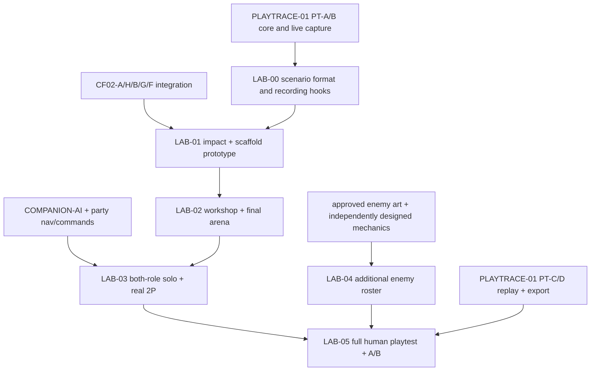

# COMBAT-LAB-01 — Mid-progression combat and verticality playtest

**Status:** design contract / proposed level; **not implemented or game-feel accepted** (2026-11-20).
**Tagline:** one playable 8–12 minute combat laboratory, individually restartable rooms and a repeatable final arena; **combat-first, not a puzzle-platformer**.
**Recording prerequisite:** [PLAYTRACE-01](../03-tech/playtrace-01-session-capture.md) records **every** human/dev gameplay attempt automatically before this is described as an ML-evaluable playtest. Recorder implementation is a separate workstream, but this level must ship instrumented from its first internal playable build.

## 1. Design authority and evidence

Owner direction after DEMO-01: ordinary combat felt repetitive (3/5), goblin-to-goblin contact 1/5, solo swap and AI Donut 2/5, camera sometimes jerked, vertical geometry too simple and spectacular death modes not observed. See [owner results](../04-production/demo-01-playtest-2026-11-20.md), [CF02](combat-fun-02-post-demo01-proposals.md), [combat-first encounters](combat-first-encounter-design.md) and [character progression horizon](character-progression-horizon.md).

COMBAT-LAB-01 **does not replace** the smaller `cf02_microarena` (1152×660, 40–60 s). That arena stays the short A/B regression for CF02 and is a dependency/building block. The new lab is a **larger, post-unlock, multi-room evaluation scenario**, separate from the starting story route. The DEMO-01 hall and existing goldens remain byte-compatible.

Already implemented / known from main: Bevy/Rust deterministic fixed-step battle simulation and fixtures, party-mode simulation and basic Donut swat/pounce/mana, native `autoplay-episode/1` for Carl-only. **Not assumed integrated:** all CF02 combo/air/morale upgrades, complete companion combat/nav/commands, general multi-room scenario runner, all later enemy production sprites, multi-hero human recorder, gameplay for every approved visual enemy. Every room declares its minimum capabilities and reports a missing dependency, rather than pretending incomplete mechanics work.

The approved controller grammar remains movement, jump, primary, physical, equipped special when unlocked, interact and solo swap; no mandatory grab/dodge/sprint/new combat button. Carl does not grab enemies; Donut is more agile; cinematic death slow-motion is rare and genuine skill-dependent; viewers/sponsors exist **only** if the experimental capability profile explicitly simulates their story unlock.

## 2. Core design hypotheses

1. **Baseline pleasure:** a fight against one goblin is satisfying before any gimmick. Heightened moves/AI cannot conceal poor basic hit/impact feedback.
2. **Authorable causality:** enemy-to-enemy collision, wall slam, support collapse and explosive traps create understandable follow-up choices and a visible outcome.
3. **Verticality is combat space:** high/low positioning allows flanking, air attacks, cover, target priority and risk, **not just jumping to the exit**.
4. **Distinct, honest enemies:** a new enemy archetype is kept only if it visibly changes a tactical choice, not because its concept art is attractive.
5. **Both leads have agency:** human Carl + AI Donut, human Donut + AI Carl and real local 2P must all make the same main path possible; P2 is never a passive observer.
6. **The same fight yields different plans:** direct melee, environment interaction and coordinated attack are each viable; at least one decisive encounter supports three meaningfully different completions.
7. **Probe without narrative damage:** any post-unlock powers, floor modifiers and audience mechanics use a test-only capability profile with an unmistakable banner; no campaign progression/save alteration.

## 3. Suggested lab layout (six rooms, final challenge optional)

This is a **design allocation**, not literal LDtk coordinates or approved level art. First create a geometry-only greybox using original approved ENV kits, 16px material grammar where compatible, safe camera framing and true gameplay-scale Carl/Donut sprites. Determine actual lengths/heights from jump arcs, collider geometry, 640×360 and 640×400 screenshots; do **not** infer larger world-visible width merely because the output is upscaled to 1080p or 4K.

| ID | Name | Approx aim | Gameplay question | Starting roster / implementation gate |
| --- | --- | --- | --- | --- |
| R00 | The Loadout Cage | 30–60 s | Can testers choose a valid capability profile, mode and difficulty without tutorials or narration? | No hostiles; stage select and safe warmup; choose Carl-human/Donut-human/2P |
| R01 | Impact Pit | 60–90 s | Do jab/kick/down/stomp/contact/wall and enemy morale tell a consistent story? | Three goblins, distinct seeded temperaments; CF02-A/B/G/H dependencies |
| R02 | Broken Scaffold | 60–90 s | Do elevation, short routes, cover, aerial hits and shared camera improve combat? | Goblins + Bad Llama; optional Rat only after behavior/sprites acceptance |
| R03 | Collapsing Workshop | 60–120 s | Does terrain destruction open attacks and generate spectacular legible kills? | Goblins + falling support; Bomb Bard **only when designed and implemented** |
| R04 | Pressure Chamber | 60–120 s | Can players respond to melee/ranged/multiple threats and benefit from companion help? | Existing goblins + llama for first implementation; Troglodyte/Scatterer gated until gameplay-ready |
| R05 | The Gauntlet | 120–180 s | Can players choose at least three different routes/kill chains within a shared 2P/solo camera? | Authored waves mixing proven archetypes; no more than 3–5 simultaneously active by default, tuning hypothesis |
| R06 | Optional: The Juicer | Variable | Can players apply learned movement/combos/support to a boss without camera clutter? | Integrated boss only when its arena and both party modes verify; not required for the core acceptance |

The length aims are hypotheses, not target timers that force content padding. Total first-play target **8–12 minutes**, with quick retries and direct room entry for focused tests. Time each room via recorded ticks and human feedback before changing density/size.

### Room geometry and interaction contract

- **R01:** a low flat brawl lane bounded by a real impact wall, a protected nook and one reversible opportunity to knock enemies into another or a wall; no visual overlap without actual damage/stagger consequence. Every goblin has readable windup/recovery and differentiated morale.
- **R02:** at least two reachable vertical tiers and a third Donut-favored position; a low route that both can use, protected and exposed upper attack positions, clear return/descent routes, one safe refuge from llama spit. No required separate equal-length routes. A high spot must not create a trivial invulnerable turret; give enemies a meaningful reaction or positional cost. **Until AI goblins can navigate between levels, use anchored ground enemies and the ranged llama, never claim vertical enemy navigation was validated.**
- **R03:** one weak supporting column with telegraphed falling mass, one destructible cover, one indestructible protected route and a chain that can hurt a careless hero. Destruction is bounded and deterministic; no arbitrary debris gameplay or impossible return path. Carl has an offensive reason to interact, Donut a useful position/displacement opportunity.
- **R04:** place ranged pressure against melee approach, a safe but time-costly fallback path, enough vertical geometry for escape, and at least one moment where swapping or a companion command creates a real combat advantage. Do not introduce enemies whose mechanics are only approved as visual concepts.
- **R05:** wider arena with left/right rebound surfaces, a central destructible bridge/support, a modest upper walkway and two safe ground pockets. Waves spawn via visible authored cues **within camera bounds**; no unseen instant damage. Three routes: (a) all-direct ground combat; (b) aerial/positioning plus cover; (c) environmental chain and duo assist. A direct route must remain feasible when terrain interactions are skipped; route diversity must be measured, not scripted by hidden prompts.
- **R06:** optional/segregated boss fixture. No new custom boss logic is owned by this PR.

**Platform collision policy:** start with existing solid platforms/slabs and walk-off transitions. Drop-through/one-way/moving platforms are **a separate experiment**, not a silent assumption of the current collision system. Avoid head-bumps or trap geometry that makes basic jumps unreliable. Sample all surfaces at gameplay scale and preserve camera headroom above both heroes. Test after destruction, at stage reset, with Donut controlled, Carl controlled and two humans; a mandatory gate may require one hero, but must not softlock the pair or separate 2P beyond the camera rules.

### Enemy roster and gating

| Archetype | Role | Approval / implementation policy |
| --- | --- | --- |
| Goblin A/B brawler/coward/show-off | Melee, panic, pincer, punish | Existing native goblin sprites; CF02 morale/move integration gate |
| Bad Llama | Ranged telegraph and control | Existing combat logic; validate integrated art and Carl/Donut collision |
| Dungeon Rat | Fast low threat, positional pressure | Owner-approved **concept only**. Behavior (run/leap/bite), damage, collision and pixel production are a **new proposal** requiring separate review |
| Goblin Bomb Bard | Visible timed area denial, potential chain | Owner-approved **concept only**. Do not assume bomb mechanics, timer or self-explosion are approved |
| Troglodyte Basher | Slow readable heavy threat / punish recovery | Approved visual study; **provisional gameplay role**, native sprites and move timings must be specified |
| Scatterer / Guardian | Spatial/pack pressure | Approved visual study; **provisional gameplay role**, never assume death explosion without approval |
| Rot Sticker / Slime | Optional later traversal/crowd experiments | No requirement for LAB-01 proof of fun; distinct mechanics must justify adding |
| The Juicer | Optional boss | Boss implementation exists in isolated scope; party and lab replay validation required |

Initial implementation must be playable with **goblins + llama**, not blocked on all additional enemy art. Later add one archetype at a time and compare actual changes in strategy, camera readability and performance; any candidate duplicating an existing tactical role is deferred.

## 4. Capability profiles, control modes and variants

Baseline `midfloor-lab-v1` is a **test-only capability set**:
- Carl: all *currently implemented and verified* jab/haymaker/kick; include CF02 follow-through, grounded stomp, dive/air kick and bail-out **only after their opt-in rule is integrated**; any explosives require their exact story-earned/test-gated gameplay implementation.
- Donut: existing feline swat/pounce and unlocked Magic Missile with real mana/cost/recovery; no infinite mana by default. Advanced Donut spells are not fabricated.
- No conventional gear inventory. Optional floor momentum/boons are separate labelled experiment toggles, never active in baseline.
- No forced shoulder mode, Mongo, new dodge button, audience/viewer HUD or sponsor grants. Only enable the latter via explicitly named, accurately story-gated test profiles after implementation.
- All special capabilities are validated at load time against actual ability implementation, action binding and story/test flags; unsupported configurations are rejected with a descriptive error.

Every room supports these mode/probe combinations in **the same game world**:
- `solo_carl`: Carl human, Donut AI with declared policy/version.
- `solo_donut`: Donut human, Carl AI with declared policy/version.
- `coop_local`: P1 Carl and P2 Donut, two independent pads.
- `sandbox`: direct room select, configured enemies/positions/hazards, explicit reset and cheats only as tagged probes.
- `stress`: adjustable density/VFX/physics instrumentation; not used unlabelled as natural player demonstration data.

Required variations for R01/R05: fixed scenario/seed for A/B; at least **three** reproducible temperament/layout variants for repeated human play, plus one **held-out geometry variant** for ML generalization. A/B comparisons keep build/input profile/roster/seed/camera identical while changing one mechanic. Never generate random unreachable platforms to inflate diversity.

## 5. Player interface and pacing

Use existing native HUD and approved hero plates. Lab-only control strip: mode, test-only capability profile, seed/variant, room index, recording status. Keep instrumentation toggles out of in-combat HUD except a minimal unobtrusive recording/error indicator. The story audience counters and specials remain gated, and individual hero credit never turns AI actions into P2.

At room end show a short readable result (damage, elapsed, named kill causes, assists, best combo opportunities) **without interrupting in-progress telegraphs**; optionally allow one human rating or timestamped annotation. Provide immediate retry, next room and A/B toggle at safe boundaries. A successful run never requires answering a survey.

Session recording from PLAYTRACE-01 spans all rooms and failures. Each room has an encounter ID; the final arena can be retried independently without discarding the prior history.

## 6. Acceptance plan: human + machine

**Focus targets (hypotheses, not claims):** basic kill >=4/5, meaningful body contact >=4/5, evasion and swap/companion >=4/5, camera/level legibility >=4/5, multiple visually distinct and readable defeat causes, no mandatory 2P softlock, and repeat the final arena three times with genuinely different observed strategies/enemy reactions. No single scalar "fun" metric replaces the owner judgment. A clean 2P session needs real two-pad evidence.

Minimum quantitative telemetry per room/episode: actual action inventory, move attempts/hits/whiffs, canceled/buffered inputs, time airborne, player damage, deaths/retries, enemy attack tell interruptions, enemy-to-enemy and wall impacts with real consequences, environment kills and self-owns, camera target/zoom/pan jitter, Donut/Carl hit and kill attribution, companion assist opportunities/successful assists, mana/special availability, uncovered/invalid actions, time stuck or without progress, performance frame-time percentiles and recorder completeness/replay verification.

**Do not optimize for inflated viewership, rewards or RL score.** A skilled kill deserves a rare cinematic event when genuinely eligible. To assess reproducibility, store the precise rule flags and replay proof for each visually significant event; a rendered effect alone is not authoritative.

Hard gates:
1. Clear R00–R02 as geometry-only/with existing roster in solo and co-op; prove basic movement and two-character visibility, no permanent obstacle to solo switching.
2. Clear R01/R05 with `cf02_rules` selected and verify all original legacy `--demo`/goldens unchanged.
3. Verify every room from its checkpoint and after partial terrain destruction; safe retry, camera continuity, all roles reachable; record failures honestly.
4. **PLAYTRACE-01:** an actual human-driven attempt of every mode is recorded, verified and exported to observation/action transitions, or the test is marked *not ML-ready*.
5. Compare same geometry with and without one new enemy archetype to show it changes decisions and remains readable; do not silently add HP-sponge enemies.
6. Collect actual human ratings on controller (including Deck-class capture if available); include 640×360, 640×400 and upscaled 1080p evidence at real 1× gameplay speed.

## 7. Dependency graph and small implementation PRs

Ownership: the lab workstream owns new level/scenario assets, layout validation, diagnostics and playtest protocol. CF02 owns combat rules, COMPANION-AI owns companion control/navigation, AUTOPLAY owns training env/reward baselines, PLAYTRACE owns recording/data schema. Do not independently rewrite these systems in the lab PR. Lab test knobs are a capability profile, **never changes to the story route**.

Read [agent work order](../07-agents/combat-lab-01-workorder.md) and [playtest protocol](../04-production/combat-lab-01-playtest-protocol.md) before implementing. All numeric values in this document are defaults subject to documented game-feel review.
