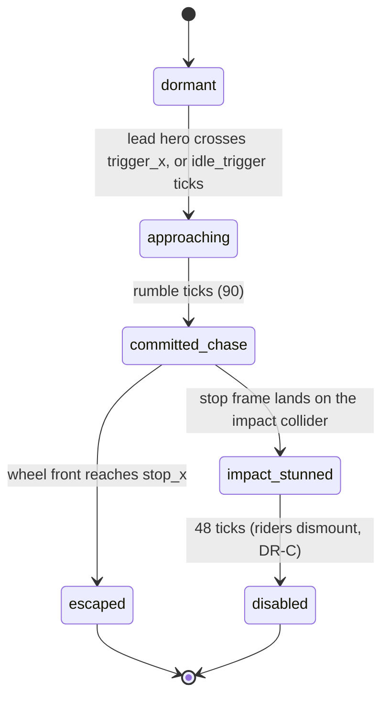

# ENEMY-GAMEPLAY-DOZER: the revenge Dozer and room 3 (DOZER-CORE design note)

> **Status: design adopted under the owner's design-defaults directive (AGENTS.md, 2026-11-19); docs only, nothing here is implemented, nothing is game-feel accepted.**
> Every tuning value below has one adopted value with a `DZ-Q##` ID (section 12), stored as data in `assets/data/gameplay/enemy_dozer_v0.json` and in the room sidecar. Every design resolution is a `DZ-AD##` (section 11). Only section 13 (`DZ-OQ##`) waits for the owner; none of it blocks implementation. The owner reviews game feel after the implementation merges and may change any value in a follow-up PR.
> Design: Claude Opus (top tier). Execution: medium tier, steps DOZER-CORE, DR-A, DR-B, DR-C, DR-D and the art order DOZ-02 (section 14). Review: a separate top-tier agent.

**Why:** step "DOZER-CORE design note" of the [Floor 01 playtest integration plan](../07-agents/f01-playtest-integration-plan.md#45-dozer-chase-01-and-owner-pr-178-stretch) (section 4.5, conflict K5, cut list item 1). It turns the owner's [Dozer revenge encounter](floor-01-dozer-revenge-encounter.md) ("The Machine Remembers", DOZER-R and stop-frame machines, DOZR-01..09) and the approved [DOZ-01 art spec](../02-art/doz-01-dozer-spec.md) (section 9, the CHASE-01 proposals) into exact rules for room 3 of the late-Floor-1 slice. Format precedents: the [Hoarder sheet](enemy-gameplay-hoarder.md) and the [llama rush sheet](enemy-gameplay-llama-rush.md).

**The one-paragraph answer.** The revenge Dozer is a **slot enemy with no hit points**: a kinematic machine that rolls right along a flat lane, never faster than Carl (cruise 160, catch-up 185, mercy 150 px/s, paced on the rearmost hero), with the DOZ-01 lethal wheel (r 44) and a hull that nobody can climb or jump past (a push box 160 px tall, above boosted Donut's 137.95 px apex). The room is a 1344 px corridor: a protected entry, a long run, one hanging **stop frame** (the Boiler's `weight_rig` prop, reused as data), a buffer stop and a **low-lintel escape tunnel** the machine cannot enter. Running always wins. A player who waits at the brace and releases the frame onto the machine (two punches, two missiles or one stick of dynamite, in an about 80-tick window at cruise) disables it, and two riders tumble out into an ordinary fight. AI partners stay out of the wheel through **hazard-feed rows** (the machine plus a 144 px lead zone, which the autonomous partner already evacuates) and a **slot rescue regroup** as a backstop; the Dozer supplies **no** `BossThreat`, because the follow layer answers a charge with a jump, and no jump clears this wheel.

## 1. Authority and inputs

- **Owner intent ([revenge doc](floor-01-dozer-revenge-encounter.md), merged with #178), kept:** an arcade escape with an optional counterstrike; the player is never obliged to disable the machine; the vehicle is a positional hazard, not a hit-point boss; no health bar; disable only on a real swept contact with a single-use stop frame; riders become fighters only after a genuine disable; no endless reappearing Dozer; no Donut invincibility; no AI-dependent timed activation; no mandatory precise dynamite throw; retry restores the frame, the machine and the seed. Deviations are in section 2.
- **[DOZ-01](../02-art/doz-01-dozer-spec.md), owner-approved art (2026-11-18):** the h120 rig (O at the tread midpoint, wheel axle at (124, 49), lethal circle r 44, hull x -84..+172 with the wheel, dome 120, stack 156, tub rim 104), the state timings of section 5 (wheel 3/2/1 ticks per frame, brake 24 ticks with a 4 px slide, strain 90 ticks), knockback immunity, the clang from behind, and the CHASE-01 proposals of section 9 (cruise 160, rubber band 185 above a 260 px gap and 150 below 96, a charge at 240, a Donut wheel exemption). Section 9.1: a chase ceiling of at least 164 px, an escape passage of 64..116 px clear height.
- **Plan K5 (revenge room only):** cruise ≤ 170 px/s; the charge and the rubber band never exceed Carl's 185 px/s; no Donut invincibility; an AI-near-the-wheel rule with no companion code (the wheel through CA2-C's hazard feed, the charge as `BossThreat::Charge`); if fixtures show that is not enough, the fix is a named CA2 append. **K6 / DM-Q18:** a wheel is never evadable. **K8 / DP-Q45:** height classes and the lane ceiling. **K18:** `env_prop.rs` is the one falling-mass engine. Plan section 4.5 acceptance items 1 to 6.
- **Hero physics on main:** Carl runs 185 px/s, apex 88.54 px (`src/prototype.rs`); Donut runs 207 px/s, apex 114.92 px (DM-Q01, DM-Q02); boosted Donut (Light on Your Feet, held in room 3's pin) apex 137.95 px (DP-Q14). Gravity 1050, 60 Hz.
- **Code on main (`a8f85ba0`):** `src/env_hazard.rs` (`HazardClass::Wheel`, persistent volumes with `set_rect`, `NavRect`), `src/env_prop.rs` (`FallingMass`, swept landing, `STEP_OVER_PX` 16, `slot_enemy_ignores_remnant`), `src/scene_enemy.rs` (the `SlotEnemy` trait, `SlotOut.shifts` and `SlotOut.regroup`, `SLOT_ID_MIN`), `src/combat_scene/slime.rs` (`CombatState::hazard_feed`), `src/combat_scene/companion.rs` (`companion_hazard_feed`, `evacuation` for briefed heroes only, `fence_step` for the assist under FA-Q15, the off-screen regroup "behind the leader"), `src/companion/navfollow.rs` (`hazards_from_feed`, the 8 px grid), `src/follower.rs` (`follower_input_boss`: a `BossThreat::Charge` makes the bot **jump**), `src/combat_scene.rs` (`hurt_hero` and the D1 solo last-HP guard), `src/f01_hoarder.rs` (room module pattern), `src/f01_run.rs` (#270: a listed room joins `--f01-run` automatically), `assets/levels/f01_late/manifest.json` (`story_order` already holds `dozer` between `boiler` and `hazards` with `f01_pin_post_pile_boss`).
- **Backlog [CA2-FU-HAZ](../04-production/backlog.md) U-1:** a moving wheel would rebuild the nav graph every tick; ruling 6 of #220: DOZER-CORE feeds a swept envelope over its lead time, rounded outward to 16 px. Section 7 does exactly that.
- **Not touched:** owner drafts #179 (the opening chase choreography) and #187 (quiet setpieces). CHASE-01 keeps its own values on the same core (section 4.4).

## 2. Reconciliation: DOZ-01 section 9, the revenge doc and K5

| ID | DOZ-01 section 9 (CHASE-01 proposal) | Revenge doc / K5 | Adopted for room 3 | Why |
| --- | --- | --- | --- | --- |
| R-1 Speeds | cruise 160; rubber band 185 above 260 px, 150 below 96; charge 240 | 150..195 (doc); cruise ≤ 170, nothing above 185 (K5) | cruise **160**, catch-up **185** above 260 px, mercy **150** below 96, accel 4 px/s per tick (DZ-Q06..Q09) | DOZ-01's numbers already sit inside K5 except the charge. Keeping the opening's cruise is the recognition beat ("the same family"), and Carl still gains 25 px/s |
| R-2 Charge | tell 36, charge 240 for 90 ticks, brake, strain, resume | the owner's DOZER-R has no charge; K5 caps it at 185 | **No charge in room 3** (DZ-AD3). The core reserves an optional `charge` block that only CHASE-01 fills | A charge capped at Carl's speed is the catch-up under another name; it adds a tell with nothing to read. Plan acceptance item 3's "during a charge" is vacuous for room 3 |
| R-3 Donut and the wheel | Donut exempt from the lethal box, or kept up by teleport | no Donut invincibility (doc, K5) | Wheel lethal to **every** hero; AI safety by feed rows, a slot rescue regroup and the existing D1 guard as backstop (section 7, DZ-AD2) | K5 and the doc win over the DOZ-01 proposal; the D1 solo guard is a rule for every enemy, not a Dozer exemption |
| R-4 AI threat input | (none) | K5: the charge reaches the AI as `BossThreat::Charge` | **The Dozer supplies no `BossThreat`** (DZ-AD2) | `follower_input_boss` jumps when a ram reaches the bot within its lead; the autonomy's DP-F blink window reads the same input. A jump in front of this wheel is death (section 3), so the K5 mechanism would kill the AI it is meant to protect. Recorded as a K5 amendment |
| R-5 No jump over | Carl-only proof: apex 88.54 < wheel top 93 < tub rim 104 | "no false jump-over affordance" | Hull push box **160 px** tall over x -84..+80 (DZ-Q02); the wheel stays r 44 | DOZ-01's proof ignores Donut: her base apex (114.92) clears the 104 rim and her boosted apex (137.95) clears the dome (120). A 160 px box (≥ 137.95 + 16, ≥ the 156 stack) makes "no hero mounts or passes the machine" hold for every height class |
| R-6 Escape route | a low side passage (≤ 116 px) the machine cannot enter | R2 "elevated bypass" with steps before the wheel catches up | **A floor-level low-lintel tunnel** (112 px) behind a 16 px buffer stop (DZ-AD4, deviation DV-1) | In a side view, anything in the lane below 164 px blocks the 156 px machine, and a walkway above it needs 164 px of climb (Carl's class is 80). The tunnel is DOZ-01 section 9.1's own rule, needs no jump, and suits the AI and 2P |
| R-7 Hull | a solid push box x -74..+79, y 0..104; pinned → stop | (doc: positional hazard) | Push box x -84..+80, y 0..160; horizontal push-out only, never upward; a push that would embed a hero stops the machine for that tick (DZ-Q02, DZ-AD5) | The rear now includes the exhaust (DOZ-01 extents) and the height follows R-5 |
| R-8 Lethal contact | circle r 44, "fail-and-retry, not a damage tick" | wheel as a hazard volume (plan acceptance 2), never evadable | Circle test first, then a persistent `HazardClass::Wheel` volume's token; damage 255 through the one `hurt_hero` path (DZ-AD6) | The volume is a rectangle; testing it alone would hurt at the empty corners of the circle |
| R-9 Rider safety | no mounting; riders unreachable | riders fight only after a real disable | Riders are carried goblins until a disable; their hurt area is inside the hull box (clang) | Same rule, made exact |
| R-10 Camera | the chase camera leads Carl and keeps the wheel at the left edge | "do not attack from beyond camera" | No camera rule change (setpiece rule); the wheel never hurts a hero outside the sim view; a measured visible-lead metric (DZ-AD14, DZ-AD16) | Plan section 3: setpieces change no camera rule in v1 |

## 3. Geometry facts the rules rest on

All in px, y up from the walking line, rig coordinates from O (DOZ-01 section 3), facing right.

| Fact | Value | Consequence |
| --- | --- | --- |
| Wheel lethal circle | centre (124, 49), r 44: x 80..168, y 5..93 | Top 93 > Carl's apex 88.54: Carl never clears it |
| Base Donut | apex 114.92, above 93 for about 26 air ticks | She can arc over the circle's top, but the hull front at x +80 stands to 160 > 114.92: she meets the box face and is pushed forward onto the wheel (the DOZ-01 argument, now for her) |
| Boosted Donut | apex 137.95, above 120 for about 25 ticks | Still below the 160 box: she cannot land on the tub or the dome |
| Machine envelope | x -84..+172 (256 px), up to 160 | Nothing passes it; the room never needs a route behind it |
| Stop frame hang | bottom 168 (DZ-Q20) | Clears the 156 stack by 12; the frame top (184) and the stack fit under the 228 px lane ceiling |
| Tunnel lintel | 112 px clear (DZ-Q24) | Carl 52 px and Donut fit; the riders' heads (about 121) and the stack (156) do not: DOZ-01 section 9.1 |

## 4. The machine (DOZER-R, the owner's states made exact)

### 4.1 States



| State | Motion | Wheel | Hull | Nav rows (section 7) | Presentation (DOZ-01 frames) |
| --- | --- | --- | --- | --- | --- |
| `dormant` | parked off-room behind the rear gate, O = gate x − 172 | off | off | none | none (the gate is still) |
| `approaching` | none | off | off | none | the rear gate shakes, puffs over it every 12 ticks, kettle steam burst, the familiar approach sound (never needed for safety) |
| `committed_chase` | right, speed band of section 4.2 | **lethal** | push box | machine + lead zone | cruise wheel and tread, rattle, rider idle, yells within 120 px of a hero |
| `escaped` (terminal) | brake: 24 ticks with the DOZ-01 4 px slide ending exactly at `stop_x`, then strain 90 ticks, then idle | lethal (spinning down; nobody can reach it) | push box | machine only | brake and strain keys, steam, riders jeer (yell loop) |
| `impact_stunned` | stops on the landing tick | off from this tick (jammed) | push box | machine only | jammed front, hull pitch, smoke and steam bursts, riders lurch forward (new art, section 15) |
| `disabled` (terminal) | none | off | push box | machine only | damaged overlays, slow smoke, driver slumped |

- **One machine per room, no respawn** (plan acceptance 5): the roster holds one `dozer` entry; a terminal state lasts until the attempt ends. A checkpoint respawn or a defeat retry puts it back to `dormant` with the frame raised (DOZR-07).
- **No hit points, no defeat event.** `hp()` reports a constant; no hit lowers it; `EnemyDefeated` is never emitted (no grant, no morale, no death presenter). The disable is a `CombatEvent::Dozer` sub-event.
- **Hits:** hero melee, Donut's swat and pounce and the Magic Missile on any hurt rect (the push box and the wheel box) give a **clang**: the shared metal hit-spark, the move's own hit-stop, no state change, no damage (DOZR-05). A blast reaching it: a clang, nothing else. A launched body: nothing (`apply_contact` → `None`). An env hit of class `FallingMass` while in `committed_chase` → `impact_stunned`; any other env hit: immune.
- **Not a target.** The companion's target list holds goblins and llamas only, so the AI never engages it; it is also not a `BossThreat` supplier (`supplies_boss` false).

### 4.2 The speed band (room 3 profile `revenge`)

- **Gap** = the left edge of the **rearmost living hero** whose centre is ahead of the axle, minus the wheel front (O.x + 168). Pacing on the rearmost hero is the 2P fairness rule: the rear player sets the pace, never the front one (DZ-AD15).
- Target speed: `catch_up` (185) when gap > 260; `mercy` (150) when gap < 96; else `cruise` (160). The speed moves toward the target by at most `accel` (4 px/s) per tick. The bands are inclusive at the lower edge: gap 96 is cruise, 260 is cruise.
- **K5 invariant (validated in data):** in a profile without a `charge` block, every speed is ≤ 185 (`RUN_SPEED`) and ≤ every hero's run speed; `revenge` additionally requires cruise ≤ 170.
- Integration is deterministic in the scene's own f32 convention (as `pile_boss.rs`); no RNG is read.
- **Pinned rule:** if a hull push-out would put a hero inside a solid, the hero is not shifted and the machine holds still for that tick (DOZ-01's "stop instead of crushing"). In room 3 nobody can be behind the machine, so a fixture proves this case never fires there.

### 4.3 The wheel and the hull

- **Wheel:** each tick in `committed_chase` and `escaped`, every hero body inside the sim view whose rectangle overlaps the r 44 circle is offered to the persistent `Wheel` volume (circle first, then the volume's token, re-armed every tick): one `HeroBlow` of damage 255, source `0x445A` ("DZ"), knock +180 px/s forward and 140 up, through `hurt_hero` (i-frames, the D1 solo guard and party defeat unchanged). Never evadable (K6).
- **A hero outside the sim view is never hurt by the wheel** (no off-screen kill, DZ-AD16); a solo bot there is rescued instead (section 7.3).
- **Push box:** x -84..+80, y 0..160. A hero body overlapping it is shifted (`SlotOut.shifts`) horizontally out to the side its centre is nearer to; never upward, never onto the top. Front contact therefore lands the hero on the wheel, as DOZ-01 section 2 argues.
- **Impact collider** (the stop frame's victim rect): x -84..+172, y 0..120, the whole machine (DZ-AD7).

### 4.4 What CHASE-01 gets from the same core

DOZER-CORE builds the machine once, with every value per profile. CHASE-01 adds a profile `opening` (its own DOZ-01 values) and appends the `charge` sub-machine (tell, charge, brake, strain, the 140 px gate) to `dozer.rs`; with a `charge` block present, the K5 "≤ 185" invariant does not apply to the charge speed. Nothing in room 3's profile, fixtures or goldens may move when CHASE-01 lands. CHASE-01 also decides its own AI answer to the charge (the `BossThreat` question of R-4 comes back there).

## 5. Room 3 geometry (DZ-Q24; data in `f01_dozer.room.json` and its sidecar)

World x from the room's left edge, heights up from the walking line (the room file stores layout px, y down, with the usual floor at 580 and height 660). Width **1344 px**, lane ceiling `ceiling_px` **228**.

```text
x:   0   32         224                    640    720  800 816                1000 1008 1040                 1264  1328 1344
     |gate| R0 entry  |  R1 chase lane         | frame |   |post|  R1b run-out     |  |bump|  tunnel (lintel 112)  | exit |  |
     |    | C192 D160 |  flat, nothing taller  | hang  |   |brace (back wall)     stop  16 |                      |      |  |
     |    |           |  than 16 px            | 168   |   |                      _x    px |                      |      |  |
     <- Dozer parked off-room (O = -140), emerges with the wheel front at x 32
```

| Piece | Data | Rule |
| --- | --- | --- |
| Rear gate | x 0..32, full height; presentation only (a back-wall gate that bursts at emergence) | The machine ignores solids; the gate is no env solid |
| R0 entry | x 32..224, protected spawn; Carl 192, Donut 160; the checkpoint | DOZ-01's 2 s retry rule: an idle hero at spawn is reached about 46 ticks after emergence, about 7 s after the room starts |
| R1 chase lane | x 224..640, flat | The lane validator (section 9) refuses any solid between the gate and `stop_x` that stands above 16 px and starts below 168 |
| Stop frame | `weight_rig` prop: footprint x 640..720 (96 tall), hang 168, remnant x 640..720 × 16; hazard `falling_mass`, telegraph 30, shadow x 640..720 × 8 | Section 6 |
| Brace | the prop's target: x 800..816, 64 tall, on the back wall (not a solid; the machine passes in front of it) | Hit from its right side, the hero faces the oncoming machine |
| Buffer stop | x 1008..1024, 16 tall (a step-over solid) | `stop_x` **1000**: the wheel front stops 8 px short of it. Resting envelope x 744..1000 does not overlap the frame footprint (720 + 16 ≤ 744): a stopped machine can never be hit by a late release |
| Tunnel | lintel solid x 1040..1344 from 112 px up | Clear height 112 (DOZ-01 9.1: 64..116). The protected regroup area (owner R4), wide enough for 1P and 2P |
| Exit | x 1264..1328 in the tunnel, goal `reach_exit`, **not gated** by the crew | DZ-Q23 |

- **Heights:** no surface above 42 px except the tunnel's interior floor (0) under a 112 px lintel and the 16 px stop; K8 and DP-Q45 hold (no unthreatened 81–128 px nest; `ceiling_px` 228 declared).
- **Duration (flagged, DV-3):** the owner doc asks for a 1280–1440 px room **and** 10–20 s of flight. At 185 px/s the straight run from the trigger to the tunnel is about 4 s (6 s with the rumble). The width wins in v1; DR-D measures human flight time and may lengthen R1 as one data change if the owner wants a longer chase.

## 6. The stop frame (the owner's industrial stop frame, DR-B)

- **Engine:** the Boiler's `weight_rig` prop and `falling_mass` hazard, as data only (K18; no new machine). States `Supported → Weakened → Released → Falling → Landed` map one-to-one onto the owner's `raised → brace_weak → released_warning → descending → landed`.
- **Release:** weight 2. Carl's melee counts 1 per move instance, the Magic Missile 1 per projectile (the Boiler's DV-5 precedent), a launched body 1, a blast 2 (one stick of dynamite releases at once, credited to the thrower: DOZR-04). Donut's swat and pounce are not prop stimuli (BOILBC-AD7).
- **Timing:** warning **30 ticks** (the doc's 24–36 midpoint; creak, dust and the floor shadow), fall 8 ticks (the engine default), landing evaluated on R + 37. Landing damage on a hero in the footprint: 1, knock 120 px/s away and 140 up (the Boiler and HRD-Q28 values: honest, warned). The footprint is fed to the AI as a telegraph during the warning, as in the Boiler.
- **Disable:** the landing's one swept evaluation against the Dozer's impact collider (section 4.3) is a real contact; a hit sends `SlotEnvHit { class: FallingMass }` and the Dozer enters `impact_stunned` once. Early or late is a valid miss.
- **A miss** leaves the 16 px remnant in the lane; the machine rolls over it (`slot_enemy_ignores_remnant`, `STEP_OVER_PX` 16: "tread overrun") and the chase goes on (DOZR-02, DZ-AD8). A hit leaves the remnant under the jammed front; the machine is not embedded for the same reason.
- **Release window at cruise** (2.667 px/tick, impact collider 256 px long, footprint 640..720): the landing hits when the wheel front at landing is in (640, 976), so at release in **(541, 877)**. A hero at the brace (body 820..844) who must still turn and run needs about 64 px (24 ticks of move recovery at cruise): release with the wheel front at ≤ 756. The **useful window is about 215 px, about 80 ticks (1.3 s)**, opening when the gap to the waiting hero is about 280 px. Mercy (150) applies in its last 30 px. DR-B pins this window with a sweep fixture (section 10) and the validator checks that the window is at least 45 ticks for the data in use.
- **Single use:** one release per attempt; a respawn or retry puts it back to `Supported` with no remnant (the env reset already does this).

## 7. The AI-near-the-wheel rule (K5 without Donut invincibility)

**Rule.** In every mode, an AI-driven hero (the autonomous Donut of a Carl-solo run, the assisted Carl of a Donut-solo run, any `cf02_assist` partner) is never inside the machine envelope or its lead zone, and is never touched by the wheel. Nothing makes any hero immune to the wheel.

### 7.1 Layer 1: feed rows, no companion code

- DOZER-CORE appends one default method to `SlotEnemy`: `nav_rects(&self) -> Vec<NavRect>` (empty by default), and one loop in `CombatState::hazard_feed` (`src/combat_scene/slime.rs`) that appends every slot enemy's rows after the existing producers. Every room without a Dozer feeds exactly what it fed before (byte-identical).
- While the wheel is lethal (`committed_chase`, `escaped`), the Dozer exports two rows, both rounded outward to **16 px** (ruling 6 of #220; CA2-FU-HAZ U-1):
  - **Active:** the machine envelope, x O-84..O+172, height 0..160;
  - **Telegraph:** the **lead zone**, from the wheel front to the wheel front + **144 px** (185 px/s × 45 ticks, rounded up), height 0..160.
- In `impact_stunned` and `disabled` only the Active row stays (the machine still blocks; the nav graph has no solid for it).
- What this buys, from the code on main: the autonomous partner **evacuates** any fed rectangle to the nearest safe anchor (`NavDriver::evacuation`), and the nearest one is always ahead (the lead zone is 144 px deep, the way back is the 256 px machine). The assist's follow steps are **fenced** at the zone's edge (FA-Q15). The blink's landing check refuses the zone. At 160 px/s the rows move a grid step every 6 ticks; DR-A reports the graph rebuild count and the frame time (`--perf-frames`), and the grid is a data knob (32 px if the cost is too high).

### 7.2 Layer 1 is not a `BossThreat`

The Dozer supplies no `BossThreat` (R-4). The follow layer's only answer to a charge is a jump, and the autonomy's blink window is tied to the same input; both are right for the Juicer's ram and fatal here.

### 7.3 Layer 2: the slot rescue regroup (existing channel)

- In a solo run, when a **bot** hero's body comes within **24 px** of the lethal circle's front (or the wheel would reach a bot outside the view), the Dozer emits `SlotOut.regroup(bot, x)` with x = the larger of the leader's x + 48 and the lead zone's front + 24, clamped to the lane before `stop_x`; logged as `DozerEvent::AiRescue`. This is the Juicer gate's existing "put the bot hero at x" channel; no companion file changes.
- It is a **backstop with a budget**: fixtures must show **0 rescues** for the autonomous partner at seeds 0..8, and report the count for the assisted Carl (expected non-zero: the assist has no evacuation and trails the leader toward the machine, see 7.5). 2P has no bots and no rescue.

### 7.4 Layer 3: the existing D1 guard

A blow on a solo bot never takes its last HP (`solo_last_hp_guard`, a rule of every enemy). Fixtures assert **0 wheel contacts** on AI heroes anyway; the guard is never the plan.

### 7.5 CA2-DZ, the pre-registered named CA2 append (plan K5 fallback)

From the code, the assisted Carl of a Donut-solo run has no evacuation and the off-screen regroup lands "behind the leader", which in a pursuit room is toward the machine. If DR-A's fixtures show more than **one rescue per run on average** for the assisted Carl, or any rescue for the autonomous partner, CA2-DZ ships (its own PR; `combat_scene/companion.rs` is a strict one-owner file, K19):
- (a) the assist also takes `evacuation` while it stands on a fed rectangle;
- (b) the follow spot and the off-screen regroup sit on the side away from a pursuer;
- both gated on a new default `SlotEnemy::pursuit_dir() -> Option<i8>` (None for every kind but the Dozer), so every other room stays byte-identical.

## 8. The crew (DR-C)

- **Riders:** rider A (GOB-01 variant A, temperament brawler) and rider B (variant B, coward) are ordinary roster goblins with a new optional field `mount: { carrier: "dozer", seat: "rider_a" | "rider_b" }`. A mounted goblin is **carried**: not drawn by the goblin presenter (the DOZ-01 rider frames draw it), not a target, no collision, no morale, no tells; its state hashes as "carried" only.
- **Dismount** at the end of `impact_stunned` (48 ticks after the landing): rider A at the wheel front + 32, rider B at + 72, on the floor, facing the heroes, in the existing CF02 knockdown (down) state for **45 ticks**, then ordinary goblin AI. A landing spot overlapping a hero moves 32 px right, at most twice; spots are clamped inside the lane before `stop_x`. Never off-screen, never far into a hero (doc section 4).
- **Driver:** stays slumped in the cab (presentation; the pot over his eyes). Not an enemy, no free death. A fighting Engineer driver is a later approved feature (the doc's own postponement).
- **Bounded:** `max_living` 3 (the machine plus two riders). No disable, no riders: a non-disabled machine never sheds killable riders.
- **Exit not gated by the crew** (DZ-Q23): the doc allows leaving them; DR-D measures whether the pocket adds or drags.
- **Retry:** dead riders stay dead after a checkpoint respawn (the CF02 rule), living ones go back to carried; a defeat retry restores both.

## 9. Validation (encounter rules for a `dozer` roster)

`src/encounter.rs` refuses a sidecar with a `dozer` entry unless:
1. exactly one `dozer` entry and `stop_x` lie inside the room, `stop_x` ≥ the gate x + 256 + 96;
2. no solid in the lane between the gate and `stop_x` + 8 is taller than 16 px with its bottom below the frame hang (168 px), apart from remnants of 16 px or less;
3. the resting envelope (`stop_x` − 256 .. `stop_x`) does not overlap any `weight_rig` footprint, and every frame's hang is ≥ the push box top + 8;
4. the lane ceiling is ≥ 200 (stack and frame), the escape passage beyond `stop_x` has 64..116 px clear height and holds the exit;
5. the release window of every frame (section 6, at cruise, with 24 ticks of recovery) is at least 45 ticks;
6. a room with a `dozer` entry declares no `BossThreat` supplier kind besides it (the existing rule) and the profile passes the K5 invariant.

## 10. Fixtures, tests and evidence (DOZR-01..09 mapped)

Pilots: **run** (straight right), **stall** (run, one 30-tick stop anywhere on R1), **brace** (wait at the brace, release with two jabs at a chosen tick, run). Modes: `carl_solo` (P1 Carl, autonomous Donut, `cf02_free`), `donut_solo` (P1 Donut, assisted Carl), `two_player` (two scripted pads), at seeds 0..8. Every fixture replays twice with a committed hash; no existing golden moves (plan acceptance 6).

| Check | Fixture(s) | Expectation |
| --- | --- | --- |
| K5 | `dz_k5_never_caught_{mode}_{run,stall}_s0..s8` | No hero is touched; every hero reaches the exit; max speed ≤ 185, cruise ≤ 170 at every tick; AI wheel contacts 0; autonomous rescues 0; assisted-Carl rescues reported |
| DOZR-01 | the run pilots above | Every mode reaches the exit without touching the frame or the brace |
| DOZR-02 | `dz_frame_early_miss` | Released with the wheel front at 400: lands, misses, the machine rolls over the remnant, the run escapes |
| DOZR-03 | `dz_frame_disable_once`, `dz_frame_window_sweep` | One `impact_stunned` on the landing tick, exactly once; the sweep over release ticks gives a contiguous hit window matching section 6 within 2 ticks |
| DOZR-04 | `dz_frame_dynamite`, `dz_frame_missile` | One stick releases at once and the disable credits the thrower; two missiles release; nothing releases on a pin without the capability |
| DOZR-05 | `dz_hull_clang`, `dz_wheel_strike`, `dz_blast_on_hull`, `dz_no_jump_over_{carl,donut,donut_boosted}` | Clangs only, no state change; a jump at the wheel at every 4 px of approach either dies on the wheel or is pushed back onto it; no hero is ever above the push box or behind the machine |
| DOZR-06 | `dz_crew_bounded` | Two riders dismount at the stated spots, never inside a hero, never off-screen; at most 3 living enemies; no rider without a disable |
| DOZR-07 | `dz_restart_{dormant,chase,stunned,disabled}` | A retry from each phase restores machine, frame, crew and remnant; the post-retry hash equals a fresh attempt's |
| DOZR-08 | the mode matrix above; real two-pad play | Same route and rules in every mode; a real two-pad run is **NOT RUN** unless done |
| DOZR-09 | DR-D | Frame time at 640x360 and 640x400 (`--perf-frames`, nav rebuild count), a human session, recognition and retry speed |
| Fairness | `dz_visible_lead` | For a hero standing still anywhere on R1, the wheel is inside the sim view at least 45 ticks before contact |
| Pinned | `dz_pinned_never_in_room3` | The pinned hold never fires in room 3; a unit test exercises it on a synthetic lane |

Evidence (DR-D, `docs/evidence/f01-dozer-revenge/`, real Bevy frames at 640x360 and 640x400): the escape, the miss and the successful reversal (the doc's three captures), the crew pocket, the AI partner escaping in each solo mode, the rumble tell, and the perf numbers.

## 11. Adopted defaults (design resolutions)

| ID | Default |
| --- | --- |
| DZ-AD1 | **Placement:** room 3 of the slice, between the Boiler and the Floor Lies, pin `f01_pin_post_pile_boss` (dynamite held), no grant: the plan's section 8 row and the manifest's existing `story_order` row. The revenge doc's "after BOILER-01, once dynamite is earned" agrees. Narrative placement stays an owner-informed open question (DZ-OQ1); cut-list item 1 still allows deferral |
| DZ-AD2 | **K5 amendment:** the Dozer supplies no `BossThreat`; the AI rule is the three layers of section 7, with CA2-DZ pre-registered as the named CA2 append |
| DZ-AD3 | No charge in room 3; the charge sub-machine is CHASE-01's append |
| DZ-AD4 | The owner's R2 elevated bypass becomes the low-lintel escape tunnel with a buffer stop (DV-1) |
| DZ-AD5 | Push box 160 px tall, horizontal push-out only; pinned rule kept |
| DZ-AD6 | Wheel contact: circle first, then a persistent `Wheel` volume token; damage 255 via `hurt_hero`; never evadable |
| DZ-AD7 | Impact collider = the whole machine (x -84..+172, y 0..120): anything that lands on the machine stops it; the window is the timing skill (section 6). Tighten to the front (x +19..+172) in data if the owner finds it too easy |
| DZ-AD8 | A missed frame's 16 px remnant is overrun, never a barrier |
| DZ-AD9 | The brace takes Carl's melee, missiles, launched bodies and blasts (DV-2) |
| DZ-AD10 | No HP, no health bar, no `EnemyDefeated`; the disable is a `CombatEvent::Dozer` sub-event; the jammed wheel is no longer lethal |
| DZ-AD11 | Crew: two carried roster goblins dismount on the disable; the driver stays in the cab |
| DZ-AD12 | **PR split amends plan section 4.5 file ownership:** the room and sidecar files move from DR-A into DOZER-CORE, because plan acceptance 3 asks for K5 fixtures *in the revenge room*. DR-A becomes the scene arm, the listing and the presentation |
| DZ-AD13 | DR-A wires the approved DOZ-01 rig as the presentation (no box stand-in for the machine); only the frame, the damage states and the env pieces are labelled stand-ins until DOZ-02 |
| DZ-AD14 | No camera rule change; fairness is the `dz_visible_lead` metric |
| DZ-AD15 | The gap is measured to the rearmost living hero ahead of the axle |
| DZ-AD16 | The wheel never hurts a hero outside the sim view |
| DZ-AD17 | Room id `dozer`, scene `f01_dozer`, title "The Machine Remembers" (the doc's own title, IP-neutral); milestone `greybox` at DR-A, `setpiece` at DR-D. A listed row joins `--f01-run` automatically (#270) |
| DZ-AD18 | Display and data call it "a Dozer of the same family" (the doc's label); engine names stay generic (`dozer`, a tracked pursuit machine), with no franchise name in types or data keys |
| DZ-AD19 | One checkpoint (the entry); any party defeat retries from R0. The room is short and the doc asks for fast retry |

## 12. Tuning values (`DZ-Q##`, data)

Machine values live in `enemy_dozer_v0.json` (keys `dzq01_...`), room values in the sidecar.

| ID | Key | Value | Source |
| --- | --- | --- | --- |
| DZ-Q01 | `dzq01_wheel_axle`, `dzq01_wheel_r_px` | (124, 49), 44 | DOZ-01 section 9 |
| DZ-Q02 | `dzq02_push_box` | x -84..+80, y 0..160 | R-5, R-7 |
| DZ-Q03 | `dzq03_impact_collider` | x -84..+172, y 0..120 | DZ-AD7 |
| DZ-Q04 | `dzq04_wheel_damage`, knock | 255; +180 / 140 px/s; source `0x445A` | DOZ-01 "fail-and-retry" |
| DZ-Q05 | `dzq05_clang` | no state change, metal hit-spark, the move's hit-stop | DOZ-01 section 9 |
| DZ-Q06 | `revenge.cruise_px_s` | 160 | R-1, K5 ≤ 170 |
| DZ-Q07 | `revenge.catch_up_px_s`, `catch_up_gap_px` | 185, above 260 | DOZ-01, K5 ≤ 185 |
| DZ-Q08 | `revenge.mercy_px_s`, `mercy_gap_px` | 150, below 96 | DOZ-01 |
| DZ-Q09 | `revenge.accel_px_s_per_tick` | 4 | new |
| DZ-Q10 | `revenge.charge` | `null` | DZ-AD3 |
| DZ-Q11 | `trigger_x`, `idle_trigger_ticks` | 256, 300 | new |
| DZ-Q12 | `rumble_ticks` | 90 | doc R0 "1–2 s" |
| DZ-Q13 | emergence | wheel front at the gate's right edge (x 32) at the current target speed | new |
| DZ-Q14 | `stop_x`, `brake_ticks`, `brake_slide_px`, `strain_ticks` | 1000, 24, 4, 90 | DOZ-01 section 5 |
| DZ-Q15 | `stunned_ticks` | 48 | new |
| DZ-Q16 | `nav_lead_px`, `nav_grid_px` | 144, 16 | #220 ruling 6 |
| DZ-Q17 | `rescue_band_px`, `rescue_ahead_px` | 24, 48 | new |
| DZ-Q18 | stop frame | footprint x 640..720 × 96, hang 168, remnant × 16, telegraph 30, fall 8, hero damage 1, release weight 2 | Boiler P2, HRD-Q26..Q28, doc 24–36 |
| DZ-Q19 | brace target | x 800..816 × 64, back wall | new |
| DZ-Q20 | riders | A brawler at +32, B coward at +72, down 45 ticks | new |
| DZ-Q21 | `max_living`, exit lock | 3, none | doc section 4 |
| DZ-Q22 | room | width 1344, `ceiling_px` 228, spawn Carl 192 / Donut 160, checkpoint x 48..96, lintel 112 from x 1040, buffer stop x 1008..1024 × 16, exit x 1264..1328 | section 5 |

## 13. Genuinely open questions (owner; none blocks implementation)

| ID | Question | Default in use |
| --- | --- | --- |
| DZ-OQ1 | **Narrative placement:** does this non-canonical revenge beat belong in the definitive story route after the Boiler, or only in the playtest slice? (The doc says it "may need narrative approval".) | In the slice as room 3; it can be dropped from the run by unlisting the row |
| DZ-OQ2 | **Same machine or same model?** Is it the opening's very Dozer and crew, or another of the same family? | "Another Dozer of the same family"; only display text and rider presentation would change |
| DZ-OQ3 | **Optional victory:** keep the crew fight after a disable, or end the beat on the disable alone? | Crew fight (the doc's R4), exit not gated |

Game-feel items for the owner's session (not questions): the release window (DZ-AD7), the flight length (DV-3), and the rescue regroup's visible pop if it ever fires.

## 14. Implementation brief (PR split)

Every step: medium tier, an independent top-tier review, the full local check list, "merged, game-feel review pending". Speed mode allows grouping DOZER-CORE with DR-A, and DR-B with DR-C.

### DOZER-CORE (depends on: this note; DM-A, ENEMY-SLOT, BOIL-B wire are merged)

- **Files:** `src/dozer.rs` **(new**, pure: profile, states, speed band, wheel, push box, nav rows, rescue rule, events), `assets/data/gameplay/enemy_dozer_v0.json` **(new)**, `src/combat_scene/dozer.rs` **(new**, the slot module), `src/scene_enemy.rs` (register `dozer`; append default `nav_rects()`), `src/combat_scene/slime.rs` (the one feed loop), `src/combat.rs` (one appended `CombatEvent::Dozer` and the exhaustive arms; the `combat.rs` queue), `src/encounter.rs` (the `dozer` roster kind and section 9 rules), `assets/levels/floor01/f01_dozer.room.json` and `f01_dozer.encounter.json` **(new**, chase only: no prop yet), `src/f01_dozer.rs` **(new**, `launch`/`combat`, the Hoarder pattern, library only), `src/dozer_fixtures.rs` **(new)**, `lib.rs` lines, the distinct hero-hurt source test row (`0x445A`).
- **Acceptance:** plan section 4.5 items 1 to 6 as amended here (item 3: the K5 fixtures of section 10 in the room, charge clause vacuous; item 2: section 4.3); DOZR-01, 05 and 07 fixtures; `dz_visible_lead`; the AI budgets of section 7; every existing golden byte-identical; the K5 data invariant test; a test that `hull top ≥ boosted apex + 16` computed from `donut_prog_v0.json` by the discrete step.

### DR-A, scene and listing (depends on DOZER-CORE)

- **Files:** the `f01_dozer` arm in `src/bin/floor01_scene.rs` and the `--f01-room dozer` path in `src/f01_late.rs` (the refusal test for `dozer` flips), the manifest row (`greybox`, `MANIFEST_HASH` re-pin listed in the PR), the PLAYTRACE source and replay rebuild, room pilots `dozer:*` in `src/room_pilots.rs`, the presentation module `src/dozer_art.rs` **(new**, read-only: the DOZ-01 rig, rattle, wheel and tread by distance, smoke, rider idle and yells, brake and strain, the gate shake stand-in), the `--f01-run` order check (the room joins after the Boiler).
- **Acceptance:** one strict recorded session; captures of the chase at both views; perf and nav rebuild counts; drawing never changes the hash (test); CA2-DZ decision recorded from the rescue counts.

### DR-B, the stop frame (depends on DR-A)

- **Files:** the sidecar prop and hazard (DZ-Q18, Q19), the `apply_env` disable path and `impact_stunned`/`disabled` in `dozer.rs`, labelled frame and brace stand-ins.
- **Acceptance:** DOZR-02, 03, 04 fixtures; the validator's window rule; the reversal capture.

### DR-C, the crew (depends on DR-B)

- **Files:** the roster `mount` field and validator rule in `src/encounter.rs`, the carried-goblin exclusion and the dismount in the goblin spawn path (`src/combat_scene.rs`, following the FA-Q20 wake-gate code where it can), sidecar entries.
- **Acceptance:** DOZR-06; companion-mode crew pilots at seeds 0..8 (no hero stuck more than 300 ticks).

### DR-D, timing, art and evidence (depends on DR-C and DOZ-02 when it lands)

- **Files:** `docs/evidence/f01-dozer-revenge/`, the DOZ-02 atlases in `src/dozer_art.rs`, data tuning only.
- **Acceptance:** DOZR-08 (2P NOT RUN allowed), DOZR-09, the three doc captures with real frames, milestone `setpiece` (re-pin listed).

### Cut order inside the track

DR-C first (the disable then ends with the crew slumped aboard), then DR-B (room 3 stays a pure escape at `greybox`). DOZER-CORE and DR-A are the minimum for listing room 3.

## 15. Art needs: work order DOZ-02 (pixel-art pipeline, routing by difficulty)

Top-tier keys for items 1 to 4, medium-tier execution and the rest, an independent top-tier review, DOZ-01 palette `dozer-floor01-v0` and rig contract kept (new parts are overlays on existing anchors). Rights: fan-concept art under `ART-PUBLICATION-ALL-V1`, provenance and checksums as for DOZ-01.

1. **Jammed wheel:** `dozer_wheel_h120` frame `jammed` (stopped, two or three bent spikes, the frame's bar wedged across the upper spikes).
2. **Impact pitch:** hull `body` and `front` pitch keys (front down 4 px, rear up 2 px) for `impact_stunned`, 2 frames, plus the brake-style slide reused.
3. **Damage overlays (disabled):** cab dent, boiler crack with a steam-leak emitter anchor, stack knocked crooked with the bucket gone, lamp glass broken (fire colours off), bent yoke; overlays on the existing anchors.
4. **Stop frame prop:** the hanging press frame (80 px wide), raised, warning shake (2 frames), falling smear (1), landed and bent remnant (80 x 16), its chain and pulley to the ceiling; the brace cleat on the back wall: intact, weakened, snapped.
5. **Crew:** rider A and B tumble keys out of the tub (2–3 frames each from GOB-01 pixels translated whole; the floor landing reuses GOB-01 knockdown frames); the driver's slumped hold key (pot over the eyes).
6. **Environment pieces** on the Goblin Workshop kit: the rear gate (closed, shaking, burst with debris), the 16 px buffer stop with hazard paint, the tunnel mouth and lintel.
7. **Reused, no new art:** cruise, brake, strain, rider idle, yell and lurch keys, smoke and steam, the metal hit-spark.

Evidence: contact sheet, enlarged frames, the reversal sequence at gameplay scale, a frame-and-state diagram (which state shows which part).

## 16. Deviations (flagged)

| ID | Source | This note | Why |
| --- | --- | --- | --- |
| DV-1 | doc R2 "elevated bypass" | low-lintel tunnel | R-6 |
| DV-2 | doc: "Donut cannot normally destroy the brace" | missiles count | the Boiler DV-5 rule for supports; a Donut-solo human may also reverse; the escape stays the mandatory route |
| DV-3 | doc: 1280–1440 px and 10–20 s of flight | 1344 px, about 4–6 s | the two numbers disagree at real run speeds; DR-D measures |
| DV-4 | plan K5: charge as `BossThreat::Charge` | no `BossThreat` | R-4 |
| DV-5 | plan 4.5: room files owned by DR-A | owned by DOZER-CORE | DZ-AD12 |

## 17. Horizon fit, tone and rights

- **Horizon:** checked against the [progression horizon](character-progression-horizon.md). No new verb, button or unlock: the reversal uses earned punches, missiles and dynamite on an environment prop, the co-op answer is "both run, either can release". It fits the direction; the guide needs no update.
- **Tone:** the [antihero tone](antihero-tone.md): the heroes do not beat the machine in a fair fight. They run, and a scrappy one waits with his back to a wall and drops a press on it. The riders stay grimy and a little ridiculous; the reversal is player-authored, never a cutscene.
- **Rights:** no new art, text or third-party material in this note. Dozer, rider and driver names are the replaceable fan-concept layer; the encounter is an original adaptation, not a claim about the novel.
