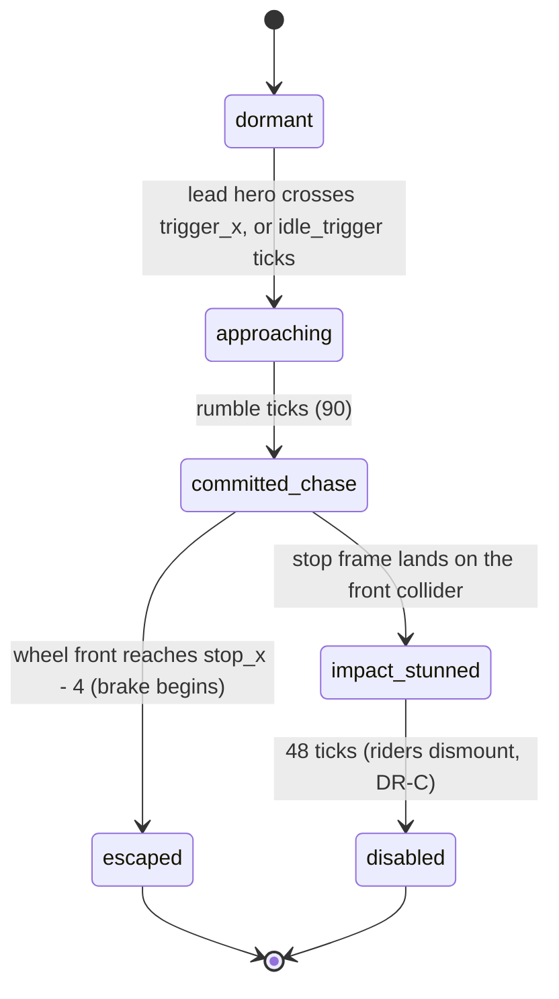

# ENEMY-GAMEPLAY-DOZER: the revenge Dozer and room 3 (DOZER-CORE design note)

> **Status: design adopted under the owner's design-defaults directive (AGENTS.md, 2026-11-19); docs only, nothing here is implemented, nothing is game-feel accepted.** **Revision 1** applies the independent review of #273: findings 1 to 4 (rescue placement, the off-screen regroup, the buffer stop and the parked wheel, the front impact collider) and 5 to 13 (section 18). **Revision 2** applies the re-review: the rescue places the bot on the floor at its own foot height (R1), prefers an in-view lane spot (R2), the AI rule is narrowed to what the fixtures assert (R3), and the parked wheel holds still (R4).
> Every tuning value below has one adopted value with a `DZ-Q##` ID and a data key (section 12), stored in `assets/data/gameplay/enemy_dozer_v0.json` or in the room sidecar. Every design resolution is a `DZ-AD##` (section 11). Only section 13 (`DZ-OQ##`) waits for the owner; none of it blocks implementation. The owner reviews game feel after the implementation merges and may change any value in a follow-up PR.
> Design: Claude Opus (top tier). Execution: medium tier, steps DOZER-CORE, DR-A, DR-B, DR-C, DR-D, the conditional CA2-DZ and the art order DOZ-02 (section 14). Review: a separate top-tier agent.

**Why:** step "DOZER-CORE design note" of the [Floor 01 playtest integration plan](../07-agents/f01-playtest-integration-plan.md#45-dozer-chase-01-and-owner-pr-178-stretch) (section 4.5, conflict K5, cut list item 1). It turns the owner's [Dozer revenge encounter](floor-01-dozer-revenge-encounter.md) ("The Machine Remembers", DOZER-R and stop-frame machines, DOZR-01..09) and the approved [DOZ-01 art spec](../02-art/doz-01-dozer-spec.md) (section 9, the CHASE-01 proposals) into exact rules for room 3 of the late-Floor-1 slice. Format precedents: the [Hoarder sheet](enemy-gameplay-hoarder.md) and the [llama rush sheet](enemy-gameplay-llama-rush.md).

**The one-paragraph answer.** The revenge Dozer is a **slot enemy with no hit points**: a kinematic machine that rolls right along a flat lane, never faster than Carl (cruise 160, catch-up 185, mercy 150 px/s, paced on the rearmost hero), with the DOZ-01 lethal wheel (r 44) and a hull that nobody can climb or jump past (a push box 160 px tall, above boosted Donut's 137.95 px apex). The room is a 1344 px corridor: a protected entry, a long run, one hanging **stop frame** (the Boiler's `weight_rig` prop, reused as data), a drawn buffer stop and a **low-lintel escape tunnel** the machine cannot enter. Running always wins. A player who waits at the brace and releases the frame onto the machine's front (two punches, two missiles or one stick of dynamite, in an about 80-tick window) disables it, and two riders tumble out into an ordinary fight. AI partners stay out of the wheel through **hazard-feed rows** (the machine plus a 144 px lead zone, which the autonomous partner already evacuates) and a **slot rescue regroup** that always lands beyond the machine's reach; the Dozer supplies **no** `BossThreat`, because the follow layer answers a charge with a jump, and no jump clears this wheel.

**Coordinates.** Rig coordinates are px from O (the tread midpoint on the walking line, DOZ-01 section 3), x forward, y up, facing right. **Wheel front** = O + 168, the front of the lethal circle. **Tips** = O + 172, the spike tips. **Rear** = O − 84. Room coordinates are world x from the room's left edge and heights up from the walking line (the room file stores layout px, y down, floor 580, height 660).

## 1. Authority and inputs

- **Owner intent ([revenge doc](floor-01-dozer-revenge-encounter.md), merged with #178), kept:**
  - an arcade escape with an optional counterstrike; the player is never obliged to disable the machine;
  - the vehicle is a positional hazard, not a hit-point boss, with no health bar;
  - disable only on a real swept contact with a single-use stop frame against the front wheel or body;
  - riders become fighters only after a genuine disable;
  - no endless reappearing Dozer, no Donut invincibility, no AI-dependent timed activation, no mandatory precise dynamite throw;
  - retry restores the frame, the machine and the seed;
  - "do not modify companion movement in this work" (section 7.5 explains why CA2-DZ is still consistent).

  Deviations are in section 16.
- **[DOZ-01](../02-art/doz-01-dozer-spec.md), owner-approved art (2026-11-18):**
  - the h120 rig: axle (124, 49), lethal circle r 44, extents x −84..+172, dome 120, stack 156, tub rim 104, the tub front at x +19;
  - the timings of section 5: wheel 3/2/1 ticks per frame, brake 24 ticks with a 4 px slide, strain 90 ticks;
  - knockback immunity and the clang;
  - the CHASE-01 proposals of section 9: cruise 160; a rubber band at 185 above a 260 px gap and 150 below 96; a charge at 240; a Donut wheel exemption;
  - section 9.1: a chase ceiling of at least 164 px and an escape passage of 64..116 px clear height.
- **Plan K5 (revenge room only):**
  - cruise ≤ 170 px/s; the charge and the rubber band never exceed Carl's 185 px/s;
  - no Donut invincibility;
  - an AI-near-the-wheel rule with no companion code: the wheel reaches the AI through CA2-C's hazard feed, the charge as `BossThreat::Charge`, and "the AI partner's regroup places it ahead of the Dozer, never between Carl and the wheel";
  - if fixtures show that is not enough, the fix is a named CA2 append.

  Also binding: **K6 / DM-Q18** (a wheel is never evadable), **K8 / DP-Q45** (height classes and the lane ceiling), **K18** (`env_prop.rs` is the one falling-mass engine) and plan section 4.5 acceptance items 1 to 6.
- **Hero physics on main** (`src/prototype.rs`, DM-Q01, DM-Q02, DP-Q14):
  - Carl runs 185 px/s, apex 88.54 px;
  - Donut runs 207 px/s, apex 114.92 px;
  - boosted Donut (Light on Your Feet, held in room 3's pin) has apex 137.95 px;
  - gravity 1050 at 60 Hz; there is no hero step-up in the physics.
- **Code on main (`2611fd33`):**
  - `src/env_hazard.rs`: `HazardClass::Wheel`, persistent volumes with `set_rect`, `NavRect`;
  - `src/env_prop.rs`: `FallingMass`, the swept landing, `STEP_OVER_PX` 16, `slot_enemy_ignores_remnant`;
  - `src/scene_enemy.rs`: the `SlotEnemy` trait, `SlotOut.shifts` and `SlotOut.regroup` (the slot channel the Hoarder uses for HRD-Q41; the Juicer uses its own `BossOut.regroup`), `HeroView.bot`, `SLOT_ID_MIN`;
  - `src/combat_scene/slime.rs`: `CombatState::hazard_feed`;
  - `src/combat_scene/companion.rs`:
    - `companion_hazard_feed`;
    - `evacuation`, for briefed heroes only;
    - `fence_step` for the assist under FA-Q15 (on in both assist sets);
    - the off-screen regroup, which places a companion-driven hero behind the leader and skips only risky anchors;
  - `src/companion/navfollow.rs`: `hazards_from_feed`, the 8 px grid;
  - `src/follower.rs`: `follower_input_boss`, where a `BossThreat::Charge` makes the bot **jump**;
  - `src/combat_scene.rs`: `hurt_hero` and the D1 solo last-HP guard;
  - `src/f01_hoarder.rs`: the room module pattern;
  - `src/f01_run.rs` (#270): a listed room joins `--f01-run` in manifest order;
  - `assets/levels/f01_late/manifest.json`: `story_order` already holds `dozer` between `boiler` and `hazards` with `f01_pin_post_pile_boss`.
- **Backlog [CA2-FU-HAZ](../04-production/backlog.md) U-1:** a moving wheel would rebuild the nav graph every tick; ruling 6 of #220 says DOZER-CORE feeds a swept envelope over its lead time, rounded outward to 16 px. Section 7 does exactly that.
- **Not touched:** owner drafts #179 (the opening chase choreography) and #187 (quiet setpieces). CHASE-01 keeps its own values on the same core (section 4.4).

## 2. Reconciliation: DOZ-01 section 9, the revenge doc and K5

| ID | DOZ-01 section 9 (CHASE-01 proposal) | Revenge doc / K5 | Adopted for room 3 | Why |
| --- | --- | --- | --- | --- |
| R-1 Speeds | cruise 160; rubber band 185 above 260 px, 150 below 96; charge 240 | 150..195 (doc); cruise ≤ 170, nothing above 185 (K5) | cruise **160**, catch-up **185** above a 260 px gap, mercy **150** below 96, accel 4 px/s per tick (DZ-Q06..Q09) | DOZ-01's numbers already sit inside K5 except the charge. Keeping the opening's cruise is the recognition beat ("the same family"), and Carl still gains 25 px/s |
| R-2 Charge | tell 36, charge 240 for 90 ticks, brake, strain, resume | the owner's DOZER-R has no charge; K5 caps it at 185 | **No charge in room 3** (DZ-AD3). The core reserves an optional `charge` block that only CHASE-01 fills | A charge capped at Carl's speed is the catch-up under another name; it adds a tell with nothing to read. Plan acceptance item 3's "during a charge" is vacuous for room 3 |
| R-3 Donut and the wheel | Donut exempt from the lethal box, or kept up by teleport | no Donut invincibility (doc, K5) | Wheel lethal to **every** hero; AI safety by feed rows, a slot rescue regroup and the existing D1 guard as backstop (section 7, DZ-AD2) | K5 and the doc win over the DOZ-01 proposal; the D1 solo guard is a rule for every enemy, not a Dozer exemption |
| R-4 AI threat input | (none) | K5: the charge reaches the AI as `BossThreat::Charge` | **No `BossThreat` supplier at all in a Dozer room** (DZ-AD2) | `follower_input_boss` jumps when a ram reaches the bot within its lead, and the autonomy's DP-F blink window reads the same input. A jump in front of this wheel is death (section 3), so the K5 mechanism would kill the AI it is meant to protect. Recorded as a K5 amendment |
| R-5 No jump over | Carl-only proof: apex 88.54 < wheel top 93 < tub rim 104 | "no false jump-over affordance" | Hull push box **160 px** tall over x −84..+80 (DZ-Q02); the wheel stays r 44 | DOZ-01's proof ignores Donut: her base apex (114.92) clears the 104 rim, and her boosted apex (137.95) clears the 120 dome. A 160 px box (≥ 137.95 + 16, ≥ the 156 stack) makes "no hero mounts or passes the machine" hold for every height class |
| R-6 Escape route | a low side passage (≤ 116 px) the machine cannot enter | R2 "elevated bypass" with steps before the wheel catches up | **A floor-level low-lintel tunnel** (112 px) behind a drawn buffer stop that is not a solid (DZ-AD4, DV-1) | In a side view, anything in the lane below 164 px blocks the 156 px machine, and a walkway above it needs 164 px of climb (Carl's class is 80). The tunnel is DOZ-01 section 9.1's own rule, needs no jump, and suits the AI and 2P |
| R-7 Hull | a solid push box x −74..+79, y 0..104; pinned → stop | (doc: positional hazard) | Push box x −84..+80, y 0..160; horizontal push-out only, never upward; a push that would embed a hero stops the machine for that tick (DZ-Q02, DZ-AD5) | The rear now includes the exhaust (DOZ-01 extents), and the height follows R-5 |
| R-8 Lethal contact | circle r 44, "fail-and-retry, not a damage tick" | wheel as a hazard volume (plan acceptance 2), never evadable | Circle test first, then the token of a persistent `HazardClass::Wheel` volume that the Dozer owns; damage 255 through the one `hurt_hero` path (DZ-AD6) | The volume is a rectangle; testing it alone would hurt at the empty corners of the circle |
| R-9 Rider safety | no mounting; riders unreachable | riders fight only after a real disable | Riders are carried goblins until a disable; their hurt area is inside the hull box (clang) | Same rule, made exact |
| R-10 Camera | the chase camera leads Carl and keeps the wheel at the left edge | "do not attack from beyond camera" | No camera rule change (the setpiece rule); the wheel never hurts a hero outside the sim view; a measured visible-lead metric (DZ-AD14, DZ-AD16) | Plan section 3: setpieces change no camera rule in v1 |
| R-11 Impact | (no stop frame in the opening) | contact with the "front wheel/body", no magnetic catch | **Front impact collider** x +19..+172 (the tub and the wheel); a landing on the rear hull is a drawn glance and a miss (DZ-AD7) | The only honest disable art is a jammed front; the melee window is the same either way (section 6) |

## 3. Geometry facts the rules rest on

| Fact | Value | Consequence |
| --- | --- | --- |
| Wheel lethal circle | centre (124, 49), r 44: x 80..168, y 5..93 | Top 93 > Carl's apex 88.54: Carl never clears it |
| Base Donut | apex 114.92, above 93 for about 26 air ticks | She can arc over the circle's top, but the hull front at x +80 stands to 160 > 114.92: she meets the box face and is pushed forward onto the wheel (the DOZ-01 argument, now for her) |
| Boosted Donut | apex 137.95, above 120 for about 22 ticks | Still below the 160 box: she cannot land on the tub or the dome |
| Machine envelope | x −84..+172 (256 px), up to 160 | Nothing passes it |
| Stop frame hang | bottom 168 (DZ-Q18) | Clears the 156 stack by 12; the frame top (184) and the stack fit under the 228 px lane ceiling |
| Tunnel lintel | 112 px clear; the lintel solid runs from 112 up to the ceiling (DZ-Q22) | Carl (52 px) and Donut fit; the riders' heads (about 121) and the stack (156) do not (DOZ-01 section 9.1). A solid to the ceiling leaves no 128 px slab on top to stand on (K8) |

## 4. The machine (DOZER-R, the owner's states made exact)

### 4.1 States



| State | Motion | Wheel | Hull | Nav rows (section 7) | Presentation (DOZ-01 frames) |
| --- | --- | --- | --- | --- | --- |
| `dormant` | parked off-room, O = −136 (wheel front at the gate's right edge, x 32) | off | off | none | none (the gate is still) |
| `approaching` | none | off | off | none | the rear gate shakes, puffs over it every 12 ticks, a kettle steam burst, the familiar approach sound (never needed for safety) |
| `committed_chase` | right, speed band of section 4.2 | **lethal** | push box | machine + lead zone | cruise wheel and tread, rattle, rider idle, yells within 120 px of a hero |
| `escaped` (terminal) | brake: 24 ticks with the DOZ-01 4 px slide, ending with the wheel front exactly at `stop_x`; then strain for 90 ticks, then idle | **lethal during the 24 brake ticks only**, then off (the wheel stops against the buffer) | push box | machine row only | brake keys; from the end of the brake the **wheel and tread frames hold still** (a still wheel reads as harmless, a spinning one as lethal; DV-7); strain shows only the hull rattle, smoke and steam; riders jeer (yell loop) |
| `impact_stunned` | stops on the landing tick | off from this tick (jammed) | push box | machine row only | jammed front, hull pitch, smoke and steam bursts, riders lurch forward (new art, section 15) |
| `disabled` (terminal) | none | off | push box | machine row only | damaged overlays, slow smoke, driver slumped |

- **One machine per room, no respawn** (plan acceptance 5): the roster holds one `dozer` entry; a terminal state lasts until the attempt ends. A checkpoint respawn or a defeat retry puts it back to `dormant` with the frame raised (DOZR-07, section 10).
- **No hit points, no defeat event.**
  - `alive()` is always true.
  - `hp()` is a fixed nonzero constant (`DOZER_HP` 255) that no hit lowers, so `check_defeat_logged` never fires and the kill-policy glance has a value to read.
  - `EnemyDefeated` is never emitted: no grant, no morale, no death presenter. The disable is a `CombatEvent::Dozer` sub-event.
- **Hits:**
  - Hero melee, Donut's swat and pounce, and the Magic Missile on any hurt rect (the push box and the wheel box) give a **clang**: the shared metal hit-spark, the move's own hit-stop, no state change, no damage (DOZR-05).
  - A blast that reaches it: a clang, nothing else.
  - A launched body: nothing (`apply_contact` returns `None`).
  - An env hit of class `FallingMass` from a stop frame, while in `committed_chase` and on the front collider: `impact_stunned`. Any other env hit: immune.
- **Not a target.** The companion's target list holds goblins and llamas only, so the AI never engages it. It is also not a `BossThreat` supplier (`supplies_boss` false), and a Dozer room has no supplier of any kind (validation rule 6).

### 4.2 The speed band (room 3 profile `revenge`)

- **Gap** = the left edge of the **rearmost living hero** whose centre is ahead of the axle, minus the wheel front (O + 168). Pacing on the rearmost hero is the 2P fairness rule: the rear player sets the pace, never the front one (DZ-AD15).
  - **Fallback** when no living hero is ahead of the axle: the target is `cruise` (DZ-Q25). In room 3 this never happens while a hero lives: section 7 keeps the AI ahead, and a human behind the axle would already have touched the wheel.
- **Target speed:**
  - `catch_up` (185) when the gap is over 260;
  - `mercy` (150) when the gap is under 96;
  - otherwise `cruise` (160). The bands are inclusive at the lower edge: gap 96 is cruise, and so is 260.
- The speed moves toward the target by at most `accel` (4 px/s) per tick.
- **K5 invariant (validated in data):** in a profile without a `charge` block, every speed is ≤ 185 (`RUN_SPEED`) and ≤ every hero's run speed. `revenge` additionally requires cruise ≤ 170.
- Integration is deterministic in the scene's own f32 convention (as in `pile_boss.rs`); no RNG is read.
- **`release_window` helper.** A pure helper in `dozer.rs`, `release_window(profile, frame, hero_x, recovery_ticks)`, integrates this band tick by tick. It is the single definition of the useful window of section 6; the validator (section 9) and the DR-B sweep both call it.
- **Pinned rule:** if a hull push-out would put a hero inside a solid, the hero is not shifted and the machine holds still for that tick (DOZ-01's "stop instead of crushing"). A fixture proves this never fires in room 3; a unit test exercises it on a synthetic lane.

### 4.3 The wheel and the hull

- **Wheel.** Each tick in which the wheel is lethal (`committed_chase`, and `escaped` during its brake), the circle is tested against every hero body inside the sim view; a body that overlaps it is then offered to the Dozer's own persistent `Wheel` volume (re-armed every tick).
  - The hit is one `HeroBlow`: damage 255, source `0x445A` ("DZ"), knock +180 px/s forward and 140 up, through `hurt_hero` (i-frames, the D1 solo guard and party defeat unchanged). Never evadable (K6).
  - The volume belongs to the Dozer and is **not** registered in the env `HazardSet`, so `env.nav_feed()` never duplicates its rows.
  - It has `hurts_enemies` false.
- **A hero outside the sim view is never hurt by the wheel** (no off-screen kill, DZ-AD16); a solo bot there is rescued instead (section 7.3).
- **Push box:** x −84..+80, y 0..160. A hero body that overlaps it is shifted (`SlotOut.shifts`) horizontally out to the side its centre is nearer to: never upward, never onto the top. Front contact therefore lands the hero on the wheel, as DOZ-01 section 2 argues.
- **Impact collider** (the stop frame's victim rect, `victim_rect`): the **front**, x +19..+172, y 0..120 (the tub and the wheel, DZ-AD7).

### 4.4 What CHASE-01 gets from the same core

DOZER-CORE builds the machine once, with every value per profile.
- CHASE-01 adds a profile `opening` (its own DOZ-01 values).
- It appends the `charge` sub-machine to `dozer.rs`: tell, charge, brake, strain and the 140 px gate. With a `charge` block present, the K5 "≤ 185" invariant does not apply to the charge speed.
- Nothing in room 3's profile, fixtures or goldens may move when CHASE-01 lands.
- CHASE-01 also decides its own AI answer to the charge: the `BossThreat` question of R-4 comes back there.

## 5. Room 3 geometry (DZ-Q22; data in `f01_dozer.room.json` and its sidecar)

Width **1344 px**, lane ceiling `ceiling_px` **228**.

```text
x:  0  32        224                  640    720  800 816              1000  1008-1024  1040                   1264  1328 1344
    |gate| R0 entry |  R1 chase lane      | frame |   |post|  R1b run-out  stop_x  buffer   | tunnel (lintel 112 up)| exit |  |
    |    | C192 D160|  flat, no solid     | hang  |   |brace (back wall)          (drawn,  |                       |      |  |
    |    |          |                     | 168   |   |                            no solid)                      |      |  |
    <- Dozer parked off-room (O = -136), emerges with the wheel front at x 32
```

| Piece | Data | Rule |
| --- | --- | --- |
| Rear gate | x 0..32, full height; presentation only (a back-wall gate that bursts at emergence) | The machine ignores solids; the gate is no env solid |
| R0 entry | x 32..224, protected spawn; Carl 192, Donut 160; checkpoint x 48..96 | An idle hero at spawn is reached about 46 ticks after emergence, about 7 s after the room starts (DOZ-01's 2 s retry rule holds) |
| R1 chase lane | x 224..1000, flat | Validation rule 2 |
| Stop frame | `weight_rig` prop: footprint x 640..720 (96 tall), hang 168, remnant x 640..720 × 16; hazard `falling_mass`, telegraph 30, shadow x 640..720 × 8 | Section 6 |
| Brace | the prop's target: x 800..816, 64 tall, on the back wall (not a solid; the machine passes in front of it) | Hit from its right side, so the hero faces the oncoming machine |
| `stop_x` | **1000** (the wheel front when the brake ends) | Resting envelope x 748..1004: it does not overlap the frame footprint (720 + 16 ≤ 748), so a stopped machine can never be hit by a late release |
| Buffer stop | x 1008..1024, 16 px, **drawn only** (presentation, like the gate) | Heroes walk through it; nobody needs to jump at the tunnel mouth, so nobody bonks the lintel face. A hero whose body's left edge is at or past `stop_x` is out of reach at every tick |
| Tunnel | lintel solid x 1040..1344 from 112 px up to the ceiling | Clear height 112 (DOZ-01 9.1: 64..116). The protected regroup area (owner R4), wide enough for 1P and 2P |
| Exit | x 1264..1328 in the tunnel, goal `reach_exit`, **not gated** by the crew (DZ-Q21) | |

- **Heights:** no standable surface above 42 px; K8 and DP-Q45 hold (no unthreatened 81–128 px nest; `ceiling_px` 228 declared).
- **Duration (flagged, DV-3):** the owner doc asks for a 1280–1440 px room, 10–20 s of flight and a 60–100 s set piece. At 185 px/s the straight run from the trigger to the tunnel is about 4 s (6 s with the rumble). An escape-only clear is therefore about 10 s from the room's start, and only a reversal plus the crew fight approaches 60 s. The width wins in v1; DR-D measures human times and may lengthen R1 as one data change if the owner wants a longer chase.

## 6. The stop frame (the owner's industrial stop frame, DR-B)

- **Engine:** the Boiler's `weight_rig` prop and `falling_mass` hazard, as data only (K18; no new machine). The states `Supported → Weakened → Released → Falling → Landed` map one-to-one onto the owner's `raised → brace_weak → released_warning → descending → landed`.
- **Release:** weight 2.
  - Carl's melee counts 1 per move instance.
  - The Magic Missile counts 1 per projectile (the Boiler's DV-5 precedent).
  - A launched body counts 1.
  - A blast counts 2: one stick of dynamite releases at once, credited to the thrower (DOZR-04).
  - Donut's swat and pounce are not prop stimuli (BOILBC-AD7).
- **Timing:** warning **30 ticks** (the doc's 24–36 midpoint: creak, dust and the floor shadow), then a fall of 8 ticks (the engine default). The landing is evaluated on R + 37.
  - Landing damage on a hero in the footprint: 1, knock 120 px/s away and 140 up (the Boiler and HRD-Q28 values: honest and warned).
  - The footprint is fed to the AI as a telegraph during the warning, as in the Boiler.
- **Disable:** the landing's one swept evaluation is a real contact. The Dozer's victim rect is the **front collider** (x +19..+172). A hit sends `SlotEnvHit { class: FallingMass }`, and the Dozer enters `impact_stunned` once. Early or late is a valid miss.
- **Misses:**
  - **Early:** the 16 px remnant stays in the lane, and the machine rolls over it (`slot_enemy_ignores_remnant`, `STEP_OVER_PX` 16: "tread overrun"). The chase goes on (DOZR-02, DZ-AD8).
  - **Late, onto the rear hull:** a landing whose footprint meets the machine behind the tub only, with the wheel front at landing in [869, 972). It is a miss, drawn as a **glance**: the frame strikes the rear deck and tips off behind the exhaust (DOZ-02 item 4). No magnetic catch.
  - **On a hit,** the remnant lies under the jammed front; the machine is not embedded, for the same step-over reason.
- **Release window** (front collider, footprint 640..720, landing on R + 37):
  - The landing hits when the wheel front at landing is in (636, 869) (tips at O + 172 > 640, tub front at O + 19 < 720).
  - At release, with the band integrated backwards, the wheel front is in about **(537, 770)**.
  - A hero at the brace (body 820..844) who must still turn and run needs 24 ticks of move recovery (DZ-Q23). So the useful release ends with the wheel front at about 756.
  - The band runs through catch-up (gap over 260, up to a wheel front of 560), then cruise, then mercy (wheel front over 724). That gives a **useful window of about 80 ticks (1.35 s)**, opening when the gap to the waiting hero is about 283 px.
  - `release_window` (section 4.2) computes these numbers exactly; the validator requires at least 45 ticks (DZ-Q23), and DR-B's sweep must match the helper exactly.
- **Single use:** one release per attempt. A respawn or retry puts the frame back to `Supported` with no remnant (the env reset already does this).

## 7. The AI-near-the-wheel rule (K5 without Donut invincibility)

**Rule.** In every mode, while the wheel is lethal, an AI-driven hero (the autonomous Donut of a Carl-solo run, the assisted Carl of a Donut-solo run, any `cf02_assist` partner):
- never has its centre behind the axle;
- is never **placed** by any regroup (the Dozer's rescue or the companion's off-screen regroup) inside a Dozer row or between the leader and the wheel: asserted for the rescue in DOZER-CORE; counted for the companion regroup in DOZER-CORE and required to be 0 before DR-A lists the room (the CA2-DZ trigger, DZ-Q24);
- is never touched by the wheel.

This is the scope the fixtures assert (section 10) and K5's own wording ("the regroup places it ahead of the Dozer"). A follow partner that **walks** behind its leader may trail between the leader and the wheel; the lead zone and the fence keep it out of reach, and the touch and behind-the-axle asserts cover the outcome.

Nothing makes any hero immune to the wheel.

### 7.1 Layer 1: feed rows, no companion code

- **Plumbing.** DOZER-CORE appends one default method to `SlotEnemy`: `nav_rects(&self) -> Vec<NavRect>`, empty by default. It adds one loop in `CombatState::hazard_feed` (`src/combat_scene/slime.rs`) that appends every slot enemy's rows after the existing producers. Every room without a Dozer feeds exactly what it fed before (byte-identical).
- **Rows.** Rounded outward to **16 px** (ruling 6 of #220; CA2-FU-HAZ U-1):
  - **In `committed_chase`:**
    - an **Active** row: the machine envelope, x O − 84..O + 172, height 0..160;
    - a **Telegraph** row, the **lead zone**: from the tips to the tips + **144 px** (185 px/s × 45 ticks, rounded up), height 0..160.
  - **In every other state after emergence** (`escaped`, `impact_stunned`, `disabled`): the Active row only. The machine still blocks, and the nav graph has no solid for it. No lead zone ever covers the tunnel mouth.
- **What this buys, from the code on main:**
  - the autonomous partner **evacuates** any fed rectangle to the nearest safe anchor (`NavDriver::evacuation`), and that anchor is always ahead: the lead zone is 144 px deep, the way back is the 256 px machine;
  - the assist's follow steps are **fenced** at the zone's edge (FA-Q15);
  - the blink's landing check refuses the zone.
- **Cost.** At 160 px/s the rows move one grid step every 6 ticks. DOZER-CORE reports the graph rebuild count and DR-A the frame time (`--perf-frames`). The grid is a data knob; use 32 px if the cost is too high.

### 7.2 Layer 1 is not a `BossThreat`

The Dozer supplies no `BossThreat` (R-4), and a Dozer room admits no other supplier. The follow layer's only answer to a charge is a jump, and the autonomy's blink window is tied to the same input. Both are right for the Juicer's ram and fatal here.

### 7.3 Layer 2: the slot rescue regroup

- **When it fires:** in a solo run, for a **bot** hero (`HeroView.bot`), when any of these holds:
  - its body comes within **24 px** of the wheel front;
  - its centre is behind the axle;
  - the wheel would reach it outside the view.
- **What it does:** the Dozer emits a new **`SlotOut.place(bot, x, foot_y)`** entry: the bot is put at rest (vx = vy = 0, `prev == cur` for the swept tests) **standing on the floor at its own foot height**: `foot_y` is the top of the highest solid under the bot's body span at x (the walking line, or a 16 px remnant after an early miss: the remnant-lift precedent; DR-B adds the remnant case and its fixture). It does **not** use `SlotOut.regroup`, the slot channel the Hoarder uses for HRD-Q41, because that one copies the **leader's** body y: a rescue fired while the leader jumps would put the bot's body top above the 112 px lintel and embed it in the tunnel ceiling (re-review R1). `place` is appended to `SlotOut` in `src/scene_enemy.rs` and applied and hashed in `src/combat_scene/slot.rs` next to `regroup`; the existing `regroup` is unchanged, so the Hoarder's goldens do not move.
- **Where** (two spots, both on the floor, both beyond the machine's reach):
  - the **lane spot** `x_lane = max(leader x + 48, lead-zone front + 24)`, used when `x_lane ≤ stop_x − 32`, `x_lane` is inside the sim view by at least 24 px, and this bot had no rescue in the last 120 ticks. It keeps the bot on screen near its leader, so the off-screen regroup has no reason to pull it back (re-review R2). From there the bot is 168 px ahead of the wheel front, 54 ticks of standing still at cruise before the band could reach it again;
  - otherwise the **tunnel spot** `x = clamp(max(x_lane, stop_x + 48), stop_x + 48, exit left − 16)`: on the tunnel floor, at x 1048..1248 in room 3, never in front of the arriving or parked wheel, never re-fired (the band never reaches it, and the lead zone ends short of it).
- **No loop.** A second rescue of the same bot within 120 ticks always takes the tunnel spot, so a bot is rescued at most twice in any 120 ticks and the second one ends the sequence. Rescue-then-off-screen-regroup cycles are counted and reported with the CA2-DZ counts.
- **Logging and modes:** each rescue is logged as `DozerEvent::AiRescue`. 2P has no bots and no rescue.
- **Budget:** it is a **backstop**. Its count is the CA2-DZ trigger (section 7.5).

### 7.4 Layer 3: the existing D1 guard

A blow on a solo bot never takes its last HP (`solo_last_hp_guard`, a rule for every enemy). Fixtures hard-assert **0 wheel contacts** on AI heroes anyway; the guard is never the plan.

### 7.5 CA2-DZ, the pre-registered named CA2 append (the plan's K5 fallback)

- **Why it may be needed.** The owner doc says "do not modify companion movement in this work". CA2-DZ is consistent with that only because plan K5 already sanctions a named CA2 append for exactly this case; DOZER-CORE itself changes no companion file. From the code, two gaps are expected:
  - the assisted Carl of a Donut-solo run has no evacuation;
  - the legacy off-screen regroup places a companion-driven hero behind the leader, which in a pursuit room can be toward the machine, or behind it (a solo softlock until a rescue).
- **Trigger** (DZ-Q24), evaluated in DOZER-CORE's K5 matrix. CA2-DZ is triggered if any of these holds:
  - any rescue of the autonomous partner;
  - more than one rescue per run on average for the assisted Carl;
  - any companion off-screen regroup during `committed_chase` that lands behind the axle, inside a Dozer row or between the leader and the wheel ("toward the machine"; DOZER-CORE counts these from the regroup events).
- **Content** (its own PR; `combat_scene/companion.rs` is a strict one-owner file, K19):
  - (a) the assist also takes `evacuation` while it stands on a fed rectangle;
  - (b) the follow spot and the off-screen regroup sit on the side away from a pursuer;
  - both gated on a new default `SlotEnemy::pursuit_dir() -> Option<i8>` (`None` for every kind but the Dozer), so every other room stays byte-identical.
- **Sequencing** (section 14): if triggered, CA2-DZ must merge **before DR-A lists room 3**.

## 8. The crew (DR-C)

- **Riders:** rider A (GOB-01 variant A, temperament brawler) and rider B (variant B, coward) are ordinary roster goblins with a new optional field `mount: { carrier: "dozer", seat: "rider_a" | "rider_b" }`.
  - A mounted goblin is **carried**: not drawn by the goblin presenter (the DOZ-01 rider frames draw it), not a target, no collision, no morale, no tells.
  - Its state hashes as one "carried" word, plus its CF02 morale entry, which stays frozen while it is carried (adopted default, #289 review finding 1: the frozen entry is deterministic and restored by a retry, so it stays in the hash rather than moving every Dozer pin again).
- **Dismount** at the end of `impact_stunned`, 48 ticks after the landing:
  - Rider A lands at the wheel front + 32 and rider B at + 72, on the floor, facing the heroes.
  - They start in the existing CF02 knockdown (down) state for **45 ticks**, then run ordinary goblin AI.
  - A landing spot that overlaps a hero moves 32 px right, at most twice. After two nudges the rider lands at the second nudged spot anyway: a goblin landing deals no damage, and the CF02 body separation resolves the overlap.
  - Spots are clamped inside the lane before `stop_x`. Never off-screen, never far into a hero (doc section 4).
- **Driver:** stays slumped in the cab (presentation, with the pot over his eyes). He is not an enemy and has no free death. A fighting Engineer driver is a later approved feature (the doc's own postponement).
- **Bounded:** `max_living` 3 (the machine plus two riders). No disable, no riders: a non-disabled machine never sheds killable riders.
- **Exit not gated by the crew** (DZ-Q21): the doc allows leaving them. DR-D measures whether the pocket adds or drags.
- **Restarts:**
  - a **defeat retry** (`reset_attempt`) restores everything: the machine `dormant`, the frame raised, both riders carried, no remnant;
  - a **checkpoint respawn** (`respawn`) puts the machine back to `dormant` and the frame raised. Living riders return to carried, and dead riders stay dead (the CF02 rule).

## 9. Validation (encounter rules for a `dozer` roster)

`src/encounter.rs` refuses a sidecar with a `dozer` entry unless:
1. There is exactly one `dozer` entry; `stop_x` lies inside the room, and `stop_x` ≥ the gate x + 256 + 96.
2. **The lane is clear:**
   - no solid between the gate and the tunnel mouth is taller than 16 px with its bottom below the frame hang (168 px), apart from remnants of 16 px or less;
   - **no solid at all** stands between `stop_x` − 256 and the tunnel mouth, the buffer stop included (it is drawn only);
   - the mouth is at least `stop_x` + 32.
3. The resting envelope (`stop_x` − 252 .. `stop_x` + 4) does not overlap any `weight_rig` footprint, and every frame's hang is ≥ the push box top + 8.
4. The lane ceiling is ≥ 200 (the stack and the frame). The escape passage beyond `stop_x` has 64..116 px of clear height, its lintel solid reaches the ceiling, and it holds the exit.
5. Every frame's useful release window from `release_window` (at the brace hero spot, with DZ-Q23's recovery) is at least DZ-Q23's minimum.
6. **A room with a `dozer` entry has no `BossThreat` supplier at all,** and the profile passes the K5 invariant.

## 10. Fixtures, tests and evidence (DOZR-01..09 mapped)

**Pilots** (the leader's scripted input; the partner is whatever the mode drives):
- **run:** straight right;
- **stall:** run, stop 30 ticks at x 480, run;
- **close_call:** run to x 480, hold until the gap is ≤ 64, run;
- **wait:** run to the brace spot (x 832), hold until the gap is ≤ 64 without touching the brace, run (the real AI stress case: a leader waiting in front of the machine);
- **brace:** wait at the brace and release with two jabs at a chosen tick, then run.

**Modes:**
- `carl_solo`: P1 Carl, autonomous Donut, `cf02_free`;
- `donut_solo`: P1 Donut, assisted Carl;
- `two_player`: two scripted pads.

All at seeds 0..8. Every fixture replays twice with a committed hash. No existing golden moves (plan acceptance 6). The stuck limit is the plan's gate value, 300 ticks (DZ-Q24).

| Check | Fixture(s) | Expectation |
| --- | --- | --- |
| K5 | `dz_k5_{mode}_{run,stall,close_call,wait}_s0..s8` (in DOZER-CORE) | Hard asserts: no hero is touched; every hero reaches the exit; speed ≤ 185 and cruise ≤ 170 at every tick; **0 AI wheel contacts**; no AI centre behind the axle for more than the one tick a rescue takes; no hero stuck over 300 ticks. Each band (catch-up, cruise, mercy) is entered at least once across the matrix (close_call and wait reach mercy). Reported, not asserted: ticks per band, rescues per bot, companion off-screen regroups toward the machine, nav rebuilds. These counts are the CA2-DZ trigger |
| Rescue placement | `dz_rescue_leader_in_tunnel`, `dz_rescue_at_leader_apex`, `dz_rescue_lane_spot`, `dz_rescue_no_loop`, `dz_rescue_behind_axle` | The leader in the tunnel and the bot trailing: the bot lands at ≥ `stop_x` + 48 and is never touched. A rescue fired while the leader is at the apex of a jump (Carl and Donut, boosted too) puts the bot standing on the floor, never inside a solid (no overlap with the lintel or any solid on the placement tick). An early-lane rescue uses the in-view lane spot. At most two rescues per bot per 120 ticks, the second at the tunnel spot. A bot placed behind the axle is rescued ahead on that tick |
| DOZR-01 | the run pilots above | Every mode reaches the exit without touching the frame or the brace |
| DOZR-02 | `dz_frame_early_miss` (DR-B) | Released with the wheel front at 400: lands, misses, the machine rolls over the remnant, the run escapes |
| DOZR-03 | `dz_frame_disable_once`, `dz_frame_window_sweep`, `dz_frame_rear_glance` (DR-B) | One `impact_stunned` on the landing tick, exactly once. The sweep's hit window equals `release_window` exactly. A rear-only landing is a miss |
| DOZR-04 | `dz_frame_dynamite`, `dz_frame_missile` (DR-B) | One stick releases at once and the disable credits the thrower; two missiles release; nothing releases on a pin without the capability |
| DOZR-05 | `dz_hull_clang`, `dz_wheel_strike`, `dz_blast_on_hull`, `dz_no_jump_over_{carl,donut,donut_boosted}` | Clangs only, no state change. A jump at the wheel, at every 4 px of approach, either dies on the wheel or is pushed back onto it. No hero is ever above the push box or behind the machine |
| DOZR-06 | `dz_crew_bounded` (DR-C) | Two riders dismount at the stated spots (or their nudged spots), never off-screen; at most 3 living enemies; no rider without a disable |
| DOZR-07 | `dz_retry_{dormant,chase,stunned,disabled}` (defeat retry), `dz_respawn_after_disable` (checkpoint respawn) | A retry from each phase restores the pristine machine, the hanging frame, no remnant and the carried crew, and the next 400 ticks of a Run plan trace (the Dozer hash, both hero x positions, the carried flags and the riders' own mix, per tick) equal a fresh attempt's; this is not the full state hash. The respawn restores the machine and the frame, carries the living riders and keeps the dead dead |
| Escape end | `dz_escaped_wheel_off`, `dz_stop_face_safe` | A hero pressed at the drawn stop (body 984..1008) during the brake is not touched once its left edge is at or past `stop_x`. After the brake, a hero walking back to the parked wheel is not hurt. The AI is never evicted from the tunnel mouth |
| DOZR-08 | the mode matrix above; real two-pad play | The same route and rules in every mode; a real two-pad run is **NOT RUN** unless done |
| DOZR-09 | DR-D | Frame time at 640x360 and 640x400 (`--perf-frames`, nav rebuild count), a human session, recognition and retry speed |
| Fairness | `dz_visible_lead` | For a hero standing still anywhere on R1, the wheel is inside the sim view at least DZ-Q23's minimum (45 ticks) before contact |
| Pinned | `dz_pinned_never_in_room3` | The pinned hold never fires in room 3; a unit test exercises it on a synthetic lane |

**Evidence** (DR-D, in `docs/evidence/f01-dozer-revenge/`): real Bevy frames at 640x360 and 640x400 of:
- the escape, the miss and the successful reversal (the doc's three captures);
- the crew pocket;
- the AI partner escaping in each solo mode;
- the rumble tell;
- the perf numbers.

## 11. Adopted defaults (design resolutions)

| ID | Default |
| --- | --- |
| DZ-AD1 | **Placement:** room 3 of the slice, between the Boiler and the Floor Lies (the Ring rooms 4a/4b follow the Floor Lies), with pin `f01_pin_post_pile_boss` (dynamite held) and no grant. This is the plan's section 8 row and the manifest's existing `story_order` row; the revenge doc's "after BOILER-01, once dynamite is earned" agrees. Narrative placement stays an owner-informed open question (DZ-OQ1), and cut-list item 1 still allows deferral |
| DZ-AD2 | **K5 amendment:** no `BossThreat` supplier in a Dozer room; the AI rule is the three layers of section 7, with CA2-DZ pre-registered as the named CA2 append and triggered by the counts of section 7.5 |
| DZ-AD3 | No charge in room 3; the charge sub-machine is CHASE-01's append |
| DZ-AD4 | The owner's R2 elevated bypass becomes the low-lintel escape tunnel, behind a buffer stop that is drawn but not a solid (DV-1) |
| DZ-AD5 | Push box 160 px tall, horizontal push-out only; the pinned rule is kept |
| DZ-AD6 | Wheel contact: circle first, then the token of a Dozer-owned persistent `Wheel` volume (not in the env set, `hurts_enemies` false); damage 255 via `hurt_hero`; never evadable |
| DZ-AD7 | **Front impact collider** (x +19..+172, y 0..120): only a landing on the tub or the wheel disables; a rear-hull landing is a drawn glance and a miss. The melee window is bounded by the hero's recovery, not by the collider, so the front collider costs the melee player nothing and keeps the disable art honest |
| DZ-AD8 | A missed frame's 16 px remnant is overrun, never a barrier |
| DZ-AD9 | The brace takes Carl's melee, missiles, launched bodies and blasts (DV-2) |
| DZ-AD10 | No HP to lose (a fixed `hp()`, `alive()` always true), no health bar, no `EnemyDefeated`; the disable is a `CombatEvent::Dozer` sub-event; the jammed wheel is no longer lethal |
| DZ-AD11 | Crew: two carried roster goblins dismount on the disable; the driver stays in the cab |
| DZ-AD12 | **PR split amends plan section 4.5 file ownership:** the room and sidecar files move from DR-A into DOZER-CORE, because plan acceptance 3 asks for K5 fixtures *in the revenge room*. DR-A becomes the scene arm, the listing and the presentation |
| DZ-AD13 | DR-A wires the approved DOZ-01 rig as the presentation (no box stand-in for the machine); only the frame, the damage states and the environment pieces are labelled stand-ins until DOZ-02; DOZ-02 wired its art in and removed every stand-in (see floor01-scene.md, Room 3's DOZ-02 art) |
| DZ-AD14 | No camera rule change; fairness is the `dz_visible_lead` metric |
| DZ-AD15 | The gap is measured to the rearmost living hero ahead of the axle, with the cruise fallback of DZ-Q25 |
| DZ-AD16 | The wheel never hurts a hero outside the sim view |
| DZ-AD17 | Room id `dozer`, scene `f01_dozer` (not the plan's `f01_dozer_revenge`, DV-6), title "The Machine Remembers" (the doc's own title, IP-neutral); milestone `greybox` at DR-A and `setpiece` at DR-D. A listed row joins `--f01-run` automatically (#270) |
| DZ-AD18 | Display and data call it "a Dozer of the same family" (the doc's label); engine names stay generic (`dozer`, a tracked pursuit machine), with no franchise name in types or data keys |
| DZ-AD19 | One checkpoint (the entry); any party defeat retries from R0. The room is short, and the doc asks for fast retry |
| DZ-AD20 | **The escaped wheel is lethal only during its 24-tick brake,** and the machine feeds only its Active row once it leaves `committed_chase`. A parked machine is an obstacle, not a trap, and never evicts the AI from the tunnel mouth |
| DZ-AD21 | **The rescue lands beyond the machine's reach, standing on the floor** through `SlotOut.place` (section 7.3): an in-view lane spot ahead of the lead zone when it is safe, else the tunnel beyond `stop_x`. It also catches a bot behind the axle |

## 12. Tuning values (`DZ-Q##`, data)

Machine and fairness values live in `enemy_dozer_v0.json` (keys `dzq##_...`); room values live in the sidecar (keys as listed).

| ID | Key(s) | Value | Source |
| --- | --- | --- | --- |
| DZ-Q01 | `dzq01_wheel_axle`, `dzq01_wheel_r_px` | (124, 49), 44 | DOZ-01 section 9 |
| DZ-Q02 | `dzq02_push_box` | x −84..+80, y 0..160 | R-5, R-7 |
| DZ-Q03 | `dzq03_impact_collider` | x +19..+172, y 0..120 | DZ-AD7 |
| DZ-Q04 | `dzq04_wheel_damage`, `dzq04_knock_x_px_s`, `dzq04_knock_up_px_s`, `dzq04_source_id`, `dzq04_hp_constant` | 255; 180; 140; `0x445A`; 255 | DOZ-01 "fail-and-retry" |
| DZ-Q05 | `dzq05_clang_hit_stop` | the move's own hit-stop, metal hit-spark, no state change | DOZ-01 section 9 |
| DZ-Q06 | `revenge.dzq06_cruise_px_s` | 160 | R-1, K5 ≤ 170 |
| DZ-Q07 | `revenge.dzq07_catch_up_px_s`, `revenge.dzq07_catch_up_gap_px` | 185, above 260 | DOZ-01, K5 ≤ 185 |
| DZ-Q08 | `revenge.dzq08_mercy_px_s`, `revenge.dzq08_mercy_gap_px` | 150, below 96 | DOZ-01 |
| DZ-Q09 | `revenge.dzq09_accel_px_s_per_tick` | 4 | new |
| DZ-Q10 | `revenge.dzq10_charge` | `null` | DZ-AD3 |
| DZ-Q11 | sidecar `dozer.dzq11_trigger_x`, `dozer.dzq11_idle_trigger_ticks` | 256, 300 | new |
| DZ-Q12 | `dzq12_rumble_ticks` | 90 | doc R0 "1–2 s" |
| DZ-Q13 | sidecar `dozer.dzq13_emerge_front_x`; `dzq13_emerge_speed` | 32 (the gate's right edge, O = −136); `"target"` (the band's target on the first tick) | new |
| DZ-Q14 | sidecar `dozer.dzq14_stop_x`; `dzq14_brake_ticks`, `dzq14_brake_slide_px`, `dzq14_strain_ticks`, `dzq14_lethal_in_brake` | 1000; 24, 4, 90, true (off after the brake) | DOZ-01 section 5, DZ-AD20 |
| DZ-Q15 | `dzq15_stunned_ticks` | 48 | new |
| DZ-Q16 | `dzq16_nav_lead_px`, `dzq16_nav_grid_px` | 144, 16 | #220 ruling 6 |
| DZ-Q17 | `dzq17_rescue_band_px`, `dzq17_rescue_ahead_px`, `dzq17_rescue_zone_margin_px`, `dzq17_rescue_past_stop_px`, `dzq17_rescue_exit_margin_px`, `dzq17_lane_spot_stop_margin_px`, `dzq17_lane_spot_view_margin_px`, `dzq17_rescue_min_spacing_ticks` | 24, 48, 24, 48, 16, 32, 24, 120 | DZ-AD21 |
| DZ-Q18 | sidecar prop `stop_frame` (`kind: weight_rig`, `target`, `hang_px`, `remnant`) and hazard `frame_fall` (`rect`, `telegraph_rect`, `telegraph_ticks`, `damage`, `push_x`, `hero_damage`, `hurts_enemies`) | footprint x 640..720 × 96, hang 168, remnant × 16, telegraph 30, fall 8 (engine default), hero damage 1, push 120, release weight 2 (engine default) | Boiler P2, HRD-Q26..Q28, doc 24–36 |
| DZ-Q19 | the prop's `target` | x 800..816 × 64, back wall | new |
| DZ-Q20 | sidecar roster `rider_a` / `rider_b`: `mount`, `dzq20_land_dx` (32, 72), `dzq20_down_ticks` 45, `dzq20_nudge_px` 32, `dzq20_max_nudges` 2, temperament | brawler, coward | new |
| DZ-Q21 | sidecar `max_living`, `locks` | 3, none | doc section 4 |
| DZ-Q22 | room file and sidecar geometry | width 1344, `ceiling_px` 228, spawn Carl 192 / Donut 160, checkpoint x 48..96, lintel solid x 1040..1344 from 112 to the ceiling, drawn buffer stop x 1008..1024 × 16 (no solid), exit x 1264..1328 | section 5 |
| DZ-Q23 | `dzq23_melee_recovery_ticks`, `dzq23_min_release_window_ticks`, `dzq23_min_visible_lead_ticks` | 24, 45, 45 | sections 6, 9, 10 |
| DZ-Q24 | `dzq24_ca2dz_autonomous_rescues_max`, `dzq24_ca2dz_assist_rescues_per_run_max`, `dzq24_ca2dz_toward_regroups_max`, `dzq24_stuck_ticks_max` | 0, 1.0 (mean over the matrix), 0, 300 (the plan's gate value) | section 7.5 |
| DZ-Q25 | `revenge.dzq25_no_hero_ahead_target` | `"cruise"` | section 4.2 |

## 13. Genuinely open questions (owner; none blocks implementation)

| ID | Question | Default in use |
| --- | --- | --- |
| DZ-OQ1 | **Narrative placement:** does this non-canonical revenge beat belong in the definitive story route after the Boiler, or only in the playtest slice? (The doc says it "may need narrative approval".) | In the slice as room 3; it can be dropped from the run by unlisting the row |
| DZ-OQ2 | **Same machine or same model?** Is it the opening's very Dozer and crew, or another of the same family? | "Another Dozer of the same family"; only display text and rider presentation would change |

**Game-feel items for the owner's session** (not questions):
- the release window (about 1.35 s);
- the flight length (DV-3);
- whether the crew pocket after a disable adds or drags (the doc's R4 decides it is there; the exit is not gated);
- the rescue regroup's visible pop, if it ever fires.

## 14. Implementation brief (PR split)

Every step uses the medium tier, an independent top-tier review and the full local check list, and merges as "merged, game-feel review pending". Speed mode allows grouping DOZER-CORE with DR-A, and DR-B with DR-C.

### DOZER-CORE (depends on: this note; DM-A, ENEMY-SLOT and BOIL-B wire are merged)

- **Files:**
  - **new:** `src/dozer.rs` (pure: the profile, states, speed band, `release_window`, wheel, push box, nav rows, rescue rule and events); `assets/data/gameplay/enemy_dozer_v0.json`; `src/combat_scene/dozer.rs` (the slot module); `assets/levels/floor01/f01_dozer.room.json` and `f01_dozer.encounter.json` (chase only, no prop yet); `src/f01_dozer.rs` (`launch` and `combat`, the Hoarder pattern, library only); `src/dozer_fixtures.rs`;
  - **edited:**
    - `src/scene_enemy.rs`: register `dozer`; append the default `nav_rects()`; append the `SlotOut.place` entry (hero, x, foot y);
    - `src/combat_scene/slot.rs`: apply `place` next to `regroup` and mix it into the hash **only when it is non-empty**, so no existing golden moves (not a one-owner file);
    - `src/combat_scene/slime.rs`: the one feed loop;
    - `src/combat.rs`: one appended `CombatEvent::Dozer` and the exhaustive arms (the `combat.rs` queue);
    - `src/encounter.rs`: the `dozer` roster kind and the rules of section 9 that need no prop;
    - `lib.rs` lines;
    - the distinct hero-hurt source test row (`0x445A`).
- **Acceptance:**
  - plan section 4.5 items 1 to 6 as amended here: item 2 is section 4.3; item 3 is the K5 matrix of section 10, with the charge clause vacuous; item 4 maps DOZR-01, 05 and 07 here, and DOZR-03 moves to DR-B (DV-6);
  - the rescue placement fixtures, the escape-end fixtures and `dz_visible_lead`;
  - the hard AI asserts of section 10;
  - the CA2-DZ trigger counts, reported in the PR body. DOZER-CORE may merge with the trigger fired, because it lists nothing;
  - every existing golden byte-identical;
  - the K5 data invariant test;
  - a test that the hull top ≥ the boosted apex + 16, computed from `donut_prog_v0.json` by the discrete step.

### CA2-DZ (conditional; depends on DOZER-CORE)

Only if DOZER-CORE's counts fire the DZ-Q24 trigger. The content is section 7.5. Acceptance: DOZER-CORE's K5 matrix re-run under the trigger thresholds, and every other companion golden byte-identical. **It must merge before DR-A lists room 3.**

### DR-A, scene and listing (depends on DOZER-CORE, and on CA2-DZ if triggered)

- **Files:**
  - the `f01_dozer` arm in `src/bin/floor01_scene.rs`;
  - the `--f01-room dozer` path in `src/f01_late.rs` (the refusal test for `dozer` flips);
  - the manifest row (`greybox`; the `MANIFEST_HASH` re-pin is listed in the PR);
  - the PLAYTRACE source and replay rebuild;
  - room pilots `dozer:*` in `src/room_pilots.rs`;
  - **new** presentation module `src/dozer_art.rs` (read-only): the DOZ-01 rig, rattle, the wheel and tread by distance, smoke, rider idle and yells, brake and strain, plus stand-ins for the gate shake and the drawn buffer stop;
  - the `--f01-run` order check (the room joins after the Boiler).
- **Acceptance:**
  - one strict recorded session;
  - captures of the chase at both views;
  - frame time and nav rebuild counts;
  - a test that drawing never changes the hash.

### DR-B, the stop frame (depends on DR-A; BOIL-D is merged, DV-6)

- **Files:** the sidecar prop and hazard (DZ-Q18, Q19); the `apply_env` disable path and `impact_stunned`/`disabled` in `dozer.rs`; the remaining validator rules (3 and 5); labelled frame and brace stand-ins, including the rear glance.
- **Acceptance:** DOZR-02, 03 and 04 fixtures; the reversal capture.

### DR-C, the crew (depends on DR-B)

- **Files:** the roster `mount` field and its validator rule in `src/encounter.rs`; the carried-goblin exclusion and the dismount in the goblin spawn path (`src/combat_scene.rs`, following the FA-Q20 wake-gate code where it can); the sidecar entries.
- **Acceptance:** DOZR-06, `dz_respawn_after_disable`, and companion-mode crew pilots at seeds 0..8 (no hero stuck more than 300 ticks).
- **Status:** implemented (merged, game-feel review pending once merged); see [floor01-scene.md](../03-tech/floor01-scene.md#room-3s-crew-dr-c). Adopted defaults: the 45 knockdown ticks include the get-up; a spot overlaps a hero when the centres are less than 24 px apart (the two half widths); the heroes are Carl, plus Donut while the party is live; the companion pilots release on the middle of the window + (seed − 4) and odd seeds linger 240 ticks after the disable before running.

### DR-D, timing, art and evidence (depends on DR-C, and on DOZ-02 when it lands)

- **Files:** `docs/evidence/f01-dozer-revenge/`, the DOZ-02 atlases in `src/dozer_art.rs`, data tuning only.
- **Acceptance:** DOZR-08 (2P NOT RUN allowed), DOZR-09, the three doc captures with real frames, milestone `setpiece` (re-pin listed).
- **Status:** the effects, captures and perf half is implemented in this step (game-feel review pending); see [floor01-scene.md](../03-tech/floor01-scene.md#room-3s-effects-retry-and-crew-captures-dr-d). It wires the DOZ-01 hit-spark and the ENV-02 splinter burst into room 3 (INT DOZER-ROOM), adds the `dozer:retry` and `dozer:crew` window captures, and re-measures DOZR-09 as an A/B of pre-DR-C, main and this step (DOZER-PERF-01). Adopted defaults: DRD-AD1, a non-blast clang (a melee hit or a Magic Missile) sparks on the hull face nearest the hero nearest the hull, 24 px over the floor, for every such clang; DRD-AD2, the gate burst is two splinter bursts at 40 and 88 px, 4 ticks apart, on the emerge tick. **Deferred to the DOZ-02 execution PR:** the gate, buffer stop and damage-state frames replacing the stand-ins, and the milestone `setpiece` with its `MANIFEST_HASH` re-pin (the milestone stays `greybox` while stand-ins are drawn). **NOT RUN:** a real two-pad run (DOZR-08), a human session and human recognition and retry times (DOZR-09).

### Cut order inside the track

DR-C goes first (a disable then ends with the crew slumped aboard), then DR-B (room 3 stays a pure escape at `greybox`). DOZER-CORE and DR-A, plus CA2-DZ if triggered, are the minimum for listing room 3.

## 15. Art needs: work order DOZ-02 (pixel-art pipeline, routing by difficulty)

**Routing:** top-tier keys for items 1 to 4, medium-tier execution of the rest, and an independent top-tier review. The DOZ-01 palette `dozer-floor01-v0` and the rig contract are kept: new parts are overlays on existing anchors. **Rights:** fan-concept art under `ART-PUBLICATION-ALL-V1`, with provenance and checksums as for DOZ-01.

1. **Jammed wheel:** `dozer_wheel_h120` frame `jammed`: stopped, two or three bent spikes, the frame's bar wedged across the upper spikes.
2. **Impact pitch:** hull `body` and `front` pitch keys for `impact_stunned` (front down 4 px, rear up 2 px), 2 frames; the brake-style slide is reused.
3. **Damage overlays (disabled):** a cab dent; a boiler crack with a steam-leak emitter anchor; the stack knocked crooked with the bucket gone; the lamp glass broken (fire colours off); a bent yoke. All are overlays on the existing anchors.
4. **Stop frame prop:**
   - the hanging press frame (80 px wide) with its chain and pulley to the ceiling;
   - raised, warning shake (2 frames), falling smear (1);
   - the landed and bent remnant (80 x 16);
   - the **rear glance** (2–3 frames: the frame strikes the rear deck and tips off behind the exhaust);
   - the brace cleat on the back wall: intact, weakened, snapped.
5. **Crew:**
   - rider A and B tumble keys out of the tub, 2–3 frames each, from GOB-01 pixels translated whole; the floor landing reuses GOB-01 knockdown frames;
   - the driver's slumped hold key (the pot over his eyes).
6. **Environment pieces** on the Goblin Workshop kit:
   - the rear gate (closed, shaking, burst with debris);
   - the 16 px buffer stop with hazard paint (drawn only);
   - the tunnel mouth and lintel.
7. **Reused, no new art:** cruise, brake, strain, the rider idle, yell and lurch keys, smoke and steam, and the metal hit-spark.

**Evidence:**
- a contact sheet and enlarged frames;
- the reversal sequence and the glance at gameplay scale;
- a frame-and-state diagram (which state shows which part).

## 16. Deviations (flagged)

| ID | Source | This note | Why |
| --- | --- | --- | --- |
| DV-1 | doc R2 "elevated bypass" | low-lintel tunnel behind a drawn buffer stop | R-6 |
| DV-2 | doc: "Donut cannot normally destroy the brace" | missiles count | the Boiler's DV-5 rule for supports; a Donut-solo human may also reverse; the escape stays the mandatory route |
| DV-3 | doc: 1280–1440 px, 10–20 s of flight, a 60–100 s set piece | 1344 px; about 4–6 s of flight; an escape-only clear of about 10 s | the doc's numbers disagree at real run speeds; DR-D measures |
| DV-4 | plan K5: the charge as `BossThreat::Charge` | no `BossThreat` supplier in a Dozer room | R-4 |
| DV-5 | plan 4.5: room files owned by DR-A | owned by DOZER-CORE | DZ-AD12 |
| DV-6 | plan 4.5: DOZER-CORE acceptance item 4 lists DOZR-01, 03, 05 and 07; room files `f01_dozer_revenge.*`; DR-B depends on BOIL-D | DOZR-03 moves to DR-B (the frame lands there); files `f01_dozer.*`; BOIL-D is merged, so it is no longer a pending dependency; CA2-DZ is a new conditional step before DR-A | the frame does not exist before DR-B; the scene id matches the manifest id `dozer` |
| DV-7 | DOZ-01 section 5: the wheel turns at 3 ticks per frame in strain | in room 3 the wheel and tread hold still from the end of the brake | the parked wheel is not lethal, and a spinning one would read as a trap |
| DV-8 | section 10, K5: "every hero reaches the exit" | DZ-IMPL-AD14 (DOZER-CORE): read as the room's completion, frozen when the **first** hero overlaps the exit, with every hero alive and ahead of the wheel (or the wheel off); the trailing hero need not touch the exit | the scene stops at completion, so nothing can hurt the trailing hero after it; recorded when DR-A lands (#279 review, finding 9) |

## 17. Horizon fit, tone and rights

- **Horizon:** checked against the [progression horizon](character-progression-horizon.md). There is no new verb, button or unlock: the reversal uses earned punches, missiles and dynamite on an environment prop, and the co-op answer is "both run, either can release". It fits the direction; the guide needs no update.
- **Tone:** the [antihero tone](antihero-tone.md) holds. The heroes do not beat the machine in a fair fight: they run, and a scrappy one waits with his back to a wall and drops a press on it. The riders stay grimy and a little ridiculous, and the reversal is player-authored, never a cutscene.
- **Rights:** no new art, text or third-party material in this note. The Dozer, rider and driver names are the replaceable fan-concept layer; the encounter is an original adaptation, not a claim about the novel.

## 18. Revision 1 and 2 resolutions (independent review and re-review of #273)

| Finding | Resolution |
| --- | --- |
| 1 Rescue clamp | The placement is always beyond `stop_x`, on the tunnel floor; no re-fire; fixtures `dz_rescue_leader_in_tunnel` and `dz_rescue_no_loop` (section 7.3, DZ-AD21, DZ-Q17) |
| 2 Regroup and trigger | Hard assert in the K5 matrix: no AI centre behind the axle for more than the rescue tick, 0 wheel contacts. Companion off-screen regroups toward the machine are counted and trigger CA2-DZ. The rescue also catches a bot behind the axle (sections 7.3, 7.5 and 10) |
| 3 Stop and parked wheel | The buffer stop is drawn only; the lane is solid-free from `stop_x` − 256 to the mouth; the escaped wheel is lethal only through the brake; the Active row only after the chase (sections 4.1, 5, 7.1 and 9, DZ-AD20) |
| 4 Collider | Front collider by default; window recomputed; the rear landing is a drawn glance (sections 4.3 and 6, DZ-AD7, DOZ-02 item 4) |
| 5 K5 pilots | `close_call` and `wait` pilots, the stall fixed at x 480, band coverage asserted, ticks per band reported (section 10) |
| 6 Budget sequencing | Hard asserts in DOZER-CORE; the budget is the CA2-DZ trigger, evaluated there; CA2-DZ merges before DR-A lists the room (sections 7.5 and 14) |
| 7 IDs | Q01..Q25 each have keys; the dangling Q23/Q24 references and the Q20/Q18 slip are fixed (section 12) |
| 8 Plan amendments | DV-6 and the plan pointer list every amendment |
| 9 Rule 6 | "no `BossThreat` supplier at all" |
| 10 Nits | O = −136, the collider-front bounds, resting envelope 748..1004, the `release_window` helper, 22 ticks above 120, the lintel to the ceiling; the lintel bonk is moot (no jump at the mouth) |
| 11 Contract gaps | `alive()` and `hp()`, the Dozer-owned volume, `hurts_enemies` false, the gap fallback, named restart kinds, the rider spot after two nudges (sections 4, 8 and 10) |
| 12 DZ-OQ3 | Moved to the game-feel items |
| 13 Sources | DV-3 adds the total duration; the regroup channel is the Hoarder's; section 7.5 cites the owner's "do not modify companion movement" |
| Re-review R1 | The rescue uses a new `SlotOut.place` with an explicit floor foot height; `dz_rescue_at_leader_apex` |
| Re-review R2 | The in-view lane spot first, the tunnel spot otherwise and on a second rescue; cycles reported |
| Re-review R3 | The rule now says "never placed by a regroup between the leader and the wheel", which is asserted; walking trail is allowed |
| Re-review R4 | The wheel and tread hold still after the brake (DV-7) |
| Final notes N1 to N3 | `place` stands the bot on the highest solid under it (a remnant in DR-B); `place` is hashed only when non-empty; DV-7 follows DV-6 |
