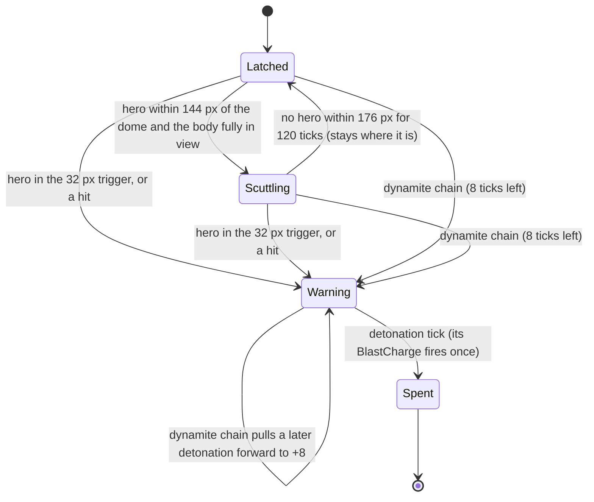

# HAZ-0 — Slime and Rot Sticker gameplay design sheet

> **Status: design adopted under the owner's design-defaults directive ([AGENTS.md](../../AGENTS.md), 2026-11-19). Nothing in this sheet is implemented. Game feel is NOT accepted.**
> Every choice has one adopted value with a `HAZ-Q##` ID ([section 16](#16-adopted-defaults-haz-q01haz-q46)). Each value is a tuning hypothesis stored as data. The owner reviews game feel after the implementation merges and may change any value in a follow-up PR. Only [section 21](#21-genuinely-open-questions) waits for the owner.
> Design: Claude Opus (top tier). Execution: medium tier, steps HAZ-A to HAZ-C ([section 19](#19-implementation-brief-medium-tier-haz-a-to-haz-c)). Review: a separate top-tier agent.
> Stacked on the owner's encounter draft (PR #178); scheduled as step HAZ-0 by the Floor 01 playtest integration plan (PR #182, `docs/07-agents/f01-playtest-integration-plan.md`, section 4.4, conflicts K3, K6, K8, K10, K13). Format precedent: [ENEMY-GAMEPLAY-ENGINEER](enemy-gameplay-engineer.md).

**Why:** the owner's [hazard encounter](floor-01-slimes-rot-stickers-encounter.md) ("The Floor Lies") asks for a slime and a Rot Sticker that are distinct species, readable before they hurt, and usable against other monsters. It leaves the gameplay numbers, the damage classification and the engine contracts to a design sheet. This is that sheet. It turns the approved SLIME-01 and ROT-01 readability sets into enemies and hazards on the shared interfaces the plan assigns: the explosion profile in `src/blast.rs` (CP-B1, CP-C) and the hazard volume in `src/env_hazard.rs` (BOIL-B).

## 1. Authority and locks

- **Owner intent (#178), kept:** three pockets (A slime floor, B Rot Sticker overhead, C crossover); slimes and Rot Stickers are separate species; **no slime splitting**; no hidden or offscreen hazard; 1 HP per qualified contact with no per-tick drain; Rot warning 18 to 24 ticks; blast radius 40 to 56 px; one detonation per sticker; one damage evaluation per victim per blast; 1 HP to nearby heroes and normal enemies; early triggers only through real collisions; no cascades; at most 1 sticker in B and 2 in C; the direct route works without any environmental combo (HAZ-06); no new button or companion command.
- **Plan resolutions applied:** K3 (world and enemy blasts hurt every hero; credit goes to the initiator), K6 (hazards, blasts and body contacts are never evadable; a sheet may opt one targeted attack in), K8 (ledges checked against a boosted Donut, 128 px), K10 (the gameplay tell wins over ROT-01's 30 ticks; greybox stand-ins allowed and labelled), K13 (the AI partner hazard gap is reported, not fixed here).
- **Art (approved readability sets, not mechanics):** [SLIME-01](../02-art/slime-01-spec.md): 30 px tall, frame 80 x 40, pivot (40, 39); tell 6 + 24, launch 2, impact 6, recover 20; lunge box frame 10 only. [ROT-01](../02-art/rot-01-spec.md): a 20 px disc, frame 32 x 32, pivot (6, 16) on the surface, dome centre 6 px off the surface; one wall-mounted set, rotated for ceilings; tell 6 + 24; the first burst frame is frame 10. Neither spec approves damage, radius, health or trigger rules; this sheet does.
- **Shared engine contracts (owned elsewhere, consumed here):**
  - **Blast profile** (`src/blast.rs`, CP-B1 adds the profile, CP-C the chain and the `BlastTarget` hook). The plan's revised contract: the profile has **one `hero_damage` policy field**, which replaces the draft's `hurts_owner_hero`. The dynamite's policy hurts only the thrower's hero (CP-Q23, CP-Q24); **world and enemy blasts hurt all heroes**. Kill credit uses the field `BlastCharge.owner` that already exists in `src/blast.rs`: for a Rot blast it holds **the player whose stimulus set it off, otherwise none** (the initiator rule). The profile gains no second owner field.
  - **Hazard volume** (`src/env_hazard.rs`, BOIL-B): a time-windowed contact area with a per-victim activation token, a team policy, a telegraph window, the class (always non-evadable) and a hero-hurt source. The acid patch is one.
  - **Hero hurt path:** `hurt_hero` with a `HeroBlow` (invulnerability, hurt ticks, hit-stop, the solo last-HP guard). Source ids follow the schemes CP-B1 (blasts) and BOIL-B (hazards) define; this sheet invents no third scheme.
  - **Donut's reflex** ([DONUT-MOBILITY-01](../03-tech/donut-mobility-01.md), DM-Q17 evadable list, DM-Q18 never-evadable default).
- **Tone:** [antihero tone](antihero-tone.md). The slime is a grimy mound that has plainly eaten someone; the Rot Sticker is a bad mushroom that lights up like a fuse. Both are threatening and a little absurd, never cute, never a spider.

## 2. Tactical roles

| | Goblin A/B | Engineer | Bad Llama | **Slime** | **Rot Sticker** |
| --- | --- | --- | --- | --- | --- |
| Where it threatens | next to the hero | a floor lane at middle distance | the air at height 42..48 | **the floor at the hero's shins, and its own body and pool** | **a circle around a point on a wall or ceiling** |
| What it punishes | standing next to it; a whiffed move | being committed at middle distance | standing in the open | **stepping on or into it; staying in close after it rears up** | **fighting, standing or jumping under or beside it without looking** |
| Main answers | hit first, swat the tell, bail-out | jump, leave the lane, matador | jump, cover | **bait the lunge and punish the recover; hop or jump the low lunge; kick it away while it rears** | **bait it and back off; provoke it from range; lure it along its track; push enemies under it** |
| Body | 24 x 38, HP 2 | 24 x 38, HP 3 | 46 x 39, HP 3 | **corrosive body, HP 3, never flinches** | **20 px disc, no health: any hit sets it off** |

**Slime:** a slow, heavy zone guard that sits in its acid pool. Touching its body or its pool burns. It rears up and throws a low lunge along the floor. Its gel never flinches, so you cannot jab it out of the tell: you out-space it or hop it, then punish the long recover. Killing it drains its pool.

**Rot Sticker:** a dormant explosive that wakes when it sees a hero, creeps along one wall or ceiling track toward the spot above or beside that hero, and goes off 24 ticks after a hero comes within 32 px or anything hits it. It does not chase; it ambushes the hero who stops to fight under it. It is a hazard, not an enemy: it is never needed to clear the room, it has no health, and enemies never set it off by walking near it. The player decides when it goes off and what is under it.

**Why they are not duplicates:** the goblins threaten the space next to you, the Engineer a lane, the llama the air. The slime threatens **the ground under your feet** (body, pool, low lunge), so its answers are hops and spacing. The sticker threatens **a fixed circle on the level geometry** on a timer you start, so its answers are observation, baiting and timing.

## 3. Player-readable tells

**Slime**

1. **Idle and creep** (SLIME-01 frames 0 to 6): a slow wet heave, 30 px/s. The green rim glow and the pool are always visible.
2. **Rear-up tell (30 ticks)**: frame 7 for 6 ticks (half-rise), frame 8 held 24 ticks (reared up and back, 37 px, acid beads on the crest). It is the tallest pose in its set, and its body visibly pulls **back** out of jab reach (section 4).
3. **Launch (2 ticks, frame 9)** and **lunge impact (6 ticks, frame 10)**: the mass slaps forward along the floor to 38 px ahead at shin height.
4. **Recover (20 ticks, frame 11)**: bunched and spent, the punish window.

**Rot Sticker**

1. **Latched** (ROT-01 idle, frames 0 to 2): a dark disc with one ember. Visible as soon as it is on screen; it never spawns or wakes off-screen.
2. **Scuttling** (frames 3 to 6): the stretch-and-drag creep at 60 px/s. The motion itself says "it has noticed you".
3. **Warning (24 ticks)**: ROT-01 frame 7 for 6 ticks, then frame 8 (the whole face lit, the halo) **held 18 ticks** instead of the authored 24. This is a playback retime of a held frame, not a redraw (K10): the gameplay tell wins. A thin ring at the blast radius is drawn around the dome centre for the whole warning (a labelled code-drawn stand-in, HAZ-Q38, shown in every build, not only under `--debug-combat`), because the 48 px blast is wider than the 20 px VFX-01 burst.
4. **Detonation**: frame 9 for the last warning tick, frame 10 on the detonation tick, then the VFX-01 burst. The body is gone; a cosmetic olive drip stays on the surface.

Audio: existing cues only (the goblin tell cue at the slime's rear-up, the existing detonation cue for the burst). No new sound asset in v1.

## 4. Slime: moves and frame data (60 Hz, all data knobs)

Attack tick 0 = the tell starts. Pixels are pivot-relative (x forward along the facing, y up from the feet). Boxes are half-open.

| Phase | Attack ticks | Frames | Motion | Boxes | Hits on the slime |
| --- | --- | --- | --- | --- | --- |
| Tell: half-rise | 0..6 | 7 | none; facing and target locked at tick 0 | hurtbox **tell**; contact box **gathered** | damage, 2-tick flash, attacker hit-stop; **the timer never changes** (gel) |
| Tell: reared | 6..30 | 8 | none | as above | as above |
| Launch | 30..32 | 9 | none | as above | as above |
| Impact | 32..38 | 10 | none (the reach is in the frame) | lunge box `[18, 38) x [0, 14)` every impact tick; hurtbox **idle**; contact box **standing** | as above |
| Recover | 38..58 | 11 | none | hurtbox **idle**; contact **standing** | as above |
| Cooldown | 48 ticks from the end of the recover | idle / creep | approach or hold | idle / standing | as above |

**Boxes** (authored facing +x; mirrored about the pivot column):

| Box | x | y (height) | Use |
| --- | --- | --- | --- |
| Hurtbox, idle (all states but the tell and launch) | `[-32, 27)` | `[0, 32)` | SLIME-01's idle hurtbox, plus 2 px of height so Carl's jab (heights 29..35) and haymaker (27..38) connect reliably on a 30 px mound |
| Hurtbox, tell and launch | `[-25, 12)` | `[0, 37)` | the reared pose: taller, pulled back |
| Contact box, standing | `[-28, 22)` | `[0, 23)` | SLIME-01's standing box: the corrosive body (crest and plate excluded) |
| Contact box, gathered (tell and launch) | `[-22, 12)` | `[0, 23)` | the gathered base under the reared mass |
| Lunge box (impact only) | `[18, 38)` | `[0, 14)` | SLIME-01 frame 10's leading bulb, floor to shin height |

**Reach at a glance** (pivot-to-pivot distance `d`, the hero in front of it on its floor; Carl's hurtbox is 24 x 52, Donut's 20 x 24):

| Fact | Carl | Donut |
| --- | --- | --- |
| The lunge hits a standing hero when | `6 < d < 50` | `6 < d < 48` |
| Corrosive body touches the hero (standing box, front) | `d < 34` | `d < 32` |
| Corrosive body touches the hero (gathered box, during the tell) | `d < 24` | `d < 22` |
| Jab, haymaker or push kick (box front 22) reaches the **idle** hurtbox | `d < 49` | — |
| Jab or kick reaches the **tell** hurtbox | `d < 34` | — |
| Swat (front 30, Engineer sheet value) reaches the idle hurtbox | — | `d < 57` |

Consequences, by design: Carl cannot jab the slime from outside its lunge reach (49 < 50), and cannot touch its reared body at all from outside the reach. Donut can poke it from 48..57 px with the swat, the cat's reach advantage. Magic Missile hits from anywhere in line.

**Jump and hop:** the lunge box is 14 px tall. Any plain jump that leaves the floor by attack tick 29 is above 14 px on every impact tick (the domain test pins the exact last press tick, predicted 30 or 31). The CF02 bail-out hop (apex 30 px) also clears it, so the hop **answers the slime** where it fails against the Engineer. A jump in place from the trigger distance (44) lands at 44, outside the body (34), during the recover. The standing contact box is 23 px tall, so a jump **over** the slime clears its body and lands behind it; the lunge, locked to its tell-start facing, then whiffs forward and its back is open (back edge 32: a jab from behind reaches `d < 54`).

### One impact tick, in this order

1. **Hero:** the lunge box overlaps a hero hurtbox (heroes stepped earlier this tick). An invulnerable hero is skipped. **Donut's reflex check runs here** (DM-B's candidate-loop pattern, as for the Engineer's ram): an evaded Donut is skipped and Carl behind her may be chosen on the same tick. On a hit: `hurt_hero` with `HeroBlow { damage 1, from_x = slime x, knock_vx 120 away, knock_vy 160 }`. **One hero per lunge**: the first overlapped; if both on the same tick, the one whose near edge is closer to the slime's front, ties to Carl. The lunge stops testing after a hit (the impact frame keeps playing).
2. **Nothing else:** the lunge never touches goblins, other slimes, Rot Stickers or props.

### Hits on the slime (gel)

- **Every hit** (jab, haymaker, kick, stomp, dive, air kick, swat, pounce, Magic Missile, a CF02 launched body, a blast) deals its normal damage and gives the attacker its normal hit-stop. The slime plays a 2-tick white flash (presentation) and **never changes state or timer**: no stagger, no launch, no knockdown, no tell interrupt, no Donut light guard. Gelatinous mass absorbs the blow.
- **Push kick:** additionally slides the slime **24 px** directly away from the kicker over 8 ticks (3 px per tick), stopped by solids and the leash. It slides in any state, including the tell, which is how a kick makes the lunge whiff (section 7).
- **Lethal hit:** defeated in place (section 9).
- **The hurt frame** (SLIME-01 frame 12) plays for 12 ticks only when a hit lands in idle; in creep it is the flash only, so the slime keeps sliding forward. The frame never changes a timer.

## 5. Slime brain

- **Wake:** a hero's hurtbox within **160 px** of the slime's pivot **and** the slime's whole body inside the simulation camera view (the llama's fair-fire precedent: simulation state, the same on every output). It never wakes off-screen.
- **Eligible hero:** living, feet within **8 px** of the slime's floor line. A jumping hero or a hero on a ledge is not a lunge target.
- **Target:** the existing `update_targets` rule (hysteresis, solo bias toward the controlled hero) over eligible heroes, locked at the tell start. With no eligible hero it holds facing the nearest hero and takes no token.
- **Approach:** creeps at **30 px/s** (0.5 px per tick) toward the point **40 px** (the standoff) from the target on its current side, never backward, never more than **96 px** from its home column (the leash; its home is its pool's centre or its spawn).
- **Trigger and tokens:** a token candidate only when the target is eligible and `d <= 44`. It shares the goblins' `MAX_ATTACKERS` (2) and the 12-tick tell spacing, and holds the token from the tell start to the end of the impact. Without a token it holds.
- **Contact (corrosive body):** checked every tick in every living state, section 8.

## 6. Slime: size, hurtboxes, health

- **Health 3** (HAZ-Q04): a bait-and-punish cycle is jab plus haymaker in one recover (2), plus one more hit. Never a sponge; mixed in C, the Rot blast's 1 damage makes it a two-hit kill.
- **Hurtbox and contact boxes:** section 4. The boxes are per state (two hurtboxes, two contact boxes), taken from SLIME-01 section 3.
- **Mass:** never launched, never knocked down, never bowled by a CF02 flier (a flier that meets it stops as against a llama; the flier takes its normal contact result and the slime takes the flier's hit damage).

## 7. Counterplay

| Who | Answer | Cost or risk |
| --- | --- | --- |
| Carl | **Bait and punish:** step to 44..49 px so it rears up, step back past 50 before attack tick 32 (2 ticks of running from 44), then step in during the 20-tick recover: jab + haymaker lands 2 damage | Mistime the step back and the lunge hits; walk in too far and the body burns |
| Carl | **Jump the lunge** in place or **over the slime** (body 23 px tall), then hit its back in the recover | Landing on the body or in the pool burns |
| Carl | **Push kick while it rears:** at `d < 34` during the tell the kick (startup 13) lands and slides it 24 px; from 30 px it ends at 54, past the lunge reach (50), so the lunge whiffs | Must step inside 34 px of a rearing slime; standing at `d < 24` touches the gathered base |
| Carl | **Dive, stomp:** they hit (damage), but the hero touches the corrosive body: a trade | 1 damage to Carl per contact entry |
| Donut | **Swat at range:** her swat reaches the idle slime from 48..57 px, outside her lunge reach (48) | During the tell she must be inside 34 px of it like Carl |
| Donut | **Magic Missile** from range | Mana: three casts per slime (1 damage each) |
| Donut | **Pounce** | Lands on the body: a trade, like the dive |
| Either | **Collateral:** set off a Rot Sticker with the slime inside its radius (1 damage), or kick the slime under a sticker first | The hero must leave the radius too |
| Pair | One hero baits the lunge, the other hits its back | The partner standing in the lane is the one hit |

## 8. The acid patch (hazard volume)

**Shape:** a floor strip authored in the encounter sidecar: `x0..x1` on a walking surface, volume height **6 px** above that surface. A hero whose hurtbox overlaps the volume is touching acid; a hero more than 6 px up (any jump, the hop) is not. Width **64 px** by default, 32 to 80 allowed (HAZ-Q18).

**Contact rule (patch and slime body share it, HAZ-Q19 and Q13):**
- **1 damage** through `hurt_hero`, with a pop: `HeroBlow { damage 1, from_x = the patch centre (the slime's pivot for its body), knock_vx 150 toward the nearer patch edge (away from the slime), knock_vy 200 }`. The hop lasts about 23 ticks and carries the hero about 57 px, so from anywhere in an 80 px patch the hero lands outside it (40 + 12 < 57). A hero exactly at the centre pops toward +x (the `hurt_hero` tie rule).
- **Token per entry:** one hurt per victim per volume per entry. The token rearms only after the victim's hurtbox has left the volume for at least 1 tick. An entry while invulnerable does not consume the token: if the hero is still inside when invulnerability ends, the hurt applies then. With the pop, standing in acid is impossible, so there is no per-tick drain.
- **Class:** non-evadable (DM-Q18 hazard; body contact for the slime's body).
- **Telegraph:** always active and always visible: a patch never appears, grows or hides. No telegraph window is used (the volume's window is "always").

**Team policy (HAZ-Q20):**

| Victim | Rule |
| --- | --- |
| Heroes | Contact rule above |
| Slimes | Immune (to every patch, and to each other's bodies) |
| Walking goblins and the Engineer | **Never enter:** a patch edge is a walk barrier for a grounded, non-launched goblin, exactly like a wall for its approach. One already inside walks out by the nearer edge |
| Launched or falling goblins (CF02 fliers, outer-ring launches) | **1 damage once per launch instance** when the body lands overlapping the patch; `DefeatCause::Environment { player: the launch's instigator, prop: patch id, class: acid }` (BOIL-B's appended cause) on a lethal landing. Lying in acid does nothing further. Switch `hazq20_acid_hurts_launched` (default on) |
| Llamas, Rot Stickers | Not affected (no llama in this room; stickers never touch the floor) |

**Linked pool and drain (HAZ-Q21):** a patch may name a `linked_slime`. When that slime is defeated the patch **drains**: both edges move inward by the same whole number of pixels per tick until the width is 0, over **60 ticks** (for a 64 px patch, about 0.53 px per tick per edge, rounded so the width reaches 0 on tick 60). The volume and the drawn stain always share the current width (honest bounds). A drained patch is removed. An unlinked patch is permanent for the attempt. A restart restores every patch.

**No slime trail (HAZ-Q17):** a creeping slime leaves only SLIME-01's cosmetic wet film. It never creates a hazard volume. The only acid is authored.

## 9. Slime death

- **Authoritative:** the existing causes and force tiers (melee, blast, environment), no new death physics. In place, no knock arc (the llama precedent).
- **Remains:** SLIME-01 `down` frames 13 to 15, the remains held; **inert** (no contact, no hurtbox, no collision). The linked pool drains (section 8).
- **Presentation:** a new species `slime` whose recipes all map to `slime_down` (SLIME-01 frames 13 to 15). Add it through the death overlay the way the Engineer added `goblin_engineer`; `species_death_profiles.json` stays byte-identical.
- **Morale:** its defeat is an ordinary witnessed defeat for goblins in range (no special delta). It has no nerve itself.
- **No splitting**, no drops, no larger patch on a blast kill (the owner's later experiment, section 21).

## 10. Rot Sticker: states, motion and detonation

### Track and motion

- **Track:** one straight segment on a surface, authored in the sidecar: orientation `ceiling` (a soffit or slab underside, face down), `wall_left` (the wall on the sticker's left, face +x) or `wall_right`; two end points; a start point. Floor stickers and corner traversal are not in v1 (HAZ-Q23). Length 32 to 160 px.
- **Dome centre:** 6 px off the surface along its normal (ROT-01). Every circle in this section is measured from the dome centre to the nearest point of a box (squared distance, like `BlastCharge::reach`).
- **Wake:** a hero hurtbox within **144 px** of the dome centre, **and** the sticker's whole 32 x 32 frame inside the simulation camera view. Sleep: no hero within 176 px for 120 ticks; it stays where it stopped.
- **Scuttle:** toward the projection of its target hero's hurtbox centre onto the track, at **60 px/s** (exactly 1 px per tick), clamped to the track ends; it stops on the projection. Target: the nearest living hero by that distance; ties go to Carl; it re-picks only when the other hero is 16 px nearer (hysteresis). It never leaves its track and never moves in Warning.

### Trigger (provoke)

The sticker enters **Warning** on the first tick that any of these holds (checked after the heroes' step, before the charges step):

1. **Proximity:** a hero hurtbox within **32 px** of the dome centre, with line of sight (CP-Q22: the segment is blocked by the interior of any intact solid; a hero standing on top of the slab it clings to is shielded), and the sticker fully in view. **Heroes only:** goblins, slimes and other enemies never trigger it by proximity.
2. **A hit:** any hero strike box (jab, haymaker, kick, air kick, dive, stomp, swat, pounce) or a Magic Missile bolt overlaps its hurtbox; or a CF02 launched body (a flier) overlaps its hurtbox. The attacker gets **no hit-stop** from a sticker, so a hero who chose to hit it can run at once. A 2-tick white tint plays (ROT-01's proposal), not the hurt frame.
3. **A dynamite chain** (CP-Q34): handled by the charge, below.

On the provoke tick `t` the scene sets its charge's `detonate_tick = t + 24` and writes the credit (section 11). Warning is committed: further hits, proximity and enemies change nothing, except a dynamite chain that is due earlier.

**Hurtbox:** ROT-01's shell box, surface-local `[0, 14)` out from the surface by `[-10, 10)` along it, rotated with the orientation. Exactly the drawn shell; a tiny creature is never an invisible box.

### The charge (no new arm, no change to `src/blast.rs` beyond CP-B1 and CP-C)

- Each authored sticker owns one `BlastCharge` in the fixture's charge list, appended in authored order **before** the dynamite's reserved slot (CP-Q31: the slot index is `fixture.charges.len()`, which then counts the stickers).
- It is created with `Arm::Tick`, `detonate_tick = 0` (never fires: a zero detonate tick is never reached) and no credit yet; `BlastCharge.owner` is written once at the provoke by the initiator rule (section 11).
- Each tick before the charges step, the scene writes `x` and `foot_y` so that `centre()` equals the dome centre (`foot_y = dome_y - BLAST_CENTRE_DY`).
- **CP-Q34 works unchanged.** A sticker charge is "lit" for the chain test. With `detonate_tick` 0 it is never in `(t, t + 8]`, so a dynamite blast that reaches it (within 64 px with line of sight) sets it to `t + 8`, depth 1. One already due within 8 ticks is left alone, and one due later is pulled forward to `t + 8`. The sticker reads the new tick and enters or stays in Warning; presentation shows frame 8, then frame 9 on the last tick.
- On the detonation tick the charges step fires it once (dedupe as CP-Q34), the existing `Blast { tick, charge }` is logged, and the sticker becomes **Spent** in the env step of the same tick: no hurtbox, no trigger, no motion, never again this attempt.

### The Rot blast profile (HAZ-Q30)

| Field | Rot value | Note |
| --- | --- | --- |
| core radius | **0: no core band** | No point-blank kill. CP-B1 must treat 0 as "no core", even at distance 0 (requirement on CP-B1; the QA profile keeps 20) |
| outer radius | **48** | Middle of the owner's 40..56 |
| outer damage | **1** | Owner: 1 HP for normal enemies and heroes |
| launch | **160 / 180** px/s away from the centre (goblins only) | Lighter than the dynamite's 200 / 220; a normal CF02 launched body (CP-Q36) |
| line of sight | **on** (CP-Q22) | |
| `hero_damage` | **all heroes** | The plan's single policy field. The dynamite uses its "thrower's hero only" value (CP-Q23, CP-Q24); world and enemy blasts use "all heroes" |
| breaks structures | **off** | No shore, strut or terrain effect |

**What one Rot blast does (one evaluation per victim per blast):**

| Victim within 48 px with line of sight | Effect |
| --- | --- |
| Carl or Donut (either player, human or AI) | `hurt_hero` with `HeroBlow { damage 1, from_x = dome centre x, knock_vx 120 away, knock_vy 160 }` (the CP-Q23 block values); invulnerability and the solo last-HP guard apply; **non-evadable** |
| Goblin, Engineer | 1 damage and a launch (160 / 180); lethal → `Explosion { point_blank: false }` with `player = charge.owner` |
| Llama | 1 damage with its kick reaction (the CP-Q26 analogue) |
| Slime | 1 damage (gel: no state change), through CP-C's `BlastTarget` hook |
| Another Rot Sticker | **nothing** (no provoke, no damage) |
| Dynamite stick, authored charges | Only CP-Q34 applies: an independently provoked Rot blast is not a dynamite blast and no dynamite chain reached it, so it chains nothing. A dynamite-chained Rot blast (depth 1) could chain further by CP-Q34, so the encounter validator keeps every sticker track more than 56 px from any other sticker track and from any authored charge (HAZ-Q33). In practice a Rot blast never propagates |

Caps: CP-Q34's depth 4 and 8 detonations per tick apply unchanged; with at most two stickers per pocket and the separation rule they are never reached.

### Escape and reach tables

**Ceiling sticker** (surface at height `H` above the walking line, dome centre at `H - 6`; `g` = gap from the dome centre down to the top of a grounded hero: Carl 52 px tall, Donut 24):

| `H` | Example | Carl `g` | Carl walking under | Donut `g` | Donut walking under |
| --- | --- | --- | --- | --- | --- |
| 68 | perch slab underside | 10 | triggers within 30.4 px horizontally (box edge to centre); the blast reaches 46.9 | 38 | never triggers grounded; the blast reaches 29.3 |
| 80 | low soffit | 22 | triggers within 23.2; blast 42.7 | 50 | never triggered, never hit grounded |
| 96 | soffit | 38 | never triggers grounded; blast reaches 29.3 | 66 | safe grounded |
| 112 or more | high ceiling | 54 or more | safe grounded; a **jump** under it triggers (Carl's top reaches about 140) | | safe grounded; a jump triggers |

**Bait and back off** (Carl, `H` 68, walking toward it and reversing on the provoke): escaping means moving the near box edge from 30.4 to 46.9 px horizontally from the centre, 16.5 px, which takes **6 ticks** at 185 px/s. With a 24-tick warning that leaves **18 ticks (300 ms) to react**, about a human reaction time. This is why the warning is 24 and not 18: at 18 the margin would be 12 ticks (200 ms), unfair from a standing start.

**Running straight through** under an `H` 68 sticker you have just triggered: the hero must cover about 93 px (from the trigger edge on one side to beyond the blast on the other, including the 24 px body), 30 ticks at 185 px/s: **hit**. Intended lesson: once it lights, back off the way you came; do not run through. To pass, bait it first, lure it to one end of its track, or take another route (the B slab is also a perch you can walk over, out of its line of sight).

**Wall sticker:** the dome centre is 6 px from the wall face. A grounded hero whose box spans the centre's height triggers it within 26 px of the wall face. Carl jabbing a wall sticker stands with his box edge about 17 px from the centre (jab front 22, shell 14 deep), inside the trigger: the hit and the proximity agree. He needs about 31 px to clear the blast: 10 ticks of running after the jab's 11 remaining ticks (2 active, 9 recovery). That is 21 ticks of the 24, so jab and run works if he runs at once.

## 11. Credit, events and attribution

- **`BlastCharge.owner` (the initiator rule, K3):** set once, at the provoke:
  - proximity → the player slot of the hero who entered the trigger (in solo the one human player, also when the AI-driven hero entered);
  - a hero hit or a Magic Missile → that hero's player;
  - a launched body → that launch's instigator (CF02 launch credit), or none;
  - a dynamite chain → the dynamite charge's owner.
  If nothing credits it, it stays none. Kills by the Rot blast are `Explosion { player: charge.owner, point_blank: false }`; acid kills are `Environment` (section 8). Damage to heroes is not "friendly fire": no hero owns a Rot blast.
- **Events (appended):** `RotProvoked { tick, sticker, cause: Proximity | Hit(MoveId) | Flier | Chain, player: Option<u32> }` once per sticker. The detonation reuses `Blast { tick, charge }`. Acid hurts use the `HeroHurt` source of BOIL-B's hazard scheme with the patch id; slime-body hurts use the slime's target id; lunge hurts the slime's target id.
- **Not an enemy:** a Rot Sticker emits no `EnemyDefeated`, counts for no room goal, morale, audience, CINE or AUTOPLAY enemy column, and is never in `update_targets` or the companion's `CompanionView`. It is a strike target only for hero hit boxes and bolts (section 19 lists where).

## 12. Evadable classification (K6, DM-Q17 and DM-Q18)

| Source | Donut's reflex | Why |
| --- | --- | --- |
| **Slime lunge** | **Evadable (opted in, DM-Q17 list)** | A single-target attack with a 30-tick readable tell aimed at a body, like a goblin swing; scoped to the lunge instance (DM-Q19) |
| Slime body contact | Never | Body contact (DM-Q18) |
| Acid patch | Never | Hazard (DM-Q18) |
| Rot blast | Never | Blast (DM-Q18) |
| Rot trigger | — | Not an attack; nothing to evade |

The owner's #178 starting rule ("persistent acid contact and a Rot Sticker AoE should not be consumed as a dodge of a targeted melee hit") holds. A `HeroHurt` from any of these resets her reflex wait as every hurt does (DM-B).

## 13. AI partner hazard gap (K13)

**Today (before CA2-C):** the companion has no hazard input. Expected behaviour in this room:
- The follower may walk into an acid patch the leader jumped. The pop throws it out after 1 damage; the solo last-HP guard keeps an AI hero at 1 HP or more.
- An AI Carl (Donut controlled) is tall and triggers low stickers that Donut passes under (section 10 table).
- An AI Donut that pounces on a slime burns (a trade).
- The AI never targets a Rot Sticker (it is not in `CompanionView`) and never provokes one on purpose. It may provoke one by proximity.

**This sheet adds no companion behaviour** (#178: no new buddy navigation; the plan: companion files belong to CA2). It does three things:
1. **The slime is in `CompanionView`** as a ground enemy with the kind-aware phase mapping (tell and launch → `Tell` with `tell_len` 30, impact → `Impact`, recover → `Recover`), so the existing assist can swat it or fire a missile at it. Like the Engineer, its committed phases are not interruptible, so the director's swat at a rearing slime deals damage only.
2. **Hazard feed data for CA2-C:** each tick the scene can list hazard rectangles in the one format BOIL-B's hazard core defines (active and telegraphed). The HAZ entries: every acid patch as **active** (the hazard core publishes it itself); every living slime's contact box as **active**; every awake sticker's trigger circle bounding box as **telegraphed**; every warning sticker's blast circle bounding box as **telegraphed**, with the detonation tick. HAZ-B writes the slime and sticker rows into that list. CA2-C consumes it; until CA2-C lands, nobody reads it.
3. **Measured, with a threshold:** per solo clear, count AI-hero acid hurts, slime-body hurts, Rot hurts and Rot provokes by the AI hero. **More than 1 AI-hero hazard hurt per clear** on the solo routes opens a CA2 follow-up item (the Engineer's threshold precedent).

## 14. Solo and 2P parity

- **Same room, same rules, same route** for solo Carl, solo Donut (swap) and 2P (HAZ-09). No step needs a second human; no gate uses two simultaneous positions; every pocket is clearable by either hero alone.
- **Triggers and damage are per hero:** either hero can provoke a sticker; a Rot blast hurts every hero in range, human or AI; the lunge hits one hero per lunge; acid tokens are per victim.
- **Size asymmetry (emergent, accepted):** Donut (24 px tall) walks under `H` 68..80 stickers without triggering them; Carl (52 px) cannot. It mirrors her small-body role and gates nothing: the B slab is a perch both heroes can use, and every sticker can be baited by either. Recorded as an open question (section 21) in case playtests show it trivialises B for Donut.
- **2P camera:** v1 changes no camera rule (the plan gives the camera to CA2-B2). Readability comes from authoring: every sticker track lies inside the vertical band the shared camera always shows at the walking line, and a sticker can only wake and trigger while it is fully in view, so neither player is hit by an unseen sticker.
- **Credit:** per player, section 11.

## 15. Encounter rules for the room (sidecar data and validator)

The owner's spans are kept (#178 section 2). Recommended greybox values (data, not fixed LDtk; HAZ-A may shift them while every validator rule passes):

| Pocket | Greybox | Purpose |
| --- | --- | --- |
| Entry 0..160 | dry floor, a cosmetic corrosion stain at x about 150 | teach the look before any harm |
| A 160..400 | pool 248..312 (64 px) linked to slime S1 (home 280); a stone shelf 232..328 at 40 px high as the alternate footing; one common goblin at x 380 (the owner's "ordinary enemy at a fair distance") | the floor lies; hop it, use the shelf, or kill the slime to drain it |
| Transition 400..500 | dry, calm | reset; B's left retreat pocket |
| B 500..720 | perch slab 560..680, underside 68, top 80 (Carl class); sticker R1 on its underside, track 576..664 | look up; bait and back off; or walk over the slab out of its sight |
| C 720..1008 | ceiling soffit 744..840, underside 84, no standable top; sticker R2 under it, track 760..824; pool 768..832 linked to slime S2 (home 800); ledge slab 880..960, underside 60, top 72; sticker R3 under it, track 896..944; one common goblin spawning at 990 | turn danger into advantage; three valid patterns |
| Exit 1008..1152 | protected dry floor, checkpoint | regroup |

Under a soffit at 84 a grounded Carl triggers R2 within 22 px horizontally and the slime (32 px hurtbox) is inside R2's blast within about 13 px: provoking R2 over the pool is a real slime hit. A goblin under R3 (gap 16 px) is inside its blast within about 45 px.

**Validator rules (appended to BOIL-A's encounter validator; a failure names the rule and the ids):**

1. **Patch:** width 32..80; on a walking surface; at least 48 px of dry floor on both sides; clearable by a standing-start plain jump for Carl and for base and boosted Donut (computed from the live tuning); never inside a protected spawn, checkpoint or exit rectangle.
2. **Alternate footing (pocket A):** at least one patch-free route from entry to exit for Carl and for base Donut, using walking and plain jumps only.
3. **Sticker track:** length 32..160; surface orientation matches the solid it lies on; the dome centre at every track point is at most 200 px above the walking line below it (inside the shared camera band); the blast circle swept along the track does not intersect a protected rectangle; the sweep leaves at least one dry, blast-free pocket at least 64 px wide on each side of the track along the floor.
4. **Separation:** any two track points of different stickers are more than 56 px apart (48 + 8); any track point is more than 56 px from an authored charge.
5. **Counts:** B at most 1 sticker; C at most 2 stickers, 1 slime and 1 goblin; never more than the LAB-Q04 cap of 4 enemies active (stickers do not count; slimes do).
6. **Goblin reach:** every goblin's spawn reaches the hero route without crossing a patch (no stand-off behind acid).
7. **Height gates (K8):** every standable surface of 81..128 px is lowered to 80 or less or declared a Donut vantage with a counter; in this room none exists (the slab tops are 80 and 72; the C soffit has no top).
8. **Direct route (HAZ-06):** the exit is reachable and the room goal (every slime and goblin defeated; stickers excluded) is achievable with every sticker unprovoked.

## 16. Adopted defaults (HAZ-Q01..HAZ-Q46)

Knob names start with the question id (`hazq04_slime_health`). Slime and acid knobs live in `assets/data/gameplay/enemy_slime_v0.json`, Rot knobs in `assets/data/gameplay/enemy_rot_sticker_v0.json`; geometry lives in the room's `.encounter.json` sidecar.

| ID | Question | Adopted value | Rationale | Knob |
| --- | --- | --- | --- | --- |
| HAZ-Q01 | Roles | Slime: ground zone guard with a corrosive body and a low lunge. Rot Sticker: a provoked, timed surface explosive; a hazard, not an enemy (section 2) | Distinct from goblin, Engineer and llama; uses only the approved readability sets | none (design) |
| HAZ-Q02 | Gate | Both exist only under `cf02_rules`, in the hazard scene (`--scene f01_hazards`, and `--f01-room hazards` once the Floor 01 room selector lands), with data kill switches `hazq02_slime_enabled` and `hazq02_rot_enabled` (default true). Never in `--demo`, the story route, plain `--cf02` or the combat lab | Plain modes stay byte-identical; a kill switch needs no rebuild | `hazq02_slime_enabled`, `hazq02_rot_enabled` |
| HAZ-Q03 | Simultaneous counts | A: 1 slime and 1 goblin; B: 1 sticker; C: 1 slime, 1 goblin, 2 stickers | #178 section 3 limits; LAB-Q04 cap | validator (rule 5) |
| HAZ-Q04 | Slime health | **3** | Bait cycle (2) plus one hit; no sponge | `hazq04_slime_health` |
| HAZ-Q05 | Slime boxes | Section 4 table; idle hurtbox height 32 (art 30 + 2) | Jab and haymaker connect on a low mound; per-state boxes follow the art | `hazq05_*` boxes |
| HAZ-Q06 | Wake, creep, leash | Wake at **160** px and fully in view; creep **30** px/s; leash **96** | Slow zone guard; never wakes off-screen | `hazq06_sight_px`, `hazq06_creep_px_s`, `hazq06_leash_px` |
| HAZ-Q07 | Eligibility and target | Feet within **8** px of its floor; the existing hysteresis rule; locked at tell start | A low lunge cannot target a jumper; Engineer precedent | `hazq07_floor_tolerance_px` |
| HAZ-Q08 | Trigger and standoff | Tell at `d <= 44`; standoff **40** | A standing hero at the trigger is hit (Carl `< 50`, Donut `< 48`) | `hazq08_trigger_px`, `hazq08_standoff_px` |
| HAZ-Q09 | Timeline | Tell **30** (6 + 24), launch **2**, impact **6**, recover **20**, cooldown **48** | SLIME-01's ticks; first harm on attack tick 32, inside #178's 24..36 | `hazq09_*_ticks` |
| HAZ-Q10 | Lunge | Box `[18, 38) x [0, 14)` on impact ticks; 1 damage, knock 120 / 160; one hero per lunge; first overlapped, closer edge, ties Carl | SLIME-01 frame 10; existing hurt path | `hazq10_damage`, `hazq10_knock_x`, `hazq10_knock_y` |
| HAZ-Q11 | Gel | Hits deal damage and hit-stop only; never staggered, launched, knocked down or interrupted; 2-tick flash | Its tell cannot be jabbed out: out-space it or hop it | `hazq11_gel` (switch) |
| HAZ-Q12 | Push kick slide | **24** px over 8 ticks, any state | The defensive answer to the tell (kick at 30 → ends at 54, past 50) | `hazq12_kick_slide_px`, `hazq12_kick_slide_ticks` |
| HAZ-Q13 | Corrosive body | Contact box per state; the section 8 contact rule (1 damage, pop 150 / 200 away from its pivot, token per entry) | "Contact risk"; dive, stomp and pounce become trades | `hazq13_body_contact` (switch) |
| HAZ-Q14 | Tokens | Shares `MAX_ATTACKERS` 2 and the 12-tick spacing; a candidate only at `d <= 44` with an eligible target | At most two attacks in flight | none (code) |
| HAZ-Q15 | Reflex class | Lunge evadable; body, acid and blast never | DM-Q17 criteria; K6 | `hazq15_lunge_evadable` |
| HAZ-Q16 | Slime death | In place; inert remains (frames 13 to 15); species `slime`; ordinary witnessed defeat | No new death physics; SLIME-01 "remains, not a stain" | data (death overlay) |
| HAZ-Q17 | Splitting and trail | No splitting; the creep film is cosmetic; no slime-made hazard | #178 and the roster forbid unapproved splitting; no saturation | none |
| HAZ-Q18 | Acid patch shape | Authored strip, volume height **6** px, width **64** (32..80) | Jumpable by every hero; the pop always clears it | `hazq18_volume_height_px`; widths in the sidecar |
| HAZ-Q19 | Acid contact | 1 damage, pop **150 / 200** toward the nearer edge, one hurt per entry, invulnerable entries keep the token | "1 HP per qualified contact, gated by invulnerability, no per-tick drain" | `hazq19_damage`, `hazq19_pop_x`, `hazq19_pop_y` |
| HAZ-Q20 | Acid team policy | Heroes: yes; slimes: immune; walking goblins: never enter (edge is a walk barrier); landing fliers: 1 damage once per launch, `Environment` credit to the instigator | Shoving enemies into hazards is player-authored causality (#178 asked for approval and tests; this is the adopted approval) | `hazq20_acid_hurts_launched` |
| HAZ-Q21 | Pool drain | A linked pool drains over **60** ticks when its slime dies; unlinked pools are permanent for the attempt | The visible clear state #178 asks for; a reward for the kill | `hazq21_drain_ticks` |
| HAZ-Q22 | Acid telegraph | Always active, always visible; no hidden or growing acid | Owner: no invisible instantaneous puddles | none |
| HAZ-Q23 | Rot track | One straight segment, `ceiling`, `wall_left` or `wall_right`, 32..160 px; no floor stickers, no corners in v1 | Deterministic and readable; ROT-01 covers the orientations by rotation | sidecar; validator |
| HAZ-Q24 | Rot boxes | Hurtbox = ROT-01 shell `[0, 14) x [-10, 10)` surface-local; dome centre 6 px off the surface | Exactly the drawn shell | `hazq24_hurtbox`, `hazq24_dome_offset_px` |
| HAZ-Q25 | Rot wake and sleep | Wake: a hero within **144** of the dome centre and the whole frame in view; sleep after **120** ticks with no hero within **176** | Owner: never offscreen, visible before it threatens | `hazq25_wake_px`, `hazq25_sleep_px`, `hazq25_sleep_ticks` |
| HAZ-Q26 | Rot scuttle | **60** px/s (1 px per tick) toward the target's projection on the track; nearest hero, hysteresis **16** px, ties Carl | A third of Carl's run: it ambushes the stationary, never chases | `hazq26_speed_px_s`, `hazq26_switch_px` |
| HAZ-Q27 | Rot trigger | Hero hurtbox within **32** px of the dome centre, with line of sight, while in view; heroes only | Owner's "danger envelope"; no scripted or enemy trigger | `hazq27_trigger_px` |
| HAZ-Q28 | Rot warning | **24** ticks, committed, stationary; ROT-01 retimed 6 + 18 by playback | 18 ticks of reaction at the trigger edge (section 10); owner range 18..24 | `hazq28_warning_ticks` |
| HAZ-Q29 | Provoke by hit | Any hero strike box, a Magic Missile bolt or a CF02 flier overlapping the hurtbox; no attacker hit-stop; a hit never defuses | Owner: real collisions only; hit and run is the melee answer | `hazq29_hit_provokes` (switch) |
| HAZ-Q30 | Rot blast profile | Core none, outer **48**, damage **1**, launch **160 / 180**, line of sight on, `hero_damage` all heroes, structures off | Owner: 1 HP, 40..56 px, no free instant kills; K3 | `hazq30_*` (profile row) |
| HAZ-Q31 | Rot blast on heroes | 1 damage, knock **120 / 160** away from the dome centre, through `hurt_hero` | CP-Q23 block values; existing guards | `hazq31_knock_x`, `hazq31_knock_y` |
| HAZ-Q32 | Rot blast on enemies | Goblin and Engineer: 1 and a launch; llama: 1 with its kick reaction; slime: 1; other stickers: nothing | Standard explosion pipeline; no cascades | none (rules) |
| HAZ-Q33 | Chains | Dynamite chains a sticker by CP-Q34 (+8, depth 1); an independent Rot blast chains nothing; the separation rule (more than 56 px) keeps a chained Rot blast from propagating; caps 4 and 8 unchanged | Owner: no cascades; CP-Q34 stays the one chain rule | validator (rule 4) |
| HAZ-Q34 | Credit | `BlastCharge.owner` = the initiator's player at the provoke, else none (section 11) | K3 initiator rule; no second owner field | none (rules) |
| HAZ-Q35 | Spent and defuse | Detonation removes the body; a cosmetic drip remains; no dud defuse in v1 | One detonation per sticker; jab twice to defuse would make melee free | `hazq35_defuse` (switch, false) |
| HAZ-Q36 | Not an enemy | No `EnemyDefeated`, no room goal, morale, audience, CINE or companion view; `RotProvoked` and `Blast` events only | A hazard the player may ignore (HAZ-06) | none |
| HAZ-Q37 | Rot presentation timing | Frame 7 (6), frame 8 (18), frame 9 on the last warning tick, frame 10 on the detonation; chained: frame 8 then 9 | Gameplay tell wins (K10); art held, not redrawn | presentation table |
| HAZ-Q38 | Radius ring | A thin ring at 48 px around the dome centre during the whole warning, in every build, labelled stand-in until approved hazard VFX art exists | The VFX-01 burst is 20 px; the danger must read at its true size | `hazq38_ring` (switch) |
| HAZ-Q39 | Room goal | The exit opens when every slime and goblin is defeated; stickers never count | Direct route without combos (HAZ-06) | sidecar goal |
| HAZ-Q40 | Pocket A layout | Section 15: one 64 px pool linked to the slime, a 40 px shelf as alternate footing, one goblin | Teach one hazard with a safe alternative | sidecar; validator rules 1, 2 |
| HAZ-Q41 | Pocket B layout | One sticker under a walkable 80 px slab (underside 68) | Look up; bait; or bypass over the top | sidecar |
| HAZ-Q42 | Pocket C layout | Section 15: soffit sticker over the pool, ledge sticker under a 72 px slab, slime, goblin | Three valid patterns (#178 section 3) | sidecar; validator |
| HAZ-Q43 | Camera | No camera change; tracks within 200 px above the walking line; wake and trigger only fully in view | Camera belongs to CA2-B2 (plan) | validator (rule 3) |
| HAZ-Q44 | Companion | Slime in `CompanionView` (phase mapping section 13); stickers not; no companion behaviour change | K13; #178 forbids companion work here | none |
| HAZ-Q45 | AI gap threshold | More than 1 AI-hero hazard hurt per solo clear opens a CA2 follow-up | Engineer precedent | none (report) |
| HAZ-Q46 | Determinism | No randomness in either enemy; the C goblin takes slot 0 of the CF02-Q58 temperament bag | Replays stay exact | none |

## 17. Deviations from #178 (flagged)

| # | #178 says | This sheet | Why |
| --- | --- | --- | --- |
| D1 | "Camera ... leads upward only enough to include dangerous ceilings" | No camera change in v1; the authoring band and the fully-in-view rule replace it | The plan gives the camera to CA2-B2 and says setpieces change no camera rule in v1. A later camera proposal can still add the lead |
| D2 | "One or two localized acidic footprints" (slime section) | Read as **authored pools**, optionally linked to a slime and draining on its death; the slime never makes new acid | Bounded tokens, a visible clear state, no saturation, and deterministic routes |
| D3 | "Ability to be shoved toward other hazards requires gameplay approval and tests" | Adopted: launched goblins landing in acid take 1 damage once per launch; the push kick slides a slime 24 px | This sheet is that approval as an adopted default; tests in section 18 |
| D4 | Rot Sticker "explodes on contact" (canon) | A 32 px proximity trigger with line of sight (contact included) and a 24-tick warning | The owner's own warning rule; contact without warning would be unreadable |
| D5 | ROT-01's art proposal: "a kill during the tell ends it in a dud" | Not adopted: a hit provokes; nothing defuses | One detonation per sticker; keeps "hit it and run" a decision. Open question 1 |
| D6 | Warning "18–24 fixed ticks" | 24 (the upper bound) | Reaction margin (section 10) |

Kept as written: separate species, no splitting, 1 HP per contact, one detonation per entity, one evaluation per victim, radius inside 40..56, enemies do not trigger stickers by walking, no cascades, at most 1 and 2 stickers, three patterns in C, a direct route, no new button, no companion command.

## 18. Acceptance tests (HAZ-A to HAZ-C)

All headless under `cf02_rules` with the HAZ switches on, golden-pinned, replayed identically twice. Unless stated: Carl only (Donut not live), on the **hazard test kit** (`src/hazards_fixtures.rs`): flat floor, end walls with faces at x 16 and 1184, a slab K1 at x 560..680 (underside 68, top 80), a pillar K2 at x 960..984 (height 160). Attack tick 0 = the logged tell (slime) or the logged `RotProvoked` (sticker). Where a row says "outcome", the outcome is the assertion and the exact ticks are pinned by the golden.

### Domain unit tests (no scene)

- **`slime.rs`:** the reach table (lunge `6 < d < 50` Carl and `< 48` Donut; body contact `< 34` / `< 24` gathered; idle hurtbox jab reach `< 49`, tell `< 34`); the jump-window edge (a plain jump pressed by attack tick 29 clears; the exact last tick is pinned); the bail-out hop clears the lunge; gel (every hit leaves the state and timer unchanged; a lethal hit defeats); the kick slide (24 px over 8 ticks, stopped by a solid and by the leash); the timeline (tell 30, launch 2, impact 6, recover 20, cooldown 48).
- **`rot_sticker.rs`:** provoke at `t` → `detonate_tick == t + 24`; hits and proximity during Warning change nothing; a CP-Q34 reach at `t` with `detonate_tick` 0 gives `t + 8`, with `t + 5` stays, with `t + 20` gives `t + 8`; the trigger circle with line of sight (a hero on top of the slab is shielded); the section 10 escape table (`H` 68: trigger at 30.4, blast at 46.9; `H` 96: no grounded trigger for Carl); scuttle at 1 px per tick, clamped to the track, stopped in Warning and asleep; wake only fully in view; the separation and credit rules.
- **Acid (in `env_hazard.rs`'s volume, HAZ data):** the pop goes toward the nearer edge, a centre tie goes +x; one hurt per entry; an invulnerable entry keeps the token; the drain shrinks a 64 px pool to 0 on tick 60 with honest bounds every tick.

### HAZ-A fixtures (isolated prototypes)

| Fixture | Setup | Input | Expected |
| --- | --- | --- | --- |
| `haz_slime_lunge_hits_idle_carl` | slime 400 facing +x, Carl 444 | none | Tell 0; HeroHurt on attack tick 32 (1 damage, knock +x 120 / 160); recover 38..58; cooldown 48 |
| `haz_slime_backstep_whiff` | as above | hold +x attack ticks 10..12; then -x and jab on attack tick 40, haymaker in its chain window | No HeroHurt; jab and haymaker land in the recover; slime health 3 → 1; no state change on either hit |
| `haz_slime_jump_over` | as above | jump with -x held on attack tick 12 | Carl clears body and lunge, lands behind it; no HeroHurt of any source; the lunge whiffs +x; a jab on its back in the recover lands |
| `haz_slime_kick_slide` | slime 400, Carl 440 | hold -x attack ticks 0..2; push kick on attack tick 3 | The kick lands in the tell; the slime slides 24 px -x; the lunge whiffs (`d` ≥ 50 on every impact tick); no HeroHurt |
| `haz_slime_body_burn` | slime 400 asleep (Passive), Carl 470 | hold -x | Outcome: one HeroHurt (slime body source) on the first overlap tick, popped +x; walking back in after invulnerability gives a second; nothing while outside |
| `haz_slime_dive_trade` | slime 400 asleep, Carl on a 64 px test box beside it | the CF02 dive onto it (the executor may move the press by up to 3 ticks so it lands) | Outcome: the slime takes the dive's damage and no state change; Carl takes 1 from the body |
| `haz_slime_gel_tell` | slime 400, Carl 430 | jab on attack ticks 4 and 20 | Both hits damage it; the tell never ends early; the lunge fires on attack tick 32 and hits Carl |
| `haz_slime_no_split` | kill the slime by three hits | scripted | Enemy count drops by exactly 1; no new enemy or volume; remains inert (walking through them does nothing) |
| `haz_acid_pop_out` | pool 200..264, Carl 150 | hold +x | One HeroHurt (hazard source, the patch id) on the first overlap tick; popped toward the left edge; lands outside; health 4 → 3; no second hurt |
| `haz_acid_centre_tie` | Carl placed at 232 | none | HeroHurt on tick 1, popped +x |
| `haz_acid_jump_clear` | Carl 150 | hold +x, jump on the tick his box is 8 px from the pool | No HeroHurt (HAZ-01 base) |
| `haz_acid_invulnerable_entry` | Carl 150, invulnerable 55 ticks at start | hold +x | No HeroHurt (he crosses in about 25 ticks) |
| `haz_acid_drain` | pool linked to a slime; slime killed by script | none | The pool shrinks to 0 by 60 ticks after the defeat; a hero standing 8 px inside the original edge is hurt before the edge passes him, never after |
| `haz_acid_goblin_edge` | chasing goblin at 120, Carl at 300 beyond the pool | none, 360 ticks | The goblin stops at the pool's left edge and never overlaps the volume |
| `haz_acid_launched_goblin` | goblin 190 facing Carl at 160 | push kick launching it +x into the pool | One damage on landing (`Environment`, Carl credited); none while it lies there |
| `haz_rot_wake_requires_view` | sticker on K2's left face at height 32; camera view held so the sticker is off-screen | Carl walks within 144 px | No wake while off-screen; it wakes on the first tick its frame is fully in view |
| `haz_rot_scuttle_and_trigger` | sticker under K1, track 576..664, start 664; Carl 600 | none | It scuttles -x at 1 px per tick; `RotProvoked { cause: Proximity, player: 0 }` when the circle reaches Carl; `Blast` 24 ticks later; Carl HeroHurt 1 (non-evadable class); the sticker is Spent |
| `haz_rot_bait_and_retreat` | as above, two runs | hold -x from provoke + 15 / provoke + 19 | Run 1: no HeroHurt; run 2: HeroHurt (the escape table's 18-tick margin) |
| `haz_rot_run_through` | sticker awake and still at 620 under K1; Carl 450 | hold +x | Provoked and hit (running through is punished) |
| `haz_rot_slab_top_shielded` | sticker under K1 at 620; Carl standing on K1's top above it | none, 240 ticks | No provoke (line of sight blocked) |
| `haz_rot_jab_and_run` | sticker on K2's left face, centre height 32; Carl facing it, box edge 17 px from the centre | jab on tick 1; hold away from the first tick after the jab's recovery | `RotProvoked { cause: Hit(Jab) }`; no attacker hit-stop; no HeroHurt |
| `haz_rot_enemy_never_triggers` | sticker under K1; a goblin walking under it; Carl far away but in view | none, 240 ticks | No provoke |
| `haz_rot_one_evaluation` | 2P: Carl and Donut both inside 48 px | Carl triggers | Exactly one HeroHurt per hero for this blast; both hurt (K3); no `HeroEvaded` even with an armed reflex |

### HAZ-B fixtures (tells, contact, classification; after BOIL-B wire and DM-B)

| Fixture | Expected |
| --- | --- |
| `haz_slime_lunge_evaded` | An armed Donut evades the lunge (one `HeroEvaded`, no HeroHurt); Carl behind her on the same tick is hit |
| `haz_acid_not_evadable`, `haz_slime_body_not_evadable`, `haz_rot_not_evadable` | An armed Donut takes the hurt; the reflex stays armed (no evade spent) and then resets because she was hurt |
| `haz_rot_missile_provoke` | 2P (or Donut controlled): Donut 760 casts at a sticker on K2's left face at bolt height; `RotProvoked { cause: Hit(MagicMissile), player: Donut's }`; a goblin at 930 takes 1 and a launch, credited to Donut's player; Donut untouched |
| `haz_rot_missile_miss` | A bolt that passes under a ceiling sticker's hurtbox does not provoke it |
| `haz_rot_flier_provoke` | A push kick launches a goblin into a wall sticker's hurtbox: provoke credited to Carl (cause `Flier`) |
| `haz_rot_selective_radius` (HAZ-05) | Goblins at 40 and 60 px from the dome centre: only the inner one is hurt and launched; the event credits the initiator |
| `haz_hazard_feed_rows` | The hazard list carries the acid patches and slime contact boxes as active, awake stickers' trigger boxes and warning stickers' blast boxes as telegraphed, in stable order |
| `haz_presentation_timing` | The presenter maps Warning to frames 7 (6 ticks), 8 (18), 9 (1), 10 on the detonation tick; the ring is drawn for all 24 ticks (presentation test, no hash) |

### HAZ-C fixtures (mixed pocket, collateral, room; after CP-C)

| Fixture | Expected |
| --- | --- |
| `haz_rot_dynamite_chain` | A dynamite stick lands within 64 px of R2 with line of sight: dynamite `Blast` at `t`, R2's `Blast` at `t + 8` (depth 1), credited to Carl's player; nothing further detonates |
| `haz_rot_no_cascade` | R2 provoked by proximity; R3 and any live dynamite stick are unaffected |
| `haz_rot_hits_slime` | The slime under R2: 1 damage through the `BlastTarget` hook, no state change |
| `haz_room_a_direct` (HAZ-01) | Scripted Carl route through A: hop the pool, bait and punish the slime, kill the goblin; no hazard damage; exit reachable |
| `haz_room_untriggered_exit` (HAZ-06) | A route that never provokes a sticker clears every slime and goblin with melee and reaches the exit |
| `haz_room_c_orderings` (HAZ-07) | Three scripted orders (direct fight, bait a sticker over the slime, dynamite chain): each deterministic, replayed twice; at most 2 Rot blasts per attempt; chain depth at most 1 from a Rot blast |
| `haz_restart_mid_state` (HAZ-08) | Restarts during a slime tell, a sticker scuttle, a sticker warning, a pool drain and the tick after a detonation: the post-restart state hash equals a fresh start's; every sticker is latched at its start, every charge has `detonate_tick` 0, `owner` none and is not detonated, every pool is restored |
| `haz_room_solo_carl`, `haz_room_solo_donut`, `haz_room_2p` (HAZ-09) | The same route clears; no human-P2 gate; AI-hero hazard hurts and AI Rot provokes are reported (threshold HAZ-Q45) |
| `haz_room_playtrace` (HAZ-10) | A recorded live session replays strict twice with the same hazard classifications and event order |

**Validator tests:** each rule of section 15 has a failing sidecar case and the shipped room passes all of them.

**Gate tests:** the hazard scene without `cf02_rules` is rejected; `--demo`, the story route, plain `--cf02` and the lab never load slimes or stickers; with `hazq02_*_enabled` false the room loads without that kind; every existing golden is byte-identical (the sticker charges exist only in HAZ fixtures, so no existing fixture's charge list changes); the two data files load, validate (a load error names the field), are FNV-1a pinned, and a completeness test proves every HAZ-Q has a knob or a recorded no-knob reason.

**Evidence (HAZ-B and HAZ-C PRs, real Bevy, 640 x 360 and 640 x 400, 1x):** bait-and-punish on a slime; a jump over it; a kick slide; an acid pop; a pool draining; a sticker waking, scuttling, warning (ring visible) and bursting; bait and retreat; a missile provoke over a goblin; a dynamite chain; the C crossover by each of the three patterns; one 2P clip. Contact sheets of the slime tell and the Rot warning next to a goblin tell at 1x.

**Human (owner, game feel; the items stay "merged, game-feel review pending"):** can the owner tell, without being told, where acid is, when a sticker will pop and how far; does the first enemy killed by a sticker feel like a discovery; is the slime more than a punching bag; are the last 30 seconds fun with every sticker spent.

## 19. Implementation brief (medium tier, HAZ-A to HAZ-C)

No design decision is left to the executor. A fixture whose outcome contradicts this sheet is reported as a design defect, not tuned silently. Do not edit `docs/04-production/backlog.md` (speed mode: status in the PR body).

| Step | Depends on | Files | Delivers |
| --- | --- | --- | --- |
| **HAZ-A** | HAZ-0, CP-B1 (profile with `hero_damage` and core 0 = none), BOIL-B core (volume), BOIL-A core (sidecar schema), DM-A merged (fixtures recorded after it) | `src/slime.rs` and `src/rot_sticker.rs` (new, Bevy-free, llama-style structs implementing `StrikeTarget`), `assets/data/gameplay/enemy_slime_v0.json` and `enemy_rot_sticker_v0.json` (new, `include_str!`, FNV-1a pinned), `src/hazards_fixtures.rs` (new), `assets/levels/floor01/f01_hazards.room.json` and `.encounter.json` (new), validator rules appended in `src/encounter.rs`, the `lib.rs` mod lines, the `--scene f01_hazards` arm (queued on `floor01_scene.rs`) | Domain unit tests, HAZ-A fixtures, the greybox room with stand-ins |
| **HAZ-B** | HAZ-A, BOIL-B wire (tick slot, `HeroBlow` hazard source, `Environment` cause), DM-B (evasion check), DP-C merged (bolt loop) | the same modules; the slime and sticker hooks in BOIL-B's env tick slot and the "new enemies" slot of `combat_scene.rs` (append only); the bolt-versus-sticker test appended in `combat_scene/donut.rs`; the slime in `CompanionView`; hazard-feed rows; presentation stand-ins (SLIME-01 and ROT-01 atlases with the section 3 timing, the ring, a code-drawn acid strip) | HAZ-B fixtures and evidence |
| **HAZ-C** | HAZ-B, CP-C (chain, `BlastTarget`) | sidecar data for C; the slime's `BlastTarget` impl; room fixtures | HAZ-C fixtures, the crossover, replay evidence |

**Rules the executor must not re-decide:**
- **Tick order** (the plan's order): heroes' strikes and moves, scene physics, …, llamas, Engineer, **slimes then stickers** (brains, lunge tests, provokes, charge position sync), contacts, shore, boss, **charges** (sticker charges in authored order, then the dynamite slot), **env props and hazards** (acid contacts, slime body contacts, drains, stickers to Spent), morale. A strike that lands on a slime or sticker this tick resolves before its step.
- **The charge model** of section 10: `Arm::Tick` with `detonate_tick` 0, `owner` none until the provoke; no new `Arm` variant; no edit to `src/blast.rs` (owned by CP-B1 and CP-C).
- **Hashing:** slime and sticker state is mixed only when the fixture has them; the unused kinds mix nothing, so every existing golden stays byte-identical.
- **Walk barrier:** a patch edge stops a grounded, non-launched goblin through the same input that stops its approach at a wall. If that needs a `goblin.rs` edit, it is append-only and queued behind the other open owners of that file.
- **Not targets:** stickers are excluded from `update_targets`, `CompanionView`, morale, audience, CINE and the AUTOPLAY enemy rows. Slimes are included in all of them except CINE eligibility (no slime finisher in v1).

## 20. Horizon fit, rights and provenance

- **Horizon:** consulted the [character progression horizon](character-progression-horizon.md). **Still consistent, no guide change needed:** it adds no player verb, button or unlock. It makes existing Floor 01 verbs the right answer at the right time (the hop and jump over low attacks, the push kick as a spacing tool, Magic Missile and dynamite as remote triggers) and adds one rewarding environmental interaction, which the horizon's Floor 01 row asks for ("one rewarding environmental kill"; "floor-specific rules ... hazards ... different terrain and telegraphs reward familiar skills in new ways"). Solo and 2P get the same answers. The engine contract is IP-neutral: `slime`, `rot_sticker`, hazard volumes and blast profiles are generic data kinds; the fan-concept layer is only the names and the art.
- **Fun over canon:** the 24-tick warning, the proximity envelope, the pool drain and the gel rule are game adaptations of "explodes on contact" and "corrosive", recorded here.
- **Rights:** no new art, audio or text from third parties. SLIME-01 and ROT-01 sources and provenance are unchanged; ROT-01 is retimed by playback only. Code-drawn stand-ins are labelled. Gameplay values are original design hypotheses. Design by Claude Opus (top tier); execution and the independent review are not done yet.

## 21. Genuinely open questions

1. **Defuse:** should a sticker killed during its warning become a dud (ROT-01's proposal)? v1: no (`hazq35_defuse` false).
2. **Donut under low stickers:** her 24 px body passes under 68..80 px stickers untriggered. Keep the size asymmetry or give the trigger a vertical pad for her?
3. **Gel feel:** does a slime that never flinches read as heavy and fair, or as unresponsive? The switch `hazq11_gel` false would give it a goblin-style hurt.
4. **Camera lead upward** (#178 section 5): a later camera proposal under CA2-B2's ownership.
5. **Blast-killed slime leaves a short, larger patch** (#178's later experiment).
6. **Floor stickers and corner traversal** (ROT-01 supports them by rotation).
7. **Acid damage to launched goblins:** keep it on after play, or limit it to defeats only?
