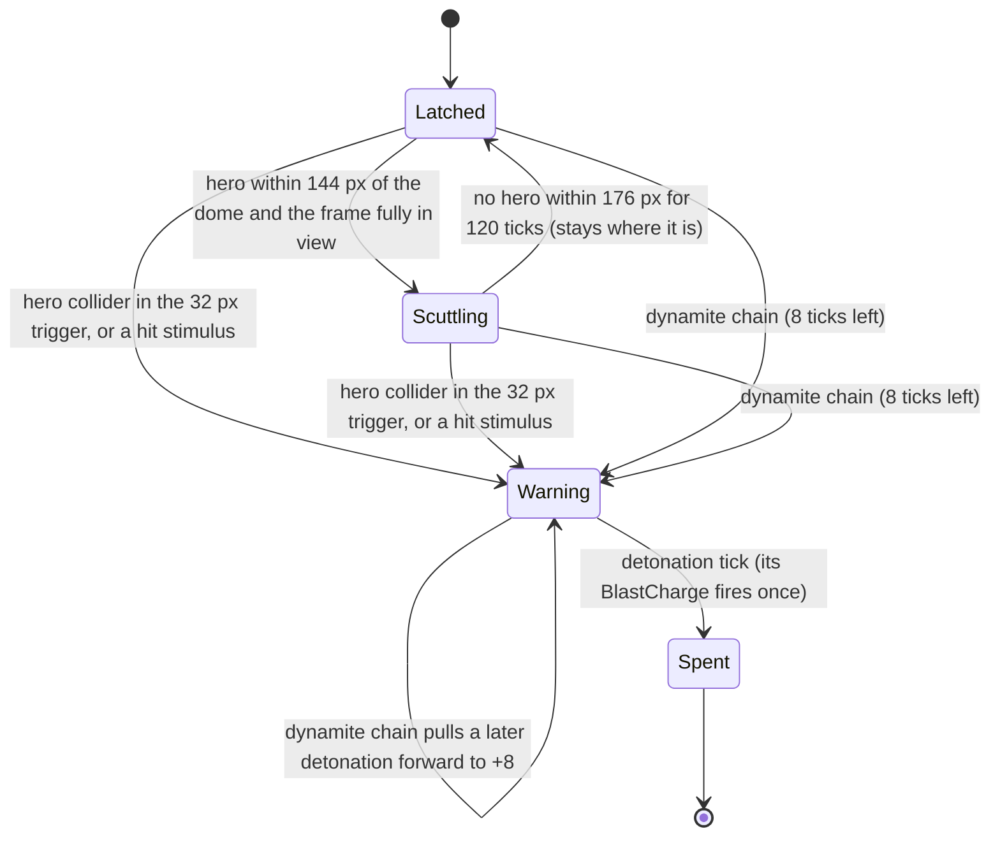

# HAZ-0 — Slime and Rot Sticker gameplay design sheet

> **Status: design adopted under the owner's design-defaults directive ([AGENTS.md](../../AGENTS.md), 2026-11-19). Nothing in this sheet is implemented. Game feel is NOT accepted.**
> Every choice has one adopted value with a `HAZ-Q##` ID ([section 16](#16-adopted-defaults-haz-q01haz-q50)). Each value is a tuning hypothesis stored as data. The owner reviews game feel after the implementation merges and may change any value in a follow-up PR. Only [section 21](#21-genuinely-open-questions) waits for the owner.
> Design: Claude Opus (top tier). Execution: medium tier, steps HAZ-A1, HAZ-A2, HAZ-B and HAZ-C ([section 19](#19-implementation-brief-medium-tier-haz-a1-to-haz-c)). Review: a separate top-tier agent.
> Stacked on the owner's encounter draft (PR #178); scheduled as step HAZ-0 by the Floor 01 playtest integration plan (PR #182, `docs/07-agents/f01-playtest-integration-plan.md`, Revision 2: section 4.4, the ENEMY-SLOT step, conflicts K3, K6, K8, K10, K13, K18). Format precedent: [ENEMY-GAMEPLAY-ENGINEER](enemy-gameplay-engineer.md).
> **Revision 1** applies the independent review's fix-now items F1 to F17: the charge model and its requirements on CP-B1 and CP-C, the ENEMY-SLOT rows, the Rot Sticker as an env prop, the HAZ-A1 and HAZ-A2 split, the companion mapping, the goblin walk barrier, the ROT-01 timing, the SLIME-01 box conversion, the jump and escape arithmetic, the acid pop, the contact box during the lunge, the DP-Q45 ceiling, respawn, the hazard-volume requirements, two new deviations, a low wall sticker for Donut's missile, collider-based proximity, and the pocket A shelf.
> **Revision 2** applies the re-review items N1 to N4 and its sheet-text notes: the acid patch as a persistent `Acid` volume in a separate `acid_patches` sidecar array, with every schema addition listed as a HAZ-A1 append (N1); pocket C without the lookout goblin and the low wall sticker, with Donut's missile proven as an airborne cast into R2 over the slime (N2); a single `boss` supplier per roster (N3); walk barriers as x-intervals with a walking line that flee and the Coward hop also obey (N4); plus the 84 px step-out, the 52 px pop figure, `Acid` feed rows for the slime body, no second blast volume, the roster cap note, the unlit-charge wording and the respawn-hook wording.
> **Revision 3** applies the narrow re-read: a Magic Missile bolt provokes a sticker from its 32 px trigger circle with line of sight (rule B, P1), which widens Donut's C missile window to cast presses on jump ticks 0..6 and 42..49; S2 holds at home while Donut is airborne (P2); the acid volume's data uses BOIL-B core's `hero_damage: AllHeroes` and `hurts_enemies: true` (N1-T); an outer-radius floor of 48 while room C ships; a drained patch is removed, never shrunk to width 0.

**Why:** the owner's [hazard encounter](floor-01-slimes-rot-stickers-encounter.md) ("The Floor Lies") asks for a slime and a Rot Sticker that are distinct species, readable before they hurt, and usable against other monsters. It leaves the gameplay numbers, the damage classification and the engine contracts to a design sheet. This is that sheet. It turns the approved SLIME-01 and ROT-01 readability sets into one slot enemy and one environmental prop on the shared interfaces the plan assigns: the new-enemy slot (ENEMY-SLOT), the explosion profile in `src/blast.rs` (CP-B1, CP-C), the env prop and hazard volume cores (`src/env_prop.rs`, `src/env_hazard.rs`, BOIL-B) and the encounter sidecar (`src/encounter.rs`, BOIL-A).

## 1. Authority and locks

- **Owner intent (#178), kept:** three pockets (A slime floor, B Rot Sticker overhead, C crossover); slimes and Rot Stickers are separate species; **no slime splitting**; no hidden or offscreen hazard; 1 HP per qualified contact with no per-tick drain; Rot warning 18 to 24 ticks; blast radius 40 to 56 px; one detonation per sticker; one damage evaluation per victim per blast; 1 HP to nearby heroes and normal enemies; early triggers only through real collisions; no cascades; at most 1 sticker in B and 2 in C; the direct route works without any environmental combo (HAZ-06); no new button or companion command.
- **Plan resolutions applied:** K3 (world and enemy blasts hurt every hero; credit goes to the initiator), K6 (hazards, blasts and body contacts are never evadable; a sheet may opt one targeted attack in), K8 (rooms are checked for Carl, base Donut and boosted Donut, 128 px; the DP-Q45 lane ceiling), K10 (the gameplay tell wins over ROT-01's 30 ticks; greybox stand-ins allowed and labelled), K13 (the AI partner hazard gap is reported, not fixed here), K18 (`src/env_prop.rs` is the one engine for new environmental props).
- **Art (approved readability sets, not mechanics):** [SLIME-01](../02-art/slime-01-spec.md): 30 px tall, frame 80 x 40, pivot (40, 39); tell 6 + 24, launch 2, impact 6, recover 20; lunge box frame 10 only. [ROT-01](../02-art/rot-01-spec.md): a 20 px disc, frame 32 x 32, pivot (6, 16) on the surface, dome centre 6 px off the surface; one wall-mounted set, rotated for ceilings; tell 6 + 24; the first burst frame is frame 10. Neither spec approves damage, radius, health or trigger rules; this sheet does.
- **Shared engine contracts (owned elsewhere, consumed here):**
  - **New-enemy slot** (ENEMY-SLOT, `src/scene_enemy.rs`): the slime is a slot enemy. It lives in its own `src/combat_scene/slime.rs` module behind ENEMY-SLOT's one hook line and adds no hook of its own in `combat_scene.rs`, `companion/**` or `contacts_cf02.rs`. Its rows are in [section 19](#19-implementation-brief-medium-tier-haz-a1-to-haz-c).
  - **Env props** (`src/env_prop.rs`, BOIL-B core): the Rot Sticker is an env prop, not an enemy. Its machine `latched → scuttling → warning → spent` mirrors the valve's `intact → warning → venting → spent`. It reads BOIL-B core's stimulus intake.
  - **Blast profile** (`src/blast.rs`, CP-B1 adds the profile, CP-C the chain and the `BlastTarget` hook; the shared `HeroDamagePolicy` enum lives in `src/hero_damage.rs`, added by BOIL-B core or CP-B1, whichever lands first). The profile has **one `hero_damage` policy field**, which replaces the draft's `hurts_owner_hero`. The dynamite's policy hurts only the thrower's hero (CP-Q23, CP-Q24); **world and enemy blasts use `AllHeroes`**. Kill credit uses the field `BlastCharge.owner` that already exists in `src/blast.rs`: for a Rot blast it holds **the player whose stimulus set it off, otherwise none** (the initiator rule). The profile gains no second owner field.
  - **Hazard volume** (`src/env_hazard.rs`, BOIL-B core and wire): a contact area with a per-(activation, victim) token, a team policy, the class (`HazardClass`, always non-evadable) and a hero-hurt source. BOIL-B core's review round allows **timed, persistent and moving** volumes; its 18/120-tick limits and its 24-tick telegraph floor for hero hazards apply only to timed volumes, and its nav feed carries ticks-left. The acid patch is a **persistent** volume of class `Acid` (section 8). Every addition this sheet needs is listed in section 19, as a HAZ-A1 append where the core lacks it.
  - **Hero hurt path:** `hurt_hero` with a `HeroBlow` (invulnerability, hurt ticks, hit-stop, the solo last-HP guard). `hurt_hero` copies `knock_vx` as given, so **every caller signs it** (section 8). Source ids follow the schemes CP-B1 (blasts) and BOIL-B (hazards) define; this sheet invents no third scheme.
  - **Donut's reflex** ([DONUT-MOBILITY-01](../03-tech/donut-mobility-01.md), DM-Q17 evadable list, DM-Q18 never-evadable default).
- **Tone:** [antihero tone](antihero-tone.md). The slime is a grimy mound that has plainly eaten someone; the Rot Sticker is a bad mushroom that lights up like a fuse. Both are threatening and a little absurd, never cute, never a spider.

## 2. Tactical roles

| | Goblin A/B | Engineer | Bad Llama | **Slime** | **Rot Sticker** |
| --- | --- | --- | --- | --- | --- |
| Where it threatens | next to the hero | a floor lane at middle distance | the air at height 42..48 | **the floor at the hero's shins, and its own body and pool** | **a circle around a point on a wall or ceiling** |
| What it punishes | standing next to it; a whiffed move | being committed at middle distance | standing in the open | **stepping on or into it; staying in close after it rears up** | **fighting, standing or jumping under or beside it without looking** |
| Main answers | hit first, swat the tell, bail-out | jump, leave the lane, matador | jump, cover | **bait the lunge and punish the recover and cooldown; hop or jump the low lunge; kick it away while it rears** | **bait it and back off; provoke it from range; lure it along its track; push enemies into it** |
| Body | 24 x 38, HP 2 | 24 x 38, HP 3 | 46 x 39, HP 3 | **corrosive body, HP 3, never flinches** | **20 px disc, no health: any hit sets it off** |

**Slime:** a slow, heavy zone guard that sits in its acid pool. Touching its body or its pool burns. It rears up and throws a low lunge along the floor. Its gel never flinches, so you cannot jab it out of the tell: you out-space it or hop it, then punish it while it recovers and cools down. Killing it drains its pool.

**Rot Sticker:** a dormant explosive that wakes when it sees a hero, creeps along one wall or ceiling track toward the spot above or beside that hero, and goes off 24 ticks after a hero's body comes within 32 px or anything hits it. It does not chase; it ambushes the hero who stops to fight near it. It is a hazard, not an enemy: it is never needed to clear the room, it has no health, and enemies never set it off by walking near it. The player decides when it goes off and what is near it.

**Why they are not duplicates:** the goblins threaten the space next to you, the Engineer a lane, the llama the air. The slime threatens **the ground under your feet** (body, pool, low lunge), so its answers are hops and spacing. The sticker threatens **a fixed circle on the level geometry** on a timer you start, so its answers are observation, baiting and timing.

## 3. Player-readable tells

**Slime**

1. **Idle and creep** (SLIME-01 frames 0 to 6): a slow wet heave, 30 px/s. The green rim glow and the pool are always visible.
2. **Rear-up tell (30 ticks)**: frame 7 for 6 ticks (half-rise), frame 8 held 24 ticks (reared up and back, 37 px, acid beads on the crest). It is the tallest pose in its set, and its body visibly pulls **back**: its hurtbox front drops from 28 to 13 px (section 4). The goblin tell cue plays on the first tick (existing cue, through the slot's cue hook).
3. **Launch (2 ticks, frame 9)** and **lunge impact (6 ticks, frame 10)**: the mass slaps forward along the floor to 39 px ahead at shin height.
4. **Recover (20 ticks, frame 11)**: bunched and spent. Then a **48-tick cooldown** in idle or creep, in which it never attacks. Recover plus cooldown is the punish window (68 ticks).

**Rot Sticker**

1. **Latched** (ROT-01 idle, frames 0 to 2): a dark disc with one ember. Visible as soon as it is on screen; it never wakes or triggers off-screen.
2. **Scuttling** (frames 3 to 6): the stretch-and-drag creep at 60 px/s. The motion itself says "it has noticed you". Audio: an optional quiet loop of an existing soft cue while scuttling (HAZ-Q47; off if no fitting cue exists).
3. **Warning (24 ticks from the provoke tick `t`)**: ROT-01 frame 7 on ticks `t..t+5` (6 ticks; the provoke tick shows frame 7), frame 8 (the whole face lit, the halo) on `t+6..t+22` (**17 ticks** instead of the authored 24), frame 9 on `t+23`, frame 10 on the detonation tick `t+24`. This is a playback retime of a held frame, not a redraw (K10): the gameplay tell wins. A thin ring at the blast radius is drawn around the dome centre on `t..t+23` (a labelled code-drawn stand-in, HAZ-Q38, shown in every build), because the 48 px blast is wider than the 20 px VFX-01 burst. Audio: the existing dynamite fizzle cue plays once on the provoke tick (HAZ-Q47), the "sharp click" #178 asks for, until a dedicated cue exists.
4. **Detonation**: frame 10, then the VFX-01 burst and the existing detonation cue. The body is gone; a cosmetic olive drip stays on the surface.

A sticker set off by a dynamite chain at tick `c` (detonation at `c+8`) shows frame 8 on `c..c+6`, frame 9 on `c+7` and frame 10 on `c+8`.

## 4. Slime: moves and frame data (60 Hz, all data knobs)

Attack tick 0 = the tell starts. Pixels are pivot-relative (x forward along the facing, y up from the feet). Boxes are half-open. Every box is converted from SLIME-01's frame-pixel `(x, y, w, h)` rows by subtracting the pivot (40, 39) and using `w` and `h` exactly; the only gameplay change is +2 px on the idle hurtbox height.

| Phase | Attack ticks | Frames | Motion | Hurtbox | Contact box | Hits on the slime |
| --- | --- | --- | --- | --- | --- | --- |
| Tell: half-rise | 0..6 | 7 | none; facing and target locked at tick 0 | **tell** | **gathered** | damage, 2-tick flash, attacker hit-stop; **the timer never changes** (gel) |
| Tell: reared | 6..30 | 8 | none | tell | gathered | as above |
| Launch | 30..32 | 9 | none | tell | gathered | as above |
| Impact | 32..38 | 10 | none (the reach is in the frame) | idle | **gathered** (kept through the impact) | as above |
| Recover | 38..58 | 11 | none; facing still locked | idle | standing | as above |
| Cooldown | 58..106 | idle / creep | **turns to its target at tick 58**, then approaches or holds; never attacks | idle | standing | as above |

**Boxes** (authored facing +x; mirrored about the pivot column):

| Box | SLIME-01 frame px | x | y (height) | Use |
| --- | --- | --- | --- | --- |
| Hurtbox, idle (every state except tell and launch) | 8, 10, 60, 30 | `[-32, 28)` | `[0, 32)` | SLIME-01's idle hurtbox (height 30) **plus 2 px** so Carl's jab (heights 29..35) and haymaker (27..38) connect reliably on a 30 px mound |
| Hurtbox, tell and launch | 15, 3, 38, 37 | `[-25, 13)` | `[0, 37)` | the reared pose: taller, pulled back |
| Contact box, standing (recover, cooldown, idle, creep) | 12, 16, 51, 24 | `[-28, 23)` | `[0, 24)` | SLIME-01's standing box: the corrosive mound without film and crest |
| Contact box, gathered (tell, launch, impact) | derived: frame 8, rows 15 to 38 | `[-25, 4)` | `[0, 24)` | the gathered mound of frame 8 at the same heights, by the standing box's rule (film row and floor plate excluded) |
| Lunge box (impact only) | 58, 25, 21, 15 | `[18, 39)` | `[0, 15)` | SLIME-01 frame 10's leading bulb, floor to shin height |

**Reach at a glance** (pivot-to-pivot distance `d`, the hero in front of it on its floor; Carl's hurtbox is 24 x 52, Donut's 20 x 24):

| Fact | Carl | Donut |
| --- | --- | --- |
| The lunge hits a standing hero when | `6 < d < 51` | `8 < d < 49` |
| Corrosive body touches the hero (standing box, front) | `d < 35` | `d < 33` |
| Corrosive body touches the hero (gathered box: tell, launch, impact) | `d < 16` | `d < 14` |
| Jab, haymaker or push kick (box front 22) reaches the **idle** hurtbox | `d < 50` | — |
| Jab or kick reaches the **tell** hurtbox | `d < 35` | — |
| Jab reaches the idle hurtbox **from behind** (back edge −32) | `d < 54` | — |
| Swat (front 30, Engineer sheet value) reaches the idle / tell hurtbox | — | `d < 58` / `d < 43` |

Consequences, by design: Carl cannot jab the slime from outside its lunge reach (50 < 51), and cannot touch its reared body at all from outside the reach. Donut can poke it from 49..58 px with the swat, the cat's reach advantage. Magic Missile hits from anywhere in line.

**Jump and hop:** the lunge box is 15 px tall. A plain jump pressed by attack tick 29 has the feet above 15 px on every impact tick (about 20 px on tick 32; a press on tick 30 gives about 13.8 and is hit; the domain test pins the last safe press tick, predicted 29). The CF02 bail-out hop (apex 32 px) also clears it, so the hop **answers the slime** where it fails against the Engineer. A plain jump lasts about 50 ticks, so **the punish after any jump happens in the cooldown, not the recover**: a jump pressed on attack ticks 12 to 29 lands on ticks 62 to 79. The standing contact box is 24 px tall, so a jump **over** the slime clears its body and lands behind it; the lunge, locked to its tell-start facing, whiffs forward. The slime turns toward its target at the start of the cooldown (tick 58), so its back is open only during the recover, which a hero who jumped over it cannot use; he hits its front during the cooldown instead.

### One impact tick, in this order (inside the slime's slot step)

1. **Lunge:** the lunge box overlaps a hero hurtbox (heroes stepped earlier this tick). An invulnerable hero is skipped. **Donut's reflex check runs here** (DM-B's candidate-loop pattern, as for the Engineer's ram): an evaded Donut is skipped and Carl behind her may be chosen on the same tick. On a hit: `hurt_hero` with `HeroBlow { damage 1, from_x = slime x, knock_vx = ±120 signed away from the slime, knock_vy 160 }`. **One hero per lunge**: the first overlapped; if both on the same tick, the one whose near edge is closer to the slime's front, ties to Carl. The lunge stops testing after a hit (the impact frame keeps playing).
2. **Body contact** (section 8 contact rule) with the gathered box. **A hero who evaded this lunge instance is exempt from body contact on this lunge's impact ticks** (HAZ-Q15), so an evade is never voided by the body on the same tick.
3. **Nothing else:** the lunge never touches goblins, other slimes, Rot Stickers or props.

### Hits on the slime (gel)

- **Every hit** (jab, haymaker, kick, stomp, dive, air kick, swat, pounce, Magic Missile, a CF02 launched body, a blast) deals its normal damage and gives the attacker its normal hit-stop. The slime plays a 2-tick white flash (presentation) and **never changes state or timer**: no stagger, no launch, no knockdown, no tell interrupt, no Donut light guard. Gelatinous mass absorbs the blow.
- **Push kick:** additionally slides the slime **24 px** directly away from the kicker over 8 ticks (3 px per tick), stopped by solids and the leash. It slides in any state, including the tell, which is how a kick makes the lunge whiff (section 7). To finish the slide before the impact, the kick must land by attack tick 24 (pressed by attack tick 11).
- **Lethal hit:** defeated in place (section 9).
- **The hurt frame** (SLIME-01 frame 12) plays for 12 ticks only when a hit lands in idle; in every other state it is the flash only. The frame never changes a timer. This replaces #178's "observable hurt reaction" outside idle (deviation D8).

## 5. Slime brain

- **Wake:** a hero's hurtbox within **160 px** of the slime's pivot **and** the slime's whole body inside the simulation camera view (the llama's fair-fire precedent: simulation state, the same on every output). It never wakes off-screen.
- **Eligible hero:** living, feet within **8 px** of the slime's floor line. A jumping hero or a hero on a ledge is not a lunge target.
- **Target:** the existing `update_targets` rule (hysteresis, solo bias toward the controlled hero) over eligible heroes, locked at the tell start until the end of the recover. With no eligible hero it holds facing the nearest hero and takes no token.
- **Approach:** creeps at **30 px/s** (0.5 px per tick) toward the point **40 px** (the standoff) from the target on its current side, never backward, never more than **96 px** from its home column (the leash; its home is its pool's centre or its spawn).
- **Trigger and tokens:** a token candidate only when the target is eligible and `d <= 44`, and never during the cooldown. It shares the goblins' `MAX_ATTACKERS` (2) and the 12-tick tell spacing (through ENEMY-SLOT's token access, section 19), and holds the token from the tell start to the end of the impact. Without a token it holds.
- **Contact (corrosive body):** checked every tick in every living state, in its slot step, section 8.

## 6. Slime: size, hurtboxes, health

- **Health 3** (HAZ-Q04): a baited lunge opens 68 safe ticks (recover plus cooldown), which is room for jab, haymaker and one more hit. Never a sponge; mixed in C, the Rot blast's 1 damage makes it a two-hit kill. The cooldown is the owner's tuning knob if one bait proves too generous.
- **Hurtbox and contact boxes:** section 4. The boxes are per state (two hurtboxes, two contact boxes), taken from SLIME-01 section 3.
- **Mass:** never launched, never knocked down, never bowled by a CF02 flier (a flier that meets it stops as against a llama; the flier takes its normal contact result and the slime takes the flier's hit damage).

## 7. Counterplay

| Who | Answer | Cost or risk |
| --- | --- | --- |
| Carl | **Bait and punish:** stand at 44..50 px so it rears up, step back past 51 before attack tick 32 (3 ticks of running from 44), then step in during the recover: jab + haymaker lands 2 damage; finish in the cooldown | Mistime the step back and the lunge hits; walk in too far and the body burns |
| Carl | **Jump the lunge** in place or **over the slime** (body 24 px tall), then hit it during the cooldown | Landing on the body or in the pool burns; the slime has turned to face him |
| Carl | **Push kick while it rears:** from `27 <= d < 35` during the tell, a kick that lands by attack tick 24 slides it 24 px; from 30 px it ends at 54, past the lunge reach (51), so the lunge whiffs | Must step inside 35 px of a rearing slime; standing at `d < 16` touches the gathered base |
| Carl | **Dive, stomp:** they hit (damage), but the hero touches the corrosive body: a trade | 1 damage to Carl per contact entry |
| Donut | **Swat at range:** her swat reaches the idle slime from 49..58 px, outside her lunge reach (49) | During the tell she must be inside 43 px of it, inside the lunge |
| Donut | **Magic Missile** from range | Mana: three casts per slime (1 damage each) |
| Donut | **Pounce** | Lands on the body: a trade, like the dive |
| Either | **Collateral:** set off a Rot Sticker with the slime inside its radius (1 damage), or kick the slime under a sticker first | The hero must leave the radius too |
| Pair | One hero baits the lunge, the other hits its back during the recover | The partner standing in the lane is the one hit |

## 8. The acid patch (hazard volume)

**Shape:** a floor strip authored in the encounter sidecar's own **`acid_patches`** array (entries `id`, `x0`, `x1`, `floor_y`, `linked_slime`; a HAZ-A1 append, never in the room file's `hazards`): `x0..x1` on a walking surface, volume height **6 px** above that surface. Each entry becomes one **always-on persistent** hazard volume of class **`HazardClass::Acid`** (it exists in BOIL-B core). A hero whose hurtbox overlaps the volume is touching acid; a hero more than 6 px up (any jump, the hop) is not, and counts as outside. Width **64 px** by default, 32 to 80 allowed (HAZ-Q18).

**Contact rule (patch and slime body share it, HAZ-Q19 and Q13):**
- **1 damage** through `hurt_hero`, with a pop: `HeroBlow { damage 1, from_x = the patch centre (the slime's pivot for its body), knock_vx = +180 when hero.x >= from_x, otherwise −180, knock_vy 200 }`. **The caller signs `knock_vx`**: `hurt_hero` copies it as given and applies its own away direction only to a defeat knockdown. A hero exactly at the centre pops toward +x.
- **The pop always clears the widest patch inside the hurt lock.** `HERO_HURT_TICKS` and `donut_hurt_ticks` are both 18, and 18 ticks at 3 px per tick carry the hero 54 px, while leaving an 80 px patch from its exact centre takes at most **52 px** (Carl: 40 + half-width 12) or **50 px** (Donut: 40 + 10); 54 still clears. The hop lasts about 23 ticks, so the hero is still airborne, outside the 6 px volume, when the lock ends; input after the lock cannot bring the hurtbox back over the patch before landing (pinned by `haz_acid_pop_from_centre_80`).
- **Token per entry (a HAZ-A1 append):** BOIL-B core's token is once per (activation, victim), and a persistent volume has one activation, so HAZ-A1 appends a per-entry token policy: one hurt per victim per volume per entry. The token rearms only after the victim's hurtbox has been outside the volume for at least 1 tick. An entry while invulnerable consumes no token: it is held pending, and if the hero is still inside when invulnerability ends, the hurt applies then. With the pop, standing in acid is impossible, so there is no per-tick drain.
- **Class:** `Acid`, non-evadable (DM-Q18 hazard; body contact for the slime's body).
- **Telegraph:** none needed. The volume is persistent: no telegraph window and no active maximum (BOIL-B core's 18/120 limits and 24-tick telegraph floor are for timed volumes only). The patch is always active and always visible from the moment it is on screen, so it is its own telegraph; it never appears, grows or hides. Validator rule 1 (section 15) proves a patch can never seal the lane.

**Team policy (HAZ-Q20), by victim filtering in the caller:** BOIL-B core's volume data (`hero_damage: HeroDamagePolicy`, `hurts_enemies: bool`, the plan's K3 vocabulary) cannot say "heroes and landing fliers, but not slimes", so the volume's data is **`hero_damage: AllHeroes`, `hurts_enemies: true`**, and HAZ's acid step **passes only the eligible victims** to it: living heroes, and launched goblins on their landing tick. Slimes, walking goblins and stickers are never passed.

| Victim | Rule |
| --- | --- |
| Heroes | Contact rule above |
| Slimes | Immune (to every patch, and to each other's bodies) |
| Walking goblins | **Never enter:** a patch is a **walk barrier** (an x-interval on its walking line), obeyed by the grounded walk, approach, flee and the Coward hop (section 19), so a Coward never flees or hops into acid. One already inside walks out by the nearer edge. Never passed as a victim |
| The Engineer | His walk obeys the same barrier; **a ram ends at a patch edge without a bonk** (HAZ-Q48) |
| Llamas | Their walk obeys the same barrier (HAZ-Q48; matters for PT-MASTERY) |
| Launched or falling goblins (CF02 fliers, outer-ring launches, kicks) | Walk barriers never stop a flight. **1 damage once per launch instance** when the body lands overlapping the patch; `DefeatCause::Environment { player: the launch's instigator, prop: patch id, class: acid }` (BOIL-B wire's cause) on a lethal landing. Lying in acid does nothing further. Switch `hazq20_acid_hurts_launched` (default on) |
| Rot Stickers | Never touch the floor |

**Linked pool and drain (HAZ-Q21):** a patch may name a `linked_slime`. When that slime is defeated the patch **drains** over **60 ticks**: on drain tick `k` (0 on the defeat tick) both edges move inward by `floor((w / 2) · k / 60)` whole pixels (HAZ computes the bounds and calls BOIL-B core's `set_rect` on ticks 1 to 59). The volume and the drawn stain always share the current bounds (honest bounds). On drain tick 60, where the width would reach 0, HAZ **removes** the volume and the stain instead (`set_rect` refuses an empty rectangle); a drained patch is never a zero-width volume. An unlinked patch is permanent for the attempt. Restart and respawn rules are in section 15.

**No slime trail (HAZ-Q17):** a creeping slime leaves only SLIME-01's cosmetic wet film. It never creates a hazard volume. The only acid is authored.

## 9. Slime death

- **Authoritative:** the existing causes and force tiers (melee, blast, environment), no new death physics. In place, no knock arc (the llama precedent). It emits the existing `CombatEvent::EnemyDefeated { tick, target, cause, force, instigator }`.
- **Remains:** SLIME-01 `down` frames 13 to 15, the remains held; **inert** (no contact, no hurtbox, no collision). The linked pool drains (section 8).
- **Presentation:** a new species `slime` whose recipes all map to `slime_down` (SLIME-01 frames 13 to 15), through ENEMY-SLOT's death-species hook; `species_death_profiles.json` stays byte-identical.
- **Morale:** its defeat is an ordinary witnessed defeat for goblins in range (no special delta). It has no nerve itself (morale opt-out).
- **No splitting**, no drops, no larger patch on a blast kill (the owner's later experiment, section 21).

## 10. Rot Sticker: states, motion and detonation

### Track and motion

- **Track:** one straight segment on a surface, authored in the sidecar: orientation `ceiling` (a soffit or slab underside, face down), `wall_left` (the wall on the sticker's left, face +x) or `wall_right` (face −x); two end points; a start point. A track may have length 0 (a fixed sticker) up to 160 px. Floor stickers and corner traversal are not in v1 (HAZ-Q23).
- **Dome centre:** 6 px off the surface along its normal (ROT-01). Every circle in this section is measured from the dome centre to the nearest point of a box (squared distance, like `BlastCharge::reach`). For a wall sticker the dome is 6 px in front of the face, so a circle of radius `r` reaches `r + 6` px from the face.
- **Wake:** a hero hurtbox within **144 px** of the dome centre, **and** the sticker's whole 32 x 32 frame inside the simulation camera view. Sleep: no hero within 176 px for 120 ticks; it stays where it stopped.
- **Scuttle:** toward the projection of its target hero's hurtbox centre onto the track, at **60 px/s** (exactly 1 px per tick), clamped to the track ends; it stops on the projection. Target: the nearest living hero by that distance; ties go to Carl; it re-picks only when the other hero is 16 px nearer (hysteresis). It never leaves its track and never moves in Warning.

### Trigger (provoke)

The sticker enters **Warning** on the first tick that any of these holds. It steps in the env step, after the charges step (section 19):

1. **Proximity:** a hero's **collider** within **32 px** of the dome centre, with line of sight (CP-Q22: the segment is blocked by the interior of any intact solid; a hero standing on top of the slab a ceiling sticker clings to is shielded), and the sticker fully in view. Both heroes' colliders are 24 x 52 (DM-Q07), so **Carl and Donut set it off the same way** (HAZ-Q27, F16); damage still tests the hurtbox, so Donut's small body keeps its edge against the blast. **Heroes only:** goblins, slimes and other enemies never trigger it by proximity.
2. **A hit stimulus** (BOIL-B core's stimulus intake, section 19): a hero melee hit token (jab, haymaker, kick, air kick, dive, stomp, swat, pounce; any per-move hit weight is enough), a projectile against the prop (a Magic Missile bolt overlapping its hurtbox, **or a bolt whose box comes within the sticker's 32 px trigger circle**, below), or a launched-body impact (a CF02 flier overlapping its hurtbox). The attacker gets **no hit-stop** from a sticker, so a hero who chose to hit it can run at once. A 2-tick white tint plays (ROT-01's proposal), not the hurt frame. Blast, prop-contact and boss-shove stimuli are ignored (a dynamite chain reaches the sticker through its charge, below).
3. **A dynamite chain** (CP-Q34): handled by the charge, below.

**Missile trigger circle (rule B, HAZ-Q29):** a Magic Missile bolt provokes a sticker when its box comes within the sticker's **32 px trigger circle** (squared distance from the dome centre to the nearest point of the bolt box, as for proximity) with line of sight (CP-Q22). The bolt is **consumed** on the provoke; cause `Projectile`, credit to Donut's player. This is the sticker's own rule in `rot_sticker.rs`, next to collider proximity, so BOIL-B core's stimulus intake is unchanged. Proximity stays heroes-only for bodies. Consequences: a grounded bolt (heights 16..22) never provokes R1 (`H` 68, 40 px) or R2 (`H` 84, 56 px); on the B slab top the slab blocks line of sight to R1; a wall sticker can be provoked by a near miss at dome height, which is intended.

On the provoke tick `t` the env step sets its charge's `detonate_tick = t + 24` and writes the credit (section 11). Warning is committed: further hits, proximity and enemies change nothing, except a dynamite chain that is due earlier.

**Hurtbox:** ROT-01's shell box, surface-local `[0, 14)` out from the surface by `[-10, 10)` along it, rotated with the orientation. Exactly the drawn shell; a tiny creature is never an invisible box. **One deliberate exception:** the missile's provoke uses the 32 px trigger circle (rule B above); every hit test (melee, fliers) and every damage test still uses the drawn shell.

### The charge (the drum precedent)

The detonation is an authored `BlastCharge` with a world profile, like BOIL-D's drum.

- **Where it lives (F1 a, c):** at attempt start, HAZ-A2's setup appends one charge per authored sticker to `CombatState.charges`, **after the fixture's charges**, in sidecar order. These charges are not `ChargeSpawn`s: they are appended after `CombatState::new` has validated the fixture, so its "a charge on tick 0 never fires" check never sees them. No sentinel value is used.
- **Initial state:** `Arm::Tick`, `detonate_tick = 0` (never fires: tick 0 is never stepped; it also marks the charge as unlit), no credit yet. `BlastCharge.owner` is written once at the provoke by the initiator rule (section 11).
- **Dynamite slot (F1 b):** CP-Q31's reserved dynamite slot is **the index after every authored charge**: fixture charges, then sticker charges. CP-Q31's wording "`fixture.charges.len()`" equals this in every fixture without stickers; the amended wording is requested from CP-B1 (section 19).
- **Position:** each tick, the env step writes `x` and `foot_y` so that `centre()` equals the dome centre (`foot_y = dome_y - BLAST_CENTRE_DY`).
- **Chains (F1 e):** for CP-Q34, a charge is **unlit** when `detonate_tick == 0` and it has not detonated (the plan's CP-C wording), and a chain that reaches it sets `now + 8` (a requirement on CP-C with its own unit test). HAZ's reset hook writes 0 back on a respawn (section 15). So a dynamite blast that reaches a latched sticker (within 64 px with line of sight) sets it to `t + 8`, depth 1. A sticker due within 8 ticks is left alone, and one due later is pulled forward to `t + 8`. The env step reads the new tick and enters or stays in Warning.
- **Credit on a chain (F1 f):** CP-C writes `owner` only on a charge whose `owner` is none. **The first initiator wins:** a sticker a hero already provoked keeps that hero's player when a dynamite chain pulls it forward. A latched sticker reached by a chain takes the dynamite's owner. This narrows CP-C's "a chained charge inherits the initiator" to charges without an initiator; it does not contradict it.
- **Detonation:** the charges step fires it once on its tick (dedupe as CP-Q34) and logs the existing `Blast { tick, charge }`. The sticker becomes **Spent** in the env step of the same tick: no hurtbox, no trigger, no motion, never again in this attempt.
- **Presentation (F1 d):** the presenter never draws the dynamite stick, the fuse or the fizzle for a sticker slot. It draws ROT-01 by sticker state (section 3). The shared burst VFX is used.

### The Rot blast profile (HAZ-Q30)

| Field | Rot value | Note |
| --- | --- | --- |
| core radius | **0: no core band** | No point-blank kill. **Requirement on CP-B1:** core radius 0 means no core band **including `sq == 0`** (a body that contains the centre gets the outer result), with the unit test `core_zero_never_point_blank`. Today's `reach()` returns `PointBlank` for `sq == 0` before any radius test, so this is a real change |
| outer radius | **48** | Middle of the owner's 40..56. **Floor: at least 48 while room C ships:** S2 at home is 47.5 px from R2's dome at 760, so a smaller radius silently breaks the C collateral |
| outer damage | **1** | Owner: 1 HP for normal enemies and heroes |
| launch | **160 / 180** px/s away from the centre (goblins only) | Lighter than the dynamite's 200 / 220; a normal CF02 launched body (CP-Q36) |
| line of sight | **on** (CP-Q22) | |
| `hero_damage` | **`AllHeroes`** | The plan's single policy field (the shared `HeroDamagePolicy` enum) |
| breaks structures | **off** | No shore, strut or terrain effect |

**What one Rot blast does (one evaluation per victim per blast):**

| Victim within 48 px with line of sight | Effect |
| --- | --- |
| Carl or Donut (either player, human or AI) | `hurt_hero` with `HeroBlow { damage 1, from_x = dome centre x, knock_vx = ±120 signed away from the centre, knock_vy 160 }` (the CP-Q23 block values); invulnerability and the solo last-HP guard apply; **non-evadable** |
| Goblin, Engineer | 1 damage and a launch (160 / 180); lethal → `Explosion { point_blank: false }` with `player = charge.owner` |
| Llama | 1 damage with its kick reaction (the CP-Q26 analogue) |
| Slime | 1 damage (gel: no state change), through ENEMY-SLOT's blast hurtbox |
| Another Rot Sticker | **nothing** (no provoke, no damage; the blast stimulus is ignored) |
| Dynamite stick, authored charges | Only CP-Q34 applies: an independently provoked Rot blast is not a dynamite blast and no dynamite chain reached it, so it chains nothing. A dynamite-chained Rot blast (depth 1) could chain further by CP-Q34, so the encounter validator keeps every sticker track more than 56 px from any other sticker track and from any authored charge (HAZ-Q33). In practice a Rot blast never propagates |

Caps: CP-Q34's depth 4 and 8 detonations per tick apply unchanged; with at most two stickers per pocket and the separation rule they are never reached.

### Escape and reach tables

**Ceiling sticker** (surface at height `H` above the walking line, dome centre at `H − 6`). Proximity uses the collider (24 x 52, top at 52 for both heroes); damage uses the hurtbox (Carl top 52, Donut top 24). Distances are horizontal, from the dome centre to the nearest box edge:

| `H` | Example | Trigger, grounded (both heroes) | Carl hit within | Donut hit within |
| --- | --- | --- | --- | --- |
| 68 | B perch slab underside | 30.4 | 46.9 | 29.3 |
| 80 | low soffit | 23.2 | 42.7 | never, grounded |
| 84 | C soffit (R2) | 18.6 | 40.3 | never, grounded |
| 96 | soffit | never, grounded | 29.3 (only after a jump triggers it) | never, grounded |
| 112 or more | high ceiling | a **jump** under it triggers | jump-dependent | jump-dependent |

**Bait and back off** (`H` 68, walking toward it and reversing on the provoke). Carl moves his box edge from 30.4 to 46.9 px, 16.5 px, which takes **6 ticks** at 185 px/s. Heroes step before the charges step, so a hero who starts moving away on provoke tick `t + L` moves on ticks `t+L .. t+24`: **the latest safe start is L = 19** (predicted; pinned by `haz_rot_bait_and_retreat`). That leaves **18 ticks (300 ms) to react**, about a human reaction time. This is why the warning is 24 and not 18: at 18 the margin would be 12 ticks (200 ms), unfair from a standing start. Donut: when her collider reaches 30.4, her hurtbox edge is at 32.4, already outside her 29.3 blast reach, so stopping or reversing at once is safe.

**Running straight through** under an `H` 68 sticker you have just triggered. Carl must cover about 101 px (30.4 + 24 + 46.9), 33 ticks at 185 px/s: **hit**. Donut must cover about 82 px (32.4 + 20 + 29.3), and 24 ticks at 207 px/s give 82.8 px: she **barely escapes** (about 1 px of margin, pinned by `haz_rot_donut_run_through`). Intended lesson: once it lights, back off the way you came; do not run through, unless you are a cat.

**Wall sticker** (dome 6 px in front of the face): a grounded hero whose collider spans the dome's height triggers it within **38 px of the face** (32 + 6), and is hit within **54 px of the face** (48 + 6) when his hurtbox spans the dome's height. Carl's jab reaches the shell (14 px deep) when his hurtbox edge is about 17 px from the dome centre, inside the trigger: hit and proximity agree. He needs 31 px more to clear the blast, **11 running ticks** (10 ticks give 30.8 px), after the jab's remaining active and recovery ticks: **22 of the 24 ticks**. Jab and run works if he runs at once.

## 11. Credit, events and attribution

- **`BlastCharge.owner` (the initiator rule, K3):** set once, at the provoke:
  - proximity → the player slot of the hero whose collider entered the trigger (in solo the one human player, also when the AI-driven hero entered; the CP-Q30 pattern);
  - a hero melee hit token or a Magic Missile → that hero's player;
  - a launched body → that launch's instigator (CF02 launch credit), or none;
  - a dynamite chain → the dynamite charge's owner, **only if the sticker had no initiator yet** (section 10).
  If nothing credits it, it stays none. Kills by the Rot blast are `Explosion { player: charge.owner, point_blank: false }`; acid kills are `Environment` (section 8). Damage to heroes is not "friendly fire": no hero owns a Rot blast. A dynamite chain through a sticker can hurt the thrower's partner (K3, `AllHeroes`); this is by design and pinned by `haz_rot_chain_hurts_partner` so the owner sees it.
- **Events:** **one appended variant** `CombatEvent::RotProvoked { tick, sticker, cause: Proximity | Hit(MoveId) | Projectile | Flier | Chain, player: Option<u32> }`, once per sticker. HAZ-A2 appends it through the `combat.rs` queue (the plan allows one HAZ event). The detonation reuses `Blast { tick, charge }`. Acid hurts use the `HeroHurt` source of BOIL-B's hazard scheme with the patch id; slime lunge and body hurts use the slime's slot target id.
- **Not an enemy:** a Rot Sticker emits no `EnemyDefeated`, counts for no room goal, morale, audience, CINE or AUTOPLAY enemy column, and is never in `update_targets` or the companion's `CompanionView`. It receives hits only through the env-prop stimulus intake.

## 12. Evadable classification (K6, DM-Q17 and DM-Q18)

| Source | Donut's reflex | Why |
| --- | --- | --- |
| **Slime lunge** | **Evadable (opted in, DM-Q17 list)** | A single-target attack with a 30-tick readable tell aimed at a body, like a goblin swing; scoped to the lunge instance (DM-Q19). The evading hero is also exempt from body contact for that lunge's impact ticks (section 4) |
| Slime body contact | Never | Body contact (DM-Q18) |
| Acid patch | Never | Hazard (DM-Q18) |
| Rot blast | Never | Blast (DM-Q18) |
| Rot trigger | — | Not an attack; nothing to evade |

The owner's #178 starting rule ("persistent acid contact and a Rot Sticker AoE should not be consumed as a dodge of a targeted melee hit") holds. A `HeroHurt` from any of these resets her reflex wait as every hurt does (DM-B).

## 13. AI partner hazard gap (K13)

**Today (before CA2-C):** the companion has no hazard input. Expected behaviour in this room:
- The follower may walk into an acid patch the leader jumped. The pop throws it out after 1 damage; the solo last-HP guard keeps an AI hero at 1 HP or more.
- With collider-based proximity, an AI hero of either kind triggers low stickers it walks under.
- The AI never targets a Rot Sticker (it is not in `CompanionView`) and never provokes one on purpose. It may provoke one by proximity.

**This sheet adds no companion code** (#178: no new buddy navigation; the plan: companion files belong to CA2, and a slot enemy adds no AI code). The slime reaches the companion only through the row ENEMY-SLOT offers (HAZ-Q44, F3):
1. **Not a target, not an interrupt, never a pounce.** The slime is in neither `targets` nor `threats`. So the director has no interrupt candidate against a rearing slime it cannot interrupt (gel), no support strike into its lunge band, and `duo_pounce_standing` never pounces onto its corrosive body. The AI does not attack slimes: a known, measured gap.
2. **Its tell as the single `boss` input.** ENEMY-SLOT lets one slot kind per room supply `CompanionView.boss`; in the hazard room that is the slime kind. While a slime is in tell, launch or impact, it supplies `BossThreat::Pound { x: slime x, facing, target: None }` (the rearing slime nearest to the AI hero; ties to the lower id). The follow layer's existing pound step-out (`POUND_STEP_OUT_PX`, **84 px** ahead of the facing, more than the 51 px lunge reach) then walks the AI hero out of the lunge, and the flank is suppressed while it is up. No director rule reads it as an interrupt.
   **Single supplier (N3):** a room or fixture whose roster holds another `boss` supplier (a slot kind that supplies it, or a fixture boss) **turns the slime's row off**: the slime supplies nothing there, and that is a recorded gap, not a merge of two threats. ENEMY-SLOT's registration, or else HAZ's validator rule 9, rejects two supplier kinds in one roster.
3. **If ENEMY-SLOT later offers `threats` and `targets` rows for slot enemies:** the slime's threat row uses `tell_len 0` (no interrupt candidate exists), its target row uses a kind that `duo_pounce_standing` excludes, and support strikes are allowed only in recover and cooldown if the row can express that; otherwise the gap stays recorded.
4. **Hazard feed data for CA2-C:** each tick the scene lists hazard rectangles in BOIL-B core's nav-feed format (active or telegraphed, class, ticks-left): every acid patch as **active**, class `Acid`, persistent (the hazard core publishes its own volumes); every living slime's contact box as **active**, class **`Acid`**; every awake sticker's trigger circle bounding box as **telegraphed**, class `Blast`; every warning sticker's blast circle bounding box as **telegraphed**, class `Blast`, with **ticks-left** to its detonation. HAZ-B writes the slime and sticker rows. **Sticker rows are feed-only:** HAZ never authors a damage-dealing `Blast` hazard volume for a sticker; its damage comes only from its `BlastCharge` (no double blast). CA2-C consumes the feed; until CA2-C lands, nobody reads it.
5. **Measured, with a threshold (HAZ-Q45):** per solo clear, count AI-hero hurts by source: acid, slime body, **slime lunge**, Rot blast, plus Rot provokes by the AI hero. **More than 1 AI-hero hazard or slime hurt per clear** on the solo routes opens a CA2 follow-up item (the Engineer's threshold precedent).

## 14. Solo and 2P parity

- **Same room, same rules, same route** for solo Carl, solo Donut (swap) and 2P (HAZ-09). No step needs a second human; no gate uses two simultaneous positions; every pocket is clearable by either hero alone.
- **Triggers and damage are per hero:** either hero can provoke a sticker and both provoke it the same way (collider proximity, F16); a Rot blast hurts every hero in range, human or AI; the lunge hits one hero per lunge; acid tokens are per victim.
- **Size asymmetry, kept small:** Donut's 20 x 24 hurtbox is hit by a ceiling blast only within 29.3 px under an `H` 68 sticker and never under `H` 80 or higher; she can just outrun an `H` 68 blast she triggered. It is her small-body edge and gates nothing. Open question 2 keeps it tunable.
- **Missile pattern for Donut:** in pocket C she jump-casts Magic Missile into R2 from left of the soffit (a cast press on jump ticks 0 to 6, including the jump tick, or 42 to 49), with the slime S2 inside the blast (section 15, `haz_room_c_missile_collateral`), so #178's pattern 3 and HAZ-04 work in the shipped room for solo Donut too.
- **2P camera:** v1 changes no camera rule (the plan gives the camera to CA2-B2). Readability comes from authoring: every sticker track lies inside the vertical band the shared camera always shows at the walking line, and a sticker can only wake and trigger while it is fully in view, so neither player is hit by an unseen sticker.
- **Credit:** per player, section 11.

## 15. Encounter rules for the room (sidecar data and validator)

The owner's spans are kept (#178 section 2). Recommended greybox values (data, not fixed LDtk; HAZ-A1 may shift them while every validator rule passes). The **room file** `f01_hazards.room.json` declares **`ceiling_px: 228`** (DP-Q45, read by BOIL-A core as `room_ceiling_px`: the room has standable surfaces more than 42 px up and the HAZ story pin holds Light on Your Feet). It keeps `props`, `enemies` and `hazards` empty; the sidecar holds every encounter entity.

| Pocket | Greybox | Purpose |
| --- | --- | --- |
| Entry 0..160 | dry floor, a cosmetic corrosion stain at x about 150 | teach the look before any harm |
| A 160..400 | **foothold slab** x 160..216, free-standing, **underside 56, top 68** (Carl, 52 tall, walks under it; it ends 32 px before the pool, so the standing-jump take-off zone x 228..236 has no slab above it); acid patch 248..312 (64 px) linked to slime S1 (home 280, spawned inside its pool; its 37 px tell fits anywhere); one common goblin at x 380 (the owner's "ordinary enemy at a fair distance") | the floor lies; hop the pool, watch from the foothold, or kill the slime to drain it |
| Transition 400..500 | dry, calm | reset; B's left retreat pocket |
| B 500..720 | perch slab 560..680, underside 68, top 80 (Carl class); sticker R1 on its underside, track 576..664 | look up; bait and back off; or walk over the slab out of its sight |
| C 720..1008 | ceiling soffit 744..840, underside 84, no standable top; sticker **R2** under it, track 760..824, **start point 760**; acid patch 768..832 linked to slime S2 (home 800, spawned inside its pool); one common goblin spawning on the floor at x 920 (CF02-Q58 bag slot 0); **exit step**: the floor rises to a standable top at 40 px from x 960 (the "short upper ledge" of #178) | turn danger into advantage; three valid patterns |
| Exit 1008..1152 | protected floor on the step, checkpoint | regroup |

**One sticker in C (N2).** Revision 1's lookout goblin is dropped: goblins live on one fixed floor line, and a raised-floor goblin needs an engine feature no step owns. R3 is dropped with it, because without an enemy beside it a low wall sticker gives no collateral (a floor enemy in front of a wall sticker always shadows a grounded bolt). C keeps one sticker, inside #178's limit of two.

What the C geometry gives:
- **R2 over the slime (pattern 2, bait):** under the 84 soffit a grounded hero's collider triggers R2 within 18.6 px horizontally, and the slime (32 px hurtbox) is inside R2's blast within about 13.7 px: provoking R2 over the pool is a real slime hit. S2 at home (800, facing −x, hurtbox 772..832) is 47.5 px from a dome at 760 and 46 px from a dome at 824, so R2 hits it from either end of its track.
- **Donut's airborne missile (pattern 3, HAZ-04, HAZ-Q50):** R2's hurtbox spans heights 70..84 under the soffit, and a grounded bolt (16..22) is 56 px below the dome, so the missile pattern is a **jump-cast** that uses rule B (section 10: a bolt within the 32 px trigger circle with line of sight provokes and is consumed). The proof position: Donut at x 708, left of the soffit, facing +x. The release comes on the press tick + 4; the bolt spawns 27 px ahead, moves 6 px per tick and meets the soffit's side face at 744 if it is too high. Simulated with the DM-A jump (semi-implicit, launch 500, gravity 1050, apex 114.92 on tick 28), the real bolt step, the soffit as a solid and line of sight: the release window is jump ticks 4..10 on the rise and 46..53 on the fall, that is **a cast press on jump ticks 0 to 6** (including the same tick as the jump) **or 42 to 49**, 7 + 8 press ticks. Her collider (`[696, 720)`) stays 40 px from the dome at every height, so she never provokes by proximity. She is clear at the detonation: the earliest rising release detonates around tick 28 with her about 55 px from the dome, the latest (release on tick 10, the bolt provokes on its spawn tick) around tick 34 at **51.6 px** with line of sight blocked by the soffit as well; falling releases detonate after she has landed, at about 68 px. R2 wakes on her (within 144 px), and her projection clamps it at its start point 760. **S2 holds at home while she is airborne** (a jumping hero is not an eligible target, section 5); any creep while she stands only moves it toward the dome. At home S2 is 47.5 px from the dome, inside the blast (hence the 48 px floor in section 10). The fixture does not rely on the creep. Pinned by `haz_room_c_missile_collateral`.
- **The C goblin** walks left and holds at the patch's right edge (x about 844) while the patch is wet. If R2 sits at its right end (824), the waiting goblin is inside its blast (about 40.8 px). It is fought across the dried pool or after a hop.
- **Dynamite (pattern 3, Carl):** a stick within 64 px of R2 with line of sight chains it at +8 (section 10).
- **The exit step** (top 40) is the short upper ledge and a refuge; no sticker guards it.

**Room goal (HAZ-Q39):** the sidecar goal **`defeat_roster`** (a HAZ-A1 append to the `Goal` kinds; BOIL-A core accepts only `reach_exit`): the exit opens when every roster enemy (S1, S2 and both goblins) has an `EnemyDefeated`; stickers are props and never count. HAZ-A2 opens the exit at runtime on that tick.

**Roster cap:** BOIL-A core's `MAX_LIVING_FIRST_PROBE` (4) counts the whole roster. This room's roster (S1, the A goblin, S2, the C goblin) is exactly 4, with no headroom; a fifth enemy needs a design change, not a data edit.

**Restart and respawn (HAZ-Q49):**
- **Full restart:** everything returns to its authored start: every sticker latched at its start point, its charge with `detonate_tick` 0, no owner and not detonated; every pool restored at full width; every slime at home with full health. The state hash equals a fresh start's.
- **Defeat respawn:** a **Spent** sticker stays spent; a sticker in Warning or Scuttling returns to Latched at its start point. HAZ's reset hook **runs on the room's defeat-respawn path, whichever the scene uses** (the existing `respawn()` resets only fixture charges and returns early outside demo rules) and rewrites each non-spent sticker charge to `detonate_tick` 0 and owner none. Slimes follow the goblin respawn rule exactly. A pool follows its linked slime: it stays drained while that slime stays defeated, and is restored (with its drain cancelled) when that slime respawns.

**Validator rules (appended to BOIL-A's encounter validator; a failure names the rule and the ids):**

1. **Acid patch:** width 32..80; on a walking surface; at least 48 px of dry floor on both sides; clearable by a standing-start plain jump for Carl and for base and boosted Donut from a take-off zone with no solid within the jump's rise (computed from the live tuning); never inside a protected spawn, checkpoint or exit rectangle. This rule is why a persistent patch is safe: it can never seal the lane.
2. **Alternate footing:** at least one route from entry to exit that touches no patch, for Carl and for base Donut, using walking and plain jumps only.
3. **Sticker track:** length 0..160; the surface orientation matches the solid it lies on; the dome centre at every track point is at most 200 px above the walking line below it (inside the shared camera band) and under `ceiling_px`; the blast circle swept along the track does not intersect a protected rectangle; the sweep leaves at least one dry, blast-free pocket at least 64 px wide on each side of the track along the floor.
4. **Separation:** any two track points of different stickers are more than 56 px apart (48 + 8); any track point is more than 56 px from an authored charge.
5. **Counts:** B at most 1 sticker; C at most 2 stickers, 1 slime and 1 goblin; A at most 1 slime and 1 goblin; never more than the LAB-Q04 cap of 4 enemies active (stickers do not count; slimes do).
6. **Spawn in acid (HAZ's rule):** a slime may spawn only inside its linked patch or on dry floor; no other kind may spawn overlapping a patch. Acid patches live in the separate `acid_patches` array, so BOIL-A core's `RosterInHazard` (which reads `hazards`) never sees them and needs no exemption.
7. **Goblin reach:** a goblin whose spawn is separated from the entry side by a patch holds at that patch's walk barrier. This is allowed only when the patch drains (it is linked to a slime) or the heroes' route crosses it by a jump; otherwise the validator rejects it (no stand-off softlock).
8. **Height gates (K8):** every standable surface of 81..128 px is lowered to 80 or less or declared a Donut vantage with a counter; in this room none exists (tops: A foothold 68, B slab 80, C step 40; the C soffit has no top). The DP-Q45 ceiling is **covered by BOIL-A core's existing rule** on the room file's `ceiling_px`; HAZ appends nothing for it, and DP-B's sweep includes this room.
9. **One `boss` supplier (N3):** a sidecar roster may hold at most one kind that supplies `CompanionView.boss`; a second supplier kind is rejected (by ENEMY-SLOT's registration if it enforces this first, otherwise by this rule).
10. **Direct route (HAZ-06):** the room goal is achievable with `hazq02_rot_enabled` false; that is, no step depends on a sticker blast. Checked by `haz_room_direct_route`.

**No turret ledges (#178):** from the 68, 80 and 40 px tops, Carl's strikes (lowest box 18 px above his feet) and Donut's grounded bolt (16..22 px) pass over the 38 px goblin and the 32 and 37 px slime. The tops are refuges from floor enemies, never firing positions against them.

## 16. Adopted defaults (HAZ-Q01..HAZ-Q50)

Knob names start with the question id (`hazq04_slime_health`). Slime and acid knobs live in `assets/data/gameplay/enemy_slime_v0.json`, Rot knobs in `assets/data/gameplay/enemy_rot_sticker_v0.json`; geometry lives in the room's `.encounter.json` sidecar.

| ID | Question | Adopted value | Rationale | Knob |
| --- | --- | --- | --- | --- |
| HAZ-Q01 | Roles | Slime: a slot enemy, a ground zone guard with a corrosive body and a low lunge. Rot Sticker: an env prop, a provoked, timed surface explosive; a hazard, not an enemy (section 2) | Distinct from goblin, Engineer and llama; uses only the approved readability sets; follows ENEMY-SLOT and K18 | none (design) |
| HAZ-Q02 | Gate | Both exist only under `cf02_rules`, in the hazard scene (`--scene f01_hazards`, and `--f01-room hazards` once the Floor 01 room selector lands) and in sidecar rosters that list them, with data kill switches `hazq02_slime_enabled` and `hazq02_rot_enabled` (default true). Never in `--demo`, the story route, plain `--cf02` or the combat lab | Plain modes stay byte-identical; a kill switch needs no rebuild | `hazq02_slime_enabled`, `hazq02_rot_enabled` |
| HAZ-Q03 | Simultaneous counts | A: 1 slime and 1 goblin; B: 1 sticker; C: 1 slime, 1 goblin, 1 sticker (limit 2); the roster is exactly 4 | #178 section 3 limits; LAB-Q04 cap; `MAX_LIVING_FIRST_PROBE` 4 counts the whole roster | validator (rule 5) |
| HAZ-Q04 | Slime health | **3** | One baited lunge opens 68 safe ticks; no sponge | `hazq04_slime_health` |
| HAZ-Q05 | Slime boxes | Section 4 table, converted from SLIME-01 with `w` and `h`; idle hurtbox height 32 (art 30 + 2); gathered contact box `[-25, 4) x [0, 24)` from frame 8 | Jab and haymaker connect on a low mound; per-state boxes follow the art exactly | `hazq05_*` boxes |
| HAZ-Q06 | Wake, creep, leash | Wake at **160** px and fully in view; creep **30** px/s; leash **96** | Slow zone guard; never wakes off-screen | `hazq06_sight_px`, `hazq06_creep_px_s`, `hazq06_leash_px` |
| HAZ-Q07 | Eligibility and target | Feet within **8** px of its floor; the existing hysteresis rule; locked from tell start to recover end; **turns to the target at the cooldown start** | A low lunge cannot target a jumper; the back is open only in the recover | `hazq07_floor_tolerance_px` |
| HAZ-Q08 | Trigger and standoff | Tell at `d <= 44`; standoff **40** | A standing hero at the trigger is hit (Carl `< 51`, Donut `< 49`) | `hazq08_trigger_px`, `hazq08_standoff_px` |
| HAZ-Q09 | Timeline | Tell **30** (6 + 24), launch **2**, impact **6**, recover **20**, cooldown **48** | SLIME-01's ticks; first harm on attack tick 32, inside #178's 24..36 | `hazq09_*_ticks` |
| HAZ-Q10 | Lunge | Box `[18, 39) x [0, 15)` on impact ticks; 1 damage, knock 120 / 160 signed away; one hero per lunge; first overlapped, closer edge, ties Carl | SLIME-01 frame 10; existing hurt path | `hazq10_damage`, `hazq10_knock_x`, `hazq10_knock_y` |
| HAZ-Q11 | Gel | Hits deal damage and hit-stop only; never staggered, launched, knocked down or interrupted; 2-tick flash; hurt frame only in idle | Its tell cannot be jabbed out: out-space it or hop it (deviation D8) | `hazq11_gel` (switch) |
| HAZ-Q12 | Push kick slide | **24** px over 8 ticks, any state | The defensive answer to the tell (kick at 30 → ends at 54, past 51) | `hazq12_kick_slide_px`, `hazq12_kick_slide_ticks` |
| HAZ-Q13 | Corrosive body | Contact box per state (gathered through tell, launch and impact; standing otherwise); the section 8 contact rule (1 damage, pop 180 / 200 signed away from its pivot, token per entry) | "Contact risk"; dive, stomp and pounce become trades | `hazq13_body_contact` (switch) |
| HAZ-Q14 | Tokens | Shares `MAX_ATTACKERS` 2 and the 12-tick spacing through ENEMY-SLOT's token access; a candidate only at `d <= 44` with an eligible target, never in cooldown | At most two attacks in flight | none (code) |
| HAZ-Q15 | Reflex class | Lunge evadable; an evading hero is exempt from the body contact for that lunge's impact ticks; body, acid and blast never evadable | DM-Q17 criteria; K6; an evade is never voided on the same tick | `hazq15_lunge_evadable` |
| HAZ-Q16 | Slime death | In place; existing `EnemyDefeated`; inert remains (frames 13 to 15); species `slime`; ordinary witnessed defeat; own nerve opted out | No new death physics; SLIME-01 "remains, not a stain" | data (death overlay) |
| HAZ-Q17 | Splitting and trail | No splitting; the creep film is cosmetic; no slime-made hazard | #178 and the roster forbid unapproved splitting; no saturation | none |
| HAZ-Q18 | Acid patch shape | An always-on **persistent** volume of class `Acid`, authored in the sidecar's `acid_patches` array (HAZ-A1 append); volume height **6** px, width **64** (32..80); no telegraph window, no active maximum | Jumpable by every hero; the pop always clears it; BOIL-B core's timed-volume limits do not apply to a volume that is always visible | `hazq18_volume_height_px`; widths in the sidecar |
| HAZ-Q19 | Acid contact | 1 damage; pop **180 / 200**, signed by the caller (+ when `hero.x >= centre`); one hurt per entry; rearm after 1 tick outside; invulnerable entries leave the token pending | 54 px inside the 18-tick hurt lock clears an 80 px patch from its centre; "1 HP per qualified contact, gated by invulnerability, no per-tick drain" | `hazq19_damage`, `hazq19_pop_x`, `hazq19_pop_y` |
| HAZ-Q20 | Acid team policy | By victim filtering in HAZ's acid step (the volume's data is `hero_damage: AllHeroes`, `hurts_enemies: true`): heroes: yes; slimes: immune (never passed); walking goblins: never enter (walk barrier on walk, approach, flee and the Coward hop); landing fliers: 1 damage once per launch, `Environment` credit to the instigator | Shoving enemies into hazards is player-authored causality (#178 asked for approval and tests; this is the adopted approval) | `hazq20_acid_hurts_launched` |
| HAZ-Q21 | Pool drain | A linked pool drains over **60** ticks when its slime dies (edge offset `floor((w/2) · k / 60)` on drain tick `k`); unlinked pools are permanent for the attempt | The visible clear state #178 asks for; a reward for the kill | `hazq21_drain_ticks` |
| HAZ-Q22 | Acid telegraph | Always active, always visible; no hidden or growing acid | Owner: no invisible instantaneous puddles | none |
| HAZ-Q23 | Rot track | One straight segment, `ceiling`, `wall_left` or `wall_right`, 0..160 px (0 = fixed); no floor stickers, no corners in v1 | Deterministic and readable; ROT-01 covers the orientations by rotation | sidecar; validator |
| HAZ-Q24 | Rot boxes | Hurtbox = ROT-01 shell `[0, 14) x [-10, 10)` surface-local; dome centre 6 px off the surface | Exactly the drawn shell | `hazq24_hurtbox`, `hazq24_dome_offset_px` |
| HAZ-Q25 | Rot wake and sleep | Wake: a hero within **144** of the dome centre and the whole frame in view; sleep after **120** ticks with no hero within **176** | Owner: never offscreen, visible before it threatens | `hazq25_wake_px`, `hazq25_sleep_px`, `hazq25_sleep_ticks` |
| HAZ-Q26 | Rot scuttle | **60** px/s (1 px per tick) toward the target's projection on the track; nearest hero, hysteresis **16** px, ties Carl | A third of Carl's run: it ambushes the stationary, never chases | `hazq26_speed_px_s`, `hazq26_switch_px` |
| HAZ-Q27 | Rot trigger | A hero's **collider** within **32** px of the dome centre, with line of sight, while in view; heroes only; damage tests the hurtbox | Owner's "danger envelope"; both heroes set it off the same way (F16); no scripted or enemy trigger | `hazq27_trigger_px`, `hazq27_sense_box` (`collider`) |
| HAZ-Q28 | Rot warning | **24** ticks, committed, stationary | 18 ticks of reaction at the trigger edge (section 10); owner range 18..24 | `hazq28_warning_ticks` |
| HAZ-Q29 | Provoke by hit | Any env-prop hit stimulus: a hero melee hit token (any weight), a projectile against the prop, a launched-body impact; **plus rule B: a Magic Missile bolt whose box comes within the 32 px trigger circle with line of sight provokes it and is consumed**; no attacker hit-stop; a hit never defuses | Owner: real collisions only; hit and run is the melee answer; rule B widens Donut's airborne window from 3 + 2 to 7 + 8 press ticks (P1) | `hazq29_hit_provokes` (switch) |
| HAZ-Q30 | Rot blast profile | Core none (radius 0, also at `sq == 0`), outer **48**, damage **1**, launch **160 / 180**, line of sight on, `hero_damage: AllHeroes`, structures off; the outer radius stays **at least 48** while room C ships (S2 at 47.5 px) | Owner: 1 HP, 40..56 px, no free instant kills; K3 | `hazq30_*` (profile row) |
| HAZ-Q31 | Rot blast on heroes | 1 damage, knock **120 / 160** signed away from the dome centre, through `hurt_hero` | CP-Q23 block values; existing guards | `hazq31_knock_x`, `hazq31_knock_y` |
| HAZ-Q32 | Rot blast on enemies | Goblin and Engineer: 1 and a launch; llama: 1 with its kick reaction; slime: 1; other stickers: nothing | Standard explosion pipeline; no cascades | none (rules) |
| HAZ-Q33 | Chains | Dynamite chains a sticker by CP-Q34 (+8, depth 1; an unlit charge is set to +8); an independent Rot blast chains nothing; the separation rule (more than 56 px) keeps a chained Rot blast from propagating; caps 4 and 8 unchanged | Owner: no cascades; CP-Q34 stays the one chain rule | validator (rule 4) |
| HAZ-Q34 | Credit | `BlastCharge.owner` = the initiator's player at the provoke, else none; a later chain never overwrites an initiator (section 11) | K3 initiator rule; no second owner field | none (rules) |
| HAZ-Q35 | Spent and defuse | Detonation removes the body; a cosmetic drip remains; no dud defuse in v1 | One detonation per sticker; "hit it twice to defuse" would make melee free | `hazq35_defuse` (switch, false) |
| HAZ-Q36 | Not an enemy | No `EnemyDefeated`, no room goal, morale, audience, CINE or companion view; one appended `RotProvoked` event plus the existing `Blast` | A hazard the player may ignore (HAZ-06) | none |
| HAZ-Q37 | Rot presentation timing | Provoke tick `t`: frame 7 on `t..t+5`, frame 8 on `t+6..t+22` (17), frame 9 on `t+23`, frame 10 on `t+24`; chained at `c`: frame 8 on `c..c+6`, 9 on `c+7`, 10 on `c+8` | Gameplay tell wins (K10); art held, not redrawn | presentation table |
| HAZ-Q38 | Radius ring | A thin ring at 48 px around the dome centre on `t..t+23`, in every build, labelled stand-in until approved hazard VFX art exists | The VFX-01 burst is 20 px; the danger must read at its true size | `hazq38_ring` (switch) |
| HAZ-Q39 | Room goal | Sidecar goal **`defeat_roster`** (HAZ-A1 append): the exit opens when every roster enemy (slimes and goblins) is defeated; stickers never count | Direct route without combos (HAZ-06); BOIL-A core accepts only `reach_exit` | sidecar goal |
| HAZ-Q40 | Pocket A layout | Section 15: a free-standing foothold slab (underside 56, top 68) clear of the pool, one 64 px pool linked to the slime, one goblin beyond it | Teach one hazard with a safe hop and an optional vantage (deviation D9) | sidecar; validator rules 1, 2, 6 |
| HAZ-Q41 | Pocket B layout | One sticker under a walkable 80 px slab (underside 68) | Look up; bait; or bypass over the top | sidecar |
| HAZ-Q42 | Pocket C layout | Section 15: soffit sticker R2 (track 760..824, start 760) over the slime's pool, one floor goblin spawning at 920, an exit step (top 40); no lookout goblin, no wall sticker | Three valid patterns (#178 section 3), including Donut's airborne missile; no raised-floor goblin feature needed | sidecar; validator |
| HAZ-Q43 | Camera | No camera change; tracks within 200 px above the walking line and under `ceiling_px`; wake and trigger only fully in view | Camera belongs to CA2-B2 (plan) | validator (rule 3) |
| HAZ-Q44 | Companion | Slime in neither `targets` nor `threats`; its tell supplied as the single `boss` input (`BossThreat::Pound`, `target: None`; step-out 84 px); the row is off in a roster with another `boss` supplier (recorded gap); never a pounce target; stickers not in the view; no companion code change | K13; ENEMY-SLOT's one-row contract; gel makes an interrupt pointless | none |
| HAZ-Q45 | AI gap threshold | More than 1 AI-hero hurt per solo clear from acid, slime body, slime lunge or Rot opens a CA2 follow-up | Engineer precedent | none (report) |
| HAZ-Q46 | Determinism | No randomness in either kind; the C goblin takes slot 0 of the CF02-Q58 temperament bag | Replays stay exact | none |
| HAZ-Q47 | Rot audio | Existing dynamite fizzle cue once on the provoke tick; optional quiet loop of an existing soft cue while scuttling (off without a fitting cue); existing detonation cue | #178 separates a traversal cue from a sharp warning; no new audio asset (deviation D7) | `hazq47_provoke_cue`, `hazq47_scuttle_loop` |
| HAZ-Q48 | Other walkers at acid | Goblins: walk, approach, flee and the Coward hop obey the barrier; Engineer: walk barrier, and a ram ends at a patch edge without a bonk; llama: walk barrier | One rule for every walker; matters for PT-MASTERY | none (rules) |
| HAZ-Q49 | Restart and respawn | Section 15: full restart restores everything; a defeat respawn keeps spent stickers spent, resets warning and scuttling stickers to latched, and pools follow their linked slime | Matches the existing charge respawn rule | none (rules) |
| HAZ-Q50 | C missile pattern | Donut's missile pattern is an **airborne cast into R2** from left of the soffit, with S2 in the blast; R2 starts at 760; with rule B a cast press on jump ticks 0..6 or 42..49 provokes (simulated window, pinned) | Proves HAZ-04 in the shipped geometry without a raised-floor goblin (N2), with a window a player can find (P1) | sidecar (R2 start) |

## 17. Deviations from #178 (flagged)

| # | #178 says | This sheet | Why |
| --- | --- | --- | --- |
| D1 | "Camera ... leads upward only enough to include dangerous ceilings" | No camera change in v1; the authoring band and the fully-in-view rule replace it | The plan gives the camera to CA2-B2 and says setpieces change no camera rule in v1. A later camera proposal can still add the lead |
| D2 | "One or two localized acidic footprints" (slime section) | Read as **authored pools**, optionally linked to a slime and draining on its death; the slime never makes new acid | Bounded tokens, a visible clear state, no saturation, and deterministic routes |
| D3 | "Ability to be shoved toward other hazards requires gameplay approval and tests" | Adopted: launched goblins landing in acid take 1 damage once per launch; the push kick slides a slime 24 px | This sheet is that approval as an adopted default; tests in section 18 |
| D4 | Rot Sticker "explodes on contact" (canon) | A 32 px proximity trigger on the collider, with line of sight (contact included), and a 24-tick warning | The owner's own warning rule; contact without warning would be unreadable |
| D5 | ROT-01's art proposal: "a kill during the tell ends it in a dud" | Not adopted: a hit provokes; nothing defuses | One detonation per sticker; keeps "hit it and run" a decision. Open question 1 |
| D6 | Warning "18–24 fixed ticks" | 24 (the upper bound) | Reaction margin (section 10) |
| D7 | Separate a traversal cue ("surface tick sounds") from a detonation warning ("sharp click") | No new audio: the existing dynamite fizzle cue on the provoke tick as the warning click; an optional quiet existing loop while scuttling | No audio asset is approved for this room; the separation is kept with existing cues |
| D8 | Slimes are "killed by existing attacks with observable hurt reaction" | Gel: outside idle a hit shows a 2-tick flash and no hurt pose or stagger | The tell must not be jabbed out; open question 3 keeps it tunable |
| D9 | Pocket A "elevated foothold" (greybox read as 48 px or lower) | A free-standing slab, underside 56 and top 68, clear of the pool | Carl (52) must walk under it and the slime's 37 px tell must fit; a slab over the pool would block the hop |

Kept as written: separate species, no splitting, 1 HP per contact, one detonation per entity, one evaluation per victim, radius inside 40..56, enemies do not trigger stickers by walking, no cascades, at most 1 and 2 stickers, three patterns in C, a direct route, no new button, no companion command.

## 18. Acceptance tests (HAZ-A1 to HAZ-C)

All headless under `cf02_rules` with the HAZ switches on, golden-pinned, replayed identically twice. Unless stated: Carl only (Donut not live), on the **hazard test kit** (`src/hazards_fixtures.rs`): flat floor, end walls with faces at x 16 and 1184, a slab K1 at x 560..680 (underside 68, top 80), a pillar K2 at x 960..984 (height 160). Attack tick 0 = the logged tell (slime) or the logged `RotProvoked` (sticker). Where a row says "outcome", the outcome is the assertion and the exact ticks are pinned by the golden. Where a row says "pinned boundary", the test finds the boundary value, asserts it equals the predicted one, and asserts that the boundary passes and the next value fails.

### HAZ-A1 domain unit tests (no scene)

- **`slime.rs`:** the reach table (lunge `6 < d < 51` Carl and `8 < d < 49` Donut; body contact `< 35` standing, `< 16` gathered; idle hurtbox jab reach `< 50`, tell `< 35`, from behind `< 54`); the jump window (pinned boundary: the last safe press tick, predicted 29); the bail-out hop clears the lunge; gel (every hit leaves the state and timer unchanged; a lethal hit defeats); the kick slide (24 px over 8 ticks, stopped by a solid and by the leash); the timeline (tell 30, launch 2, impact 6, recover 20, cooldown 48); the turn at the cooldown start; the gathered contact box through the impact.
- **`rot_sticker.rs`:** provoke at `t` → `detonate_tick == t + 24`; hits and proximity during Warning change nothing; the trigger circle against the collider with line of sight (a hero on top of the slab is shielded); the section 10 tables (`H` 68: trigger 30.4, Carl hit 46.9, Donut hit 29.3; `H` 96: no grounded trigger; wall: trigger 38 and blast 54 from the face); scuttle at 1 px per tick, clamped to the track, stopped in Warning and asleep; a length-0 track never moves; wake only fully in view; the credit rule (first initiator wins).
- **Acid (HAZ data on `env_hazard.rs`'s volume):** the pop sign (+ at `hero.x >= centre`); one hurt per entry; rearm after 1 tick outside; an invulnerable entry leaves the token pending and hurts when invulnerability ends inside; the drain formula (a 64 px pool is removed on tick 60 and never has width 0; the bounds are whole pixels and monotonic every tick); the per-launch token.

### HAZ-A2 fixtures (isolated prototypes, wired)

| Fixture | Setup | Input | Expected |
| --- | --- | --- | --- |
| `haz_slime_lunge_hits_idle_carl` | slime 400 facing +x, Carl 444 | none | Tell 0; HeroHurt on attack tick 32 (1 damage, knock +x 120 / 160); recover 38..58; cooldown 58..106 |
| `haz_slime_backstep_whiff` | as above | hold +x attack ticks 10..12; hold −x from attack tick 38; jab on attack tick 40, haymaker in its chain window | No HeroHurt; jab and haymaker land in the recover; slime health 3 → 1; no state change on either hit |
| `haz_slime_jump_over` | as above | jump with −x held on attack tick 12; after landing, hold +x and jab when `d < 50` | No HeroHurt of any source; Carl lands behind the slime (x < 360) during the cooldown; the lunge whiffs +x; the slime has turned to −x at tick 58; the jab lands in the cooldown |
| `haz_slime_kick_slide` | slime 400, Carl 440 | hold −x attack ticks 0..2; push kick on attack tick 3 | The kick lands in the tell by attack tick 24; the slime slides 24 px −x; the lunge whiffs (`d >= 51` on every impact tick); no HeroHurt |
| `haz_slime_body_burn` | slime 400 asleep (Passive), Carl 470 | hold −x | Outcome: one HeroHurt (slime body source) on the first overlap tick, popped +x (180 / 200); walking back in after invulnerability gives a second; nothing while outside |
| `haz_slime_dive_trade` | slime 400 asleep, Carl on a 64 px test box beside it | the CF02 dive onto it (the executor may move the press by up to 3 ticks so it lands) | Outcome: the slime takes the dive's damage and no state change; Carl takes 1 from the body |
| `haz_slime_gel_tell` | slime 400, Carl 430 | jab on attack ticks 4 and 20 | Both hits damage it; the tell never ends early; the lunge fires on attack tick 32 and hits Carl |
| `haz_slime_no_split` | kill the slime by three hits | scripted | Exactly one `EnemyDefeated`; no new enemy or volume; remains inert (walking through them does nothing) |
| `haz_acid_pop_out` | pool 200..264, Carl 150 | hold +x | One HeroHurt (hazard source, the patch id) on the first overlap tick; popped −x; lands outside; health 4 → 3; no second hurt |
| `haz_acid_pop_from_centre_80` | an 80 px pool 200..280; Carl placed at 239 (centre − 1); a second run with Donut live and placed at 239 | from the first tick after the hurt lock ends, hold +x (toward the centre) | Popped −x; each hero's hurtbox lands outside the patch; no second hurt |
| `haz_acid_centre_tie` | 64 px pool 200..264, Carl placed at 232 | none | HeroHurt on tick 1, popped +x |
| `haz_acid_jump_clear` | Carl 150 | hold +x, jump on the tick his box is 8 px from the pool | No HeroHurt (HAZ-01 base) |
| `haz_acid_invulnerable_entry` | Carl 150, invulnerable 55 ticks at start | hold +x | No HeroHurt (he crosses in about 25 ticks) |
| `haz_acid_drain` | pool 200..264 linked to a slime; slime killed by script at tick `k0`; Carl enters at `k0 + 30` at a point inside the original bounds but outside the current ones | hold toward the pool's centre until 2 px outside the current edge | The pool's volume and stain are removed on `k0 + 60`; the stain and volume match every tick; no HeroHurt while he is outside the current bounds |
| `haz_acid_goblin_edge` | chasing goblin at 120, Carl at 300 beyond the pool | none, 360 ticks | The goblin stops at the pool's left edge and never overlaps the volume |
| `haz_acid_coward_no_entry` (N4) | a Coward-temperament goblin at 180 with the pool 200..264 behind it; Carl at 120 | Carl presses it until it flees and hops | It never flees or hops into the pool: its body never overlaps the volume; it holds at the edge |
| `haz_acid_launched_goblin` | goblin 190 facing Carl at 160 | push kick launching it +x into the pool | It flies past the walk barrier; one damage on landing (`Environment`, Carl credited); none while it lies there |
| `haz_rot_wake_requires_view` | sticker on K2's left face at height 32; camera view held so the sticker is off-screen | Carl walks within 144 px | No wake while off-screen; it wakes on the first tick its frame is fully in view |
| `haz_rot_scuttle_and_trigger` | sticker under K1, track 576..664, start 664; Carl 600 | none | It scuttles −x at 1 px per tick; `RotProvoked { cause: Proximity, player: 0 }` when the circle reaches Carl's collider; `Blast` 24 ticks later; Carl HeroHurt 1; the sticker is Spent |
| `haz_rot_bait_and_retreat` | as above, Carl walking toward it | reverse at provoke + L | Pinned boundary: L = 19 (predicted) escapes with no HeroHurt; L = 20 is hit |
| `haz_rot_run_through` | sticker awake and still at 620 under K1; Carl 450 | hold +x | Provoked and hit (Carl cannot run through) |
| `haz_rot_donut_run_through` | as above, Donut live and controlled, Carl parked out of range | hold +x | Provoked by her collider; no HeroHurt (she clears the 29.3 px reach; the margin is pinned) |
| `haz_rot_slab_top_shielded` | sticker under K1 at 620; Carl standing on K1's top above it | none, 240 ticks | No provoke (line of sight blocked) |
| `haz_rot_jab_and_run` | sticker on K2's left face, centre height 32; Carl facing it, hurtbox edge 17 px from the dome | jab on tick 1; hold away from the first tick he can move | `RotProvoked { cause: Hit(Jab) }`; no attacker hit-stop; no HeroHurt (he is outside 48 px after 11 running ticks) |
| `haz_rot_enemy_never_triggers` | sticker under K1; a goblin walking under it; Carl far away but in view | none, 240 ticks | No provoke |
| `haz_rot_one_evaluation` | 2P: Carl and Donut both inside 48 px | Carl triggers | Exactly one HeroHurt per hero for this blast; both hurt (K3); no `HeroEvaded` even with an armed reflex |
| `haz_rot_core_zero` | a goblin hugging K2 whose body contains a wall sticker's dome centre | provoke | The goblin takes the outer result (1 damage and a launch), never `point_blank: true` |
| `haz_rot_respawn` | a sticker in Warning and a Spent sticker; Carl defeated and respawned | scripted | The Spent sticker stays spent; the warning sticker is latched at its start with `detonate_tick` 0 and owner none |

### HAZ-B fixtures (tells, contact, classification; after DM-B)

| Fixture | Expected |
| --- | --- |
| `haz_slime_lunge_evaded` | An armed Donut evades the lunge (one `HeroEvaded`, no HeroHurt); Carl behind her on the same tick is hit |
| `haz_slime_evade_no_body_burn` | An armed Donut at `d` 12 evades the lunge; no body-contact HeroHurt on any impact tick of that lunge |
| `haz_acid_not_evadable`, `haz_slime_body_not_evadable`, `haz_rot_not_evadable` | An armed Donut takes the hurt; the reflex stays armed (no evade spent) and then resets because she was hurt |
| `haz_rot_missile_provoke` | Donut controlled at 880 casts +x at a fixed wall sticker on K2's left face at dome height 26; `RotProvoked { cause: Projectile, player: Donut's }`; Donut untouched |
| `haz_rot_missile_miss` | A grounded bolt more than 32 px below the dome (R1 at `H` 68: 40 px; R2 at `H` 84: 56 px) does not provoke it |
| `haz_rot_missile_near_miss` (rule B) | A bolt whose box passes within 32 px of a sticker's dome with line of sight, without touching its shell, provokes it (`cause: Projectile`) and is consumed; with the line of sight blocked by a solid it does not |
| `haz_rot_selective_radius` (HAZ-05) | Goblins at 40 and 60 px from the dome centre: only the inner one is hurt and launched; the event credits the initiator |
| `haz_companion_boss_row` | While a slime is in tell, launch or impact, `CompanionView.boss` is `Pound { x, facing, target: None }`; otherwise none; the slime never appears in `targets` or `threats`. A second case with another `boss` supplier in the roster: the slime supplies nothing (yield, N3), and a sidecar listing two supplier kinds fails validation |
| `haz_hazard_feed_rows` | The hazard list carries the acid patches and slime contact boxes as active, class `Acid`; awake stickers' trigger boxes and warning stickers' blast boxes as telegraphed, class `Blast`, the blast rows with ticks-left; in stable order. No sticker has a damage-dealing hazard volume |
| `haz_presentation_timing` | The presenter maps Warning to frame 7 (`t..t+5`), 8 (`t+6..t+22`), 9 (`t+23`), 10 (`t+24`); the ring is drawn on `t..t+23`; no dynamite stick or fizzle is drawn on a sticker slot (presentation test, no hash) |

### HAZ-C fixtures (mixed pocket, collateral, room; after CP-C and BOIL-D)

| Fixture | Expected |
| --- | --- |
| `haz_rot_dynamite_chain` | A dynamite stick lands within 64 px of a latched R2 with line of sight: dynamite `Blast` at `t`, R2's `Blast` at `t + 8` (depth 1), owner = Carl's player; nothing further detonates |
| `haz_rot_chain_keeps_initiator` | R2 provoked by Donut's collider; Carl's dynamite pulls it forward; owner stays Donut's player |
| `haz_rot_chain_hurts_partner` | 2P: Carl's dynamite chains R2 with Donut under it; Donut takes 1 (K3, `AllHeroes`) |
| `haz_rot_no_cascade` | R2 provoked by proximity, with a live dynamite stick more than 64 px away and a second test sticker on the kit more than 56 px away: neither is affected |
| `haz_rot_hits_slime` | The slime under R2: 1 damage through its slot blast hurtbox, no state change |
| `haz_rot_flier_provoke` | A push kick launches a goblin into a wall sticker's hurtbox: provoke credited to Carl (cause `Flier`; BOIL-D's launched body against a prop collider) |
| `haz_room_a_direct` (HAZ-01) | Scripted Carl route through A: hop the pool, bait and punish the slime, kill the goblin; no hazard damage; exit reachable |
| `haz_room_direct_route` (HAZ-06) | A melee-only route clears every slime and goblin and reaches the exit; the same route also clears with `hazq02_rot_enabled` false |
| `haz_room_c_orderings` (HAZ-07) | Three scripted orders (direct fight, bait R2 over the slime, dynamite chain): each deterministic, replayed twice; at most 2 Rot blasts per attempt; chain depth at most 1 from a Rot blast |
| `haz_room_c_missile_collateral` (HAZ-04) | Solo Donut controlled at x 708 facing +x (Carl parked out of range); R2 latched at 760, S2 at home 800. She jumps on tick 0 and presses cast on jump tick `p`: for every `p` in 0..6 and 42..49, `RotProvoked { cause: Projectile, player: Donut's }` (rule B) with no proximity provoke at any tick; R2's blast hits S2 (1 damage, no state change; S2 stays at home while she is airborne); Donut untouched (at least 51.6 px at the detonation). Pinned boundaries: press 0 and press 6 provoke and press 7 meets the soffit's side face; on the fall, press 42 and press 49 provoke, and the presses just outside them (41 and 50) do not provoke |
| `haz_restart_full` (HAZ-08) | Restarts during a slime tell, a sticker scuttle, a sticker warning, a pool drain and the tick after a detonation: the post-restart state hash equals a fresh start's |
| `haz_respawn_mid_state` (HAZ-08) | A defeat respawn in the same five states follows section 15: spent stays spent, warning and scuttling return to latched, pools follow their slime |
| `haz_room_solo_carl`, `haz_room_solo_donut`, `haz_room_2p` (HAZ-09) | The same route clears; no human-P2 gate; AI-hero hurts by source and AI Rot provokes are reported (threshold HAZ-Q45) |
| `haz_room_playtrace` (HAZ-10) | A recorded live session replays strict twice with the same hazard classifications and event order |

**Validator tests:** each rule of section 15 has a failing sidecar case and the shipped room passes all of them.

**Gate tests:** the hazard scene without `cf02_rules` is rejected; `--demo`, the story route, plain `--cf02` and the lab never load slimes or stickers; with `hazq02_*_enabled` false the room loads without that kind; every existing golden is byte-identical (sticker charges exist only where a sidecar lists stickers, so no existing fixture's charge list or dynamite slot index changes); the two data files load, validate (a load error names the field), are FNV-1a pinned, and a completeness test proves every HAZ-Q has a knob or a recorded no-knob reason.

**Evidence (HAZ-B and HAZ-C PRs, real Bevy, 640 x 360 and 640 x 400, 1x):** bait-and-punish on a slime; a jump over it; a kick slide; an acid pop; a pool draining; a sticker waking, scuttling, warning (ring visible) and bursting; bait and retreat; Donut's airborne missile provoke of R2 over the slime; a dynamite chain; the C crossover by each of the three patterns; one 2P clip. Contact sheets of the slime tell and the Rot warning next to a goblin tell at 1x.

**Human (owner, game feel; the items stay "merged, game-feel review pending"):** can the owner tell, without being told, where acid is, when a sticker will pop and how far; does the first enemy killed by a sticker feel like a discovery; is the slime more than a punching bag; are the last 30 seconds fun with every sticker spent.

## 19. Implementation brief (medium tier, HAZ-A1 to HAZ-C)

No design decision is left to the executor. A fixture whose outcome contradicts this sheet is reported as a design defect, not tuned silently. Do not edit `docs/04-production/backlog.md` (speed mode: status in the PR body).

| Step | Depends on | Files | Delivers |
| --- | --- | --- | --- |
| **HAZ-A1** pure cores | HAZ-0, BOIL-B core | `src/slime.rs` and `src/rot_sticker.rs` (new, Bevy-free), `assets/data/gameplay/enemy_slime_v0.json` and `enemy_rot_sticker_v0.json` (new, `include_str!`, FNV-1a pinned), `assets/levels/floor01/f01_hazards.room.json` and `.encounter.json` (new; the room file keeps `props`, `enemies` and `hazards` empty), the validator rules appended in `src/encounter.rs`, the additive token policy in `src/env_hazard.rs` where BOIL-B core lacks it (table below), the `lib.rs` mod lines. **Schema appends** (BOIL-A core's sidecar uses `deny_unknown_fields`, so each is an explicit append with a failing-field test): the `acid_patches` array (`id`, `x0`, `x1`, `floor_y`, `linked_slime`); roster fields `facing`, `home`, `linked_pool`; the `rot_sticker` prop kind with its `track` (`orientation`, two ends, `start`); the `defeat_roster` goal kind; HAZ's acid spawn rule (validator rule 6); the per-entry token policy. The room file uses the existing `ceiling_px` field | Domain unit tests, the data, the greybox room |
| **HAZ-A2** wire, isolated pockets | HAZ-A1, **ENEMY-SLOT**, CP-B1 (profile with `hero_damage` and core 0 = none), BOIL-B wire (env tick slot, `HeroBlow` hazard source, `Environment` cause) | `src/combat_scene/slime.rs` (new, the slot module and its slot registration); the Rot Sticker as an appended prop kind in `src/combat_scene/env.rs` (the sticker charges appended at attempt start; the reset hook, which runs on the room's defeat-respawn path, whichever the scene uses); the runtime exit opening on `defeat_roster`; the "projectile against a prop" stimulus in `env_prop.rs` if BOIL-B core lacks it; `walk_barriers` in `src/goblin.rs` (**required, append-only, queued**); one appended `CombatEvent::RotProvoked` (the `combat.rs` queue); the scene arm (queued on `floor01_scene.rs`); `src/hazards_fixtures.rs` (new) | HAZ-A2 fixtures |
| **HAZ-B** tells, contact, classification | HAZ-A2, DM-B (evasion check) | the same modules; the slime's evasion call in its lunge candidate loop; the slime's `boss` row value; hazard-feed rows; presentation stand-ins (SLIME-01 and ROT-01 atlases with the section 3 timing, the ring, a code-drawn acid strip, sticker slots skipped by the dynamite drawing, queued on `floor01_scene.rs`) | HAZ-B fixtures and evidence |
| **HAZ-C** crossover | HAZ-B, CP-C (chain, unlit rule, owner-if-none), BOIL-D (launched body against a prop collider) | sidecar data for C; room fixtures | HAZ-C fixtures, the crossover, replay evidence |

**ENEMY-SLOT rows for the slime** (the plan's slot contract; template: the Engineer's touch list):

| Slot row | Slime value |
| --- | --- |
| Module | `src/combat_scene/slime.rs`, called from ENEMY-SLOT's one hook line; pure logic in `src/slime.rs` |
| Roster spawn | sidecar roster kind `slime` with `x`, `facing`, `home`, `linked_pool` (the last three are HAZ-A1 appends); it may spawn inside its linked pool (validator rule 6) |
| Hurtboxes for hero melee, missiles and blasts | per state: idle `[-32, 28) x [0, 32)`, tell and launch `[-25, 13) x [0, 37)` |
| Env prop and hazard victim | acid: immune (never passed as a victim by HAZ's acid step); env prop footprints: ordinary damage, gel rules (none in this room) |
| Blast victim | CP-B1's blast victim loop through the slot: 1 damage, no launch |
| Contact target (`contacts_cf02.rs`) | fliers stop against it and deal their hit damage; never bowled |
| Emit hero hurt | lunge (section 4) and corrosive body (section 8), both from the slot step, source = the slime's slot target id |
| Defeat | the existing `CombatEvent::EnemyDefeated { tick, target, cause, force, instigator }`; no new variant |
| `CompanionView` | the single `boss` input: `BossThreat::Pound { x, facing, target: None }` during tell, launch and impact; the slime kind is the room's one `boss` supplier; in a roster with another supplier (a supplying slot kind or a fixture boss) the row is off (recorded gap), and two supplier kinds in one roster are rejected; not in `targets` or `threats` |
| Death species | `slime` → `slime_down` (SLIME-01 frames 13 to 15) |
| Morale | its defeat counts as witnessed; its own nerve opted out |
| Draw hook | stand-in: SLIME-01 atlas frames by state (section 3) |
| Audio cue | the goblin tell cue at the tell start |
| Attack tokens | **requirement on ENEMY-SLOT:** read and write access to the goblins' `MAX_ATTACKERS` token pool and the 12-tick tell spacing |
| Hash | slime state mixed only when a slime exists |

**The Rot Sticker as an env prop** (not a slot enemy, K18):

| Row | Value |
| --- | --- |
| Module | `src/rot_sticker.rs` (pure); scene step as an appended prop kind in `src/combat_scene/env.rs`, in the env-props-and-hazards slot after the charges step |
| Machine | `latched → scuttling → warning → spent`, mirroring the valve |
| Stimuli consumed | melee hit token (any per-move weight provokes; the prop declares zero attacker hit-stop), projectile against a prop, launched-body impact (BOIL-D) |
| Stimuli ignored | blast, prop contact, boss shove |
| Own rules | collider proximity with line of sight; wake, sleep and scuttle |
| Detonation | one authored `BlastCharge` per sticker with the Rot profile (the BOIL-D drum precedent) |
| Event | one appended `CombatEvent::RotProvoked` |

**Requirements on other steps** (each is stated here so the owning step reads it; the PR body asks the orchestrator to carry the CP-B1 and CP-C rows into those briefs):

| Requirement | Owner | Fallback |
| --- | --- | --- |
| Core radius 0 means no core band, including `sq == 0` (the outer result applies); unit test `core_zero_never_point_blank` | CP-B1 | none: HAZ-A2 waits for it |
| CP-Q31 wording: the dynamite slot is the index after every authored charge (fixture charges, then sticker charges) | CP-B1 (or the plan's doc step) | equal to `fixture.charges.len()` wherever no sticker exists |
| A charge is unlit when `detonate_tick == 0` and it has not detonated; a chain sets it to `now + 8`; unit test | CP-C | none: HAZ-C waits for it |
| A chain writes `owner` only on a charge whose `owner` is none (first initiator wins) | CP-C | none |
| Persistent (always-on) volumes, and moving volumes | BOIL-B core (its review round: `HazardWindow::Persistent`, `set_rect`) | — |
| 18/120-tick limits and the 24-tick telegraph floor apply only to timed volumes | BOIL-B core (its review round) | — |
| `HazardClass::Acid`; class non-evadable; `HeroBlow` hazard source | BOIL-B core provides | — |
| Shared `HeroDamagePolicy` in `src/hero_damage.rs` | BOIL-B core or CP-B1, whichever lands first | — |
| Per-(activation, victim) token | BOIL-B core provides | — |
| Per-entry token: one hurt per entry, rearm only after at least 1 tick outside the volume | — | HAZ-A1 appends |
| A pending token on an invulnerable entry (applies when invulnerability ends inside) | — | HAZ-A1 appends |
| Dynamic integer bounds per tick (the drain formula) | BOIL-B core's `set_rect` | HAZ-A1 computes the drain and calls `set_rect`; it removes the volume on drain tick 60 |
| A per-launch-instance token for launched victims | — | HAZ-A1 appends |
| Team policy: heroes and landing fliers only | BOIL-B core's `hero_damage` and `hurts_enemies` cannot express it | the volume's data is `hero_damage: AllHeroes`, `hurts_enemies: true`; HAZ's acid step passes only heroes and landing fliers |
| Nav-feed row: active or telegraphed rectangle, class, ticks-left | BOIL-B core provides | — |
| Sidecar schema: `acid_patches`, roster `facing` / `home` / `linked_pool`, `rot_sticker` prop with `track`, `defeat_roster` goal, acid spawn rule | BOIL-A core (`deny_unknown_fields`) lacks them | HAZ-A1 appends |
| `ceiling_px` in the room file; the DP-Q45 rule | BOIL-A core provides | — |
| Projectile against a prop (extends "projectile against a support") | BOIL-B core | HAZ-A2 appends to `env_prop.rs` |
| Zero attacker hit-stop for a prop's melee hit token | BOIL-B core | HAZ-A2 appends |
| Launched body against a prop collider | BOIL-D | the flier provoke waits for it (HAZ-C) |
| Token pool access for slot enemies | ENEMY-SLOT | none: HAZ-A2 waits for it |

**Rules the executor must not re-decide:**
- **Tick order** (the plan's order): heroes' strikes and moves, scene physics, …, llamas, Engineer, **slot enemies** (the slime: brain, lunge, body contact), contacts, shore, boss, **charges** (fixture charges, sticker charges, then the dynamite slot), **env props and hazards** (stickers: stimuli, proximity, provoke, charge position sync, Spent; acid contacts; drains), morale. A strike that lands on a slime resolves before its slot step; a hit on a sticker reaches it through the stimulus intake in the env step of the same tick.
- **The charge model** of section 10: appended after the fixture's charges at attempt start, `Arm::Tick`, `detonate_tick` 0, owner none until the provoke; no new `Arm` variant; no edit to `src/blast.rs` beyond CP-B1 and CP-C.
- **Walk barrier (F4, N4):** a `walk_barriers` list of **x-intervals** `[x0, x1)`, each with its **walking line** (the foot height of the surface it lies on); in this room, one per acid patch. A goblin on that walking line never moves its body into an interval by its grounded **walk, approach, flee or Coward hop** (the `solid_at` checks of those four motions; a flee step stops at the edge, a hop that would land inside is cut short at the edge), so a Coward never flees or hops into acid. The knockback integration never reads it. It is never added to `solids`, so knockback, launches and wall slams ignore it, and a kicked goblin lands in acid. The `goblin.rs` edit is **required and append-only**, queued `src/goblin.rs: CP-B1 → CP-D → HAZ-A2`; if ENEMY-SLOT has already added a generic barrier field, HAZ-A2 uses that instead and does not edit `goblin.rs`. The Engineer and llama rules (HAZ-Q48) land with the first room that puts them next to acid (PT-MASTERY), queued behind those files' owners; until then the validator rejects an Engineer or llama whose route crosses a patch.
- **No direct companion or Donut edits:** the slime reaches the companion only through its slot `boss` row; the missile reaches stickers only through the env-prop stimulus intake. HAZ adds nothing to `companion/**`, `combat_scene/companion.rs` or `combat_scene/donut.rs`.
- **Hashing:** slime and sticker state is mixed only when the fixture has them; the unused kinds mix nothing, so every existing golden stays byte-identical.
- **Not targets:** stickers are excluded from `update_targets`, `CompanionView`, morale, audience, CINE and the AUTOPLAY enemy rows. Slimes are included in `update_targets`, morale, audience and the AUTOPLAY enemy rows, but not in CINE eligibility (no slime finisher in v1).

## 20. Horizon fit, rights and provenance

- **Horizon:** consulted the [character progression horizon](character-progression-horizon.md). **Still consistent, no guide change needed:** it adds no player verb, button or unlock. It makes existing Floor 01 verbs the right answer at the right time (the hop and jump over low attacks, the push kick as a spacing tool, Magic Missile and dynamite as remote triggers) and adds one rewarding environmental interaction, which the horizon's Floor 01 row asks for ("one rewarding environmental kill"; "floor-specific rules ... hazards ... different terrain and telegraphs reward familiar skills in new ways"). Solo and 2P get the same answers. The engine contract is IP-neutral: `slime`, `rot_sticker`, hazard volumes, env props and blast profiles are generic data kinds; the fan-concept layer is only the names and the art.
- **Fun over canon:** the 24-tick warning, the proximity envelope, the pool drain and the gel rule are game adaptations of "explodes on contact" and "corrosive", recorded here.
- **Rights:** no new art, audio or text from third parties. SLIME-01 and ROT-01 sources and provenance are unchanged; ROT-01 is retimed by playback only, and existing cues are reused. Code-drawn stand-ins are labelled. Gameplay values are original design hypotheses. Design by Claude Opus (top tier); the independent top-tier review passed with fix-now items, applied in Revisions 1, 2 and 3; execution has not started.

## 21. Genuinely open questions

1. **Defuse:** should a sticker killed during its warning become a dud (ROT-01's proposal)? v1: no (`hazq35_defuse` false).
2. **Donut against ceiling blasts:** she triggers stickers like Carl (collider), but an `H` 68 blast reaches her only within 29.3 px and she can just outrun it. Keep that small-body edge, or shrink it?
3. **Gel feel:** does a slime that never flinches read as heavy and fair, or as unresponsive? The switch `hazq11_gel` false would give it a goblin-style hurt.
4. **Camera lead upward** (#178 section 5): a later camera proposal under CA2-B2's ownership.
5. **Blast-killed slime leaves a short, larger patch** (#178's later experiment).
6. **Floor stickers and corner traversal** (ROT-01 supports them by rotation).
7. **Acid damage to launched goblins:** keep it on after play, or limit it to defeats only?
8. **Slime punish window:** one baited lunge opens 68 safe ticks (recover plus cooldown). Is that too generous for a 3 HP slime? The cooldown is the knob.
9. **Donut's C missile window:** with rule B the airborne cast into R2 works for a cast press on jump ticks 0 to 6 (including the jump tick) or 42 to 49. Is that findable in play without being told? The knob is the trigger radius that rule B uses; the soffit height does not widen the window (a lower soffit narrows it, because she rises through the band faster), and R2's start point does not change it.
