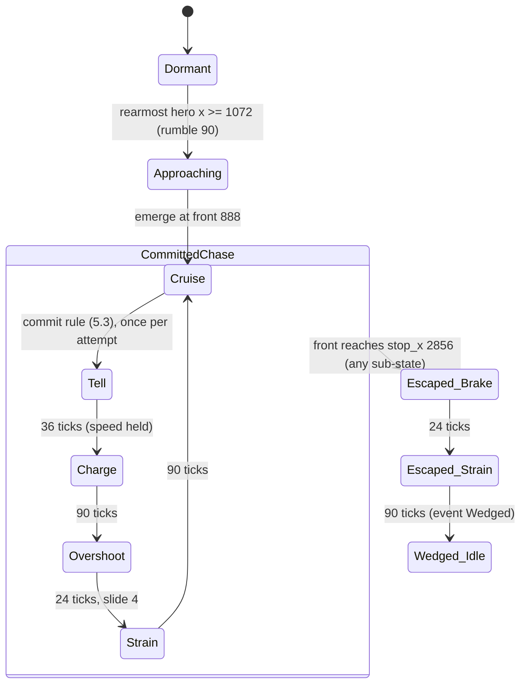

# Floor 01 Act I in the floor run (ACT1-PLAN)

**Status:** design and integration plan, **not implemented**. Docs only. Nothing here is playtested or accepted. After its implementation PRs merge, the status is "merged, game-feel review pending".

**Owner decision (2026-11-25, cited for every adopted default below):** "Go with all because I could not test it until next week" and "Ensure that everything ends on main for testing all together next week". Every owner-gated Floor 1 item is authorized under adopted defaults recorded by ID. Everything must be reachable in `--scene f01_late --f01-run` in story order. New behaviour is on by default where the spec allows. Large unfinished items land as a labelled playable greybox.

**What this plan does.** It puts Act I (beats I-01 to I-04 of the [Act I combat beats](floor-01-act-01-playable-combat-beats.md)) at the **start** of the floor run, before the Infernal Corral. The rooms are:

- the entry and the Murder Dozer chase (CHASE-01, choreography from the owner draft #179, carried onto main as [the Dozer opening choreography](floor-01-dozer-opening-choreography.md));
- Carl's first revenge on the goblins, with the rotten shore ([I-03](floor-01-first-goblin-encounter.md));
- the Tutorial Guild, where Donut gets the biscuit (**GUILD-BEAT-01**).

The plan reuses the merged DOZER-CORE machine of room 3 ([Dozer gameplay note](enemy-gameplay-dozer.md)) with a second profile. It does not fork it.

**Read with:**

- [the Dozer opening choreography](floor-01-dozer-opening-choreography.md) and its [work order](../07-agents/floor-01-dozer-opening-workorder.md);
- [ENV-02](../02-art/env-02-opening-spec.md) (option R, the segment and marker baseline) and [DOZ-01 section 9](../02-art/doz-01-dozer-spec.md) (the machine's timing proposals);
- [the Dozer gameplay note](enemy-gameplay-dozer.md) section 4.4 and section 7;
- [the integration plan](../07-agents/f01-playtest-integration-plan.md) section 17;
- [the REST plan](floor-01-quiet-setpieces-and-transitions.md) section G, the pattern this section copies.

## 1. What main holds today (checked at `a3dd07b2`)

- **The run.** `--f01-run` walks the listed rooms of `assets/levels/f01_late/manifest.json` in row order. It is one room per launch: on a room exit it shows a facts-only room-clear panel, and on confirm it relaunches with the next room and the carried story ledger. The first room is `manifest.rooms[0]`. Ten rooms are listed: corral, rest_refuge, hoarder, boiler, dozer, hazards, ring_court, ring_split, juicer, mastery. REST-WIRE PR 2 (camp and aftermath) is in flight and adds two.
- **CORRAL-F** (`Manifest::validate`): "the corral (room 0) must be the first listed room". The corral scene runs room `corral` only. AUDIENCE-RUN goes live in every room listed **after** the corral (`AUDIENCE_UNLOCK_AFTER`). The rule is positional, so rooms listed before the corral have no audience with no code change.
- **Story-less rooms.** The corral has no story runtime (KC11). Its sidecar `story_pin` is a label with no table row. `carry_for` returns an empty ledger snapshot for the corral under the Story loadout, and `carry_story` accepts an empty snapshot in a story-less room.
- **The biscuit already exists in code.**
  - `DonutSetup { start, guild_zone }` (`src/donut_mana.rs`) holds Donut's mana start state and an optional guild zone. When Donut's pivot enters the zone's x range, `ManaEvent::UnlockGranted` fires and `primary_ranged` unlocks. The unlock survives a defeat retry; a fixture restart restores the declared start.
  - The HUD already switches Donut's prompt from the pre-biscuit swat to the missile (`DonutMagic::PreBiscuit`). Her AI never casts before the biscuit (CF02-Q17).
  - `primary_ranged` is a **read-through** capability: it is read from Donut's mana, never stored in the ledger.
  - The manifest's story order holds a **point** `guild_biscuit` that grants `primary_ranged` with `trigger: null`. `check_story_order` accepts that for a read-through capability, so `story_unlocks_v0.json` (`TABLE_HASH`) does **not** need to change.
- **The shore (CP-03).** `Fixture::shore_dx` enables the rotten-shore strike column relative to Carl's start column, with no new code (`f01_mastery` uses it). The rules are:
  - three melee hits, then a 6-tick delay;
  - a 140 px fall onto the footprint +25..+105;
  - a credited defeat for a goblin under the block;
  - the landed block does not collide.
- **DOZER-CORE** (`src/dozer.rs`, `src/combat_scene/dozer.rs`) is room 3's revenge machine.
  - Data: tuning `enemy_dozer_v0.json` with profile `revenge` and `dzq10_charge: null`.
  - States: `Dormant` → `Approaching` (rumble) → `CommittedChase` (speed band) → `Escaped(Brake, Strain, Idle)`. Also `ImpactStunned` and `Disabled` for the stop frame.
  - Contact: a lethal wheel (r 44) and a hull push box.
  - The solo rescue `SlotOut::place` uses a lane spot, then a tunnel spot (section 7.3).
  - Events are codes 1..12, each hashed.
  - The sidecar `dozer` block (`deny_unknown_fields`) holds the trigger x, the idle-wake ticks, the emergence front, `stop_x` and a required `dzq22_lintel`.
  - The encounter validator (`src/encounter/haz.rs`) enforces room 3's tunnel rules. Rule 2 says no tall solid on the chase lane; rule 4 requires a lane ceiling and the lintel.
- **Not on main.**
  - The ENV-02 route is not wired into any Bevy scene.
  - No room draws the guild interior in gameplay. The `refuge_guild` scene is a separate non-gameplay screen with marks: Donut 226, Carl 258, Mordecai 380 (`mordecai_h44`).
  - The game has no runtime audio path. `floor01_dozer_chase.ogg` and `murder_dozer_engine_sketch.ogg` exist as provisional files.

## 2. The decisions in one place

1. **Three Act I rooms precede the corral:** `act1_chase` → `act1_shore` → `act1_guild` → `corral` → … (ACT1-AD1).
   - `act1_chase` covers I-01 and I-02: ENV-02 S1 to S5's arch, route x 0..3008.
   - `act1_shore` covers I-03: S5 to S6, route x 2608..3584, re-based to local x 0.
   - `act1_guild` covers I-04: a short interior greybox.
   - All three are milestone `greybox`, run under `cf02_rules`, are story-less like the corral, and have no audience.
2. **The chase is a scripted escape room on DOZER-CORE.**
   - It uses a second profile `opening` from a **new** tuning file, so room 3's `TUNING_HASH` does not move.
   - It appends a charge sub-machine (tell, charge, overshoot brake, strain, resume), an authored safe **pocket**, a barricade **lock** that only the machine opens, and a **wedge** end state.
   - The machine is never killed or stunned in the opening. Room 3's profile, fixtures and goldens stay byte-identical (Dozer note section 4.4).
3. **The room boundary at the post-chase checkpoint.**
   - The chase and the goblin fight are separate rooms that meet at ENV-02's `checkpoint_post_chase` (route x 2640).
   - A death in the goblin fight therefore never reruns the chase (CHDIR-09). DOZER-CORE resets the machine to `dormant` on every respawn, so one room holding both could not keep a wedged machine behind a respawning party.
   - The price is one room-clear panel between the escape and the fight (ACT1-AD2, ACT1-Q1).
4. **GUILD-BEAT-01.**
   - The story-order point `guild_biscuit` becomes the room row `act1_guild`. That row grants `primary_ranged` (read-through, `trigger: null`), so `TABLE_HASH` is unchanged.
   - In the room, Donut starts locked with a guild zone in front of the guide's mark. A new lock `donut_unlocked` seals the exit until her mana is unlocked.
   - The existing swat-to-missile prompt switch is the payoff, plus a new `MAGIC MISSILE` notice (ACT1-AD12).
5. **Two implementation PRs** (section 12).
   - **ACT1-A:** the run plumbing, the shore room and the guild room.
   - **ACT1-B:** the chase room and the opening profile.
   - ACT1-A lands first and lists `act1_shore` and `act1_guild` before the corral. ACT1-B lists `act1_chase` in front of them.

## 3. Run order

| Run index (after ACT1-B) | Room id | Scene | Title (ACT1-AD3) | Milestone | Story pin at entry | Grants in play | PR |
| --- | --- | --- | --- | --- | --- | --- | --- |
| **0** | **`act1_chase`** | **`f01_act1_chase`** | **The First Chase** | **greybox** | **none (`f01_pin_act1_chase_entry`, no table row)** | **none** | ACT1-B |
| **1** | **`act1_shore`** | **`f01_act1_shore`** | **The Rotten Shore** | **greybox** | **none (`f01_pin_act1_shore_entry`)** | **none** | ACT1-A |
| **2** | **`act1_guild`** | **`f01_act1_guild`** | **The Guild Door** | **greybox** | **none (`f01_pin_act1_guild_entry`)** | **`primary_ranged` (the biscuit, read-through)** | ACT1-A |
| 3 | `corral` | `f01_corral` | The Infernal Corral | greybox | none | none |  |
| 4 | `rest_refuge` | `f01_rest_refuge` | The Wrong Restaurant | greybox | none | `jump_reach_boost` |  |
| 5.. | hoarder, boiler, dozer, hazards, ring_court, ring_split, (rest_camp), juicer, (rest_aftermath), mastery | unchanged | | | | | |

Run length:

| State of main | Listed rooms |
| --- | --- |
| Today | 10 |
| After REST-WIRE PR 2 | 12 |
| After ACT1-A | +2 (12, or 14 with REST PR 2) |
| After ACT1-B | +1 (13, or 15 with REST PR 2) |

The pacing map of the [REST plan section D](floor-01-quiet-setpieces-and-transitions.md#d-connected-floor-01-pacing-map-adapted) already places "Opening / Murder Dozer → first goblins → Guild / biscuit" before the corral as slot S0. This plan fills slot S0 (REST-Q8, partially answered).

## 4. Rooms (greybox, room px, y down, floor 580, height 660, 16 px grid)

All three rooms:

- **Files:** `floor01-demo-hall-v1` room files plus `floor01-encounter-v1` sidecars in `assets/levels/floor01/`, composed with the existing kit (`f01_boiler::compose_kit`, the REST pattern). No new art.
- **Room fields:** `setting` `dry-catacomb`, `act` 1, `platform_slab_px` 12, protected spawn `{16, 484, 208, 96}`, and spawn Carl 112, Donut 80 unless stated.
- **Route mapping:** ENV-02 layout y maps to room y with +272 (the layout walking line 308 is room floor 580).

### 4.1 `act1_chase` (I-01 entry and I-02 chase)

Width **3008**. It is the route from S1 to the S5 arch, x 0..2944, plus a 64 px exit apron. The x values are ENV-02's.

| Piece | Data | Source / rule |
| --- | --- | --- |
| S1 false calm | x 0..640, spawn Carl 72, Donut 48 (ACT1-AD4) | ENV-02 `spawn` 72. No threat and no idle wake (ACT1-AD7) |
| S2 window | x 640..944. The machine emerges with its wheel front at **888**, the window's right edge (`pursuer_spawn` [696, 70, 192, 218]) | DZ-Q13 `dzq13_emerge_front_x` 888 |
| Checkpoint | `{984, 484, 48, 96}` (centre 1008) | ENV-02 `checkpoint_chase` 1008 |
| Trigger | `dzq11_trigger_x` **1072**, crossed by the **rearmost** living hero (ACT1-AD6) | ENV-02 `trigger_chase_start` 1072 |
| S3 low ceiling | Decor only: the soffit `{976, 272, 704, 96}` (underside y 368, 212 px clear). It is not a solid; no jump reaches it (ACT1-AD8) | ENV-02 option R |
| Timber sets | Decor plus events: `timber_a` at x 1104, `timber_b` at x 1424, each `{x, 456, 80, 104}`. Not solids | ENV-02 `timber_set_a/b` |
| Humps | Platforms `{1168, 564, 64, 16}` and `{1456, 564, 64, 16}` | ENV-02 humps, one tile |
| Charge arm | `arm_x` **1888** (data, opening tuning) | ENV-02 charge trigger |
| Pocket ledge | Platform `{2064, 564, 96, 16}`. Pocket rect `{2072, 460, 80, 104}` (feet on the ledge top y 564, 104 px clear) | ENV-02 `safe_pocket_alcove` |
| Barricade | Lock `barricade`: solid `{2312, 304, 80, 276}`, `opens_on: dozer_contact` (section 5.4). Drawn as the ENV-02 full-height barricade x 2304..2400 | ENV-02 blocker [2312, 32, 80, 276] |
| Wedge | `dzq14_stop_x` **2856** (the S5 arch's right edge). The machine wedges there (section 5.4) | ENV-02 wedge [2664, 70, 192, 218] |
| Exit | `{2928, 484, 64, 96}` | It lies past `stop_x` + 48 + 16 (the past-stop rescue spot, DZ-Q17) |
| Roster | One `dozer` entry, x 888, beat `I02`. No riders, no goblins (ACT1-AD9) | |
| Goal | `reach_exit`. `max_living` 1 | |

Sidecar `dozer` block (section 5.6 has the new fields):

```json
"dozer": {
  "profile": "opening",
  "dzq11_trigger_x": 1072,
  "dzq11_trigger_by": "rearmost",
  "dzq11_idle_trigger_ticks": 216000,
  "dzq13_emerge_front_x": 888,
  "dzq14_stop_x": 2856,
  "pockets": [{ "id": "alcove", "rect": { "x": 2072, "y": 460, "w": 80, "h": 104 }, "ledge": 2 }],
  "timbers": [{ "id": "timber_a", "x": 1104 }, { "id": "timber_b", "x": 1424 }],
  "wedge": true
}
```

`dzq22_lintel` is absent here: the opening has no tunnel. `ledge: 2` is the index of the ledge platform in the room's `platforms`.

### 4.2 `act1_shore` (I-03, Carl's first revenge)

Width **976**. It is the route x 2608..3584 re-based by −2608 (local = route − 2608).

| Piece | Data | Source / rule |
| --- | --- | --- |
| Entry | Spawn Carl 112, Donut 80. Checkpoint `{32, 484, 48, 96}` (route 2640, `checkpoint_post_chase`) | Retrying here never replays the chase |
| Wedged machine | Decor `wedged_dozer` `{56, 440, 192, 140}` (route 2664..2856): the machine stuck in the arch, wheel spinning, not lethal, not in the sim (ACT1-AD10) | ENV-02 wedge |
| Rotten shore | `Fixture::shore_dx` = **255** (strike column local 367 = route 2975, minus Carl's spawn 112). The fall footprint is local 392..472 (route 3000..3080) | ENV-02 / CP-03 |
| Goblins | `gob_a` kind `goblin`, x 528 (route 3136, spawn A), temperament `brawler`. `gob_b` x 568 (spawn B), temperament `coward`, so it arrives late (I-03 G1). Spawn C (local 608) stays reserved (ACT1-Q4) | I-03 section 1, 2 |
| Goal | `defeat_roster`. The exit opens when both goblins are defeated, by any credited cause: melee, kick contact or the shore block. `max_living` 2 | I-03 |
| Exit | `{728, 484, 64, 96}`: the guild portal at local 760 (route 3368), inside the protected exit (local ≥ 624) | ENV-02 `exit_guild` |
| Platforms | None | |

### 4.3 `act1_guild` (I-04, GUILD-BEAT-01)

Width **640**, `ceiling_px` **228** (an interior; the REST refuge's slab rule).

| Piece | Data | Rule |
| --- | --- | --- |
| Entry | Spawn Carl 112, Donut 80. Checkpoint `{64, 484, 48, 96}` | |
| The guide | Decor `guide` `{368, 536, 24, 44}`, centred on the `refuge_guild` Mordecai mark (x 380). The binary may draw the existing `mordecai_h44` sprite there; a labelled rectangle is the fallback (ACT1-AD11) | Presentation only, never in the sim |
| Guild zone | `DonutSetup.guild_zone` = **(336, 376)**: Donut's pivot entering x 336..376 grants the biscuit | Donut's existing unlock trigger |
| Door lock | Lock `guild_door`: solid `{528, 336, 16, 244}` (slab underside to floor), `opens_on: { "event": "donut_unlocked" }` (section 6.4) | Carl cannot leave without Donut's biscuit, even when the companion trails |
| Exit | `{560, 484, 64, 96}` | |
| Roster | Empty. Goal `reach_exit` (REST's empty-roster rule) | |
| Text | None. No dialogue, no quotes, no tutorial screen. The beat is the walk past the guide, the notice and the changed prompt (I-04: brief, noncombat) | Rights |

## 5. The opening Dozer: profile `opening` on DOZER-CORE

### 5.1 Data

The new file `assets/data/gameplay/enemy_dozer_opening_v0.json` holds the opening profile. It has its own `OPENING_TUNING_HASH` and pin key `dozer_opening_tuning`. The shared machine values stay in `enemy_dozer_v0.json` (wheel, push box, rumble, brake, rescue constants), whose `TUNING_HASH` does **not** move.

| Key | Value | Source |
| --- | --- | --- |
| `dzq06_cruise_px_s` | 160 | DOZ-01 section 9 |
| `dzq07_catch_up_px_s`, `dzq07_catch_up_gap_px` | 185, 260 | DOZ-01 |
| `dzq08_mercy_px_s`, `dzq08_mercy_gap_px` | 150, 96 | DOZ-01 |
| `dzq09_accel_px_s_per_tick` | 4 | DOZER-CORE |
| `dzq25_no_hero_ahead_target` | `cruise` | DOZER-CORE |
| `dzq10_charge.arm_x` | 1888 | ENV-02 |
| `dzq10_charge.min_gap_px` | 140 | DOZ-01 gate |
| `dzq10_charge.tell_ticks` | 36 | DOZ-01 |
| `dzq10_charge.speed_px_s` | 240 | DOZ-01 (K5 ≤ 185 does not apply to a charge, Dozer note section 4.4) |
| `dzq10_charge.max_ticks` | 90 | DOZ-01 |
| `dzq10_charge.brake_ticks`, `brake_slide_px` | 24, 4 | DOZ-01 overshoot |
| `dzq10_charge.strain_ticks` | 90 | DOZ-01 |
| `dzq10_charge.reach_margin_ticks` | 20 | ACT1-AD5 (ENV-02 measured 17 for the hop) |
| `dzq10_charge.charges_per_attempt` | 1 | ACT1-AD5 |

The #179 draft's "130 px/s against 145" are stale ENV-02 hypotheses. Carl runs 185 on main, and DOZ-01's values above replace them.

### 5.2 States

The opening adds **no** top-level `DozerState`. `CommittedChase` gains a sub-state that exists only when the profile has a `dzq10_charge` block:



- **Charge.** The machine moves at 240 px/s on a straight line. It never steers or reacquires, and it has no homing.
- **Overshoot and strain.** When the 90 charge ticks end before `stop_x`, the machine brakes and strains in the lane as DOZ-01 steps 3 to 4 describe. The wheel stays lethal (`dzq14_lethal_in_brake`). Then it resumes cruise (step 5).
- **`stop_x`.** Reaching it ends every sub-state. The room-3 brake and strain follow, then `Idle` with the wedge (section 5.4).
- **Barricade.** If the charge reaches the barricade, the lock opens on contact and the charge continues (section 5.4).
- **No idle wake (ACT1-AD7).** `dzq11_idle_trigger_ticks` 216000 (an hour) keeps S1's false calm. A party standing still is not chased. Nothing ahead of the trigger can lock, so this cannot softlock.

### 5.3 The commit rule and the fairness math

#179 named the real risk: "leader crosses x 1888" kills a trailing P2. Its preferred experiment, policy 1, is adopted: the arm is visual only, and the commit needs **every** living hero (ACT1-AD5). `ChargeArmed` fires once when the **leading** living hero first reaches `arm_x`; it drives the windup presentation only. The tell (the commit) starts on the first fixed tick, during `Cruise` and while no charge has been used in this attempt, at which **all** of these hold:

1. **Every** living hero has `x ≥ arm_x` (#179 policy 1: both are in the preparation band).
2. The gap from the rearmost living hero's body left edge to the wheel front is **≥ 140** (the DOZ-01 gate).
3. **Every** living hero can reach the pocket before the wheel does: for each hero `h`, `walk_ticks(h) + reach_margin_ticks ≤ wheel_ticks`.
   - `walk_ticks(h)` is the hero's horizontal distance to the nearest x at which its whole body lies inside the pocket's x span, divided by that hero's own run speed per tick (its `HeroMotion`). It is 0 when the body is already inside.
   - `wheel_ticks` is the number of ticks the wheel front needs to reach the pocket's left edge: 36 tell ticks at the current speed, then 240 px/s.
   - A hero past the pocket (waiting at the barricade) walks back. A hero behind the wheel front makes rule 2 fail.

If the rule never holds, **no charge happens**. The cruise continues and the pocket protects at every speed. The cruise reaches the barricade, opens it and runs on to the wedge. So there is no forced lethal charge and no softlock, and no fail-open timer is needed. This replaces ENV-02's 8 s scripted-charge guard and #179's fallback 2 (ACT1-AD5, flagged in section 15).

Worked cases. The units are px and ticks at 60 Hz. Carl runs 185 px/s (3.08 px/tick). The body half width is 12.

| Case at commit | Wheel front | Hero must reach | `walk_ticks` | `wheel_ticks` | Margin |
| --- | --- | --- | --- | --- | --- |
| Rearmost hero at 1888, gap exactly 140 | 1736 | body inside 2072..2152: centre 2084 | 64 | 36 (front to 1832) + 60 = 96 | 32 ≥ 20 commits |
| Leader waiting at the barricade (x 2300), the rearmost as above | 1736 | centre 2140 | 52 | 96 | 44 commits |
| Both at the barricade (x 2300), front already at 2160 | 2160 | pocket behind the wheel | n/a | n/a | rule 3 fails, no charge. The cruise reaches them unless they went back while the front was left of the pocket |
| P2 448 px behind the leader when the leader arms (P2 at about 1440) | follows P2 (band on the rearmost gap) | | | | no commit until P2 ≥ 1888 with gap ≥ 140 and rule 3. The leader's walk-back (52) fits |

A charge from gap 140 never catches a hero who keeps running on an open lane (DOZ-01: the gap shrinks to about 72 over 90 ticks). The danger is the barricade ahead, and that is what makes the pocket the answer.

### 5.4 Pocket, barricade, wedge, timbers

- **Pocket (authored depth refuge).** A hero is *in the pocket* when its body's x span lies inside the pocket rect's x span (2072..2152) and its feet are at or above the ledge top (y ≤ 564). A hero jumping inside the pocket stays protected.
  - The wheel test and the push-out skip a hero in the pocket.
  - This is not invulnerability anywhere else, and it is not a generic cover rule.
  - The event `PocketEntered { hero }` fires the first time each hero enters per attempt.
  - The pocket fits both heroes: 80 px against two 24 px bodies.
- **Barricade lock (`LockEvent::DozerContact`).** The lock solid stands until the first tick on which the machine's wheel front reaches the solid's left edge (front ≥ 2312). The lock opens **in that same tick, before collision**, and the event `BarrierImpact` fires.
  - Only the machine opens it. Heroes cannot break it or jump it (276 px tall).
  - Unlike REST's `hero_on_surface` lock, it is **not latched**. A defeat retry, a checkpoint respawn and a fixture restart all close it again, because they reset the machine to `dormant`.
- **Wedge (`wedge: true`).** When the room-3 strain at `stop_x` ends, the machine enters `Escaped(Idle)` and the event `Wedged` fires. From then on:
  - the wheel is already off at `Idle` (room 3's `wheel_lethal`); the wedge also turns the push box and the nav rows off, so the heroes, who are *behind* the machine in this room (in the pocket), walk past it to the exit;
  - its clang hurtbox stays, so melee still sparks and does no harm.
  - The presentation draws the hull in the S5 arch window. The greybox clips and darkens the side-on rig, because the end-on art is ACT1-Q3.
  - In room 3 (`wedge` absent) `Idle` is unchanged.
- **Timbers.** `TimberSmashed { id }` fires once per id and attempt, on the first tick the wheel front reaches the timber's x. It drives the existing ENV-02 splinter burst (DR-D's presentation) and nothing else.
- **Humps.** These are ordinary 16 px platforms. The machine ignores solids, and the presentation may flatten them; the sim does not.

### 5.5 The AI partner (solo)

- No `BossThreat` (Dozer note R-4: the bot would jump into the wheel). The layer-1 nav rows stay, cut around the pocket rect, so the planner may stand in the pocket.
- The layer-2 rescue keeps room 3's rules but changes the **spot order** while the profile has a charge and the barricade stands:

| Situation (a bot hero, solo, wheel lethal, rescue cause as room 3) | Spot | Value |
| --- | --- | --- |
| The pocket's left edge is still ahead of the wheel front by at least the rescue band plus a body width | `RescueSpot::Pocket` (new, appended) | Centre of the pocket, feet on the ledge |
| The wheel front is at or past the pocket's left edge | `RescueSpot::Behind` (new, appended) | `o + dzq02_push_box.x0 − dzq17 zone margin − HERO_HALF_WIDTH`, on the lane |
| After `BarrierImpact` | room 3's order (lane spot, then the past-stop spot) | unchanged |

- **During `Tell` and `Charge`,** a bot that is not in the pocket is rescued into it on the tell's first tick, with the cause `Charge`, a new appended `RescueCause`. This avoids a later near-wheel rescue. The bot may still walk out; then the table above applies.
- **Append only.** `RescueSpot` and `RescueCause` keep their existing discriminants (`Lane` 0, `Tunnel` 1; `Near`, `BehindAxle`, `OffScreen`).
- **Targets.** The fixtures assert **zero** wheel contacts on a bot in solo Carl-active and Donut-active runs. They report rescue counts; there is no CA2-style budget (ACT1-Q5). If zero cannot be reached with these spots, stop and escalate as a CA2-style named append (section 12.4).

### 5.6 Sidecar block and validation

`RawDozer` gains optional fields with `serde(default)`. Room 3's sidecar bytes and hash do not change.

| Field | Type | Default (room 3) | Opening |
| --- | --- | --- | --- |
| `profile` | `"revenge"` or `"opening"` | `revenge` | `opening` |
| `dzq11_trigger_by` | `"lead"` or `"rearmost"` | `lead` | `rearmost` |
| `dzq22_lintel` | rect, **now optional** | required by `revenge` | absent |
| `pockets` | list of `{ id, rect, ledge }` | empty | one |
| `timbers` | list of `{ id, x }` | empty | two |
| `wedge` | bool | false | true |

`DozerSite.lintel` becomes `Option<IRect>`. The `revenge` validation errors when it is `None`. `f01_dozer` reads it as before.

Validation branches on the profile. `revenge` keeps rules 1 to 4 exactly. `opening` replaces rules 2 and 4 with O1 to O8 (rule 1, the trigger between the gate and `stop_x`, still applies):

| Rule | Check |
| --- | --- |
| O1 | The opening tuning has a `dzq10_charge` block, and the sidecar has at least one pocket and exactly one `dozer_contact` lock |
| O2 | `emerge_front_x < trigger_x < arm_x < pocket.x`, and every timber x lies in `(emerge_front_x, arm_x)`, strictly increasing, with unique ids |
| O3 | Each pocket: `ledge` names a platform whose top equals the pocket rect's bottom; width ≥ 4 × `HERO_HALF_WIDTH` (two bodies); clear height ≥ 2 × `HERO_HALF_HEIGHT` + 8; the pocket lies right of `arm_x` and left of the barricade |
| O4 | The barricade lock solid lies after the pocket and at least 256 px before `stop_x` (`RUN_OUT_CLEAR_PX`); it reaches the floor and is taller than any hero jump (the gate classes) |
| O5 | `exit.x ≥ stop_x + dzq17_rescue_past_stop_px + dzq17_rescue_exit_margin_px` |
| O6 | No other solid on the lane between the emergence front and `stop_x` is taller than 16 px (`REMNANT_MAX_PX`): the humps and the ledge pass, the barricade is the only exception |
| O7 | No `dzq22_lintel` and no crew (`mount`) entries in an `opening` room |
| O8 | With the barricade closed the exit is unreachable for every class and 2P; open, it is reachable (the existing lock checks) |

### 5.7 Events and the state hash

Appended `DozerEvent` variants: codes 13 `ChargeArmed`, 14 `ChargeTell`, 15 `ChargeCommitted`, 16 `ChargeEnded { by_ticks }`, 17 `TimberSmashed { id }`, 18 `PocketEntered { hero }`, 19 `BarrierImpact`, 20 `Wedged`. Each one has a `mix_into`.

The machine mixes the charge sub-state, the used-charge flag, the per-hero pocket flags, the smashed-timber bits and the wedge flag into the hash **only when the profile has a charge block**. Room 3's fixture hashes, DOZR replays and goldens therefore stay byte-identical, and the brief makes that a stop condition. The barricade lock's opened flag is mixed by the env runtime only in a room that has a `dozer_contact` lock (the REST rule).

## 6. Entry and exit contracts with the run

### 6.1 Scenes and listing

- `RoomScene::{Act1Chase, Act1Shore, Act1Guild}`, with serde names `f01_act1_chase`, `f01_act1_shore` and `f01_act1_guild`.
- K17: all three run under `cf02_rules`. Each Act I scene runs only its own room id, like the corral rule.
- **CORRAL-F becomes ACT1-F.** Every listed Act I room comes before the corral, in the fixed order chase, shore, guild (any listed subset keeps that order). The corral directly follows the last listed Act I room. No Act I room is listed after the corral.
  - When no Act I room is listed, the rule reduces to today's CORRAL-F.
  - The error text names both IDs ("ACT1-F, CORRAL-F").

### 6.2 Carry

- The Act I rooms are story-less like the corral. Each sidecar `story_pin` is a label with no table row, and `launch` asserts `!has_pin(pin)` (the corral's rule).
- `carry_for(Story, scene, combat)` falls back to the empty snapshot for **every story-less scene**: corral, act1_chase, act1_shore and act1_guild (a `RoomScene::story_less()` helper).
- So the chain under Story is: chase → empty → shore → empty → guild → empty → corral → empty → refuge (unchanged). The corral now *receives* an empty carry, which `carry_story` accepts.
- Under `--f01-loadout all`, `carry_for` returns nothing, as today (F01RUN-AD2).

### 6.3 Donut's setup per loadout (ACT1-AD13)

| Launch | chase, shore | guild |
| --- | --- | --- |
| Story loadout, or flagless | `DonutSetup::NONE` (locked: the swat, no missile, her AI never casts) | locked plus `guild_zone (336, 376)` |
| `--f01-loadout all` (or any `--donut-light-feet` / `--donut-puddle`, which imply the biscuit, DP-Q06 / DP-Q10) | `DonutSetup::unlocked(8)` | `DonutSetup::unlocked(8)` (the lock is open at tick 0) |

- Carl holds his base kit under Story: no dynamite, no reinforced fist, no thrown charge (#179: nothing before the Guild). The Act I fixtures author no bomb or charge pickups.
- The corral and every later room keep their own `DonutSetup::unlocked(8)` unchanged. The biscuit is a read-through capability that each room declares, so nothing about it is carried.

### 6.4 The `donut_unlocked` lock

`LockEvent::DonutUnlocked` is appended to the `#[non_exhaustive]` enum, with sidecar `"opens_on": { "event": "donut_unlocked" }` and no target.

- **Open state.** On every fixed tick, before collision, the lock is open exactly when Donut's mana is unlocked. It is a pure function of state the hash already holds, so the lock needs no new hashed flag.
- **Retry and restart.** A defeat retry keeps the unlock, so the door stays open. A fixture restart restores the locked start, so the door closes.
- **Validation.** Allowed only in a room whose Donut setup can unlock: the validator accepts it, and the room module asserts that the guild zone is set under the Story setup. O8's reachability checks apply.

### 6.5 Panel, HUD, audience

- **Room-clear panel.** The guild's panel lists `granted here: Donut primary_ranged`. `RoomFacts.grants` gains `(1, "primary_ranged")` when the room's combat log holds a `ManaEvent::UnlockGranted`; the ledger never holds it (ACT1-AD12). The other two Act I panels show "none".
- **Notice.** `LabelId::MagicMissile` → `"MAGIC MISSILE"`, raised by `notice_for_event` on `CombatEvent::Mana(ManaEvent::UnlockGranted)`. It is presentation only. Cut it if it moves a golden (cut order 1).
- **Hint.** `LabelId::GetIntoTheAlcove` → `"GET INTO THE ALCOVE"`, shown for 180 ticks after a respawn at the chase checkpoint, only after at least one death in this attempt (#179 section 4). It is presentation only (cut order 2).
- **Audience.** Off in all three rooms (positional rule, no code). This matches #179's "no viewers or sponsor in the opening". The broadcast line stays on the corral's panel.
- **Location strip.** It shows the manifest titles, as for every room.

## 7. Grants: GUILD-BEAT-01 and KR12

- `story_order`:
  - ACT1-A replaces the point `{ "id": "guild_biscuit", "kind": "point", … }` with `{ "id": "act1_guild", "kind": "room", "pins": [], "grants": [{ "capability": "primary_ranged", "trigger": null }] }` and inserts `{ "id": "act1_shore", "kind": "room", "pins": [], "grants": [] }` before it.
  - ACT1-B inserts `{ "id": "act1_chase", "kind": "room", "pins": [], "grants": [] }` first.
- `check_story_order` already accepts both a read-through grant with no trigger and a room row with empty pins. No pin holds a later grant: `primary_ranged` is still granted before the corral and the Hoarder's `f01_pin_pre_pile_boss`.
- **Unchanged:** `story_unlocks_v0.json` (`TABLE_HASH`), every pin and every trigger. The combat lab's `floor01_after_guild_biscuit_before_juicer` label is a lab profile name and stays.

## 8. Flags and defaults

- No new command-line flag. The Act I rooms are listed, so `--f01-run` starts in them by default. `--f01-room act1_chase|act1_shore|act1_guild` launches one directly, as for any listed room.
- `DEFAULT_ROOM` (`boiler`) is unchanged.
- An optional `--room-pilot` plan per room (the EVID-ROOM pattern) is for evidence captures only.

## 9. Determinism and pins

Fixed tick, no RNG beyond the existing seeded CF02 stream. Presentation (decor, the wedge draw, splinters, notices, hints) never enters the sim or the hash.

| Pin | ACT1-A | ACT1-B | Reason |
| --- | --- | --- | --- |
| `story_unlock::TABLE_HASH` | **unchanged** | **unchanged** | `primary_ranged` is read-through; no table row moves |
| `f01_late::MANIFEST_HASH` | re-pin | re-pin | rooms rows, story-order rows and a `status` sentence each. Every committed or local late-floor PLAYTRACE recording made before a re-pin fails strict verification with a content mismatch (expected; say so in the PR) |
| `dozer::TUNING_HASH` (`enemy_dozer_v0.json`) | unchanged | **unchanged** | the opening values live in a new file |
| `OPENING_TUNING_HASH` (`dozer_opening_tuning`) | | new | new file |
| Act I room and sidecar hashes | new (4: shore and guild) | new (2: chase) | new files |
| Room 3 sidecar and room hashes | unchanged | **unchanged** | the new `dozer` fields default; the file is untouched |
| `SCOPED_PIN_KEYS` | +4 | +3 | today 21 → 25 → 28; with REST PR 2 first, 25 → 29 → 32. `pin_applies` maps each new key to its room. `dozer::PIN_KEY` now applies to `dozer` **and** `act1_chase` (the shared machine values); the scope test's owner map takes a list |
| `playtrace::live::data_pins()` | +4 | +3 | the new pins; update the length assertions |
| Goldens, DP fixture hashes, room-3 DOZR fixture hashes, CF02 tuning, gate classes | unchanged | unchanged | asserted; a move is a stop condition |
| Act I fixture final hashes | new | new | new fixtures |

PLAYTRACE gets new descriptor rooms and replay and live dispatch arms (the REST pattern), plus `f01_act1_{chase,shore,guild}_recording_verifies` (strict, 360 and 400 view heights).

## 10. Tests and fixtures by ID

Module tests live in `src/f01_act1.rs`. The fixtures live in `src/act1_fixtures.rs`; each runs twice and asserts an identical final hash. The #179 CHDIR IDs are mapped in the last column.

| ID | Test / fixture | Expected | PR | CHDIR |
| --- | --- | --- | --- | --- |
| ACT1-T01 | `the_act1_rooms_are_listed_first_in_story_order` | listed `[act1_chase?, act1_shore, act1_guild, corral, …]`; `first_room` is the first Act I room; ACT1-F rejects a swap, an Act I room after the corral and a gap before the corral | A, B | |
| ACT1-T02 | `act1_carry_is_empty_and_accepted` | Story: each Act I exit carries the empty snapshot; the corral accepts it; All: none | A | |
| ACT1-T03 | `act1_shore_sidecar_validates`, `act1_guild_sidecar_validates`, `act1_chase_sidecar_validates` | valid; no surface above 42 px except the guild's slab; the story pins are not table rows | A, B | |
| ACT1-T04 | `act1_guild_door_seals_until_the_biscuit` | locked: exit unreachable for every class and 2P; unlocked: reachable | A | |
| ACT1-F01 | `act1_shore_solo_carl` (companion off) | both goblins defeated; the guild door opens; exit; no `UnlockGranted`; Donut never casts | A | |
| ACT1-F02 | `act1_shore_block_kill` | three strikes at local 367 while `gob_a` stands in 392..472: a credited defeat by the block | A | |
| ACT1-F03 | `act1_shore_2p` and `act1_shore_solo_companion` (default `cf02_free`) | exit reached; Donut never casts (CF02-Q17) | A | |
| ACT1-F04 | `act1_shore_retry_from_post_chase` | a party defeat respawns at the checkpoint (route 2640); goblins restored; no chase | A | 09 |
| ACT1-F05 | `act1_guild_solo_carl` (companion off, swap to Donut), `act1_guild_solo_donut`, `act1_guild_2p` | exactly one `UnlockGranted { hero: 1 }` when Donut's pivot enters 336..376; door open that tick; exit; panel grants `(1, primary_ranged)`; HUD prompt switches | A | |
| ACT1-F06 | `act1_guild_companion_crossing` (default companion, Carl active) | exactly one grant; exit; Carl is never sealed in | A | |
| ACT1-F07 | `act1_guild_retry_keeps_the_biscuit` | after a defeat retry: unlocked, door open; after a fixture restart: locked, door closed; a second crossing grants once | A | |
| ACT1-F08 | `act1_guild_all_loadout_is_open` | `unlocked(8)` at tick 0, door open, no `UnlockGranted` | A | |
| ACT1-F10 | `act1_chase_solo_first_run` (Carl active, companion off, runs to the pocket, waits, exits) | event order: `Rumble`, `Emerged`, `TimberSmashed a`, `TimberSmashed b`, `ChargeArmed`, `ChargeTell`, `ChargeCommitted`, `PocketEntered` (both), `BarrierImpact`, (`ChargeEnded`), `BrakeStarted`, `Wedged`; exit; no hero defeat | B | 01, 03, 04, 08 |
| ACT1-F11 | `act1_chase_hull_cannot_be_hurt` | melee on the hull: `Clang` only, `hp()` constant, no stun, no state change | B | 02 |
| ACT1-F12 | `act1_chase_2p_together` | both in the pocket; zero wheel contacts | B | 05 |
| ACT1-F13 | `act1_chase_2p_lag_{0,96,224,448}` (P2 that far behind the leader when the leader arms) | no wheel contact on a hero who follows the script (run, hide); the commit tick waits for rule 5.3; recorded commit tick and margin per case | B | 06 |
| ACT1-F14 | `act1_chase_skip_pocket` (a hero waits at the barricade) | that hero is defeated by the wheel; respawn at 1008; the barricade restored; the machine `dormant`; the hint shows; no softlock | B | 07, 09 |
| ACT1-F15 | `act1_chase_solo_bot_{carl,donut}_active` (default companion) | zero wheel contacts on the bot; rescue counts reported by spot | B | 06 |
| ACT1-F16 | `act1_chase_no_charge_path` (a party that never satisfies rule 5.3) | no `ChargeTell`; the cruise opens the barricade and wedges; exit reached from the pocket | B | 07 |
| ACT1-F17 | `act1_chase_presentation_is_read_only` | the same inputs with presentation disabled (no decor, no notices, no splinters) give the same event log and hash | B | 12 |
| ACT1-F18 | `room3_unchanged_by_the_opening` | every DOZR fixture hash and replay equals its committed value | B | |
| ACT1-T10 | `opening_validation_rules` | O1..O8 each rejects a minimal broken sidecar; the revenge rules still reject a lintel-less `revenge` block | B | |
| ACT1-T11 | `the_charge_commit_rule` (domain unit tests) | rule 5.3 table rows above, including the walk-back and the pocket-behind-the-wheel case | B | 04, 06 |
| ACT1-T12 | `act1_run_walk` | a Story `--f01-run` walk from the first Act I room through the corral: entry lines in order, empty carries, guild grant on the panel | A, B | 11 |

CHDIR-10 (resolutions and scaling) and CHDIR-12's audio half are evidence items (section 11). CHDIR-11 is ACT1-T12 plus the PLAYTRACE verify tests.

## 11. Evidence (`docs/evidence/act1/`, a README with commands and results)

1. Bevy captures at 640×360, 640×400 and 1920×1080:
   - S1 at spawn;
   - the emergence at the S2 window;
   - a timber smash;
   - the tell at `arm_x`;
   - both heroes in the pocket with the wheel passing;
   - the barricade impact;
   - the wedge;
   - the shore strike and the block kill;
   - the guild zone with the notice and the changed prompt.
2. A seeded GIF of the solo chase (ACT1-F10) and one of a 2P lag-448 run (ACT1-F13), at 1x.
3. The ACT1-F13 commit table (commit tick, margin per hero, per lag) as text.
4. The run walk: each room's entry line from `act1_chase` to `mastery`, in order.
5. The PLAYTRACE verify lines.
6. Frame time at 640×360 for `act1_chase` (`--perf-frames`), against room 3.
7. A real two-pad run, a human first-run time (the #179 25–40 s hypothesis) and human recognition of the pocket: **NOT RUN** unless a human did it.

## 12. Implementation split (two PRs, one Sonnet implementer each)

### 12.1 ACT1-A: run plumbing, the shore and the guild

- **Data:** manifest rows `act1_shore` and `act1_guild` before `corral`; the story-order change; the `status` sentence; the `MANIFEST_HASH` re-pin.
- **Run rules:** ACT1-F in `validate`; `RoomScene::Act1Shore` and `Act1Guild`; `story_less()`; the `carry_for` generalization.
- **Room module:** `src/f01_act1.rs` with `Act1Room { Chase, Shore, Guild }` (Chase unlisted and unbuilt until ACT1-B); `LockEvent::DonutUnlocked`; the room and sidecar files.
- **Presentation:** the panel grant fact; the `MAGIC MISSILE` notice; the decor draw.
- **Plumbing and checks:** the binary and PLAYTRACE arms; the retargeted run tests (section 12.3); ACT1-F01..F08 and T01..T04, T12; evidence.

### 12.2 ACT1-B: the chase

- **Data:** the opening tuning file; the `RawDozer` fields and the optional lintel; the O1..O8 validation branch.
- **Machine:** the charge sub-machine, commit rule, pocket, wedge, timbers and events in `src/dozer.rs`; `LockEvent::DozerContact`; `RescueSpot::{Pocket, Behind}` and `RescueCause::Charge`.
- **Room:** the room and sidecar; the manifest row `act1_chase` first, the story-order row and a `MANIFEST_HASH` re-pin; `RoomScene::Act1Chase`; the binary and PLAYTRACE arms.
- **Presentation:** the DOZ-01 rig reuse (room 3's draw path); the greybox wedge; splinters; the hint.
- **Checks:** ACT1-F10..F18 and T10, T11; evidence.

**Cut order inside ACT1-B** (cut from the top; never cut the pocket, the lock, the commit rule or the zero-contact fixtures):

1. the hint;
2. the timber splinter presentation (keep the events);
3. the nav-row hole around the pocket (if the rescue alone reaches zero contacts);
4. the greybox wedge draw (a labelled rectangle instead).

Audio is not in scope (ACT1-Q2).

### 12.3 Tests that must be retargeted (ACT1-A)

- In `src/f01_run.rs`:
  - every `first_room(..).id == "corral"`;
  - `the_audience_is_live_only_after_the_corral` (`listed[0]`);
  - the `room_run` test dispatch: the Corral arm's "first room, no carry" assertion becomes "an empty carry";
  - the dynamite test's exception list (add the Act I rooms);
  - the panel counters ("ROOM n/N", "n of N listed rooms", slices `rooms[3..]`);
  - `the_corral_exit_relaunches_into_the_refuge`, which must still pass with the corral no longer first;
  - the run-walk grant table (add `act1_guild`).
- In `src/f01_late.rs`: `the_corral_is_listed_first_…` becomes ACT1-F (CORRAL-F) cases, and the listed-rooms test changes with it.
- Docs that list the run order: `docs/03-tech/floor01-scene.md` (the `--f01-room` ids and the manifest re-pin history) and `docs/01-design/audience-run-design.md` (the "Tutorial Guild point `guild_biscuit`" sentence becomes the `act1_guild` room).

### 12.4 Sequencing and stop conditions

- **Order.** ACT1-A, then ACT1-B. Each re-pins `MANIFEST_HASH` once. If REST-WIRE PR 2 merges first, rebase and re-count (section 9); the reverse also works.
- **Hot files.** `src/f01_late.rs`, `src/f01_run.rs`, the manifest, `src/encounter.rs`, `src/combat_scene/env.rs`, `src/bin/floor01_scene.rs` and the PLAYTRACE dispatch. ACT1-B also touches `src/dozer.rs`, `src/combat_scene/dozer.rs` and `src/encounter/haz.rs`.
- **Stop and report** (do not improvise) if:
  - a room-3 DOZR hash, a golden or a DP hash moves;
  - zero bot wheel contacts cannot be reached with the spots of section 5.5;
  - the lock validator cannot express `dozer_contact` or `donut_unlocked` without a design change;
  - `carry_story` rejects the corral's empty carry;
  - the Act I rooms cannot be reached first through `--f01-run`.

## 13. Adopted defaults (ACT1-AD)

All are adopted under the owner decision of 2026-11-25. The owner may change any of them after playing.

| ID | Default | Why |
| --- | --- | --- |
| ACT1-AD1 | Three rooms `act1_chase`, `act1_shore`, `act1_guild` before the corral, milestone `greybox`, `cf02_rules`, story-less | One room per launch is the run's model. The guild interior is "separate" in the Act I beats doc |
| ACT1-AD2 | The chase/shore boundary is ENV-02's post-chase checkpoint (route 2640); the standard room-clear panel shows between them | DOZER-CORE resets the machine on every respawn; a split keeps CHDIR-09 without new respawn rules |
| ACT1-AD3 | Titles "The First Chase", "The Rotten Shore", "The Guild Door" | Plain and literal, no franchise quote (antihero tone) |
| ACT1-AD4 | Spawns Carl 72 / Donut 48 in the chase (ENV-02 spawn), Carl 112 / Donut 80 elsewhere | ENV-02 marker; REST pattern |
| ACT1-AD5 | Commit rule of section 5.3 (all heroes past `arm_x`, gap ≥ 140, reach margin 20 ticks), one charge per attempt, no fail-open timer | #179 policy 1; DOZ-01 gate; no forced lethal charge |
| ACT1-AD6 | The chase trigger is crossed by the **rearmost** living hero | A leader alone never wakes the machine with P2 behind its emergence point |
| ACT1-AD7 | No idle wake in the opening (216000 ticks) | #179 C0 "false calm, no forced tutorial"; no softlock is possible ahead of the trigger |
| ACT1-AD8 | The S3 soffit is decor, not a solid | 212 px clear is above every jump; the machine ignores solids |
| ACT1-AD9 | No riders on the opening machine in the greybox; the shore goblins stand in for the thrown riders | DR-C's crew is room 3's system; the riders are ACT1-Q6 |
| ACT1-AD10 | The wedged machine in the shore room is decor | The machine is resolved in the chase room |
| ACT1-AD11 | The guide is decor at the `refuge_guild` mark; the `mordecai_h44` sprite if drawable, else a labelled rectangle; no text | No invented dialogue; the beat stays brief (I-04) |
| ACT1-AD12 | The guild panel lists the read-through grant; a `MAGIC MISSILE` notice on `UnlockGranted` | Every other grant has a notice; the ledger never holds `primary_ranged` |
| ACT1-AD13 | Donut locked in the Act I rooms under Story and flagless; `unlocked(8)` under All or the light-feet / puddle flags | The flags already imply the biscuit (DP-Q06, DP-Q10) |
| ACT1-AD14 | `RescueSpot::Pocket`, `RescueSpot::Behind` and `RescueCause::Charge` appended; the solo bot is put in the pocket at the tell | K5 without Donut invincibility (Dozer note section 7); DOZ-01 "the player must never fail because of the AI partner" |
| ACT1-AD15 | The opening values live in a new tuning file with its own pin | Room 3's `TUNING_HASH` and data stay untouched (Dozer note section 4.4) |
| ACT1-AD16 | `stop_x` 2856 and the exit at 2928; the machine wedges at the S5 arch's right edge | ENV-02 wedge marker; the past-stop rescue spot fits before the exit |

## 14. Open questions (ACT1-Q, non-blocking)

| ID | Question | Default until answered |
| --- | --- | --- |
| ACT1-Q1 | Should the chase/shore and shore/guild boundaries skip the room-clear panel (a seamless relaunch)? | The standard panel |
| ACT1-Q2 | Runtime audio for the chase (music on the trigger, engine, whistle, impact, sudden quiet) once the game has an audio path | No audio; the provisional files stay unused |
| ACT1-Q3 | End-on wedge art (≤ 192 px wide, DOZ-02 or ENV-02's wall-breach contingency) | The greybox wedge draw |
| ACT1-Q4 | The optional third goblin at spawn C | Two goblins |
| ACT1-Q5 | A rescue budget for the opening (CA2-style), after a human session | Zero wheel contacts asserted; counts reported |
| ACT1-Q6 | Riders on the opening machine, thrown at the barricade impact into the shore room | None in the greybox |
| ACT1-Q7 | ENV-02 dressing of the three rooms (the art kit on the greybox) | Greybox kit, decor rectangles |
| ACT1-Q8 | Guild dialogue, the skip / fast advance for repeat play (I-04) and the book chronology | No text, nothing to skip |
| ACT1-Q9 | The #179 first-run duration hypothesis (25–40 s) and the reach margin, after a human session | Values above |

## 15. Deviations (flagged)

- **From #179.**
  - #179 kept ENV-02's 8 s scripted-charge fail-open as a last resort. This plan has no fail-open: with no charge, the cruise still opens the barricade (ACT1-AD5).
  - #179 kept chase and fight "in the same scene". This plan splits them into two run rooms at the post-chase checkpoint (ACT1-AD2).
  - Both changes keep #179's stated intent: no softlock, no forced lethal charge, fast retry without the intro.
- **From ENV-02.** "When the leading player crosses x 1888 the pursuer charges" is now arm-on-leader, commit-on-all (#179's own fix). The trigger is crossed by the rearmost hero.
- **From DOZ-01.**
  - DOZ-01's state diagram allows repeated charges and a "stopped" state when Carl is pinned. The opening allows one charge, and the room-3 pinned rule stays as DOZER-CORE built it.
  - DOZ-01 suggests "Donut exempt or guaranteed to keep up". The opening uses the rescue spots instead (no invincibility, Dozer note section 7).
- **From the Act I beats doc.** Its line "keep chase, CP-01, CP-02 and CP-03 in the same scene" predates the run's one-room-per-launch model. The three rooms keep ENV-02's geometry and order.

## 16. Horizon, tone and rights

- **Horizon.** Consulted [the progression horizon](character-progression-horizon.md). The plan adds no hero verb, button or ability.
  - The biscuit is the approved first Donut unlock (I-04, DP-Q02's chain), now placed in a room instead of a point.
  - The chase teaches the horizon's "a threat can be too strong to kill *yet*" with terrain as the answer.
  - The direction is unchanged, and no horizon edit is needed.
- **Tone.** The opening is panic and survival, not heroics. Carl cannot hurt the machine; the pocket is a cramped hole, not a power move. The first kill is a plain punch and a rotten beam. The guild is a quiet, modest room with no fanfare beyond a two-word notice. No slow motion, no audience, no sponsor.
- **Rights.**
  - No new art, text, audio or third-party material.
  - Every drawn piece is an existing committed asset (the DOZ-01 rig, the ENV-02 splinter burst, `mordecai_h44`) or a greybox rectangle.
  - Character names remain the replaceable fan-concept layer: room ids, events and data use neutral names (`guide`, `pocket`, `opening`).
