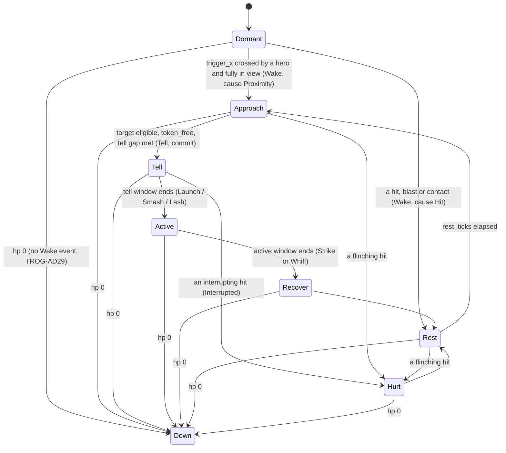

# Floor 01 troglodyte run and the Test of Strength in the floor run (TROG-PLAN)

**Status:** design and integration plan. **TROG-A** (the three enemies and `trog_run`, section 12.1) and **TROG-B** (`trog_strength`, the gate and the hand-off, section 12.2) are implemented by their own PRs; TROG-B landed the **declared static fallback** for the bench at **80 px** (the validator refuses the 80 px partition, TROG-AD43; a static solid may reach 80 px, TROG-AD46) and its gate **passes every row** (section 7.3 and 15.2; under the first 48 px static G-1 and G-2 failed, kept as history in TROG-AD45). Nothing here is playtested or accepted. Once an implementation PR merges, its part becomes "merged, game-feel review pending". The TROG-A implementation notes and the review fixes are TROG-AD27..AD38 (section 13) and section 15.1; TROG-B's are TROG-AD42..AD47 and section 15.2. Its execution order is [the troglodyte work order](../07-agents/floor-01-troglodyte-workorder.md).

**Owner decisions (cited for every adopted default below):**

- 2026-11-24, "go with all": every owner-gated Floor 1 item is authorized under adopted defaults recorded by ID.
- 2026-11-25, "ensure everything ends on main": every room must be reachable in `--scene f01_late --f01-run` in story order. New behaviour is on by default where the spec allows. Large unfinished items land as a labelled playable greybox.

**Source.** This plan carries the owner draft **#191** onto main, adapted. The draft is "FLOOR01-TROG-RUNUP-01, The House of Broken Weights", on branch `design/f01-troglodyte-runup-juicer-gym`:

- `docs/01-design/floor-01-troglodyte-gym-approach.md`: T0..T5, three enemy contracts, the Test of Strength with its bench knock, the gym reception, cases TROG-01..17;
- `docs/07-agents/floor-01-troglodyte-gym-workorder.md`.

#191 itself is not merged. Its intent, its cases and its "not allowed" list are kept. Its geometry and its single-encounter shape change where current main requires it (section 15).

**What this plan does.** It puts the troglodyte territory and the Test of Strength between the survivors' camp and the Juicer, as two greybox rooms:

- `trog_run` (#191 T0..T3): the Pygmy, the Basher and the Virtuoso, one at a time;
- `trog_strength` (#191 T4): Basher plus Virtuoso, with a breakable bench stack the Basher can smash.

#191's T5 (the reception and turnstile) is the Juicer arena's zone A, which AREA-GYM-01 already dresses. The Juicer room, `brute_boss_f01` and its data, gate, goldens and pins do not change.

**Read with:**

- [the Act I integration plan](floor-01-act-01-integration.md), the shape this plan copies;
- [the integration plan](../07-agents/f01-playtest-integration-plan.md) section 18;
- the art specs [TROG-01](../02-art/trog-01-spec.md), [TROG-02](../02-art/trog-02-spec.md), [TROG-03](../02-art/trog-03-spec.md) and their manifests `assets/manifests/trog-0{1,2,3}.json` (every frame window and box below comes from them);
- [AREA-GYM-01](../02-art/area-gym-01-spec.md) (the gym kit and the arena's zone A);
- [the llama rush sheet](enemy-gameplay-llama-rush.md) section 11 (the STATIONARY-DONUT gate this plan reuses);
- [the progression horizon](character-progression-horizon.md).

## 1. What main holds today (checked at `d6051bdd`)

- **The run.** `assets/levels/f01_late/manifest.json` lists 15 rooms: act1_chase, act1_shore, act1_guild, corral, rest_refuge, hoarder, boiler, dozer, hazards, ring_court, ring_split, rest_camp, juicer, rest_aftermath, mastery. `MANIFEST_HASH` is `0xd213_db6d_b329_d342`, and `SCOPED_PIN_KEYS` has 32 entries.
  - `rest_camp` pins `f01_pin_post_pile_boss`.
  - `juicer` (scene `boss_f01`, rules `boss`) pins `f01_dynamite_held` and `f01_donut_boss_held`. On `brute_boss_f01_defeated` it grants `fist_reinforced` and `special_short_blink`.
  - AUDIENCE-RUN is live in every room after the corral (`AUDIENCE_UNLOCK_AFTER`, positional).
- **ENEMY-SLOT** (`src/scene_enemy.rs`, `src/combat_scene/slot.rs`) is the owner of every new enemy.
  - `SlotStepCtx` gives an enemy:
    - the tick and the heroes;
    - the solids (env solids included) and the env view, including `EnvTarget { prop, rect, solid }`;
    - the room's floor and walls, and `view_x`;
    - `token_free`, which already applies `MAX_ATTACKERS` 2 and `TELL_SPACING` 12;
    - `evade`, the DM-B cat reflex lent to evadable attacks.
  - `SlotOut` carries:
    - events and blows (`HeroBlow { hero, source, damage, from_x, knock_vx, knock_vy }`);
    - `tell_started`;
    - `env_stimuli: Vec<SlotStimulus { prop, stimulus }>`. This is the Hoarder's path for shoving a prop (`combat_scene/pile_boss.rs`).
  - `SlotHit` carries a `HitSource` (`CarlMelee`, `DonutSwat`, `DonutPounce`, `MagicMissile`) and a `poise` equal to the move's damage. Interrupt rules must therefore key on `HitSource`, not on poise.
  - **Checkpoint respawn** (`slot_respawn`): a living slot enemy goes back to its spawn state, and a defeated one stays defeated.
  - **Fixture restart** (`SlotRuntime::reset`): every enemy is rebuilt.
- **Roster.** `RosterKind { Room(EnemyKind), Slime, Dozer }`. `EnemyKind::Trog` exists only as a camera_lab test kind (`kind_name` "trog"). `RosterEntry` has no leash field, and the sidecar is `deny_unknown_fields`.
- **The partition** (`src/env_prop.rs`, CORRAL-D) is the only breakable solid prop.
  - States: `Intact` → `Weakened` → `Broken`.
  - Breaking it: `MeleeHit` stimuli count distinct tokens up to `break_hits`, and one `Shove` at or above `shove_min_impulse_px_s` breaks it at once.
  - `Projectile`, `Blast`, `LaunchedBody` and `PropContact` are `NotAccepted`.
  - A remnant of 16 px or less is not a solid.
  - A checkpoint respawn keeps its state (`reset_keeping_partitions`, CD-AD10); a restart restores it.
- **Companion.** Donut's AI sees goblins, llamas (opt-in per room) and at most one slot "boss" threat supplier. A plain slot enemy is invisible to her targeting and her dodge. The llama feed is the precedent for a per-room opt-in.
- **Art.**
  - TROG-01 Pygmy (40 px), TROG-02 Basher (66 px) and TROG-03 Virtuoso (66 px) exist as native sources and atlases. Their review status is `prototype_fixture_unapproved`, and they are not wired into any Bevy binary.
  - AREA-GYM-01 dresses the Juicer arena. Its zone A holds `gym_reception_desk` (46, 368) and `gym_turnstile` (110, 370). `gym_bench` (44 × 18) is one of its props.
- **Not on main.** No troglodyte gameplay, no troglodyte room, no evaluator stage for them.

## 2. The decisions in one place

1. **Two rooms between the camp and the Juicer:** `rest_camp` → **`trog_run`** → **`trog_strength`** → `juicer` (TROG-AD1). #191 places the lead-in after the survivors' camp and before `boss_f01`, and nothing in the progression bible contradicts that.
   - Both rooms are milestone `greybox` under `cf02_rules`. They are story rooms on the camp's pin (`f01_pin_post_pile_boss`), so they carry the ledger unchanged and the audience is live.
   - The run grows from 15 to 16 rooms (TROG-A), then to 17 (TROG-B).
2. **One enemy family on ENEMY-SLOT.**
   - Code: one domain module `src/trog.rs` with three species, one adapter `src/combat_scene/trog.rs`, and one appended roster kind `RosterKind::Trog(TrogSpecies)`.
   - Data: one tuning file `assets/data/gameplay/enemy_trog_v0.json` with its own pin.
   - Sidecar kinds: `trog_pygmy`, `trog_basher`, `trog_virtuoso`.
   - Every attack commits at its tell start. Every attack hits each hero at most once, and none tracks after its tell starts.
   - A troglodyte targets only a hero its attack band can reach (TROG-AD17). It tells only while fully in view, and its wake records whether proximity or a hit caused it (TROG-AD21).
3. **The bench knock uses the corral partition, not new physics.**
   - The bench is an 80 px "bench stack" partition prop. It breaks after 3 hero melee tokens, or at once to the Basher's smash shove.
   - The Basher smashes it only from a true hitbox overlap: either a normal smash, or a **bench smash** that rule (b) starts when the Basher is walk-blocked by the bench with a grounded hero in the bait zone.
   - If the partition cannot carry it, the declared fallback is an 80 px static bench (TROG-AD46), with the bench beat cut (section 5.4).
4. **STATIONARY-DONUT gate for the Test of Strength** (TROG-14): no gated stationary policy can defeat both troglodytes from a natural start while the bench stands. The geometry proves it (section 7.3), and an evaluator stage asserts it. T1..T3 are reported, not gated; T1's Pygmy is the positive control.
5. **No rescue, no teleport.** The companion gets a slot target and threat feed in these rooms and nothing else (TROG-AD16).
6. **Hand-off.** The `trog_strength` exit shows the standard room-clear panel and relaunches into `juicer` (`boss_f01`) with the carried ledger. The boss scene's own x96 engage marker, 2P gate and checkpoint are the protected entry #191's T5 asks for.
7. **Two implementation PRs plus one art order** (section 12):
   - **TROG-A:** the enemies and `trog_run`.
   - **TROG-B:** `trog_strength`, the bench, the evaluator gate and the run wiring.
   - **AREA-TROG-01:** the environment art, through the art pipeline.

## 3. Run order

| Run index (after TROG-B) | Room id | Scene | Title (TROG-AD2) | Milestone | Story pin at entry | Grants | PR |
| --- | --- | --- | --- | --- | --- | --- | --- |
| 0..11 | act1_chase .. rest_camp | unchanged | | | | | |
| **12** | **`trog_run`** | **`f01_trog_run`** | **The Troglodyte Run** | **greybox** | **`f01_pin_post_pile_boss`** | **none** | TROG-A |
| **13** | **`trog_strength`** | **`f01_trog_strength`** | **The Test of Strength** | **greybox** | **`f01_pin_post_pile_boss`** | **none** | TROG-B |
| 14 | `juicer` | `boss_f01` | The Juicer | boss | `f01_dynamite_held`, `f01_donut_boss_held` | `fist_reinforced`, `special_short_blink` on defeat | |
| 15, 16 | rest_aftermath, mastery | unchanged | | | | | |

| State of main | Listed rooms |
| --- | --- |
| Today | 15 |
| After TROG-A | 16 (`trog_run` between `rest_camp` and `juicer`) |
| After TROG-B | 17 |

#191's pacing hypothesis: about 6–8 minutes from the camp exit to the boss gate on a first run, and about 3–4 minutes for an experienced player. It is reported from a human session only (TROG-Q9).

## 4. Rooms (greybox, room px, y down, floor 580, height 660, 16 px grid)

Heights below are "above the floor" (floor y 580).

Both rooms share these properties:

- **Files.** They are `floor01-demo-hall-v1` room files plus `floor01-encounter-v1` sidecars in `assets/levels/floor01/`, composed with the existing kit (`f01_boiler::compose_kit`, the REST and ACT1 pattern).
- **Common sidecar fields.**
  - Spawns: Carl 112, Donut 80.
  - Areas: `protected_spawn` {16, 484, 208, 96} and `checkpoint` {32, 484, 48, 96}.
  - `goal: defeat_roster`, `max_living` 2, `platform_slab_px` 12.
- **Floor.** Flat and continuous, with no pit and no lethal fall. The ceiling is at 228 px (DP-Q45).
- **Surfaces.**
  - Low steps are sidecar statics of kind `solid` up to 48 px (the ACT1-AD17 form).
  - A raised slab is a room platform with at least 52 px clear under it (`PlatformBlocksLane`).
- **Decor.** Presentation only: decor rectangles until AREA-TROG-01 lands (section 16).

### 4.1 `trog_run` (#191 T0..T3), width 2304

| Pocket | x | Contents | Teaches |
| --- | --- | --- | --- |
| T0 approach | 0..320 | Spawn and checkpoint. Knuckle-mark and impact decor; a far "slam" decor beat (no audio path, TROG-Q7). No enemy can see the spawn. | The area's identity |
| T1 the low hunter | 320..896 | **`pyg_a`** at 640: `trigger_x` 400, leash 448..832. A **32 px low refuge** static at x 352..416. An optional second Pygmy, `pyg_b` at 784, is not authored by default (TROG-Q1). | Coil, leap; punish the landing low (Carl's CF02 stomp, Donut's pounce), then jab it as it stands up (TROG-AD22) |
| T2 the fist-shaped hole | 896..1696 | **`bas_a`** at 1376: `trigger_x` 1120, leash 1280..1472. It emerges in front of the fist-shaped hole (decor at 1376). Flat lane, no shelf. | Read the overhead tell, punish the 20-tick recovery |
| T3 the bell and the tongue | 1696..2304 | A **32 px step** static at x 1840..1904. A **64 px platform** at x 1920..1984 (slab 12, exactly 52 clear; Carl class, TROG-AD35). **`vir_a`** at 2144: `trigger_x` 1776, leash 2016..2272. The exit is at x 2224..2288 (inside the play area, TROG-AD34). | Line control, two answers (in under the tongue, or over the top) |

**Why each surface is truthful.**

- **The T1 refuge** (feet at 32) lies outside the Pygmy's leash, and a leap is clamped to the leash.
  - A Pygmy landing at 448 facing left strikes x 416..434 at the furthest (its earlier strike ticks are further right). A hero (half-width 12) is safe with its pivot at 404 or less, which covers a hero standing fully on the refuge (pivot 364..404).
  - A hero overhanging the refuge's right edge (pivot 405..427) can still be struck. The refuge is safe only when the hero is actually on it.
  - From the refuge, Donut's bolts fly at 48..54, above the Pygmy's idle hurtbox (top 33), and Carl's jab box (feet + 29..35) passes over it too.
  - The refuge is therefore a breather, not a turret.
- **The T3 step** (feet at 32) is the stair to the platform. It lies outside the tongue's reach: from the leash start 2016 facing left, the tongue band spans x 1939..1960. The height truth of a +32 stand (both heroes inside the band y 36..46: Carl 32..84, Donut 32..56) is tested in TROG-F05's fixture geometry, not here.
- **The T3 platform** (feet at 64) is above the band for both heroes.
  - Its bolts fly at 80..86, above every Virtuoso hurtbox (tops 60, 68, 70), so it is a vantage, not a turret.
  - Dropping off its right edge (x 1984) lands a hero within 56 px of a Virtuoso holding at 2016..2040. That is inside the tongue's dead zone (the band starts at +56) and in Carl's melee reach.
- **The Virtuoso's leash** starts at 2016, so its body (x −16..14 facing left) never stands under the slab, whose 52 px clear is lower than its 66 px height.

### 4.2 `trog_strength` (#191 T4), width 1024

> **As built (TROG-B).** The table below is the design with the 80 px `bench_stack` partition. The validator refuses that prop, so the shipped room is the declared static fallback of 5.4: the bench is an 80 px static `solid` at 640..672 (TROG-AD46), the Basher spawns at 800 (leash 704..896) and the exit is 944..1008 (TROG-AD42, TROG-AD43, section 15.2). Everything in this section about breaking the bench, the bait zone and the far face describes the cut design, kept as the intended shape if the bench becomes a partition again.

| Element | x | Height | Rule |
| --- | --- | --- | --- |
| Spawn, checkpoint | Carl 112, Donut 80 | floor | protected spawn x 16..224 |
| Retreat shelf (`shelf`) | 288..352 | 48, static `solid` | #191's "short optional retreat shelf" |
| **`vir_a`** (Virtuoso) | spawn 496, leash 368..624 | floor | `trigger_x` 240; engages first |
| **`bench_stack`** (partition prop) | 640..672 | **80**, solid while `Intact` or `Weakened` | `break_hits` 3, `shove_min_impulse_px_s` 160; remnant x 640..672, h 16 (not a solid) |
| **`bas_a`** (Basher) | spawn 776, leash 680..872 | floor | `trigger_x` 600 (TROG-AD23); walk-blocked by the bench at pivot 696 (body front +24 = 672) |
| Exit apron | 960..1024 | floor | exit rect x 976, w 48 |

**Reading the room.**

- The Virtuoso fights on the near side. The Basher waits behind the bench, so the two tells are staggered by geometry, not by a timer (#191 beat 1, TROG-08).
- **The bench is the room's question.** There are three ways past it:
  - climb it (80 px, Carl's class limit; the corral bumper precedent);
  - break it by hand (3 melee tokens, while the Virtuoso can reach the bait zone);
  - bait the Basher's smash, so the bench breaks in one hit and the Basher is in its 20-tick recovery right in front of you (#191 beats 3 and 4).
- Ignoring the bench and fighting straight through must stay viable (TROG-10).
  - Climb, cross the bench top, and drop **past the Basher's body**, at x 736 or more. A Basher blocked at 696 facing left has its body at 672..722.
  - Then fight it on open floor with the pivot at 736 or more. To aim at a hero whose hurtbox starts at 724 or later, a Basher facing left needs its pivot past 748, so its smash rect starts past 707 and never reaches the bench (672).
  - A drop between the bench and the Basher (x 680..735) puts the hero in a smash whose rect overlaps the bench by 12 px or more. That is the far-face case of 5.4: allowed, and it breaks the bench.
- **The Basher wakes at x 600** (TROG-AD23). A hero who fights the Virtuoso left of 600 keeps the Basher Dormant behind the bench. Once a hero crosses 600, the Basher needs 160 ticks (80 px at 0.5 px per tick) to reach the bench face.
- **The bait zone** is the floor strip x 600..640, left of the bench (section 5.4).
- **The tongue is clipped at the first standing solid.**
  - From the leash start at 368 facing left, the band x 291..312 is cut at the shelf face (352), so the shelf is a true retreat.
  - Facing right from 624, the band reaches x 680..701 only once the bench is broken. While the bench stands, it is cut at 640.
- **The Virtuoso's leash ends touch the solids and never enter them** (TROG-AD24: the walk body is the idle and walk hurtbox, stepped against standing solids).
  - At 624 facing right, the body is x 610..640, touching the bench face.
  - At 368 facing left, the body is x 352..382, touching the shelf face.
  - The wider lash pose (−14..26) never occurs facing right at 624 while the bench stands, because the clipped band is empty there, so no tell can start.

## 5. The troglodyte family on ENEMY-SLOT

### 5.1 Data (`assets/data/gameplay/enemy_trog_v0.json`, `TUNING_HASH`, `PIN_KEY` "trog")

Every value is an adopted default (TROG-AD3) unless marked "from the manifest". The loader rejects a value outside its stated range with an error that names the field.

**Shared values.**

| Key | Value | Rule |
| --- | --- | --- |
| `trogq01_damage` | 1 | per blow, every species (`HERO_HEALTH` 4) |
| `trogq02_tell_gap_ticks` | 24 | a troglodyte does not start a tell within 24 ticks of another troglodyte's tell start (on top of `TELL_SPACING` 12, section 5.3) |
| `trogq03_wake_margin_px` | 0 | wake only when the whole hurtbox is inside the view (`view_x` .. `view_x` + view width) |

**Per-species values** (Pygmy / Basher / Virtuoso).

| Key | Pygmy | Basher | Virtuoso | Rule |
| --- | --- | --- | --- | --- |
| `hp` | 2 | 4 | 3 | |
| `walk_px_tick` | 1.0 | 0.5 (art) | 0.75 (art) | |
| `leash_px` | 192 | 96 | 128 | half-width around the spawn x; never left (TROG-AD5) |
| `tell` | 0..23 (24) | 0..35 (36) | 0..29 (30) | from the manifest |
| `active` | launch 24..26, strike 27..34 | downswing 36..38, impact 39..46 | lash 30..31, strike 32..37 | from the manifest; the hitbox is live only in the strike or impact window |
| `recover` | land 35..48 (14) | 47..66 (20) | 38..55 (18) | from the manifest |
| `rest_ticks` | 40 | 30 | 36 | after recover, before the next tell |
| `hurt_ticks` | the `hurt` tag's frame ticks | the `hurt` tag's frame ticks (14) | the `hurt` tag's frame ticks | from the manifest |
| `hitbox` (from pivot, facing +1) | x 14..32, y 13..33 | x 24..41, y 0..14 | x 56..77, y 36..46 | from the manifest |
| `knock_vx`, `knock_vy` (px/s) | 150, −120 | 220, −160 | 90, −60 | |
| species-specific | `leap_min_px` 64, `leap_max_px` 160, `apex_px` 16, `trigger_px` 160 | `open_band` x 24..38, `bench_shove_px_s` 200, `bench_min_overlap_px` 12, `bait_px` 96, `interrupt_until` 18, `interrupt_cooldown` 120 | `standoff_px` 66 | |

**Hurtboxes.** Each state uses the manifest box of its tag:

- idle and walk, also used in Dormant, Approach and Rest. Its x range is also the walk body that collides with standing solids (TROG-AD24);
- tell (the feint, for the Virtuoso);
- active (leap, smash, lash and strike);
- recover (land, for the Pygmy);
- hurt.

`down` is not hurtable. A drift test compares every box and every window above with the three manifests, and a box that does not match fails CI (TROG-T02). If a manifest is unreadable at runtime, the boxes still come from the data file, so the sim never reads art.

### 5.2 States (one machine, three profiles)



**Dormant.**

- The enemy stands, does not attack and does not count as an attacker. It stays hurtable.
- A wake has one of two **causes**, which the `Wake` event and the state hash record (TROG-AD21):
  - **Proximity.** A hero's pivot has crossed `trigger_x` (either hero), and the whole idle hurtbox is inside the view. The enemy goes to Approach.
  - **Hit.** A hit, blast or contact reaches it while Dormant, for example a 240 px bolt into a partly off-screen enemy. The hit deals its damage, and the enemy goes to **Rest** (no flinch, no tell), logging `Wake { Hit }`. The view rule does not apply to this wake, because the player chose to strike first.
  - **A one-hit defeat of a sleeper** goes straight to Down and logs **no** `Wake` event, only the existing `EnemyDefeated` (TROG-AD29). The event log is hashed, so this is fixed: a defeat of a body that never woke is not a wake.
- The view rule enforces #191's "only after its tell can be seen" (TROG-AD6). A hit-woken enemy is still covered: no tell starts unless its whole hurtbox is in view (the eligibility rule below).

**Approach.** Walk toward the target until it is **eligible**, never leaving the leash. A leash end is a wall for the enemy, and so is a standing solid: the walk body (the idle and walk hurtbox's x range) stops at a solid face (TROG-AD24).

- **The target** (TROG-AD17, amended; TROG-AD27 and AD31): the nearest living hero in x, outside `protected_spawn`, **whose current hurtbox can meet the species' attack band** in y (relative to the enemy's feet) **and lies inside the leash's reach in x** (its hurtbox overlaps the leash band widened by the hitbox's furthest edge: 32, 41 or 77 px). Distance is measured **after** that filter, and in solo the bot hero counts `trogq04_ai_bias_px` (40, the boss's and the goblins' value) farther away (TROG-AD27). The target is kept until another is `trogq05_target_switch_px` (24) nearer, the goblins' hysteresis. Ties go to Donut (the smaller hurtbox, #191 section 7: attacks do not single out Carl). The bands are:
  - Pygmy y 13..33 (its grounded box);
  - Basher y 0..14 (a hero touching the floor band);
  - Virtuoso y 36..46: Carl with his feet below 46 (on the floor or the 32 step, not on the 64 platform), or Donut with her feet at 13..45 (airborne, on the step or on a stand). A grounded Donut (hurtbox 0..24) is **never** a Virtuoso target while another candidate exists.
- **No candidate.** If no hero meets the band, the target is the nearest living hero outside `protected_spawn`. The enemy positions on it but never becomes eligible, so it never tells at a hero it cannot hit. For the Virtuoso and a lone grounded Donut, that means holding at `standoff_px`. This is reported (TROG-Q13).
- **No target at all** (re-review R4, TROG-AD30). If no living hero stands outside `protected_spawn`, the enemy has **no target**: it holds where it stands, walks nowhere and never tells, until a hero leaves the protected spawn.
- **A hero reachable in y but not in x** (re-review R5, TROG-AD31). The leash clause above removes a hero the leash cannot bring the attack to (the T1 refuge hero outside the Pygmy's leash). A hero a **solid** cuts off (Carl behind the intact bench for the Virtuoso, whose band is clipped) or that stands where the committed geometry never meets it stays a candidate by the leash rule; the trog follows it and never tells, and the other hero gets free hits. That remainder is reported with TROG-Q13, not gated.
- The target is re-chosen every Approach tick (with the hysteresis above) and fixed at the tell start.
- **Eligible** means all of these hold:
  - the target is outside `protected_spawn`;
  - the enemy's whole current hurtbox is inside the view (`trogq03_wake_margin_px`), whatever woke it;
  - the attack's committed geometry can overlap the target's current hurtbox (the truth rule);
  - for the Pygmy, the target's pivot is within `trigger_px` 160;
  - for the Basher, the target's hurtbox overlaps `open_band` and touches the floor band y 0..14;
  - for the Virtuoso, the target's hurtbox overlaps the clipped band x 56..77, y 36..46. Otherwise the Virtuoso walks to `standoff_px` 66.
  - **Otherwise it walks to its hold distance** (TROG-AD32): the Pygmy only closes in; the Basher holds at the open band's centre (31 px) and the Virtuoso at `standoff_px`, and each **backs off** when a hero stands inside that distance rather than freezing, so a hero cannot stand inside a body for free hits.

**Tell (the commit).**

- At the tick the tell starts, the enemy fixes its **facing** and its attack geometry, sets `SlotOut::tell_started` and holds the token (`holds_token`) from the tell start until the end of its active window.
- What is fixed per species:
  - **Pygmy:** the landing x is fixed at `clamp(target pivot x, leap_min, leap_max)` along the facing, then clamped to the leash.
  - **Basher:** the smash rectangle is fixed. In a bench smash (5.4) the target is the bench prop.
  - **Virtuoso:** the line is fixed.
- Nothing re-aims after this tick. This is the ACT1 lesson: "commit timing" is the tell start, never a later tick.

**Active.**

- **Pygmy.**
  - It is airborne from 24 to 34 (11 ticks) on a fixed parabola of apex 16 px from its x to the landing x, at a constant horizontal speed of (landing − start) / 11 px per tick.
  - It is stepped against solids: if a solid face is in the way, it stops at the face and lands there.
  - It lands at 35.
  - **Boxes in the air** (TROG-AD25). The sim pivot follows the parabola. With k = tick − 24 (0..11), the pivot's height is round(4 · 16 · k · (11 − k) / 121). Over the strike ticks 27..34 (k 3..10), that gives 13, 15, 16, 16, 15, 13, 10, 5.
  - Every Pygmy box in the air (the hitbox x 14..32, y 13..33 and the leap hurtbox) is measured from this **airborne pivot**, in x and y, and the frame is drawn at it. The art's in-frame lift is part of the frame, and the presenter adds no other offset.
  - So the strike box covers ground y 26..46 at k 3 and 18..38 at k 10. A grounded Donut (top 24) can be struck only on ticks 33 and 34. Carl (top 52) can be struck on every strike tick.
  - The landing x committed at the tell start is the pivot x at k 11.
- **Basher.** It stands still.
- **Virtuoso.** It stands still. The band is clipped each strike tick at the first standing solid on that tick (env solids included, so a bench broken this tick still clips; the one-tick lag of 5.7).
- **A blow** is one `HeroBlow { damage 1, knock as data }` per hero per attack instance (`source` = the enemy's target id; `from_x` = its pivot), for any hero whose hurtbox overlaps the live hitbox on a strike or impact tick. A hero inside DM-B's evade window is skipped (`evade`, all three attacks are evadable, TROG-AD9). Heroes inside invulnerability frames take no damage.
- **Strike** is logged on the first tick a blow lands. **Whiff** is logged at the end of the active window if none landed.

**Recover, Rest.** The enemy is vulnerable and does not attack. `holds_token` is false from the first recover tick.

**Hits taken** (`apply_hit`): every hit deals its `damage` (a 0-damage swat deals none). Its reaction depends on the state and the `HitSource`:

| Species | In Tell | In Approach, Rest | In Active, Recover |
| --- | --- | --- | --- |
| Pygmy | any hit **interrupts** | any hit flinches (Hurt) | damage only (committed) |
| Basher | `CarlMelee` or `DonutPounce` interrupts **only in ticks 0..17** of the tell and only if no interrupt happened in the last 120 ticks; otherwise damage only. `MagicMissile` and `DonutSwat`: damage only | `CarlMelee` or `DonutPounce` flinches only if no interrupt or flinch happened in the last 120 ticks (a flinch spends the same budget); otherwise damage only. `MagicMissile` and `DonutSwat`: **no reaction**, damage only | damage only |
| Virtuoso | `CarlMelee` or `DonutPounce` interrupts; `MagicMissile` and `DonutSwat` deal damage only | any hit flinches | damage only |

- **Why the Basher has a budget.** Without it, Carl's 14-tick jab loop could chain interrupts and keep it from ever attacking. With it, the late tell is a committed smash that must be dodged (TROG-05, "no repeated stunlock").
- **Why bolts never interrupt** the Basher or the Virtuoso. A planted Donut would otherwise cancel every tell from range for free. A bolt still deals full damage: there is no magic immunity (TROG-05).
- **`apply_blast`** (Carl's dynamite) deals the blast's damage and acts as an interrupt for every species. Dynamite is held at this point of the run, and #191 forbids "artificial immunity". `apply_contact` (a launched body) deals no damage and flinches the Pygmy only.

**Down.**

- The enemy is defeated (`alive()` false). `death_body` reports `trog_pygmy`, `trog_basher` or `trog_virtuoso` at its pivot.
- These keys have no death profile today, so the presenter draws nothing extra and the art's `down` frame holds as the body (TROG-Q6). No gore, slow motion or camera move is added (#191 section 7).

### 5.3 Two tells at once (TROG-08)

- `token_free` already caps the attackers at 2, with tells at least 12 ticks apart.
- **The tell gap.** A troglodyte also waits `trogq02_tell_gap_ticks` 24 after another troglodyte's tell start (TROG-AD8). The adapter reads the scene's `last_tell_start`, which `SlotStepCtx` gains as an appended field (the scene already tracks it).
- **What the gap buys** (Basher tell at t):
  - With the gap, a Virtuoso tell can start at t + 24 at the earliest. Its strike lands at t + 56..61, after the Basher's impact at t + 39..46, so one hero can dodge one, then the other.
  - With only the 12-tick spacing, the strike could land at t + 44..49 and overlap the impact.
  - Invulnerability (55 ticks) already stops a double damage, but the gap keeps a real safe response (#191 "one real safe response").
- **Fallback.** If exposing `last_tell_start` turns out to need a change in a shared hot path beyond one appended ctx field, drop the gap and rely on `TELL_SPACING` plus invulnerability. Record the fallback as an implementation note.

### 5.4 The bench knock (#191 section 5, TROG-09)

**The prop.**

```json
{ "id": "bench_stack", "kind": "partition",
  "target": { "x": 640, "y": 500, "w": 32, "h": 80 }, "solid_intact": true,
  "remnant": { "x": 640, "y": 564, "w": 32, "h": 16 },
  "partition": { "break_hits": 3, "shove_min_impulse_px_s": 160 } }
```

The corral partition already has a 48 px target. TROG-B's first check: if `env_prop` or the sidecar validator rejects an 80 px partition, a target this wide, or this remnant, **stop and escalate**. Do not widen the prop rules on the side.

**Result of the first check (TROG-B).** The sidecar validator **rejects** it: `ObstacleTooTall { prop: bench_stack, px: 80 }`, because a `solid_intact` prop may leave at most `MAX_LANE_OBSTACLE_PX` (48) px on the lane (`the_80_px_bench_stack_partition_is_refused_so_the_static_fallback_is_taken`). The prop rules were not widened; the declared fallback below is what landed (TROG-AD43).

**How it breaks.** Three ways, all existing partition rules:

1. **Three distinct hero melee tokens.** Every hero melee stimulus the corral partition already accepts counts; the implementer records which Donut moves count.
2. **A Basher smash** whose impact rectangle overlaps the bench's rectangle by at least `bench_min_overlap_px` 12 on an impact tick. The adapter pushes one `SlotStimulus { prop, Shove { impulse_px_s: 200, source: the Basher's target id, credit } }`, the Hoarder's path. At most one shove is sent per smash instance.
   - **`credit`** (TROG-AD26), following `env_prop`'s rule ("the player of the hero the shove baited, `None` when the target was a bot"):
     - a bench smash takes the player of the **baiting hero**: the hero that met rule (b)'s bait condition at the tell start, the nearest to the Basher's pivot, with ties to Donut;
     - a normal smash at the far face takes the player of its committed target;
     - it is `None` when that hero is the companion bot.
   - The `BenchSmash` event names the baiting hero's id either way, so a bot bait is still attributed in the log.
3. **Nothing else.** Bolts, blasts and launched bodies are `NotAccepted` (the solid stops a bolt, which then counts as blocked).

**The bench smash (rule b).** Rule (b) starts a normal smash tell with the bench as its committed target when all of these hold:

- the Basher is in Approach;
- its walk toward the target is blocked within 4 px by a partition prop whose `EnvTarget.solid` is true;
- a living hero stands on the room floor (feet within 2 px of 580), on the bench's side away from the Basher, with its pivot within `bait_px` 96 of the Basher's pivot;
- the ordinary tell gates hold, because a bench smash is a tell: `token_free` (`MAX_ATTACKERS`, `TELL_SPACING`), the 24-tick trog tell gap (5.3), and the whole hurtbox in view. It sets `tell_started` and holds the token like any smash.

**The geometry.** A Basher blocked at pivot 696 facing left:

- its impact rectangle is x 655..672, which overlaps the bench (640..672) by 17 px, at least 12, so the bench breaks;
- a hero whose hurtbox lies left of 655 is not hit. A hero pressed against the bench face has its pivot at most 628 (Carl) or 630 (Donut), so its hurtbox is no further right than 640;
- the bait zone is the floor strip x 600..640, where any hero pivot lies within 96 px of 696.

The tell is the ordinary 36-tick overhead tell; the player sees the same body language aimed at the bench.

**The far face.**

- A normal smash at a hero pressed against the bench's right face (hurtbox at x 672..677) overlaps the bench too, and it also breaks it.
- That is still a hero choice, so it is allowed. It is reported as a diagnostic (section 7.3).
- A smash at a hero further right never reaches the bench, because the open band (24..38) lies inside the hitbox (24..41).

**After the break.**

- The partition logs its own break event; the adapter logs `Trog { act: BenchSmash }`.
- The remnant (16 px, not solid) lets both heroes and the Basher pass. The Basher's leash still ends at 680, so it never crosses to the Virtuoso's side.
- "At most once" holds by construction: a `Broken` partition accepts nothing.

**The static fallback (declared, TROG-AD12).** If the stop condition above fires, or if the TROG-B gate fails and the fix is not a value change in this plan:

- the bench becomes an 80 px static `solid` (Carl's class limit and the corral bumper's height; heroes climb it; TROG-AD46 raised the first 48 px fallback);
- the Basher's leash moves to 704..872, so it can never stand at the bench face;
- rule (b) and the bench smash are cut;
- section 7.3's G1 still holds, because bolts below 48 + 16 stop on the bench.

This is #191's own "static, traversable bench" path, landed as a labelled greybox with the bench beat open.

**The 48 px fallback's claim about G1 was wrong** (history, corrected by TROG-B's measurement; the shipped bench is 80 px, TROG-AD46): bolts below 48 + 16 px do not all stop on a 48 px bench. A bolt flies at feet + 16..22, so only a bolt released below feet 32 meets the bench; one released at feet 32..54 flies over it and still meets a troglodyte hurtbox (tops 58 to 70). G1 needs a bench at least as high as the tallest hurtbox (70 px): then every bolt either stops on it (feet below 64 for an 80 px bench) or flies above 80 over both bodies. The shipped 80 px static satisfies it: feet below 64 stop on the bench, and feet of 64 or more fly at 80 or above, over every hurtbox (70 or lower). See 7.3 and 15.2.

### 5.5 Sidecar and validation

- **Roster entries** use the existing fields only: `{ id, kind: "trog_pygmy" | "trog_basher" | "trog_virtuoso", x, beat, trigger_x?, delay_ticks }`.
  - The leash is spawn-relative and comes from tuning (TROG-AD5), so the schema does not change.
  - `delay_ticks` is honoured as an extra wait after wake.
- **Parsing.** `kind` maps to `RosterKind::Trog(species)` before `EnemyKind::parse`, like `slime` and `dozer`. Unknown `trog_*` kinds are rejected with the field name.
- **`TROG-V` validation**, in the encounter validator, only for rooms that hold a trog:
  - V1: each trog's leash band lies inside the room and contains its spawn x;
  - V2: no static solid taller than 16 px lies inside a leash band;
  - V3: no part of `protected_spawn` lies within a trog's leash plus its forward reach (Pygmy 160 + 32, Basher 41, Virtuoso 77);
  - V4: a partition prop named by no rule is allowed, but one inside a leash band is rejected;
  - V5: the existing reachability checks still pass with every partition intact.
- **Statics.** `trog_run` has `refuge` (352..416, h 32) and `bell_step` (1840..1904, h 32); `trog_strength` has `shelf` (288..352, h 48). All are kind `solid`. The T3 platform is a room platform.

### 5.6 Events and the state hash

`CombatEvent::Trog { tick, enemy: u32, act: TrogAct }` is appended, with these codes:

| Code | Act |
| --- | --- |
| 1 | Wake { cause: Proximity = 0, Hit = 1 } |
| 2 | Tell { target: the hero's stable id; in a bench smash, the baiting hero's } |
| 3 | Launch |
| 4 | Land |
| 5 | Strike |
| 6 | Whiff |
| 7 | Interrupted |
| 8 | BenchSmash { bait: the baiting hero's stable id } |

The codes are appended and hashed like every combat event. A payload is hashed after its code.

**Event order inside one enemy step:**

1. `Wake`;
2. `Tell` or `Interrupted`;
3. `Launch` or `Land`;
4. the blows (the scene logs its hero-hit events after the slot step, as today);
5. `Strike` or `Whiff`;
6. `BenchSmash`.

The partition's break event comes later in the same tick, from `step_env`.

**The state hash.** `mix_into` folds the species, state, state tick, hp, facing, wake cause, committed target and geometry (landing x, smash rect or line), leash band, interrupt budget, per-instance hit mask and position. Only rooms and fixtures that hold a trog have one, so every existing golden, fixture hash and replay stays byte-identical. Asserting that is a stop condition.

### 5.7 Tick order (the ACT1 one-tick-lag lesson, stated up front)

Each fixed tick runs in this order:

1. the scene step (hero movement and collision, bolts);
2. the slot enemies (a smash's stimulus is pushed here);
3. `step_env` resolves stimuli: the partition goes `Broken`, and the env view and solids update.

Collision and bolts see the missing bench from the **next** tick. A Virtuoso strike in the break tick is still clipped by the bench. No global step is reordered.

### 5.8 Companion (Donut's AI, solo)

A per-room opt-in **slot feed**, on in both trog rooms and off everywhere else (TROG-AD16):

- **Kind.** `EntityKind::Slot` is appended, keyed by `StableEntityId { kind: Slot, index: slot index, spawn_serial }`.
- **Hooks.** `SlotEnemy` gains `companion_target()` (the hurt rect) and `companion_threat()` (the committed hitbox plus the ticks until it is live). Both default to `None`, so no existing enemy changes.
- **Effect.** The AI aims, casts and dodges against troglodytes with its existing targeting and threat rules. There is no trog-specific behaviour code in the companion files (KC7).
- **The one required companion edit.** `src/companion/autonomy.rs` `mode_for` matches `t.id.kind` exhaustively, so the appended kind needs an arm. It is kind-generic and data-free, a copy of the Goblin arm: `Cast` when `cast_ok` and the target is standing or staggered; no mode when the target is airborne (a leaping Pygmy); `Pounce` otherwise.
- The goblin-only director rules (`src/companion/director.rs`, the `EntityKind::Goblin` checks) do not apply to `Slot`, and no arm is added there.
- The implementer greps every `match` on `EntityKind` at the branch point and lists them in the PR. Any arm beyond `mode_for` must also be a data-free copy, or it is a stop condition.
- **No rescue.** There are no rescue spots and no teleport (the ACT1 rescue-loop lesson). A bot that stays behind the intact bench, or misses a jump, is reported, never moved.
- **Guarantees.** Every existing `companion_ai` golden is unchanged, because no existing room turns the feed on.

## 6. Entry and exit contracts with the run

### 6.1 Scenes and listing

- `RoomScene::{TrogRun, TrogStrength}`, serde names `f01_trog_run`, `f01_trog_strength`, module `src/f01_trog.rs` with `TrogRoom { Run, Strength }`. Each scene runs only its own room id.
- **TROG-R1** (`Manifest::validate`). Listed trog rooms keep the order `trog_run` → `trog_strength`. They come after `rest_camp` when it is listed, and the last listed trog room directly precedes `juicer`. The error text names TROG-R1.

### 6.2 Carry

Both rooms are story rooms on `f01_pin_post_pile_boss`, the camp's pin, so `carry_for` and `carry_story` need no new case.

- The ledger crosses `rest_camp` → `trog_run` → `trog_strength` → `juicer` unchanged.
- Dynamite (`special_thrown_charge`) and Light on Your Feet (`jump_reach_boost`) are held, and `primary_ranged` is read-through as today.
- The Juicer receives exactly what the camp gave it before (TROG-T04).

### 6.3 Donut's setup

`DonutSetup::unlocked(8)` in both rooms under every loadout. The biscuit is long granted here.

### 6.4 Panel, HUD, audience

- **Panel.** Both rooms show "granted here: none".
- **HUD.** There is no boss bar for troglodytes (#191 section 7): ordinary hit flash and hurt feedback only.
- **Audience.** Live, by the positional rule; no new audience reaction is authored (TROG-Q8).
- **Location strip.** It shows the manifest titles.

### 6.5 The hand-off into `juicer`

- The `trog_strength` exit opens when both troglodytes are defeated (`defeat_roster`). Leaving through it shows the room-clear panel, and on confirm the run relaunches into `juicer` (`boss_f01`) with the carried ledger.
- Nothing from `trog_strength` leaks into `boss_f01`: no bench, no projectile, no enemy and no camera state crosses a launch.
- The boss scene keeps its own entry: the x96 engage marker, the 2P gate that closes only with both heroes inside, its checkpoint and its dressing (zone A's reception desk and turnstile). That is #191's T5. Its tests do not change.

## 7. Fixtures, the evaluator and the STATIONARY-DONUT gate

### 7.1 Fixtures by ID

Module tests live in `src/trog.rs`. The fixtures live in `src/trog_fixtures.rs`; each runs twice and asserts an identical final hash. The last column maps #191's cases.

| ID | Test / fixture | Expected | Feasibility | PR | #191 |
| --- | --- | --- | --- | --- | --- |
| TROG-T01 | `trog_tuning_loads_and_validates` | the pin matches; each out-of-range value names its field | data only | A | |
| TROG-T02 | `trog_boxes_match_the_manifests` | Every hitbox, hurtbox and window in 5.1 equals `trog-0{1,2,3}.json`. **Taught-punish overlap** (D1 of the #309 review): these must overlap the Pygmy's boxes in y, and a box change that breaks one fails the test: <br>• the CF02 stomp box (y 0..10, from `cf02_combat_v0.json`) and Donut's pounce (y 0..17) against the `land` hurtbox (y 0..15); <br>• Carl's jab (y 29..35) against the idle hurtbox (y 0..33) used in Rest. <br>The test also records, as asserted non-overlaps, that the jab, the haymaker (27..38), the push kick (18..28) and the bolt band (16..22) cannot meet `land`. | the values were copied from the manifests and the move tables | A | 01 |
| TROG-T03 | `trog_commit_at_tell_start` (domain) | moving the target after the tell start changes neither the landing x, the smash rect nor the line; one blow per hero per instance | pure function of the state at tell start | A | 02, 06 |
| TROG-T04 | `trog_rooms_listed_and_carry` | TROG-R1 accepts the order and rejects a swap, a trog room after `juicer` and a gap before `juicer`; the ledger entering `juicer` equals the camp's exit ledger | listing rule plus an unchanged pin | A, B | 11 |
| TROG-T05 | `trog_sidecars_validate` | both sidecars valid; V1..V5 each reject a minimal broken sidecar | | A, B | |
| TROG-F01 | `trog_pygmy_dodge_and_punish` (Carl scripted, `cf02_rules` on) | Setup: the Pygmy commits a left leap to landing x L at Carl's pivot. <br>1. Carl runs away during the 24-tick tell and stops with his pivot at L − 48, facing it: `Whiff`. <br>2. He presses the stomp on tick 35 (the first land tick); it hits on stomp tick 9 = land tick 9 of 0..13: 1 damage, no reaction (the Pygmy is committed in Recover). <br>3. After the stomp (ends at tick 61) he steps 4 px in and jabs in Rest: the hit flinches it, hp 0. <br>Pygmy defeated in **one cycle (stomp + jab)**; Carl takes 0 damage. | Whiff: the strike box at the landing is L − 32..L − 14, and Carl's hurtbox at L − 48 is L − 60..L − 36, clear by 4 px; 48 px takes 16 of the 24 tell ticks. <br>Stomp: the 6 px root step puts Carl at L − 42, so the box is L − 36..L − 16 against `land` L − 20..L + 14 (4 px; y 0..10 against 0..15). <br>Jab: from L − 38 the box is L − 22..L − 16 against idle L − 21..L + 14 (5 px; y 29..35 against 0..33). | A | 02, 03 |
| TROG-F02 | `trog_pygmy_stationary_donut` (positive control) | Donut planted on the floor at 432 (right of the refuge, inside the Pygmy's strike reach from 448), facing +1, casting whenever the target is in line: Pygmy defeated, at most 1 HP lost | its hurtbox (top 33) is in the bolt band 16..22; any hit cancels the coil; her range 240 reaches it from x 672, before it can tell at 592 (trigger 160) | A | 14 |
| TROG-F03 | `trog_basher_flank_and_punish` (Carl) | Cycle 1: Carl jabs inside tell ticks 0..17, for exactly one `Interrupted` and 1 damage. <br>On later tells he does not jab in the tell. He steps out (`Whiff`) and lands **at least 1 jab per 20-tick recovery**. <br>Defeated within 4 tells in all; no `Interrupted` within 120 ticks of the first; Carl takes 0 damage. | A jab is active from its tick 3. Out of the smash rect, Carl's pivot is at least 53 from the Basher's (the rect ends at +41, plus his half-width 12). The recover hurtbox front is +30, so the jab (+16..22) needs a step of about 2 px in (to a pivot distance of 51 or less), then hits 3 ticks after the press. A second jab in the same recovery is possible only from exactly 53 and is not asserted. HP 4 = 1 interrupt plus at least 3 recoveries. | A | 04, 05 |
| TROG-F04 | `trog_basher_bolts_do_not_interrupt` | 4 bolts defeat it; none interrupts a tell; damage 1 each | | A | 05 |
| TROG-F05 | `trog_virtuoso_elevations` (a fixture room with a 32 px step and a 64 px platform inside the tongue's reach; the line is committed by a setup write, so target choice does not apply) | grounded Carl (0..52): hit; grounded Donut (0..24): **not hit**, the band passes over her; Donut with her feet at 13..45: hit; on the 32 step both heroes hit; on the 64 platform neither | hurtbox truth only; no homing | A | 06 |
| TROG-F06 | `trog_virtuoso_solo_carl`, `trog_virtuoso_raised_donut`, `trog_virtuoso_target_choice`, and the reported `trog_virtuoso_grounded_donut` | **solo_carl:** Carl drops off the platform inside the dead zone and jabs; defeated with at most 2 HP lost. <br>**raised_donut:** Donut solo on a +32 stand (fixture geometry), so she is a target. She dodges each committed line by a hop timed to the feint (feet above 46 on strike ticks 32..37) and bolts during the 18-tick retract (her bolts fly at 48..54, and the retract hurtbox is 0..52, so they **meet it by 4 px**, re-review R2); defeated with at most 2 HP lost. <br>**target_choice:** with Carl and Donut both present and a grounded Donut nearer, every `Tell` names Carl; with Donut on the stand and nearer, it names Donut. <br>**grounded_donut** (reported, TROG-Q13): a lone grounded Donut is never told at; she defeats it from the floor with 0 HP lost. Only "no `Tell` targets an unreachable hero" is asserted. | dead zone below +56; retract window 18 ticks; the band rule of 5.2 (TROG-AD17) | A | 07 |
| TROG-F07 | `trog_run_solo_carl`, `trog_run_solo_donut`, `trog_run_2p`, `trog_run_solo_companion` | exit reached; no hero defeat in the scripted runs; no tell starts against a target in `protected_spawn`; every **proximity** `Wake` and every `Tell` starts with the enemy fully in view; a hit `Wake` is allowed anywhere and logged with its cause | geometry of 4.1; the wake causes of 5.2 (TROG-AD21) | A | 11, 12 |
| TROG-F08 | `trog_run_retry` | a party defeat in T2: the checkpoint respawn rebuilds the living Basher at its spawn and keeps a defeated Pygmy down; a fixture restart rebuilds all; identical hash on the double run | `slot_respawn` and `SlotRuntime::reset` | A | 13 |
| TROG-F09 | `trog_strength_direct` (Carl climbs, then fights; companion off) | The script: <br>1. Carl defeats the Virtuoso left of x 600 (the Basher stays Dormant). <br>2. He walks to the bench face and climbs; he is on the floor of the bait zone for under 20 ticks, long before the Basher, woken at 600, can reach 696 (160 ticks). <br>3. He jumps off the bench top and lands at x 736 or more, past the Basher's body. <br>4. He fights with his pivot at 736 or more. <br>Both defeated; the bench is **`Intact`**; no `BenchSmash`. | Climb of 80 px = Carl's class limit (the corral bumper). Rule (b) needs a hero on the floor; Carl is on the bench top or right of it. A smash aimed at a hurtbox starting at 724 or later has its rect at 707 or later (4.2). | B | 10 |
| TROG-F10 | `trog_strength_bait` (Carl stands at 616 after the Virtuoso is down) | exactly one `BenchSmash` (bait = Carl); the partition is `Broken` by the Basher's shove (source = its id, credit = Carl's player); Carl is not hit; Carl punishes the recovery | 5.4 geometry: impact 655..672, overlap 17; Carl's hurtbox ends at 628 | B | 09 |
| TROG-F11 | `trog_strength_bench_by_hand` | Preconditions: the Virtuoso is **Down** first (scripted as in F10), and Carl stays left of 600 until then, so the Basher is Dormant. <br>Carl walks to pivot 620; crossing 600 is the Basher's proximity `Wake` at tick W. <br>He makes 3 separate jabs (each press after the previous jab ends, so no haymaker chain), the first pressed by W + 10. All land by W + 45. <br>Result: `Broken` on the third, credited to Carl; no `BenchSmash`. | Partition `break_hits` 3. From 620, the jab box 636..642 meets the bench (640..672). The Basher needs 160 ticks from 776 to the blocked pivot 696, and a `Broken` bench blocks nothing, so rule (b) can never start. | B | 09 |
| TROG-F12 | `trog_strength_no_break_from_far_side` | Donut fights the Basher from x 720 and 760: the bench stays solid; no `BenchSmash` | open band inside the hitbox (5.4) | B | 09 |
| TROG-F13 | `trog_strength_tell_gap` | the Basher and the Virtuoso both eligible: tell starts at least 24 ticks apart; no tick where both hitboxes are live on the same hero. **As built:** the tell-gap half is the 2P run; the same-hero half is structural with the bench standing (the Virtuoso's clipped band ends at x 640, the Basher's smash starts at 663) and is asserted geometrically by `trog_strength_live_hitboxes_cannot_overlap_one_hero` | 5.3 | B | 08 |
| TROG-F14 | `trog_strength_retry_and_respawn` | after a respawn the bench keeps `Broken` (CD-AD10) and the living trogs are at their spawns; after a restart the bench is `Intact` | the existing partition and slot rules | B | 13 |
| TROG-F15 | `trog_strength_2p` and `trog_strength_solo_companion` | exit reached; the bot's stuck time behind the bench is reported, never rescued | | B | 12 |
| TROG-F16 | `trog_presentation_is_read_only` | the same inputs with presentation off (decor, notices, sprites) give the same log and hash | | A, B | 13 |
| TROG-F17 | `trog_existing_hashes_unchanged` | every golden, CF02, DP, DOZR, corral and `companion_ai` hash equals its committed value; the Juicer fixtures unchanged | trogs only exist in the new rooms | A, B | 16 |
| TROG-T06 | `trog_run_walk` | a Story `--f01-run` walk from `rest_camp` through `juicer`: entry lines in order, ledger unchanged, `juicer` on the boss scene | | B | 11 |

TROG-15 (mobile Donut, Carl melee and 2P) is section 7.3's movement rows. TROG-16 (the Juicer with and without the rack) is evidence only, with no Juicer change (section 11). TROG-17 is the PLAYTRACE verify tests plus the evidence README.

### 7.2 The evaluator stage

The evaluator reuses `corral_eval`'s policy, reflex and report machinery as a new binary `trog_eval` (`src/bin/trog_eval.rs`) with trog stages:

- **Aimed policy.** It is generalised from llama bodies to "any slot enemy's hurt rect" behind one function. The llama path keeps its exact behaviour.
- **Corral output.** `corral_eval`'s report must stay byte-identical, and that is asserted. A move is a stop condition.
- **Policies** (gated): `stationary_cast`, `stationary_cast_aimed`, `stationary_turret`, `stationary_jump_cast`. Jumping in place counts as stationary (CRL-Q42).
- **Variants:**
  - per-enemy phase P0..P2, written at setup as the first rest counter;
  - reflex `off` and `reflex`;
  - companion `isolated` (Carl parked in `protected_spawn`, where trogs never start a tell; decisive) and `default` (reported);
  - bench `intact` and `broken` (authored pre-broken with `set_broken_for_setup`, reported).
- **Setup writes** are exempt as in F11 of the llama sheet: Donut's x, y and facing, the phases, Carl's parked x and the bench state, written once before the first tick.
- **Outputs:** JSON and a text table with defeats by credit, damage taken by source, stationary seconds, casts, hits, bench state and cause, and the best counterexample per start.

### 7.3 The gate (Test of Strength, asserted)

**Natural starts.** Spawn 80; shelf top 320 (feet at 48); bench top 656 (feet at 80); far landing 720 (Donut on the floor past the bench); exit apron 992.

**Diagnostics** (reported, not gated): the bait zone 600..640, the far face 676, and a 16 px grid over the floor 240..1000 plus the shelf and bench tops.

**G1, the geometric invariant (bench intact).** No spot hits both troglodytes.

- The Virtuoso never leaves x 368..624 and the Basher never leaves 680..872; the bench (640..672, 80 high) stands between them.
- A bolt flies level at feet + 16..22 and is stopped by solids. Every troglodyte hurtbox top is at most 70 (Basher tell and hurt, Virtuoso hurt).
- From any spot left of the bench, a bolt that could hit the Basher (feet < 54) is stopped by the bench (stopped when feet < 64).
- From the bench top, bolts fly at 96 or higher and miss both.
- From right of the bench, a bolt toward the Virtuoso is stopped by the bench the same way.
- So no stationary spot, including a hop in place, can damage both while the bench stands.
- The Virtuoso alone is beatable by a grounded stationary Donut (TROG-AD17: it never tells at her). G1 therefore counts only on the bench and the Basher, and that is enough for row 1.

**G1 with the static bench (TROG-B measured, TROG-AD45, TROG-AD46).** With the first **48 px** static bench G1 did **not** hold (arithmetic in 5.4; history): from the far landing (x 720) the swept `stationary_jump_cast` at offsets 0 and 1 defeated **both** troglodytes in about 391 ticks with no damage taken (12 of 1,830 decisive runs, four start groups; 39 more of 720 grid runs), so G-1 and G-2 failed. With the shipped **80 px** static bench (70 <= H <= 80) a bolt below feet 64 stops on it and one from 64 up flies at 80 or above, over every hurtbox, so a stationary Donut can hit only the troglodyte on her own side; the bench top is the only spot on neither side and its bolts fly at 96 or higher. The full sweep (`docs/evidence/trog-b/eval/report.txt`, 6,345 runs, 3,009 double runs identical) passes **every row**: G-1 1,830 gated runs none defeated both; G-2 0 of 610 groups cleared; the grid (720 runs, bench tops at 80 included) finds no both-defeated run.

**G2 (who breaks the bench).** The bench breaks only from:

- a hero's melee;
- rule (b) with a grounded hero in the bait zone;
- a normal smash at a hero against the far face.

Bolts and blasts are `NotAccepted`. No natural start is in the bait zone or at the far face, and Carl is parked out of reach.

**The gate rows.**

1. **Hard.** No gated policy, from any natural start, in the decisive variant (isolated, reflex on), defeats **both** troglodytes by Donut-credited hits in any phase variant. This is the llama sheet's invariant form, stricter than KC19's 50 %.
2. **KC19 form**, kept for comparability. No such run defeats both within 1800 ticks with at most 1 HP of 4 lost in 50 % or more of the phase variants.
3. **Positive control:** TROG-F02 (T1).
4. **Movement success** (TROG-15). `mobile_cast` (Donut solo, Carl parked), `carl_melee` and `coop_probe` each clear the room within 2400 ticks with no party defeat in at least 50 % of the phase variants, with the bench intact at the start.
5. **System failures (hard):**
   - a blow before its active window;
   - a tell against a target in `protected_spawn`;
   - a **proximity** `Wake`, or any `Tell`, while the enemy is not fully in view (a hit `Wake` is exempt and logged with its cause, TROG-AD21);
   - a `Tell` whose target's hurtbox cannot meet the species' band (TROG-AD17);
   - a trog outside its leash;
   - a bench break with no hero act and no rule (b);
   - a different log or hash on the double run;
   - a trog, bench or phase not reset on retry.

**Reported, not gated.**

- The bait-zone and far-face rows. A stationary bait-zone clear is the skill answer, not degenerate (TROG-Q3).
- T1..T3 stationary rows from their natural starts (T2: 1056, 1280; T3: 1760, the step 1872 and the platform 1952).
- **The grounded-Donut row** (TROG-Q13), for T3's floor starts and the Test of Strength's near side. A grounded stationary Donut is never a Virtuoso target, so the Virtuoso never tells at her and she can defeat it alone from the floor. The row reports the Virtuoso's defeats by Donut credit, the tells (expected 0) and the damage taken.
  - It does not weaken G1 or row 1: the bench still stops every bolt toward the Basher. The gate's hard row rests on the Basher, not the Virtuoso.
- The bench-broken variant.

**Feasibility.** G1 is arithmetic on fixed boxes, so the hard row cannot be failed by tuning drift without a box or leash change, and TROG-T02 pins the boxes. Row 4 is feasible from TROG-F09/F10 (Carl) and a Donut that jumps the bench (her apex of 114.92 or 137.95 clears 80).

**If the gate fails:** stop and report the counterexample. Do not retune the bolt or Donut (#191: "fix AI approach/tells/room geometry first; not Donut's cost/damage").

## 8. Flags and defaults

- No new command-line flag. `--f01-room trog_run|trog_strength` launches one room directly.
- Everything in this plan is on by default in the two rooms and absent elsewhere: the enemies, the companion feed, the bench and rule (b).

## 9. Determinism and pins

The tick is fixed and no new RNG is added. Presentation (sprites, decor, the bench draw, debris, the slam decor beat) never enters the sim or the hash.

| Pin | TROG-A | TROG-B | Reason |
| --- | --- | --- | --- |
| `trog::TUNING_HASH` (`enemy_trog_v0.json`) | new | unchanged (re-pin only if a value moves, recorded) | new file |
| `trog_run` room and sidecar | new (2) | | new files |
| `trog_strength` room and sidecar | | new (2) | new files |
| `SCOPED_PIN_KEYS` | 32 → 35 | 35 → 37 | `pin_applies` maps the tuning key to both trog rooms (a list, as `dozer::PIN_KEY`) |
| `playtrace::live::data_pins()` | +3 | +2 | update the length assertions |
| `f01_late::MANIFEST_HASH` | re-pin (from `0xd213_db6d_b329_d342`; landed `0x828c_82a6_345b_0efe`) | re-pin (landed `0x69da_957f_05d9_2834`) | room, story-order and `status` rows. Every late-floor PLAYTRACE recording made before a re-pin fails strict verification (expected; say so in the PR) |
| `story_unlock::TABLE_HASH` | unchanged | unchanged | no grant, no trigger |
| `brute_boss_f01.json`, the boss fixtures, goldens and gate tests | unchanged | unchanged | asserted; a move is a stop condition |
| Corral partition, llama, corral_eval report | unchanged | unchanged | asserted |
| Goldens, CF02, DP, DOZR, `companion_ai` | unchanged | unchanged | asserted |
| Trog fixture final hashes | new | new | new fixtures |

PLAYTRACE gets descriptor rooms, replay and live dispatch arms (the REST pattern), and `f01_trog_{run,strength}_recording_verifies` (strict, 360 and 400 view heights).

## 10. Rescue, respawn and restart restore rules

| Event | Troglodytes | Bench | Heroes, mana, ledger |
| --- | --- | --- | --- |
| Party defeat, checkpoint respawn (`respawn`) | living ones rebuilt at spawn, Dormant again (`slot_respawn`); defeated ones stay down | keeps its state, `Intact`, `Weakened` or `Broken` (CD-AD10) | the existing respawn path |
| Fixture restart, new attempt (`reset_attempt`) | all rebuilt (`SlotRuntime::reset`) | `Intact` (`env_reset`) | the declared setup |
| Run relaunch into the room | fresh build | `Intact` | ledger carried |

- **Why living troglodytes go home.** It is the goblins' rule and the slot's existing code. It also means no troglodyte ever stands inside a re-solidified bench: the Basher's spawn is 776, the Virtuoso's 496, and the bench never re-solidifies on a respawn anyway.
- **No rescue spot, no teleport, no invincibility** in either room (TROG-AD16).
- An evaluator `reset_attempt` rebuilds everything from the fixture, as in the corral.

## 11. Evidence (`docs/evidence/trog/`, a README with commands and results)

1. Bevy captures at 640×360, 640×400 and 1920×1080:
   - each species idle, mid-tell and active at gameplay scale;
   - the T3 platform with the tongue passing under it;
   - the Test of Strength opening view;
   - the bench smash and the remnant;
   - the exit into the Juicer arena's reception.
2. Seeded GIFs at 1x: TROG-F01, F03, F10, and a 2P `trog_strength` run.
3. The `trog_eval` text table and JSON (all rows of 7.3), plus the corral report byte-identity line.
4. The run walk: entry lines from `rest_camp` to `juicer`.
5. The PLAYTRACE verify lines and frame time for `trog_strength` at 640×360 (`--perf-frames`).
6. TROG-16: Juicer time-to-clear and damage taken, solo and 2P, with and without the left rack, measured on the unchanged boss **only if** a scripted or human run exists. Otherwise **NOT RUN**. No boss tuning in these PRs (#191 section 6).
7. A real two-pad run and a human first-run time: **NOT RUN** unless a human did it.

## 12. Implementation split

### 12.1 TROG-A: the family and `trog_run`

- **Data:** `enemy_trog_v0.json` with its pin and loader; `RosterKind::Trog`; the `trog_*` sidecar kinds; the `TROG-V` checks.
- **Domain:** `src/trog.rs`: the three profiles, the machine of 5.2, the commit rule, interrupts, budgets, events, hash and unit tests.
- **Adapter:** `src/combat_scene/trog.rs`, the `SlotEnemy` impl and three `SLOT_KINDS` rows.
  - It implements `apply_hit`, `apply_blast`, `apply_contact`, `death_body`, `holds_token`, `companion_target` and `companion_threat`.
  - It reads `last_tell_start` (the appended ctx field).
  - **Every `SlotStepCtx` constructor gets the field.** At `d6051bdd` there are two struct literals:
    - `step_slot_enemies` in `src/combat_scene/slot.rs` (around line 394), which passes the scene's value;
    - the test helper `step_ctx` in `src/combat_scene/pile_boss.rs` (around line 489), which passes `None`.
  - The implementer re-greps `SlotStepCtx {` across `src/` and `tests/` at the branch point and lists every hit in the PR.
- **Companion:** `EntityKind::Slot`, its data-free `mode_for` arm in `src/companion/autonomy.rs` (5.8), and the per-room opt-in feed.
- **Presentation:**
  - the TROG-01/02/03 atlases wired into the scene's draw path, with the tag per state and facing, labelled "art review pending";
  - a labelled rectangle per hurtbox if an atlas fails to load;
  - the decor rectangles.
- **Room:** the room, sidecar and module `src/f01_trog.rs`; `RoomScene::TrogRun`; TROG-R1; the manifest and story-order rows; the `MANIFEST_HASH` re-pin; the binary and PLAYTRACE arms. The run grows from 15 to 16 rooms.
- **Checks:** TROG-T01..T05, F01..F08, F16, F17; evidence items 1 (species and T3), 2 (F01, F03) and 4.

### 12.2 TROG-B: the Test of Strength and the gate

- **Room:** the room and sidecar with `bench_stack`; `RoomScene::TrogStrength`; the second manifest and story-order row and re-pin. The run grows from 16 to 17 rooms.
- **Bench:** the 80 px partition check (stop condition), the Basher's smash shove and rule (b), `BenchSmash`.
- **Evaluator:** `trog_eval` with the stages and gate of 7.2 and 7.3, and the corral report byte-identity test.
- **Checks:** TROG-F09..F15, T06; evidence items 1 (strength), 2, 3, 5 and 6.

**As landed (TROG-B).** Room, run listing and re-pin, the hand-off, `trog_eval` with the gate and the corral byte-identity check, fixtures F09, F13, F14, F15 and T04..T06, and evidence items 1 (strength), 2 (cut), 3, 5 and 6 (NOT RUN) landed; the bench is the **static fallback** at 80 px (cut order 3 and 4 both taken, TROG-AD43, TROG-AD46), so F10, F11, F12, the far-face diagnostic and the bench debris presentation are cut, and the gate passes every row (15.2).

**Cut order inside TROG-B** (cut from the top). Never cut the gate, the no-leak rule or the commit rule.

1. The far-face diagnostic row.
2. The bench debris presentation (keep the events).
3. Rule (b): the bench then breaks only by hand or by a smash aimed at a hero against a face. Record that the bait beat is open.
4. The partition bench itself: the static fallback of 5.4.

### 12.3 Tests that must be retargeted

- **`src/f01_run.rs`:**
  - the `next_room(rest_camp) == juicer` assertions;
  - the relaunch chain that names `juicer` fourth;
  - the camp-carry test (`carry_up_to(.., "rest_camp")`) becomes "the ledger entering `juicer`";
  - the run-walk grant table;
  - the panel counters.
- **`src/f01_late.rs`:** the listed-room strings and the order assertions that put `juicer` right after `rest_camp`.
- **Docs that list the run order:** `docs/03-tech/floor01-scene.md` (the `--f01-room` ids and the re-pin history).

### 12.4 Sequencing and stop conditions

- **Order.** TROG-A, then TROG-B. Each re-pins `MANIFEST_HASH` once, from main's value at its branch point. If another manifest PR lands in between, rebase and re-count.
- **Hot files.**
  - `src/f01_late.rs`, `src/f01_run.rs`, the manifest, `src/encounter.rs`, `src/scene_enemy.rs` (one appended ctx field, two default trait methods), the `SlotStepCtx` constructors (`src/combat_scene/slot.rs`, `src/combat_scene/pile_boss.rs`), the companion view kinds and `src/companion/autonomy.rs` (`mode_for`), `src/bin/floor01_scene.rs` and the PLAYTRACE dispatch.
  - TROG-B also touches `src/combat_scene/env.rs` only if the partition needs it, and `src/corral_eval/` only through the policy generalisation.
- **Stop and report** (do not improvise) if:
  - a golden, a CF02, DP, DOZR, Juicer or `companion_ai` hash, or the corral report moves;
  - `env_prop` or the validator rejects the bench of 5.4 (then the static fallback is the plan, recorded);
  - gate row 1 or 5 fails;
  - a trog needs a rescue to pass a fixture;
  - the run cannot reach both rooms in order through `--f01-run`.

## 13. Adopted defaults (TROG-AD)

All are adopted under the owner decisions of 2026-11-24 and 2026-11-25. The owner may change any of them after playing.

| ID | Default | Why |
| --- | --- | --- |
| TROG-AD1 | Two rooms `trog_run` and `trog_strength` between `rest_camp` and `juicer`; greybox, `cf02_rules`, story pin `f01_pin_post_pile_boss` | #191's position; the run's one-room-per-launch model; a death in the mixed fight never replays T1..T3 |
| TROG-AD2 | Titles "The Troglodyte Run" and "The Test of Strength" | #191's own name for T4; plain and literal |
| TROG-AD3 | The numbers of 5.1 (HP 2/4/3, damage 1, rests 40/30/36, knock values, leap 64..160, apex 16, standoff 66) | Short fights (#191 "both characters can kill quickly", "no excessive 4 HP grind"); the windows are the art's own |
| TROG-AD4 | Hitboxes, hurtboxes and windows copied from the TROG manifests, with a drift test | #191 "verify real hurtboxes"; art and sim cannot drift silently |
| TROG-AD5 | The leash is a spawn-relative half-width in tuning (192 / 96 / 128); no sidecar schema change | The sidecar is `deny_unknown_fields`; one value per species is enough for two rooms |
| TROG-AD6 | A proximity wake needs `trigger_x` crossed by a hero **and** the whole hurtbox in view; every tell needs the whole hurtbox in view, whatever the wake cause (amended by AD21) | #191 "activates only after its tell can be seen" |
| TROG-AD7 | Commit at tell start: facing, landing x, smash rect and line; one blow per hero per instance; no tracking | The ACT1 commit-timing lesson; TROG-02, TROG-06 |
| TROG-AD8 | A 24-tick trog-to-trog tell gap via an appended `last_tell_start` ctx field; fallback to `TELL_SPACING` | #191 "one real safe response" (5.3) |
| TROG-AD9 | All three attacks are evadable by the DM-B reflex | The reflex is the game's existing cat dodge; no enemy is exempt without a reason |
| TROG-AD10 | Interrupts keyed by `HitSource` (5.2 table): bolts never interrupt the Basher or the Virtuoso; the Basher has an 18-tick window and a 120-tick budget | Poise equals damage and cannot tell sources apart; no stunlock and no free ranged cancel (TROG-05, TROG-14) |
| TROG-AD11 | The bench is an 80 px partition prop (`break_hits` 3, shove 160) and the Basher's smash shoves at 200 with a 12 px overlap minimum; rule (b) baits it and obeys every tell gate (`token_free`, the 24-tick gap, in view) | The existing CORRAL-D interface; "only actual collision", "at most once", hero-attributed (TROG-09) |
| TROG-AD12 | The declared static fallback of 5.4 | #191's own fallback; keeps T4 playable if the partition cannot carry it |
| TROG-AD13 | The Test of Strength has Basher + Virtuoso only; no Pygmy reinforcement | #191 "optional only if human trials show clear threat separation" |
| TROG-AD14 | T5 is the Juicer arena's zone A (reception, turnstile); no duplicate room | AREA-GYM-01 already dresses it; the boss scene owns its entry |
| TROG-AD15 | Dynamite damages troglodytes and interrupts them | It is held; no artificial immunity |
| TROG-AD16 | A per-room companion slot feed (targets and threats); no rescue, no teleport, no invincibility | The ACT1 rescue-loop lesson; KC7 (no trog code in companion files) |
| TROG-AD17 | Target choice (amended, review D3): the nearest living hero in x, outside `protected_spawn`, whose hurtbox can meet the species' attack band in y; tie to Donut; with no such hero, the nearest is followed but never told at | #191 "attacks should not target Carl alone" and "an observable, reachable actual living hero"; a grounded Donut must not absorb the Virtuoso in co-op |
| TROG-AD18 | The gate is the invariant (row 1) plus KC19 (row 2) on the Test of Strength; T1..T3 are reported | The mixed fight is the spam risk; T1 is the positive control |
| TROG-AD19 | No death profile, gore or slow motion added; the `down` frame holds | #191 section 7; death-profile design is a separate art and design decision |
| TROG-AD20 | The TROG atlases are wired at runtime with the label "art review pending" (`prototype_fixture_unapproved`); wired in the TROG-A review round (AD39..AD41) | "Ensure everything ends on main"; an independent art review stays open |
| TROG-AD21 | Wake causes `Proximity` and `Hit`, recorded in the `Wake` event and the state hash. A hit, blast or contact on a Dormant trog deals its damage and sends it to Rest (no tell). Gate row 5 and TROG-F07 check the view only for proximity wakes and for every tell | Review D2: a 240 px bolt can legitimately strike a partly off-screen trog; the tell-in-view rule keeps #191's intent |
| TROG-AD22 | The T1 lesson is "punish the landing low": Carl's CF02 stomp (box y 0..10, startup 9, inside the 14-tick land) or Donut's pounce (y 0..17), then a jab in Rest against the 33 px idle box. The jab, haymaker, push kick and bolt cannot meet `land` (y 0..15), and TROG-T02 asserts both facts | Review D1: the jab passes over the landing; the stomp and the pounce are the existing low verbs (no new verb) |
| TROG-AD23 | `bas_a` in `trog_strength` has `trigger_x` 600 | Review nit 1: a defined wake; a hero who fights the Virtuoso left of 600 keeps the Basher Dormant; crossing 600 leaves 160 ticks before it reaches the bench |
| TROG-AD24 | The walk body is the idle and walk hurtbox's x range, stepped against standing solids like a leash end; the Virtuoso's leash ends (368, 624) touch the shelf and bench faces exactly | Review nit 10; the Basher's walk-block at 696 already assumes it |
| TROG-AD25 | The Pygmy's airborne boxes are measured from its airborne pivot, on the integer parabola of 5.2; the presenter adds no other offset | Review nit 5: an unambiguous landing and strike geometry |
| TROG-AD26 | A bench-smash shove's `credit` is the baiting hero's player (the far-face smash: its target's player), `None` for the bot; `BenchSmash` names the baiting hero either way | Review nit 4; `env_prop`'s own credit rule |
| TROG-AD27 | Re-review R1. The solo bot bias applies to the target rule **after** the band and reach filter: `trogq04_ai_bias_px` 40 (the boss's `ai_bias_px` and the goblins' `target_ai_bias_px`), plus a switch hysteresis `trogq05_target_switch_px` 24 | One rule family; in solo the Pygmy and the Basher no longer chase the companion bot as readily as the player |
| TROG-AD28 | The `Launch` event (code 3) marks the start of the active window of **every** species (the leap, the downswing, the lash); `Land` (code 4) is the Pygmy's landing only | The plan's event table named Launch and Land without saying which species emit them |
| TROG-AD29 | Re-review R3. A lethal hit on a Dormant troglodyte emits **no** `Wake` event: Dormant goes straight to Down, and only the existing `EnemyDefeated` is logged | The hashed log must not report the wake of a body that never woke |
| TROG-AD30 | Re-review R4. With no living hero outside `protected_spawn` a troglodyte has no target: it holds still and never tells | A defined empty case; V3 keeps the spawn out of reach anyway |
| TROG-AD31 | Re-review R5 (the reviewer's recommendation, in part): reachability in x is part of the candidate filter by the **leash reach** (the leash band widened by the hitbox's furthest edge); a hero cut off by a **solid** is reported with TROG-Q13, not filtered | The T1 refuge hero outside the leash must not draw the Pygmy; the solid-clip case needs the clip geometry and stays a later question |
| TROG-AD32 | The Basher holds at the open band's centre (31 px) and the Virtuoso at `standoff_px`; each backs off when a hero is inside; the Pygmy only closes in | A trog must not freeze while a hero stands inside its body |
| TROG-AD33 | The knock values of 5.1 are y-down layout numbers (the plan's rooms are y down): the data file stores the world-frame (y up) values 120, 160 and 60 | A negative world `knock_vy` lifts no hero and would drop the horizontal knock too |
| TROG-AD34 | `trog_run`'s exit is x 2224..2288, the last 64 px of the play area, because the walls take 16 px at each end; the plan's 2256..2304 lies outside it | `within_play` rejects an exit past `render - 16` |
| TROG-AD35 | The T3 platform (64 px, slab 12) is declared a **Carl-class** surface (`gates: surface 0, class carl`): the validator measures that base Donut cannot jump it, so it is a Carl vantage. Boosted Donut reaches it; no critical route uses it | The validator's own height class; the platform is a vantage, never a gate |
| TROG-AD36 | `EvadeSource::TrogBlow` is appended to the DM-B allow-list (five sources), so AD9 is real: Donut's reflex may evade any troglodyte blow, key `(slot target id, tell start tick)` | AD9 needs a variant; a source with none is never evaded (DM-Q18) |
| TROG-AD37 | A troglodyte needs a `trigger_x` (rule V0), and the roster's `delay_ticks` is an extra wait after a wake. It has no perch, gate, fallback or mount | Its wake rule is the sidecar's field; the schema stays unchanged (TROG-AD5) |
| TROG-AD38 | `trog_run`'s sidecar sets `max_living` 3 (the plan said 2): the validator's cap counts the roster, and three single-enemy beats are fought one at a time by geometry, never alive together unless the player wakes them together | No schema change and no `waves` flag (a test keeps that to the mastery arena and the corral) |
| TROG-AD39 | The atlas frame map (presenter only, `src/trog_art.rs`): idle (0..=2, looped on the manifests' ticks) for Dormant, Rest and a standing Approach; walk (3..=6) while its x changed in the last 6 ticks; the tell is frame 7 for the manifest's onset ticks (6, 8, 6) and 8 after; the active window is frame 9 until the hitbox is live and 10 while it is; Recover 11; Hurt 12; Down plays 13, 14 on their ticks and holds 15 | The manifests' `playback` and ticks answer every case; the attack split follows the sim's own windows (launch 3, 3 and 2 ticks) |
| TROG-AD40 | The art faces right; a facing of -1 mirrors the sprite and its pivot. The sprite stands its pivot on the troglodyte's pivot, the Pygmy's at its **airborne** pivot (AD25), so no other offset exists | The manifests' pivots; AD25 |
| TROG-AD41 | The labelled hurtbox rectangle stays as the fallback where an atlas is missing (the export was not run) and, faint, behind `--debug-combat`; the stand-in telegraph of the committed hitbox stays in both. The atlases are the `prototype_fixture_unapproved` candidates: art review pending | A missing export must not hide the enemies; the telegraph is gameplay legibility the unreviewed art does not yet carry |
| TROG-AD42 | `trog_strength`'s exit is x 944..1008 (`goal_x` 992), the last 64 px of the play area, because the walls take 16 px at each end; the plan's 976..1024 lies outside it (the AD34 rule). The gate's "exit apron" natural start is therefore 928 (the closed exit gate stands from 944) | `within_play` rejects an exit past `render - 16`; a start inside the closed gate solid is not a legal one |
| TROG-AD43 | **The declared static fallback is taken** (AD12): the validator rejects the 80 px `bench_stack` partition (a `solid_intact` prop is at most 48 px), so the bench is a static `solid` at 640..672 (48 px first, **80 px since TROG-AD46**) and the shelf a 48 px static at 288..352; the Basher spawns at 800 (leash 704..896, a symmetric half-width of 96: the plan's "704..872" keeps the left end); rule (b), `BenchSmash` (code 8), the partition shove and fixtures F10, F11, F12 are cut; no `trog.rs`, adapter or `env.rs` code changed | The work order: "if either rejects it, switch to the static fallback and record it; do not widen the partition rules". The owner's instruction repeats it. The gate consequence is AD45; AD46 supersedes the bench height |
| TROG-AD44 | `trog_eval` decisions: the stationary policies and the reflex variant are `corral_eval`'s (one generalisation, `LlamaObs::rect`, `None` for a llama, so the corral report is byte-identical); the phase variant P0..P2 is the roster's `delay_ticks` (`[0,0,0]`, `[30,60,15]`, `[60,0,45]` by roster index, the extra wait after a wake); the decisive seat parks Carl at x 80 inside the protected spawn; the `default` seat is the never-attacking follow-and-jump bot (reported); the co-op probe's Donut stands at 400 (a setup write: a Donut left at the spawn pins the shared screen and Carl cannot scroll on); the diagnostic grid is the aimed policies in the decisive variant | One generalisation of the llama policies (plan 7.2); the llama path keeps its exact behaviour |
| TROG-AD45 | The gate is **not weakened**. Under AD43's first 48 px bench G-1 and G-2 failed with a measured counterexample (7.3; kept as history). Under AD46 (80 px) every row passes: `docs/evidence/trog-b/eval/report.txt` | "If the gate fails: stop and report the counterexample. Do not retune the bolt or Donut" (7.3); the plan author's decision took the static-height fix, not a gate narrowing |
| TROG-AD46 | The bench is an **80 px static `solid`** (640..672, y 500; the shelf stays 48 px at 288..352). The validator gains `MAX_STATIC_SOLID_PX` 80, used **only** for a plain (non-sliding) sidecar static of kind `solid`; `MAX_LANE_OBSTACLE_PX` stays 48 for a `solid_intact` prop, a remnant and a solid static that carries a `slide` (review R2), so the 80 px partition is still refused. It supersedes AD43's "48 px static bench"; the rest of AD43's cuts (rule (b), `BenchSmash`, the partition shove, F10..F12) stand. The change is permissive only: no shipped sidecar changes its verdict. No data pin: the cap is a code constant, tested by `a_static_solid_is_at_most_80_px` | G1 needs 70 <= H <= 80: H of at least the tallest hurtbox (70) so no bolt over the bench meets a body, and H of at most Carl's class limit, under both heroes' 92 px ground jump and the follower's 88 px reach. A lower bench leaves a band of hop shots that cross it and still hit |
| TROG-AD47 | `trog_eval` ties its two surfaces to the sidecar: `SHELF_RISE_PX` 48 and `BENCH_RISE_PX` 80 (the natural starts, the shelf and bench tops of the grid); a test asserts them equal to the sidecar's `shelf` and `bench` heights so they cannot drift | The bench-top natural start must exist at the bench's own height (no `invalid_setup`) |

## 14. Open questions (TROG-Q, non-blocking)

| ID | Question | Default until answered |
| --- | --- | --- |
| TROG-Q1 | The optional second Pygmy in T1 | Not authored |
| TROG-Q2 | A Pygmy reinforcement in the Test of Strength once human trials show separation | None (TROG-AD13) |
| TROG-Q3 | Is a stationary clear from the bait zone (both enemies, bench smashed by rule b) an acceptable skill answer? | Yes; it is reported, not gated (the player chose the risk spot in both reaches) |
| TROG-Q4 | Should dynamite (a `Blast`) break the bench? | No (the partition's rule); revisit with the owner's play |
| TROG-Q5 | Is a 4-HP Basher with the 120-tick interrupt budget the right weight after play? | The values of 5.1 |
| TROG-Q6 | Troglodyte death profiles (species rows, finishes) | None; the `down` frame holds |
| TROG-Q7 | Runtime audio (the slam through stone, the bench impact, gym hum) once the game has an audio path | None |
| TROG-Q8 | Audience reactions to troglodyte kills and the bench smash | None authored |
| TROG-Q9 | The #191 time hypothesis (6–8 min first run, 3–4 experienced) | Measured from a human session only |
| TROG-Q10 | The Juicer's 36 HP feel after this lead-in (TROG-16) | Unchanged; a separate boss-balance PR if the owner asks |
| TROG-Q11 | A sidecar leash field if a later room needs a non-default leash | Tuning leash only |
| TROG-Q12 | Does the Virtuoso's tongue dead zone (inside +56) read clearly at 1x, or does it need a body-contact shove? | The dead zone, as the art draws it |
| TROG-Q13 | (Also the R5 remainder, TROG-AD31: a hero a **solid** cuts off, such as Carl behind the intact bench or on the T3 platform while a grounded Donut is followed, still draws the Virtuoso, which never tells at it.) A grounded Donut is never hit by the Virtuoso (its band y 36..46 passes over her 24 px hurtbox), so a solo floor Donut beats it unthreatened. Is the Virtuoso acceptable as "Carl's problem", or does it need a low lash variant? | Accepted as Carl's problem; reported in `trog_eval` (7.3) and TROG-F06; a low lash would be a separate design and art question |
| TROG-Q14 | Should the sidecar validator let a **partition** prop be as high as Carl's class limit (80 px) while a prop stays at 48? It would restore the plan's `bench_stack` (rule (b), the bench smash, F10..F12). **Open, non-blocking**: the gate passes with the 80 px static (TROG-AD46), so this only restores the bench beat | Deferred; not in this PR |
| TROG-Q15 | (Closed by TROG-AD46.) Is a hopping stationary Donut's over-the-bench shot acceptable? | Closed: the 80 px bench removes the shot, so it is neither accepted nor reported, and the gate is not narrowed |

## 15. Deviations (flagged)

- **From #191:**
  - **Rooms.** #191 sketches one 3200 px encounter T0..T5. This plan uses two run rooms, T0..T3 and T4, and moves T5 into the Juicer arena's existing zone A (TROG-AD1, AD14). The run's one-room-per-launch model, and a respawn that never replays T1..T3 after a mixed-fight death, justify the split.
  - **The bench.** #191's states `intact` → `dislodged` → `settled_low` map to the partition's `Intact` → `Broken`, with a 16 px remnant. `Weakened` is only the hand-break counter. The bench is an 80 px "bench stack" so that it can stop bolts and block the Basher; the 44 × 18 kit bench could do neither.
  - **The bench break** is allowed by hand (#191 beat 4: "if the material rules actually support this"; they do).
  - **The leash** comes from tuning, not the sidecar.
  - **The T3 ledge.** The 32–64 px ledge is one 32 px step plus one 64 px platform.
- **From the TROG art specs.** The hitboxes are drawn on one frame only ("impact frame only"). The sim uses the manifest's tick windows, the boxes and the windows both coming from the manifest.

### 15.1 TROG-A implementation notes (deviations and results)

- **Atlases wired in the review round** (presenter only, AD39..AD41): the first commits of TROG-A drew labelled rectangles (the work order's first cut); the fix round wired the TROG-01/02/03 atlases through `src/trog_art.rs` (pure frame map, a state-hash test) and the bin presenter, with the rectangles as fallback and behind `--debug-combat`. The atlases are exported by `scripts/export_assets.sh`.
- **T3 under-tongue capture.** No pilot can stand a hero on the platform while the other draws the tongue (a raised Donut is a candidate only while airborne at feet 13..45, and the step lies 36 px from the platform), so the capture is not shot. The geometry is asserted against the real room file (`the_t3_platform_stands_over_the_tongue_in_the_real_room`) and F05.
- **Fixture notes.** F01's "Carl at L - 48, facing it" and F02's "Donut planted at 432" are single setup writes (the llama sheet's F11 exemption). F06's `solo_carl` is measured inside the F07 solo-Carl run (the Virtuoso is fought from the floor, in its dead zone, and defeated with 0 HP lost) rather than from a platform drop. F05, F06 `raised_donut`, `target_choice` and `grounded_donut` are domain fixtures (`src/trog/tests.rs`) with the line committed by a setup write. F17 is the full suite: no committed golden moved.
- **Platform.** A 64 px platform is not reachable by base Donut (the validator's class), so she stays on the floor of T3 (TROG-AD35). Her bolts from the platform fly over every troglodyte, as designed.
- **Knock.** A blow knocks a hero about 60 px back (knock 150 to 220 px/s); a hero knocked past a leash's reach is no longer a target (TROG-AD31), so the Pygmy and the Basher hold at their leash ends.

### 15.2 TROG-B implementation notes (deviations and results)

- **The first check stopped the partition.** The 80 px `bench_stack` is refused by the sidecar validator (`ObstacleTooTall`, a `solid_intact` prop is at most 48 px); the declared fallback landed (TROG-AD43). The prop rules were not widened (the 80 px **static** cap is a separate, permissive rule, TROG-AD46). `docs/evidence/trog-b/` has the test names and the outputs.
- **Cut by the fallback:** rule (b), the bench smash, `BenchSmash` (code 8, **not appended**: nothing logs a bench break, so the AREA-TROG-01 presenter has no break direction to read and its bench and debris presenters are cut by that order's own G7), the partition shove, fixtures F10, F11 and F12, the far-face diagnostic row and the bench debris presentation. TROG-F09 (Carl climbs the 80 px bench and fights the Basher on the far side) and F13..F15 and T06 landed.
- **Shared code:** none touched beyond additive wiring (`RoomScene::TrogStrength`, `TrogRoom::Strength`, the manifest, the replay and live pin lists, the scripts) and `corral_eval`'s `LlamaObs::rect` (one field, `None` for a llama; the corral report is byte-identical, evidence file). No `trog.rs`, adapter, `env.rs` or companion change.
- **Gate result.** Every row **passes** on the 80 px static bench (TROG-AD46; `docs/evidence/trog-b/eval/report.txt`, 6,345 runs, 3,009 double runs identical): G-1 (1,830 gated runs, none defeated both), G-2 (0 of 610 groups), G-3 (the T1 Pygmy positive control), G-4 (mobile Donut, Carl melee and the co-op probe each clear the room in 3 of 3 phases with 0 HP lost; both heroes cross the 80 px bench, the bench-top start exists) and G-5 (zero hard system failures). History: the first 48 px static bench failed G-1 and G-2 (a hop shot over the bench from x 720, 12 of 1,830 runs); the Virtuoso falls to no fixed gated policy from a natural start, the Basher to a Donut planted past the bench (reported, the credit rows and the grid).
- **TROG-Q13 reading.** A grounded stationary Donut at the Virtuoso's side is the grid's `virtuoso_defeated_by_donut` (303 of 720 diagnostic runs): it defeats the Virtuoso from the floor and is never told at, as in `trog_run`.
- **Fixture notes.** F09 is `clear_run` of the solo Carl policy (the shelf and the bench are hopped by `with_hop`): the Virtuoso is down before the Basher wakes (asserted from the log), the bench stands, no blow lands. F13 places Carl at 562 and Donut at 780 after the second player's join tick (a setup write, the join places Donut beside Carl) and asserts that tells start at least 24 ticks apart and that no hero ever stands under two live hitboxes. F14 is the respawn and restart of the room (the bench is a static: nothing to keep). F15's bot-stuck time is not measured (an 80 px static both heroes cross); reported as not measured.
- **Evaluator limits.** The movement policies are closed loops on the state and are tuned to nothing; the grid and the pockets are reported, not gated; a real two-pad run and a human first-run time are **NOT RUN**; TROG-16 (the Juicer with and without the rack) is **NOT RUN** (no scripted or human run exists, no boss change).

## 16. Environment art (companion stub for the art queue: AREA-TROG-01)

The art pipeline applies: top-tier design, then Sonnet execution, then an independent Opus review, then the owner at the end. This stub lists needs and kit reuse only; the art spec is written by that pipeline.

| Need | Room | Reuse | New |
| --- | --- | --- | --- |
| **Territory backdrop**: catacomb brick and stone, damaged masonry, knuckle marks, the "fist-shaped hole" at T2, a "bell" at T3 | `trog_run` | ENV-01 catacomb kit ([kit](../02-art/floor-01-catacomb-kit.md), contract `floor01-catacomb-v2`) walls, arches, torches; ENV-02 opening pieces where they fit | decals: knuckle marks, impact craters, the fist-shaped hole (back-wall decal, about 64 × 80), the bell (prop, decor only) |
| **Test of Strength arena**: stone floor turning to gym tile, hanging mirror fragments, one fluorescent fixture | `trog_strength` | AREA-GYM-01 kit `floor01_gym_kit.json`: `gym_mirror_bay`, `gym_fluoro_cold`, `gym_plate_tree`, `gym_mat_a/b`, `gym_dumbbell_rack`, `gym_girder` | a stone-to-tile threshold strip |
| **The bench stack** (gameplay prop, 3 states) | `trog_strength` | built from `gym_bench` (44 × 18) and plates | `gym_bench_stack` intact 32 × 80, `remnant` 32 × 16, a small debris burst (presentation) |
| **Retreat shelf, refuge, step, platform** | both | ENV-01 ledge and block pieces | none expected |
| **Reception and turnstile** (#191 T5) | `juicer` zone A | `gym_reception_desk`, `gym_turnstile` already placed by AREA-GYM-01 | **none** |

**Constraints:**

- palette `floor01-catacomb-v2`;
- fluorescent light only in `trog_strength` and the arena (art atlas row 09);
- nothing cropped or traced from the standalone gym panorama;
- the sim never reads art;
- every capture at 1x shows the troglodytes as the brightest, highest-contrast shapes.

## 17. Horizon, tone and rights

- **Horizon.** Consulted [the progression horizon](character-progression-horizon.md). The plan adds no hero verb, button or ability, and no new mandatory skill.
  - The three enemies add tactical depth with existing verbs: dodge and punish, read low and high, use terrain.
  - The bench is a bounded terrain-combat interaction on the corral's existing partition.
  - The reference path's Juicer step is unchanged. The direction still fits, and no horizon edit is needed.
- **Tone.** The troglodytes are heavy, ugly and dangerous; Carl wins by reading them and timing a plain stomp or punch, not by bravado. The gym is a grimy strip-mall joke in a catacomb, with no fanfare. There is no slow motion, no gore escalation and no boss bar.
- **Rights.**
  - No new art, text, audio or third-party material is added by this plan.
  - The TROG sprites are the committed, owner-selected family art, still under independent review.
  - "Troglodyte" is a generic creature word. Engine and data ids stay neutral (`trog_*`, `bench_stack`, `gym_*`), and the boss's fan-concept name stays a presentation title.
  - No claim of a canonical layout or novel events (#191 section 10).
