# BARD-01: Goblin Bomb Bard readability set, design spec

**Status:** design done (this spec plus the frozen idle hero key 0). Execution pending (keys 3, 7, 8, 10, 12, 15 and 9 in-betweens). Review pending.

**Decision record:** height 40 px (every frame at most 43 px), frame 64 x 56, pivot (28, 55), 16 frames, layers `body` and `prop`. Proposed by the design step; bounded by the work-order cap; confirmed or rejected by the independent review.

The sections follow `docs/02-art/gob-01-goblin-spec.md`. The design step stops at the hero key and this spec (see the top-tier budget in `docs/07-agents/agent-orchestration.md`); sections 7 and 8 are written so the execution step can draw every other frame without design decisions.

## 1. Canon and tone constraints

- Approved concept: `assets/concept/floor-01/enemies/floor01-goblin-bomb-bard-concept-approved.png`; `docs/02-art/floor-01-minor-enemy-concepts.md` records it as an owner-approved visual concept: a manic, comparatively slender **goblin-family** combatant with pointy ears, goggles and scarf, improvised brass horn, scavenged copper fittings and visible bomb-like gear.
- Tone (`docs/01-design/antihero-tone.md`, enemies row): threatening yet eccentric, with motivated behaviors and readable tells and some absurd visual contrasts; never a purely serious faceless army and never comedic with no danger. 1980s-1990s action cinema is used for attitude only, never copied designs.
- Canon facts that must survive in pixels (from the approved docs and the concept board, not design decisions):
  - A **distinct later Floor 1 goblin type** on the goblin body family (base reference GOB-01, `assets/source/characters/goblin/goblin_a_h36.*`, `docs/02-art/gob-01-goblin-spec.md`); the musical/performance silhouette separates it from the two ordinary opening goblins and the pot-helmet engineer.
  - Pointy ears, goggles, red scarf/bandana, brass horn/bagpipe-like instrument, backpack with bomb-like gear.
  - Manic and panicked expressions; key poses feature horn use, explosive-object handling and panic under pressure.
- Design reading of the tone: a scrawny street-busker goblin who plays lookout and arsonist. The GOB-01 head (glaring eyes, hooked nose, teeth) keeps the threat; the open, too-wide grin, the oversized scavenged horn and the bomb riding on his pack are the absurd contrast. He is not cute (no big round eyes, no clean costume: patched leather, grimy brass, iron bombs) and not heroic (thin limbs, a slight crouch, he flinches and leans away when he lights the fuse). The horn toot before the throw is his motivated tell: he announces himself, then commits.

### Guardrails (copied from the roster and minor-enemy docs)

- **No retrofitting of bombs into the opening trio.** The opening goblins use pineapples on wooden sticks; the Engineer is not automatically a mine-layer or turret. The Bard is a separate later Floor 1 variant with its own loadout; do not arm Goblin A/B or the Engineer with it.
- Exact musical mechanics, explosion timers, area damage, self-detonation, bomb chaining and any specific instrument named in generated captions are **not** approved gameplay requirements. The explosion scene in the board's bottom right is mood only.
- Fuse sparks, music notes, thrown-bomb arcs and explosions are VFX beyond the readability set.
- Printed scale comparisons are not accepted native sprite dimensions. Convert from original editable pixel grids / `.aseprite`, never by tracing or cropping the board.

### Packet inputs

- Concept crops in `docs/evidence/bard-01/packet/` (x,y,w,h in the 1672x941 concept):
  - `concept_crop_1.png` = `55,110,330,285`: main pose (horn braced, aggressive)
  - `concept_crop_2.png` = `440,85,330,310`: attack state, blowing the horn
  - `concept_crop_3.png` = `800,110,470,285`: attack state, throwing a bomb
  - `concept_crop_4.png` = `1300,95,350,300`: panic state, bomb at the feet
- `scale_lineup.png`: Carl 52, Donut 40, GOB-01 goblin 36 (the base body reference) plus three empty candidate slots at 36, 40 and 44 px (44 is the Engineer's printed height; estimates, not approved sizes). The default 64 x 56 frame is a placeholder only.
- Readability set (tags): `idle` (2-4), `move` (4-6), `tell` (1-2), `attack` (2-3), `hurt` (1), `defeat` (2-3); about 12 to 20 frames. Concrete tag names and frame counts are the designer's choice (section 4 and `frame_pivot_template.json` carry the toolkit defaults).

## Difficulty and route

**Score 1 of 4: Easy, route C** (top tier writes the spec and draws 1 hero key; medium tier draws the rest).

| Point | Met | Note |
| --- | --- | --- |
| 1. New design, not a variant | no | Goblin-family variant on the GOB-01 base body; the horn, scarf and bomb pack are carried gear |
| 2. Native height above about 40 px | no | Candidates 36, 40, 44 px; 44 would score this point |
| 3. Complex anatomy | no | Carried props, no moving rig beyond the limbs |
| 4. VFX, projectiles, special states | yes | Thrown bomb, fuse sparks, music notes in the concept |

Reasoning: base body is approved; the extra cost is the horn and bomb gear plus the throw. If the bomb becomes its own sprite or the height reaches 44 px, the score is 2 and the route is Medium (B).

## 2. Size decision

Carl is 52 px (about 6 ft), Donut 40 px, the goblin 36 px (see `scale_lineup.png`).

| Option | Idle opaque height | Ratio to Carl | Implied real height | Why / why not |
| --- | --- | --- | --- | --- |
| A | 36 px | 0.69 | about 4 ft 2 in | Same as GOB-01 A/B; in a mixed group the Bard would only differ by gear, and the horn bell would dominate a 36 px body |
| B | 40 px | 0.77 | about 4 ft 7 in | GOB-01 head and limb construction, 1 row of headwrap plus 3 rows from a more upright, less hunched stance: taller and thinner than A/B, still clearly smaller than Carl |
| C | 44 px | 0.85 | about 5 ft 1 in | The Engineer's printed height; the tell and throw poses would exceed the 43 px work-order cap and the route would become Medium |

Decision: **B, 40 px idle opaque height (rows 16 to 55).** The Bard reuses the GOB-01 head, ear, face and limb thickness, so the family read holds; the 4 extra pixels come from the headwrap and the upright posture that the concept's "comparatively slender" note asks for, not from a bigger head. Every frame of the set stays at 43 px or less (top row 13 or lower in frame space), which keeps the score at 1 and route C. Proposed by the design step; the 43 px cap is the work-order bound; the independent review confirms or rejects.

## 3. Frame, pivot, boxes and atlas

- **Frame 64 x 56, pivot (28, 55), contact row 55**, the same as GOB-01, so both goblin families share one placement rule. Pivot x is the midpoint between the idle soles (back sole x 19 to 26, front sole x 31 to 39).
- **Grounded tags:** `idle`, `walk`, `attack_tell`, `attack_swing`, `attack_recover`, `hurt`, `down`; every frame has its lowest opaque row on 55 (0 px foot sink). **Airborne tags:** none in this set (no knockback; a GOB-01-style knockback is a later work order).
- **Height cap:** no opaque pixel above row 13 in any frame (43 px). Validator `B1-height-cap-43px`.
- **Sim standing box:** the WORK-021 enemy AABB 24 x 38 (frame x 16 to 39, rows 18 to 55), unchanged from GOB-01.
- **Hurtbox (proposal):** 20 x 36, frame x 18 to 37, rows 20 to 55: the body, the front half of the pack and the legs. It excludes the horn bell (x 44 and more in idle), the fuse, the ear tip and the headwrap top. In `hurt` the box follows the recoil 3 px back (x 15 to 34). In `down` the runtime removes it (state-driven).
- **Attack hitbox: none on the Bard's frames.** The Bard has no melee hit and no contact damage in this set. The thrown bomb is drawn inside frames 9 and 10 only; on the **last tick of frame 10** the runtime spawns the projectile at the frame-10 bomb centre **(53, 20)**, which is offset **(+25, -35)** from the pivot (mirror x when facing left). Frame 11 has no bomb, so the projectile never doubles the drawn one. Projectile, arc, fuse loop, explosion and their hitboxes belong to the follow-up work order in section 14.
- Authored facing right; the runtime mirrors around the pivot column (x 28).
- **One atlas, 16 frames (0 to 15), row-major, two layers:** `body` (goblin, headwrap, goggles, scarf, pack, belt, shorts, boots, hands) and `prop` (horn, bombs, fuse, spark, note). The layers are disjoint (`layers_disjoint`). Draw order in `scripts/author_bard01.py`: body, then prop (prop clears the body under it), then the `front` body pass (gripping hands clear the prop under them).

## 4. Readability-set animation list

16 frames. Tick windows at 60 Hz; the asset config `assets/source/characters/goblin/bard/bard_01.pixelart.json` already carries this table.

| Role | Tag | Frames | Playback | Ticks | Total |
| --- | --- | --- | --- | --- | --- |
| idle | `idle` | 0, 1, 2 | loop | 14 + 10 + 14 | 38 |
| move | `walk` | 3, 4, 5, 6 | loop | 5 + 5 + 5 + 5 | 20 (scurry; GOB-01 walks 30) |
| tell | `attack_tell` | 7, 8 | once | 10 (horn toot) + 20 (lit bomb held back) | 30 |
| attack | `attack_swing` | 9, 10 | once | 3 (whip) + 4 (release, projectile spawns on its last tick) | 7 |
| attack | `attack_recover` | 11 | once | 14 | 14 |
| hurt | `hurt` | 12 | once | 12 | 12 |
| defeat | `down` | 13, 14, 15 | hold | 4 + 8 + hold (state-driven) | 12 + hold |

Frame table (K = key, drawn from section 7; I = in-between, section 8):

| # | Tag | Pose | Ticks | Type |
| --- | --- | --- | --- | --- |
| 0 | `idle` | horn held across the body, bell forward, open grin (**hero key, frozen**) | 14 | K |
| 1 | `idle` | breath down 1 px, fingers drum | 10 | I |
| 2 | `idle` | manic twitch: head 1 px forward, ear flick | 14 | I |
| 3 | `walk` | contact, near leg forward | 5 | K |
| 4 | `walk` | passing, near leg under the hip | 5 | I |
| 5 | `walk` | contact, far leg forward | 5 | I |
| 6 | `walk` | passing, far leg under the hip | 5 | I |
| 7 | `attack_tell` | horn toot: horn at the mouth, bell up, note above | 10 | K |
| 8 | `attack_tell` | lit bomb held back low behind the body, leaning away | 20 | K |
| 9 | `attack_swing` | whip: bomb over the shoulder, spark trailing | 3 | I |
| 10 | `attack_swing` | release: arm extended, bomb just left the hand | 4 | K |
| 11 | `attack_recover` | follow-through, empty hand, horn back in front | 14 | I |
| 12 | `hurt` | recoil, head back, eye whites, horn flung up | 12 | K |
| 13 | `down` | falling back at about 45 degrees, horn in the air | 4 | I |
| 14 | `down` | on the back, bounce 2 px up | 8 | I |
| 15 | `down` | flat on the back, headwrap over the eyes, rolled bomb | hold | K |

## 5. State diagram

```mermaid
stateDiagram-v2
    [*] --> idle
    idle --> move: target outside throw range (gameplay spec)
    move --> idle: in throw range, or no target
    idle --> tell: in throw range and throw cooldown elapsed
    move --> tell: in throw range and throw cooldown elapsed
    tell --> attack: 30 tell ticks elapsed (toot 10, lit hold 20)
    attack --> recover: 7 ticks elapsed (projectile spawned on tick 7)
    recover --> idle: 14 ticks elapsed
    idle --> hurt: hit
    move --> hurt: hit
    tell --> hurt: hit (the throw is cancelled; no projectile)
    hurt --> idle: 12 ticks elapsed
    hurt --> defeat: health 0
    defeat --> [*]
```



Throw range, cooldown, movement speed and whether a hit during the tell cancels the throw are gameplay proposals, not approved requirements.

## 6. Palette `bard-floor01-v0` (19 of 20)

Base-body palette: **reuse** `goblin-floor01-v0` for skin, leather, eyes, teeth, mouth and the two reds (same hex, so the Bard reads as the same family); **new** keys only for brass, iron and the spark core. The variant-only GOB-01 keys (wood, pineapple, leaf) are dropped.

| Key | Name | Hex | Role |
| --- | --- | --- | --- |
| K | outline_plum | `#1b1124` | outline, shared with Carl and GOB-01 |
| a / s / m / l | skin deep / shade / mid / light | `#263a26` `#46682e` `#7a9e36` `#b2cc56` | GOB-01 skin; far limbs use s/a only |
| r / t / u | leather dark / mid / light | `#2c1e28` `#4c3436` `#73524a` | GOB-01 rags: vest, pack, shorts, boots |
| e | eye_yellow (accent) | `#ffd23a` | eyes; spark halo |
| w | tooth_white (accent) | `#efe4c4` | teeth, goggle glints, music note, hurt eye whites |
| o | mouth_dark | `#5c1426` | open mouth |
| R / B | scarf red / dark | `#b8322e` `#6e1a22` | headwrap and neck scarf; R is also the spark ember |
| n / b / h | brass dark / mid / light (h accent) | `#6a4a1e` `#b8862e` `#f0cf6a` | horn, goggle rims, fuse caps |
| q / Q | iron dark / light | `#3a3245` `#766c86` | bombs (cool violet-grey, lighter than the outline), goggle lenses |
| Y | spark_core (accent) | `#fff4b8` | lit fuse core, **only** in frames 8, 9, 10 |

One slot is free; adding a key needs a spec change. Concept candidates (`palette_candidates.json`), by eye:

| # | Candidate | Share | Decision |
| --- | --- | --- | --- |
| 1-5, 7, 12, 13, 17, 19, 22-24 | navy `#04030f` to `#141321` | 47 % | concept background; not used |
| 6 | `#5d2c22` | 5.7 % | copper/leather shadow; covered by `t`/`B`, not added |
| 8 | `#ca933d` | 4.7 % | brass horn: `b` `#b8862e` (darker and browner, so it stays below the torch-lit brick highlight) |
| 9 | `#3c2821` | 4.0 % | leather: `t` (GOB-01) |
| 10 | `#c45f2f` | 3.8 % | scarf/copper: `R` (GOB-01 red, kept cooler than the brick orange) |
| 11 | `#7c5629` | 3.4 % | brass shadow: `n` `#6a4a1e` |
| 14 | `#eed287` | 3.3 % | brass highlight: `h` `#f0cf6a` |
| 15 | `#97321f` | 3.3 % | scarf shade: `B` (GOB-01 variant B) |
| 16 | `#2c1a21` | 3.0 % | leather dark: `r` |
| 18, 20, 21 | `#21141f` `#240d16` `#120b16` | 6.9 % | outline family: `K` |

Lighting fit: the skin, leather and red are the GOB-01 values already proven in the A1 scene; the brass is the only large warm-light area and sits on the side toward Carl (the bell), the iron bombs sit on the side away from him and separate from the brick by their violet-grey hue and the `Q` highlight. The spark core `Y` is the brightest pixel in the atlas and appears only in the tell and the throw.

## 7. Key poses

Coordinates are frame space (x right, y down, pivot (28, 55)). "Key 0 parts" means: copy the pixels of that part from frame 0 (see the segment tables `HEAD_IDLE`, `BODY_IDLE`, `FRONT_IDLE` in `scripts/author_bard01.py`) and move them as stated. Stamps: `BOMB7`, `BOMB5`, `SPARK`, `NOTE`, `BELL_IDLE` in the same script; "mirrored" = each stamp row reversed, "turned up" = the stamp transposed so the bell mouth faces up.

**Key 0 anatomy (as authored, frozen):** headwrap rows 16 to 20; goggles x 32 to 40, rows 19 to 21 (two lenses `Q` with `w` glints); ear tip (18, 18); eyes row 23 (x 34 to 35 and 38); nose tip x 44, rows 25 to 26; mouth rows 26 to 28, x 33 to 38 (upper teeth, `o`, lower fangs); scarf rows 29 to 35 with the knot tail on the chest (x 34 to 36); pack x 16 to 25, rows 29 to 41 (flap row 32, clasp (21, 32 to 33)); pack bomb `BOMB7` at (15, 22) with an unlit `t` fuse to (16, 19); belt bomb `BOMB5` at (19, 41); torso x 26 to 37, rows 30 to 42; near fist x 33 to 37, rows 38 to 42; far hand x 39 to 42, rows 36 to 39; horn mouthpiece (28, 41), pipe to x 43 rising 1 row per 3 px, bell `BELL_IDLE` at (44, 29) (rim x 52, rows 30 to 40); shorts rows 43 to 45; back leg (far, `m`/`a`) to boot x 19 to 26; front leg (near, `l`/`m`/`s`) to boot x 31 to 39. Bounding box x 15 to 53, rows 16 to 55 (39 x 40).

| Frame | Tag | Silhouette and pose notes | Readability reason |
| --- | --- | --- | --- |
| 0 | idle | As authored above. Upright, slightly crouched, horn across the body with the bell forward at chest-to-hip height, bomb on the pack behind the head, open manic grin. | Three blobs read at 1x: red-capped green head, round black bomb behind, big brass bell in front. None of these exist on GOB-01 A/B. |
| 3 | walk | Key 0 rows 16 to 45 (head, pack, torso, hands, horn) moved **down 1 and forward 1**. Near (front) leg reaches forward: thigh from (33, 46) to knee (37, 49), shin to a heel strike, boot x 36 to 44 with the heel on row 55 and the toe on row 54. Far (back) leg extends back: thigh from (26, 46) to knee (23, 50), boot x 14 to 21, toe on row 55, heel raised to row 53. Stride about 7 px either side of the pivot. Pack bomb 1 px higher than the body shift (it lags), belt bomb 1 px back. | Scurrying contact; the gear bounce is what separates the Bard's walk from GOB-01's march. |
| 7 | attack_tell (toot) | Upright, rows shift **up 1** (head top row 15). The horn is lifted to the mouth: mouthpiece at (38, 27), pipe 2 px thick rising about 35 degrees forward to the bell; bell `BELL_IDLE` redrawn with its axis rotated so the mouth faces up-forward, rim between x 47 and 55, rows 17 to 27. Near fist on the pipe at x 36 to 40, rows 29 to 33; far hand at x 42 to 45, rows 25 to 28. Cheeks puffed: mouth closed (no `o`, no teeth), a 2 x 3 `l` bulge at x 35 to 36, rows 25 to 27; eyes squeezed (each eye a 2 px `K` line on row 23, no `e`). One `NOTE` stamp at (55, 13) (rows 13 to 16). Legs as key 0 but the front heel lifted 1 px (toe on row 55). Pack bomb unchanged, fuse unlit. | Beat 1 of the tell: a sound cue the player can see (horn up, note) before any bomb moves. GOB-01 never raises a horn. |
| 8 | attack_tell (lit hold) | The whole upper body (rows 15 to 45) **leans back 3 px** (x - 3) with the head 1 px lower than key 0. The pack bomb is **gone from the pack** (pack top row 29 is the highest pack row). The near arm reaches back from the shoulder (27, 32) through the elbow (20, 31) to the hand at x 11 to 14, rows 29 to 32, holding `BOMB7` at (4, 27) (rows 27 to 33). Fuse lit: `SPARK` centred on (7, 25) (Y at (7, 25), rows 24 to 26). Horn held only by the far hand: key 0 horn moved **x - 3, y + 2** (bell rim x 49, rows 32 to 42). Front leg braced forward: boot x 33 to 41; back knee bent 1 px lower. Eyes wide (`e` 2 px each), mouth open with both teeth rows. Bounding box left edge 4 or less, right edge 50 or less. | Beat 2: the brightest pixel in the atlas appears **behind the Bard, low, on the side away from Carl**, and the silhouette leans away. GOB-01's tell raises its weapon **overhead**; the Bard's is a horizontal wind-up with a lit spark. |
| 10 | attack_swing (release) | Torso lunges **forward 3 px** from key 0 and down 1. Near arm fully extended forward-up: shoulder (33, 32), elbow (39, 29), open hand x 44 to 47, rows 24 to 27 (3 fingers spread, `l`/`m`). `BOMB7` at (50, 17), 2 px clear of the fingers, its fuse cap turned up-back: fuse pixels (52, 16), (51, 15), `SPARK` centred on (50, 14) (rows 13 to 15). The horn swings back with the far hand: pipe from the far hand at (24, 40) to a **mirrored** `BELL_IDLE` whose rim is at x 8, rows 34 to 44 (bell opening facing left, down-back). Front leg lunge: boot x 37 to 45; back leg straight behind, toe on row 55 at x 14 to 20. Mouth wide open, eyes `e`. Pack empty. Right edge 56 or more. | The bomb leaves the hand forward-up, exactly where the projectile spawns (bomb centre (53, 20)). The horn trailing behind counterbalances the throw and keeps the whole action readable as one diagonal. |
| 12 | hurt | Upper body recoils **back 3 px**, head thrown back 1 px further with the chin up (face rows tilt: nose tip 1 px higher). Goggles knocked up 1 px. Eyes are `w` whites (2 x 1 each) with a 1 px `K` pupil, no `e`. Mouth an O: 3 x 3 `o` ringed by `K`, no teeth. Horn flung up and back: bell `BELL_IDLE` turned up, rim at rows 18 to 20, x 40 to 49, pipe down to the near fist at x 36 to 39, rows 28 to 31. Pack bomb jolted up 2 px (fuse unlit). Front heel lifted: only the front toe on row 55. Right edge 50 or less. | A body-wide shock pose; eye whites and the O mouth repeat the GOB-01 hurt language, so players learn one "hit" read for the family. |
| 15 | down (hold) | Lying on the back, head left, face up, bounding box rows 38 or lower to 55, about x 4 to 56. Pack under the shoulders tilts the chest 3 px above the floor; head at x 6 to 18, rows 42 to 52, ear flat along the floor to the left. The headwrap has slipped over the eyes (an `R`/`B` band covers the eye row), goggles askew on top, mouth open with the lower teeth and `o`. Knees up (near knee top at row 40), boots on the floor. Horn lying across the belly, bell turned up at x 34 to 43, rows 40 to 50. The pack bomb has rolled away: `BOMB7` at (57, 49) resting on row 55, fuse unlit (no `Y`, no spark). | A grounded, comic defeat that still keeps the danger prop on screen; low and wide so it cannot be mistaken for a standing Bard. |

## 8. In-between list

For the execution tier; no design decisions needed. Shifts are relative to the named key.

| # | Pose notes |
| --- | --- |
| 1 | Key 0 with rows 16 to 45 moved down 1 px (top row 17); thighs 1 row shorter (knee rows move up into the shift). Far hand fingers 1 px up (drum). Pack bomb stays where it was in key 0 (lag), fuse tip swings 1 px back. |
| 2 | Key 0; head rows 16 to 28 moved forward 1 px (manic twitch), ear tip 1 px lower, fuse tip 1 px forward, grin unchanged. Body and legs exactly key 0. |
| 4 | Passing: body back to key 0 height (top 16), near leg straight under the hip (boot x 27 to 35 on row 55), far leg lifted behind (boot raised 3 px, x 18 to 25, rows 49 to 52). Pack bomb 1 px down (lag). |
| 5 | As key 3 with the legs swapped: far leg forward (boot x 34 to 42, shaded `m`/`a`), near leg back (boot x 15 to 22, heel raised). Upper body as key 3. |
| 6 | As frame 4 with the legs swapped (far leg under the hip, near leg lifted behind). |
| 9 | Whip, 3 ticks: torso forward 1 px from key 0, head ducked 1 px. Near arm up over the shoulder, hand at x 30 to 33, rows 18 to 21; `BOMB7` at (26, 14) (rows 14 to 20). `SPARK` centred on (23, 16), trailing behind; an optional 1 px `e` smear arc from (12, 28) to (21, 18), at most 8 px. Horn already swinging back as in key 10, bell 2 px higher. Pack empty. Top row 14 to 17. |
| 11 | Follow-through, 14 ticks: torso forward 2 px from key 0; near arm down across the body, empty open hand at x 38 to 41, rows 40 to 43. Horn back in front: key 0 horn moved down 2 px, held by the far hand only. Pack empty. Grin, eyes `e`. Right edge 54 or less. |
| 13 | Falling back at about 45 degrees: hips over the back heel, head at x 8 to 20, rows 28 to 40, feet still on row 55. Horn in the air above the chest (bell turned up, rows 26 to 36). Pack bomb still on the pack. Top row 26 or lower. |
| 14 | Key 15 with the upper body 2 px higher (bounce) and the horn 2 px higher; the rolled bomb at (52, 49), not yet at rest. Top row 38 or lower. |

After the keys pass the review, re-freeze with `python3 -m scripts.pixelart freeze assets/source/characters/goblin/bard/bard_01.pixelart.json --force` after setting `rules.frozen_keys.frames` to `[0, 3, 7, 8, 10, 12, 15]`; the frame-0 digest must not change.

## 9. Validators and readability rules

Run by `python3 -m scripts.pixelart validate assets/source/characters/goblin/bard/bard_01.pixelart.json` (rules V01 to V15). Already set in the asset config:

- V04 palette: at most 20 colours (19 used). V05 isolated pixels: 0. V06 orphan pixels: at most 9 per frame (key 0 has 5).
- V07/V08 contact rows: every frame ends on row 55 (all tags grounded).
- V09 frozen keys: `tests/fixtures/bard-01_keys.json` (frame 0 now; the 7 keys after review). Layers `body` and `prop` stay disjoint.
- V13 bbox rules: `B1-size-idle-40px` (frame 0, rows 16 to 55), `B1-height-cap-43px` (every frame, top row 13 or lower), `B1-standing-band` (frames 1 to 6, top row 15 to 17), `B2-toot-note-above-head` (7, top 15 or higher), `B2-tell-bomb-behind-the-back` (8, left 10 or less, right 50 or less), `B3-whip-bomb-over-the-shoulder` (9, top 17 or higher), `B3-release-reach` (10, right 56 or more), `B3-recover-arm-down` (11, right 54 or less), `B4-hurt-recoil` (12, right 50 or less), `B5-down-impact-falling` (13, top 26 or lower), `B5-down-low` (14, 15, top 38 or lower).
- V14 key counts: `B2-no-spark-outside-tell-and-throw` (`Y` = 0 in frames 0 to 7 and 11 to 15), `B2-tell-fuse-lit` and `B3-throw-fuse-lit` (`Y` at least 1 in 8, 9, 10), `B2-toot-note` (`w` at least 7 in frame 7), `B4-hurt-no-yellow-eyes` and `B4-hurt-eye-whites` (frame 12).

### Tell-to-attack read (acceptance target)

| | GOB-01 | BARD-01 |
| --- | --- | --- |
| Tell beat 1 | lean back, arm rises | horn up to the mouth, music note above the bell (frame 7, 10 ticks) |
| Tell hold | pineapple is the highest point, overhead, yell | lit spark (`Y`) is the brightest point, **behind and low**, whole body leans away (frame 8, 20 ticks) |
| Direction of the threat | vertical (top to bottom) | horizontal, back to front, then up and out |
| Attack | overhead bonk, melee hitbox at Carl's hip | throw: bomb leaves the hand forward-up (frame 10); no melee hitbox; projectile spawns |
| Total tell | 24 ticks | 30 ticks (a ranged attack gets a longer warning) |

### Acceptance targets

1. At 1x next to Carl and Donut on Floor 1 brick, the idle Bard is recognisable as a goblin (GOB-01 head and skin) and distinct from GOB-01 A/B by three blobs: red headwrap with goggles, bomb behind the head, brass bell in front.
2. Every frame is 43 px tall or less; idle is exactly 40 px.
3. The tell-to-attack strip (frames 7, 8, 9, 10, 11) reads as toot, then lit bomb held back, then throw, with no frame where the spark is in front of the body before frame 9.
4. The spark core `Y` appears only in frames 8 to 10; notes only in frame 7; no separate projectile or explosion sprite exists in this asset.
5. All validator rules in this section pass; keys frozen; grid, `.ase` and manifest reproducible from `scripts/author_bard01.py`.
6. No bombs or horn gear appear on GOB-01 A/B or the Engineer.

## 10. Evidence

```text
python3 -m scripts.pixelart validate assets/source/characters/goblin/bard/bard_01.pixelart.json --out <dir>
python3 -m scripts.pixelart evidence assets/source/characters/goblin/bard/bard_01.pixelart.json --out <dir>
python3 -m scripts.pixelart review-pack assets/source/characters/goblin/bard/bard_01.pixelart.json --out <dir>
```

The review pack holds exactly three images (contact sheet x4, lit scene 640 x 360 shown x3, tell to attack strip) and the validator report. Design stage evidence: `docs/evidence/bard-01/design/hero-key-idle0.png` (key 0 at 8x, 1x and 2x on a flat brick tone; not the lit scene).

## 11. Files

| File | Role |
| --- | --- |
| `scripts/author_bard01.py` | authoring record: palette, stamps, segment tables, key 0 (the executor adds frames 1 to 15 here) |
| `assets/source/characters/goblin/bard/bard_01.grid.json` / `.ase` | pixel-grid source and Aseprite master (design stage: frame 0 only) |
| `assets/source/characters/goblin/bard/bard_01.pixelart.json` | asset config: tags, ticks, rules (complete for 16 frames) |
| `assets/manifests/bard_01.json` | manifest with `bard.frames` and `bard.tick_hz` (executor) |
| `tests/fixtures/bard-01_keys.json` | frozen keys |
| `tests/test_art_bard01.py` | reproducibility, `.ase` parity, key freeze, size and layer checks |

## 12. Rights and provenance

Fan-concept art under the owner-reported `ART-PUBLICATION-ALL-V1` scope (see `docs/04-production/rights-and-release.md`). Record in the PR's `Rights/Provenance` section which model designed, executed and reviewed the art. No tracing of the concept, no image-model raster output.

### Rights/Provenance stub

- Concept: owner-approved reference under `ART-PUBLICATION-ALL-V1`; crops are for reference only, never traced or exported.
- Packet: script output plus a medium-tier executor (stage P).
- Spec and hero key 0: Claude Opus. Key 0 is literal pixel segments in `scripts/author_bard01.py`; the head reuses the GOB-01 variant A idle head (own project art). Executed by: pending. Independently reviewed by: pending.
- No third-party assets, no copied designs or dialogue, no image-model raster output.

## 13. Execution notes

- Draw keys 3, 7, 8, 10, 12, 15 first (section 7), then the in-betweens (section 8), all as new segment tables or `Canvas` calls in `scripts/author_bard01.py`; extend `FRAMES`, `TAGS`, `TICKS` and `KEY_FRAMES`, and write the manifest from the same script. Frame 0 must stay byte-identical (the frozen digest guards it).
- Rotated bells (frames 7, 12, 13, 15) are drawn by hand from `BELL_IDLE`'s colour logic: rim column `h`, the cone half toward the light `b` with an `h` edge, the half away from it `n`, 1 px `K` outline.
- Design problems found during execution (a pose that cannot meet a rule, a palette clash) go back to the design step; do not change the rules to fit the pixels.

## 14. Follow-ups after this work order

- **Bomb projectile and explosion VFX (proposed work order, Medium):** the thrown bomb in flight (arc, rotation, fuse spark loop), the explosion and its scorch, their hitboxes and timing. Spawn point: frame 10 bomb centre (53, 20), pivot offset (+25, -35). Explosion timing, area damage and chaining stay unapproved until that work order's gameplay spec.
- Knockback and get-up tags for the Bard (GOB-01 parity), only when a gameplay work order needs them.
