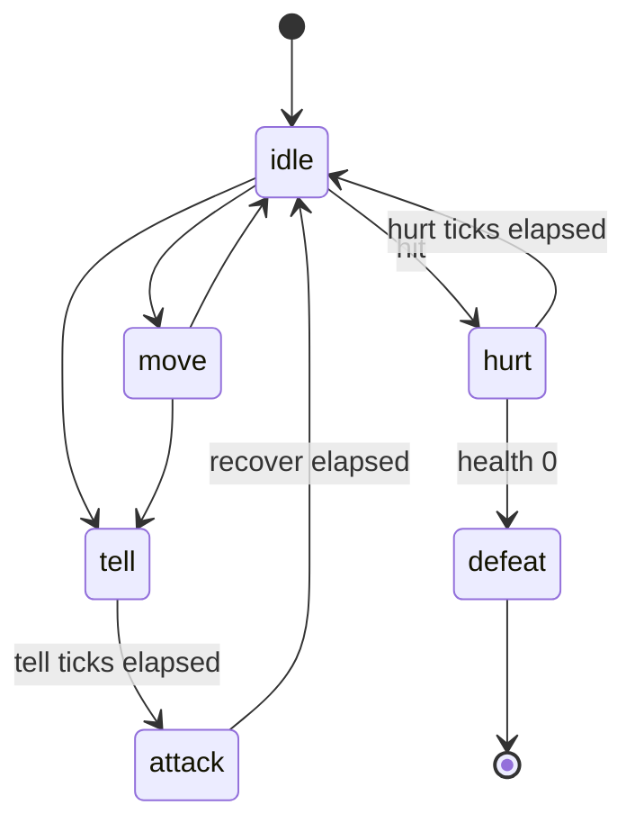

# BARD-01: Goblin Bomb Bard readability set, design spec

**Status:** packet ready; design pending. Execution pending. Review pending.

**Decision record:** height <fill> px, frame <fill> x <fill>, pivot (<fill>, <fill>). Proposed by <fill>; decided by <fill>.

The sections follow `docs/02-art/gob-01-goblin-spec.md`. Replace every `<fill: ...>`; write numbers, not adjectives. The design step stops at the keys and this spec (see the top-tier budget in `docs/07-agents/agent-orchestration.md`).

## 1. Canon and tone constraints

- Approved concept: `assets/concept/floor-01/enemies/floor01-goblin-bomb-bard-concept-approved.png`; `docs/02-art/floor-01-minor-enemy-concepts.md` records it as an owner-approved visual concept: a manic, comparatively slender **goblin-family** combatant with pointy ears, goggles and scarf, improvised brass horn, scavenged copper fittings and visible bomb-like gear.
- Tone (`docs/01-design/antihero-tone.md`, enemies row): threatening yet eccentric, with motivated behaviors and readable tells and some absurd visual contrasts; never a purely serious faceless army and never comedic with no danger. 1980s-1990s action cinema is used for attitude only, never copied designs.
- Canon facts that must survive in pixels (from the approved docs and the concept board, not design decisions):
  - A **distinct later Floor 1 goblin type** on the goblin body family (base reference GOB-01, `assets/source/characters/goblin/goblin_a_h36.*`, `docs/02-art/gob-01-goblin-spec.md`); the musical/performance silhouette separates it from the two ordinary opening goblins and the pot-helmet engineer.
  - Pointy ears, goggles, red scarf/bandana, brass horn/bagpipe-like instrument, backpack with bomb-like gear.
  - Manic and panicked expressions; key poses feature horn use, explosive-object handling and panic under pressure.
- Design reading of the tone: <fill: how the Bard reads as a threatening, eccentric and slightly ridiculous goblin, not a heroic or cute design>.

### Guardrails (copied from the roster and minor-enemy docs)

- **No retrofitting of bombs into the opening trio.** The opening goblins use pineapples on wooden sticks; the Engineer is not automatically a mine-layer or turret. The Bard is a separate later Floor 1 variant with its own loadout; do not arm Goblin A/B or the Engineer with it.
- Exact musical mechanics, explosion timers, area damage, self-detonation, bomb chaining and any specific instrument named in generated captions are **not** approved gameplay requirements. The explosion scene in the board's bottom right is mood only.
- Fuse sparks, music notes, thrown-bomb arcs and explosions are VFX beyond the readability set.
- Printed scale comparisons are not accepted native sprite dimensions. Convert from original editable pixel grids / `.aseprite`, never by tracing or cropping the board.

### Packet inputs

- Concept crops in `docs/evidence/bard-01/packet/` (x,y,w,h in the 1672x941 concept):
  - `concept_crop_1.png` = `55,110,330,285`: main pose (horn braced, aggressive)
  - `concept_crop_2.png` = `440,85,330,310`: attack state, blowing the horn
  - `concept_crop_3.png` = `800,110,470,285`: attack state, throwing a bomb
  - `concept_crop_4.png` = `1300,95,350,300`: panic state, bomb at the feet
- `scale_lineup.png`: Carl 52, Donut 40, GOB-01 goblin 36 (the base body reference) plus three empty candidate slots at 36, 40 and 44 px (44 is the Engineer's printed height; estimates, not approved sizes). The default 64 x 56 frame is a placeholder only.
- Readability set (tags): `idle` (2-4), `move` (4-6), `tell` (1-2), `attack` (2-3), `hurt` (1), `defeat` (2-3); about 12 to 20 frames. Concrete tag names and frame counts are the designer's choice (section 4 and `frame_pivot_template.json` carry the toolkit defaults).

## Difficulty and route

**Score 1 of 4: Easy, route C** (top tier writes the spec and draws 1 hero key; medium tier draws the rest).

| Point | Met | Note |
| --- | --- | --- |
| 1. New design, not a variant | no | Goblin-family variant on the GOB-01 base body; the horn, scarf and bomb pack are carried gear |
| 2. Native height above about 40 px | no | Candidates 36, 40, 44 px; 44 would score this point |
| 3. Complex anatomy | no | Carried props, no moving rig beyond the limbs |
| 4. VFX, projectiles, special states | yes | Thrown bomb, fuse sparks, music notes in the concept |

Reasoning: base body is approved; the extra cost is the horn and bomb gear plus the throw. If the bomb becomes its own sprite or the height reaches 44 px, the score is 2 and the route is Medium (B).

## 2. Size decision

Carl is 52 px (about 6 ft), Donut 40 px, the goblin 36 px (see `scale_lineup.png`).

| Option | Idle opaque height | Ratio to Carl | Implied real height | Why / why not |
| --- | --- | --- | --- | --- |
| A | 36 px | <fill> | <fill> | <fill> |
| B | 40 px | <fill> | <fill> | <fill> |
| C | 44 px | <fill> | <fill> | <fill> |

Decision: <fill: height and the reason, one paragraph; the proposer and the decider are different agents>.

## 3. Frame, pivot, boxes and atlas

- Frame <fill> x <fill>, pivot (<fill>, <fill>), contact row <fill> (the lowest opaque row of every grounded frame).
- Grounded tags: <fill>. Airborne tags (no pixel on the contact row): <fill or none>.
- Standing box <fill> x <fill>; hurtbox <fill>; attack hitbox <fill> on the impact frame.
- Authored facing right; the runtime mirrors around the pivot column.
- One atlas, frames 0 to <fill>, layers: <fill: for example body, weapon>.

## 4. Readability-set animation list

Readability set: idle, move, tell, attack, hurt, defeat (about 12 to 20 frames until the asset has a gameplay work order). Tick windows are at 60 Hz.

| Role | Tag | Frames | Playback | Tick-window proposal | Reference |
| --- | --- | --- | --- | --- | --- |
| idle | `idle` | 2-4 | loop | 8-12 ticks per frame, a 32-40 tick breathing cycle | GOB-01: 12 + 8 + 12 + 8 |
| move | `walk` | 4-6 | loop | 5 ticks per frame, speed from the gameplay spec | GOB-01: 6 x 5 = 30 ticks |
| tell | `attack_tell` | 1-2 | once | at least 18 ticks of readable hold, about 24 total | GOB-01: 6 + 18 |
| attack | `attack_swing` | 2-3 | once | smear 2, impact 3-4 (shown on exactly the hitbox-active ticks) | GOB-01: 2 + 4, then recover 20 |
| hurt | `hurt` | 1 | once | 8-12 ticks | GOB-01: 4 + 8 |
| defeat | `down` | 2-3 | hold | floor impact 4, settle 8, then a state-driven hold | GOB-01: 4 + 8 + hold |

Frame table (`frame_pivot_template.json` carries the same rows):

| # | Tag | Pose | Ticks | Author |
| --- | --- | --- | --- | --- |
| 0 | `idle` | <fill: pose> | 12 | <fill: key or Sonnet> |
| 1 | `idle` | <fill: pose> | 8 | <fill: key or Sonnet> |
| 2 | `idle` | <fill: pose> | 12 | <fill: key or Sonnet> |
| 3 | `walk` | <fill: pose> | 5 | <fill: key or Sonnet> |
| 4 | `walk` | <fill: pose> | 5 | <fill: key or Sonnet> |
| 5 | `walk` | <fill: pose> | 5 | <fill: key or Sonnet> |
| 6 | `walk` | <fill: pose> | 5 | <fill: key or Sonnet> |
| 7 | `attack_tell` | <fill: pose> | 6 | <fill: key or Sonnet> |
| 8 | `attack_tell` | <fill: pose> | 18 | <fill: key or Sonnet> |
| 9 | `attack_swing` | <fill: pose> | 2 | <fill: key or Sonnet> |
| 10 | `attack_swing` | <fill: pose> | 4 | <fill: key or Sonnet> |
| 11 | `hurt` | <fill: pose> | 4 | <fill: key or Sonnet> |
| 12 | `hurt` | <fill: pose> | 8 | <fill: key or Sonnet> |
| 13 | `down` | <fill: pose> | 4 | <fill: key or Sonnet> |
| 14 | `down` | <fill: pose> | 8 | <fill: key or Sonnet> |
| 15 | `down` | <fill: pose> | hold | <fill: key or Sonnet> |

## 5. State diagram



## 6. Palette

Base-body palette: reuse or deliberately diverge from `goblin-floor01-v0` (`docs/02-art/gob-01-goblin-spec.md`, section 7; at most 20 colours per atlas). Which keys are reused and which are new (copper, brass, scarf red, bomb black, spark orange) is a design decision (<fill>).

At most <fill: 20> colours. Candidates from the concept crop (median cut, by pixel share; see `palette_candidates.json`). These are candidates, not decisions.

| # | Candidate | Share | Decision (key, name, role) |
| --- | --- | --- | --- |
| 1 | `#121220` | 10.4 % | <fill: key, name, role> |
| 2 | `#11111f` | 10.2 % | <fill: key, name, role> |
| 3 | `#111120` | 6.8 % | <fill: key, name, role> |
| 4 | `#141321` | 6.5 % | <fill: key, name, role> |
| 5 | `#121120` | 6.2 % | <fill: key, name, role> |
| 6 | `#5d2c22` | 5.7 % | <fill: key, name, role> |
| 7 | `#04030f` | 5.5 % | <fill: key, name, role> |
| 8 | `#ca933d` | 4.7 % | <fill: key, name, role> |
| 9 | `#3c2821` | 4.0 % | <fill: key, name, role> |
| 10 | `#c45f2f` | 3.8 % | <fill: key, name, role> |
| 11 | `#7c5629` | 3.4 % | <fill: key, name, role> |
| 12 | `#111220` | 3.3 % | <fill: key, name, role> |
| 13 | `#10101c` | 3.3 % | <fill: key, name, role> |
| 14 | `#eed287` | 3.3 % | <fill: key, name, role> |
| 15 | `#97321f` | 3.3 % | <fill: key, name, role> |
| 16 | `#2c1a21` | 3.0 % | <fill: key, name, role> |
| 17 | `#12121f` | 2.9 % | <fill: key, name, role> |
| 18 | `#21141f` | 2.8 % | <fill: key, name, role> |
| 19 | `#0c0d1a` | 2.6 % | <fill: key, name, role> |
| 20 | `#240d16` | 2.1 % | <fill: key, name, role> |
| 21 | `#120b16` | 2.0 % | <fill: key, name, role> |
| 22 | `#131422` | 1.9 % | <fill: key, name, role> |
| 23 | `#131322` | 1.4 % | <fill: key, name, role> |
| 24 | `#100d19` | 0.9 % | <fill: key, name, role> |

The chosen palette must separate this asset from the warm brick and the cold arch of Floor 1 at 1x, and fit the A1 lighting.

## 7. Key poses

One key per readability tag (about 6 to 8 keys): idle 0, move contact, tell hold, attack impact, hurt, defeat. Each key lists silhouette, joint positions, palette use and the readability reason. Keys are frozen once the review passes (`pixelart freeze`).

| Frame | Tag | Silhouette and pose notes | Readability reason |
| --- | --- | --- | --- |
| <fill> | <fill> | <fill> | <fill> |

## 8. In-between list

For the execution tier; no design decisions needed. One row per non-key frame, as in section 9 of the GOB-01 spec.

| # | Pose notes |
| --- | --- |
| <fill> | <fill> |

## 9. Validators and readability rules

Run by `python3 -m scripts.pixelart validate <asset-config>` (rules V01 to V15 in `scripts/pixelart/validators.py`). Parametrize in the asset config:

- V04 palette: at most <fill> colours; V05 isolated pixels: 0; V06 orphan pixels: at most <fill> per frame.
- V07/V08 contact rows: grounded tags end on the contact row, airborne tags never touch it.
- V09 frozen keys: SHA-256 per key frame, fixture `tests/fixtures/bard-01_keys.json`.
- V13/V14 readability rules (write each as a bbox or key-count rule): <fill: for example the tell is the highest point, the hurt eyes are white>.

## 10. Evidence

```text
python3 -m scripts.pixelart validate <asset-config> --out <dir>
python3 -m scripts.pixelart evidence <asset-config> --out <dir>
python3 -m scripts.pixelart review-pack <asset-config> --out <dir>
```

The review pack holds exactly three images (contact sheet x4, lit scene 640 x 360 shown x3, tell to attack strip) and the validator report.

## 11. Files

| File | Role |
| --- | --- |
| `assets/source/<fill>/bard-01.grid.json` / `.ase` | pixel-grid source and Aseprite master |
| `assets/manifests/bard-01.json` | manifest |
| `<fill>/bard-01.pixelart.json` | the asset config (from `frame_pivot_template.json`) |
| `tests/fixtures/bard-01_keys.json` | frozen keys |

## 12. Rights and provenance

Fan-concept art under the owner-reported `ART-PUBLICATION-ALL-V1` scope (see `docs/04-production/rights-and-release.md`). Record in the PR's `Rights/Provenance` section which model designed, executed and reviewed the art. No tracing of the concept, no image-model raster output.

### Rights/Provenance stub

- Concept: owner-approved reference under `ART-PUBLICATION-ALL-V1`; crops are for reference only, never traced or exported.
- Packet: script output plus a medium-tier executor (stage P).
- Designed by: pending. Executed by: pending. Independently reviewed by: pending.
- No third-party assets, no copied designs or dialogue, no image-model raster output.
