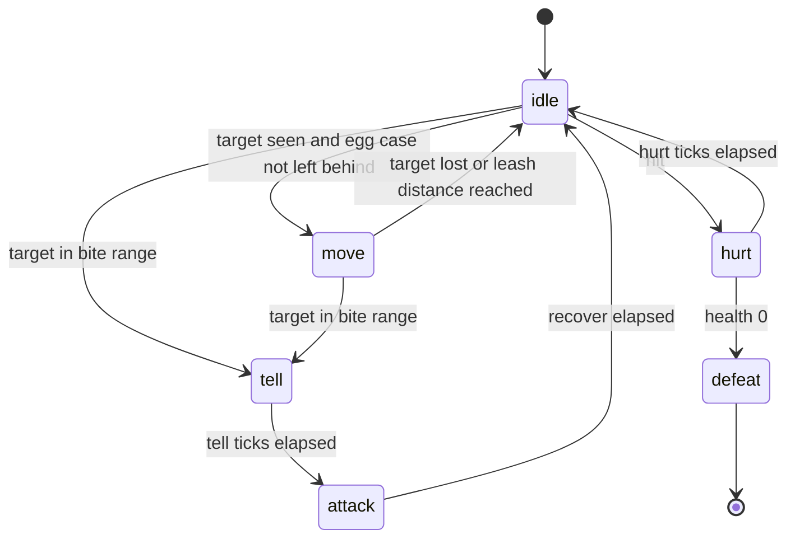

# BROOD-01: Scatterer Brood Guardian readability set, design spec

**Status:** design done (spec and frozen idle hero key 0). Execution pending (keys 3, 8, 10, 12, 15 and the in-betweens). Review pending.

**Decision record:** height 30 px, frame 80 x 44, pivot (37, 43). Proposed by the design step; decided by the independent review.

The sections follow `docs/02-art/gob-01-goblin-spec.md`. The design step stops at the keys and this spec (see the top-tier budget in `docs/07-agents/agent-orchestration.md`).

## 1. Canon and tone constraints

- Approved concept: `assets/concept/floor-01/enemies/scatterers-rot-sticker-slime-bestiary.png`. The roster (`docs/02-art/floor-01-enemy-concept-roster.md`) records the Brood Guardian as a **larger form of the same visual species** as the Scatterer (cockroach/insectoid), native production pending. This work order covers the Brood Guardian only; the small Scatterer is merged (SCAT-01), Rot Sticker and Green Slime are separate.
- Tone (`docs/01-design/antihero-tone.md`, enemies row): threatening yet eccentric, with motivated behaviors and readable tells and some absurd visual contrasts; never a purely serious faceless army and never comedic with no danger. 1980s-1990s action cinema is used for attitude only, never copied designs.
- Canon facts that must survive in pixels (from the approved docs and the concept board, not design decisions):
  - Same species as the merged Scatterer (`assets/source/characters/scatterer/`, `docs/02-art/scat-01-spec.md`): segmented plated back, long curved antennae, spiny legs, red eye, reddish-brown chitin family look.
  - Larger and heavier than the Scatterer; the board also shows a bigger head with prominent mandibles.
  - Reads against the Floor 01 catacomb stone; the printed sizes and the scale ratio on the board are not decisions.
- Design reading of the tone: a dog-sized roach that drags its own egg case (an ootheca, the purse-shaped capsule real cockroaches carry) and will not leave it. It is not a hero beast: it is a grimy, scarred parent with crusted plates, dorsal thorns and a heavy lowered head, defending a lumpy brown purse of eggs. The danger is real (two big cream fangs at Carl's shin height, a long rear-up tell); the eccentric contrast is the fussy protectiveness over something ridiculous.
- **Design addition, flagged for the review:** the egg case is not on the board. It is the visual motive for the "Guardian" name and the clearest silhouette difference from the small Scatterer (a rear bump). It is a separate part (`ootheca()` in the authoring script); if the review cuts it, drop that part, drop rule R0-ootheca, and re-freeze key 0.

### Guardrails (copied from the roster and SCAT-01 spec)

- A generated label indicating **Scatterers explode on death** is not an approved gameplay feature. **No explosion, burst, splat, particles or glow on the Brood Guardian defeat frames.** The bottom-row defeat panel of the board (legs splayed, yellow splat) is deliberately left out of the crops and must not be read as an explosion mechanic.
- The speed-line dash and the "!" rear-up panels are concept illustrations of states, not approved behaviors or stun mechanics.
- Printed scale comparisons in the generated board are not accepted native sprite dimensions. Rot Sticker and Green Slime are out of scope here (no slime splitting, no Rot Sticker anatomy); use the board for mood only.
- Convert from original editable pixel grids / `.aseprite`, never by tracing or cropping the illustrated board.

### Packet inputs

- Concept crops in `docs/evidence/brood-01/packet/` (x,y,w,h in the 1672x941 concept):
  - `concept_crop_1.png` = `405,165,445,285`: hero Brood Guardian (top row)
  - `concept_crop_2.png` = `420,545,425,115`: state row 1 (idle, speed-lined dash)
  - `concept_crop_3.png` = `415,675,430,95`: state row 2 (idle, rear-up with "!", idle)
- `scale_lineup.png`: Carl 52, Donut 40, goblin 36 and the merged Scatterer idle (15 px opaque, frame 48 x 32, pivot (24, 31)) at x1 and x4, plus three empty candidate slots at 30, 36 and 42 px.
- Defeat reference: the board's defeat panel is excluded from the crops (see guardrails); the defeat pose below is a plain collapse.

## Difficulty and route

**Score 1 of 4: Easy, route C** (top tier writes the spec and draws 1 hero key; medium tier draws the rest).

| Point | Met | Note |
| --- | --- | --- |
| 1. New design, not a variant | no | Larger form of the merged Scatterer species |
| 2. Native height above about 40 px | no | 30 px chosen (section 2) |
| 3. Complex anatomy | yes | Six spiny legs plus antennae, as the Scatterer |
| 4. VFX, projectiles, special states | no | Dust puff and speed lines in the concept are illustrations; defeat has no VFX |

Reasoning: same species and construction as an asset that already passed review, so the cost is scale and menace, not a new design.

## 2. Size decision

Carl is 52 px (about 6 ft), Donut 40 px, the goblin 36 px (see `scale_lineup.png`). As in SCAT-01, the height is the idle opaque height including the antennae; 1 px is about 1.4 in (rough guide only). The shell height is the thorn tip to the floor.

| Option | Idle opaque height | Ratio to Carl | Implied real height | Why / why not |
| --- | --- | --- | --- | --- |
| A | 30 px (shell 24, body 56 long, 76 px with legs and antennae) | 0.58 | about 42 in (shell about 34 in, body about 6.5 ft long) | 2.0x the Scatterer's 15 px (shell 24 vs 12, about 3.4x the opaque area): same species, clearly the big one at 1x. Stays below the goblin's 36 px while its 56 px length makes it the heaviest mass on screen after Carl. Leaves room for a 38 px tell. **Chosen.** |
| B | 36 px (shell 29, body about 68 long) | 0.69 | about 50 in | Same height as the goblin; frame grows to about 96 x 52 and the tell rises to about 45 px, above Donut, so the tell reads as a boss move. Rejected. |
| C | 42 px (shell 34, body about 80 long) | 0.81 | about 59 in | Above Donut and above the 40 px threshold: changes the difficulty route and reads as a floor boss, not a nest guard. Rejected. |

Decision: **A, 30 px idle height (rows 14 to 43), shell 24 px (thorn tips row 20 to the floor), body 56 px long (x 11 to 66), plus the egg case.** It doubles every Scatterer feature the player reads at 1x (height, shell, eye from 2 x 2 to a 3 x 2 core, one mandible pair to two big fangs), keeps the creature under the goblin and Donut in height and keeps the route at Easy. The bite moves from Carl's ankles to his shins and knees.

## 3. Frame, pivot, boxes and atlas

- **Frame 80 x 44, pivot (37, 43), contact row 43** (the lowest opaque row of every frame). Pivot x 37 is the near mid-leg coxa column, between the feet-span midpoint (x 3 to 64, 33.5) and the shell centre (x 11 to 66, 38.5), nearer the shell because the mass is there.
- Grounded tags: `idle`, `walk`, `attack_tell`, `attack_swing`, `hurt`, `down`. Airborne tags: none (the lunge keeps feet planted; the defeat collapses onto the floor).
- **Standing (sim) box:** 50 x 20 at frame x 13 to 62, rows 24 to 43 (pivot-relative x -24 to +25, rows -19 to 0). Excludes antennae, egg case, fangs and leg tips.
- **Hurtbox:** 66 x 18 at frame x 4 to 69, rows 22 to 39 (shell, egg case and head; not legs, antennae or fangs), every frame except the `down` tag. In `attack_tell` frame 8 it follows the raised front: x 2 to 67, rows 14 to 41. In `attack_swing` frames 9 to 11 it moves with the body (dx +3, +6, +3).
- **Attack hitbox:** 14 x 12 at frame x 66 to 79, rows 30 to 41 (pivot-relative x +29 to +42, rows -13 to -2: Carl's shins and knees), active **only on frame 10** (6 ticks).
- Authored facing right; the runtime mirrors around the pivot column.
- **One atlas, frames 0 to 15**, row-major, single layer `body` (the fangs and the egg case are part of the body).

## 4. Readability-set animation list

Readability set: idle, move, tell, attack, hurt, defeat (16 frames). Tick windows are at 60 Hz. The Guardian is heavier than the Scatterer, so every window is longer.

| Role | Tag | Frames | Playback | Ticks | Notes |
| --- | --- | --- | --- | --- | --- |
| idle | `idle` | 0-2 | loop | 14 + 10 + 14 = 38 | slow breathing, antenna twitch |
| move | `walk` | 3-6 | loop | 4 x 6 = 24 | alternating tripod gait, 1 px body bob |
| tell | `attack_tell` | 7-8 | once | 8 + 24 = 32 | rear-up ramp, then the readable hold |
| attack | `attack_swing` | 9-11 | once | 3 + 6 + 18 = 27 | dash, impact (hitbox), recover |
| hurt | `hurt` | 12 | once | 12 | flinch back, flash eye |
| defeat | `down` | 13-15 | hold | 6 + 10 + hold | legs buckle, belly hits the floor, settled hold |

| # | Tag | Pose | Ticks | Author |
| --- | --- | --- | --- | --- |
| 0 | `idle` | master idle, head low, fangs closed | 14 | key, drawn and frozen |
| 1 | `idle` | antennae up 1, near fang open 1 | 10 | in-between |
| 2 | `idle` | dome settles 1 (breath out) | 14 | in-between |
| 3 | `walk` | contact A | 6 | key |
| 4 | `walk` | passing A, body up 1 | 6 | in-between |
| 5 | `walk` | contact B (tripods swapped) | 6 | in-between |
| 6 | `walk` | passing B, body up 1 | 6 | in-between |
| 7 | `attack_tell` | rear-up ramp | 8 | in-between |
| 8 | `attack_tell` | rear-up hold, fangs spread, eye flare | 24 | key |
| 9 | `attack_swing` | dash smear | 3 | in-between |
| 10 | `attack_swing` | shove-bite impact | 6 | key |
| 11 | `attack_swing` | recover | 18 | in-between |
| 12 | `hurt` | flinch, flash eye | 12 | key |
| 13 | `down` | legs buckle | 6 | in-between |
| 14 | `down` | belly hits the floor | 10 | in-between |
| 15 | `down` | settled, eye dark | hold | key |

### Tell-to-attack read (60 Hz, from the start of `attack_tell`)

| Window | Ticks | Frame | What the player reads |
| --- | --- | --- | --- |
| tell ramp | 0-7 | 7 | the front starts to rise, fangs part |
| tell hold | 8-31 | 8 | highest pose, shield up, fangs in a wide V, eye flares, cold belly shows |
| dash | 32-34 | 9 | body snaps forward 3 px, front drops |
| impact (hitbox active) | 35-40 | 10 | flat, stretched, fangs pinched shut at x 76 to 79 |
| recover | 41-58 | 11 | back to idle height, fangs open 1 |

Reaction window: 27 ticks (450 ms) from the first hold tick to the first hitbox tick, 35 ticks from the tell start (the Scatterer has 22 and 28). The tell hold is the only frame taller than 31 px.

## 5. State diagram



The leash ("does not leave its egg case") is an art motive, not an approved mechanic; gameplay decides.

## 6. Palette

Palette `scatterer-floor01-v1`, extended for the Brood Guardian: **the 16 Scatterer keys are reused with identical hex**, plus **2 new keys** (`y`, `o`), so the shared species palette has **18 of 20** colours and 2 slots stay free. No key is skipped (`w` is used only on hurt).

| Key | Name | Hex | Role on the Brood Guardian | Accent (orphan-exempt) |
| --- | --- | --- | --- | --- |
| `K` | outline_char | `#1c0e12` | outline, belly line, pronotum seam, brow over the eye, dorsal thorns | |
| `a` | chitin_0_deep | `#3d1519` | plate seams, lowest shell band, far legs, pits in the crust | |
| `b` | chitin_1_shade | `#5f1d1d` | lower shell band, lower head | |
| `c` | chitin_2_mid | `#84291f` | shell body colour, head | |
| `d` | chitin_3_light | `#ab4329` | upper-mid band, far antenna | |
| `f` | chitin_4_lit | `#d0693a` | torch band, plate edges in front of each seam, pronotum crown | |
| `h` | sheen_torch | `#ea9c5c` | sheen row on the dome and pronotum; fang body; cheek | |
| `H` | glint_cream | `#f7dc9c` | fang edges and tips, eye glint | yes |
| `g` | leg_dark | `#4a2a28` | femur underside, tibia back edge, tarsi; egg-case ridges | |
| `j` | leg_mid | `#8a5240` | femur top, tibia, near antenna | |
| `s` | leg_spine | `#b98660` | leg spines, antenna beads, egg-case lit top | yes |
| `u` | belly_cold | `#3e2f3a` | cold belly row; tell belly reveal | |
| `v` | rim_cold | `#66545e` | cold rim along the rear underside | |
| `e` | eye_rim | `#b81c1c` | eye lower rim | yes |
| `r` | eye_glow | `#ff4a32` | eye glow; never on hurt (12) or the settled defeat (14, 15) | yes |
| `w` | eye_flash | `#efe3d3` | hurt flash eye only | yes |
| `y` | crust_pale | `#c4a888` | **new.** Pale dried crust and scars on the plates (the board's tan speckle), 2 to 3 px patches | yes |
| `o` | ootheca_brown | `#74492f` | **new.** Egg-case body; more yellow and less saturated than the chitin, so it reads as a separate object | |

Packet candidates, by eye (the navy and near-black candidates are the board background):

| # | Candidate | Decision |
| --- | --- | --- |
| 1, 2, 4-7, 14, 18, 20-22, 24 | `#18202a`, `#161e28`, `#152231`, `#1a283a`, `#16202b`, `#16273b`, `#152535`, `#0f151c`, `#1a232f`, `#141e29`, `#171d27`, `#1c2028` | not used (background navy) |
| 11, 12 | `#0b0e13`, `#08080c` | not used (the outline stays the warm `K`) |
| 3 | `#913a2c` | covered by `c` / `d` |
| 8, 23 | `#762625`, `#75191a` | covered by `b` / `c` |
| 9 | `#db965e` | covered by `h` |
| 10 | `#b26743` | covered by `f` / `s`; source of the crust tone `y` (lighter, desaturated) |
| 13 | `#3d191d` | covered by `a` |
| 15 | `#221215` | covered by `K` |
| 16, 17 | `#36333d`, `#34262d` | covered by `u` / `g` |
| 19 | `#f1ce94` | covered by `H` |

Lighting: A1 Floor 1 (warm torch from above, cold ambient from below). Shell bands by relative depth from the dome top to the belly: `K` outline, `h` sheen row, `f` (t < 0.13), `d` (< 0.32), `c` (< 0.62), `b` (< 0.84), `a`; then the `v` rim / `u` belly row and the `K` belly line. Against the warm brick the asset separates by the `K` outline, the saturated chitin and the `h`/`H` sheen; against the cold arch by the warm ramp. The egg case is lit only on its top (`s`).

## 7. Key poses

Coordinates are frame pixels (x right, row down, 0-based), facing right. To move a part, call the key-0 part function and translate its pixels whole (never resample or rotate except 90 degrees or a mirror). After moving parts, close outline gaps with `K` and fill new interior pixels with the band of their depth (section 6). **Do not edit the key-0 part functions in `scripts/author_brood01.py`; copy them** (frame 0 is frozen).

### Frame 0, `idle` (hero key, drawn and frozen by the designer)

Source: `frame_idle0()` in `scripts/author_brood01.py` (parts `shell`, `ootheca`, `head`, `antennae`, `far_legs`, `near_legs`, drawn in that z-order: far legs, antennae, egg case, shell, head, near legs). Measured: bbox x 3 to 78, rows 14 to 43 (76 x 30), 18 colours, 2 orphans, 0 isolated.

- **Shell:** dome top row 22 (x 30 to 39), rear tip x 11 (rows 31 to 35), belly line `K` row 37 (x 16 to 60). Four abdominal seams in `a` at x 19, 27, 35, 43 (at the top), slanting back 1 px per 3 rows; the plate edge in front of each seam is `f`. A 2 px `K` thorn leans back on top of each seam (tips rows 20 to 25). Pale `y` crust patches at (23..24, 29..30), (31..32, 27..28), (40..41, 31) and (56..57, 29), with `a` pits beside the first three.
- **Pronotum shield:** x 51 to 66, `K` seam bowing forward from (50, 24) to (53, 36), `h` crown row 26, `f` rows 27 to 28; its lip ends over the head at (66, 31).
- **Egg case:** x 4 to 11, rows 31 to 37, hanging from the abdomen tip: `K` outline, `s` lit top row 32, `o` body, three `g` ridges (x 6, 8, 10 on rows 34 to 35).
- **Head:** x 59 to 69, rows 30 to 39, low under the lip. **Eye:** `r` (63,32), (64,32), `H` glint (65,32); `e` (63,33), `r` (64,33), (65,33); `e` (64,34), (65,34); a `K` brow at (62,32) and row 31. Cheek `h` at (68, 35..36).
- **Fangs:** near fang (`h` body, `H` edge) from (69,37) down-forward to (71,40), hooking back to the tip (69,42); far fang (behind, shorter) from (65,39) to the tip (65,42). A 2 px gap between them: the mouth is closed but not sealed.
- **Antennae:** near `j` from the head (65,30) up-forward to the apex (73..75, 14), down to the tip (78,19), `s` beads at (67,24), (69,18), (74,14); far `d` from (56,27) up and back over the shell to the apex (42..45, 16) and the tip (40,17).
- **Legs**, near (femur `j` over `g`, tibia `j` with a `g` back edge, `s` spines, 2 px `g` tarsus): rear coxa (24,37), knee raised at (13,34), foot (3..4, 43); mid coxa (37,37), knee (32,39), foot (26..27, 43); front coxa (52,37), knee (55,40), foot (58..59, 43). Far legs in `a`: rear foot (16..17, 43), mid (47..48, 43), front (63..64, 43).

### Frame 3, `walk` contact A (key)

- Body (shell, egg case, head, antenna roots) dx +1, dy 0.
- Tripod A planted on row 43: near rear foot x 1..2 (leg stretched back, knee at (12,34)), near front foot x 63..64 (reaching forward, knee (58,40)), far mid foot x 43..44.
- Tripod B lifted, feet on row 41: near mid foot x 34..35 (swinging forward under the belly, knee (36,39)), far rear foot x 22..23, far front foot x 67..68.
- Near antenna apex at (75..77, 15) (bobbing 1 forward and 1 down); far antenna unchanged. Fangs closed as frame 0. Eye `r` 4.
- bbox top 15, height at most 31.

### Frame 8, `attack_tell` hold (key)

The Guardian rears its front, raises the pronotum like a shield, spreads both fangs and drops its rear over the egg case: the highest pose in the set.

- All parts dx -2 (coiling back). Slices raised by column of frame 0: x 4 to 18 (egg case and abdomen tip) dy +2 (the egg case bottom reaches row 39); x 19 to 30 dy 0; x 31 to 42 dy -2; x 43 to 50 dy -4; pronotum x 51 to 66 dy -7; head x 59 to 72 dy -8 (head lands at x 57 to 67, rows 22 to 31). Redraw the top outline as a smooth rising line; keep a thorn on each seam.
- **Belly reveal:** a 1 px `u` strip under the raised belly line from x 30 to 58 (at least 8 `u`).
- **Fangs spread in a wide V:** upper arm from the head front (67,27) up-forward to (71,24), tip curling down (72,25); lower arm from (67,30) down-forward to (71,33), tip curling up (72,32); 2 px wide (`h` body, `H` edge), at least 8 `H`.
- **Eye flare:** the 3 x 2 eye core all `r` except the `H` glint, plus one more `r` on the rim (at least 6 `r`), `e` below.
- **Front legs raised and pawing:** near front femur from the raised coxa (48,30) forward-up to the knee (55,27), tibia forward-down to the tip (60,31), spines (57,26), (59,29); far front `a` parallel 2 px lower. Mid and rear legs planted wider: near rear foot x 1..2, near mid foot x 24..25, far rear 14..15, far mid 45..46.
- Antennae up, the highest point: near from the head (62,22) up to the apex (69..71, 6), tip forward-down (75,9); far from (52,20) up and back to the apex (44..46, 8), tip (41,10).
- bbox: top row 6, height 38, bottom 43.

### Frame 10, `attack_swing` shove-bite impact (key)

- Body dx +6. Shell flattened: delete band row 26 of the moved shell and lower rows 20 to 25 by 1 (dome top row 23). The egg case moves with the body (x 10 to 17).
- Head thrust forward and down: dx +8, dy +1 (x 67 to 77, rows 31 to 40). **Fangs pinched shut:** near and far fang tips meet at (78..79, 39..40); at least 4 `H` at x 76 or more, and only on this frame.
- Antennae streamed back over the dome: near from (72,31) back along rows 21 to 23 to x 52; far a 4 px stub hidden behind the pronotum.
- Legs drive: near rear a long diagonal from the coxa to the foot (6..7, 43) (pushing), near mid foot (28..29, 43), near front braced forward to the foot (70..71, 43); far feet (21, 43), (50, 43), (73, 43). Eye `r` 4.
- bbox: top row 16 or lower, right edge x 78 or more, bottom 43.

### Frame 12, `hurt` (key)

- All parts dx -3. Front pitched up: pronotum and head dy -2, abdomen x 31 to 50 dy -1, rear and egg case dy 0.
- **Flash eye:** `w` on at least 5 of the eye pixels, one `K` pupil at the rear-bottom; no `r`, no `e`.
- Fangs gape: near fang tip dx +1, far fang tip dx -1 (a 4 px gap).
- Near front leg off the floor, foot at row 41, pointing forward-down; others planted. Antennae thrown back: near apex at (64..66, 16), far lying along the dome.
- bbox right edge at most x 75.

### Frame 15, `down` hold (key)

A plain collapse, no flip, no splat, no glow: the legs give out and the Guardian lies belly-down beside its egg case.

- Shell, egg case and head dy +5 (belly line row 42, dome top row 27, thorn tips from row 25), dx 0. The egg case rests on the floor, still attached.
- Legs splayed flat: near rear femur nearly horizontal back to the foot (0..1, 43); near mid flat back to (26..27, 43); near front flat forward to (62..63, 43); far legs show only 2 to 3 px tips on rows 42 to 43.
- Head down: fang tips rest on row 43, fangs closed; eye dark: `a` with one `K` pixel, no `r`, `e`, `w` and no eye glint (fang `H` stays, at most 3 px).
- Antennae down: near antenna lies along rows 41 to 43 from the head to x 77; far antenna bent over the pronotum, ending on row 30.
- bbox: top row 24 or lower, height at most 20.

## 8. In-between list

For the execution tier; no design decisions needed.

| # | Pose notes |
| --- | --- |
| 1 | Frame 0 with the near antenna's top 6 px up 1 and forward 1 (apex row 13); far antenna apex back 1; near fang tip dx +1 (mouth parts 1 px). |
| 2 | Frame 0 with the dome slice (rows 20 to 28, x 12 to 50) down 1 (breath out); near antenna apex down 1 (row 15). Egg case, head and legs unchanged. |
| 4 | Passing A: body dx +1, dy -1; tripod A feet stay planted, tripod B mid-swing (feet row 40, halfway between frames 3 and 5). |
| 5 | Contact B: tripods swapped from frame 3 (near mid, far rear and far front planted; near rear, near front and far mid lifted to row 41); body dy 0. |
| 6 | Passing B: as 4 with the tripods swapped. |
| 7 | Tell ramp: half of frame 8 (dx -1; slice dy +1, 0, -1, -2, -4, head -4); fangs half open (at least 5 `H`); 5 `r`; antennae top rows 9 to 12. |
| 9 | Dash smear: body dx +3, dy 0, no flatten; fangs half closed; antennae halfway back; legs as frame 10 with shorter diagonals. |
| 11 | Recover: frame 0 at dx +3; fangs open 1 px; antennae as frame 1; near rear foot re-planted at x 6..7. |
| 13 | Buckle: shell, egg case and head dy +3; knees splay out and down (each near knee 2 px lower and 2 px further out); eye dims to `e` (2 to 4 px, no `r` required); antennae sag (top row 18 or lower). |
| 14 | Floor impact: as frame 15 with the shell squashed by 1 (delete band row 30 of the dropped shell); near antenna halfway down; eye 2 `e` pixels, no `r`. |

## 9. Validators and readability rules

Run by `python3 -m scripts.pixelart validate assets/source/characters/scatterer/brood/brood-01.pixelart.json` (rules V01 to V15 in `scripts/pixelart/validators.py`). Parametrized in that asset config:

- V04 palette: at most 20 colours (18 used); V05 isolated pixels: 0; V06 orphan pixels: at most 6 per frame (key 0 has 2).
- V07 contact rows: every tag is grounded on row 43; V08 unused (no airborne tag).
- V09 frozen keys: SHA-256 per key frame, fixture `tests/fixtures/brood-01_keys.json` (frame 0 now; the executor adds 3, 8, 10, 12, 15 after the review passes).
- V13 bbox rules: S1 idle 30 px (rows 14 to 43), idle frames top 13 to 15; S2 walk height at most 31; R1 tell ramp top 9 to 12, tell hold top 5 to 7 and height at least 37; R3 lunge right edge 78 or more; R4 hurt right edge 75 or less; R6 buckle top 18 or lower, settled defeat top 24 or lower and height at most 20.
- V14 key-count rules: R0 eye `r` at least 4 on idle, walk, tell ramp and swing frames; R0 egg case `o` at least 12 on every frame; R2 tell hold `H` at least 8, `r` at least 6, `u` at least 8; R4 hurt `w` at least 5 and `r` 0; R5 no `w` in 13 to 15, no `r` in 14 to 15, no `e` in 15.
- `tests/test_art_brood01.py`: key 0 equals the script and the frozen digest; 30 px idle height under 40 px; 4 `r`, at least 12 `o`, no `w` on key 0; the 16 Scatterer palette keys reused unchanged, at most 4 new keys, at most 20 colours. The executor extends it with the fang-reach rule (fang `H` at x 76 or more only on frame 10) and the no-explosion defeat rule, as in `tests/test_art_scat01.py`.

### Acceptance targets

1. At 1x next to Carl, Donut and the Scatterer, the Guardian reads as the same species (plates, antennae, red eye, spiny legs, chitin ramp) and clearly bigger; the egg case reads as a carried object, not a tail.
2. The tell hold (frame 8) is the only pose above 31 px and reads in a single frame at 1x: raised shield, wide fangs, bright eye.
3. The impact frame 10 is the only frame with fangs at x 76 or more, and the hitbox matches it.
4. Hurt has a white eye and no red; the defeat has no splat, burst, particles, yellow flash or glow.
5. Validator: 0 failures once execution is done. Today V12 (unique frames), V13 and V14 fail only because frames 1 to 15 are placeholder copies of key 0.

## 10. Evidence

```text
python3 -m scripts.pixelart validate assets/source/characters/scatterer/brood/brood-01.pixelart.json --out <dir>
python3 -m scripts.pixelart evidence assets/source/characters/scatterer/brood/brood-01.pixelart.json --out <dir>
python3 -m scripts.pixelart review-pack assets/source/characters/scatterer/brood/brood-01.pixelart.json --out <dir>
```

The review pack holds exactly three images (contact sheet x4, lit scene 640 x 360 shown x3, tell to attack strip) and the validator report. The executor adds the manifest `assets/manifests/brood-01.json` (frame rows with ticks, the boxes of section 3 and the attack ticks of section 4, as `assets/manifests/scat-01.json`) and the `manifest` / `manifest_tick_rows` keys in the asset config.

## 11. Files

| File | Role |
| --- | --- |
| `scripts/author_brood01.py` | deterministic authoring script (key 0 parts; frames 1 to 15 are placeholders until execution) |
| `assets/source/characters/scatterer/brood/brood-01.grid.json` / `.ase` | pixel-grid source and Aseprite master |
| `assets/source/characters/scatterer/brood/brood-01.pixelart.json` | the asset config |
| `assets/manifests/brood-01.json` | manifest (execution step) |
| `tests/fixtures/brood-01_keys.json` | frozen keys |
| `tests/test_art_brood01.py` | key-freeze and hero-key tests |

## 12. Rights and provenance

Fan-concept art under the owner-reported `ART-PUBLICATION-ALL-V1` scope (see `docs/04-production/rights-and-release.md`). No tracing of the concept, no image-model raster output.

### Rights/Provenance

- Concept: owner-approved reference under `ART-PUBLICATION-ALL-V1`; crops are for reference only, never traced or exported.
- Packet: script output plus a medium-tier executor (stage P).
- Spec + hero key (frame 0): Claude Opus. Executed by: pending. Independently reviewed by: pending.
- No third-party assets, no copied designs or dialogue, no image-model raster output.
