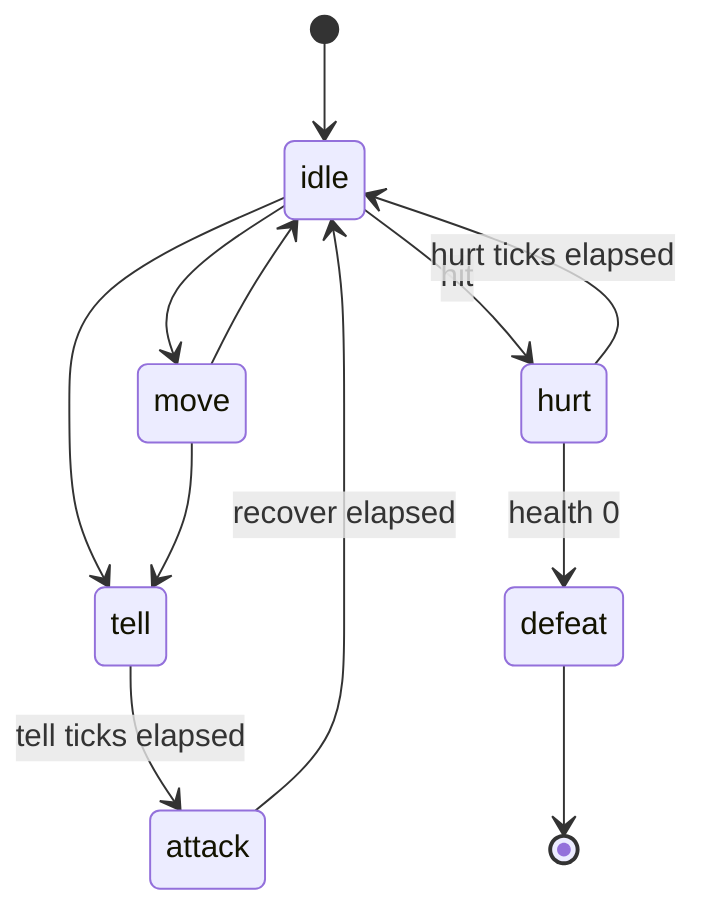

# BROOD-01: Scatterer Brood Guardian readability set, design spec

**Status:** packet ready; design pending. Execution pending. Review pending.

**Decision record:** height <fill> px, frame <fill> x <fill>, pivot (<fill>, <fill>). Proposed by <fill>; decided by <fill>.

The sections follow `docs/02-art/gob-01-goblin-spec.md`. Replace every `<fill: ...>`; write numbers, not adjectives. The design step stops at the keys and this spec (see the top-tier budget in `docs/07-agents/agent-orchestration.md`).

## 1. Canon and tone constraints

- Approved concept: `assets/concept/floor-01/enemies/scatterers-rot-sticker-slime-bestiary.png`. The roster (`docs/02-art/floor-01-enemy-concept-roster.md`) records the Brood Guardian as a **larger form of the same visual species** as the Scatterer (cockroach/insectoid), native production pending. This work order covers the Brood Guardian only; the small Scatterer is merged (SCAT-01), Rot Sticker and Green Slime are separate.
- Tone (`docs/01-design/antihero-tone.md`, enemies row): threatening yet eccentric, with motivated behaviors and readable tells and some absurd visual contrasts; never a purely serious faceless army and never comedic with no danger. 1980s-1990s action cinema is used for attitude only, never copied designs.
- Canon facts that must survive in pixels (from the approved docs and the concept board, not design decisions):
  - Same species as the merged Scatterer (`assets/source/characters/scatterer/`, `docs/02-art/scat-01-spec.md`): segmented plated back, long curved antennae, spiny legs, red eye, reddish-brown chitin family look.
  - Larger and heavier than the Scatterer; the board also shows a bigger head with prominent mandibles.
  - Reads against the Floor 01 catacomb stone; the printed sizes and the scale ratio on the board are not decisions.
- Design reading of the tone: <fill: how the Brood Guardian reads as a believable, nasty and slightly eccentric threat>.

### Guardrails (copied from the roster and SCAT-01 spec)

- A generated label indicating **Scatterers explode on death** is not an approved gameplay feature. **No explosion, burst, splat, particles or glow on the Brood Guardian defeat frames.** The bottom-row defeat panel of the board (legs splayed, yellow splat) is deliberately left out of the crops and must not be read as an explosion mechanic.
- The speed-line dash and the "!" rear-up panels are concept illustrations of states, not approved behaviors or stun mechanics.
- Printed scale comparisons in the generated board are not accepted native sprite dimensions. Rot Sticker and Green Slime are out of scope here (no slime splitting, no Rot Sticker anatomy); use the board for mood only.
- Convert from original editable pixel grids / `.aseprite`, never by tracing or cropping the illustrated board.

### Packet inputs

- Concept crops in `docs/evidence/brood-01/packet/` (x,y,w,h in the 1672x941 concept):
  - `concept_crop_1.png` = `405,165,445,285`: hero Brood Guardian (top row)
  - `concept_crop_2.png` = `420,545,425,115`: state row 1 (idle, speed-lined dash)
  - `concept_crop_3.png` = `415,675,430,95`: state row 2 (idle, rear-up with "!", idle)
- `scale_lineup.png`: Carl 52, Donut 40, goblin 36 and the merged Scatterer idle (15 px opaque, frame 48 x 32, pivot (24, 31)) at x1 and x4, plus three empty candidate slots at 30, 36 and 42 px. The candidates bracket a rough by-eye ratio of about 2.5 between the Guardian and the Scatterer on the board (about 95 px vs 235 px in the 1672x941 image); that is an estimate to be tested, not an approved size.
- Readability set (tags): `idle` (2-4), `move` (4-6), `tell` (1-2), `attack` (2-3), `hurt` (1), `defeat` (2-3); about 12 to 20 frames. Concrete tag names and frame counts are the designer's choice (section 4 and `frame_pivot_template.json` carry the toolkit defaults).
- Defeat reference: the board's defeat panel is excluded from the crops (see guardrails); the defeat pose is a design decision.

## Difficulty and route

**Score 1 of 4: Easy, route C** (top tier writes the spec and draws 1 hero key; medium tier draws the rest).

| Point | Met | Note |
| --- | --- | --- |
| 1. New design, not a variant | no | Larger form of the merged Scatterer species |
| 2. Native height above about 40 px | no | Candidates 30, 36, 42 px; 42 would score this point |
| 3. Complex anatomy | yes | Six spiny legs plus antennae, as the Scatterer |
| 4. VFX, projectiles, special states | no | Dust puff and speed lines in the concept are illustrations; defeat has no VFX |

Reasoning: same species and construction as an asset that already passed review, so the cost is scale and menace, not a new design.

## 2. Size decision

Carl is 52 px (about 6 ft), Donut 40 px, the goblin 36 px (see `scale_lineup.png`).

| Option | Idle opaque height | Ratio to Carl | Implied real height | Why / why not |
| --- | --- | --- | --- | --- |
| A | 30 px | <fill> | <fill> | <fill> |
| B | 36 px | <fill> | <fill> | <fill> |
| C | 42 px | <fill> | <fill> | <fill> |

Decision: <fill: height and the reason, one paragraph; the proposer and the decider are different agents>.

## 3. Frame, pivot, boxes and atlas

- Frame <fill> x <fill>, pivot (<fill>, <fill>), contact row <fill> (the lowest opaque row of every grounded frame).
- Grounded tags: <fill>. Airborne tags (no pixel on the contact row): <fill or none>.
- Standing box <fill> x <fill>; hurtbox <fill>; attack hitbox <fill> on the impact frame.
- Authored facing right; the runtime mirrors around the pivot column.
- One atlas, frames 0 to <fill>, layers: <fill: for example body, weapon>.

## 4. Readability-set animation list

Readability set: idle, move, tell, attack, hurt, defeat (about 12 to 20 frames until the asset has a gameplay work order). Tick windows are at 60 Hz.

| Role | Tag | Frames | Playback | Tick-window proposal | Reference |
| --- | --- | --- | --- | --- | --- |
| idle | `idle` | 2-4 | loop | 8-12 ticks per frame, a 32-40 tick breathing cycle | GOB-01: 12 + 8 + 12 + 8 |
| move | `walk` | 4-6 | loop | 5 ticks per frame, speed from the gameplay spec | GOB-01: 6 x 5 = 30 ticks |
| tell | `attack_tell` | 1-2 | once | at least 18 ticks of readable hold, about 24 total | GOB-01: 6 + 18 |
| attack | `attack_swing` | 2-3 | once | smear 2, impact 3-4 (shown on exactly the hitbox-active ticks) | GOB-01: 2 + 4, then recover 20 |
| hurt | `hurt` | 1 | once | 8-12 ticks | GOB-01: 4 + 8 |
| defeat | `down` | 2-3 | hold | floor impact 4, settle 8, then a state-driven hold | GOB-01: 4 + 8 + hold |

Frame table (`frame_pivot_template.json` carries the same rows):

| # | Tag | Pose | Ticks | Author |
| --- | --- | --- | --- | --- |
| 0 | `idle` | <fill: pose> | 12 | <fill: key or Sonnet> |
| 1 | `idle` | <fill: pose> | 8 | <fill: key or Sonnet> |
| 2 | `idle` | <fill: pose> | 12 | <fill: key or Sonnet> |
| 3 | `walk` | <fill: pose> | 5 | <fill: key or Sonnet> |
| 4 | `walk` | <fill: pose> | 5 | <fill: key or Sonnet> |
| 5 | `walk` | <fill: pose> | 5 | <fill: key or Sonnet> |
| 6 | `walk` | <fill: pose> | 5 | <fill: key or Sonnet> |
| 7 | `attack_tell` | <fill: pose> | 6 | <fill: key or Sonnet> |
| 8 | `attack_tell` | <fill: pose> | 18 | <fill: key or Sonnet> |
| 9 | `attack_swing` | <fill: pose> | 2 | <fill: key or Sonnet> |
| 10 | `attack_swing` | <fill: pose> | 4 | <fill: key or Sonnet> |
| 11 | `hurt` | <fill: pose> | 4 | <fill: key or Sonnet> |
| 12 | `hurt` | <fill: pose> | 8 | <fill: key or Sonnet> |
| 13 | `down` | <fill: pose> | 4 | <fill: key or Sonnet> |
| 14 | `down` | <fill: pose> | 8 | <fill: key or Sonnet> |
| 15 | `down` | <fill: pose> | hold | <fill: key or Sonnet> |

## 5. State diagram



## 6. Palette

Family palette constraint (from `docs/02-art/scat-01-spec.md`, section 6): the Scatterer palette `scatterer-floor01-v1` uses 16 keys of at most 20, and **4 slots are free** for the Brood Guardian family (same ramps, plus for example a deeper chitin, a pale scar/crust and a brood-sac tone), so a shared species palette never exceeds 20. Existing keys (hex): `K` outline `#1c0e12`, `a` `#3d1519`, `b` `#5f1d1d`, `c` `#84291f`, `d` `#ab4329`, `f` `#d0693a`, `h` sheen `#ea9c5c`, `H` glint `#f7dc9c`, `g` `#4a2a28`, `j` `#8a5240`, `s` spine `#b98660`, `u` belly `#3e2f3a`, `v` rim `#66545e`, `e` `#b81c1c`, `r` eye glow `#ff4a32`, `w` `#efe3d3`. Whether the Guardian reuses, extends or deliberately skips any of them is a design decision (<fill>).

At most <fill: 20> colours. Candidates from the concept crop (median cut, by pixel share; see `palette_candidates.json`). These are candidates, not decisions.

| # | Candidate | Share | Decision (key, name, role) |
| --- | --- | --- | --- |
| 1 | `#18202a` | 9.8 % | <fill: key, name, role> |
| 2 | `#161e28` | 6.9 % | <fill: key, name, role> |
| 3 | `#913a2c` | 5.9 % | <fill: key, name, role> |
| 4 | `#152231` | 5.2 % | <fill: key, name, role> |
| 5 | `#1a283a` | 5.2 % | <fill: key, name, role> |
| 6 | `#16202b` | 5.1 % | <fill: key, name, role> |
| 7 | `#16273b` | 5.0 % | <fill: key, name, role> |
| 8 | `#762625` | 5.0 % | <fill: key, name, role> |
| 9 | `#db965e` | 4.8 % | <fill: key, name, role> |
| 10 | `#b26743` | 4.7 % | <fill: key, name, role> |
| 11 | `#0b0e13` | 4.6 % | <fill: key, name, role> |
| 12 | `#08080c` | 4.3 % | <fill: key, name, role> |
| 13 | `#3d191d` | 4.2 % | <fill: key, name, role> |
| 14 | `#152535` | 4.2 % | <fill: key, name, role> |
| 15 | `#221215` | 3.3 % | <fill: key, name, role> |
| 16 | `#36333d` | 3.1 % | <fill: key, name, role> |
| 17 | `#34262d` | 2.9 % | <fill: key, name, role> |
| 18 | `#0f151c` | 2.7 % | <fill: key, name, role> |
| 19 | `#f1ce94` | 2.6 % | <fill: key, name, role> |
| 20 | `#1a232f` | 2.5 % | <fill: key, name, role> |
| 21 | `#141e29` | 2.4 % | <fill: key, name, role> |
| 22 | `#171d27` | 2.1 % | <fill: key, name, role> |
| 23 | `#75191a` | 2.1 % | <fill: key, name, role> |
| 24 | `#1c2028` | 1.5 % | <fill: key, name, role> |

The chosen palette must separate this asset from the warm brick and the cold arch of Floor 1 at 1x, and fit the A1 lighting.

## 7. Key poses

One key per readability tag (about 6 to 8 keys): idle 0, move contact, tell hold, attack impact, hurt, defeat. Each key lists silhouette, joint positions, palette use and the readability reason. Keys are frozen once the review passes (`pixelart freeze`).

| Frame | Tag | Silhouette and pose notes | Readability reason |
| --- | --- | --- | --- |
| <fill> | <fill> | <fill> | <fill> |

## 8. In-between list

For the execution tier; no design decisions needed. One row per non-key frame, as in section 9 of the GOB-01 spec.

| # | Pose notes |
| --- | --- |
| <fill> | <fill> |

## 9. Validators and readability rules

Run by `python3 -m scripts.pixelart validate <asset-config>` (rules V01 to V15 in `scripts/pixelart/validators.py`). Parametrize in the asset config:

- V04 palette: at most <fill> colours; V05 isolated pixels: 0; V06 orphan pixels: at most <fill> per frame.
- V07/V08 contact rows: grounded tags end on the contact row, airborne tags never touch it.
- V09 frozen keys: SHA-256 per key frame, fixture `tests/fixtures/brood-01_keys.json`.
- V13/V14 readability rules (write each as a bbox or key-count rule): <fill: for example the tell is the highest point, the hurt eyes are white>.

## 10. Evidence

```text
python3 -m scripts.pixelart validate <asset-config> --out <dir>
python3 -m scripts.pixelart evidence <asset-config> --out <dir>
python3 -m scripts.pixelart review-pack <asset-config> --out <dir>
```

The review pack holds exactly three images (contact sheet x4, lit scene 640 x 360 shown x3, tell to attack strip) and the validator report.

## 11. Files

| File | Role |
| --- | --- |
| `assets/source/<fill>/brood-01.grid.json` / `.ase` | pixel-grid source and Aseprite master |
| `assets/manifests/brood-01.json` | manifest |
| `<fill>/brood-01.pixelart.json` | the asset config (from `frame_pivot_template.json`) |
| `tests/fixtures/brood-01_keys.json` | frozen keys |

## 12. Rights and provenance

Fan-concept art under the owner-reported `ART-PUBLICATION-ALL-V1` scope (see `docs/04-production/rights-and-release.md`). Record in the PR's `Rights/Provenance` section which model designed, executed and reviewed the art. No tracing of the concept, no image-model raster output.

### Rights/Provenance stub

- Concept: owner-approved reference under `ART-PUBLICATION-ALL-V1`; crops are for reference only, never traced or exported.
- Packet: script output plus a medium-tier executor (stage P).
- Designed by: pending. Executed by: pending. Independently reviewed by: pending.
- No third-party assets, no copied designs or dialogue, no image-model raster output.
