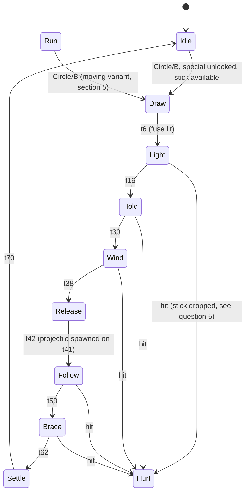

# ANIM-CARL-03: Carl's dynamite throw (equipped special), design spec

**Status:** design phase; silhouette gate FIX-KEYS on H only, fixed and H re-frozen (section 14). The spec and the frozen keys are delivered: four Carl keys (light, hold, wind-up, release) and three stick keys (two flight frames, one fizzle frame). The in-betweens are copies of their nearest key until the execution phase draws them (section 6). Silhouette gate, execution and independent review are pending. Nothing is wired into a Bevy binary and no gameplay number in this file is approved. Rights basis for publishing: owner-reported `ART-PUBLICATION-ALL-V1` ([rights register](../04-production/rights-and-release.md)). No reuse licence, no game or asset-pack distribution right.

Read with: [MVP controller contract](../01-design/mvp-controller-contract.md) (Special, Circle/B; equipable specials), [character progression horizon](../01-design/character-progression-horizon.md) (early encounters / Hoarder), [antihero tone](../01-design/antihero-tone.md), [Carl bible](carl-character-bible.md), [ANIM-CARL-02 melee spec](carl-melee-anim-02-spec.md) (frame, pivot, identity rules and helpers this spec inherits), [ANIM-INTERACT-01](interact-anim-01-spec.md), [VFX-01](vfx-01-spec.md) (the reused blast), [monster death system](../03-tech/monster-death-system-proposal.md) (gore preset 4).

| File | Role |
| --- | --- |
| `assets/source/characters/carl/carl_h52_dynamite.grid.json`, `.ase`, `.pixelart.json` | pixel-grid-v1 source (45 frames: 9 standing, 36 moving), Aseprite file, toolkit config (the **machine-readable tick contract**, `tags.*.frames` = `[frame, ticks]`) |
| `assets/source/vfx/dynamite/vfx_dynamite.grid.json`, `.ase`, `.pixelart.json` | the stick in flight and fizzling on the floor (6 frames) |
| `scripts/author_carl_dynamite.py` | deterministic authoring record: literal prop rows, key poses, the moving-variant rule, evidence (`--check`, `--evidence`, `--ascii <frame>`) |
| `tests/test_art_carl_dynamite.py`, `tests/fixtures/anim-carl-03_keys.json`, `tests/fixtures/anim-carl-03-vfx_keys.json` | spec tests and the frozen keys |
| [`docs/evidence/anim-carl-03/`](../evidence/anim-carl-03/README.md) | 1x scale and silhouette sheets on lit Floor 1, 4x keys, moving variant, `SHA256SUMS` |

## 1. Canon and acting brief

Carl's dynamite is his first **story-earned equipped special** (Circle/B), granted in the early encounters / Hoarder beat of the progression horizon; before that the button is greyed out (controller contract). The binding never encodes "dynamite": the special slot resolves to this ability through the capability layer. Book canon is used for attitude only; nothing here copies a cover, an illustration or another game's throw.

Carl is a believable everyman with a lit explosive in his hand. He is **brave enough to do it and visibly not comfortable with it**:

1. **Draw.** He fishes the stick out of the back of his waistband: a chore, not a quick-draw.
2. **Light.** Chin down, both hands at the chest; the far hand strikes at the fuse and it pops. He watches it like a man who has burned his fingers before.
3. **Hold (the tell).** The fuse is lit and sparking. He holds it out at arm's length, leans back, pulls his head away and puts the other hand up, fingers spread, between his face and the spark: "okay, okay, okay". This beat is the readable tell, and the spark stays on screen until the blast.
4. **Wind-up.** Weight on the back foot, the throwing arm cocked high behind his head, the spark up behind his hair, the other hand flat forward for aim and balance, front foot on its toe.
5. **Release.** He lunges onto the front foot and lobs it overhand with a yell; the hand opens, the stick leaves the fingers fuse-first.
6. **Follow-through and recovery.** The arm carries down across his body and he over-commits, then **flinches**: shoulders up, a hand clamped over his ear, waiting for the bang. Then a settle back to idle.

Tone gate ([antihero tone](../01-design/antihero-tone.md)): practical, a little clumsy, gutsy. No quarterback pose, no confident grin, no twirl, no catch-and-light trick, no cigar lighting, no superhero stance. The explosion is the spectacle, not Carl.

## 2. Frame, pivot, layers and palette (integration contract)

- **Frame 48 x 56, pivot (25, 55)**: identical to the locomotion, melee and interact atlases. The atlas loads next to them with no pivot math. All frames are **grounded** (lowest opaque row 55). Columns 0 and 47 and row 0 stay empty (V11). Frames face right; mirror around the pivot column for left.
- **Layers:** Carl's 11 layers in master order plus one new layer `prop` between `hair` and `near_arm` (`far_arm, legs, shoes, torso, boxers, jacket, head, hair, prop, near_arm, watch, pin`). The stick sits under the throwing hand, so the fist covers its grip; in the wind-up it draws over the hair.
- **Palette: 27 colours** = Carl's 23 master colours unchanged (test) plus four prop colours:

| Key | Name | Hex | Role |
| --- | --- | --- | --- |
| `n` | dynamite_shade | `#6e1622` | lower-right edge of the stick |
| `m` | dynamite_red | `#c42a2e` | stick body: a cool red that separates from the warm orange Floor 1 brick and from the orange VFX-01 fire |
| `o` | dynamite_light | `#f06a4c` | lit upper-left edge |
| `y` | spark_core (accent) | `#fff4b8` | spark core (same hex as VFX-01 `Y`) |

  Reused master keys: `K` outline, `h` (hair light brown) for the fuse cord, `G` (pin yellow, accent) for the spark halo. The red is not one of the VFX-01 flame colours, so a later emissive registration of the flame keys never blooms the stick.
- **Identity locks** (ANIM-CARL-02 section 9): hair, head, torso, jacket, pin and boxer seat are master pixels translated by U(dx, dy) from idle 0; faces are the existing variants (v2 effort open mouth, v3 effort closed mouth) with the head offset at most 2 px; arms, legs, fists and Crocs are the ANIM-CARL-02 tubes and stamps. Tested on all four keys.
- **Hurtbox:** unchanged (24 x 52 greybox AABB). Sprites never feed back into collision.

## 3. Frames, tags and ticks (60 Hz)

Tick 0 is the fixed tick on which Circle/B is accepted with the special unlocked and a stick available. Frame selection is a pure function of the throw clock. `duration_ms` in the grid is for previews only (`round(ticks x 1000 / 60)`).

| Frame | Id | Ticks | Owner | Phase |
| --- | --- | --- | --- | --- |
| 0 | `t0_draw` | t0-5 (6) | in-between | startup: stick out of the waistband, fuse not lit |
| 1 | **`t1_light`** | t6-15 (10) | **key L** | startup: **fuse lit on t6** (the spark appears) |
| 2 | **`t2_hold`** | t16-22 (7) | **key H** | startup, the tell |
| 3 | `t3_hold_b` | t23-29 (7) | in-between | startup, the tell (spark flicker) |
| 4 | **`t4_wind`** | t30-37 (8) | **key W** | startup |
| 5 | **`t5_release`** | t38-41 (4) | **key R** | release: **projectile spawns on t41** (the frame's last tick) at the stick centre |
| 6 | `t6_follow` | t42-49 (8) | in-between | recovery, no stick in hand |
| 7 | `t7_brace` | t50-61 (12) | in-between | recovery: the flinch |
| 8 | `t8_settle` | t62-69 (8) | in-between | recovery, hands over to idle |

Total **70 ticks (1.17 s)**. The spark is visible in Carl's hand from t6 to t41 (36 ticks, 600 ms) and then on the stick until the blast. Same convention as the Bomb Bard (BARD-01 section 3): the hand shows the stick through the release frame, the next frame shows none.

**Moving tags** (section 5): `dynamite_move_light`, `_hold`, `_hold_b`, `_wind`, `_release`, `_follow`, 6 frames each (one per run frame), 4 ticks each (the locomotion run frames rounded to whole ticks; preview only, they follow the locomotion clock).

## 4. Keys

Coordinates are canvas pixels (x right, y down, floor row 55). U(dx, dy) is the upper-block translation from idle 0. Stamps: `FIST_SMALL` (6 x 4), `CROC_FLAT`, `CROC_TOE` (ANIM-CARL-02); `HAND_OPEN_UP` (the ANIM-CARL-02 kb open hand), `HAND_PALM` (open palm: skin finger tips fanned with 1 px gaps, separate thumb), `HAND_CUP` (open hand cupped over an ear), `HAND_FLAT_R` (open, fingers forward); prop stamps in section 7. **Keys are final for pose, silhouette and prop pixels**; they are frozen and the execution phase keeps them pixel-identical. Design problems found while drawing in-betweens come back to design.

| Key | Body | Arms and prop | Executor notes |
| --- | --- | --- | --- |
| **L** light (frame 1) | U(+1, +2), head v3 (+1, +1): chin down, eyes on the fuse. Plain standing feet: back `CROC_FLAT` x15-24, front x27-36 | Near arm from the back shoulder down past the ribs and up to the chest, `FIST_SMALL` grip x31-36 rows 27-30, watch on the cuff. Stick `STICK_V` x32-35 rows 21-29 (grip covered), fuse to (35, 19), `FLARE` x34-38 rows 14-18 in front of the chin. Far arm elbow-down, `FIST_SMALL` x37-42 rows 19-22 beside the flare (the striking hand) | Reads as "lighting something": both hands at the chest, the pop in front of the face. It is a chore pose, so no wide stance. |
| **H** hold, the tell (frame 2) | U(-2, +2), head v3 (-2, 0): leaning back 2 px, head pulled 2 px further away. Feet wider: back x12-21, front x30-39 | Near arm nearly straight, forward and a little down: `FIST_SMALL` x37-42 rows 25-28, stick `STICK_V` upright x38-41 rows 17-25, `SPARK_A` x40-43 rows 11-14 (face height, as far from the face as the arm reaches). Far arm: upper arm forward to a low elbow out front (about (35, 23)), forearm angled up and back, wrist bent; `HAND_PALM` x30-37 rows 11-17 between his face and the spark at chin-to-brow height, palm toward the spark (thumb at x30) | The open palm is what keeps this from reading as a raised fist (a cheer): skin finger tips with 1 px gaps, never `K` tips, never a closed hand. The palm pixels are locked against the orphan merge so the finger separators survive. Keep the spark at least 2 px clear of the hand (x37 to x40). |
| **W** wind-up (frame 4) | U(-2, +1), head v3 (-1, 0). Weight back: back leg straight to `CROC_FLAT` x12-21; front knee bent, front foot on its toe (`CROC_TOE` x31-36, bottom row 55) | Near arm cocked: shoulder, elbow back at about (10, 19), forearm up, `FIST_SMALL` x6-11 rows 11-14 behind the head. Stick `STICK_B` x3-9 rows 6-12 pointing up-back, `SPARK_A` x1-4 rows 1-4 above and behind the hair. Far arm level forward, `HAND_FLAT_R` x36-42 rows 19-23 | Not the haymaker (ANIM-CARL-02 b0): the hand is further back (x6-11 against x13-18), the stick and spark stick out behind the head, the far arm is forward, not pulled to the chest, and the front foot is on its toe. Tested: the whole prop is behind the hair and above it. |
| **R** release (frame 5) | U(+3, +2), head v2 (0, 0): the yell. Lunge: back leg trailing to `CROC_TOE` x15-20, front knee bent over `CROC_FLAT` x32-41 | Near arm up-forward from the shoulder, `HAND_OPEN_UP` x36-42 rows 12-17 (the hand opens). Stick `STICK_D` x38-44 rows 6-12 just off the fingers, fuse first, `SPARK_S` x44-46 rows 2-4. Far arm yanked back behind the hip, `FIST_SMALL` x11-16 rows 30-33 | An overhand lob, not a punch: open hand at head height, stick ahead of the hand (tested). The arm touches the chin line; the face stays readable. |

Measured orphans (non-accent pixels with no same-colour neighbour, no limit in the config, isolated pixels 0): L 3, H 6, W 3, R 4. They are master jacket and neck pixels next to the offset head, the single fuse pixel left where the spark covers the fuse tip (R) and the finger separators of `HAND_PALM` (H).

### Hand and prop anchors (pivot-relative, x forward, y up)

| Frame | Stick centre | Spark core |
| --- | --- | --- |
| 1 light | (+8, +30) | (+11, +39) |
| 2 hold | (+14, +34) | (+17, +43) |
| 4 wind-up | (-19, +46) | (-23, +53) |
| 5 release | (+16, +46) | (+20, +52) |

**Projectile spawn:** on t41 the runtime spawns the `dynamite_flight` entity with its pivot at **(+16, -46)** from Carl's pivot in screen coordinates (y down); mirror x when facing left. On the moving variant the release arms are moved by the run frame's offset (section 5): add (0, 0) on run frames 4, 6, 7, 9 and (0, +1) on 5, 8. Computed from pixels by `prop_anchors()` and tested.

## 5. Moving variant (decision: arm overlay baked per run frame)

Carl can throw while running. Options weighed:

| Option | Verdict |
| --- | --- |
| Separate full-body run-throw clips | Rejected: a second run cycle that drifts from ANIM-CARL-01, and the feet would skate. |
| Runtime two-sprite actor (arms over a body atlas) | Rejected for now: the locomotion atlas is flattened, so the run arms would show under the throw arms. |
| **Arm overlay baked per run frame** | **Chosen.** In every run frame (locomotion 4-9) the upper block is idle 0 translated by U(+3, +2) or U(+3, +3) (measured on the torso by `run_u`). A moving frame is the run frame with its `far_arm`, `near_arm`, `watch` and the `prop` layer replaced by the standing phase's, moved by U(run) - U(phase). Legs, Crocs, boxers, torso, jacket, head and hair stay the run frame's (tested). The hold arms sit 2 px and the wind-up arms 1 px further back (`MOVE_TRIM`), because their lean-back reach would otherwise touch column 47; the arm root is drawn over the jacket, so the slide does not open a gap. The pin is hidden when the near sleeve covers 3 of its 4 pixels. |

**Runtime rule (proposal for the integration agent):** the locomotion state machine keeps its own clock and run frame `n` (4-9). While a throw phase p in {light, hold, hold_b, wind, release, follow} is active **and** the locomotion state is `run`, draw `dynamite_move_
` frame `n - 4`; when standing, draw the standing frame. Draw, brace and settle on the run show the plain run frame (the arms swing as usual). The throw clock and its spawn tick are the same in both cases. Cost: 36 frames, none hand-drawn; they follow the standing in-betweens automatically when the executor reruns the script.

## 6. In-between table (execution phase, no design decisions needed)

| Frame | From | Pose |
| --- | --- | --- |
| `t0_draw` | idle -> L | U(+1, +1), head v3 (+1, +1) (looking down and back at his hip). Feet as L. Near arm reaching down and back to the waistband: `FIST_SMALL` at about x14-19 rows 34-37, behind the boxer seat edge, the top 4 rows of `STICK_V` showing above the fist with the fuse but **no spark** (unlit). Far arm: idle far arm moved (+1, +1). |
| `t3_hold_b` | H | H pixel for pixel, except the spark: `SPARK_B` at the same top-left (40, 11) instead of `SPARK_A`. The 14-tick hold flickers between the two spark shapes; nothing else may move. |
| `t6_follow` | R -> brace | U(+5, +3), head v3 (+1, +1) (over-committed, chin down). Near arm swung down and across: open `HAND_FLAT_R` turned fingers-down (or `HAND_OPEN_UP` flipped vertically) at about x36-42 rows 30-35, in front of the boxers. Far fist still back at the hip (R's moved (+1, +1)). Front `CROC_FLAT` holds x32; back `CROC_TOE` drags 2 px forward (x17). **No prop pixels** from this frame on. |
| `t7_brace` | follow -> settle | The flinch: U(+1, +3), head v3 (0, +1) (shoulders up, chin tucked). Near hand cupped over the near ear: the open `HAND_CUP` stamp (5 x 5, skin finger tips with gaps) at about x14-18 rows 11-15, elbow out and down behind him; **never a fist beside the head** (it reads as a head-scratch or a phone call). Far arm tense and straight down (idle far arm moved (+1, +3)). Front Croc steps back from x32 to x29; back foot comes down flat at x15. One hand only, never both hands up (that reads as a cheer). |
| `t8_settle` | brace -> idle | U(+1, +1), head v0 (a "huh" after the bang, or no bang yet). Idle arms moved (+1, +1). Feet back x15, front x27: hands over to idle with at most a 2 px foot snap. |
| VFX `f1_down` | f0 -> f3 | `STICK_V` centred on the pivot with the fuse at the **bottom** (the stamp mirrored vertically, lit column kept on the left), `SPARK_B` at the tip, core touching it, halo away from the stick. |
| VFX `f2_left` | f1 -> f3 | `STICK_H` centred with the fuse on the **left** (mirrored horizontally, lit row kept on top), `SPARK_A` at the tip. |
| VFX `z1` | z0 | z0 with `SPARK_B` instead of `SPARK_A` at the same place (fizzle flicker). |

After drawing a frame, set its source to `None` in `STANDING` and add its function to `KEYS` (or a new in-between map); `STANDING_U` already holds the planned U of each in-between, and `phase_u` then uses it for the moving overlay. When all are drawn: turn on `rules.unique_frames` in both configs, replace `test_design_phase_in_betweens_are_key_copies` with per-frame checks of this table (the moving-variant test then covers the new arms automatically), add GIFs and contact sheets with `python3 -m scripts.pixelart evidence`, a timing diagram, the export manifests (`assets/manifests/carl_book1_h52_dynamite.json`, `assets/manifests/vfx_dynamite.json`) with the tick contract, spawn offset and anchors, and refresh `SHA256SUMS`. Do not edit the frozen keys.

## 7. Prop and VFX

**Stick stamps** (literal rows in `author_carl_dynamite.py`, about 9 x 4 px; exaggerated like every Floor 1 prop: the Bard bomb is 7 x 7): `STICK_V` (fuse up), `STICK_D` ("/" fuse up-right), `STICK_B` ("\" fuse up-left), `STICK_H` (fuse right). `K` outline, `o` lit upper-left edge, `m` body, `n` shade. The lit edge stays upper-left in every orientation: the light does not turn with the stick. Fuse: 2 px of `h` from the fuse end; the last pixel is the burning tip.

**Sparks:** `SPARK_A` and `SPARK_B` (4 x 4, 4 core px each, alternate for flicker), `SPARK_S` (3 x 3, release key at the canvas edge), `FLARE` (5 x 5 diamond, the light pop, 5 core px). The core always touches the fuse tip; isolated pixels 0. Cap: at most 5 core (`y`) and 13 spark pixels per frame (tested on the keys), so the spark never blows out the hand or the face.

**VFX grid** `vfx_dynamite`: 24 x 24, pivot (12, 12), 7 colours (a subset of the Carl dynamite palette), one layer `body`.

| Frames | Tag | Ticks | Content |
| --- | --- | --- | --- |
| 0-3 | `dynamite_flight` (loop) | 3 each, 12 per turn | Stick centred on the pivot, forward tumble in 90 degree steps: f0 fuse forward (**key**), f1 fuse down, f2 fuse back, f3 fuse up (**key**). Starts at f0 (the release key's stick points up-right). No motion streaks. |
| 4-5 | `dynamite_fizzle` (loop) | 4, 4 | The stick lying on the floor, lowest row on the pivot row (the walking line), fuse burning up-forward: z0 (**key**), z1 the flicker. |

**The blast reuses VFX-01 `burst` unchanged** (48 x 48, 9 frames, 42 ticks, draws behind the actors, centre 8 px above the walking line for a floor blast). Reason: a hand-thrown stick and the Bard's bomb are the same class of charge; the burst already reads as a grimy fireball with smoke and debris, sits in the A1 lighting rules, and its drawn fire covers about a 20 px radius. One stick catching two adjacent goblins (each 22 px wide) fits that radius. A bigger dynamite blast is a separate, natively drawn `burst_large` (VFX-01 section 8), never a scaled burst.

**Gore preset 4:** the blast art is only the blast. Killing blows from it are `cause: Explosion` with a high force tier in the death system's `EnemyDefeated` event; the body chunks, fragments and aftermath at the default preset 4 come from the species death profiles (GOB-02-DEATH and later work orders), not from this atlas, and never change damage or the replay hash.

## 8. State flow

Projectile: `Spawned (t41) --> Flight (dynamite_flight loop, ballistic arc) --> Landed (dynamite_fizzle loop) --> Blast (VFX-01 burst, entity despawns after it)`; whether the stick bounces, slides or explodes on contact is open (question 2).

## 9. Open gameplay questions (not decided here)

The art works with any answer below; numbers are placeholders for evidence only.

1. **Fuse time.** Fixed from the light tick (t6) or from the release? Placeholder for the evidence: blast 90 ticks after t6 (about 55 ticks after the spawn). Can the player cook the fuse by holding Circle/B (press vs hold, controller contract)?
2. **Throw arc.** Fixed lob along facing (no required aim, controller contract) with optional stick-tilt range? Placeholder: vx 150 px/s, vy -260 px/s, `GRAVITY` 1050 (about a 32 px apex and about 75 px of travel). Bounce, slide or stop on landing? Contact-detonation against an enemy?
3. **Cooldown and ammunition.** Cooldown after the settle, or a carried-stick count (inventory)? A greyed-out special when empty?
4. **Self-damage and friendly fire.** Does the blast hurt Carl or Donut? The art's brace beat supports either; a "too close" rule needs the blast radius (VFX-01 recommends 18 to 22 px).
5. **Interrupt while lit.** If Carl is hit between t6 and t41, does he drop the lit stick at his feet (it fizzles and blows), lose it, or keep winding? The fizzle frames already cover "dropped".
6. **Cancel windows.** Proposal: no cancel before t42; movement may cancel the brace and settle from t50.
7. **Moving and airborne throws.** The moving variant is drawn (section 5). Throwing while jumping or falling has no frames; options: ignore the input in the air, or a separate work order.
8. **Blast radius above about 26 px** would need a natively drawn `burst_large` (VFX-01 section 8).

## 10. Difficulty score and route

Per [routing by difficulty](../07-agents/pixel-art-pipeline.md#routing-by-difficulty): new design (the throw, prop and stick VFX; Carl himself is the approved master) **yes**; native height above 40 px **yes** (52 px); complex construction **no**; VFX, projectiles or special states **yes**. **Score 3: Hard.** Route: the design phase draws and freezes every key and the spec (this delivery); a silhouette gate checks the four Carl keys and the stick keys at 1x on lit Floor 1 before the in-betweens; execution draws section 6; an independent review closes.

**Living-horizon fit:** dynamite as Carl's first equipped special, granted at the early encounters / Hoarder beat on Circle/B, is exactly the horizon's step "punch -> kick -> story-earned explosive"; it adds no new button and keeps Carl a scrappy improviser. No horizon update needed. This art is not approval to implement the ability; gameplay signoff still applies.

## 11. Acceptance targets and validators

1. Frame, pivot, layers (plus `prop`) and the 23 master colours identical to the locomotion atlas; every frame grounded on row 55; columns 0 and 47 and row 0 empty (V07, V11, test).
2. The four Carl keys and the three stick keys pixel-identical to the fixtures in every later phase (V09).
3. Tick table as section 3 (70 ticks, fuse lit on t6, spawn on t41) in the config and the grid (V03, test).
4. **At 1x on lit Floor 1** next to Donut and a goblin (`keys-scale.png`): the four keys read as four different silhouettes (`silhouettes.png`); the hold is a readable tell (lit stick held away, palm up, lean back); the wind-up reads as "throw coming" and is not the haymaker; the release reads as a lob, not a punch; the stick reads as a red stick with a spark on warm brick and on cold stone, lit and unlit.
5. Tone gate: plain, gutsy, a little clumsy; never a quarterback or action-star pose, never a cheering fist above the shoulders.
6. Identity: hair, head, torso, jacket, pin and boxers are translated master pixels in every frame (tested on the keys; the execution phase extends the test to every frame).
7. Spark caps (section 7); isolated pixels 0; VFX orphans at most 9; stick frames within 16 x 16 px (V13).
8. Moving frames keep the run body and move the standing arms by the rule (test).
9. `python3 scripts/author_carl_dynamite.py --check`, `python3 -m scripts.pixelart validate` on both configs and `python3 -m pytest tests -q -k "dynamite or pixelart"` pass.

## 12. Evidence

See [the evidence README](../evidence/anim-carl-03/README.md): `keys-scale.png` (1x lit Floor 1 with Donut, idle Carl, the keys, the stick in flight and fizzling, goblins and the burst), `keys-scale-unlit.png`, `silhouettes.png` (solid shapes at 1x and 4x, with the ANIM-CARL-02 b0 haymaker for comparison), `keys-x4.png`, `move-{light,hold,wind,release}-scale.png`. Regenerate with `bash scripts/export_assets.sh` once, then `python3 scripts/author_carl_dynamite.py --evidence`.

## 13. Rights and provenance

Derived from the owner-approved Carl 52 px master (via the ANIM-CARL-01 locomotion canvas) and the review-passed ANIM-CARL-02 stamps; master parts translated only, limbs rasterised and prop pixels written as literal rows by `scripts/author_carl_dynamite.py`. No image-model raster output, no tracing, no third-party or franchise art; the dynamite stick is a generic object drawn from scratch. The explosion is the existing VFX-01 burst. Spec, keys, silhouette sheet and authoring script: Claude Opus (design). Execution and independent review: pending.

## 14. Silhouette gate result

Independent gate on the seven keys: **FIX-KEYS for H only**. L, W, R and the three stick keys passed; the 27-colour palette was accepted (the `o`/`n` ramp is the stick's only volume cue at 1x); the moving release overlay passed; the flinch beat fits the tone. Fixed in one round:

1. **F1.** H's far hand read as a raised fist (outline-colour finger tips read as knuckles). Now `HAND_PALM`: skin finger tips fanned with 1 px gaps and a separate thumb, locked against the orphan merge.
2. **F2.** The vertical forearm under a blob is gone: the elbow sits low out front, the forearm angles up and back, the wrist bends and the palm sits between the face and the spark at chin-to-brow height, 2 px clear of the spark.
3. **F3.** Lean-back made visible: U(-1, +2) to U(-2, +2), head v3 (-2, 0); stick and spark kept at their absolute pixels (anchors unchanged). The moving hold overlay's trim rises from 1 to 2 px (hold and hold_b only); no gap at the arm root (`move-hold-scale.png`).
4. **F4.** The `t7_brace` row now asks for an open hand cupped over the ear (`HAND_CUP`), never a fist.
5. **F5.** H fixture re-frozen; section 4 and the orphan counts updated; `t3_hold_b` follows H (design-phase copy); evidence and `SHA256SUMS` regenerated. L, W, R, the spawn tick and offset are unchanged.

Non-blocking items done: flight sticks over the lit brick wall in `keys-scale.png` (N1), moving sheets for light, hold, wind-up and release (N2), `--ascii` accepts an atlas frame index (N3).
