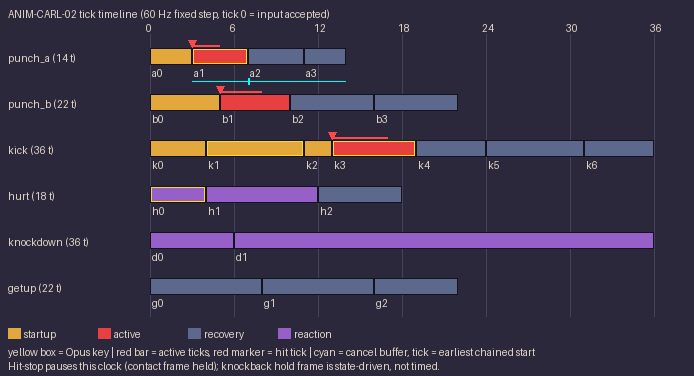
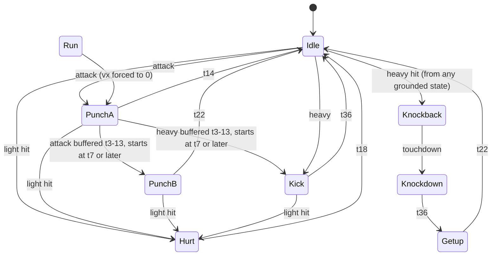

# ANIM-CARL-02: Carl unarmed melee, design spec (phase 1)

**Status:** full set drawn (Sonnet), awaiting independent Opus review (second round). Design and the eight Opus key poses: Claude Opus, 2026-11-17 (four in phase 1, four in the fix round, section 14). The other 16 frames: Claude Sonnet (phase 2, section 13; the fix-round redraws and corrections are done, section 13). Review: pending, then owner review. Nothing here is owner-approved. Nothing is wired into a Bevy binary; runtime integration is a separate work order. Rights basis for publishing: owner-reported `ART-PUBLICATION-ALL-V1` ([rights register](../04-production/rights-and-release.md)). No reuse licence, no game or asset-pack distribution right.

Read with: [ANIM-CARL-01 locomotion](carl-locomotion-anim-01.md) (frame, pivot and identity rules this spec inherits), [Carl bible](carl-character-bible.md), [antihero tone](../01-design/antihero-tone.md), [combat feel / hybrid physics](../01-design/combat-feel-hybrid-physics.md), [Floor 1 combat probes](../07-agents/floor-01-integrated-combat-probes.md) (CP-01, CP-02), [animation system](animation.md).

| File | Role |
| --- | --- |
| `assets/source/characters/carl/carl_h52_melee.grid.json` | pixel-grid-v1 source, 24 frames in the section-6 layout (the 8 Opus keys at frames 1, 4, 5, 9, 11, 15, 18 and 19, unchanged) |
| `scripts/author_carl_melee.py` | deterministic authoring record of the 16 Sonnet frames (`--check` verifies the committed grid) |
| `tests/test_art_carl_melee.py`, `tests/fixtures/carl_melee_phase1_keys.json` | contract tests and the frozen Opus keys they compare against |
| `assets/source/characters/carl/carl_h52_melee.ase` | built from the grid by `scripts/pixel_grid_to_ase.py` (via `scripts/export_assets.sh`) |
| `assets/manifests/carl_book1_h52_melee.json` | candidate manifest `carl_book1_h52_melee_candidate_v1`. Its `melee.moves` block is the **machine-readable tick contract** of this spec (the timing diagram is drawn from it) |
| `scripts/make_carl_melee_previews.py` | contact sheets, timing diagram, tick-timed GIFs, lit Floor 1 compositions, `measurements.json` |
| [`docs/evidence/anim-carl-02/`](../evidence/anim-carl-02/README.md) | committed renders with SHA-256 sums |

## 1. Acting brief

Carl fights like a guy who has never trained and is furious about it. He commits too hard, swings his off arm for balance, overbalances after the big hits and has to shuffle back. Confidence is the 1980s-90s action-movie kind: loud, a bit wrong, effective anyway. No martial-arts stances, no clean guard, no superhero landing, no flexing.

- **Jab (CP-01).** A short, mean lead-hand pop to a goblin's face. The off arm flies back. Gritted teeth.
- **Haymaker (CP-01, chained).** The arm goes back behind his head first (readable), then a wild round swing that drags him forward and off balance.
- **Front kick (CP-02, signature heavy).** Lean back, knee up to the belt, then the pink Croc sole slams flat into the goblin's chest. Arms fly up for balance, he yells. Then the foot slaps down and he stumbles forward. The sole of a Croc as the hero's weapon is the joke and the read.
- **Hurt.** The head snaps back, eyes squeezed shut, the front foot skids on its heel, arms fly out.
- **Knockdown and get-up.** He lands on his butt, not his back, sits there bewildered with his Crocs up, then gets up the hard way: knee, hand on knee, stand, and a guilty glance back.

## 2. Frame size and pivot (integration contract)

- **Frame 48 x 56, pivot (25, 55): unchanged from ANIM-CARL-01.** No widening is needed. The kick sole ends at x46 and the hurt's back hand at x1, so columns 0 and 47 stay empty in all four keys (the clipping rule). The melee atlas therefore shares the locomotion actor spec exactly: width 48, height 56, pivot (25, 55), master padded 6 px per side. The integration agent can load it as a second atlas with the same layout, or append its frames to the locomotion atlas, without any pivot math.
- **Grounded tags** (`punch_a`, `punch_b`, `kick`, `hurt`, `knockdown`, `getup`): the lowest opaque row is 55 in every frame (0 px foot sink). In `knockdown` the contact is the butt or a planted hand, in `getup` the knee or a foot, still on row 55.
- **Airborne tag** (`knockback`): the pivot stays on the AABB bottom and nothing is drawn on row 54 or 55 (lowest row at most 53), like `jump_rise` / `jump_fall`. Never ground-snap it.
- **Facing:** all frames face right. Mirror around the pivot column for facing left, exactly as for idle and run.
- **Hurtbox:** unchanged (the greybox AABB, 24 x 52). Sprites never feed back into collision.

## 3. Tick conventions

- Logic runs at 60 Hz (`TICK_SECONDS = 1/60`). **Tick 0** is the fixed tick on which the input is accepted (the tick on which WORK-021 applies melee damage today).
- **Active ticks** are the ticks on which the attack hitbox is live. The **hit tick** is the first active tick. A target can be hit at most once per move instance (dedup by move instance id), so a 4-tick active window never deals 4 hits.
- **Frame selection** is a pure function of the move clock: `frame = the frame whose [start, end] tick range contains the move tick`. Never use wall-clock time. The `.ase` `duration_ms` values are only for previews (`round(ticks x 1000 / 60)`).
- **Hit-stop** (proposal): on a confirmed hit, the attacker's move clock and the target freeze for N ticks; the contact frame stays on screen. The tables below are without hit-stop.
- **Root motion:** none. The art assumes horizontal input is ignored (vx = 0) during grounded melee, hurt, knockdown and get-up; the feet stay planted where the tables say. Knockback velocity applied by gameplay moves the whole sprite. If gameplay lets Carl walk while attacking, these frames will skate; that would need a separate upper/lower-body design.

## 4. Move table

| Move | Input (proposal) | Startup | Active | Recovery | Total | Hit tick | Cancel |
| --- | --- | --- | --- | --- | --- | --- | --- |
| `punch_a` jab, far arm | attack | 3 (t0-2) | 2 (t3-4) | 9 (t5-13) | **14** (233 ms) | **t3** | into `punch_b` or `kick`: press buffered t3-13, the next move starts at max(t7, press tick) |
| `punch_b` haymaker, near arm | attack again during the jab buffer | 5 (t0-4) | 3 (t5-7) | 14 (t8-21) | **22** (367 ms) | **t5** | none (ends the string) |
| `kick` front push kick, near leg | heavy input, see section 8 | 13 (t0-12) | 4 (t13-16) | 19 (t17-35) | **36** (600 ms) | **t13** | none (full commitment) |
| `hurt` flinch | taking a light hit | - | - | 18 hitstun | **18** (300 ms) | - | none |
| `knockback` + `knockdown` | taking a heavy hit | airborne hold | - | 6 impact + 30 sprawl | hold + **36** | - | into `getup` |
| `getup` | automatic after the sprawl | - | - | 22 | **22** (367 ms) | - | none |

Cadence: mashing attack gives the one-two with hits on t3 and t12 (150 ms apart, 29 ticks for both). Jab then kick lands the kick on t20 after the first press. The jab's 14 ticks equal the current `MELEE_COOLDOWN` (14), so a one-button prototype can keep that constant.

**Proposed target reactions** (starting values for COMBAT-PHYS-01 tuning, **not approved** and not art data):

| Move | Hit-stop | Goblin reaction |
| --- | --- | --- |
| jab | 3 ticks | stagger 10 ticks, push about 4 px |
| haymaker | 5 ticks | stagger 18 ticks, push about 12 px |
| kick | 8 ticks | launch vx 300 px/s, vy 220 px/s. With `GRAVITY` 1050 that is a 23 px apex and about 126 px over 25 ticks, enough to reach a second goblin standing close (CP-02). Hitting the second goblin staggers and repositions it with **no damage** by default, deduplicated per event, as CP-02 requires |

### Art reach (from the keys; pivot-relative, x forward, y up from the floor, inclusive)

| Key | Part | x | y |
| --- | --- | --- | --- |
| jab contact | fist | +16 .. +21 | 31 .. 36 (a 38-40 px goblin's face) |
| kick contact | Croc sole | +15 .. +21 | 18 .. 27 (a goblin's chest) |
| kick contact | whole leg | +7 .. +21 | 15 .. 27 |
| haymaker (hook) contact | fist | +16 .. +21 | 35 .. 41 (the top of a 38-40 px goblin's head) |

These numbers are in the manifest (`melee.hit_boxes_px`) as a guide; hitboxes stay gameplay data. The hook reaches as far as the jab but lands 5 px higher, so the jab's proposed push (about 4 px) can carry a goblin out of hook range. Proposal for the gameplay owner: give `punch_b` a forward root step of about 4 px during b0-b1 (the art already lunges: U.x +6 at b1 against +3 at a1), or keep the jab push at 2 px or less.

**Contradiction to flag (not changed here):** WORK-021's melee hits anything from -9 to +54 px ahead of the hero centre (and 44 px vertically). The art reaches +21, so a goblin whose centre is more than about +33 away (21 + its 12 px half-width) would be hit with a visible gap. The gameplay owner should either shrink the range to the art (about +34 centre to centre) or accept the gap. The jab also misses targets shorter than 31 px; there are none in Floor 1 today.

## 5. Frames, keys and poses

Coordinates are canvas pixels (x right, y down; floor = row 55). **U(dx, dy)** is the translation applied to the identity-locked upper block (master `hair`, `head`, `torso`, `jacket`, `pin` and the boxer seat, master boxer rows 31-38) relative to ANIM-CARL-01 idle frame 0. **Head** gives the head variant and the head's extra offset relative to the jacket. Head variants (all existing faces): **v0** neutral, open mouth (master idle 0); **v1** glance back, closed mouth (master idle 2); **v2** effort brow, open mouth (run); **v3** effort brow, closed mouth (land wince); **pain** = v0 with both eyes closed to `D` (4 px, new; authored in h0).

Stamps to reuse (copy the pixels from the named key, do not redraw): `CROC_FLAT` (master), `CROC_HEEL` (heel strike, toe up: run frame 4 front foot, used in h0), `CROC_TOE` (toe down: hanging foot of k1), `CROC_SOLE` (sole forward: k3), `FIST_BIG` (6 x 6 fist with outline: a1), `FIST_SMALL` (5 x 4: k1 far fist), `BACK_ARM` (near arm swung back-down with fist: a1 rows 20-34), `RAISED_ARM` (near arm up-back: k3).

**Opus keys are final for pose, silhouette and contact pixels.** There are eight: a1, b0, b1, k1, k3, h0, kb and d0, frozen in `tests/fixtures/carl_melee_phase1_keys.json` and copied verbatim by `scripts/author_carl_melee.py`. Sonnet keeps them pixel-identical; any change to a key goes back to Opus. One Sonnet frame is a **secondary key** (d1): Sonnet draws it from the spec, and the reviewer checks it first.

Two more stamps come from the fix-round keys: `HAND_OPEN_UP` (7 x 6 open hand, fingers up: kb near hand) and `HAND_OPEN_SIDE` (6 x 7 open hands, fingers pointing out: d0 near hand points left, d0 far hand points right).

### 5.1 `punch_a`: jab (frames 0-3 of the final atlas)

| Frame | Ticks | Owner | Pose |
| --- | --- | --- | --- |
| a0 chamber | t0-2 | Sonnet | U(+1, +1), head v3 (0, 0). Far fist cocked by the chin: `FIST_SMALL` at x33-37, rows 17-20, sleeve mostly behind the torso. Near arm starts back: idle near arm moved (-2, +1). Feet: back `CROC_FLAT` x14-23, front `CROC_FLAT` x28-37 (front foot sliding forward) |
| **a1 contact** | t3-6 (active t3-4, **hit t3**) | **Opus key** | U(+3, +2), head v3 (0, 0). Far arm straight at shoulder height: sleeve rows 20-24 from behind the chest to x40, cuff with glint, `FIST_BIG` x41-46 rows 19-24. Near arm thrown back (`BACK_ARM`, fist x9-14 rows 31-34). Wide stance: back leg straight, `CROC_FLAT` x13-22; front knee bent over the toes, `CROC_FLAT` x31-40 |
| a2 retract | t7-10 | Sonnet | U(+3, +2), head v3 (0, 0), legs identical to a1. Far arm bent half back: elbow at about x36 row 23, `FIST_SMALL` at x37-41 rows 18-21. Near arm: `BACK_ARM` moved (+1, -1) |
| a3 settle | t11-13 | Sonnet | U(+1, +1), head v0 (0, 0). Far arm hanging forward-down, relaxed: k3's far arm moved (+2, +1). Near arm: idle near arm moved (+1, +1). Feet: back x14-23, front x28-37. Hands over to idle with at most a 2 px foot snap |

### 5.2 `punch_b`: haymaker (frames 4-7)

| Frame | Ticks | Owner | Pose |
| --- | --- | --- | --- |
| **b0 wind** | t0-4 | **Opus key** (fix round) | U(0, +2), head v3 (-1, 0): he leans back to load. Legs identical to a1 (feet do not move). Near arm cocked to throw: upper arm rising back from the shoulder to a high elbow at about x9-12 rows 15-19, forearm angled forward and up, `FIST_SMALL` at x13-18 rows 11-14, behind the ear (over the back of the hair). Far fist pulled to the chest: `FIST_SMALL` at x32-37 rows 22-25. Not a raised hand: the elbow points back |
| **b1 contact** | t5-9 (active t5-7, **hit t5**) | **Opus key** (fix round) | A hook, not a second jab. U(+6, +3), head v2 (+1, +1): he yells and tucks the chin. Body turn: the near shoulder has come round, so the near arm starts at the chest front (about x25-29 rows 23-27), the upper arm runs out level under the chin to the elbow at about x36 row 22 (shoulder height), and the forearm rises to `FIST_BIG` at x41-46 **rows 14-19** (head height, beside the face, which stays clear). The far arm is yanked back to the hip: `FIST_SMALL` at x12-17 rows 30-33 behind the back. The pin is hidden by the sleeve. Front `CROC_FLAT` x33-42 with the knee deep (about x39 row 46); back foot up on its toe: `CROC_TOE` at x15-20, bottom on row 55 |
| b2 overswing | t10-15 | Sonnet (**redraw**, fix round) | Follow-through of the b1 hook. U(+7, +3), head v3 (+1, +1) (chin down, over-rotated, off balance). The near arm keeps its b1 shape and carries on round and down: elbow at about x37 row 26, `FIST_BIG` at about x34-39 rows 27-32, in front of the lower chest (never level at shoulder height, so it does not read as a jab). Far fist stays back at the hip as in b1 (about x13-18 rows 30-33). Feet exactly as b1 (no slide). Delete the whole pin when the sleeve covers 3 or more of its 4 pixels; never leave a single pin pixel |
| b3 recover | t16-21 | Sonnet | U(+2, +1), head v0 (0, 0). Idle arms moved (+2, +1). Feet: back `CROC_FLAT` x15-24, front x29-38. Hands over to idle |

### 5.3 `kick`: front push kick (frames 8-14)

The support foot (`CROC_FLAT` x15-24, the master's left Croc position) **does not move from k0 to k5**.

| Frame | Ticks | Owner | Pose |
| --- | --- | --- | --- |
| k0 load | t0-3 | Sonnet | U(0, +2), head v3 (0, 0). The kicking heel lifts: `CROC_TOE` at x28-33 (bottom on row 55), knee forward at about x30 row 45. Near arm starts back: `BACK_ARM` as in k1 moved (+1, -2). Far fist rising: k1's far arm moved (+1, +2) |
| **k1 wind-up** | t4-10 | **Opus key** | U(-1, +3), head v3 (-1, +1) (leaning back, chin tucked). Knee chambered to the jacket hem: boxer leg rising forward (x28-34 rows 34-41), knee at x38 row 34, shin hanging, `CROC_TOE` dangling at x33-38 rows 43-49. Near arm cocked back (`BACK_ARM`, fist x5-10 rows 32-35), far `FIST_SMALL` up by the chin (x31-36 rows 16-19). Support leg bent a little more than idle. This is the telegraph: the silhouette must say "kick coming" at 1x |
| k2 snap | t11-12 | Sonnet | Upper block as k3: U(-2, +2), head v2 (-1, 0). Leg three-quarter extended: k3's boxer flap, shin angled down-forward to the ankle at about x37 row 38, `CROC_SOLE` moved (-3, +3) (x37-43, rows 31-40). Near arm sweeping up: horizontal back at shoulder height, fist at about x2-6 rows 18-22. Far fist dropping to about x31-35 rows 21-24. No smear frames |
| **k3 contact** | t13-18 (active t13-16, **hit t13**) | **Opus key** | U(-2, +2), head v2 (-1, 0): the yell. Leg out, rising slightly from the hip: short boxer flap (x27-33 rows 34-40), lit-top skin tube to x39, `CROC_SOLE` at x40-46 rows 28-37 with the sole facing the target. Near arm flung up and back (`RAISED_ARM`, fist x8-12 rows 10-13), far arm hanging forward (fist x31-35 rows 27-30). Support leg straight-ish under the hips |
| k4 retract | t19-23 | Sonnet | U(-1, +2), head v3 (-1, 0). Leg pulled back bent, lower than k1: knee about x36 row 37, `CROC_TOE` dangling at about x32-37 rows 44-50 (off the floor). Near arm coming down: fist at about x4-8 rows 20-24. Far arm as k3 |
| k5 stumble | t24-30 | Sonnet | U(+3, +2), head v0 (+1, 0) (he huffs, overbalanced forward). The kicking foot slaps down far forward: front leg and `CROC_FLAT` copied from a1 (x31-40). Support `CROC_FLAT` still x15-24, back leg redrawn as a long diagonal. Near arm swings forward-down: `FIST_SMALL` at about x29-33 rows 29-32; far arm hidden |
| k6 settle | t31-35 | Sonnet | U(+1, +1), head v3 (0, 0). Front foot shuffled back to x27-36, back stays x15-24. Idle arms moved (+1, +1). Hands over to idle with a 1 px foot snap |

### 5.4 `hurt`: flinch (frames 15-17)

| Frame | Ticks | Owner | Pose |
| --- | --- | --- | --- |
| **h0 impact** | t0-3 | **Opus key** | U(-5, +3), pain head (-2, -1): head snapped back, neck showing, eyes shut, mouth open. Front foot skids on its heel (`CROC_HEEL` at x27-37), back foot planted (`CROC_FLAT` x10-19). Near arm flung back (`BACK_ARM`, hand x1-5 rows 32-35), far arm flung forward-down, open (hand x28-33 rows 28-32) |
| h1 recoil | t4-11 | Sonnet | U(-3, +2), head v3 (-1, 0) (eyes open again, angry). Front heel comes down: `CROC_FLAT` x24-33; back `CROC_FLAT` stays x10-19. Near arm: `BACK_ARM` moved (+3, -1). Far arm: k3's far arm moved (-2, 0) |
| h2 recover | t12-17 | Sonnet | U(-1, +1), head v3 (0, 0). Feet x13-22 and x26-35. Idle arms moved (-1, +1). Hands over to idle |

### 5.5 `knockback`, `knockdown`, `getup` (frames 18-23)

The identity lock forbids rotating the head and jacket, so Carl never lies flat. A heavy hit throws him **butt-first** and he lands **sitting**, upper body upright. This keeps him recognisable and is funnier.

| Frame | Ticks | Owner | Pose |
| --- | --- | --- | --- |
| **kb launched** | hold while airborne | **Opus key** (fix round) | Airborne: lowest opaque row 38 (at most 53). U(-6, -1), pain head (-2, -1): the upper block sits well behind the pivot so the butt leads the flight. Jackknife: the seat is closed by a flat `U` hem (row 38); the near boxer leg rises up-forward (x24-31 rows 29-36), knee at about x33 row 29, shin up to a side-on `CROC_HEEL` at x35-45 rows 23-28 (toe up), so the feet are higher than the butt; the far shin (darker ramp) runs forward under it to a `CROC_TOE` at x35-40 rows 32-38. The two Crocs are 3 rows apart, never one pink block. Both arms flung back with open hands, reaching behind for the fall: near arm up-back to `HAND_OPEN_UP` at x2-8 rows 5-10, far arm level back to a `HAND_OPEN_SIDE` (left) at x1-6 rows 20-26. No fists |
| **d0 butt impact** | t0-5 | **Opus key** (fix round) | U(-4, +15) (boxer seat bottom on row 53, hem flattened onto rows 54-55: the butt is the contact), pain head (0, +1). Legs bounce up with the feet apart: near knee about x33 row 44, near `CROC_HEEL` at x36-46 rows 40-45; far leg lower in the darker ramp, `CROC_HEEL` at x34-44 rows 48-53 (heels off the floor). Arms flung out sideways at shoulder height with open splayed hands: near `HAND_OPEN_SIDE` (left) at x1-6 rows 28-34, far one (right) at x34-39 rows 28-34. **No fists above the shoulders** (that read as cheering) |
| d1 sprawled | t6-35 | **Sonnet, secondary key** (**redraw feet**, fix round) | U(-4, +15), head v0 (0, +1): the bewildered fall face. Near leg straight forward, heel on the floor, toe-up `CROC_HEEL` at about x36-46; far leg knee up, `CROC_FLAT` at about x26-35, so a column of floor shows between the two Crocs (at least 1 px; no pink block). Near hand propped behind on the floor (hand rows 51-55 at about x5-9). Far hand resting on the far knee. Coming from d0, the arms drop from the sideways splat to these props |
| g0 knee | t0-7 | Sonnet (**redraw**, fix round) | U(-1, **+11**), head v3 (0, 0): a low kneel, so the upper block rises 4 px from d1 (+15) instead of popping 7. Near knee on the floor (rows 51-55 at about x22-27), near shin back along the floor, `CROC_TOE` lying at about x8-13; far foot planted forward `CROC_FLAT` x27-36, far knee up at about x31 row 47 (hip lower than before). Near hand pushing on the far knee |
| g1 push up | t8-15 | Sonnet (**redraw**, fix round) | U(+1, **+6**), head v3 (0, 0), hunched (rises 5 px from g0, then 5 px to g2's +1). Front `CROC_FLAT` x27-36, knee about x32 row 46; back leg straightening onto its toe (`CROC_TOE` x12-17, bottom on row 55). Near hand on the front thigh (about x29-33 rows 40-43) |
| g2 stumble | t16-21 | Sonnet | U(+1, +1), head **v1** (glance back, closed mouth: "did anyone see that?"). Feet x14-23 and x27-36. Near arm: idle moved (-1, +1); far arm: idle moved (+2, +1). Hands over to idle |

## 6. Planned final atlas layout (phase 2)

24 frames, unpadded row-major 48 x 56, same `.grid.json` / `.ase` / manifest paths:

| Frames | Tag | Playback | Contact |
| --- | --- | --- | --- |
| 0-3 | `punch_a` (a0-a3) | once | grounded |
| 4-7 | `punch_b` (b0-b3) | once | grounded |
| 8-14 | `kick` (k0-k6) | once | grounded |
| 15-17 | `hurt` (h0-h2) | once | grounded |
| 18 | `knockback` (kb) | hold | **airborne** |
| 19-20 | `knockdown` (d0, d1) | once, d1 holds until get-up | grounded |
| 21-23 | `getup` (g0-g2) | once | grounded |

Phase 1 holds only the keys (a1 = frame 0, k1 = 1, k3 = 2, h0 = 3). Sonnet rebuilds the grid to the layout above, keeping these four frames pixel-identical at their new indices (a1 = 1, k1 = 9, k3 = 11, h0 = 15), and updates the manifest (`animation_tags`, `grounded_tags`, `airborne_tags`, `playback`, `phase1_keys` renamed to `keys` with the new indices). Durations in the grid are the tick ranges converted to ms (the knockback hold frame: 100 ms, preview only). Fix round: the manifest `melee.keys` also lists b0 = 4, b1 = 5, kb = 18 and d0 = 19.

## 7. State and timing

Interrupts: any hit during an attack cancels it (no super armour in Book 1). Whether hurt or getup grant invulnerability is a gameplay decision; WORK-021 already grants 55 ticks after contact damage.

## 8. Integration notes and open decisions (for the gameplay and input owners, not done here)

1. **Damage moves from tick 0 to the hit tick** (t3 jab). WORK-021 applies damage on the press tick today.
2. **Reach** (section 4): greybox range +54 vs art +21.
3. **Heavy input:** `PlayerAction` has `attack_pressed` and `special_pressed`; `special` is the bomb today, which Carl must not have in the opening. Options: (a) `special` drives the kick until bombs unlock, (b) hold attack, (c) kick only as a jab follow-up. Recommendation for the opening scene: (a), because it keeps the kick reachable on its own and needs no long sequence. Input owner decides.
4. **No movement during grounded melee** (section 3).
5. **Facing on hurt:** the hurt and knockdown frames assume the hit came from the front. Turn Carl toward the hit source when hurt starts, or accept a mirrored read.
6. **Airborne attacks:** no frames in this work order.
7. **Frame choice is a pure function** of (move, move tick) and of `vy` for the knockback hold. Rendering never feeds back into the simulation.

## 9. Identity locks and pixel rules (same as ANIM-CARL-01)

- `hair`, `head`, `torso`, `jacket`, `pin` and the boxer seat (master boxer rows 31-38, with the hearts) are the master's own pixels, **translated only**: no redraw, rotation, resampling or flip. The head may sit up to 2 px off its idle position relative to the jacket (used: (-1, +1), (-1, 0), (-2, -1), (+1, +1), (0, +1)); the keys prove these joins stay clean.
- Faces: v0-v3 plus the 4 px pain edit. Any head must stay within 4 changed pixels of a master idle head (the ANIM-CARL-01 test, `HEAD_TOLERANCE` 8 symmetric). Hair is a pure translation of a master hair.
- A heart that a re-pixelled boxer leg would cut is removed, not left as a fragment (k1 and k3 each lose one heart cell). Boxer legs carry no hearts.
- Same 23-colour palette and 11 layers in master order. `.` is the only transparency.
- Arms, legs, boxer legs, Crocs and fists are re-pixelled per pose with the master ramps: skin `S`/`L`/`M`/`S`/`D` with the lit edge up-left and `S`/`D` as the leg outline; leather `K`/`T`/`j`/`J` with a `T` sheen and bunched `T` cuffs; Crocs `X`/`Q`/`P` with vent holes; the watch is one `w` on the near cuff.
- No isolated pixels. Orphans only where documented (section 11).
- Columns 0 and 47 and row 0 stay empty. Grounded frames: lowest row 55. Airborne: at most 53.

## 10. Acceptance targets

**Phase 2 (Sonnet execution):**

1. 24 frames in the section-6 layout, the four Opus keys pixel-identical.
2. Every Sonnet frame matches its row in section 5 within 2 px for every listed position, with the listed stamps copied, not redrawn.
3. A contract test `tests/test_art_carl_melee.py` modelled on `tests/test_art_carl_locomotion.py`: manifest, header (palette, layers, 48 x 56, pivot), tags and frame counts, tick ranges from `melee.moves` contiguous and matching the grid durations, keys identical to the phase-1 keys, grounded/airborne contact rows, clipping, lint, head and hair identity, plus negative tests.
4. `scripts/make_carl_melee_previews.py` extended: full contact sheet x1 and x6, a GIF per tag at tick timing (60 Hz, each frame shown for its tick count), a jab-jab and a jab-kick string GIF, and a Floor 1 sequence mock (wind-up, contact, goblin launched into the second goblin) using the proposed launch values from section 4, plus refreshed evidence and `SHA256SUMS`.
5. `bash scripts/export_assets.sh` and `python3 -m unittest discover -s tests -p 'test_art_*.py'` pass; the working tree stays clean after export.

**Phase 3 (independent Opus review) checklist:**

- At 1x and at the 1080p mock: each move has a distinct silhouette; the k1 wind-up is a clear telegraph; the kick contact reads as a sole to the chest; the hurt reads as a hit, not a stumble or a step.
- Tone gate (antihero-tone.md): scrappy and a little wrong, never a martial-arts form, superhero pose, flex or cheering fist.
- Identity: same face, hair, jacket, pin and boxers in all 24 frames; no shimmer between frames of one move.
- Timing: the GIFs at tick timing feel fast for the jab and heavy for the kick; contact frames line up with the hit ticks.
- The fix-round keys (b0, b1, kb, d0) and the secondary key d1 first. b1 must not read as a second jab (fist height, bent arm, body turn); kb must read as a jackknife, not as sitting in the air; neither kb nor d0 may show a cheering fist.

## 11. Self-review of the keys (Opus, not approval)

**What works at 1x:** four clearly different silhouettes (arm out; knee up; leg out with a pink sole; leaning back with a skidding heel). The kick reads in the lit Floor 1 mock against a 40 px goblin placeholder. The compress-then-extend contrast between k1 (gathered, arm cocked back) and k3 (everything flung out) gives the kick its snap. Identity holds: all head, hair, jacket, torso, pin and seat pixels are master pixels translated; the only face edit is the 4 px pain eyes.

**Known weaknesses:**

1. **Rigid torso.** As in ANIM-CARL-01 the upper body only translates, so the lean in k1, k3 and h0 comes from block offsets, head offsets and limbs. The kick is a stiff-backed push kick. That suits an untrained Carl, but a reviewer may want more lean.
2. **Hurt is the weakest read.** The head throw-back, closed eyes and the heel skid carry it; at 1x it can read as a stumble. In game it will come with hit-stop and knockback velocity. If the review rejects it, the next option is a doubled-over gut hit (it needs an approved torso variant, which the identity lock forbids today).
3. **Equal reach.** The fist and the sole both reach +21 px. The kick is "heavier" through startup, height and launch, not reach. More reach would need a wider frame or a leg longer than Carl's anatomy.
4. **Short kicking leg.** The leg is foreshortened by the boxer flap; the sole stamp is what reads.
5. **Lint orphans:** k1 2, k3 3, h0 2. They are master jacket and neck pixels next to the offset head (k1, k3, h0), and two Croc vent holes in `CROC_SOLE` (the master flat Croc has the same vents). a1 has none.
6. **Dark sleeve on dark jacket** (inherited): b1's haymaker crosses the jacket; it needs a clean `K` separation line.
7. No human has judged feel or timing in motion. All tick numbers are proposals for COMBAT-PHYS-01.

## 12. Out of scope

Bevy integration, gameplay constants, input bindings, hit VFX and SFX, goblin art and goblin reaction frames, airborne attacks, bombs, Donut, Mongo.

## 13. Phase 2 execution notes (Sonnet)

How the 20 frames were made and where they depart from the tables above (all departures are within the spec's 2 px tolerance unless stated; none touches a key, a tick or a pivot):

- **Method.** `scripts/author_carl_melee.py` places the identity-locked upper block (translated master pixels), copies the stamps named in section 5 (`CROC_FLAT`, `CROC_HEEL`, `CROC_TOE`, `CROC_SOLE`, `FIST_BIG`, `FIST_SMALL`, `BACK_ARM`, `RAISED_ARM`, the k3 and k1 boxer flaps) and rasterises legs and sleeves from centre lines with the master ramps. A cleanup pass merges orphan pixels of hand-shaped parts into their neighbours; master pixels are never touched.
- **Arm offsets aligned to U.** Where a stamp offset in section 5 would detach an arm from its shoulder, the offset was set to the difference between the two U values: a3 far arm (+3,-1) instead of (+2,+1), h1 far arm (-1,0) instead of (-2,0).
- **Pin hidden by an arm** (corrected in the fix round). `pin` is the top layer, so a sleeve cannot cover it by draw order; the builder (`occlude_pin`) deletes the pin pixels that sit under the near arm. The pin is never moved or redrawn, but this is a deletion of master pixels, allowed only for this occlusion. Current state: b1 hides all 4 pin pixels, h1 hides all 4, b2 hides 3 (a 1 px remnant, removed by the b2 redraw rule in section 5.2); kb and every other frame show the full pin.
- **Added reach box.** The manifest has `hit_boxes_px.punch_b_contact.fist`, measured on b1. Fix round: the hook key changes it to [16, 35, 21, 41] (it was [15, 31, 20, 36] on the rejected level swing). It is a guide, not collision.
- **d1 far foot.** `CROC_FLAT` at x30-39 (spec: about x32-41) so it does not hide behind the near foot.
- **Orphans.** Lint reports 0 to 5 orphan pixels per frame, 0 isolated. The remaining ones are master jacket and neck pixels beside an offset head (as in the keys) and a few sleeve edge pixels.
- **Superseded by the fix round.** The first review failed kb, d0, b1 and b0. They are now Opus keys (section 14).

- **Execution fix round (after the first review).**
  - h1: the near arm is now h0's `BACK_ARM` (not a1's) shifted (+3,-1), root at x14-19 row 20, hand x4-8 rows 31-34, with the `w`. All 4 pin pixels stay (one lands on a sleeve outline pixel, the pin draws over it).
  - d1: the near arm is a K/T/j/J sleeve down to a bunched T cuff with the `w` (rows 48-50), a wrist and a flat palm (rows 52-55, x5-9, L top, no K cap row). The two Crocs are separated: far `CROC_FLAT` at x25-34 raised one row (rows 49-54), near toe-up `CROC_HEEL` at x36-46, and a 3 px skin shin of the near leg between them. The far hand rests above the far knee on the `far_arm` layer. Departure: the coordinator note put the shin at x29-32; the far Croc sits there, so the shin shows at x34-36.
  - b2: redrawn from the hook b1 (upper-arm band of b1, forearm falling from the elbow, `FIST_BIG` at x34-39 rows 27-32, far fist at the hip as in b1, legs and hems copied from b1). The pin is removed whole when a sleeve covers 3 or 4 of its pixels; 1 or 2 covered pixels leave it whole. The pin test now accepts only the 4 master pixels or none.
  - `w`: one watch face on a near-arm cuff pixel in every frame outside the 8 keys (tested). New cuffs on b2, k2, k4, k5, d1, g0, g1.
  - g0 (U.y +11) and g1 (U.y +6): legs refitted. g0 near shin is a rounded tube with an M top edge, lowest row 55 (it no longer merges with the floor as a flat S/D plank).
  - Foot snaps: b3 front Croc x27 (idle x26, 1 px; the spec x29-38 was a 3 px snap); a2 back leg and Croc 1 px right of a1 (a1 x13, a2 x14, k0 x15 and b0 x13), so jab to kick and jab to haymaker slide at most 1 px. Both are tested (`check_foot_snaps`).
  - Reach box: the box is the tight bounding box of the arm-layer pixels at or beyond its first column, including the sleeve-edge `K` in that column, for both fists (a1 [16,31,21,36], b1 [16,35,21,41]) and the sole (shoes layer). The test compares all extents.

## 14. Design fix round (Opus, after the first independent review)

The first independent Opus review failed the set. The four design items were fixed by redesigning the frames as new frozen Opus keys (`tests/fixtures/carl_melee_phase1_keys.json`, keys `b0`, `b1`, `kb`, `d0`; `scripts/author_carl_melee.py` copies them verbatim, `--check` and `tests/test_art_carl_melee.py` cover them). Evidence: [`opus_keys_x6.png`](../evidence/anim-carl-02/opus_keys_x6.png) shows all eight keys next to the idle.

| Review item | Fix |
| --- | --- |
| 1. kb reads as "seated in the air": vertical shins, a face-on sole stamp plus the far Croc as one 13 x 10 pink block | A real jackknife: the upper block is 6 px behind the pivot so the butt leads, the seat is closed by a flat hem, the near thigh rises to the knee at row 29 and the side-on `CROC_HEEL` sits at rows 23-28, above the butt. The far foot is a separate `CROC_TOE` 3 rows lower. Arms flung back with open hands. Lowest row 38 |
| 2. d0 shows cheering fists above the shoulders | Arms flung out sideways at shoulder height with open splayed hands (fingers pointing out). The feet were also split apart (they formed the same pink block as kb) |
| 3. b1 reads as a second jab (silhouette IoU 0.69 with a1, the same arm band on rows 19-24) | A hook with a body turn: the arm starts at the chest front, the elbow is out at shoulder height under the chin, and the fist is at head height (rows 14-19) beside a clear face. The far fist is yanked back to the hip. The reach box is now [16, 35, 21, 41]: as far as the jab, 5 px higher |
| 4. b0 reads as raising a hand (straight vertical arm, fist up) | Bent elbow pointing back, fist cocked behind the ear, upper block leaning back 1 px |
| 5. (optional) d1 to g0 pops the upper block 7 px | Fixed in the spec: g0 U.y +11 and g1 U.y +6, so the rise is 15, 11, 6, 1 (steps of 4, 5 and 5). Sonnet redraws g0 and g1 |

**Sonnet redraws required to match the new keys** (execution, rows in section 5):

- **b2** (after the hook): new follow-through, fist down-across in front of the lower chest, far fist kept at the hip, feet as b1, and the pin rule.
- **d1** (after the new d0): split the two Crocs with floor showing between them.
- **g0, g1** (option 5): new U.y values (+11, +6) and the legs re-fitted to the lower and higher hips.
- Check, no redraw expected: **a2/a3** (unchanged, the cancel into b0 happens at t7), **b3** (starts from b2), **k-frames, h-frames** (unchanged). kb has no drawn neighbour: it is entered from any state and leaves into d0.
- The review's execution items (non-design) stay with Sonnet as listed in the review.

**Self-review of the fix-round keys (Opus, not approval):** at 1x the four new keys read as intended. kb is a V with the feet above the butt and both open hands behind him. d0 is a splat, arms wide. b0 is a cocked throw. b1 is a bent arm with the fist beside the head. Weak points: b1's sleeve crosses the dark jacket, so the read rests on the fist position and the bent shape more than on the sleeve; the open hands are 6-7 px stamps whose fingers read as a jagged edge at 1x rather than as distinct fingers; kb's far shin is short. The head offsets (+1, +1) on b1 and (-1, 0) on b0 are within the identity rule and pass the identity test.
