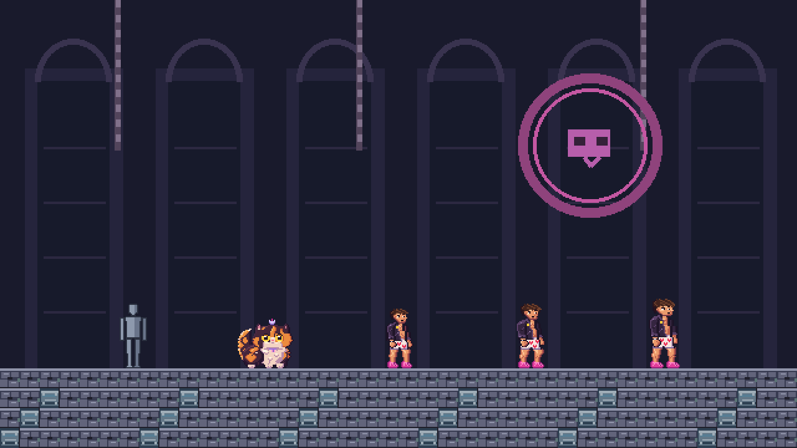
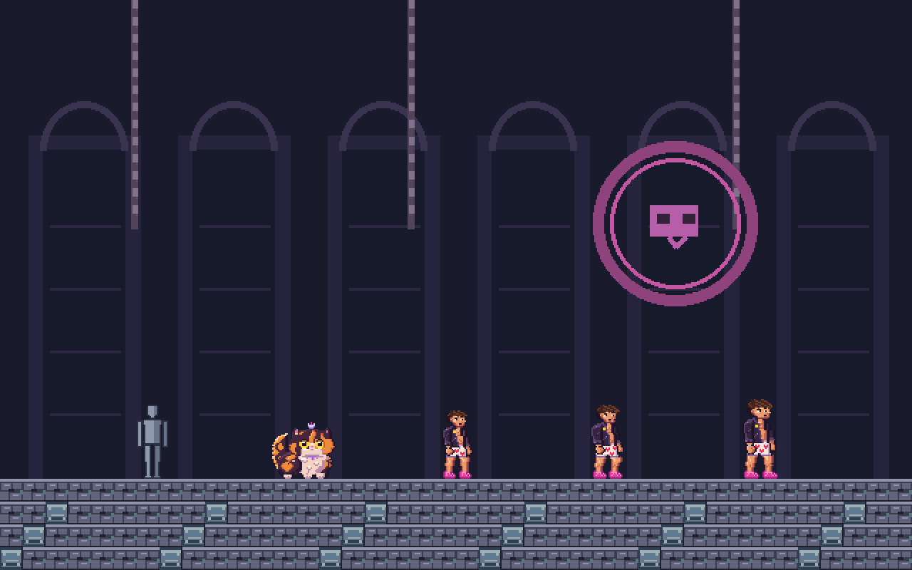
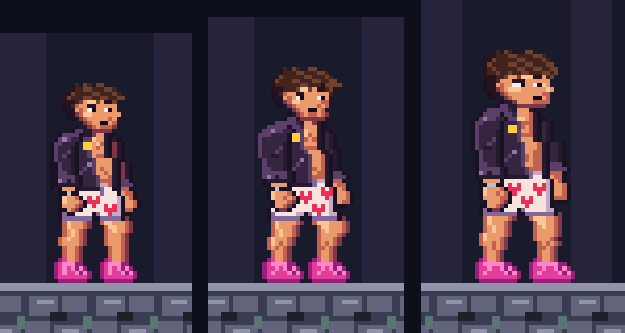
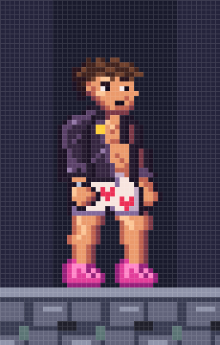
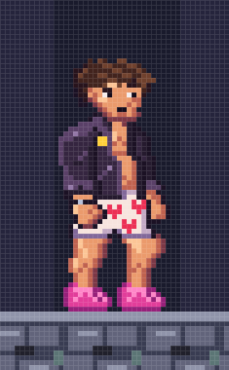
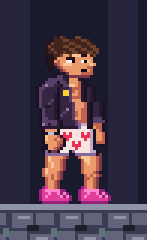
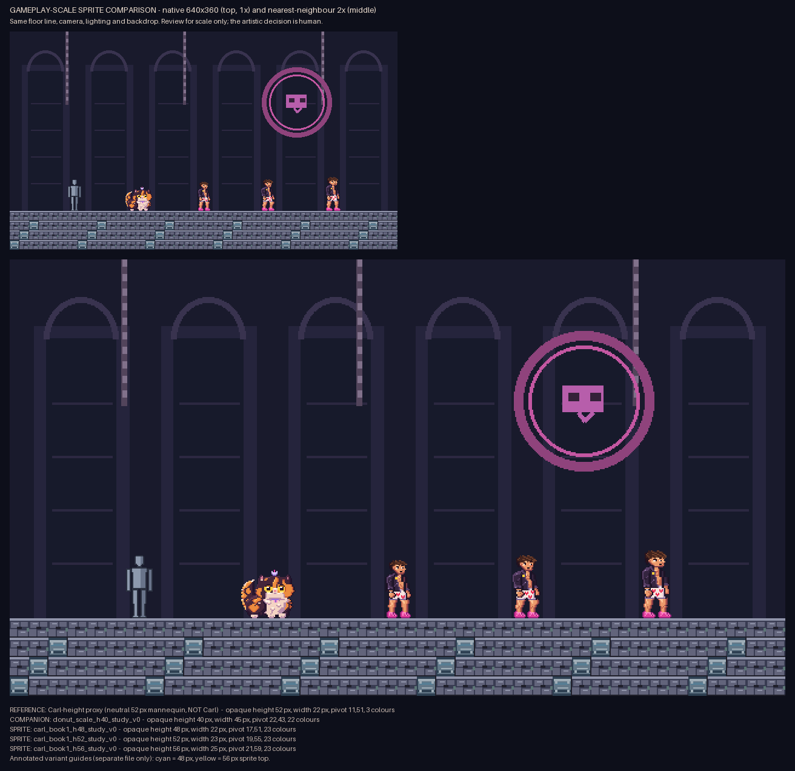
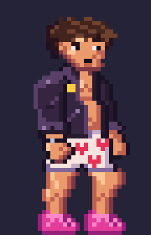
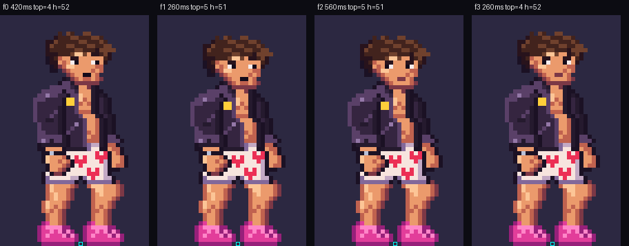
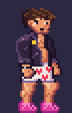

# Carl, Book 1 "Survivor": native pixel scale study

**Status:** three native-resolution studies (48, 52, 56 px) and one four-frame idle prototype at 52 px, **awaiting human artistic review**. Nothing here is a locked production sprite, and this document does not decide the scale. The scale below is a **proposal** for the reviewer.
**Branch:** `art/carl-book1-sprite-scale` (stacked on `art/donut-floor1-scale-study`, PR #18). **Evidence commit:** `957270e`.
**Rights:** publication of these sources and renders is covered by the owner-reported record `ART-PUBLICATION-ALL-V1` in [`rights-and-release.md`](../04-production/rights-and-release.md). That record is not verified rightsholder consent and grants no reuse licence.
**Creative canon:** Carl follows [`antihero-tone.md`](../01-design/antihero-tone.md): a believable, plain everyman, out of his depth, in Book 1 costume (near-black leather jacket worn open, heart-print boxers, pink Crocs).

## Method

- **Source format:** `pixel-grid-v1` text grids (`carl_h{48,52,56}.grid.json`), layers bottom to top `far_arm, legs, shoes, torso, boxers, jacket, head, hair, near_arm, watch, pin`. `scripts/pixel_grid_to_ase.py` builds the editable `.ase` master from each grid, and `scripts/export_assets.sh` exports atlas PNG and metadata through the existing toolchain.
- **Per-size native authoring:** each size was drawn separately on its own grid. No size is a resample of another. They share a design plan (pose, palette, layer map, costume decisions) but not pixels. No pixel comes from the concept board or its tiny mock sprites. The board was used only as enlarged crops for costume, pose and head shape.
- **No resizing, no board pixels:** all renders in this study are nearest-neighbour integer enlargements of the exported pixels. No smoothing is applied anywhere.
- **Rounds:** round 1 (Sonnet) was **rejected**: a mid-brown jacket instead of near-black leather, a spiky anime crest instead of a tousled mop, a weak face, hearts that read as red "Y"/"T" shapes, and a stiff, symmetric front-on pose with a fist clutching the waist. Round 2 (Opus) replaced every pixel of round 1 and is the committed work. The per-size critique log (about 9 rounds at 52, 6 at 56, 5 at 48) is in [`STYLE_NOTES.md`](../../assets/source/characters/carl/STYLE_NOTES.md).
- **Gates:** `lint --strict --expect-height N` passes for all three (exact opaque heights, contact row equals pivot y, 0 orphan pixels, 0 isolated pixels, 0 px bottom-row drift). The shared 23-colour palette is within the 24-colour limit. Every pixel is fully opaque and there is no antialiasing.
- **Shared design:** the same roughly 45 degree three-quarter pose at every size, with the head turned further toward the camera for a wary sideways glance, weight on the near leg, a relaxed far knee, both arms hanging (no fist at the waist), the same costume map and the same light direction (upper left front, shared with Donut). Per-size pixel budgets and what each size simplified are in `STYLE_NOTES.md`.

## Sources, manifests and reproduction

| Size | Grid source | Editable master | Manifest |
| --- | --- | --- | --- |
| 48 | `assets/source/characters/carl/carl_h48.grid.json` | `assets/source/characters/carl/carl_h48.ase` | `assets/manifests/carl_book1_h48.json` |
| 52 | `assets/source/characters/carl/carl_h52.grid.json` | `assets/source/characters/carl/carl_h52.ase` | `assets/manifests/carl_book1_h52.json` |
| 56 | `assets/source/characters/carl/carl_h56.grid.json` | `assets/source/characters/carl/carl_h56.ase` | `assets/manifests/carl_book1_h56.json` |

The three manifests join the scale-study group `carl_book1`. Palette, pose, layers, proportions and the critique log are in [`STYLE_NOTES.md`](../../assets/source/characters/carl/STYLE_NOTES.md).

Reproduce everything (from the repository root; `ART_CLI` is an Aseprite or LibreSprite CLI executable):

```bash
ART_CLI=/path/to/aseprite-or-libresprite bash scripts/export_assets.sh
```

This rebuilds the `.ase` files from the grids, exports atlases, validates them, and writes the comparison scene, close-ups, contact sheet, `comparison.json` and the idle GIFs under `generated/art/` (git-ignored). The committed copies of the review images, their regeneration notes and checksums are in [`docs/evidence/carl-book1-scale-study/`](../evidence/carl-book1-scale-study/README.md).

## Evidence

All three candidates stand on the same floor line, under the same camera and backdrop, beside the neutral 52 px mannequin and the Donut 40 px companion. The mannequin is **not Carl**. This is a native-scale pixel review, not gameplay capture and not an in-engine check. Mongo is not in the scene; his relation is calculated from the provisional 64-88 px range.

Native 640x360 scene at 1x (left to right: mannequin, Donut 40, Carl 48, 52, 56):


The same scene at nearest-neighbour 2x (1280x720):



Steam Deck-class framing (640x400 native, 2x):



6x close-ups side by side (48, 52, 56), no smoothing:



Per-size 6x close-ups with a pixel grid, for pixel-level review:

| 48 px | 52 px | 56 px |
| --- | --- | --- |
|  |  |  |

Contact sheet (1x and 2x scenes with actor labels):



What is visible in the 2x scene and the side-by-side close-ups:

- In the 2x scene Carl reads as a dark-haired figure in a near-black jacket with a yellow dot, a skin chest strip, white boxers with red marks, skin legs and bright pink Crocs. The pink Crocs and the boxers are the strongest identity cues at every size.
- In the close-ups the face is plain and slightly bewildered at all three sizes: a low near brow, a raised far brow, eye whites with pupils toward the right and a small open mouth. The hair is a tousled brown mop rather than a spiky crest.
- The 48 px figure is the stockiest and simplest. 56 px is the leanest and has the clearest face and hands. 52 px sits between them.

## Evaluation matrix

Measured values come from `generated/art/scale_study/carl_book1/comparison.json` (opaque height, width, canvas, pivot) and from `STYLE_NOTES.md` (opaque pixels on frame 0; they match the exported atlases: 731, 837, 977). Ratios use Donut 40 (the companion in the scene), Donut 32 (proposed by PR #18) and Mongo's provisional 64-88 px from [`art-direction.md`](art-direction.md). Cells that describe appearance are visual review notes, not verdicts.

| Criterion | 48 px | 52 px (proposed) | 56 px |
| --- | --- | --- | --- |
| Face readability at 1x / 2x | Every feature is 1-2 px (2x1 eyes, 2 px brows, 1 px nose tip, 2 px mouth). At 1x it is skin tone with dark dots, not a face. At 2x brows and open mouth read, but this size would be first to collapse in motion. | 2x1 eyes with white and pupil, 2 px brows with the far brow raised, 2 px open mouth. At 1x it is a skin patch with a dark mouth dot. At 2x it reads as a face with brows, both eye whites and an open mouth. | 3x1 wide near eye, modelled nose (lit ridge, tip, underside shadow) and lower jaw. Most expressive: the wary glance reads best here, at 1x as well as 2x. The face is longer and the jaw heavier, drifting slightly toward a leading-man head. |
| Silhouette / hair | 22 px wide, head 12 rows (25 %), 4-row hair cap with three swept strand runs. Stockiest silhouette at 1x. Hair reads as a brown cap at 1x. | 23 px wide, head 13 rows (25 %), 5 rows of hair above the forehead, 88 hair pixels. Tousled mop at 2x, a brown cap at 1x. Slightly slouched, ordinary build. | 25 px wide, head 14 rows (25 %), 6 rows of hair, 109 hair pixels. Best mop shape, but a leaner, taller figure that is the least "ordinary guy". |
| Iconic costume (jacket, heart boxers, pink Crocs, smiley pin, watch) | Jacket reads black leather with a pocket glint. Only two hearts, which read as red specks. Crocs read pink (9 px long). Pin is 2x2 yellow. Watch is a 5 px band with a 1 px face. | Three hearts (`R.R / RRR / .R.` on off-white), creases, collar and lapel. Hearts are specks at 1x, "v" marks at 2x, hearts from 4x. Crocs 10 px with holes and strap. Pin 2x2 yellow. Watch is a 6 px band with a 1 px face. | Three hearts, richest hands and watch (2 px face). Crocs 11 px. Pin is still 2x2 yellow, with no room for a smiley. |
| Contact / pivot | Canvas 36x52, pivot [17, 51] in the manifest. The true feet centre is x.5, so the pivot is a half-pixel rounding. Contact row 295 in the scene. | Canvas 36x56, pivot [19, 55]. Pivot x is exact (Croc soles at 13.5 and 24.5 give 19). Same contact row 295 and 0 px bottom-row drift across the four idle frames. | Canvas 40x60, pivot [21, 59] in the manifest. The true feet centre is x.5, so the pivot is a half-pixel rounding. Same contact row 295. |
| Size relation to Donut and Mongo | Donut 40 = 83 % of Carl (Donut 32 = 67 %). Mongo 64-88 = 1.33-1.83x Carl. Donut 40 is nearest to Carl's height here. | Donut 40 = 77 % of Carl (Donut 32 = 62 %). Mongo 64-88 = 1.23-1.69x. Donut stays clearly smaller, Mongo clearly bigger. | Donut 40 = 71 % of Carl (Donut 32 = 57 %). Mongo 64-88 = 1.14-1.57x. Against Mongo 64 the ratio is only 1.14, so Mongo would want about 72 px or more to keep his mass. |
| Clutter / lighting on the dark backdrop | Near-black jacket sits close to the `#191a2c` backdrop. Only sheen and glint pixels separate the jacket. White boxers and pink Crocs carry the figure. | Same issue, softened: the near sleeve has a lit sheen rim instead of a dark outline on its left edge (21 px changed in the polish pass). The far sleeve still relies on sheen and glint pixels. | Same as 48, with more sheen and glint pixels available. The larger figure holds the backdrop best at 2x. |
| Authoring cost (opaque pixels, frame 0) | 731 px (87 % of 52). Lowest cost, but the fewest pixels for expression. | 837 px (the reference). Moderate. Already carries a four-frame idle (0 / 199 / 198 / 11 changed px per frame against frame 0). | 977 px (117 % of 52, +140 px). Highest cost for every future frame, expression and animation set. |

## Proposed scale: 52 px (not locked)

**Proposal:** 52 px opaque height (contact row to hair top), for **human artistic review**. It is not accepted, not locked, and no production animation set should be started on it until a human decides.

Reasoning:

- It is the best balance of face, costume and silhouette. At 2x the face reads as a face (brows, both eye whites, open mouth), three hearts read as hearts at 4x, and both hands are readable.
- The stocky, slightly slouched body reads as an ordinary guy rather than an athlete, which suits the everyman rule. 56 drifts toward a leaner, leading-man read.
- It keeps Donut 40 at 77 % and Mongo at 1.23-1.69x, so the cast stays in order (Donut smaller, Carl middle, Mongo bigger).
- It costs about 14 % fewer opaque pixels per frame than 56, and it is the only size with evidence that pivot and costume hold through an animation (the 4-frame idle).
- The mannequin proxy and the existing guides already assume a 52 px Carl, so no document needs a range change to adopt it. If a human picks 56, check the Mongo and Donut ratios again.

If the reviewer prefers a stronger face at gameplay distance, 56 is the credible alternative. 48 is the cheapest but loses the face first.

## Idle prototype (52 px only)

Four frames in `carl_h52.grid.json`, tag `idle` 0-3 forward, durations 420 / 260 / 560 / 260 ms (1500 ms loop). Every frame is derived from frame 0 by scripted, listed edits. No frame is redrawn independently and no limb is rotated.

| Frame | Duration | Change from frame 0 | Changed px |
| --- | --- | --- | --- |
| 0 | 420 ms | master: chest up, bewildered face (raised far brow, open mouth, eyes looking right) | 0 |
| 1 | 260 ms | exhale: row 26 is dropped and every layer row above it moves down 1 px, so head, hair, shoulders, chest, collar, pin and upper sleeves settle by 1 px | 199 |
| 2 | 560 ms | frame 1 plus an irritated side-glance: pupils swap to the back of the eye, the far brow drops to a level scowl, the open mouth closes to a flat 2 px line | 198 |
| 3 | 260 ms | frame 0 (chest back up) still holding the glance edits from frame 2 | 11 |

- **Beat:** startled, then "...seriously?" He settles, side-eyes back over his shoulder, straightens, and the face resets to bewildered at the loop. The body bob and the face change never happen on the same frame.
- **Fixed parts:** nothing at or below row 27 changes in any frame (cuffs, hands, watch, boxers, hearts, legs, Crocs). Contact row 55 is identical in all frames, the pivot stays [19, 55], and lint reports 0 px bottom-row drift.
- **Height:** frame 0 is exactly 52 px. Frames 1 and 2 measure 51 because the head bobs down 1 px.
- Reviewed as GIFs at 1x and 4x: no jitter in hands or feet and no shimmer in the jacket. The 1 px drop is visible at 4x and just perceptible at 1x.

Exported preview from the pipeline (the exporter's preview scale):



Scratch review renders (not produced by a committed script): the four frames at 6x, then the loop at 4x on `#2c2841`.





## Run readiness

**A 6-frame run is not done and is not started.** The 52 px master is a three-quarter idle, not a locomotion pose. From `STYLE_NOTES.md`, a 6-frame run would need:

- **Profile torso:** rotate the torso from about 45 degrees to near profile. The open jacket then shows as a front panel edge, a sliver of chest and a swinging hem. The pin moves to the visible front panel.
- **Profile head:** a one-eye head built from the 52 face parts (low brow, eye white plus pupil, nose tip past the face line), not the current camera-facing glance.
- **Arm and leg layers:** complete shoulder-to-hand cels for both arms. The thighs must be drawn up to the waist, since they are currently filled only about 3 rows under the boxer hem.
- **Crocs:** a second, foreshortened push-off pose plus the planted version. Contact row and pivot rules stay as in the idle, with an awkward, slightly heavy stride rather than an athletic one.
- **Bob:** reuse the idle's row-drop technique for the 1 px body bob instead of redrawing.

## Known weaknesses

- **Hearts at 1x:** red specks. At 2x only "v"-ish marks. They read as hearts at 4x and above. `R.R / RRR / .R.` is the smallest heart with a notch, and a larger heart means re-laying out the whole print.
- **Pin and watch:** the pin is a plain 2x2 yellow square. The watch is a dark band with a light 1 or 2 px face.
- **Hair at 1x:** a brown cap. It reads as a tousled mop only from 2x.
- **Jacket on the dark backdrop:** the near-black leather and the `K` outline are close to `#191a2c`. Only 52 has the lit sleeve rim. The far sleeve and the 48 and 56 masters rely on sheen and glint pixels.
- **Legs and Crocs:** simple ramps with little calf or knee modelling. Both Crocs share one design, with no individual wear.
- **Pose:** three-quarter idle, not the profile body that `walk` and `run` need. The near hand also covers the near side of the boxers.
- **Pivot rounding:** at 48 and 56 the pivot is a half-pixel rounding of the true feet centre.
- **Idle:** one 1 px body step, so the settle is a pop rather than an ease. 48 and 56 have no idle beyond one static frame.
- **Evidence limits:** the Donut companion is the Donut 40 study master and PR #18 now proposes Donut 32, so the Donut relation in the scene may change. The mannequin is not Carl. No human has judged game feel at these scales, there is no in-engine (Bevy) check, and no performance or Steam Deck claim is made. The two scratch idle renders are not produced by a committed script.

## Open canon questions

1. **Sleeves:** pushed up past mid-forearm, as on the concept board, or full-length and bunched at the lower forearm, as drawn here? The brief asked for full-length sleeves plus a visible watch, so this is an **interpretation** flagged for owner review.
2. **Crocs design detail:** the bible only says "appropriate early-story pink Crocs". Model, colour, holes, heel strap and wear are not specified. All three sizes use one magenta-pink design with hole hints and a strap.
3. **Smiley pin:** a concept-board element kept per owner direction, not book-verified, and at this scale only a 2x2 yellow square with no smiley face. Is it book canon, which side of the jacket carries it, and is a smiley even wanted if it cannot be drawn? The `pin` layer can be dropped without touching the jacket.
4. Is the open jacket with nothing underneath canon for the opening chapters?

## Next steps

1. **Human artistic review** of the 1x scene, the 2x scenes and the close-ups, and a decision on the scale (48, 52, 56 or a rework). Record the decision as an ADR or in the backlog.
2. **Resolve the canon questions** above (sleeves, Crocs, pin), since the pin and sleeves change pixels at every size.
3. **If 52 px is approved:** update the Carl-relative height guides, and recheck Donut (40 or 32 from PR #18) and Mongo against it. If 56 wins, Mongo needs about 72 px or more.
4. **Plan the profile body and head** needed for `walk` and `run` before committing to a larger animation set (see Run readiness).
5. **Address the weaknesses** on the chosen size (jacket separation from the backdrop, hair read at 1x, a longer idle ease).
6. **In-engine check:** view the chosen size in a Bevy pixel-camera scene on real backgrounds and under FX once the runtime exists, and keep the work order open until a human signs off at 1x and 2x.
