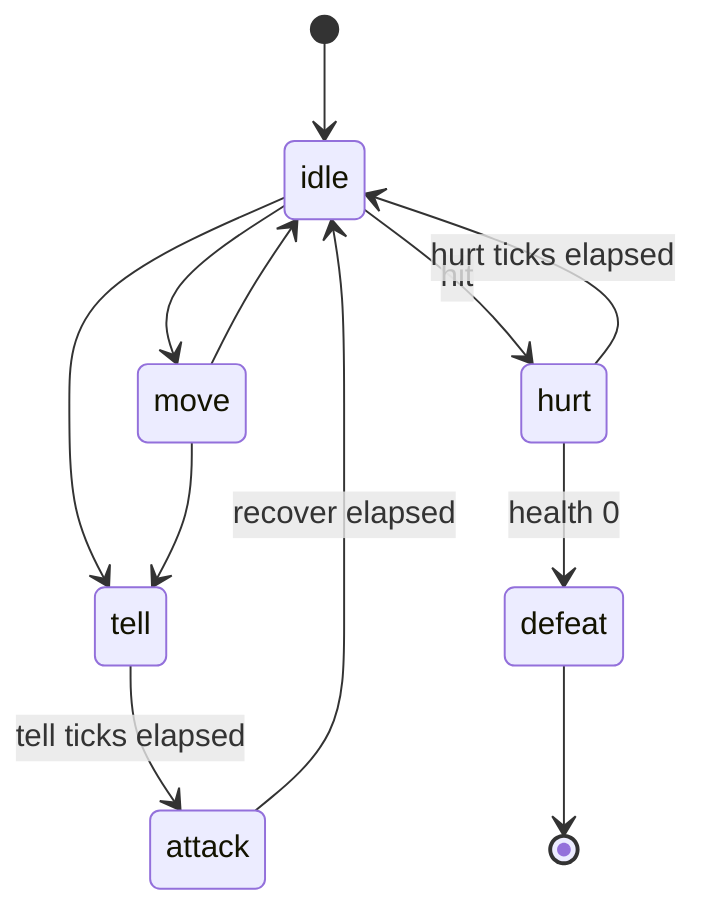

# CHOP-01: Goblin Copper Chopper readability set, design spec

**Status:** packet ready; design pending. Execution pending. Review pending.

**Decision record:** height <fill> px, frame <fill> x <fill>, pivot (<fill>, <fill>). Proposed by <fill>; decided by <fill>.

The sections follow `docs/02-art/gob-01-goblin-spec.md`. Replace every `<fill: ...>`; write numbers, not adjectives. The design step stops at the keys and this spec (see the top-tier budget in `docs/07-agents/agent-orchestration.md`).

## 1. Canon and tone constraints

- Approved concept: `assets/concept/floor-01/enemies/floor01-goblin-copper-chopper-concept-approved.png`; `docs/02-art/floor-01-minor-enemy-concepts.md` records it as an owner-approved **light steam-powered goblin motorcycle/sidecar direction**, distinct from the tracked Murder Dozer: copper tubes, patched sheet metal, compact boiler, smoking exhaust, crooked headlight, exposed engine and shaky sidecar. Native production pending.
- Tone (`docs/01-design/antihero-tone.md`, enemies row): threatening yet eccentric, with motivated behaviors and readable tells and some absurd visual contrasts; never a purely serious faceless army and never comedic with no danger. 1980s-1990s action cinema is used for attitude only, never copied designs.
- Canon facts that must survive in pixels (from the approved docs and the concept board, not design decisions):
  - A **vehicle encounter, not a new humanoid species**: a goblin driver and a sidecar passenger (goblin family) on a steam-powered chopper with a sidecar.
  - Reads as a light, fast, shaky machine, clearly different from the tracked, heavy Murder Dozer, whose visual identity and setpiece are preserved.
  - Copper and patched rust-red sheet metal, copper tubing, boiler glow, smoking exhaust.
- Design reading of the tone: <fill: how the Chopper reads as a nasty, eccentric, slightly ridiculous threat, never a heroic design>.

### Vehicle and contraption parts visible on the board

Facts read from the board, not design decisions (the designer chooses which become separate layers or atlas parts):

| Part | Where on the board |
| --- | --- |
| Front wheel, rear wheel (chunky tyres, spoked copper hubs) | side, front, rear and motion views |
| Forks, long raked handlebars | side view |
| Headlight in a copper cage, crooked, glowing orange | front view, key details |
| Boiler / firebox with glowing grille behind the driver, copper pipework | key details, side view |
| Exhaust stack with smoke | all views |
| Exposed engine with chain and gears | key details, side view |
| Sidecar tub with a skull plate on patched red sheet metal, rope lashing, its own wheel | all views, key details |
| Crew: driver (goggles, helmet, red scarf), sidecar rider with a spiked club | crew panel |

### Projectiles and VFX on the board

- Projectiles: none. The sidecar rider's spiked club is a held melee weapon, and the passenger weapon is a provisional illustration (see guardrails).
- VFX and special states: exhaust smoke plume, dust kick-up behind the wheels, glowing headlight and firebox, a drift/powerslide dust cloud and speed streaks, a crash/topple panel with ground sparks and flying debris (bolts, a gear, a plate, goggles) and ejected crew. All of it is beyond the readability set.

### Shared parts with GOB-01 and the DOZ-01 rider

- The board labels both crew as the goblin family. GOB-01 (`assets/source/characters/goblin/goblin_a_h36.*`, 36 px, `docs/02-art/gob-01-goblin-spec.md`) is the base body reference. DOZ-01 already has seated rider sprites on main (`assets/source/enemies/dozer/dozer_riders_h36.*`: engineer, rider A, rider B at 36 px, 64 x 56 frames, GOB-01 pixels and palette, seat-point pivot (28, 55)); whether the Chopper crew reuses that construction, the palette, or is redrawn is a design decision (<fill>). The Chopper driver wears goggles, a helmet and a red scarf, which the DOZ-01 riders do not; the Bomb Bard (BARD-01) is not on main yet and is not in the lineup.
- Vehicle parts do not come from the Dozer. The Dozer is a tracked h120 machine drawn as layered parts (`assets/source/enemies/dozer/`, 39 machine colours, 7 of them smoke; `docs/02-art/doz-01-dozer-spec.md` section 3), and the board says to keep its identity. Material language (rust, copper, boiler, smoke) is shared; a shared smoke part (`dozer_smoke`) is possible but undecided (<fill>).

### Guardrails (copied from the minor-enemy docs)

- This is a vehicle encounter, not a new humanoid species. The passenger weapon, exact crew count, vehicle width, speed, collision radius, crash damage and scriptable pursuits are provisional illustrative ideas; derive no combat rules from the illustration.
- The opening goblins carry pineapples on sticks; the board's spiked club is not an approved weapon for them. The Engineer is not turned into a turret or mine-layer.
- Preserve the opening Dozer's visual identity and setpiece. Printed labels (`UNSTABLE!`) and scale comparisons are not decisions.
- Chopper width needs native 640 x 360 review against Carl 52 and Donut 40. Convert from original editable pixel grids / `.aseprite`, never by tracing or cropping the board.

### Packet inputs

- Concept crops in `docs/evidence/chop-01/packet/` (x,y,w,h in the 1672x941 concept):
  - `concept_crop_1.png` = `10,105,790,440`: hero view, driver and sidecar rider in motion
  - `concept_crop_2.png` = `785,115,240,200`: front view
  - `concept_crop_3.png` = `1040,75,245,235`: rear view
  - `concept_crop_4.png` = `1300,85,350,235`: side view, clean (no crew)
  - `concept_crop_5.png` = `845,375,160,170`: crew, driver
  - `concept_crop_6.png` = `1010,390,185,160`: crew, sidecar rider
  - `concept_crop_7.png` = `1225,360,430,205`: key details and construction (headlight, firebox, stack, engine, pipes, skull plate, rope)
  - `concept_crop_8.png` = `15,590,505,335`: in motion, drift / powerslide (dust VFX)
  - `concept_crop_9.png` = `535,590,530,335`: crash / topple (sparks and debris; reference for states only, not a mechanic)
  - The Floor 01 catacomb context panel is not cropped.
- `scale_lineup.png`: Carl 52, Donut 40, GOB-01 goblin 36, plus three empty candidate slots at 44, 52 and 60 px. The candidates are overall heights from the ground to the driver's helmet top, from a by-eye estimate that the seated driver is about 26 to 30 px, which gives about 40 to 45 px, and a wider sidecar machine about 75 to 100 px long. These are estimates to be tested, not approved sizes; the lineup has no slot for length, so the designer must also decide the width. The default 64 x 56 frame in `frame_pivot_template.json` is a placeholder only and too narrow for a sidecar machine.
- Readability set (tags): `idle` (2-4), `move` (4-6), `tell` (1-2), `attack` (2-3), `hurt` (1), `defeat` (2-3); about 12 to 20 frames. Concrete tag names and frame counts are the designer's choice (section 4 and `frame_pivot_template.json` carry the toolkit defaults).

## Difficulty and route

**Score 4 of 4: Hard, route B + silhouette gate** (medium tier drafts size, palette, all keys and the spec; a fresh top-tier editor corrects and freezes them; a fresh top-tier agent runs the silhouette gate on the idle key before any other key or in-between).

| Point | Met | Note |
| --- | --- | --- |
| 1. New design, not a variant | yes | A new vehicle; neither the Dozer nor a goblin variant |
| 2. Native height above about 40 px | yes | Candidates 44, 52, 60 px, and a longer body |
| 3. Complex anatomy or construction | yes | Vehicle with two wheels, sidecar, boiler and crew |
| 4. VFX, projectiles, special states | yes | Smoke, dust, drift, crash with sparks and debris |

Reasoning: every point is met, so the honest score is 4, which matches the expected Hard class. Point 4 would drop if the crash/topple and dust states were deferred, giving 3, which stays Hard.

## 2. Size decision

Carl is 52 px (about 6 ft), Donut 40 px, the goblin 36 px (see `scale_lineup.png`).

| Option | Idle opaque height | Ratio to Carl | Implied real height | Why / why not |
| --- | --- | --- | --- | --- |
| A | 44 px | <fill> | <fill> | <fill> |
| B | 52 px | <fill> | <fill> | <fill> |
| C | 60 px | <fill> | <fill> | <fill> |

Decision: <fill: height and the reason, one paragraph; the proposer and the decider are different agents>.

## 3. Frame, pivot, boxes and atlas

- Frame <fill> x <fill>, pivot (<fill>, <fill>), contact row <fill> (the lowest opaque row of every grounded frame).
- Grounded tags: <fill>. Airborne tags (no pixel on the contact row): <fill or none>.
- Standing box <fill> x <fill>; hurtbox <fill>; attack hitbox <fill> on the impact frame.
- Authored facing right; the runtime mirrors around the pivot column.
- One atlas, frames 0 to <fill>, layers: <fill: for example body, weapon>.

## 4. Readability-set animation list

Readability set: idle, move, tell, attack, hurt, defeat (about 12 to 20 frames until the asset has a gameplay work order). Tick windows are at 60 Hz.

| Role | Tag | Frames | Playback | Tick-window proposal | Reference |
| --- | --- | --- | --- | --- | --- |
| idle | `idle` | 2-4 | loop | 8-12 ticks per frame, a 32-40 tick breathing cycle | GOB-01: 12 + 8 + 12 + 8 |
| move | `walk` | 4-6 | loop | 5 ticks per frame, speed from the gameplay spec | GOB-01: 6 x 5 = 30 ticks |
| tell | `attack_tell` | 1-2 | once | at least 18 ticks of readable hold, about 24 total | GOB-01: 6 + 18 |
| attack | `attack_swing` | 2-3 | once | smear 2, impact 3-4 (shown on exactly the hitbox-active ticks) | GOB-01: 2 + 4, then recover 20 |
| hurt | `hurt` | 1 | once | 8-12 ticks | GOB-01: 4 + 8 |
| defeat | `down` | 2-3 | hold | floor impact 4, settle 8, then a state-driven hold | GOB-01: 4 + 8 + hold |

Frame table (`frame_pivot_template.json` carries the same rows):

| # | Tag | Pose | Ticks | Author |
| --- | --- | --- | --- | --- |
| 0 | `idle` | <fill: pose> | 12 | <fill: key or Sonnet> |
| 1 | `idle` | <fill: pose> | 8 | <fill: key or Sonnet> |
| 2 | `idle` | <fill: pose> | 12 | <fill: key or Sonnet> |
| 3 | `walk` | <fill: pose> | 5 | <fill: key or Sonnet> |
| 4 | `walk` | <fill: pose> | 5 | <fill: key or Sonnet> |
| 5 | `walk` | <fill: pose> | 5 | <fill: key or Sonnet> |
| 6 | `walk` | <fill: pose> | 5 | <fill: key or Sonnet> |
| 7 | `attack_tell` | <fill: pose> | 6 | <fill: key or Sonnet> |
| 8 | `attack_tell` | <fill: pose> | 18 | <fill: key or Sonnet> |
| 9 | `attack_swing` | <fill: pose> | 2 | <fill: key or Sonnet> |
| 10 | `attack_swing` | <fill: pose> | 4 | <fill: key or Sonnet> |
| 11 | `hurt` | <fill: pose> | 4 | <fill: key or Sonnet> |
| 12 | `hurt` | <fill: pose> | 8 | <fill: key or Sonnet> |
| 13 | `down` | <fill: pose> | 4 | <fill: key or Sonnet> |
| 14 | `down` | <fill: pose> | 8 | <fill: key or Sonnet> |
| 15 | `down` | <fill: pose> | hold | <fill: key or Sonnet> |

## 5. State diagram



## 6. Palette

Palette reference: the Dozer machine palette `dozer-floor01-v0` (39 colours) and the GOB-01 palette `goblin-floor01-v0` (at most 20 colours per atlas; 59 union at most 64, see `docs/02-art/doz-01-dozer-spec.md` section 4) are the nearest approved ramps for copper, rust and goblin skin. Whether the Chopper reuses them is a design decision (<fill>); the Chopper reads lighter and more orange-copper than the Dozer on the board.

At most <fill: 20> colours. Candidates from the concept crop (median cut, by pixel share; see `palette_candidates.json`). These are candidates, not decisions.

| # | Candidate | Share | Decision (key, name, role) |
| --- | --- | --- | --- |
| 1 | `#12131e` | 26.7 % | <fill: key, name, role> |
| 2 | `#131420` | 5.0 % | <fill: key, name, role> |
| 3 | `#12141f` | 4.7 % | <fill: key, name, role> |
| 4 | `#161521` | 4.4 % | <fill: key, name, role> |
| 5 | `#bd865c` | 4.3 % | <fill: key, name, role> |
| 6 | `#983726` | 4.3 % | <fill: key, name, role> |
| 7 | `#4c1d1d` | 4.2 % | <fill: key, name, role> |
| 8 | `#77574a` | 4.1 % | <fill: key, name, role> |
| 9 | `#251b24` | 4.1 % | <fill: key, name, role> |
| 10 | `#683530` | 4.0 % | <fill: key, name, role> |
| 11 | `#e3be83` | 3.5 % | <fill: key, name, role> |
| 12 | `#3c2b31` | 3.5 % | <fill: key, name, role> |
| 13 | `#b25e41` | 3.4 % | <fill: key, name, role> |
| 14 | `#523234` | 3.2 % | <fill: key, name, role> |
| 15 | `#11111a` | 3.1 % | <fill: key, name, role> |
| 16 | `#05050a` | 3.1 % | <fill: key, name, role> |
| 17 | `#191726` | 2.8 % | <fill: key, name, role> |
| 18 | `#2f0e13` | 2.7 % | <fill: key, name, role> |
| 19 | `#0a0b16` | 2.3 % | <fill: key, name, role> |
| 20 | `#110c14` | 2.2 % | <fill: key, name, role> |
| 21 | `#15121d` | 1.9 % | <fill: key, name, role> |
| 22 | `#15151e` | 1.3 % | <fill: key, name, role> |
| 23 | `#121320` | 1.0 % | <fill: key, name, role> |
| 24 | `#12141a` | 0.3 % | <fill: key, name, role> |

The chosen palette must separate this asset from the warm brick and the cold arch of Floor 1 at 1x, and fit the A1 lighting.

## 7. Key poses

One key per readability tag (about 6 to 8 keys): idle 0, move contact, tell hold, attack impact, hurt, defeat. Each key lists silhouette, joint positions, palette use and the readability reason. Keys are frozen once the review passes (`pixelart freeze`).

| Frame | Tag | Silhouette and pose notes | Readability reason |
| --- | --- | --- | --- |
| <fill> | <fill> | <fill> | <fill> |

## 8. In-between list

For the execution tier; no design decisions needed. One row per non-key frame, as in section 9 of the GOB-01 spec.

| # | Pose notes |
| --- | --- |
| <fill> | <fill> |

## 9. Validators and readability rules

Run by `python3 -m scripts.pixelart validate <asset-config>` (rules V01 to V15 in `scripts/pixelart/validators.py`). Parametrize in the asset config:

- V04 palette: at most <fill> colours; V05 isolated pixels: 0; V06 orphan pixels: at most <fill> per frame.
- V07/V08 contact rows: grounded tags end on the contact row, airborne tags never touch it.
- V09 frozen keys: SHA-256 per key frame, fixture `tests/fixtures/chop-01_keys.json`.
- V13/V14 readability rules (write each as a bbox or key-count rule): <fill: for example the tell is the highest point, the hurt eyes are white>.

## 10. Evidence

```text
python3 -m scripts.pixelart validate <asset-config> --out <dir>
python3 -m scripts.pixelart evidence <asset-config> --out <dir>
python3 -m scripts.pixelart review-pack <asset-config> --out <dir>
```

The review pack holds exactly three images (contact sheet x4, lit scene 640 x 360 shown x3, tell to attack strip) and the validator report.

## 11. Files

| File | Role |
| --- | --- |
| `assets/source/<fill>/chop-01.grid.json` / `.ase` | pixel-grid source and Aseprite master |
| `assets/manifests/chop-01.json` | manifest |
| `<fill>/chop-01.pixelart.json` | the asset config (from `frame_pivot_template.json`) |
| `tests/fixtures/chop-01_keys.json` | frozen keys |

## 12. Rights and provenance

Fan-concept art under the owner-reported `ART-PUBLICATION-ALL-V1` scope (see `docs/04-production/rights-and-release.md`). Record in the PR's `Rights/Provenance` section which model designed, executed and reviewed the art. No tracing of the concept, no image-model raster output.

### Rights/Provenance stub

- Concept: owner-approved reference under `ART-PUBLICATION-ALL-V1`; crops are for reference only, never traced or exported.
- Packet: script output plus a medium-tier executor (stage P).
- Designed by: pending. Executed by: pending. Independently reviewed by: pending.
- No third-party assets, no copied designs or dialogue, no image-model raster output.
