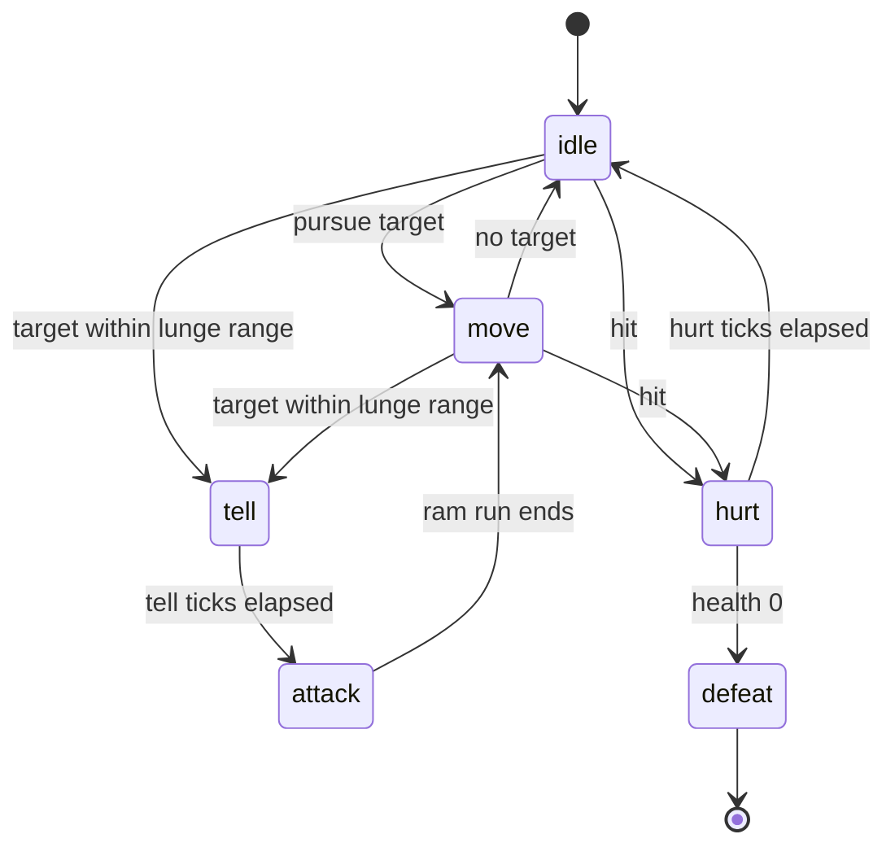

# CHOP-01: Goblin Copper Chopper readability set, design spec

**Status:** design edited; six keys (0, 3, 8, 10, 11, 15) redrawn, silhouette gate fixes applied (section 13), keys re-frozen. Ten in-betweens drawn through the rig (section 8; Executor notes in section 15). Art review pending.

**Decision record:** body height 47 px (opaque idle 52 px with puff), length 95 px, frame 112 x 64, pivot (56, 63); the bike sits in front of the sidecar tub so both bike wheels read; the ram is the only hit; the crew stays baked into the vehicle frames; tell 30 ticks, attack 12 ticks; the wreck is a grounded settle, not a flip; orphan limit 4 (keys at 0). Decided in the design edit (section 13).

The sections follow `docs/02-art/gob-01-goblin-spec.md`.

## 1. Canon and tone constraints

- Approved concept: `assets/concept/floor-01/enemies/floor01-goblin-copper-chopper-concept-approved.png`; `docs/02-art/floor-01-minor-enemy-concepts.md` records it as an owner-approved **light steam-powered goblin motorcycle/sidecar direction**, distinct from the tracked Murder Dozer: copper tubes, patched sheet metal, compact boiler, smoking exhaust, crooked headlight, exposed engine and shaky sidecar. Native production pending.
- Tone (`docs/01-design/antihero-tone.md`, enemies row): threatening yet eccentric, with motivated behaviors and readable tells and some absurd visual contrasts; never a purely serious faceless army and never comedic with no danger. 1980s-1990s action cinema is used for attitude only, never copied designs.
- Canon facts that must survive in pixels (from the approved docs and the concept board, not design decisions):
  - A **vehicle encounter, not a new humanoid species**: a goblin driver and a sidecar passenger (goblin family) on a steam-powered chopper with a sidecar.
  - Reads as a light, fast, shaky machine, clearly different from the tracked, heavy Murder Dozer, whose visual identity and setpiece are preserved.
  - Copper and patched rust-red sheet metal, copper tubing, boiler glow, smoking exhaust.
- Design reading of the tone: a bad-tempered, home-welded contraption crewed by two snarling goblins, one in goggles and a flapping red scarf, one chewing the air with a club. It is a real threat (it rears, rams and chops) made absurd by its parts: a kettle-stack, a crooked lamp, a skull painted on a patched tub, rope holding it together. Nothing about it is sleek or heroic; the glow and the speed are the menace, the scarf and the sidecar are the joke.

### Vehicle and contraption parts visible on the board

Facts read from the board, not design decisions (the designer chooses which become separate layers or atlas parts):

| Part | Where on the board |
| --- | --- |
| Front wheel, rear wheel (chunky tyres, spoked copper hubs) | side, front, rear and motion views |
| Forks, long raked handlebars | side view |
| Headlight in a copper cage, crooked, glowing orange | front view, key details |
| Boiler / firebox with glowing grille behind the driver, copper pipework | key details, side view |
| Exhaust stack with smoke | all views |
| Exposed engine with chain and gears | key details, side view |
| Sidecar tub with a skull plate on patched red sheet metal, rope lashing, its own wheel | all views, key details |
| Crew: driver (goggles, helmet, red scarf), sidecar rider with a spiked club | crew panel |

### Projectiles and VFX on the board

- Projectiles: none. The sidecar rider's spiked club is a held melee weapon, and the passenger weapon is a provisional illustration (see guardrails).
- VFX and special states: exhaust smoke plume, dust kick-up behind the wheels, glowing headlight and firebox, a drift/powerslide dust cloud and speed streaks, a crash/topple panel with ground sparks and flying debris (bolts, a gear, a plate, goggles) and ejected crew. All of it is beyond the readability set.

### Shared parts with GOB-01 and the DOZ-01 rider

- The board labels both crew as the goblin family. GOB-01 (`assets/source/characters/goblin/goblin_a_h36.*`, 36 px, `docs/02-art/gob-01-goblin-spec.md`) is the base body reference. DOZ-01 already has seated rider sprites on main (`assets/source/enemies/dozer/dozer_riders_h36.*`: engineer, rider A, rider B at 36 px, 64 x 56 frames, GOB-01 pixels and palette, seat-point pivot (28, 55)); the decision: the Chopper crew **reuses the GOB-01 palette keys and head construction** (ear, nose, snarl) but is **redrawn seated on the bike** from a parametric rig, not copied from the DOZ-01 rider sprites, whose seat pose and 36 px full-body proportions do not fit a bike lean. The Chopper driver wears goggles, a helmet and a red scarf, which the DOZ-01 riders do not; the Bomb Bard (BARD-01) is not on main yet and is not in the lineup.
- Vehicle parts do not come from the Dozer. The Dozer is a tracked h120 machine drawn as layered parts (`assets/source/enemies/dozer/`, 39 machine colours, 7 of them smoke; `docs/02-art/doz-01-dozer-spec.md` section 3), and the board says to keep its identity. Material language (rust, copper, boiler, smoke) is shared; the decision: `dozer_smoke` is **not** shared; the stack puff is drawn into the vehicle frames in two colours (`i`, `z`).

### Guardrails (copied from the minor-enemy docs)

- This is a vehicle encounter, not a new humanoid species. The passenger weapon, exact crew count, vehicle width, speed, collision radius, crash damage and scriptable pursuits are provisional illustrative ideas; derive no combat rules from the illustration.
- The opening goblins carry pineapples on sticks; the board's spiked club is not an approved weapon for them. The Engineer is not turned into a turret or mine-layer.
- Preserve the opening Dozer's visual identity and setpiece. Printed labels (`UNSTABLE!`) and scale comparisons are not decisions.
- Chopper width needs native 640 x 360 review against Carl 52 and Donut 40. Convert from original editable pixel grids / `.aseprite`, never by tracing or cropping the board.

### Packet inputs

- Concept crops in `docs/evidence/chop-01/packet/` (x,y,w,h in the 1672x941 concept):
  - `concept_crop_1.png` = `10,105,790,440`: hero view, driver and sidecar rider in motion
  - `concept_crop_2.png` = `785,115,240,200`: front view
  - `concept_crop_3.png` = `1040,75,245,235`: rear view
  - `concept_crop_4.png` = `1300,85,350,235`: side view, clean (no crew)
  - `concept_crop_5.png` = `845,375,160,170`: crew, driver
  - `concept_crop_6.png` = `1010,390,185,160`: crew, sidecar rider
  - `concept_crop_7.png` = `1225,360,430,205`: key details and construction (headlight, firebox, stack, engine, pipes, skull plate, rope)
  - `concept_crop_8.png` = `15,590,505,335`: in motion, drift / powerslide (dust VFX)
  - `concept_crop_9.png` = `535,590,530,335`: crash / topple (sparks and debris; reference for states only, not a mechanic)
  - The Floor 01 catacomb context panel is not cropped.
- `scale_lineup.png`: Carl 52, Donut 40, GOB-01 goblin 36, plus three empty candidate slots at 44, 52 and 60 px. The candidates are overall heights from the ground to the driver's helmet top, from a by-eye estimate that the seated driver is about 26 to 30 px, which gives about 40 to 45 px, and a wider sidecar machine about 75 to 100 px long. These are estimates to be tested, not approved sizes; the lineup has no slot for length, so the designer must also decide the width. The default 64 x 56 frame in `frame_pivot_template.json` is a placeholder only and too narrow for a sidecar machine.
- Readability set (tags): `idle` (2-4), `move` (4-6), `tell` (1-2), `attack` (2-3), `hurt` (1), `defeat` (2-3); about 12 to 20 frames. Concrete tag names and frame counts are the designer's choice (section 4 and `frame_pivot_template.json` carry the toolkit defaults).

## Difficulty and route

**Score 4 of 4: Hard, route B + silhouette gate** (medium tier drafts size, palette, all keys and the spec; a fresh top-tier editor corrects and freezes them; a fresh top-tier agent runs the silhouette gate on the idle key before any other key or in-between).

| Point | Met | Note |
| --- | --- | --- |
| 1. New design, not a variant | yes | A new vehicle; neither the Dozer nor a goblin variant |
| 2. Native height above about 40 px | yes | Candidates 44, 52, 60 px, and a longer body |
| 3. Complex anatomy or construction | yes | Vehicle with two wheels, sidecar, boiler and crew |
| 4. VFX, projectiles, special states | yes | Smoke, dust, drift, crash with sparks and debris |

Reasoning: every point is met, so the honest score is 4, which matches the expected Hard class. Point 4 would drop if the crash/topple and dust states were deferred, giving 3, which stays Hard.

## 2. Size decision

Carl is 52 px (about 6 ft), Donut 40 px, the goblin 36 px (see `scale_lineup.png`). The Chopper is a low, long machine, so two numbers matter: the **body height** (floor to the driver's helmet outline, which excludes the stack puff and the raised club) and the **length** (rear tub pipes to the front tyre).

| Option | Body height | Ratio to Carl | Implied real height | Why / why not |
| --- | --- | --- | --- | --- |
| A | 44 px | 0.85 | about 5.1 ft | The seated driver (about 26 px) reads as a toy next to the 36 px goblin on foot, and the stack crowds the helmet |
| B | 47 px (decided; 46 fill + 1 outline row) | 0.90 | about 5.4 ft | Driver's head clears the stack by 2 rows, the bike stays visibly lower than Carl, so Carl can look over and past it |
| C | 52 to 60 px | 1.0 to 1.15 | 6.0 to 6.9 ft | Reads as a truck, competes with the Dozer's role and hides Carl at 640 x 360 |

Decision: **body height 47 px, length 95 px (x 8 to 102 in the idle key), idle opaque height 52 px including the exhaust puff** (stack top row 20, puff rows 12 to 17). Option B keeps the Chopper a "light, fast, shaky machine" against the Dozer's 2.3 times Carl, and 95 px is inside the packet's 75 to 100 px estimate. A 64 x 56 frame is too small. The frame is **112 x 64**: 8 px of margin to the left of the tub pipes, 9 px to the right of the front tyre (the attack lunge uses 7 of them), and headroom above row 4 for the raised club and the tell puff. Kept in the design edit after the 1x check in `key0-scale.png`: next to Carl the bike stays clearly lower (Carl looks over the driver's helmet), it is about 1.8 Carl-widths long, which is a vehicle and not a creature, and the goblin crew reads at the same head size as the 36 px goblin on foot. 52 px or more would compete with the Dozer; 44 px shrinks the crew below the goblin's head size.

Identity against DOZ-01 (the three differences that must survive at 1x):

| Axis | DOZ-01 Dozer | CHOP-01 Chopper |
| --- | --- | --- |
| Silhouette | Tall boxy mass, h120, tracks and a giant roller | Long and low, two big round bike wheels in front of a deep sidecar tub with a small third wheel, a thin vertical stack |
| Palette | Cool riveted iron, 39 machine colours | Warm copper and rust red, glowing firebox and lamp, cold rubber only on tyres |
| Crew and motion | Three riders in a tub, rattles in place | Two crew, one leaning forward over the bars with a streaming red scarf, rears and slams |

## 3. Frame, pivot, boxes and atlas

- Frame **112 x 64**, pivot **(56, 63)**, contact row **63** (the lowest opaque row of every frame; the sidecar wheel, and in the ram the front wheel, sit on it).
- Grounded tags: idle, walk, attack_tell, attack_swing, hurt, down. Airborne tags: none (a wheelie is a pitch about a wheel on the floor).
- Hurtbox (relative to the pivot, y up, 60 Hz game space, **provisional**): x -44 to +44, y 0 to 40 (88 x 40): tub, bike and the crew's bodies; it excludes the helmet top, the stack puff and the club head, so a jump over the bike clears it. It moves with the entity; the 5 px lunge in the attack key is visual only.
- Attack hitbox: **one box, the ram** (front wheel, forks and lamp): x +28 to +54, y 0 to 28 (26 x 28), active on attack ticks 33 to 38 (the first 6 of the 9 impact ticks, see section 4). One hit per attack. The club has **no hitbox**: it is the read, not a rule (guardrail: the passenger weapon is a provisional illustration), and it cannot reach in front of the bike anyway.
- Depth order, far to near: sidecar rider, tub (on the far side of the bike), bike (rear wheel, engine, boiler, stack, fork, front wheel), club, driver. The draft drew the tub over the bike, which hid the rear wheel and made the machine read as a red cart; with the bike in front, two big wheels plus the small tub wheel read at 1x.
- **Crew stays baked into the vehicle frames** (`crew` layer), not separate reusable sprites. Reason: in every key the crew is clipped by and overlaps the machine (rider inside the tub, driver's leg behind the engine, club over the stack), so separate sprites would need per-frame offsets and depth sorting for no readability gain; no other asset reuses this seated pose, and the crash VFX (ejected crew, section 12) is out of scope. If CHOP-VFX-01 later needs flying goblins, it draws them as VFX frames from the `crew` layer of key 11.
- Authored facing right; the runtime mirrors around the pivot column.
- One atlas, frames 0 to 15, layers: `machine` (vehicle, sidecar, smoke, sparks), `crew` (driver, sidecar rider), `weapon` (spiked club). Layers are disjoint per pixel and each key is frozen over all three.

## 4. Readability-set animation list

Readability set: idle, move, tell, attack, hurt, defeat (16 frames). Tick windows are at 60 Hz.

| Role | Tag | Frames | Playback | Ticks | Notes |
| --- | --- | --- | --- | --- | --- |
| idle | `idle` | 3 (0, 1, 2) | loop | 12 + 8 + 12 = 32 | engine ticking over |
| move | `walk` | 4 (3 to 6) | loop | 4 x 5 = 20 | the rolling bike; wheel spokes advance each frame |
| tell | `attack_tell` | 2 (7, 8) | once | 8 + 22 = 30 (500 ms) | rev and rear; the 22-tick hold is key 8 |
| attack | `attack_swing` | 2 (9, 10) | once | 3 smear + 9 impact = 12 | ram slam; hitbox on impact ticks 33 to 38 of the attack |
| hurt | `hurt` | 2 (11, 12) | once | 4 + 8 = 12 | jolted back |
| defeat | `down` | 3 (13, 14, 15) | hold | 6 + 10 + hold | key 15 is the wreck hold |

Tick edit: the draft's attack was 6 ticks (2 + 4), so the impact pose was on screen for 67 ms, shorter than the hurt flash; a ram from a 95 px machine needs its slam held long enough to read as contact and to place the hitbox. Impact is now 9 ticks (150 ms) with the hitbox on the first 6. The tell grows from 24 to 30 ticks (500 ms): this is a large, fast hit on Floor 01, and the GOB-01 jab gets its tell on a smaller body. The ram lunge distance itself is runtime motion, not decided here.

Frame table:

| # | Tag | Pose | Ticks | Author |
| --- | --- | --- | --- | --- |
| 0 | `idle` | upright, club resting back over the shoulder, firebox glowing low, small puff | 12 | key |
| 1 | `idle` | in-between: puff 1 px higher, firebox core out (flicker), rider head 1 px lower | 8 | in-between |
| 2 | `idle` | in-between: machine 1 px lower, scarf droops | 12 | in-between |
| 3 | `walk` | rolling: 1 px lower, driver flat to the bars, scarf streaming, club carried upright | 5 | key |
| 4 | `walk` | in-between: tub back up, fork rebounds, spokes +15 degrees | 5 | in-between |
| 5 | `walk` | in-between: fork at full extension, puff clear of the stack, spokes +30 degrees | 5 | in-between |
| 6 | `walk` | in-between: machine 1 px lower, scarf lifts, spokes +45 degrees | 5 | in-between |
| 7 | `attack_tell` | in-between: pitch +3, driver ducking, club at 125, firebox core half size | 8 | in-between |
| 8 | `attack_tell` | rears 7 degrees, firebox and lamp flare, club straight up, big puff | 22 | key |
| 9 | `attack_swing` | in-between: lunge 2 px, pitch -1, club at 55 with a 1 px iron smear, no sparks | 3 | in-between |
| 10 | `attack_swing` | lunges 6 px, nose slams down, driver prone, rider stands and reaches the club forward over the driver's helmet, spark burst at the front tyre, puff streams back | 9 | key |
| 11 | `hurt` | jolt back, nose pops up, white lenses, O mouths, club flung back | 4 | key |
| 12 | `hurt` | in-between: pitch +1.5, club dropping to 130, lenses stay white | 8 | in-between |
| 13 | `down` | in-between: front tyre bursts, nose down 3 degrees, firebox gutters to `f`, crew pitched forward | 6 | in-between |
| 14 | `down` | in-between: both tyres flat, machine 2 px up off them, stack tipping, dark smoke, gear thrown clear | 10 | in-between |
| 15 | `down` | wreck settled on the floor, leaning toward the tub: tyres burst flat, hull on the floor, stack knocked crooked, fire and lamp out, dark wisp, crew slumped, a loose gear ahead | hold | key |

## 5. State diagram



The lunge distance, speed and cooldown are not decided here (they belong to the gameplay work order). The attack tag covers 12 ticks (smear and impact); the runtime then plays `walk` while the machine carries on.

## 6. Palette `chop-floor01-v0` (19 of 20 colours)

The concept candidates were mostly background navy, so colours were picked by eye. The crew uses the **GOB-01 keys and values** for outline, the skin ramp, eye, tooth, rags (`t`, `u`) and the scarf red (`R`), so the goblins match the opening goblins. The Dozer palette is not reused: the Chopper reads warmer and lighter. Shared smoke part `dozer_smoke` is not used either; the puff is two colours drawn into the vehicle frames.

| Key | Name | Value | Role |
| --- | --- | --- | --- |
| K | outline_plum | `#1b1124` | shared outline, drawn around every part so crew and machine separate |
| a | skin_deep | `#263a26` | GOB-01 skin shade (reserved, not yet used in the keys) |
| s m l | skin ramp | `#46682e` `#7a9e36` `#b2cc56` | GOB-01 skin |
| e | eye_yellow | `#ffd23a` | driver lens and rider eye (accent) |
| w | tooth_white | `#efe4c4` | teeth, skull plate, hurt/defeat eyes (accent) |
| R p | red mid, red dark | `#b8322e` `#6e1a22` | scarf, sidecar tub panel |
| t u | rag mid, light | `#4c3436` `#73524a` | clothes, helmet leather, seat, rope |
| c C D | copper dark, mid, light | `#5a2e1c` `#b0602e` `#e69a4e` | pipes, boiler, hubs, forks, club handle and spikes |
| k | rubber | `#2e2630` | tyres (cold, separates from brick) |
| i z | iron/smoke dark, smoke | `#4a4450` `#7a7286` | engine block, club head, exhaust puff |
| f Y | fire orange, fire hot | `#e2631c` `#ffc84a` | firebox grille, headlamp, sparks (Y is an accent) |

Colour budget: 19, one free. Light model: top-lit 3-tone per part (light on the top edge, dark on the bottom edge), matching the A1 warm-torch, cold-ambient scene.

## 7. Key poses

Six keys (frames 0, 3, 8, 10, 11, 15), frozen in `tests/fixtures/chop-01_keys.json`.

| Frame | Tag | Silhouette and pose notes | Readability reason |
| --- | --- | --- | --- |
| 0 | `idle` | Upright, level. Bike in front: rear wheel (r 10) and front wheel (r 11) both whole; deep tub behind with a raised rear lip, skull plate, rope and its small wheel. Driver in a brown leather jacket, helmet top row 17, yellow goggle lenses, short scarf. Rider's chest, arm and face above the rim, club resting back over his shoulder (angle 145), face drawn over the handle. Firebox `f` with a small `Y` core, lamp `Y` (22 `Y`) | Long, low, wheeled copper machine; two goblins with faces; one thin vertical stack |
| 3 | `walk` | Rolling: 1 px lower, fork compressed, driver leaning 2 px forward, scarf 1.4 times longer and lifted, rider ducked 1 px, club carried upright (110), wider puff, spokes advanced | Same bike, clearly moving; the scarf is the speed cue at 1x |
| 8 | `attack_tell` | Pitch +7 degrees about the sidecar wheel: the front wheel lifts about 9 px. Driver hunched forward, firebox grille filled with `Y`, lamp ringed with `f` (40 `Y`), three-blob puff to row 4, rider rises 2 px with the club straight up (100) | Rev and rear: the highest silhouette (row 4 against 12), nose up, brightest glow, held 22 ticks |
| 10 | `attack_swing` | Lunge 6 px forward and pitch -3.5 degrees about the front wheel: nose slams down, tail lifts about 4 px (the tub wheel clears the floor), driver prone, scarf and puff streaming straight back, rider stands and reaches the club forward (angle 22): the iron ball sits above and in front of the driver's helmet, over the bars, 2 px clear of helmet and stack. A 14 px `Y`/`f` spark burst fans forward from the tyre contact, a `z` dust clump behind it | Forward-most silhouette (right edge 110 against 102), nose down after nose up, club from straight up at the back to forward over the bars: the ram contact |
| 11 | `hurt` | Whole machine shifted back 3 px, nose popped up 3 degrees, driver leaning back with an O mouth and white lenses, scarf flung up, rider head thrown back, club flung back (150), two sparks at the front | Knocked back: right edge 98 against 102; no yellow lens or eye pixel (`e` count 0) |
| 15 | `down` | The wreck settles where it stopped, 4 px lower and leaning toward the tub (shear: fork and stack tilt back about 3 degrees): both bike tyres burst to slumped rubber with a flat 2-row bottom on row 63, a loose gear on the floor ahead of the front wheel, the tub hull rests on the floor (its wheel hidden under it), the stack is knocked crooked backwards, firebox and lamp dark (`Y` 0, lamp `i`), one dark `i` wisp. Driver slumped over the bars, head down, white eyes; rider slumped over the rim with the club hanging from his limp hand down the hull | Low (top row 20 against 12), dead (no glow), still a machine and still grounded: every part rests on something |

Design edit notes. The draft wreck was a vertical reflection of the machine, so the tub floated on the stack and the crew lay apart; the crash board's flip is a mid-air VFX moment, not a resting state. The new key keeps the machine's identity (the player recognises what they destroyed) and reads dead through flat tyres, a dark firebox, the crooked stack and slumped crew. The draft attack chopped the club to mid-machine with no forward motion, so tell and attack differed mostly by pitch; the edit adds the lunge, moves the sparks to the tyre contact and turns the club from straight up (tell) to flat forward (attack), so the step reads in one frame. Every key now has 0 orphan and 0 isolated pixels: thin copper parts (fork, bars, chain stay, tub pipes) are one flat key instead of a 3-tone ramp that broke diagonals into single pixels, club spikes are 2 px clusters, and the rig ends with a deterministic cluster pass (`Canvas.despeckle`: a lone non-accent pixel takes its neighbours' most common key).

Spiked club versus the opening goblins' pineapples: the opening goblins carry a **fruit on a stick** (golden `G`/`F`/`H` body, teal leaf crown `V`/`v`, wooden stick). The Chopper rider's club is a later-type weapon: a **blackened iron ball** (`i`, `z`), six copper spikes (`C`, `D`) and a plank handle with a rope wrap, no gold and no leaves. The weapon layer may never contain a pineapple or leaf key (tested). The board's club stays a provisional illustration, not an approved weapon for the opening goblins.

## 8. In-between list

The ten in-betweens are drawn through the same rig as the keys (new pose parameters, no pixel painting); `unique_frames` is on again.

| # | Pose notes |
| --- | --- |
| 1 | Idle: puff 1 px higher, firebox `Y` core out for one frame (flicker), rider head 1 px lower |
| 2 | Idle: whole machine 1 px lower (engine shudder), scarf droops 1 px |
| 4 | Walk: spokes advance 15 degrees (one step under half the 30 degree half-period), tub back up, scarf at its lowest |
| 5 | Walk: spokes 30 degrees from key 3, fork at full extension, puff drifts along the stack |
| 6 | Walk: spokes 45 degrees from key 3 (the loop 6 to 3 closes at 60), machine 1 px lower, scarf lifts |
| 7 | Tell anticipation: pitch +3 degrees, driver ducking, club half raised (angle 125), firebox `Y` core at half size |
| 9 | Smear: lunge 2 px, pitch -1 degree, club at angle 55 with a 1 px iron smear behind the head, no sparks yet |
| 12 | Hurt recover: pitch +1.5 degrees, club dropping (angle 130), lenses back to yellow |
| 13 | Defeat: front tyre bursts, nose drops 3 degrees, firebox gutters to `f`, crew pitched forward |
| 14 | Defeat: machine bounces 2 px up off the burst tyres, stack tipping, smoke turning dark |

## 9. Validators and readability rules

Run by `python3 -m scripts.pixelart validate assets/source/characters/goblin/chopper/chop_01.pixelart.json` (rules V01 to V15).

- V04 palette: at most 20 colours; V05 isolated pixels: 0; V06 orphan pixels: at most **4** per frame (the six keys measure 0; the limit leaves in-betweens room for one deliberate single pixel per part, in line with GOB-01).
- V07 contact rows: every frame is grounded and ends on row 63. V08 is skipped (no airborne tag). V12 (unique frames) is on.
- V09 frozen keys: SHA-256 per key frame over `machine`, `crew`, `weapon`, fixture `tests/fixtures/chop-01_keys.json`.
- V13 bounding boxes: C1 idle length 90 to 100 px and height rows 12 to 63; C2 the tell is the highest pose (top row at most 6); C3 the attack reaches furthest forward (right edge at least 106); C4 the hurt is knocked back (right edge at most 100); C5 the wreck is low and grounded (top row 18 to 24).
- V14 key counts: the tell and attack carry at least 38 `Y` pixels while idle and walk carry at most 24; the wreck has none; the driver lens `e` is visible (at least 4) in idle, walk, tell and attack; no `e` in hurt, hurt in-between and wreck.
- Extra tests (`tests/test_art_chop01.py`): reproducibility, `.ase` match, tick table, GOB-01 key parity, no pineapple key in the weapon layer, size decision numbers, bike rear wheel drawn over the tub, wreck resting on the floor, 0 orphans in every key.

## 10. Evidence

```text
python3 -m scripts.pixelart validate assets/source/characters/goblin/chopper/chop_01.pixelart.json --out <dir>
python3 -m scripts.pixelart evidence assets/source/characters/goblin/chopper/chop_01.pixelart.json --out <dir>
python3 -m scripts.pixelart review-pack assets/source/characters/goblin/chopper/chop_01.pixelart.json --out <dir>
python3 scripts/author_chop01.py scale
python3 scripts/author_chop01.py sheet
```

Evidence: [`docs/evidence/chop-01/key0-scale.png`](../evidence/chop-01/key0-scale.png) shows key 0 at 1x on the lit Floor 1 floor next to Carl and a GOB-01 goblin (both facing, the Chopper mirrored to face them), with a 4x crop below (needs `bash scripts/export_assets.sh` for the kit atlas). [`docs/evidence/chop-01/keys-x3.png`](../evidence/chop-01/keys-x3.png) is the six keys at 3x (top: 0, 3, 8; bottom: 10, 11, 15). The review pack (lit scene, tell-to-attack strip) is for the next stage.

Acceptance targets for the review (to be measured, not yet met or checked by a reviewer):

1. At 1x the Chopper reads as a vehicle with two goblin crew, distinct from the Dozer by silhouette and palette alone.
2. Tell versus idle is told apart at 1x by silhouette (top row 4 against 12 and a lifted front wheel) and by glow, and the tell lasts 500 ms (22-tick hold).
3. Tell-to-attack: the change from the tell to the impact pose is visible in one 4-tick step (nose up to nose down, club up to club forward).
4. Hurt and defeat are told from idle and attack by the white lenses and by the flat wheels-up wreck.
5. Copper reads against the warm brick by value (red-dark body, bright glow, cold tyre) in the A1 lit scene.

## 11. Files

| File | Role |
| --- | --- |
| `assets/source/characters/goblin/chopper/chop_01.grid.json` / `.ase` | pixel-grid source and Aseprite master |
| `assets/manifests/chop-01.json` | manifest (tick table, key list) |
| `assets/source/characters/goblin/chopper/chop_01.pixelart.json` | the asset config |
| `scripts/author_chop01.py` | deterministic authoring script (palette, rig, keys, manifest, scale evidence) |
| `tests/fixtures/chop-01_keys.json` | frozen keys |
| `tests/test_art_chop01.py` | contract tests |
| `docs/evidence/chop-01/key0-scale.png` | key 0 against Carl and GOB-01 |
| `docs/evidence/chop-01/keys-x3.png` | six keys at 3x |

## 12. VFX hand-off (not drawn here)

Smoke trail, dust kick-up, drift/powerslide streaks, ground sparks, crash debris (bolts, gear, plate, goggles) and speed streaks are a **separate VFX work order** (suggested id CHOP-VFX-01). Only two things stay inside the vehicle frames: the stack puff (two colours, at most three blobs, always inside rows 4 to 17) and one or two spark pixels at the front in the attack and hurt keys. The crash board's mid-air flip, scattered parts, ejected crew and dust are not drawn; the defeat key is the settled wreck.

## 13. Design edit decisions (the draft's open questions)

1. Wreck: redrawn as a grounded settle (section 7, key 15), not a reflection; no custom rig was needed beyond flat-tyre wheels and a crooked stack.
2. Club versus ram: the ram is the only hit (section 3). The club is the read: straight up in the tell, flat forward in the attack. No side-facing chop.
3. Wheels at 4 walk frames: the three-spoke hubs already show rotation; the in-betweens advance them 15 degrees per frame (section 8 and Executor notes). No extra hub marker.
4. Crew sprites: baked in (section 3), with the reason recorded.
5. Orphans: 0 per key, limit 4 (section 9).

Silhouette gate (FIX-KEYS, outline kept) fixes, applied to the keys:

1. Driver jacket: leather ramp `u` with a copper-lit (`C`) top and back edge (firebox bounce), a dark `t` belt with a `D` buckle at the seat, and the red scarf wrapped at the neck so a red band separates helmet and torso.
2. Attack club: the rider stands and reaches; the ball sits above and in front of the helmet over the bars, 2 px clear of helmet and stack (measured); in keys 8 to 10 it never overlaps the stack column.
3. Impact: a spark burst fanning forward from the tyre contact plus a dust clump; the puff streams straight back; lunge 6 px.
4. Evidence: `key0-scale.png` now puts key 0 on lit brick under the torch beside Carl and the goblin, and keys 10 and 15 on the lit brick span right of the archway, all at 1x, with the 4x crop of key 0 below.
5. Grime: the hull is 1 px deeper, the bottom two rows are dark `p`, six rust patches (`c` with a `C` edge), two rows of dark rivet pairs, two 2 px rope bands (`u` with a `t` shadow side), dark clamp bands on the tub rim, the frame rail and the exhaust. No new colour.
6. Rider head: radius 5.3 (was 4.5) and a longer, taller ear, the goblin-on-foot head size; the rim is not raised.
7. Wreck: lean, slumped flat-bottomed tyres, a loose gear ahead of the front wheel.

Open for review: whether 6 px of lunge in the attack key is enough next to the runtime ram motion.

## 14. Rights and provenance

Fan-concept art under the owner-reported `ART-PUBLICATION-ALL-V1` scope (see `docs/04-production/rights-and-release.md`). No tracing of the concept, no image-model raster output.

### Rights/Provenance stub

- Concept: owner-approved reference under `ART-PUBLICATION-ALL-V1`; crops are for reference only, never traced or exported.
- Packet: script output plus a medium-tier executor (stage P).
- Draft spec and keys (frames 0, 3, 8, 10, 11, 15): Claude Sonnet. Design edit (all six keys redrawn and re-frozen, spec decisions): Claude Opus. In-betweens and execution: Claude Sonnet. Review: pending.
- No third-party assets, no copied designs or dialogue, no image-model raster output.

## 15. Executor notes

- **Spoke step is 15 degrees, not 30.** The wheel has three diameter spokes, so the pattern repeats every 60 degrees; a 30 degree step flips between two images, and 60 would freeze it (wagon wheel). Frames 3, 4, 5, 6 use phases 28.6, 43.6, 58.6, 73.6 degrees; the loop 6 to 3 continues the step (88.6 = 28.6 mod 60), so the wheels roll forward at a readable rate. The rear and sidecar wheels use the same phase plus their fixed offsets.
- **Frame 12 keeps white lenses.** Section 8 asked for "lenses back to yellow", but V14 (C4) requires no `e` pixel in frame 12. The rule is unchanged; the recovery reads through the pitch and the dropping club.
- **Frame 14 bounce.** The machine rises 2 px while both burst tyres stay on row 63, so V07 (grounded) holds; the tub hull floats 2 px for the 10 tick bounce, then settles into key 15.
- **Frame 9 smear.** A 1 px `z` streak sits behind the club head in the weapon layer; it adds no new colour.
- **Foot drift (V16).** The validator set in this repo stops at V15 and has no `rules.foot_drift`, so it could not be opted into. The machine never travels in the move loop (scroll speed is runtime), so both wheel contact points keep the same x and row 63 in every walk frame.
- Frames 7 and 13 pitch about the sidecar wheel (+3 and -3 degrees), so the tub wheel keeps its contact.

### Review fixes (blind review, execution items)

Keys 0, 3, 8, 10, 11 and 15 were redrawn through the rig and re-frozen (`freeze --force`; fixture `tests/fixtures/chop-01_keys.json`) because the reviewer prescribed changes that touch every key. The design numbers (size, palette, boxes, ticks) are unchanged; the validator passes without any rule edit.

1. **Wheels.** One step everywhere: 15 degrees per walk frame (section 4, section 8 and these notes agree), under half the 30 degree half-period of the three-spoke pattern. `docs/evidence/chop-01/move-loop.gif` loops frames 3 to 6 (slowed 4x); the measured front-wheel spoke phase advances by the same sign each frame, including 6 to 3.
2. **Wreck.** Burst tyres are now a flattened black ring around a copper rim (`C` ring, `c` core, `D` hub) instead of one dark mass. The rear bike wheel is drawn after the engine and exhaust, so it stays visible. The whole wreck pitches 4 degrees nose-down about the tub (frame 14: 3 degrees), so the hull slopes toward the bike while its tail stays on the floor; the top row is 22 (C5). A bent plate lies beside the tub's tail next to the loose gear (placed on the left because the right edge must stay under the attack's 110).
3. **Puff.** New lumpy, asymmetric clouds whose first blob sits on the stack cap and trails back and up; no mirrored lobes. Key 0 still reaches row 12 (C1).
4. **Helmet.** Round crown with a lit top and no brim; a copper-rimmed two-lens goggle band with a divider and a dark strap (8 lens pixels, `e` or `w`).
5. **Scarf.** Tapered 1.6 to 0.7 px, one-row wave, forked second tail, length 13.5 x scale so it ends well before the rider's head.
6. **Jacket.** Lit `C` yoke on the front half of the chest, `u` body, `t` hips, plus a lit shoulder cap over the arm.

Not changed (note N1): the tub stays behind the bike.
