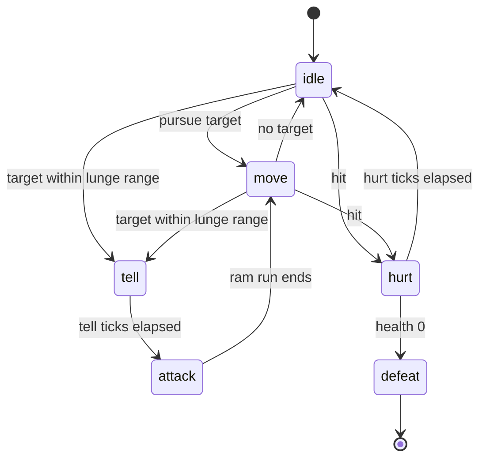

# CHOP-01: Goblin Copper Chopper readability set, design spec

**Status:** first-draft design and six keys done (draft). Senior edit pending. In-betweens, review pending.

**Decision record:** body height 47 px (opaque idle 52 px with puff), length 95 px, frame 112 x 64, pivot (56, 63). Proposed by the draft designer; decided by the senior designer (pending).

The sections follow `docs/02-art/gob-01-goblin-spec.md`. This is a first draft: numbers are proposals for the senior designer to edit.

## 1. Canon and tone constraints

- Approved concept: `assets/concept/floor-01/enemies/floor01-goblin-copper-chopper-concept-approved.png`; `docs/02-art/floor-01-minor-enemy-concepts.md` records it as an owner-approved **light steam-powered goblin motorcycle/sidecar direction**, distinct from the tracked Murder Dozer: copper tubes, patched sheet metal, compact boiler, smoking exhaust, crooked headlight, exposed engine and shaky sidecar. Native production pending.
- Tone (`docs/01-design/antihero-tone.md`, enemies row): threatening yet eccentric, with motivated behaviors and readable tells and some absurd visual contrasts; never a purely serious faceless army and never comedic with no danger. 1980s-1990s action cinema is used for attitude only, never copied designs.
- Canon facts that must survive in pixels (from the approved docs and the concept board, not design decisions):
  - A **vehicle encounter, not a new humanoid species**: a goblin driver and a sidecar passenger (goblin family) on a steam-powered chopper with a sidecar.
  - Reads as a light, fast, shaky machine, clearly different from the tracked, heavy Murder Dozer, whose visual identity and setpiece are preserved.
  - Copper and patched rust-red sheet metal, copper tubing, boiler glow, smoking exhaust.
- Design reading of the tone: a bad-tempered, home-welded contraption crewed by two snarling goblins, one in goggles and a flapping red scarf, one chewing the air with a club. It is a real threat (it rears, rams and chops) made absurd by its parts: a kettle-stack, a crooked lamp, a skull painted on a patched tub, rope holding it together. Nothing about it is sleek or heroic; the glow and the speed are the menace, the scarf and the sidecar are the joke.

### Vehicle and contraption parts visible on the board

Facts read from the board, not design decisions (the designer chooses which become separate layers or atlas parts):

| Part | Where on the board |
| --- | --- |
| Front wheel, rear wheel (chunky tyres, spoked copper hubs) | side, front, rear and motion views |
| Forks, long raked handlebars | side view |
| Headlight in a copper cage, crooked, glowing orange | front view, key details |
| Boiler / firebox with glowing grille behind the driver, copper pipework | key details, side view |
| Exhaust stack with smoke | all views |
| Exposed engine with chain and gears | key details, side view |
| Sidecar tub with a skull plate on patched red sheet metal, rope lashing, its own wheel | all views, key details |
| Crew: driver (goggles, helmet, red scarf), sidecar rider with a spiked club | crew panel |

### Projectiles and VFX on the board

- Projectiles: none. The sidecar rider's spiked club is a held melee weapon, and the passenger weapon is a provisional illustration (see guardrails).
- VFX and special states: exhaust smoke plume, dust kick-up behind the wheels, glowing headlight and firebox, a drift/powerslide dust cloud and speed streaks, a crash/topple panel with ground sparks and flying debris (bolts, a gear, a plate, goggles) and ejected crew. All of it is beyond the readability set.

### Shared parts with GOB-01 and the DOZ-01 rider

- The board labels both crew as the goblin family. GOB-01 (`assets/source/characters/goblin/goblin_a_h36.*`, 36 px, `docs/02-art/gob-01-goblin-spec.md`) is the base body reference. DOZ-01 already has seated rider sprites on main (`assets/source/enemies/dozer/dozer_riders_h36.*`: engineer, rider A, rider B at 36 px, 64 x 56 frames, GOB-01 pixels and palette, seat-point pivot (28, 55)); the decision: the Chopper crew **reuses the GOB-01 palette keys and head construction** (ear, nose, snarl) but is **redrawn seated on the bike** from a parametric rig, not copied from the DOZ-01 rider sprites, whose seat pose and 36 px full-body proportions do not fit a bike lean. The Chopper driver wears goggles, a helmet and a red scarf, which the DOZ-01 riders do not; the Bomb Bard (BARD-01) is not on main yet and is not in the lineup.
- Vehicle parts do not come from the Dozer. The Dozer is a tracked h120 machine drawn as layered parts (`assets/source/enemies/dozer/`, 39 machine colours, 7 of them smoke; `docs/02-art/doz-01-dozer-spec.md` section 3), and the board says to keep its identity. Material language (rust, copper, boiler, smoke) is shared; the decision: `dozer_smoke` is **not** shared; the stack puff is drawn into the vehicle frames in two colours (`i`, `z`).

### Guardrails (copied from the minor-enemy docs)

- This is a vehicle encounter, not a new humanoid species. The passenger weapon, exact crew count, vehicle width, speed, collision radius, crash damage and scriptable pursuits are provisional illustrative ideas; derive no combat rules from the illustration.
- The opening goblins carry pineapples on sticks; the board's spiked club is not an approved weapon for them. The Engineer is not turned into a turret or mine-layer.
- Preserve the opening Dozer's visual identity and setpiece. Printed labels (`UNSTABLE!`) and scale comparisons are not decisions.
- Chopper width needs native 640 x 360 review against Carl 52 and Donut 40. Convert from original editable pixel grids / `.aseprite`, never by tracing or cropping the board.

### Packet inputs

- Concept crops in `docs/evidence/chop-01/packet/` (x,y,w,h in the 1672x941 concept):
  - `concept_crop_1.png` = `10,105,790,440`: hero view, driver and sidecar rider in motion
  - `concept_crop_2.png` = `785,115,240,200`: front view
  - `concept_crop_3.png` = `1040,75,245,235`: rear view
  - `concept_crop_4.png` = `1300,85,350,235`: side view, clean (no crew)
  - `concept_crop_5.png` = `845,375,160,170`: crew, driver
  - `concept_crop_6.png` = `1010,390,185,160`: crew, sidecar rider
  - `concept_crop_7.png` = `1225,360,430,205`: key details and construction (headlight, firebox, stack, engine, pipes, skull plate, rope)
  - `concept_crop_8.png` = `15,590,505,335`: in motion, drift / powerslide (dust VFX)
  - `concept_crop_9.png` = `535,590,530,335`: crash / topple (sparks and debris; reference for states only, not a mechanic)
  - The Floor 01 catacomb context panel is not cropped.
- `scale_lineup.png`: Carl 52, Donut 40, GOB-01 goblin 36, plus three empty candidate slots at 44, 52 and 60 px. The candidates are overall heights from the ground to the driver's helmet top, from a by-eye estimate that the seated driver is about 26 to 30 px, which gives about 40 to 45 px, and a wider sidecar machine about 75 to 100 px long. These are estimates to be tested, not approved sizes; the lineup has no slot for length, so the designer must also decide the width. The default 64 x 56 frame in `frame_pivot_template.json` is a placeholder only and too narrow for a sidecar machine.
- Readability set (tags): `idle` (2-4), `move` (4-6), `tell` (1-2), `attack` (2-3), `hurt` (1), `defeat` (2-3); about 12 to 20 frames. Concrete tag names and frame counts are the designer's choice (section 4 and `frame_pivot_template.json` carry the toolkit defaults).

## Difficulty and route

**Score 4 of 4: Hard, route B + silhouette gate** (medium tier drafts size, palette, all keys and the spec; a fresh top-tier editor corrects and freezes them; a fresh top-tier agent runs the silhouette gate on the idle key before any other key or in-between).

| Point | Met | Note |
| --- | --- | --- |
| 1. New design, not a variant | yes | A new vehicle; neither the Dozer nor a goblin variant |
| 2. Native height above about 40 px | yes | Candidates 44, 52, 60 px, and a longer body |
| 3. Complex anatomy or construction | yes | Vehicle with two wheels, sidecar, boiler and crew |
| 4. VFX, projectiles, special states | yes | Smoke, dust, drift, crash with sparks and debris |

Reasoning: every point is met, so the honest score is 4, which matches the expected Hard class. Point 4 would drop if the crash/topple and dust states were deferred, giving 3, which stays Hard.

## 2. Size decision

Carl is 52 px (about 6 ft), Donut 40 px, the goblin 36 px (see `scale_lineup.png`). The Chopper is a low, long machine, so two numbers matter: the **body height** (floor to the driver's helmet outline, which excludes the stack puff and the raised club) and the **length** (rear tub pipes to the front tyre).

| Option | Body height | Ratio to Carl | Implied real height | Why / why not |
| --- | --- | --- | --- | --- |
| A | 44 px | 0.85 | about 5.1 ft | The seated driver (about 26 px) reads as a toy next to the 36 px goblin on foot, and the stack crowds the helmet |
| B | 47 px (decided; 46 fill + 1 outline row) | 0.90 | about 5.4 ft | Driver's head clears the stack by 2 rows, the bike stays visibly lower than Carl, so Carl can look over and past it |
| C | 52 to 60 px | 1.0 to 1.15 | 6.0 to 6.9 ft | Reads as a truck, competes with the Dozer's role and hides Carl at 640 x 360 |

Decision: **body height 47 px, length 95 px (x 8 to 102 in the idle key), idle opaque height 52 px including the exhaust puff** (stack top row 20, puff rows 12 to 17, club head row 21). Option B keeps the Chopper a "light, fast, shaky machine" against the Dozer's 2.3 times Carl, and 95 px is inside the packet's 75 to 100 px estimate. A 64 x 56 frame is too small. The frame is **112 x 64**: 8 px of margin to the left of the tub pipes, 9 px to the right of the front tyre, and headroom above row 4 for the raised club and the tell puff. Proposed by the draft designer; the decider is the senior designer who edits this draft.

Identity against DOZ-01 (the three differences that must survive at 1x):

| Axis | DOZ-01 Dozer | CHOP-01 Chopper |
| --- | --- | --- |
| Silhouette | Tall boxy mass, h120, tracks and a giant roller | Long and low, two big round wheels plus a small third, a thin vertical stack |
| Palette | Cool riveted iron, 39 machine colours | Warm copper and rust red, glowing firebox and lamp, cold rubber only on tyres |
| Crew and motion | Three riders in a tub, rattles in place | Two crew, one leaning forward over the bars with a streaming red scarf, rears and slams |

## 3. Frame, pivot, boxes and atlas

- Frame **112 x 64**, pivot **(56, 63)**, contact row **63** (the lowest opaque row of every frame; the sidecar wheel, and in the ram the front wheel, sit on it).
- Grounded tags: idle, walk, attack_tell, attack_swing, hurt, down. Airborne tags: none (a wheelie is a pitch about a wheel on the floor).
- Hurtbox (relative to the pivot, y up, 60 Hz game space, **provisional**): x -44 to +44, y 0 to 44 (88 x 44); it excludes the stack puff and the club head.
- Attack hitbox on the impact frame (frame 10): ram box x +24 to +50, y 0 to 26 (26 x 26: front wheel, forks and lamp). A secondary club box x -4 to +12, y 29 to 45 (16 x 16) on the same ticks. One hit per attack. Both are proposals; the board's reach is an illustration.
- Authored facing right; the runtime mirrors around the pivot column.
- One atlas, frames 0 to 15, layers: `machine` (vehicle, sidecar, smoke, sparks), `crew` (driver, sidecar rider), `weapon` (spiked club). Layers are disjoint per pixel and each key is frozen over all three.

## 4. Readability-set animation list

Readability set: idle, move, tell, attack, hurt, defeat (16 frames). Tick windows are at 60 Hz.

| Role | Tag | Frames | Playback | Ticks | Notes |
| --- | --- | --- | --- | --- | --- |
| idle | `idle` | 3 (0, 1, 2) | loop | 12 + 8 + 12 = 32 | engine ticking over; in the draft all three are key 0 |
| move | `walk` | 4 (3 to 6) | loop | 4 x 5 = 20 | the rolling bike; wheel spokes advance each frame |
| tell | `attack_tell` | 2 (7, 8) | once | 6 + 18 = 24 | rev and rear; the 18-tick hold is key 8 |
| attack | `attack_swing` | 2 (9, 10) | once | 2 smear + 4 impact = 6 | ram slam plus club chop; impact ticks 26 to 29 of the attack |
| hurt | `hurt` | 2 (11, 12) | once | 4 + 8 = 12 | jolted back |
| defeat | `down` | 3 (13, 14, 15) | hold | 4 + 8 + hold | key 15 is the wreck hold |

Frame table:

| # | Tag | Pose | Ticks | Author |
| --- | --- | --- | --- | --- |
| 0 | `idle` | upright, club resting over the shoulder, firebox glowing low, small puff | 12 | key |
| 1 | `idle` | copy of 0 | 8 | copy |
| 2 | `idle` | copy of 0 | 12 | copy |
| 3 | `walk` | rolling: nose dips, driver flat to the bars, scarf streaming, tub squats 1 px | 5 | key |
| 4 | `walk` | copy of 3 | 5 | copy |
| 5 | `walk` | copy of 3 | 5 | copy |
| 6 | `walk` | copy of 3 | 5 | copy |
| 7 | `attack_tell` | copy of 8 (anticipation) | 6 | copy |
| 8 | `attack_tell` | rears 6 degrees, firebox and lamp flare, club cocked high, big puff | 18 | key |
| 9 | `attack_swing` | copy of 10 (smear) | 2 | copy |
| 10 | `attack_swing` | front slams down, driver prone, club chopping forward, sparks at the lamp | 4 | key |
| 11 | `hurt` | jolt back, nose pops up, white lenses, O mouths, club flung up | 4 | key |
| 12 | `hurt` | copy of 11 | 8 | copy |
| 13 | `down` | copy of 15 | 4 | copy |
| 14 | `down` | copy of 15 | 8 | copy |
| 15 | `down` | wreck rolled onto its back, fire out, crew sprawled clear | hold | key |

## 5. State diagram



The lunge distance, speed and cooldown are not decided here (they belong to the gameplay work order). The attack tag only covers the 6 ticks of impact pose; the runtime then plays `walk` while the machine carries on.

## 6. Palette `chop-floor01-v0` (19 of 20 colours)

The concept candidates were mostly background navy, so colours were picked by eye. The crew uses the **GOB-01 keys and values** for outline, the skin ramp, eye, tooth, rags (`t`, `u`) and the scarf red (`R`), so the goblins match the opening goblins. The Dozer palette is not reused: the Chopper reads warmer and lighter. Shared smoke part `dozer_smoke` is not used either; the puff is two colours drawn into the vehicle frames.

| Key | Name | Value | Role |
| --- | --- | --- | --- |
| K | outline_plum | `#1b1124` | shared outline, drawn around every part so crew and machine separate |
| a | skin_deep | `#263a26` | GOB-01 skin shade (reserved, not yet used in the keys) |
| s m l | skin ramp | `#46682e` `#7a9e36` `#b2cc56` | GOB-01 skin |
| e | eye_yellow | `#ffd23a` | driver lens and rider eye (accent) |
| w | tooth_white | `#efe4c4` | teeth, skull plate, hurt/defeat eyes (accent) |
| R p | red mid, red dark | `#b8322e` `#6e1a22` | scarf, sidecar tub panel |
| t u | rag mid, light | `#4c3436` `#73524a` | clothes, helmet leather, seat, rope |
| c C D | copper dark, mid, light | `#5a2e1c` `#b0602e` `#e69a4e` | pipes, boiler, hubs, forks, club handle and spikes |
| k | rubber | `#2e2630` | tyres (cold, separates from brick) |
| i z | iron/smoke dark, smoke | `#4a4450` `#7a7286` | engine block, club head, exhaust puff |
| f Y | fire orange, fire hot | `#e2631c` `#ffc84a` | firebox grille, headlamp, sparks (Y is an accent) |

Colour budget: 19, one free. Light model: top-lit 3-tone per part (light on the top edge, dark on the bottom edge), matching the A1 warm-torch, cold-ambient scene.

## 7. Key poses

Six keys (frames 0, 3, 8, 10, 11, 15), frozen in `tests/fixtures/chop-01_keys.json`.

| Frame | Tag | Silhouette and pose notes | Readability reason |
| --- | --- | --- | --- |
| 0 | `idle` | Upright, level. Driver seated, helmet top row 17 (outline), goggle lenses yellow, scarf short. Stack with a small puff (rows 12 to 17). Sidecar rider head over the tub rim, club resting back over his shoulder (angle 145), head at row 21. Firebox `f` with a small `Y` core, lamp `Y` | Long, low, wheeled copper machine; two goblins; one thin vertical stack |
| 3 | `walk` | Rolling: whole machine 1 px lower, fork compressed, driver leaning 2 px forward, scarf 1.4 times longer and lifted, rider head 1 px down, wider puff, spokes advanced | Same bike, clearly moving; the scarf is the speed cue at 1x |
| 8 | `attack_tell` | Pitch +6 degrees about the sidecar wheel: front wheel lifts about 7 px. Driver hunched forward, firebox grille filled with `Y` (23 `Y` pixels against 16), lamp ringed with `f`, three-blob puff to row 4, club cocked at angle 78 above the rider (highest club pose) | Rev and rear: the highest silhouette (row 4 against 12) and the brightest glow, held 18 ticks |
| 10 | `attack_swing` | Pitch -3.5 degrees about the front wheel: nose slams down, tail lifts about 4 px, driver prone, scarf streaming flat, rider lunging forward, club chopping forward at angle 35, two spark pixels at the lamp and tyre | Forward-most silhouette (right edge 104), club forward, glow at the front: the ram contact |
| 11 | `hurt` | Whole machine shifted back 3 px, nose popped up 3 degrees, driver leaning back with an O mouth and white lenses, scarf flung up, rider head thrown back, club flung up and back (angle 140), two sparks at the front | Knocked back: right edge 98 against 102; no yellow lens or eye pixel (`e` count 0) |
| 15 | `down` | Machine rolled onto its back (reflected vertically): wheels in the air, stack on the floor, fire out (`Y` count 0), small steam puff. Driver sprawled at the front with white eyes and an O mouth, sidecar rider flat at the rear, club on the floor beside him | Flat, dead, wheels up; crew thrown clear. Reference: crash board, reduced to its final state |

Spiked club versus the opening goblins' pineapples: the opening goblins carry a **fruit on a stick** (golden `G`/`F`/`H` body, teal leaf crown `V`/`v`, wooden stick). The Chopper rider's club is a later-type weapon: a **blackened iron ball** (`i`, `z`), six copper spikes (`C`, `D`) and a plank handle with a rope wrap, no gold and no leaves. The weapon layer may never contain a pineapple or leaf key (tested). The board's club stays a provisional illustration, not an approved weapon for the opening goblins.

## 8. In-between list

Ten slots are copies of the nearest key for now. The execution tier replaces them and then turns `unique_frames` back on.

| # | Pose notes |
| --- | --- |
| 1 | Idle: puff 1 px higher, firebox `Y` core out for one frame (flicker), rider head 1 px lower |
| 2 | Idle: whole machine 1 px lower (engine shudder), scarf droops 1 px |
| 4 | Walk: spokes advance 30 degrees, tub back up, scarf at its lowest |
| 5 | Walk: spokes 60 degrees, fork at full extension, puff separated from the stack |
| 6 | Walk: spokes 90 degrees, machine 1 px lower, scarf lifts |
| 7 | Tell anticipation: pitch +3 degrees, driver ducking, club half raised (angle 105), firebox `Y` core at half size |
| 9 | Smear: pitch -2 degrees, club at angle 65, no sparks yet |
| 12 | Hurt recover: pitch +1.5 degrees, club dropping (angle 120), lenses back to yellow |
| 13 | Defeat: machine mid-roll (pitch 90 degrees about the tub, wheels vertical), crew in the air |
| 14 | Defeat: machine lands on its back, bounce 2 px up, crew landing |

## 9. Validators and readability rules

Run by `python3 -m scripts.pixelart validate assets/source/characters/goblin/chopper/chop_01.pixelart.json` (rules V01 to V15).

- V04 palette: at most 20 colours; V05 isolated pixels: 0; V06 orphan pixels: at most **70** per frame for the draft (the spokes, skull stamp and sparks produce about 60; the execution tier should bring this down and tighten the limit).
- V07 contact rows: every frame is grounded and ends on row 63. V08 is skipped (no airborne tag). V12 is off while in-betweens are copies.
- V09 frozen keys: SHA-256 per key frame over `machine`, `crew`, `weapon`, fixture `tests/fixtures/chop-01_keys.json`.
- V13 bounding boxes: C1 idle length 90 to 100 px and height rows 12 to 63; C2 the tell is the highest pose (top row at most 6); C3 the attack reaches furthest forward (right edge at least 102); C4 the hurt is knocked back (right edge at most 100); C5 the wreck is low (top row 8 to 12).
- V14 key counts: the tell and attack carry at least 20 `Y` pixels while idle and walk carry at most 17; the wreck has none; the driver lens `e` is visible (at least 4) in idle, walk, tell and attack; no `e` in hurt, hurt in-between and wreck.
- Extra tests (`tests/test_art_chop01.py`): reproducibility, `.ase` match, tick table, GOB-01 key parity, no pineapple key in the weapon layer, size decision numbers.

## 10. Evidence

```text
python3 -m scripts.pixelart validate assets/source/characters/goblin/chopper/chop_01.pixelart.json --out <dir>
python3 -m scripts.pixelart evidence assets/source/characters/goblin/chopper/chop_01.pixelart.json --out <dir>
python3 -m scripts.pixelart review-pack assets/source/characters/goblin/chopper/chop_01.pixelart.json --out <dir>
python3 scripts/author_chop01.py scale
```

Draft evidence: [`docs/evidence/chop-01/key0-scale.png`](../evidence/chop-01/key0-scale.png) shows key 0 at 1x on the lit Floor 1 floor next to Carl and a GOB-01 goblin (both facing, the Chopper mirrored to face them), with a 4x crop below. The review pack (contact sheet, lit scene, tell-to-attack strip) is for the next stage.

Acceptance targets for the review (to be measured, not yet met or checked by a reviewer):

1. At 1x the Chopper reads as a vehicle with two goblin crew, distinct from the Dozer by silhouette and palette alone.
2. Tell versus idle is told apart at 1x by silhouette (top row 4 against 12 and a lifted front wheel) and by glow, and the 18-tick hold is at least 300 ms.
3. Tell-to-attack: the change from the tell to the impact pose is visible in one 4-tick step (nose up to nose down, club up to club forward).
4. Hurt and defeat are told from idle and attack by the white lenses and by the flat wheels-up wreck.
5. Copper reads against the warm brick by value (red-dark body, bright glow, cold tyre) in the A1 lit scene.

## 11. Files

| File | Role |
| --- | --- |
| `assets/source/characters/goblin/chopper/chop_01.grid.json` / `.ase` | pixel-grid source and Aseprite master |
| `assets/manifests/chop-01.json` | manifest (tick table, key list) |
| `assets/source/characters/goblin/chopper/chop_01.pixelart.json` | the asset config |
| `scripts/author_chop01.py` | deterministic authoring script (palette, rig, keys, manifest, scale evidence) |
| `tests/fixtures/chop-01_keys.json` | frozen keys |
| `tests/test_art_chop01.py` | contract tests |
| `docs/evidence/chop-01/key0-scale.png` | key 0 against Carl and GOB-01 |

## 12. VFX hand-off (not drawn here)

Smoke trail, dust kick-up, drift/powerslide streaks, ground sparks, crash debris (bolts, gear, plate, goggles) and speed streaks are a **separate VFX work order** (suggested id CHOP-VFX-01). Only two things stay inside the vehicle frames: the stack puff (two colours, at most three blobs, always inside rows 4 to 17) and one or two spark pixels at the front in the attack and hurt keys. The crash board's mid-air flip, scattered parts and dust are not drawn; the defeat key is the final resting state.

## 13. Open questions for the senior designer

1. The wreck (key 15) is a vertical reflection: the tub floats on the stack. A better rest pose (tub rim and bars on the floor) may need a custom rig.
2. The sidecar rider's club only reaches the middle of the machine in the attack key; decide whether the club or the ram is the real hit and whether the rider needs a side-facing chop.
3. The hurt jolt and the walk key are single drawings; wheels turning at 4 frames may need a hub marker.
4. Defeat ejects both crew as part of key 15; decide whether the crew become separate reusable sprites for the later crash VFX.
5. Orphan count (about 60 per frame) is high for a 95 px sprite; spokes and stamps are the cause.

## 14. Rights and provenance

Fan-concept art under the owner-reported `ART-PUBLICATION-ALL-V1` scope (see `docs/04-production/rights-and-release.md`). No tracing of the concept, no image-model raster output.

### Rights/Provenance stub

- Concept: owner-approved reference under `ART-PUBLICATION-ALL-V1`; crops are for reference only, never traced or exported.
- Packet: script output plus a medium-tier executor (stage P).
- Draft spec and keys (frames 0, 3, 8, 10, 11, 15): Claude Sonnet. Senior design edit: pending. Review: pending.
- No third-party assets, no copied designs or dialogue, no image-model raster output.
