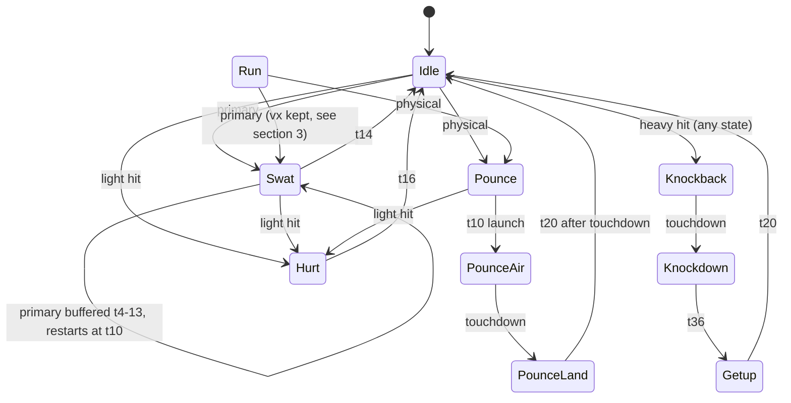

# ANIM-DONUT-02: Princess Donut melee and damage reactions, design spec (phase 1)

**Status:** phase 1 design: eight keys drawn and frozen, the seven in-betweens are copies of their nearest key and wait for execution (section 6). Nothing here is reviewed or owner-approved. Nothing is wired into a Bevy binary; runtime integration is a separate work order. Rights basis for publishing: owner-reported `ART-PUBLICATION-ALL-V1` ([rights register](../04-production/rights-and-release.md)). No reuse licence, no game or asset-pack distribution right.

Read with: [ANIM-DONUT-01 locomotion](donut-locomotion-anim-01.md) (frame, pivot, layers and identity rules this spec inherits), [Donut bible](donut-character-bible.md), [gear timeline](donut-gear-timeline.md), [controller contract](../01-design/mvp-controller-contract.md#character-actions-and-progression), [antihero tone](../01-design/antihero-tone.md), and the structural model [ANIM-CARL-02](carl-melee-anim-02-spec.md).

| File | Role |
| --- | --- |
| `assets/source/characters/donut/donut_h40_melee.grid.json` | pixel-grid-v1 source, 15 frames in the section-6 layout (keys at 0, 1, 4, 5, 6, 8, 10, 11) |
| `assets/source/characters/donut/donut_h40_melee.ase` | built from the grid by `scripts/pixel_grid_to_ase.py` (also via `scripts/export_assets.sh`) |
| `assets/source/characters/donut/donut_h40_melee.pixelart.json` | toolkit config: tags, tick table, lint limits, frozen keys |
| `scripts/author_donut_melee.py` | deterministic authoring record of the keys (`--check`, `--evidence`) |
| `assets/manifests/donut_h40_melee.json` | candidate manifest `donut_h40_melee_candidate_v0`. Its `melee.moves` block is the **machine-readable tick contract**; `melee.frames` is the per-frame tick table |
| `tests/test_art_donut_melee.py`, `tests/fixtures/anim-donut-02_keys.json` | contract tests and the frozen keys (SHA-256 over all eight layers) |
| `docs/evidence/anim-donut-02/` | `keys-scale.png` (1×, lit Floor 1, next to Carl and a GOB-01 goblin), `keys-scale-x4.png`, `keys_x6.png` |

## 1. Acting brief

Donut fights like a pampered show cat who has decided this is beneath her and is doing it anyway. She is **agile and fragile**: quick, light, never planted, never a brawler. Every action is a cat action (paw, pounce, pin), never a human punch translated onto a cat. Cuteness stays the default (bible: "cute in neutral"); the attitude is in the timing and the tail, not in a snarl.

- **Swat (primary, Square/X, pre-biscuit).** A quick defensive paw slap at a goblin's ankles: paw up beside the chin, then a short down-and-forward swipe. Low damage; it buys space, it does not win fights.
- **Pounce (physical, Triangle/Y).** The hunting crouch (head low, plume dropped), a short flat leap with both forepaws thrown forward, then a two-paw pin on landing, plume up ("got it"). Its value is position: it moves her about 45 px fast. Missing it leaves her exposed (fragility = risk).
- **Hurt.** Eyes squeezed shut (the master blink face, the locomotion "oof"), head jerks back and up, the near forepaw snaps off the floor.
- **Knockback.** Thrown back, eyes shut, all four legs splayed: the startled-cat starfish.
- **Knockdown and get-up.** She lands belly-down in a **sploot** (forepaws flat in front, hind legs flat behind), head upright. Get-up is quick and dignified: chest up first, then the chin, as in the locomotion `land` recovery.

**"Never lies flat" applies to Donut, in her own form.** Carl's rule comes from his identity lock (head and jacket are never rotated). Donut has the same lock: her head, face, tiara, collar and charm are master pixels, translated only. She therefore never lies on her side or back; the sploot keeps the 3/4 face upright and readable, and it is funnier for a proud Persian.

**Gear at the entrance** ([gear timeline](donut-gear-timeline.md), [bible](donut-character-bible.md)): the approved master's tiara, violet collar and butterfly charm only. No bracelets, armour, aura or magic VFX in this set. Magic Missile, interact and Puddle Jumper are separate work orders.

## 2. Frame size, pivot and layers (integration contract)

- **Frame 72 × 44, pivot (46, 43): identical to ANIM-DONUT-01.** The melee atlas can be loaded as a second atlas with the same `actor_sprite::DONUT` layout, or appended to the locomotion atlas, with no pivot math. Column 71 and row 0 stay empty (margin rule), the furthest paw reaches column 69/70.
- **Grounded tags** (`swat`, `pounce`, `pounce_land`, `hurt`, `knockdown`, `getup`): the lowest opaque row is 43 in every frame.
- **Airborne tags** (`pounce_air`, `knockback`): nothing on rows 42 and 43 (lowest row at most 41). Never ground-snap them; the pivot follows the sim body as for Carl's `knockback`.
- **Facing:** all frames face right; mirror around the pivot column for left, as for the locomotion.
- **Layers:** the locomotion's seven (`tail, legs_far, body, legs_near, head, face, gear`) plus **`paw`** on top: a raised or reaching near forepaw that must draw over the head and chest ruff (swat keys, pounce flight). Empty elsewhere.
- **Palette:** the master's 22 keys, unchanged.

## 3. Tick conventions and movement

- Logic at 60 Hz. **Tick 0** is the fixed tick on which the press is accepted. Active ticks are the ticks on which the hitbox is live; the hit tick is the first active tick; one hit per target per move instance. Frame selection is a pure function of (move, move tick), and of airborne state for the hold frames. `.ase` durations are previews only (`round(ticks × 1000 / 60)`, holds 100 ms).
- **Swat is movement-compatible** (controller contract: Donut's primary remains movement-compatible). Gameplay does **not** zero `vx` during the swat. The keys are drawn on a standing base with the hind legs planted, so at walking speeds up to about 60 px/s the 14-tick swat skates at most about 14 px; the execution phase shuffles the hind paws forward in s2/s3 to hide that. At full trail speed (up to 185 px/s) the integration should either cap `vx` during the swat or composite the swat's front half over the run cycle. That choice is open (section 8, Q1).
- **Pounce has its own impulse** (placeholder, gameplay owns it): launch at t10 with `vx` 180 px/s and `vy` 130 px/s; with `GRAVITY` 1050 that is about 15 ticks airborne, an 8 px apex and about 45 px of travel. Horizontal input is ignored from t0 to touchdown + 8 ticks.
- Hurt, knockback, knockdown and get-up: no root motion; knockback velocity is gameplay data.

## 4. Move table (placeholders; `src/combat.rs` defines no Donut moves yet)

| Move | Input | Startup | Active | Recovery | Total | Hit tick | Cancel |
| --- | --- | --- | --- | --- | --- | --- | --- |
| `swat` | primary (Square/X) | 4 (t0-3) | 3 (t4-6) | 7 (t7-13) | **14** (233 ms) | **t4** | proposal: a repeated press buffered t4-13 restarts the swat at t10 |
| `pounce` (+ `pounce_air`, `pounce_land`) | physical (Triangle/Y) | 10 (t0-9) | launch to touchdown + 2 (nominal t10-25) | 18 (nominal t26-43) | **44** nominal (733 ms) | **t10** earliest | none (full commitment) |
| `hurt` | light hit | - | - | 16 hitstun | **16** (267 ms) | - | none |
| `knockback` → `knockdown` | heavy hit | airborne hold | - | 6 impact + 30 sploot | hold + **36** | - | into `getup` |
| `getup` | automatic | - | - | 20 | **20** (333 ms) | - | none |

The swat equals Carl's jab length (14) on purpose, so a one-button prototype can share `MELEE_COOLDOWN`; it hits one tick later (t4 against t3) because the paw has further to travel from the cock. Her get-up is 2 ticks faster than Carl's (agile), her hitstun 2 ticks shorter (light), but she has `HERO_HEALTH`-level fragility decided by gameplay, not by art.

**Proposed target reactions** (not approved, not art data): swat 2 ticks hit-stop, goblin stagger 8 ticks, push about 3 px. Pounce pin: 4 ticks hit-stop, stagger 14 ticks, no push (she lands at its feet; the value is her position, e.g. to cross a goblin's line or reach a ledge). A "pounce-bounce" off the target is a listed playtest candidate in the contract, not part of this set.

### Hitbox and hurtbox placeholders (pivot-relative, x forward, y up from the pivot row, inclusive; from the keys)

| Key | Part | x | y | Reads on a 36 px GOB-01 goblin |
| --- | --- | --- | --- | --- |
| s1 swat contact | paw | +13 .. +23 | 5 .. 10 | shins and knees |
| p1 pounce flight | near paw | +18 .. +24 | 13 .. 16 (+ flight height) | belly / chest at apex |
| p1 pounce flight | far paw | +15 .. +21 | 6 .. 9 (+ flight height) | thighs |
| p2 pin landing | both paws | +14 .. +21 | 0 .. 3 | its feet |

The same numbers are in `melee.hit_boxes_px`. Hurtbox: unchanged from the locomotion integration (the sim body); sprites never feed collision. The sploot is 4 px lower than idle; whether a downed Donut can be hit is a gameplay decision.

## 5. Keys and poses

Coordinates are canvas pixels (x right, y down; floor row 43). **U(dx, dy)** translates the identity block (`head`, `face`, `gear`) relative to its source locomotion frame; **B** the `body`, **T** the `tail`. Every key starts from an approved locomotion frame; only legs and paws are new pixels. Faces: the open-eye face (locomotion idle/run/jump) or the master blink face (locomotion frame 14).

| Frame | Key | Source | Pose |
| --- | --- | --- | --- |
| 0 | **s0 cock** | loco 15 (land recovery, standing) | U, B, T (-1, +1): weight shifts back. Near fore lifted onto `paw`: forearm up the right edge of the ruff (x59-63, rows 32-37), curled paw beside the chin at x62-67 rows 28-31, outside the ruff silhouette and against the ginger cheek; one `W` toe highlight up-left. Far fore planted |
| 1 | **s1 swat contact** | loco 15 | U, B, T (+1, 0): leans in. Near fore swiped down-forward onto `paw`: paw x59-69 rows 33-38 (5-10 px above the floor), two `W` claw pixels on the leading edge at x68. Far fore and hinds planted |
| 4 | **p0 crouch** (tell) | loco 10 (jump_start crouch) | U (0, +2): head low over the paws, eyes on the target. T (-2, +6): plume dropped low behind the rump (the hunting tell; jump_start keeps it up). Hinds bunched under the raised rump |
| 5 | **p1 pounce flight** | loco 12 (jump_rise) | Long tilted body, hinds trailing. Both forelegs replaced: near fore on `paw` reaching forward and slightly up to a paw at x64-70, claws `W` at x69; far fore (shadow ramp `c`) lower at x61-67. Whole frame up 2 px: lowest row 41 |
| 6 | **p2 pin landing** | loco 10 | U (+1, +1): head pushed in. T (+2, -2): plume up, triumphant. Both forepaws slammed flat in front: near paw x60-67 rows 40-43 with `W` claws, far paw behind it. Rump still up |
| 8 | **h0 flinch** | loco 14 (land impact, blink face) | U (-3, -2), B (-2, -1), T (-3, -1): head jerks back and up, eyes shut. Far fore planted back at x50-55; near fore snapped off the floor (curled paw x52-56 rows 37-41) |
| 10 | **kb thrown** | loco 14 | U, B, T (-4, -4), blink face. All legs redrawn splayed: near fore forward to x66 (row 35-39), far fore forward-up at x56-63 rows 31-34, near hind down (x30-35, to row 41), far hind back (x20-25). Lowest row 41 |
| 11 | **d0 sploot impact** | loco 14 | B (0, +1): belly on row 43. U (0, +4): head drops, still upright, eyes shut. T (-4, +8): plume flops low. Near fore flat forward to x67 (rows 40-43); near hind flat behind (ginger haunch continues, paw x13-18) |

Key read checks at 1× (see `keys-scale.png`): the swat pair reads as paw up, then paw out at the goblin's shins; the pounce trio reads as low crouch with dropped tail, long flat leap with paws out, two-paw landing with tail up; hurt and knockback both shut the eyes, knockback is separated by height and splayed legs; the sploot is the lowest silhouette in the set.

## 6. Frame plan, tags and in-betweens (execution phase)

15 frames, one row of 72 × 44. Ticks are 60 Hz; `hold` frames show 100 ms in previews.

| Frame | Tag | Name | Ticks | Phase | Owner now | Executor note (target pose; copy the named key first, then edit) |
| --- | --- | --- | --- | --- | --- | --- |
| 0 | `swat` | s0 cock | 4 (t0-3) | startup | **key** | frozen |
| 1 | `swat` | s1 swat contact | 3 (t4-6) | active, hit t4 | **key** | frozen |
| 2 | `swat` | s2 follow-through | 4 (t7-10) | recovery | copy of s1 | paw continues down to the floor: paw x60-67 rows 40-43 (pressed flat, claws hidden), U (+1, +1). Near hind shuffles forward 2 px (hides skating) |
| 3 | `swat` | s3 recover | 3 (t11-13) | recovery | copy of s1 | back to the loco-15 stance: near fore restored to its loco-15 pixels, U (0, 0). Hands over to idle/run with at most a 1 px snap |
| 4 | `pounce` | p0 crouch | 10 (t0-9) | startup | **key** | frozen. Optional later: a 1 px rump wiggle variant (needs a frame and a re-freeze) |
| 5 | `pounce_air` | p1 pounce flight | hold (nominal t10-23) | active | **key** | frozen |
| 6 | `pounce_land` | p2 pin landing | 8 (t24-31) | active t24-25, then recovery | **key** | frozen |
| 7 | `pounce_land` | p3 recover | 12 (t32-43) | recovery | copy of p2 | rump lowers, head back to U (0, 0), forepaws drawn back under the chest (loco-10 forelegs), plume settles halfway between p2 and loco 15 |
| 8 | `hurt` | h0 flinch | 5 (t0-4) | hitstun | **key** | frozen |
| 9 | `hurt` | h1 recoil | 11 (t5-15) | hitstun | copy of h0 | eyes open again (open-eye face), U (-1, -1), B (-1, 0); near fore back on the floor at its loco-15 position |
| 10 | `knockback` | kb thrown | hold | airborne | **key** | frozen |
| 11 | `knockdown` | d0 sploot impact | 6 (t0-5) | down | **key** | frozen |
| 12 | `knockdown` | d1 sploot sulk | 30 (t6-35) | down | copy of d0 | open-eye face (indignant stare), plume tip lifts 2 px (tail flick); holds until get-up |
| 13 | `getup` | g0 chest up | 10 (t0-9) | getup | copy of d0 | forelegs straighten under the chest (loco-10 forelegs), B (0, 0), U (0, +2); hinds still flat behind |
| 14 | `getup` | g1 chin up | 10 (t10-19) | getup | copy of d0 | the loco-15 pose with U (0, -1) (chin up first, dignity restored); hinds back under the hips. Hands over to idle |

In-between rules: head, face and gear are translations of a locomotion head block only (the test enforces this for the keys; extend it to every frame); body and tail are translations; legs and paws are re-pixelled with the master ramps (`K` outline, `C`/`c` cream legs, `W` toe and claw highlights, far legs in the shadow ramp). No isolated pixels, at most 6 orphans per frame. After execution set `unique_frames: true` in the config.

## 7. State flow

Any hit cancels an attack (no armour). Airborne swat and pounce from a jump are out of scope.

## 8. Open questions (for the gameplay and input owners; nothing decided here)

1. **Swat while running at full speed:** cap `vx` during the swat (simple, skates a little) or composite the swat's front half over the run cycle (needs a layered swat variant and an integration rule).
2. **Swat auto-repeat:** the contract leaves holding Square unresolved; the art supports a restart at t10.
3. **Pounce distance and height:** 45 px and 8 px are placeholders; the flight frame holds for any airtime.
4. **Does the pin hit the target it landed on, or only the flight hit?** The art supports both; the manifest's active rule allows one hit per instance across flight and the first two landing ticks.
5. **Hurt facing:** frames assume a hit from the front; turn Donut towards the source or accept the mirrored read.

## 9. Acceptance targets

**Execution phase:** all 15 frames drawn to section 6; the eight keys pixel-identical (`tests/fixtures/anim-donut-02_keys.json`); toolkit validation passes with `unique_frames: true`; GIFs per tag at tick timing, a swat-swat and a pounce sequence GIF, a Floor 1 sequence mock with a GOB-01 goblin; `bash scripts/export_assets.sh` and the tests pass; evidence refreshed with `SHA256SUMS`.

**Independent review checklist:**

- At 1× on lit Floor 1: each move has a distinct silhouette; the swat reads as a paw, not a step; the pounce crouch is a readable tell; the flight reads as a leap with paws out; the knockback is not confused with hurt; the sploot is belly-down with an upright head.
- Identity: same face, tiara, collar, charm, coat patches and plume in every frame; no shimmer between frames of a move.
- Tone: agile and fragile, cute in neutral; never a brawler stance, a snarl, a human punch or a superhero landing.
- Timing: the swat feels quick and light; the pounce telegraphs for 10 ticks and commits.

## 10. Difficulty and route

Score per [routing by difficulty](../07-agents/pixel-art-pipeline.md#routing-by-difficulty): new design 0 (a variant of the approved locomotion and master), native height above 40 px 0 (40 px), complex anatomy 1 (quadruped with four independently posed legs and a plume), VFX or special states 0 (none; reactions are part of the move set). **Score 1, Easy.** Route: the hero character's attack set was nevertheless keyed in full (eight keys) because the identity is owner-approved and every key touches the identity lock; the medium tier draws the seven in-betweens and evidence; then an independent review. No silhouette gate (not a new design).

## 11. Self-review of the keys (not approval)

- **Works:** identity holds by construction (every head, face, gear, body and tail pixel is a translated locomotion pixel; the test enforces it). The swat contact reads against the goblin's shins at 1×. The pounce flight and sploot are the clearest silhouettes.
- **Weak:** the s0 cock is small at 1× (the paw is a 6 × 4 cream shape beside the chin); p0 differs from the locomotion `jump_start` mostly by the dropped plume and the lower head; h0 relies on the blink face and the head jerk; far legs are mostly hidden by the ruff. A reviewer may want a larger cock arc (paw higher on the cheek) or a flattened-ears head variant, which would need an owner-approved face edit.
- No human has judged feel or timing in motion. All tick numbers are proposals.

## 12. Rights/Provenance

Spec and keys: Claude Opus (design). Built only from the owner-approved Donut master and the owner-approved ANIM-DONUT-01 locomotion pixels; legs and paws hand-placed in pixel-grid-v1 by the authoring script. No generated illustration, concept-board pixel, image-model raster or third-party asset was used.
