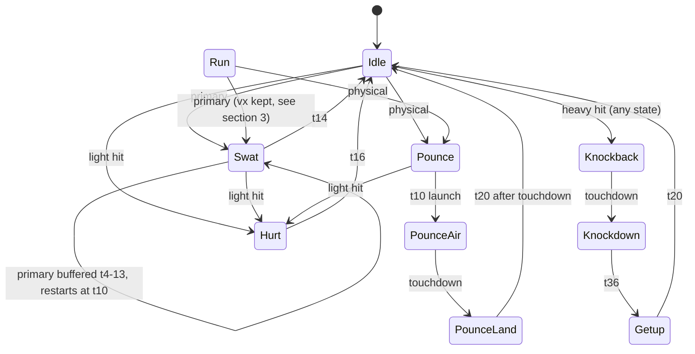

# ANIM-DONUT-02: Princess Donut melee and damage reactions, design spec (phase 1)

**Status:** execution drawn: all 15 frames exist, the eight keys frozen and silhouette-gate fixed (section 13) and the seven in-betweens drawn to section 6 (section 14); toolkit validation passes with `unique_frames: true`; evidence regenerated. The silhouette gate returned FIX-KEYS, the keys were fixed and re-frozen (no recorded re-gate), and the blind review scored 22/25, a pass with execution items (section 14). Not owner-approved. Not wired into the Floor 1 binary; gameplay use is designed in [Q10 Donut moveset](donut-moveset-q10.md) (WORK-023), which also answers open questions 2-4 of section 8. Rights basis for publishing: owner-reported `ART-PUBLICATION-ALL-V1` ([rights register](../04-production/rights-and-release.md)). No reuse licence, no game or asset-pack distribution right.

Read with: [ANIM-DONUT-01 locomotion](donut-locomotion-anim-01.md) (frame, pivot, layers and identity rules this spec inherits), [Donut bible](donut-character-bible.md), [gear timeline](donut-gear-timeline.md), [controller contract](../01-design/mvp-controller-contract.md#character-actions-and-progression), [antihero tone](../01-design/antihero-tone.md), and the structural model [ANIM-CARL-02](carl-melee-anim-02-spec.md).

| File | Role |
| --- | --- |
| `assets/source/characters/donut/donut_h40_melee.grid.json` | pixel-grid-v1 source, 15 frames in the section-6 layout (keys at 0, 1, 4, 5, 6, 8, 10, 11; in-betweens 2, 3, 7, 9, 12, 13, 14) |
| `assets/source/characters/donut/donut_h40_melee.ase` | built from the grid by `scripts/pixel_grid_to_ase.py` (also via `scripts/export_assets.sh`) |
| `assets/source/characters/donut/donut_h40_melee.pixelart.json` | toolkit config: tags, tick table, lint limits, frozen keys |
| `scripts/author_donut_melee.py` | deterministic authoring record of the keys and the seven in-betweens (`--check`, `--evidence` for the key-scale files) |
| `scripts/make_donut_melee_previews.py` | deterministic evidence set below (needs `bash scripts/export_assets.sh` first); `--out DIR` |
| `assets/manifests/donut_h40_melee.json` | candidate manifest `donut_h40_melee_candidate_v0`. Its `melee.moves` block is the **machine-readable tick contract**; `melee.frames` is the per-frame tick table |
| `tests/test_art_donut_melee.py`, `tests/fixtures/anim-donut-02_keys.json` | contract tests and the frozen keys (SHA-256 over all eight layers) |
| `docs/evidence/anim-donut-02/` | see the evidence table in section 14. Key files: `keys-scale.png` (1×, lit Floor 1, next to Carl and a GOB-01 goblin; airborne keys over open floor, s1 at the goblin), `keys-scale-x4.png`, `keys_x6.png`, `p0_vs_jump_start_x1.png` / `_x6.png`, `contact_sheet_x1.png` / `_x6.png`, `frame_layout_timing_diagram.png`, five `*_x4.gif`, six `floor01_melee_*` compositions, `measurements.json`, `SHA256SUMS` |

## 1. Acting brief

Donut fights like a pampered show cat who has decided this is beneath her and is doing it anyway. She is **agile and fragile**: quick, light, never planted, never a brawler. Every action is a cat action (paw, pounce, pin), never a human punch translated onto a cat. Cuteness stays the default (bible: "cute in neutral"); the attitude is in the timing and the tail, not in a snarl.

- **Swat (primary, Square/X, pre-biscuit).** A quick defensive paw slap at a goblin's shins: paw up in front of the cheek, then a short downward slap. Low damage; it buys space, it does not win fights.
- **Pounce (physical, Triangle/Y).** The hunting crouch (head low, rump up, plume swept back flat), a short flat leap with both forepaws thrown forward, then a two-paw pin on landing, plume up ("got it"). Its value is position: it moves her about 45 px fast. Missing it leaves her exposed (fragility = risk).
- **Hurt.** Eyes squeezed shut (the master blink face, the locomotion "oof"), head jerks back and up, the near forepaw snaps off the floor.
- **Knockback.** Thrown back, eyes shut, all four legs splayed: the startled-cat starfish.
- **Knockdown and get-up.** She lands belly-down in a **sploot** (forepaws flat in front, hind legs flat behind), head upright. Get-up is quick and dignified: chest up first, then the chin, as in the locomotion `land` recovery.

**"Never lies flat" applies to Donut, in her own form.** Carl's rule comes from his identity lock (head and jacket are never rotated). Donut has the same lock: her head, face, tiara, collar and charm are master pixels, translated only. She therefore never lies on her side or back; the sploot keeps the 3/4 face upright and readable, and it is funnier for a proud Persian.

**Gear at the entrance** ([gear timeline](donut-gear-timeline.md), [bible](donut-character-bible.md)): the approved master's tiara, violet collar and butterfly charm only. No bracelets, armour, aura or magic VFX in this set. Magic Missile, interact and Puddle Jumper are separate work orders.

## 2. Frame size, pivot and layers (integration contract)

- **Frame 72 × 44, pivot (46, 43): identical to ANIM-DONUT-01.** The melee atlas can be loaded as a second atlas with the same `actor_sprite::DONUT` layout, or appended to the locomotion atlas, with no pivot math. Column 71 and row 0 stay empty (margin rule), the furthest paw reaches column 69/70.
- **Grounded tags** (`swat`, `pounce`, `pounce_land`, `hurt`, `knockdown`, `getup`): the lowest opaque row is 43 in every frame.
- **Airborne tags** (`pounce_air`, `knockback`): nothing on rows 42 and 43 (lowest row at most 41). Never ground-snap them; the pivot follows the sim body as for Carl's `knockback`.
- **Facing:** all frames face right; mirror around the pivot column for left, as for the locomotion.
- **Layers:** the locomotion's seven (`tail, legs_far, body, legs_near, head, face, gear`) plus **`paw`** on top: a raised or reaching near forepaw that must draw over the head and chest ruff (swat keys, pounce flight). Empty elsewhere.
- **Palette:** the master's 22 keys, unchanged.

## 3. Tick conventions and movement

- Logic at 60 Hz. **Tick 0** is the fixed tick on which the press is accepted. Active ticks are the ticks on which the hitbox is live; the hit tick is the first active tick; one hit per target per move instance. Frame selection is a pure function of (move, move tick), and of airborne state for the hold frames. `.ase` durations are previews only (`round(ticks × 1000 / 60)`, holds 100 ms).
- **Swat is movement-compatible** (controller contract: Donut's primary remains movement-compatible). Gameplay does **not** zero `vx` during the swat; it **caps** it (decision, section 13): proposal 60 px/s, so the 14-tick swat skates at most about 14 px over planted hind legs; the execution phase shuffles the hind paws forward in s2/s3 to hide that. No composited run-cycle swat (it would need a new layered asset and break the translate-only identity rule).
- **Pounce has its own impulse** (placeholder, gameplay owns it): launch at t10 with `vx` 180 px/s and `vy` 130 px/s; with `GRAVITY` 1050 that is about 15 ticks airborne, an 8 px apex and about 45 px of travel. Horizontal input is ignored from t0 to touchdown + 8 ticks.
- Hurt, knockback, knockdown and get-up: no root motion; knockback velocity is gameplay data.

## 4. Move table (placeholders; `src/combat.rs` defines no Donut moves yet)

| Move | Input | Startup | Active | Recovery | Total | Hit tick | Cancel |
| --- | --- | --- | --- | --- | --- | --- | --- |
| `swat` | primary (Square/X) | 4 (t0-3) | 3 (t4-6) | 7 (t7-13) | **14** (233 ms) | **t4** | proposal: a repeated press buffered t4-13 restarts the swat at t10 |
| `pounce` (+ `pounce_air`, `pounce_land`) | physical (Triangle/Y) | 10 (t0-9) | launch to touchdown + 2 (nominal t10-25) | 18 (nominal t26-43) | **44** nominal (733 ms) | **t10** earliest | none (full commitment) |
| `hurt` | light hit | - | - | 16 hitstun | **16** (267 ms) | - | none |
| `knockback` → `knockdown` | heavy hit | airborne hold | - | 6 impact + 30 sploot | hold + **36** | - | into `getup` |
| `getup` | automatic | - | - | 20 | **20** (333 ms) | - | none |

The swat equals Carl's jab length (14) on purpose, so a one-button prototype can share `MELEE_COOLDOWN`; it hits one tick later (t4 against t3) because the paw has further to travel from the cock. Her get-up is 2 ticks faster than Carl's (agile), her hitstun 2 ticks shorter (light), but she has `HERO_HEALTH`-level fragility decided by gameplay, not by art.

**Proposed target reactions** (not approved, not art data): swat 2 ticks hit-stop, goblin stagger 8 ticks, push about 3 px. Pounce pin: 4 ticks hit-stop, stagger 14 ticks, no push (she lands at its feet; the value is her position, e.g. to cross a goblin's line or reach a ledge). A "pounce-bounce" off the target is a listed playtest candidate in the contract, not part of this set.

### Hitbox and hurtbox placeholders (pivot-relative, x forward, y up from the pivot row, inclusive; from the keys)

| Key | Part | x | y | Reads on a 36 px GOB-01 goblin |
| --- | --- | --- | --- | --- |
| s1 swat contact | paw | +13 .. +23 | 5 .. 10 | shins and knees |
| p1 pounce flight | near paw | +18 .. +24 | 13 .. 16 (+ flight height) | belly / chest at apex |
| p1 pounce flight | far paw | +15 .. +21 | 6 .. 9 (+ flight height) | thighs |
| p2 pin landing | near paw | +11 .. +21 | 0 .. 3 | its feet |
| p2 pin landing | far paw | +16 .. +23 | 2 .. 5 | its feet |

The same numbers are in `melee.hit_boxes_px`. Hurtbox: unchanged from the locomotion integration (the sim body); sprites never feed collision. The sploot is 4 px lower than idle; whether a downed Donut can be hit is a gameplay decision.

## 5. Keys and poses

Coordinates are canvas pixels (x right, y down; floor row 43). **U(dx, dy)** translates the identity block (`head`, `face`, `gear`) relative to its source locomotion frame; **B** the `body`, **T** the `tail`. Every key starts from an approved locomotion frame; only legs and paws are new pixels. Faces: the open-eye face (locomotion idle/run/jump) or the master blink face (locomotion frame 14).

| Frame | Key | Source | Pose |
| --- | --- | --- | --- |
| 0 | **s0 cock** | loco 15 (land recovery, standing) | U, B, T (-1, +1): weight shifts back. Near fore lifted onto `paw`: forearm from the shoulder up the right edge of the ruff (x62-68, rows 30-37), curled paw at x65-70 rows 26-29 in front of the cheek, 3 px past the head outline (head right edge x67), `K` on its top and front edges; one `W` toe highlight up-left. Far fore planted |
| 1 | **s1 swat contact** | loco 15 | U, B, T (+1, 0): leans in. Near fore slapped down onto `paw` (forearm x56-60 rows 30-33): paw x59-69 rows 33-38 (5-10 px above the floor), two `W` claw pixels on the leading edge at x68. Same reach as the cock, 7 rows lower. Far fore and hinds planted |
| 4 | **p0 crouch** (tell) | loco 10 (jump_start crouch) | U (0, +3): chin down to the forepaws, eyes on the target. Rump up 2 px: the `body` columns x < 44 rise 2 px (back line row 18), and the hind legs grow 2 rows by repeating their haunch row (rows 39-41), paws still on row 43. Plume **re-pixelled for p0 only**: swept back and near-horizontal at x11-29 rows 19-26, crest at or below the back line (master tortoiseshell keys). The tiara is the highest pixel (row 14); the silhouette is a forward-low wedge |
| 5 | **p1 pounce flight** | loco 12 (jump_rise) | Long tilted body, hinds trailing. Both forelegs replaced: near fore on `paw` reaching forward and slightly up to a paw at x64-70, claws `W` at x69; far fore (shadow ramp `c`) lower at x61-67. Whole frame up 2 px: lowest row 41 |
| 6 | **p2 pin landing** | loco 10 | U (+1, +2): head pushed down into the pin. T (+2, -2): plume up, triumphant. Both forepaws slammed in front: near paw x57-67 rows 40-43 with `W` claws (x65-66); far paw (shadow ramp `c`) 2 px forward of and above it, x62-69 rows 38-41. Rump still up |
| 8 | **h0 flinch** | loco 14 (land impact, blink face) | U (-3, -2), B (-2, -1), T (-3, -1): head jerks back and up, eyes shut. Far fore planted back at x50-55; near fore snapped off the floor (curled paw x52-56 rows 37-41) |
| 10 | **kb thrown** | loco 14 | U, B, T (-4, -4), blink face. All legs redrawn splayed: near fore forward to x66 (row 35-39), far fore forward-up at x56-63 rows 31-34, near hind down (x30-35, to row 41), far hind back (x20-25). Lowest row 41 |
| 11 | **d0 sploot impact** | loco 14 | B (0, +1): belly on row 43. U (0, +4): head drops, still upright, eyes shut. T (-4, +8): plume flops low. Near fore flat forward to x67 (rows 40-43); near hind flat behind (ginger haunch continues, paw x13-18) |

Key read checks at 1× (see `keys-scale.png`): the swat pair reads as paw up, then paw out at the goblin's shins; the pounce trio reads as low crouch with dropped tail, long flat leap with paws out, two-paw landing with tail up; hurt and knockback both shut the eyes, knockback is separated by height and splayed legs; the sploot is the lowest silhouette in the set.

## 6. Frame plan, tags and in-betweens

15 frames, one row of 72 × 44. Ticks are 60 Hz; `hold` frames show 100 ms in previews. "Owner now": **key** = frozen design key, **drawn** = in-between drawn by the execution phase to the executor note (what was actually done, including deviations, is in section 14).

| Frame | Tag | Name | Ticks | Phase | Owner now | Executor note (target pose) |
| --- | --- | --- | --- | --- | --- | --- |
| 0 | `swat` | s0 cock | 4 (t0-3) | startup | **key** | frozen |
| 1 | `swat` | s1 swat contact | 3 (t4-6) | active, hit t4 | **key** | frozen |
| 2 | `swat` | s2 follow-through | 4 (t7-10) | recovery | drawn | paw continues down to the floor: paw x60-67 rows 40-43 (pressed flat, claws hidden), U (+1, +1). Near hind shuffles forward 2 px (hides skating) |
| 3 | `swat` | s3 recover | 3 (t11-13) | recovery | drawn | back to the loco-15 stance: near fore restored to its loco-15 pixels, U (0, 0). Hands over to idle with the same snap as the approved `land` to idle hand-over (3 px at the head; accepted at review) |
| 4 | `pounce` | p0 crouch | 10 (t0-9) | startup | **key** | frozen. Optional later: a 1 px rump wiggle variant (needs a frame and a re-freeze) |
| 5 | `pounce_air` | p1 pounce flight | hold (nominal t10-23) | active | **key** | frozen |
| 6 | `pounce_land` | p2 pin landing | 8 (t24-31) | active t24-25, then recovery | **key** | frozen |
| 7 | `pounce_land` | p3 recover | 12 (t32-43) | recovery | drawn | built on loco 15 (land recovery), not on the loco-10 crouch (review ruling): standing forelegs, head block at U (0, 0), rump at the loco-15 back line, plume halfway between p2 and loco 15. Hands over to idle with the same 3 px snap as the approved `land` |
| 8 | `hurt` | h0 flinch | 5 (t0-4) | hitstun | **key** | frozen |
| 9 | `hurt` | h1 recoil | 11 (t5-15) | hitstun | drawn | eyes open again (open-eye face), U (-1, -1), B (-1, 0); near fore back on the floor at its loco-15 position |
| 10 | `knockback` | kb thrown | hold | airborne | **key** | frozen |
| 11 | `knockdown` | d0 sploot impact | 6 (t0-5) | down | **key** | frozen |
| 12 | `knockdown` | d1 sploot sulk | 30 (t6-35) | down | drawn | open-eye face (indignant stare), plume tip lifts 2 px (tail flick); holds until get-up |
| 13 | `getup` | g0 chest up | 10 (t0-9) | getup | drawn | forelegs straighten under the chest (loco-10 forelegs), B (0, 0), U (0, +1); hind legs half-tucked (the flat hind drawn in 8 px under the hips, paw still behind the body; review ruling, no third frame) |
| 14 | `getup` | g1 chin up | 10 (t10-19) | getup | drawn | the loco-15 pose with U (0, -1) (chin up first, dignity restored); hinds back under the hips. Hands over to idle |

In-between rules: head, face and gear are translations of a locomotion head block only (the test enforces this for all 15 frames); body and tail are translations (p0's re-pixelled plume and raised rump, and the d1 plume-tip flick, are the exceptions; a wiggle variant reuses p0's); legs and paws are re-pixelled with the master ramps (`K` outline, `C`/`c` cream legs, `W` toe and claw highlights, far legs in the shadow ramp). No isolated pixels, at most 6 orphans per frame. `unique_frames: true` is set in the config.

## 7. State flow

Any hit cancels an attack (no armour). Airborne swat and pounce from a jump are out of scope.

## 8. Open questions (for the gameplay and input owners; nothing decided here)

1. ~~Swat while running at full speed~~ **Decided at the gate (section 13): cap `vx` during the swat** (proposal 60 px/s; the value is gameplay data).
2. **Swat auto-repeat:** the contract leaves holding Square unresolved; the art supports a restart at t10.
3. **Pounce distance and height:** 45 px and 8 px are placeholders; the flight frame holds for any airtime.
4. **Does the pin hit the target it landed on, or only the flight hit?** The art supports both; the manifest's active rule allows one hit per instance across flight and the first two landing ticks.
5. ~~Hurt facing~~ **Decided at the gate (section 13): Donut turns towards the hit source** when hurt or knockback starts; the frames assume a hit from the front.

## 9. Acceptance targets

**Execution phase (done, section 14):** all 15 frames drawn to section 6; the eight keys pixel-identical (`tests/fixtures/anim-donut-02_keys.json`); toolkit validation passes with `unique_frames: true`; GIFs per tag at tick timing, a swat-swat and a pounce sequence GIF, a Floor 1 sequence mock with a GOB-01 goblin; `bash scripts/export_assets.sh` and the tests pass; evidence refreshed with `SHA256SUMS`.

**Independent review checklist:**

- At 1× on lit Floor 1: each move has a distinct silhouette; the swat reads as a paw, not a step; the pounce crouch is a readable tell; the flight reads as a leap with paws out; the knockback is not confused with hurt; the sploot is belly-down with an upright head.
- Identity: same face, tiara, collar, charm, coat patches and plume in every frame; no shimmer between frames of a move.
- Tone: agile and fragile, cute in neutral; never a brawler stance, a snarl, a human punch or a superhero landing.
- Timing: the swat feels quick and light; the pounce telegraphs for 10 ticks and commits.

## 10. Difficulty and route

Score per [routing by difficulty](../07-agents/pixel-art-pipeline.md#routing-by-difficulty): new design 0 (a variant of the approved locomotion and master), native height above 40 px 0 (40 px), complex anatomy 1 (quadruped with four independently posed legs and a plume), VFX or special states 0 (none; reactions are part of the move set). **Score 1, Easy.** Route: the hero character's attack set was nevertheless keyed in full (eight keys) at the design stage, because the identity is owner-approved and every key touches the identity lock; the execution stage draws the seven in-betweens and evidence; then an independent review. No silhouette gate (not a new design).

## 11. Self-review of the keys (not approval)

- **Works:** identity holds by construction (every head, face, gear, body and tail pixel is a translated locomotion pixel; the test enforces it). The swat contact reads against the goblin's shins at 1×. The pounce flight and sploot are the clearest silhouettes.
- **Weak (before the gate):** the s0 cock sat inside the head outline and p0 read as "standing slightly lower"; both were fixed in section 13. **Still weak:** h0 relies on the blink face and the head jerk; far legs are mostly hidden by the ruff; p0's raised rump makes the hind haunch a 3-row ginger column. A flattened-ears head variant would help hurt and the crouch but needs an owner-approved face edit.
- No human has judged feel or timing in motion. All tick numbers are proposals.

## 12. Rights/Provenance

Spec and keys: Claude Opus (design). In-betweens, export, evidence and tests: Claude Sonnet (execution). Built only from the owner-approved Donut master and the owner-approved ANIM-DONUT-01 locomotion pixels; legs and paws hand-placed in pixel-grid-v1 by the authoring script. No generated illustration, concept-board pixel, image-model raster or third-party asset was used.

## 13. Silhouette gate result and fixes

The independent silhouette gate returned **FIX-KEYS** (p0 required, s0 recommended). It passed s1, p1, p2, h0, kb and d0 at 1×, as well as master fidelity, tone and the belly-down sploot. It recorded two answers as decisions: **Q1, cap `vx` during the swat** (no composited run-cycle swat), and **Q5, Donut turns towards the hit source**. Fixes applied and re-frozen:

| Key | Gate request | Applied |
| --- | --- | --- |
| p0 (required) | plume at or below the back line; head 1 px lower; rump up 1-2 px; tiara the highest pixel; clearly lower than s0 and `jump_start` | plume re-pixelled swept back (x11-29, rows 19-26; back line row 18); U (0, +3); rump +2 px with the hind legs lengthened 2 rows; tiara row 14 is the top. Tested (`test_p0_is_a_low_forward_wedge`); compare in `p0_vs_jump_start_x6.png` |
| s0 (recommended) | paw 2 px up and forward past the head outline, `K` top and front edge, forearm continuous to the shoulder | paw x65-70 rows 26-29, 3 px past the head (x67); `K` top row and front column; forearm extended 2 rows into the ruff. Tested (`test_s0_paw_breaks_the_head_outline`). The swat is now a downward slap at equal reach (the test checks a drop of 6 rows or more) |
| p2 (optional) | separate the two paws; head 1 px lower | far paw 2 px forward and above the near paw in the `c` ramp; U (+1, +2) |
| evidence (required) | flight key over open floor, s1 at the goblin, p0 vs `jump_start` side by side | `keys-scale.png` re-staged (p1 at x622, kb at x846, s1 at x904 against the goblin at x937); `p0_vs_jump_start_x1.png` and `_x6.png` added |

Every pixel number in sections 4 and 5 was re-measured on the re-frozen grid.

## 14. Execution result: in-betweens, export and evidence

All seven in-betweens are drawn by `scripts/author_donut_melee.py` from the locomotion frames the section-6 notes name (hand-placed pixel rows for the new paws; whole-pixel translation for everything else; no raster output, no tracing). The eight keys are untouched (the frozen-key fixture and its test pass unchanged). `python3 -m scripts.pixelart validate` passes 13 checks with `unique_frames: true` and no validator limit was changed. The atlas and Aseprite metadata are produced by `bash scripts/export_assets.sh` into the gitignored `generated/art/`; the manifest `melee.moves` and `melee.frames` blocks and the hit boxes did not change (a test now checks each box against the pixels of its paw).

| Frame | What was drawn | Deviation from the executor note |
| --- | --- | --- |
| 2 s2 follow-through | loco 15; head, face, gear, body and tail translated (+1, +1); near fore replaced by a forearm running down to a flat paw at x60-67 rows 40-43 (one toe notch, no claws); hind legs creep +2 px | **Both** hind legs shift +2 (the note says the near hind): the far hind lies directly behind the near one, so shifting only the near hind merges the pair into one fat leg |
| 3 s3 recover | exactly the locomotion 15 pixels (near fore restored, U (0, 0)); `paw` layer empty | none |
| 7 p3 recover | loco 15 (land recovery) with only the plume moved (+4, -1), halfway between the p2 plume and the standing plume; head block, body, forelegs and hinds are the loco 15 pixels (rebased from loco 10 after review: the loco 10 version re-crouched and popped the head 7 px to idle) | the note's forelegs, head and rump now all come from loco 15; the plume follows the note |
| 9 h1 recoil | loco 14 body, hinds and forelegs; face block from loco 10 (open eyes at loco 14's head position) at (-1, -1), body (-1, 0), plume (-1, 0) | near fore uses the loco 14 forelegs, not the loco 15 ones: they are pixel-identical to the loco 10 forelegs and fit the crouched chest, the loco 15 legs are 2 rows taller and leave a gap under it |
| 12 d1 sploot sulk | d0 with the open-eye face block (loco 10 at (0, +4), the same head position as d0); plume tip flick: the top four plume rows rise 2 px, the next four 1 px, gap rows repeat the row below | the flick is the one tail re-pixel outside p0 (tested: root and lower rows unchanged, top 2 px higher) |
| 13 g0 chest up | d0 with body (0, 0), open-eye head block at (0, +1), plume 4 px up, forelegs under the chest (loco 10 pixels), the flat hind drawn in 8 px under the hips (half-tucked, paw still behind) | the note is silent on the plume: raised 4 px as the half-way state between the d0 flop and the standing plume; hinds half-tucked and U (0, +1) per review, so the change to g1 is spread over two swaps |
| 14 g1 chin up | loco 15 with the identity block 1 px up; hinds back under the hips | none |

Hit boxes are unchanged and live on the keys only (s1, p1, p2); in-between frames carry no active box. The swat follows the downward arc: s0 above and in front of the head, s1 at the goblin's shins (5-10 px above the floor), s2 pressed on the floor at the same reach (paw front x67, key reach x69), s3 back in the stance.

### Evidence (`docs/evidence/anim-donut-02/`)

Not Bevy captures: Pillow compositions from the grid, the manifest and the approved Carl, GOB-01 goblin and locomotion grids, lit with the A1 compositor of `scripts/env_kit_light.py` on the ENV-01 Floor 1 sample layout, over open floor between the two wall blocks. `SHA256SUMS` lists every file; `python3 scripts/check_docs.py` verifies it.

| File | What it shows |
| --- | --- |
| `contact_sheet_x1.png`, `contact_sheet_x6.png` | all 15 frames at native size and at x6 with tag, tick window, KEY mark, floor row (cyan) and pivot (yellow) |
| `frame_layout_timing_diagram.png` | frame layout (72 x 44, pivot (46, 43), floor row 43), the manifest hit boxes drawn on s1, p1 and p2, and the tick contract of every move drawn from `melee.moves` with phase colours and the hit ticks |
| `swat_x4.gif`, `swat_swat_x4.gif`, `pounce_x4.gif`, `hurt_x4.gif`, `knockdown_getup_x4.gif` | one move each at x4, played at the 60 Hz tick durations, followed by 24 ticks of the approved idle. `swat_swat` restarts the swat at t10 (spec section 4). `pounce` is one image per tick with the proposed launch (vx 180 px/s, vy 130 px/s, `GRAVITY` 1050: about 42 px of travel and an 8 px apex) and a goblin placeholder at the pin. `knockdown_getup` shows 12 ticks of the state-driven knockback hold, then sploot (6), sulk (30), get-up (20) |
| `floor01_melee_swat_640x360.png` / `_1920x1080.png` | 1x gameplay scale and exact 3x: Carl idle, Donut at s1 with the paw on the GOB-01 goblin's shins (manifest reach +23 px), the cock as a faint ghost |
| `floor01_melee_pounce_pin_640x360.png` / `_1920x1080.png` | the crouch and the flight as faint ghosts, then the p2 pin with the paws at the goblin's feet; Carl idle behind |
| `floor01_melee_inbetweens_lineup_640x360.png` / `_1920x1080.png` | the seven in-betweens 60 px apart between Carl and a goblin, for scale |
| `keys-scale.png`, `keys-scale-x4.png`, `keys_x6.png`, `p0_vs_jump_start_x1.png`, `p0_vs_jump_start_x6.png` | the design-phase key renders, unchanged |
| `measurements.json` | per-frame bounding box, opaque size, lowest row, tick count and duration |

### Reviewer rulings (blind review of this set, 22/25, pass with execution items)

1. **No third get-up frame.** The 10 + 10 tick pose-to-pose get-up stands; g0 now has half-tucked hinds and U (0, +1) to soften the g0 to g1 change (hinds, plume and a 6 px head rise remain in the swap).
2. **3 px idle snap accepted** for s3, g1 and p3: it equals the approved locomotion `land` to idle hand-over, and consistency with the approved set wins over the former "at most 1 px" wording (fixed in section 6).
3. **p3 rebased on loco 15.** The first version (loco 10 crouch) read as a second jump crouch and snapped the head 7 px to idle. The key set is unchanged.
4. **p0's 3-row ginger haunch column is fine** (reads as a tortoiseshell patch on a tucked haunch); no action.
5. **Not done:** the optional outline pixel to separate the cream paw from the cream chest applies to the s0 and s1 keys (frozen); s2's forearm already carries a K outline on both sides. The thin s0 cock and the long s2 forearm are listed as later, optional design notes (a thicker curled paw or the flattened-ears variant needs an owner-approved face edit).
6. **Review pack:** `python3 -m scripts.pixelart review-pack` needs `bash scripts/export_assets.sh` first (see `docs/evidence/anim-donut-02/README.md`).
