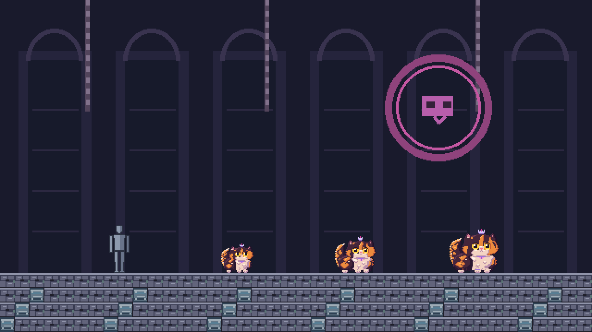
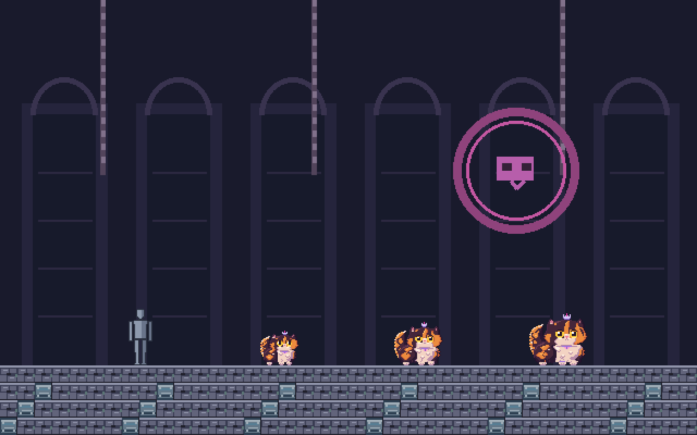
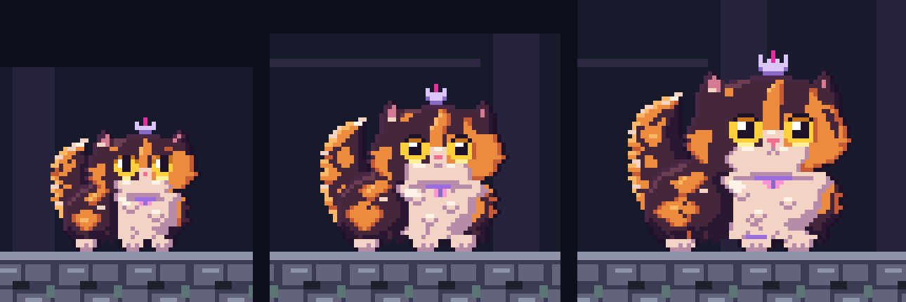
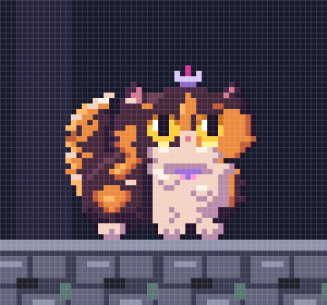
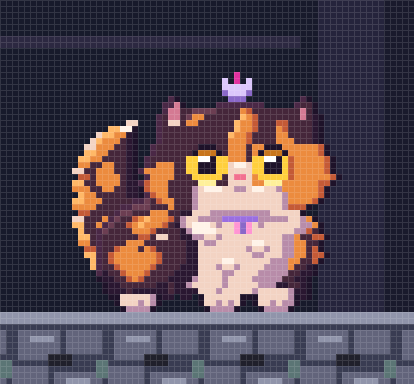
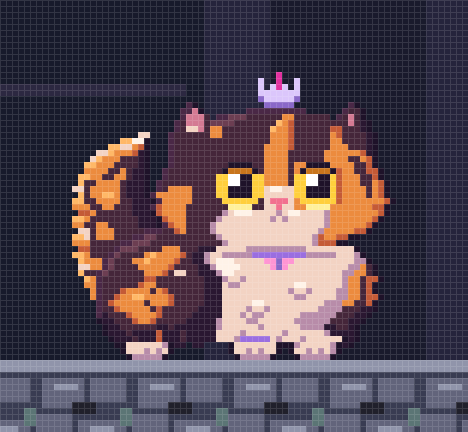
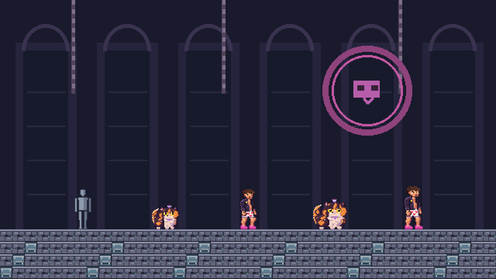
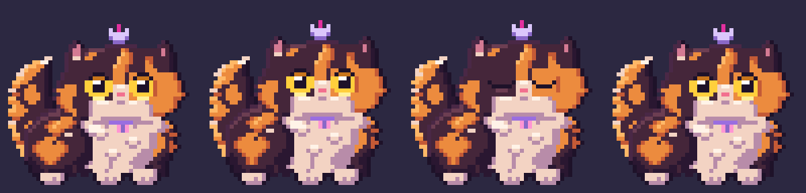
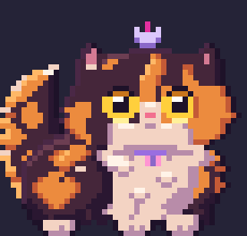
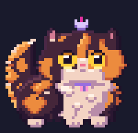

# Princess Donut: floor 1 native pixel scale study

**Status:** three native-resolution studies and one four-frame idle prototype, **awaiting human artistic review**. Nothing here is a locked production sprite, and this document does not decide the scale. The scale below is a **proposal** for the reviewer, revised after the cast-context check against the real Carl pixel masters.
**Work order:** [`docs/07-agents/donut-floor1-scale-study.md`](../07-agents/donut-floor1-scale-study.md). **Branch:** `art/donut-floor1-scale-study`. **Evidence commit:** `4918b73`.
**Rights:** publication of these sources and renders is covered by the owner-reported record `ART-PUBLICATION-ALL-V1` in [`rights-and-release.md`](../04-production/rights-and-release.md). That record is not verified rightsholder consent and grants no reuse licence.

## Method

- **Source format:** `pixel-grid-v1` text grids (`donut_h{32,40,48}.grid.json`), layers bottom to top `tail, body, head, face, gear`. `scripts/pixel_grid_to_ase.py` builds the editable `.ase` master from each grid, and `scripts/export_assets.sh` exports atlas PNG and metadata through the existing toolchain.
- **Per-size native authoring:** each size was drawn separately at its own resolution. No size is a resize of another. No pixel comes from the concept board or its tiny mock sprites. The board was used only as enlarged crops for proportions, patch map and gear restraint.
- **No resizing, no board pixels:** all renders in this study are nearest-neighbour integer enlargements of the exported pixels. No smoothing is applied anywhere.
- **Rounds:** round 1 (Sonnet) was rejected. It read as a generic spotted calico, with a boxy head, small eyes, Dalmatian spots, a rigid tail column and a boxy torso on visible legs. Round 2 (Opus) replaced it entirely, then went through a polish pass on the tail fringe and chest, and added the 40 px idle.
- **Gates:** `lint --strict --expect-height N` passes for all three (exact opaque heights, contact row equals pivot y, 0 orphan pixels, 0 isolated pixels, 0 px bottom-row drift). The shared 22-colour palette is within the 24-colour limit. Every pixel is fully opaque and there is no antialiasing.
- **Shared design:** the same seated three-quarter front loaf, coat map and gear placement at every size: round pansy head, oversized gold eyes, small lilac tiara with a magenta gem as the highest pixel, 1 px violet collar with a butterfly charm, and a separate plume tail layer. Per-size pixel budgets and what each size had to simplify are in [`STYLE_NOTES.md`](../../assets/source/characters/donut/STYLE_NOTES.md).

## Sources, manifests and reproduction

| Size | Grid source | Editable master | Manifest |
| --- | --- | --- | --- |
| 32 | `assets/source/characters/donut/donut_h32.grid.json` | `assets/source/characters/donut/donut_h32.ase` | `assets/manifests/donut_scale_h32.json` |
| 40 | `assets/source/characters/donut/donut_h40.grid.json` | `assets/source/characters/donut/donut_h40.ase` | `assets/manifests/donut_scale_h40.json` |
| 48 | `assets/source/characters/donut/donut_h48.grid.json` | `assets/source/characters/donut/donut_h48.ase` | `assets/manifests/donut_scale_h48.json` |

The three manifests join the scale-study group `donut_floor1`. Palette, pose, coat map and critique log are in [`STYLE_NOTES.md`](../../assets/source/characters/donut/STYLE_NOTES.md).

Reproduce everything (from the repository root; `ART_CLI` is an Aseprite or LibreSprite CLI executable):

```bash
ART_CLI=/path/to/aseprite-or-libresprite bash scripts/export_assets.sh
```

This rebuilds the `.ase` files from the grids, exports atlases, validates them, and writes the comparison scene, close-ups, `comparison.json` and the idle GIF under `generated/art/` (git-ignored). The committed copies of the review images, their regeneration notes and checksums are in [`docs/evidence/donut-floor1-scale-study/`](../evidence/donut-floor1-scale-study/README.md).

## Evidence

All three candidates stand on the same floor line, under the same camera and backdrop, beside a neutral 52 px mannequin that stands in for Carl's provisional 48-56 px height. The mannequin is **not Carl**. This is a native-scale pixel review, not gameplay capture and not an in-engine check.

Native 640x360 scene at 1x (left to right: mannequin, 32, 40, 48):


The same scene at nearest-neighbour 2x (1280x720):



Steam Deck-class framing (640x400 native, 2x):



6x close-ups side by side (32, 40, 48), no smoothing:



Per-size 6x close-ups with a pixel grid, for pixel-level review:

| 32 px | 40 px | 48 px |
| --- | --- | --- |
|  |  |  |

What is visible in the 2x scene and the side-by-side close-ups:

- At 2x the 32 px cat is clearly the smallest figure and is dwarfed by the mannequin. The face is a small gold-eyed patch that stays recognisable but has little room beyond it. The 40 px cat reads as a distinct, compact companion with a readable face, tiara and plume. The 48 px cat is nearly the mannequin's height and has the largest head, the dominant gold eyes and the most legible tiara, charm and nose.
- In the close-ups the tail is a separate, ginger-marbled plume at all sizes, with a lit fringe on its outer edge. Its dark inner edge sits against the body's dark coat, so the separation is by value only and is softest at 32.
- The large cream chest ruff is the biggest flat area at every size and is most noticeable at 40 and 48.

## Cast-context check (Donut beside real Carl pixel masters)

The study above judged Donut against a neutral mannequin. The Carl Book 1 pixel masters (branch `art/carl-book1-sprite-scale`, commit `5d00770`) now allow a check against the real character. The scene stands Donut 32 and 40 next to Carl 52 and 56 on the same floor line. Left to right: mannequin, Donut 32, Carl 52, Donut 40, Carl 56. Provenance, the exact command and checksums are in the [evidence README](../evidence/donut-floor1-scale-study/README.md).



The native 640x360 scene is [`cast_check_scene_640x360.png`](../evidence/donut-floor1-scale-study/cast_check_scene_640x360.png) and the measurements are in [`cast_check_comparison.json`](../evidence/donut-floor1-scale-study/cast_check_comparison.json).

Measured opaque size (width x height, from `cast_check_comparison.json`):

| Actor | Width x height (px) |
| --- | --- |
| Donut 32 | 36 x 32 |
| Carl 52 | 23 x 52 |
| Donut 40 | 45 x 40 |
| Carl 56 | 25 x 56 |
| Mannequin (not Carl) | 22 x 52 |

What the scene shows:

- Donut is a wide loaf, Carl is a narrow standing figure, so width matters more than height. Donut 40 is 45 px wide against Carl 52's 23 px, about twice the width. It carries more visual mass than Carl and competes with the player character for attention, even though it is 12 px shorter.
- Donut 32 is 36 px wide, about 1.6x Carl 52's width. Beside Carl 52 it reads as a cat companion with the right relationship: clearly the smaller, secondary figure. Her gold eyes and the tiara still read at 1x and 2x.
- Donut 40 is the more expressive face, but in the cast scene that extra room costs hierarchy. This is a visual review note, not a verdict.

Limits of this check: it is a native-scale pixel review on a static scene. It is not gameplay capture, not an in-engine check, and no human has judged game feel at these scales. Carl's width of 23 px at 52 px is the measured value (the mannequin is 22 px).

## Evaluation matrix

Measured values come from `generated/art/scale_study/donut_floor1/comparison.json` (opaque height, width, canvas, pivot) and from the grids (opaque pixels counted on frame 0; they match the exported atlases: 844, 1305, 1893). Height ratios use the 52 px mannequin proxy and Carl's provisional 48-56 px range from `docs/02-art/art-direction.md`. Cells that describe appearance are visual review notes, not verdicts.

| Criterion | 32 px | 40 px | 48 px |
| --- | --- | --- | --- |
| Eyes / muzzle readability | Eyes 6x6 near / 5x6 far, no lid arc, tall 2 px pupil, 1 px catchlight, amber corner pixels only. 1 px nose, no mouth. Face reads at 1x as gold eyes on a dark mask, but is cramped and has the fewest expression pixels. | Eyes 7x7 near / 6x7 far with lid arc, 3 px amber band, 3x3 pupil, 2x1 catchlight and a light-gold glint. 2x1 nose and 2 px mouth. All identity anchors read at 1x and 2x. | Eyes 8x8 near / 7x8 far, 2x2 catchlight, 4 px amber band, triangle nose and 3 px "ω" mouth. Largest, most luminous and cutest face, most room for expressions. |
| Silhouette | 36 px wide, 32 px high. Round head, ears, plume and tiara read at 1x. Compact, nearly square loaf. | 45 px wide, 40 px high. Head is 50 % of the height, wider than tall, with a clear plume and loaf outline. Strongest "round fluffy Persian" read against the scene. | 54 px wide, 48 px high. Clear and detailed outline, widest footprint (about 1.5x the 36 px width of 32). |
| Tail | 11 px max width, 23 rows, fewer fringe tufts. Tucks 0-3 px behind the near cheek, mostly dark against dark cheek there, so separation is the weakest. | 14 px max width, 28 rows. Distinct plume with `G`/`O` fringe tufts and a tip flick. Separated by value from the body, with a soft boundary where it tucks behind the cheek. | 17 px max width, 34 rows. Richest marbling and fringe, tip clears the head by 2-3 px. Most room for tail acting. |
| Tiara | 5x4 including a 2 px gem. Readable at 1x as a lilac nub with a magenta dot. | 5x5 including a 2 px gem. Readable at 1x, clearly a small crown. | 7x6 including a 3 px gem, three-tone. Most legible, with the most presence. |
| Contact / foot pivot | Pivot [17, 35] on a 38x36 canvas. Three paws on the contact row, 3 px each. Scene contact row 295 for all actors. Planted, centred pivot. | Pivot [22, 43] on a 46x44 canvas. Three paws, 4 px each. Same contact row 295. Pivot and contact rows stay identical across all four idle frames (0 px bottom-row drift). | Pivot [26, 51] on a 56x52 canvas. Three paws, 5 px each. Same contact row 295. Planted, centred pivot. |
| Apparent height vs Carl's provisional 48-56 px | 32 px: 57-67 % of 48-56 (62 % of the 52 px proxy). Clearly small, closest to the docs' 28-36 px range. Width note: 36 px wide against about 22-23 px for Carl 52, so about 1.6x Carl's width. | 40 px: 71-83 % of 48-56 (77 % of the 52 px proxy). Smaller than Carl yet prominent. Width note: 45 px wide, about 2x Carl 52's width, so more visual mass than Carl (see the cast-context check). | 48 px: 86-100 % of 48-56 (92 % of the 52 px proxy). As tall as Carl's lower bound, which conflicts with "Donut smaller than Carl". Width note: 54 px wide, about 2.4x Carl 52's width. |
| Clutter / lighting visibility | Mid-value ginger and cream read against the dark violet backdrop, but the small head leaves little separation of dark mask, dark tail and dark body. Small details (charm 3x1, no band) are lost. | Warm ginger and cream stand out on the dark backdrop at 1x and 2x. Chest ruff is a large cream mass, the foreleg band was dropped to avoid paw clutter. Needs a reviewer's eye on busy backgrounds and under FX. | Details are most visible and the cat dominates the frame. The large cream chest and the dark crown are big flat areas, and at this height the cat competes with the player character for attention. |
| Authoring complexity | 844 opaque px on frame 0 (65 % of the 40 px figure). Lowest cost, but expression changes have very few pixels. | 1305 opaque px on frame 0. Moderate. Already carries a four-frame idle (470, 96, 485, 25 changed px per transition). | 1893 opaque px on frame 0 (145 % of the 40 px figure, +588 px). Highest cost for every future frame, expression and animation set. |

## Proposed scale: 32 px gameplay scale (not locked)

**Proposal, revised after the cast-context check:** **32 px** opaque height (contact row to tiara gem) as Donut's **gameplay** scale, for **human artistic review**. It is not accepted, not locked, and no production animation set should be started on it until a human decides. A human makes the decision.

How the proposal changed:

- **In isolation against the mannequin, 40 px scored best.** It kept every identity anchor legible and read as a distinct companion. That finding stands for the isolated comparison.
- **Beside the real Carl, 32 px is the proposed gameplay scale.** It matches the docs' provisional 28-36 px range, keeps Carl visually dominant (36 px wide against Carl 52's 23 px, instead of 45 px at 40), and still reads the eyes and tiara.
- **40 px is the alternative** if the reviewer prioritises close-up facial expressiveness over cast hierarchy. It would need an art-direction update, because 40 px is outside the docs' 28-36 px range, and only after a human approves it.
- **36 px is a possible middle candidate** (top of the docs' range). It has not been drawn, and is a possible next study if neither 32 nor 40 satisfies the reviewer.

Remaining costs of 32 px, from the matrix and weaknesses above: it has the fewest expression pixels, no mouth or foreleg band, a 3 px charm, and the weakest tail separation. Close-up expressions (smug, calculating, furious) may need a larger portrait or a separate expression treatment rather than the gameplay sprite.

**Idle status:** the four-frame idle currently exists **only on the 40 px master**. If 32 px is approved, the idle would be re-derived on the approved size from the same master conventions (explicit edit operations on frame 0: lift, tail shear, eye replacement, pivot and bottom rows unchanged). It would not be a resize of the 40 px frames.

**Documents:** if a human approves 32 px, it is already inside the provisional 28-36 px range, so only a confirmation is needed. If a human approves 40 px, `docs/02-art/art-direction.md`, [`donut-character-bible.md`](donut-character-bible.md) and related docs would need an art-direction update to match. No document was changed for this proposal.

## Idle prototype (40 px only)

The idle exists only at 40 px. It remains useful as evidence that the coat, pivot and bottom rows hold through animation, and as the pattern for re-deriving the idle at the approved size.

Four frames in `donut_h40.grid.json`, tag `idle` 0-3 forward, durations 320 / 260 / 180 / 260 ms (about 1.02 s per loop). Frame 0 is the scale-study master. Frames 1-3 derive from it by explicit edit operations (lift, tail shear, eye replacement). Nothing is redrawn independently and nothing is rotated.

| Frame | Duration | Body and head | Eyes | Tail |
| --- | --- | --- | --- | --- |
| 0 | 320 ms | rest (master) | open | rest |
| 1 | 260 ms | inhale: everything above belly row 38 lifted 1 px, row 38 repeated | open | tip rows 12-16 shifted 1 px outward |
| 2 | 180 ms | held inhale | slow content blink: each eye becomes a `K` "‿" curve, with a 3 px `H` lid fold on the near eye | tip rows 12-15 shifted 2 px, rows 16-18 shifted 1 px |
| 3 | 260 ms | exhale: back to rest | open | tip rows 12-16 shifted 1 px outward |

- Pivot [22, 43] in every frame. Rows 39-43 (skirt tufts, all paws, contact row) are byte-identical in all four frames, with 0 px bottom-row drift.
- Frame 0 is exactly 40 px high. In frames 1-2 the gem rises to row 3, a 1 px tiara move inside the 44-row canvas.
- The export validates `donut_scale_h40_study_v0: 4 frames` through the existing toolchain, with atlas metadata durations 320/260/180/260.
- Reviewed as GIFs at 4x and 1x plus a 6x strip: no jitter in the paws or contact row, no shimmer in the coat patches.



Exported preview from the pipeline (the exporter's preview scale, 6x):



Scratch 4x review render on `#191a2c`:



## Known weaknesses

- **Chest ruff:** a large cream area at every size. The tuft clusters give it some form, but at 6x the small "v" scallops can read as marks rather than fur.
- **Outline:** mostly smooth. There are only two outline tufts on the far shoulder and a tufted skirt, with no long fur wisps on the back or rump.
- **Tail:** the S is mild (a C-bulge with a tip flick), the fringe has a faintly regular tuft rhythm, and its warm values sit near the body's ginger blotches, so tail and body separation relies on the dark inner edge. Where the plume tucks behind the near cheek, dark meets dark over a few rows (worst at 32).
- **Forehead blaze and crown:** the blaze is a fairly uniform vertical stripe and the dark crown is a big flat mass (most visible at 48).
- **32 px:** no mouth, no foreleg band, a 3 px charm, amber only at the corners of the eyes, and a cramped face that leaves very few pixels for expressions such as smug, calculating or furious.
- **48 px:** as tall as the lower bound of Carl's provisional range, so it undermines "Donut is smaller than Carl", and it is the most expensive to animate.
- **40 px:** above the docs' 28-36 px range, 45 px wide against Carl 52's 23 px so it competes with the player character, no foreleg band (dropped to keep the paw clean), and still a large cream chest mass.
- **Idle:** one inhale step, so the rise is a single 1 px pop rather than an ease. The tail sway shears only the tip rows. The near-eye closed curve is subtle on the dark mask, even with the lid fold.
- **Pose:** a seated three-quarter front loaf (board turnaround), not the side or three-quarter-side body that `walk` and `run` will need. Locomotion will need a body turn.
- **Evidence limits:** the main scenes use a neutral mannequin, not Carl; only the cast-context check uses the real Carl pixel masters. No human has judged game feel at these scales, there is no in-engine (Bevy) check, and no performance or Steam Deck claim is made. The two scratch review renders (`donut_h40_idle_4x_night.gif`, `donut_h40_idle_strip_6x.png`) are not produced by a committed script.

## Next steps

1. **Human artistic review** of the 1x scene, the 2x scenes, the cast-context scene and the close-ups, and a decision on the scale (32, 40, 48, a 36 px middle study or a rework). Record the decision as an ADR or in the backlog. Nothing is locked until then.
2. **If 32 px is approved:** keep `donut_h32` as the basis, re-derive the four-frame idle on it from the same master conventions, and decide how close-up expressions are handled (portrait or expression set).
3. **If 40 px is approved:** update `art-direction.md`, `donut-character-bible.md` and the related docs to replace the 28-36 px provisional range, and accept the extra width relative to Carl. **If another scale wins:** keep the matching master as the basis and discard or archive the others. A 36 px study is the likeliest extra round.
4. **Address the weaknesses above** on the chosen size (ruff modelling, tail separation, blaze and crown variation, a longer inhale ease and a stronger tail sway).
5. **Plan the body turn** needed for side or three-quarter-side `walk`/`run`, before committing to a larger animation set.
6. **In-engine check:** view the chosen size in a Bevy pixel-camera scene on real backgrounds and under FX once the runtime exists, and keep WORK-007 open until a human signs off at 1x and 2x.
