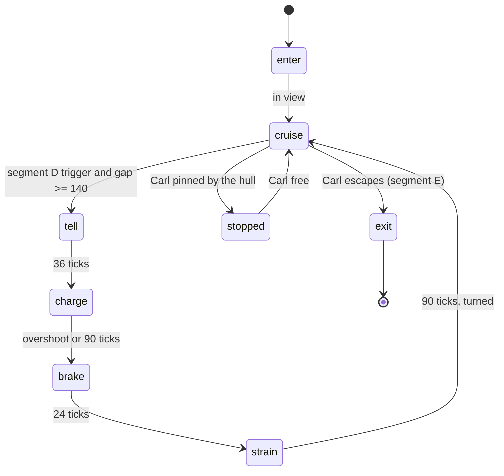

# DOZ-01: Goblin Murder Dozer design spec

**Status:** **full set drawn (Sonnet), awaiting independent Opus review.** Design by Claude Opus (phases 1 and 2, 2026-11-17); execution by Claude Sonnet (section 7.3, notes in section 15).

- **Size decided: h120.** A separate, independent Claude Opus agent made the decision, under the owner's rule that one Opus agent proposes enemy sizes and another decides them. The decider kept the rig, frame sizes and pivots as proposed. It sent back two redesigns (wheel phase 0 and the engineer's pot) and the phase 2 keys, all done here.
- **Next:** a separate Claude Opus agent reviews the set against this spec. Then the owner reviews the finished images.
- Nothing here is wired into Bevy.

Model routing ([AGENTS.md](../../AGENTS.md), "Model routing for art work"):

- **Claude Opus** (this document): the design, size study and keys.
- **Claude Sonnet:** the remaining frames, smoke frames, atlases, previews and evidence (done; section 15).
- **A separate Claude Opus agent:** the review.

Rights:

- This is fan-concept art under the owner-reported `ART-PUBLICATION-ALL-V1` scope ([rights and release](../04-production/rights-and-release.md)). There is no reuse licence and no right to distribute a game or asset pack.
- The Dozer name and the riders are the replaceable fan-concept layer. The runtime role is IP-neutral: a large tracked pursuit machine with a lethal front roller.
- The concept crop [`03-murder-dozer-reference-crop.png`](../../assets/concept/floor-01/opening/03-murder-dozer-reference-crop.png) was used for mood only. No pixel is traced or derived from it. None of its specific parts is copied: the front-mounted giant wheel housing, the red-and-white panel, the goggled riders and the firebox placement.

Evidence: [docs/evidence/doz-01/](../evidence/doz-01/README.md).

## 1. Canon checklist

From the [opening encounter handoff](../07-agents/floor-01-opening-encounter-handoff.md) (segments C, D and E), the [Floor 1 opening direction](floor-01-opening-catacomb-goblins.md) and the [combat probes](../07-agents/floor-01-integrated-combat-probes.md):

| Canon or brief item | Where it is in the design |
| --- | --- |
| Rusted, mismatched steam contraption | A cool boiler-iron hull, with dark rust cab plates, a copper patch, a rust plate bolted over a hole in the tub, soot bands and rust streaks |
| Tank treads | One near-side tread unit: a link belt with cleats, 4 road wheels, 2 end wheels and a riveted track frame |
| Huge spiked spinning front wheel | A 96 px riveted drum with 12 spikes on a push-arm fork. It spins on its own cycle (section 5) and is the brightest part of the machine (section 7.1) |
| Several smoking pipes | The main stack with a bucket spark cap, a rear copper exhaust with a tin-can cap, and a kettle soldered on as the steam whistle (3 emitters) |
| Three riders: two level-2 goblins and a level-3 engineer in a kitchen-pot helmet | The engineer sits at the rear controls in an upside-down saucepan, its handle sticking out back. Rider A (GOB-01 variant A) and rider B (variant B, red bandana) sit in the front tub |
| The engineer visibly operates the Dozer | One hand on the throttle lever (the knob is on the hull, under his hand), the other arm pointing at Carl. He has a lever-pull key for the charge |
| Grimy, menacing and a little ridiculous | A painted shark-tooth grin on the tub, the kettle whistle, the bucket on the stack, the saucepan helmet (it hops off his head on a lurch and slides over his eyes on a brake), and a pressure-gauge needle past the red |
| Escape threat, not a boss | No health bar or damage frames; knockback immunity; tells for the charge and the overshoot (section 9) |
| Riders are separate, reusable concepts | Riders are their own 64 x 56 sprites with GOB-01 pixels and palette, seated by anchors. The on-foot goblins stay GOB-01 |
| Wheel lethal zone distinct from the hull | Bright spike ring (mean L* 0.58) over a dark drum (L* 0.26), in front of a cool iron hull |
| Smoke stays local | Small, short-lived, non-blocking puffs from 3 emitters (section 5) |
| 1980s to 1990s action tone, original design | A scrap-built road roller with a grin and a soot-faced crew: B-movie menace, no copied vehicle |

## 2. Size study and decision

Reference values:

- Carl is 52 px, about 6 ft (8.7 px per foot).
- **His simulated jump apex puts his feet 88.5 px up.** `src/prototype.rs` updates the speed before the position each tick, starting from `JUMP_SPEED` 440 with `GRAVITY` 1050 at 60 Hz. The closed form `v² / 2g` gives 92.2 px and overstates it. At the apex his head is about 140 px up.
- The ENV-01 corridor has 276 px from the walking line (world y 308) to the ceiling collider (world y 32).

**Body height** runs from the floor to the boiler dome top. It excludes the stack, the riders and the smoke. One parametric construction is rasterized natively at each scale, with no resampling between sizes, and the 36 px riders keep their size. These are block-ins for the decision, not production pixels.

| Measure | h96 | **h120 (decided)** | h150 |
| --- | --- | --- | --- |
| Opaque height / length (px) | 124 / 207 | 155 / 259 | 193 / 322 |
| Share of the 640 x 360 view (height / width) | 0.34 / 0.32 | 0.43 / 0.41 | 0.54 / 0.50 |
| Clearance under the ceiling collider (px) | 152 | 121 | 83 |
| Body / Carl, implied height | 1.85x, 11.1 ft | 2.31x, 13.8 ft | 2.88x, 17.3 ft |
| Wheel tip to tip (px) | 77 | 96 | 120 |
| Tub rim (px) | 83 | 104 | 130 |
| Carl can jump over the wheel / onto the tub | **yes / yes** | no / no | no / no |
| 36 px rider / body height | 0.38 | 0.30 | 0.24 |
| Atlas px, split parts (phase 2 frame plan, section 3) | 176,999 | 229,227 | 313,509 |
| Atlas px, monolithic estimate (36 x 2 flattened frames) | 1,848,096 | 2,890,440 | 4,474,512 |

**Decision: h120.** The body is 120 px (155 px with the stack) and 259 px long. A separate Opus agent decided it, based on the proposal below.

- **Threat and readability.** At 2.3 times Carl's height it towers without leaving the frame. In the chase composition, with Carl 213 px ahead of the wheel, the whole machine, all three riders and both characters fit in one 640 x 360 view. At h150 the rear is already off-screen at the same gap, and the machine takes half the view.
- **No false affordance.** Carl's feet reach 88.5 px at the apex. The 96 px wheel and the 104 px tub rim are both above that, so the machine reads as "run", not "jump over it". At h96, Carl can clear the 77 px wheel and land on the 83 px tub. That invites a mounting mechanic nobody has designed.
- **Ceiling and lanes.** 121 px of clearance leaves room for the smoke column. At h150 the stack and smoke crowd the top third of the view.
- **Riders at 36 px.** At h120 the riders' heads and raised pineapples break the hull silhouette and read as a crew. At h96 they crowd the hull. At h150 they shrink to ornaments.
- **Atlas cost.** Split into parts, h120 costs about 229k atlas pixels with riders, smoke and the hit-spark. That is more than 10 times less than flattened frames, and 27 % less than h150.

**Jump margin.** The proposed lethal circle has r 44 around the axle at y 49, so its top is at y 93. That is 4.5 px above Carl's feet at the simulated apex. The hull is flush with the wheel's back (the rear spike tips at x +76 meet the tub front at x +79), and the tub rim is at 104. So even a jump that cleared the circle would end against the hull and drop Carl back onto the wheel; no jump clears the machine. **Keep r 44.** The CHASE-01 lethal-margin test must integrate the jump the way `src/prototype.rs` does (speed first) and **fail if the simulated apex reaches 90 px or more**. `tests/test_art_dozer_doz01.py` pins this target for the art side.

## 3. Construction and parts

The Dozer is a rig of parts, so a few frames give a lot of motion:

- a 9-frame belt;
- a 4-frame wheel;
- riders with their own cycles;
- a rattle that moves only the hull and the riders.

**Rig origin O** is the tread footprint midpoint on the walking line. Anchors are in px from O, with x forward and y up. A part's pivot is placed on its anchor. Facing left, mirror every anchor's x and flip each frame around its pivot. The data contract is [`dozer_rig_h120.json`](../../assets/source/enemies/dozer/dozer_rig_h120.json). `tests/test_art_dozer_doz01.py` checks that composing the parts with it reproduces the assembled machine pixel for pixel.

| z | Part | Atlas / tag | Frame | Pivot | Anchor | Frames (plan) |
| --- | --- | --- | --- | --- | --- | --- |
| 0 | smoke puffs (world space after spawn) | `dozer_smoke` | 24 x 24 | (12, 12) | emitters below | 6 black + 5 steam |
| 1 | hull body | `dozer_hull_h120` / `body` | 175 x 160 | (87, 159) | (0, 0) | 1 (+ rattle offset) |
| 2 | tread | `dozer_tread_h120` / `roll` | 151 x 34 | (75, 33) | (0, 0) | **9** |
| 3 | engineer | `dozer_riders_h36` / `engineer_*` | 64 x 56 | (28, 55) seat | (-48, 98) | 7 (point, jab, idle 0 and 1, lever pull, lurch back and forward) |
| 3 | rider A | `dozer_riders_h36` / `rider_a_*` | 64 x 56 | (28, 55) seat | (38, 96) | 6 |
| 4 | rider B | `dozer_riders_h36` / `rider_b_*` | 64 x 56 | (28, 55) seat | (66, 96) | 6 (A's construction + B overlay) |
| 5 | hull front, cab rail | `dozer_front_cab_h120` / `front_cab` | 60 x 21 (trimmed) | (0, 20) bottom-left | (-75, 85) | 1 |
| 5 | hull front, rider tub | `dozer_front_tub_h120` / `front_tub` | 65 x 82 (trimmed) | (0, 81) bottom-left | (19, 23) | 1 |
| 6 | spiked wheel | `dozer_wheel_h120` / `spin` (`phase_0` to `phase_3`, `smear`) | 99 x 99 | (49, 49) axle | (124, 49) | 4 + 1 smear |
| 7 | near push arm, axle cap, lamp | `dozer_yoke_h120` / `static` | 64 x 44 | (54, 30) axle | (124, 49) | 1 |
| 8 | hit-spark (shared VFX) | `vfx_hit_spark_metal` (`assets/source/vfx/`) | 16 x 16 | (8, 8) | contact point | 3 |

Rig details:

- **Occluder rows.** The hull front hides every part of a rider below them: y 105 for the engineer, y 104 for riders A and B. Rider pivots are the **seat point**, not the floor. Rider-canvas rows 48 and below are always hidden. A flung pineapple may hang over the tub's back edge; that is deliberate and tested.
- **Emitters** (smoke spawn points): stack (15, 156), rear exhaust (-82, 124), kettle whistle (5, 129).
- **Lights** (optional A1 point lights, presentation only): lamp glass (98, 66) and firebox slots (-30, 49).
- **Extents:** x -84 to +172, top of the stack 156, dome 120, tub rim 104.
- **Rider spacing rule:** the brandishing rider sits at the rear seat. Its raised pineapple then swings over the boiler, not over the other rider's face.

**Atlas budget (h120).** Changes from phase 1:

- Tread: 9 x 5,134 = 46,206 px, up 30,804 px from the 3-frame plan.
- Wheel: 5 x 9,801 px with the optional smear.
- Riders: 19 x 3,584 = 68,096 px.
- Smoke: 11 x 576 px.
- Hit-spark: 3 x 256 px.

With the hull and the yoke, the split atlases total about 229k px. Trimming `front` saves about 20k.

**Damage and rattle states.** CHASE-01 does not need damage frames, because the Dozer is never defeated in the opening. The chase needs these runtime states, made from offsets and the existing frames:

- `rattle`: while moving, the hull body, hull front and riders move up 1 px for 3 ticks every 6 ticks. The tread and wheel stay on the floor. The riders follow 2 ticks late (secondary motion).
- `strain` (segment D, stuck or turning): rattle at double rate (1 px every 3 ticks), puffs from all three emitters, firebox light at full.
- A dented-front variant after a wall impact is a later decision.

## 4. Palette `dozer-floor01-v0`

There are 39 machine colours (7 of them for smoke and steam) plus the shared outline. The riders use the GOB-01 palette (19 more), so the union is **59 colours** (the maximum is 64, and this is tested). Every atlas stays under 64.

| Keys | Name | Hex | Role |
| --- | --- | --- | --- |
| K | outline_plum | `#1b1124` | shared with Carl and the goblins |
| 0 to 6 | iron ramp | `#121220` `#1e2032` `#2c3046` `#3f445e` `#575e7a` `#78809a` `#a3abbf` | dominant boiler iron. It is cool, so the hull separates from the orange brick (tested: iron outweighs every warm key). Spikes: 4, 5 and the 6 lit face. Rim band: 5 and 3. Spokes: 2 with a 4 edge. Inner ring: 3 |
| 7 | iron_glint (accent) | `#dde2ec` | the outer 2 px of every spike, rivet heads, rim bolts, axle bolt, one bolt per road-wheel hub |
| Q W E T Y | rust ramp | `#2a1612` `#4a2318` `#6c321e` `#914524` `#b55f2c` | cab plates (Q to T only, dark), streaks, track frame, stack. The wheel drum uses Q and W, and E only as an upper-left crescent |
| p b d | paint ramp | `#3c1219` `#611b22` `#8a2b2b` | oxblood plate with the painted grin |
| c f g h i | copper (ENV-01 `copper_01` to `05`) | `#3a1a14` `#5c2a18` `#823e1e` `#a85626` `#cc7332` | rear exhaust, patch |
| L M N S Z | brass (ENV-01 `brass_01` to `05`; Z accent) | `#43331a` `#6a5224` `#93752e` `#bc9a3a` `#e0c25a` | firebox door, gauge, kettle, collar, hubs, axle cap |
| X | bone_paint | `#d8cdb0` | painted teeth, gauge face |
| j k n q z | fire (ENV-01 emissive colours) | `#8a2a12` `#d4501a` `#f58a26` `#ffc048` `#ffe98a` | **only** the firebox slots and the lamp glass (tested). These are the ENV-01 bloom colours, so the slots can glow if the runtime ever blooms actors |
| + = - : | smoke ramp | `#1c1a22` `#2e2a34` `#4a4450` `#6c6474` | black exhaust puffs: + underside, = body, - lit band, : brightest edge |
| ; / * | steam ramp | `#9c9cae` `#c6c8d4` `#eceef4` | kettle and brake steam: ; underside, / body, * lit |

Rules:

- Goblin green appears only on the riders (GOB-01 R7, tested on the machine atlases).
- Rust may never be the dominant hull colour, because the warm brick is right behind it.
- **The spike ring is the brightest part of the machine** (section 7.1, tested).

## 5. Animation timing at 60 Hz (proposal)

The simulation advances every part from ticks and travelled distance, never from wall-clock time. Animation never feeds back into the simulation. The atlas `duration_ms` is `round(ticks * 1000 / 60)` and is used for previews only.

| Part | Rule | Ticks per frame | Notes |
| --- | --- | --- | --- |
| Wheel spin | 4 frames of 7.5 degrees. With 12-fold features, the cycle repeats every 30 degrees | stopped: hold; strain: 3; cruise: 2 (225 deg/s); charge: 1 (450 deg/s) | Driven faster than rolling (191 deg/s at 160 px/s), so it reads as a powered grinder. The optional smear frame replaces every second charge frame. The light stays fixed |
| Tread belt | **9 frames, 1 px steps** of a 9 px link pitch; **frame = floor(distance) mod 9** | distance-driven | Slip-free at any speed. It reads forward while the step per tick is under half the pitch: up to 4 px per tick (240 px/s, the charge) and ambiguous from 4.5 px per tick (270 px/s). Phase 1 planned 3 frames of 3 px, and that version flickers backward above 3 px per tick (180 px/s), including the charge: a tick that advances 2 frames of 3 reads as a step back. Road wheels turn 8.2 degrees per frame inside the same 9 frames |
| Black smoke (stack) | 6 frames: spawn 6 px (key 0), 10 px, 16 px (key 2), breaking up, thin, last wisp | 4 per frame (24-tick life) | One puff every 12 ticks at cruise, every 4 during the charge tell, every 8 during the charge. It rises 0.5 px per tick and stays in world space, so it trails behind. At most 8 puffs alive |
| Rear exhaust | same black puff | 4 | every 20 ticks while moving |
| Steam (kettle) | 5 frames (keys 0 and 2) | 3 | only in the charge tell, the brake and strain: a 3-puff burst |
| Hit-spark | 3 frames: star, burst, fade | 2 each | only for Carl's melee on the hull **from behind** (section 9) |
| Rider idle | 2 frames: seated hold, then rows 0 to 46 moved 1 px lower | 16 each | per rider. A and B are phase-offset by 8 ticks |
| Rider yell | 2 frames: brandish key, then the pineapple 2 px higher and the mouth 1 px wider | 6 each, 3 loops | on the charge tell, and when Carl is within 120 px |
| Engineer | `engineer_point` and a jab (finger 1 px forward), 8 ticks each; `engineer_lever_pull` | 8 / hold | lever_pull for the whole charge tell |
| Lurch back | `*_lurch_back` keys | 8 | at charge start. The hull body squats 1 px at the rear for 4 ticks |
| Lurch forward | `*_lurch_forward` keys | 10 | on the brake or overshoot. The rig slides 4 px past the stop point |
| Rattle | rig offset, section 3 | 3 on, 3 off | strain: every 3 ticks |

## 6. Lighting note

The hull and riders are lit by the A1 pass like every actor: actor-group ambient 0.9 / 0.92 / 1.0, with torch light at 0.3. The palette is tuned for that. The cool iron sits in front of warm brick. The brightest pixels are the spike ring (mean L* 0.58, against 0.26 for the drum, which no longer matches shaded brick) and the riders' faces.

The lamp glass and the firebox slots use ENV-01 emissive colours. A small warm point light on each (radius about 40 px, presentation only) is **optional** and must not change gameplay.

The contact shadow is per actor box. For the Dozer, the runtime should use the tread footprint (x -74 to +74) rather than the whole sprite, so the shadow does not reach under the wheel.

## 7. Keys and the Sonnet ready list

`scripts/author_dozer_doz01.py` produces every key; it is the authoring record. The committed grids are the source of truth, and `--check` verifies them. All keys face right.

### 7.1 Keys (Opus, as authored)

**Hull `body`**, from the back:

- a copper rear exhaust running up the back, with an elbow and a dented tin-can cap;
- a cab box of dark rust plates (two riveted seams, rust streaks) with a brass firebox door and three glowing slots;
- a deck plate, and the throttle lever with a brass knob at about (-36, 106);
- a vertical iron boiler with three riveted hoops, a copper patch, a brass gauge (needle past the red), soot bands and one dent; its dome top is at 120;
- a brass kettle on the dome as the whistle;
- a crooked rust stack with a brass collar and an upturned iron bucket as the spark cap (top 156);
- the dark tub back wall (hidden by `front`) and a dark chassis strip behind the tread.

**Hull `front`:**

- The rider tub has a slanted front, a rolled iron lip (top y 104), a riveted seam, a bolted rust plate and streaks.
- Its oxblood lower plate carries the painted grin: staggered bone teeth around a dark mouth.
- The cab rail plate has a tube rail (top y 105).

**Wheel, phase 0 (phase 2 redesign).** The lethal part is the brightest thing on the machine.

- **Spikes:** 12, in iron `4` and `5`, with a `6` face on the side toward the upper-left light. The outer 2 px of every spike is `7`, and every spike keeps its `K` outline.
- **Rim band:** 3 px, `5` on the outer 2 px and `3` on the inner 1 px. It carries the 12 bolt glints (`7`) between the spikes.
- **Drum:** dark `Q` and `W`, with `E` only as an upper-left crescent.
- **Spokes:** 12, each 2 px of `2` with a 1 px `4` edge on the lit side. They run from the brass hub to a 2 px `3` inner ring at r 30.
- **Symmetry and light:** every feature is 12-fold, so phases 0, 7.5, 15 and 22.5 degrees loop exactly. The shading is in screen space, so the light does not turn with the wheel.
- **Measured:** the spike ring's mean L* (outline excluded) is 0.58 in all four phases, and the drum's is 0.26.

**Tread, phase 0:**

- The belt's bottom run lies on the contact row (row 33).
- Each road-wheel hub has 5 dark bolts. The one nearest the upper-left carries the `7` glint, so the glint keeps the light fixed while the bolts turn.

**`engineer_point` (phase 2 pot redesign).** The body is the GOB-01 idle body seated: rows shifted down 9, no pineapple. Over it go the saucepan, the pointing far arm and the near hand on the lever knob. The saucepan:

- jammed down to the brow;
- a **flat top** with a 1 px `6` light row;
- a 2 px `K` notch on the top-front corner;
- a 4-row body shaded as a cylinder;
- a lip only 1 px wider than the body on each side, on the rows just above the brow;
- a **2 px handle about 11 px long**. It leaves the lip, rises 2 px toward the back and has a 1 px `K` hanging hole 2 px from its end. At 1x it reads as a saucepan, not a top hat.

**`engineer_lever_pull`.** The torso and head lean back 2 px. The head is the GOB-01 yelling head (frame 11 moved by (-2, -2)). Both forearms reach straight to the knob: the near arm lit, the far arm in shade above it. The pot tilts back, with its top 2 rows 1 px back.

**`engineer_lurch_back`.** He is thrown back 3 px, yelling, with white eyes. The pot **hops 3 px off his head** and stays tilted back. His hands stay on the knob.

**`engineer_lurch_forward`.** He is pitched 2 px forward and 1 px down. The pot **slides 3 px down over his eyes**.

**`rider_a_brandish`.** The GOB-01 attack-tell key (frame 11) seated, with its pixels unchanged.

**`rider_a_lurch_back`.** The GOB-01 hurt key (frame 16) seated: head thrown back, white eyes, an O mouth, the pineapple arm flung up and back.

**`rider_a_lurch_forward`.** The seated hold pose (GOB-01 frame 0) pitched 2 px forward and 1 px down, with white eyes.

**Rider B (`rider_b_hold`, `rider_b_lurch_back`, `rider_b_lurch_forward`).** The same construction from GOB-01 variant B (the bandana overlay). `rider_b_hold` is derived, not a new key.

**Smoke, frames 0 and 2.** Lumpy round blobs with no outline:

- the body in the middle tone, a 1 px darker underside, an upper-left lit band and a few brightest edge pixels;
- black frame 0 is the 6 px spawn and black frame 2 the 16 px puff;
- steam frames 0 and 2 are smaller and paler.

For every rider frame, the visible rows (above row 48) are GOB-01 pixels translated whole, apart from the engineer's new pot and arms. Only the always-hidden rows are despeckled.

### 7.2 Rules for every new frame

- Keep the pivots, the palette and the anchors.
- Never resample or rotate pixels. The exception is the wheel and the tread: render them from their geometry with `wheel_rows(phase_deg)` and `tread_rows(phase)`, then clean up by hand.
- Rider frames are GOB-01 pixels translated whole wherever possible.
- Run `tests/test_art_dozer_doz01.py` and extend it to every new frame (section 8).

### 7.3 Sonnet ready list (execution, done: see section 15)

| # | Atlas | Work | Acceptance |
| --- | --- | --- | --- |
| 1 | wheel | Phases 1 to 3: `wheel_rows(7.5)`, `(15)`, `(22.5)`, then hand cleanup. Every spike keeps its `K` outline and its 2 px `7` tip; the spokes stay 2 + 1 px wide with no broken pixels; the hub and rings stay concentric (no wobble); the drum crescent stays upper-left | spike-ring mean L* at least 0.5 in every frame; phase 0 to 3 loops into phase 0 |
| 2 | wheel | Optional charge smear: phase 0 with a 1 px iron-5 arc joining the spike tips in the spin direction, and the tips in `6` instead of `7` | shown on every second charge frame only |
| 3 | tread | 9 phases: `tread_rows(0..8)` (1 px steps; frame = floor(distance) mod 9). Each road-wheel hub keeps exactly one off-centre `7` bolt (the one nearest the upper-left); check the end wheels for popping at the 8 to 0 wrap | contact row 33 in all 9 frames; the cleat count on the bottom run differs by at most one between frames |
| 4 | hull | Trim `front` into its own box (two boxes: cab rail and tub) and recompute its pivot so that O stays on anchor (0, 0). Add 2 px iron-`2` posts at the cab corners (the rail ends) on `front` | the rig still reproduces the assembly; riders are still hidden below the rim |
| 5 | yoke | Polish: two rivet rows along the arm, a 2 px iron-`1` underside, and one rust streak (`E` over `W`) from the lamp mount | 0 orphans |
| 6 | riders | Idle 0 and 1 for A, B and the engineer (section 5). Yell 1 for A and B. The engineer's jab (the point key with the finger 1 px forward) | visible rows stay GOB-01 pixels; hidden-below-rim test |
| 7 | riders | **Rider A fist-to-stick gap:** in `rider_a_brandish`, `rider_a_yell_1` and every frame built on GOB-01 frame 11, close the gap with a continuous 1 px `y` stick with `K` edges from the fist to the pineapple. The same gap exists in merged GOB-01 frame 11; fix it there too, in its own commit, and update the GOB-01 frozen-key fixture deliberately | no gap between fist and stick at 1x |
| 8 | smoke | Black puff: 6 frames from keys 0 and 2 (add 1: 10 px; 3: breaking up into 2 lumps; 4: thin, 3 small lumps; 5: last wisp, 2 to 3 px). Steam: 5 frames from keys 0 and 2 (add 1, 3 and 4 the same way). No outline, no dithered transparency | own ramp only; darker underside in every frame |
| 9 | VFX | Hit-spark, 3 frames, 16 x 16, pivot (8, 8): a 4-point star (`7` core, `6` arms), a burst with 4 to 6 short iron-`5` streaks, and a fade (2 to 3 pixels of `4`). It is shared with other metal hits | 0 isolated pixels |
| 10 | tests | Spike-ring brightness on all wheel frames; tread contact row on all 9 frames; the simulated-apex margin (`< 90`, documented CHASE-01 target); hidden-below-rim on every rider frame | green in CI |
| 11 | evidence | GIFs of **cruise, tell, charge, brake and strain**, at x1 and x3, driven by the section 5 timing. A lit chase at 640 x 360 and 1920 x 1080 with the wheel **in front of both a torch-lit and an unlit stretch of brick**. A rig and timing diagram (frame layout, pivots, tick bars, state flow). A new `SHA256SUMS` | README lists every file |

## 8. Validators

These are automated in `tests/test_art_dozer_doz01.py` for the keys. Extend them to every new frame.

**Frames and pivots:**

- Frame sizes and pivots match the parts table and the manifests.
- The wheel pivot is its centre pixel, and the yoke pivot carries the axle glint.
- The boiler dome's outline row is 120 px above the contact row.
- The tread's bottom run sits on the contact row in **all 9 phases**, and the 9 phases are distinct, each with lit hub bolts.
- The wheel's lowest spike outline sits on the contact row.

**Wheel:**

- 12 separate spike clusters outside the rim, with tips reaching radius 48 to 50.
- **The spike ring's mean L* is at least 0.5** in all four phases, and the drum's is at most 0.3.
- The spike ring is at least 0.1 brighter than the drum, the hull body, the hull front, the tread and the yoke.
- The outer 2 px of every spike is `7` or `K`.
- Phase 30 degrees equals phase 0, and the silhouette is 12-fold.
- The drum crescent stays upper-left in every phase.

**Palette:**

- Every entry comes from `dozer-floor01-v0` + GOB-01 with identical hex.
- At most 64 colours per atlas, and at most 64 in the union.
- ENV-01 copper and brass are reused exactly.
- Goblin green never appears on the machine atlases.
- Fire colours appear only in the firebox door and the lamp.
- Iron outweighs rust and copper on the hull.

**Lint:**

- 0 isolated pixels.
- Machine and smoke keys have 0 orphans.
- Riders and the size study have fewer than 10 orphans; rider frames carry the approved GOB-01 pixels unchanged.

**Rig and riders:**

- The rig reproduces the assembled machine.
- In every rider key, every body pixel below its occluder row is covered by the hull front; weapon pixels are exempt.
- Each rider key shows at least 120 opaque pixels above the rim.
- In the seated poses, the eyes sit above the rim.
- The visible rows of rider A and B keys equal the seated GOB-01 frames they come from.
- The lurches show white eyes, or for the engineer's forward lurch, the pot over his eyes. In his lurch back, the pot hops at least 3 px.
- The lever pull leans back, opens the mouth and reaches the knob.
- The pot has its flat top, light row, notch, lip, handle rise and hanging hole.

**Smoke:**

- 24 x 24 frames, pivot at the centre.
- Each puff uses only its own ramp, with no outline and a darker underside.
- The puffs are 6 px and 16 px wide.

**Gameplay geometry:**

- The simulated apex is 88.5 px, under the 90 px target.
- The lethal top (y 93) is above it.
- The tub rim is above it.
- The stack plus 8 px fits under a 164 px ceiling.
- A 116 px side passage is too low for the machine.

## 9. Gameplay notes for CHASE-01 (all proposals)

These are **proposals** for the CHASE-01 gameplay work order. They are not implemented, and nothing is accepted until it has been playtested. Build them in the deterministic `gameplay` layer; sprites, smoke and lights never change outcomes.

**Speed.**

- Cruise at **160 px/s**, 0.86 times Carl's 185 px/s run. A running Carl slowly gains, but a missed jump, a stagger or a dead end lets the Dozer close in.
- Rubber band: if the gap is over 260 px, match 185 px/s. If it is under 96 px, drop to 150 px/s (a mercy window).
- Never faster than Carl, except during a charge.

**Lethal box.**

- A circle of **radius 44 px** around the wheel axle, at anchor (124, 49) from O. Its top is at y 93; the visual tips reach 48.
- Contact means the fail-and-retry state, not a damage tick.
- Keep r 44. The lethal-margin test uses the **simulated** apex (88.5 px) and fails at 90 px or more (section 2).
- **Donut:** Donut is either exempt from the lethal box or guaranteed to keep up (a follower speed at least the Dozer's charge speed, or a catch-up teleport off-screen). The player must never fail because of the AI partner.

**Retry.** The checkpoint restarts the chase with about **2 s (120 ticks) before contact** at cruise speed, which is about 320 px of gap. It must not drop Carl straight into a tell.

**Pushing wall.**

- The hull is a solid box from x -74 to +79 and y 0 to 104, relative to O. It pushes Carl and does no damage.
- If Carl is pinned between the hull and terrain, the Dozer stops instead of crushing him. There is no unavoidable wall-to-wall collision.
- The hull is flush with the wheel's back, so it also blocks any jump that clears the lethal circle (section 2).

**No mounting.** The riders and the top of the tub cannot be reached or targeted in the opening. The tub rim is at 104 px, against Carl's 88.5 px apex.

**Knockback immunity.**

- The Dozer ignores every impulse; it has effectively infinite mass in the hybrid-physics model.
- Carl's melee on the hull **from behind** (Carl behind the rear of the hull, facing it) produces a **clang and the shared 3-frame hit-spark**, with no state change.
- From the front, the wheel is lethal, so no clang is possible there.
- Thrown goblins or props bounce off the hull.
- Only terrain and the Dozer's own turning radius beat it: evasion, turning radius and environmental escape.

**Charge tell for segment D** (60 Hz ticks):

0. **Gate.** Start the tell only when the gap is **at least 140 px**; otherwise stay at cruise. A charge from closer would be unreadable and unfair.
1. **Tell, 36 ticks.**
   - A stack puff burst (every 4 ticks) and the kettle shriek (a steam burst).
   - The engineer plays `engineer_lever_pull` and the riders yell.
   - The hull squats 1 px at the rear, and the wheel spins at 1 tick per frame.
   - Riders play their lurch-back keys on the first charge tick.
2. **Charge.** At most 90 ticks at **240 px/s**, in a straight line; the Dozer cannot steer.
3. **Overshoot and brake, 24 ticks.** At the junction the Dozer passes the turn. The treads stop, the rig slides 4 px, the riders play their lurch-forward keys and steam bursts out.
4. **Stuck or turning, 90 ticks.** The strain state; this is Carl's escape window into the side passage.
5. **Resume** the chase at cruise speed.

The tell must be readable with the sound off, so it relies on the smoke, the riders and the squat.

**Side passage placement.** Place the side-passage entrance so that Carl, running at 185 px/s, reaches it **before the charge ends**. The numbers, starting at the minimum gap:

- During the tell (0.6 s at cruise), the gap grows from 140 to about 155 px.
- During a full charge (1.5 s at 240 px/s), it shrinks by 55 px per second, to about 72 px. A Carl who keeps running is never caught by the charge alone.
- Over the tell and the charge he covers about 390 px.

So put the entrance **at most about 390 px** ahead of Carl's position when the tell starts, and at least about 200 px so the overshoot reads. CHASE-01 must verify this with a seeded replay, including a Carl who loses 0.5 s to a stumble.

**Camera.** The composition evidence puts Carl 213 px ahead of the wheel, one third of the view, to judge the size. The chase camera should lead Carl in the run direction and keep the wheel in view at the left edge. Never shrink the actors to fit the machine.

### 9.1 ENV-02 constraints for the chase geometry (proposal)

- **Chase passage ceiling:** at least **164 px** above the walking line. That is the stack top (156) plus 8 px. **At least 200 px is recommended** so the smoke column has room. The ENV-01 corridor has 276 px.
- **Escape side passage:** clear height **at most 116 px**, so the Dozer cannot follow; the riders' heads reach about 121 px and the stack 156 px. It also needs **at least 64 px**, so Carl (52 px) fits with headroom for a landing.
- The side passage opens off the widened segment D passage. Its lip must not be a step Carl has to jump (a step of at most 1 tile, as in the ENV-01 contract).

## 10. Files

| File | Role |
| --- | --- |
| `assets/source/enemies/dozer/dozer_size_study.grid.json` / `.ase` | the machine with riders at h96, h120 and h150 (block-ins) |
| `assets/source/enemies/dozer/dozer_hull_h120.grid.json` / `.ase` | hull `body` |
| `assets/source/enemies/dozer/dozer_front_cab_h120.*`, `dozer_front_tub_h120.*` | hull `front`, trimmed into its two boxes |
| `assets/source/enemies/dozer/dozer_wheel_h120.grid.json` / `.ase` | wheel: 4 phases and the smear |
| `assets/source/enemies/dozer/dozer_tread_h120.grid.json` / `.ase` | tread: 9 phases |
| `assets/source/enemies/dozer/dozer_yoke_h120.grid.json` / `.ase` | push arm, axle cap and lamp |
| `assets/source/enemies/dozer/dozer_riders_h36.grid.json` / `.ase` | 19 rider frames (engineer 7, rider A 6, rider B 6) |
| `assets/source/enemies/dozer/dozer_smoke.grid.json` / `.ase` | smoke: black 0 to 5, steam 0 to 4 |
| `assets/source/vfx/vfx_hit_spark_metal.grid.json` / `.ase` | shared 3-frame metal hit-spark |
| `tests/fixtures/dozer_doz01_keys.json` | the 19 frozen Opus keys (flattened rows) |
| `assets/source/enemies/dozer/dozer_rig_h120.json` | rig contract: pivots, anchors, draw order, occluders, emitters, lights |
| `assets/manifests/dozer_*.json` | candidate manifests (`prototype_fixture_unapproved`, palette `dozer-floor01-v0`) |
| `scripts/author_dozer_doz01.py` | authoring record (palette, construction, every frame, grids, manifests, rig contract with the tick table); `--check` |
| `scripts/make_dozer_doz01_review.py` | size-study sheet, layout diagram, lit chase compositions of the size options, measurements |
| `scripts/make_dozer_doz01_set_review.py` | state GIFs, lit chase with the full set, part contact sheet, rig and timing diagram, measurements |
| `tests/test_art_dozer_doz01.py` | contract tests (section 8) |

## 15. Execution notes (Sonnet)

All 11 items of section 7.3 are done. Every Opus key is pixel-identical and frozen in `tests/fixtures/dozer_doz01_keys.json`, with these documented deltas only: the cab posts and the trim of the hull front, the yoke polish (recolouring inside the same silhouette) and the rider A and B fist-to-stick fix in `rider_a_brandish` (three pixels). None of these changes a timing, the pivot of an unchanged part or a size. Where the spec left a reading open, the choice made is listed here for the reviewer.

- **Wheel (items 1, 2).** Phases 1 to 3 are `wheel_rows(7.5)`, `(15)` and `(22.5)` plus the existing despeckle pass; they needed no further hand edit (0 orphans, 12 clusters, concentric, spokes unbroken, spike ring L* above 0.5, all tested in every frame). The smear is kept (frame `smear`, 1 tick): the tips are `6`, and from every tip a 1 px iron-5 arc at radius about 46 runs 26 degrees clockwise (the spin direction), framed in `K`. At 26 degrees of a 30 degree gap the arcs read as an almost closed ring at the tips, which is the intent of a motion smear; whether it is too closed is a review question.
- **Tread (item 3).** `tread_rows(0..8)` plus despeckle. The count of `7` pixels is constant; each road-wheel hub has exactly one off-centre `7` bolt in all 9 frames; the number of cleats on the contact row differs by at most one; the end wheels change no more at the 8 to 0 wrap than between other frames.
- **Hull front (item 4).** A pixel grid has one canvas and a pivot has to lie inside it, so "trim into two boxes and keep O on anchor (0, 0)" was done as two grids: `dozer_front_cab_h120` (60 x 21) and `dozer_front_tub_h120` (65 x 82). The pivot of each is its bottom-left pixel and the rig **anchor** is that pixel's position from O: cab (-75, 85), tub (19, 23). The composed machine is pixel-identical to the untrimmed front, and a test recomposes it. The atlas cost of the front falls from 28,000 to about 6,600 px. The posts are 2 px of iron-2 under both rail ends (x -74 and -73, x -18 and -17 from O, y 86 to 100), with a plum outline.
- **Yoke (item 5).** The silhouette is unchanged. A 2 px iron-1 underside along the whole arm, a second rivet row of 4 rivets parallel to the lower edge (the key's row stays), and one rust streak of 8 px at column 29 from the lamp mount: 4 px of `E` over 4 px of `W`.
- **Riders (item 6).** Frame list and tags are in the rig contract. Readings:
  - Idle 0 of rider A is the seated GOB-01 hold (frame 0); idle 0 of B is the existing `rider_b_hold` key. The assembled machine still seats A in `rider_a_brandish`.
  - Yell 0 is the brandish. B had no brandish key, so `rider_b_brandish` is derived the same way as A's (GOB-01 variant B frame 11, seated).
  - Idle 1 is "rows 0 to 46 one px lower", exactly as written, for all three riders.
  - Yell 1: the pineapple and leaf move 2 px up, the stick grows by 2 px (`y` with `K` edges), and "mouth 1 px wider" is read as the open mouth running 1 px further forward on its three rows.
  - The engineer's idle 0 (`engineer_hold`) is the point pose without the pointing arm (one hand on the lever). The spec lists point, jab and idle as separate frames (7 in all), so idle 0 cannot be the point key. The jab duplicates column 17 of the arm so the hand and finger sit 1 px further forward.
- **Rider A fist-to-stick gap (item 7).** In key 11 the stick was a lone dark `x` at (14, 17), cut off from the fist by plum outline pixels. Three pixels became `y`: (10, 14) (a stick between the fruit and the fist) and (13, 17) and (14, 17) (the stick leaves the fist and its butt joins it). The same three pixels changed in the merged GOB-01 key 11, both variants, in a separate change; see the GOB-01 spec, section 13.
- **Smoke (item 8).** Black: 10 px, 16 px (key), breaking up into 2 lumps, thin (3 small lumps), a 3 px wisp. Steam: the same plan, paler and smaller. Every frame has no outline, only its own ramp, and a `+` or `;` underside row. The wisp is 3 px wide and 6 px in area; "2 to 3 px" is read as its width.
- **Hit-spark (item 9).** `vfx_hit_spark_metal`, 16 x 16, pivot (8, 8): a `7` 3 x 3 core with four 5 px `6` arms; a burst of six 3 px iron-5 streaks (the spec allows 4 to 6); a fade of three `4` pixels.
- **Tests (item 10).** `tests/test_art_dozer_doz01.py` covers every frame (frozen keys, wheel, tread, hull, riders, smoke, spark, timing, rig). The simulated apex target (below 90 px) is unchanged.
- **Timing.** The tick counts of section 5 are in the manifests (`dozer.frames`) and in the rig contract (`timing`). The preview durations are `round(ticks * 1000 / 60)`, and 100 ms for static and state-driven frames. The wheel atlas holds the cruise rate (2 ticks); the runtime picks 1, 2 or 3 ticks per state.
- **State choreography (item 11).** Section 5 fixes ticks but not which frame plays in each state. The GIFs use: cruise, idle 0/1 (B 8 ticks late); tell, yell 0/1 and the lever pull with the hull squat; charge, lurch back for 8 ticks, then yell and point/jab; brake, lurch forward for 10 ticks, then idle; strain, idle and the lever pull. The squat is a 1 px drop of the hull and riders for the whole tell and the first 4 charge ticks (the tread hides the overlap); section 3 and section 9 word it differently ("at the rear"), and a real rear-only squat would need a sheared hull. Strain rattle, "double rate (1 px every 3 ticks)", is read as 1 tick up every 3. The yoke, wheel and tread do not rattle. The brake slides the whole rig 4 px in 8 ticks while the camera stays on the unslid position.
- **Open for the reviewer.** The smear's nearly closed ring; the dark `2` posts against the plum outline are low contrast at 1x; the yoke's second rivet row is short (4 rivets); in the lit chase Donut runs 54 px behind Carl (the unlit stretch has a raised step ahead of Carl's usual place).
