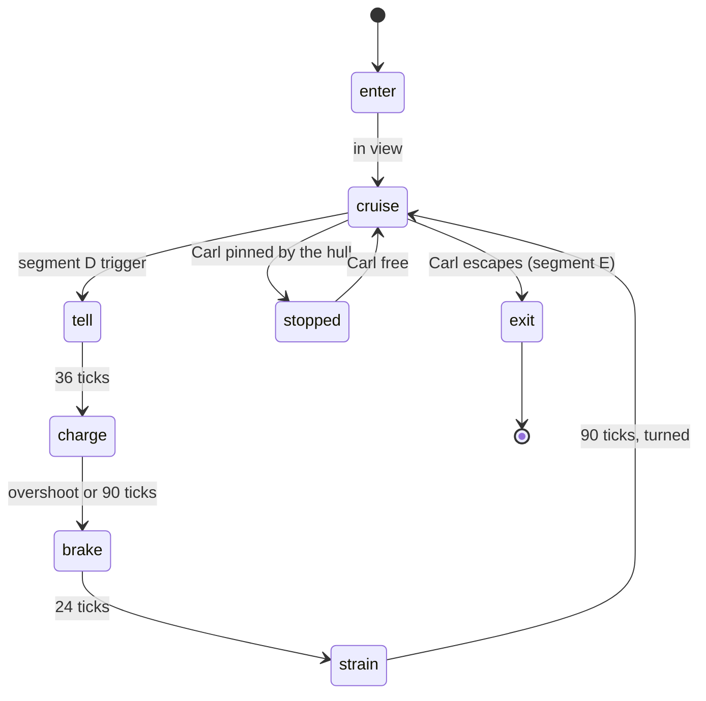

# DOZ-01: Goblin Murder Dozer design spec (phase 1)

**Status:** phase 1 design by Claude Opus, 2026-11-17. **Size decision pending** (a separate Claude Opus agent decides, under the owner's rule that enemy sizes are proposed by one Opus agent and decided by another). **Execution pending** (Claude Sonnet). **Review pending** (a separate Claude Opus agent). Nothing here is wired into Bevy.

Model routing ([AGENTS.md](../../AGENTS.md), "Model routing for art work"): the design, size study and keys are by Claude Opus (this document). The remaining frames, smoke sprites, atlases, previews and evidence go to Claude Sonnet. A separate Claude Opus agent reviews. Rights: fan-concept art under the owner-reported `ART-PUBLICATION-ALL-V1` scope ([rights and release](../04-production/rights-and-release.md)), with no reuse licence and no game or asset-pack distribution right. The Dozer name and the riders are the replaceable fan-concept layer. The runtime role is IP-neutral: a large tracked pursuit machine with a lethal front roller. The concept crop [`03-murder-dozer-reference-crop.png`](../../assets/concept/floor-01/opening/03-murder-dozer-reference-crop.png) was used for mood only. No pixel is traced or derived from it, and none of its specific parts (front-mounted giant wheel housing, red-and-white panel, goggled riders, firebox placement) is copied.

Evidence: [docs/evidence/doz-01/](../evidence/doz-01/README.md).

## 1. Canon checklist

From the [opening encounter handoff](../07-agents/floor-01-opening-encounter-handoff.md) (segments C, D and E), the [Floor 1 opening direction](floor-01-opening-catacomb-goblins.md) and the [combat probes](../07-agents/floor-01-integrated-combat-probes.md):

| Canon or brief item | Where it is in the design |
| --- | --- |
| Rusted, mismatched steam contraption | Cool boiler-iron hull with dark rust cab plates, a copper patch, a rust plate bolted over a hole in the tub, soot bands and rust streaks |
| Tank treads | One near-side tread unit: link belt with cleats, 4 road wheels, 2 end wheels and a riveted track frame |
| Huge spiked spinning front wheel | A 96 px riveted drum with 12 spikes on a push-arm fork; spins on its own cycle (section 5) |
| Several smoking pipes | Main stack with a bucket spark cap, a rear copper exhaust with a tin-can cap, and a kettle soldered on as the steam whistle (3 emitters) |
| Three riders: two level-2 goblins and a level-3 engineer with a kitchen-pot helmet | Engineer at the rear controls, wearing an upside-down saucepan with its handle sticking out back; rider A (GOB-01 variant A) and rider B (variant B, red bandana) in the front tub |
| The engineer visibly operates the Dozer | One hand on the throttle lever (the knob is on the hull, under his hand), the other arm pointing at Carl |
| Grimy, menacing and a little ridiculous | Painted shark-tooth grin on the tub, kettle whistle, bucket on the stack, saucepan helmet, pressure-gauge needle past the red |
| Escape threat, not a boss | No health bar or damage frames; knockback immunity; tells for the charge and the overshoot (section 9) |
| Riders are separate, reusable concepts | Riders are their own 64 x 56 sprites with GOB-01 pixels and palette, seated by anchors; the on-foot goblins stay GOB-01 |
| Wheel lethal zone distinct from the hull | The wheel is the brightest, highest-contrast part (pale spike tips over a dark drum); the hull is cool iron |
| Smoke stays local | Puffs are small, short-lived and non-blocking, from 3 emitters (section 5) |
| 1980s to 1990s action tone, original design | A scrap-built road roller with a grin and a soot-faced crew: B-movie menace, no copied vehicle |

## 2. Size study and recommendation

Carl is 52 px (about 6 ft, 8.7 px per foot). His jump apex puts his feet 92 px up (`JUMP_SPEED` 440, `GRAVITY` 1050 in `src/prototype.rs`) and his head 144 px up. The ENV-01 corridor has 276 px from the walking line (world y 308) to the ceiling collider (world y 32). **Body height** is the floor to the boiler dome top, excluding the stack, the riders and the smoke. One parametric construction is rasterized natively at each scale (no resampling between sizes), and the 36 px riders keep their size. These are block-ins for the decision, not production pixels.

| Measure | h96 | **h120 (recommended)** | h150 |
| --- | --- | --- | --- |
| Opaque height / length (px) | 124 / 207 | 155 / 259 | 193 / 322 |
| Share of the 640 x 360 view (height / width) | 0.34 / 0.32 | 0.43 / 0.41 | 0.54 / 0.50 |
| Clearance under the ceiling collider (px) | 152 | 121 | 83 |
| Body / Carl, implied height | 1.85x, 11.1 ft | 2.31x, 13.8 ft | 2.88x, 17.3 ft |
| Wheel tip to tip (px) | 77 | 96 | 120 |
| Tub rim (px) | 83 | 104 | 130 |
| Carl can jump over the wheel / onto the tub | **yes / yes** | no / no | no / no |
| 36 px rider / body height | 0.38 | 0.30 | 0.24 |
| Atlas px, split parts (planned frame counts) | 143,990 | 182,670 | 245,052 |
| Atlas px, monolithic estimate (12 x 2 flattened frames) | 616,032 | 963,480 | 1,491,504 |

**Recommendation: h120** (body 120 px, 155 px with the stack, 259 px long).

- **Threat and readability.** At 2.3 times Carl's height it towers without leaving the frame. In the chase composition (Carl 213 px ahead of the wheel) the whole machine, all three riders and both characters fit in one 640 x 360 view. At h150 the rear is already off-screen at the same gap, and the machine takes half the view.
- **No false affordance.** The 96 px wheel and the 104 px tub rim are both above Carl's 92 px jump apex, so the machine reads as "run", not "jump over it". At h96 Carl can clear the 77 px wheel and land on the 83 px tub, which invites a mounting mechanic nobody has designed.
- **Ceiling and lanes.** 121 px of clearance leaves room for the smoke column and for hanging duck obstacles above Carl. At h150 the stack and smoke crowd the top third of the view. All three options leave the lanes ahead of Carl clear at a 213 px gap; the difference is how much of the screen the machine owns when the gap closes.
- **Riders at 36 px.** At h120 the riders' heads and raised pineapples break the hull silhouette and read as a crew. At h96 they crowd the hull and the brandished pineapple overlaps the stack; at h150 they shrink to ornaments.
- **Atlas cost.** Split into parts, h120 costs about 183k atlas pixels including riders and smoke, about 5 times less than flattened frames, and 25 % less than h150.

Accepted trade-off: the wheel is only 4 px taller than Carl's jump apex. The lethal box (r 44, section 9) and the hull wall behind it close the gap, and CHASE-01 must test that no jump clears it.

## 3. Construction and parts

The Dozer is a rig of parts, so that a few frames give a lot of motion: a 3-frame belt, a 4-frame wheel, riders with their own cycles and a rattle that moves only the hull and riders.

**Rig origin O** is the tread footprint midpoint on the walking line. Anchors are px from O, with x forward and y up. A part's pivot is placed on its anchor. Facing left, mirror every anchor's x and flip each frame around its pivot. The data contract is [`dozer_rig_h120.json`](../../assets/source/enemies/dozer/dozer_rig_h120.json), and `tests/test_art_dozer_doz01.py` checks that composing the parts with it reproduces the assembled machine pixel for pixel.

| z | Part | Atlas / tag | Frame | Pivot | Anchor | Frames (plan) |
| --- | --- | --- | --- | --- | --- | --- |
| 0 | smoke puffs (world space) | `dozer_smoke` (Sonnet) | 24 x 24 black, 16 x 16 steam | centre | emitters below | 6 black, 5 steam |
| 1 | hull body | `dozer_hull_h120` / `body` | 175 x 160 | (87, 159) | (0, 0) | 1 (+ rattle offset) |
| 2 | tread | `dozer_tread_h120` / `roll` | 151 x 34 | (75, 33) | (0, 0) | 3 |
| 3 | engineer | `dozer_riders_h36` / `engineer_*` | 64 x 56 | (28, 55) seat | (-48, 98) | 6 |
| 3 | rider A | `dozer_riders_h36` / `rider_a_*` | 64 x 56 | (28, 55) seat | (38, 96) | 6 |
| 4 | rider B | `dozer_riders_h36` / `rider_b_*` | 64 x 56 | (28, 55) seat | (66, 96) | 6 (A frames + B overlay) |
| 5 | hull front (tub, cab rail) | `dozer_hull_h120` / `front` | 175 x 160 | (87, 159) | (0, 0) | 1 |
| 6 | spiked wheel | `dozer_wheel_h120` / `spin` | 99 x 99 | (49, 49) axle | (124, 49) | 4 (+1 optional smear) |
| 7 | near push arm, axle cap, lamp | `dozer_yoke_h120` / `static` | 64 x 44 | (54, 30) axle | (124, 49) | 1 |

- **Occluder rows** (the hull front hides everything of a rider below them): engineer y 105, riders A and B y 104. Rider pivots are the **seat point**, not the floor. Rows below `55 - (rim - seat)` are always hidden.
- **Emitters** (smoke spawn points): stack (15, 156), rear exhaust (-82, 124), kettle whistle (5, 129).
- **Lights** (optional A1 point lights, presentation only): lamp glass (98, 66), firebox slots (-30, 49).
- **Extents:** x -84 to +172, top of the stack 156, dome 120, tub rim 104.
- **Rider spacing rule:** the brandishing rider sits at the rear seat so that the raised pineapple swings over the boiler, not over the other rider's face.
- **Atlas note for Sonnet:** the `front` frame is mostly empty. If atlas size matters, split the hull into two atlases trimmed to their own boxes and recompute their pivots (anchors stay (0, 0) relative to O). Do this before any Bevy integration.

**Damage and rattle states.** CHASE-01 does not need damage frames: the Dozer is never defeated in the opening. The chase needs these runtime states, made from offsets and the existing frames:

- `rattle`: hull body, hull front and riders move up 1 px for 3 ticks every 6 ticks while moving (the tread and wheel stay on the floor). Riders follow 2 ticks late (secondary motion).
- `strain` (segment D, stuck or turning): rattle at double rate (1 px every 3 ticks), puffs from all three emitters, firebox light at full.
- A dented-front variant after a wall impact is a later decision, not phase 2.

## 4. Palette `dozer-floor01-v0`

39 machine colours (7 of them reserved for smoke and steam) plus the shared outline. The riders use the GOB-01 palette (19 more), so the union is **59 colours** (64 at most, tested). Every atlas stays under 64.

| Keys | Name | Hex | Role |
| --- | --- | --- | --- |
| K | outline_plum | `#1b1124` | shared with Carl and the goblins |
| 0 to 6 | iron ramp | `#121220` `#1e2032` `#2c3046` `#3f445e` `#575e7a` `#78809a` `#a3abbf` | dominant boiler iron: cool, so the hull separates from the orange brick (tested: iron outweighs every warm key) |
| 7 | iron_glint (accent) | `#dde2ec` | rivet heads, spike-tip glints, axle bolt |
| Q W E T Y | rust ramp | `#2a1612` `#4a2318` `#6c321e` `#914524` `#b55f2c` | cab plates (Q to T only, dark), streaks, wheel drum, track frame, stack |
| p b d | paint ramp | `#3c1219` `#611b22` `#8a2b2b` | oxblood plate with the painted grin |
| c f g h i | copper (ENV-01 `copper_01` to `05`) | `#3a1a14` `#5c2a18` `#823e1e` `#a85626` `#cc7332` | rear exhaust, patch |
| L M N S Z | brass (ENV-01 `brass_01` to `05`; Z accent) | `#43331a` `#6a5224` `#93752e` `#bc9a3a` `#e0c25a` | firebox door, gauge, kettle, collar, hubs, axle cap |
| X | bone_paint | `#d8cdb0` | painted teeth, gauge face |
| j k n q z | fire (ENV-01 emissive colours) | `#8a2a12` `#d4501a` `#f58a26` `#ffc048` `#ffe98a` | **only** the firebox slots and the lamp glass (tested). These are the ENV-01 bloom colours, so the slots can glow if the runtime ever blooms actors |
| + = - : | smoke ramp (reserved) | `#1c1a22` `#2e2a34` `#4a4450` `#6c6474` | black exhaust puffs (Sonnet) |
| ; / * | steam ramp (reserved) | `#9c9cae` `#c6c8d4` `#eceef4` | kettle and brake steam (Sonnet) |

Rules: goblin green appears only on the riders (GOB-01 R7, tested on the machine atlases). Rust may never be the dominant hull colour; the warm brick is right behind it.

## 5. Animation timing at 60 Hz (proposal)

The simulation advances every part from ticks and travelled distance, never from wall-clock time. Animation never feeds back into the simulation. The atlas `duration_ms` is `round(ticks * 1000 / 60)` and is used for previews only.

| Part | Rule | Ticks per frame | Notes |
| --- | --- | --- | --- |
| Wheel spin | 4 frames of 7.5 degrees, 12 spikes, so the cycle repeats every 30 degrees | stopped: hold; strain: 3; cruise: 2 (225 deg/s); charge: 1 (450 deg/s) | Driven faster than rolling (191 deg/s at 160 px/s), so it reads as a powered grinder. Optional smear frame (blurred spike ring) on every second charge frame |
| Tread belt | 3 frames, 3 px steps of a 9 px link pitch; **frame = floor(distance / 3) mod 3** | distance-driven | Slip-free at any speed. Aliasing starts above 4.5 px per tick (270 px/s), above the proposed charge speed. Road wheels and end wheels turn inside the same 3 frames |
| Black smoke (stack) | 6 frames: spawn 6 px, 10 px, 16 px, breaking up, thin, last wisp | 4 per frame (24-tick life) | One puff every 12 ticks at cruise, every 4 during the charge tell, every 8 during the charge. Rises 0.5 px per tick and stays in world space, so it trails behind. At most 8 puffs alive |
| Rear exhaust | same black puff | 4 | every 20 ticks while moving |
| Steam (kettle) | 5 frames, 16 x 16 | 3 | only in the charge tell, the brake and strain: a 3-puff burst |
| Rider idle | 2 frames: seated hold, then the same 1 px lower | 16 each | per rider; phase-offset by 8 ticks between A and B |
| Rider yell | 2 frames: brandish key, then pineapple 2 px higher and mouth 1 px wider | 6 each, 3 loops | on the charge tell and when Carl is within 120 px |
| Engineer | point key and a jab (finger 1 px forward), 8 ticks each; `lever_pull` (both hands on the lever, leaning back) | 8 / hold | lever_pull for the whole charge tell |
| Lurch back | 1 frame per rider: torso and head 2 px back, mouth open, arm flung | 8 | charge start; the hull body squats 1 px at the rear for 4 ticks |
| Lurch forward | 1 frame per rider: torso 2 px forward, eyes white (GOB-01 hurt eyes) | 10 | brake / overshoot; the rig slides 4 px past the stop point |
| Rattle | rig offset, section 3 | 3 on, 3 off | strain: every 3 ticks |

## 6. Lighting note

The hull and riders are lit by the A1 pass like every actor (actor group: ambient 0.9 / 0.92 / 1.0, torch light at 0.3). The palette is tuned for that: cool iron in front of warm brick, the brightest pixels on the spike tips and riders' faces. The lamp glass and the firebox slots use ENV-01 emissive colours. A small warm point light on each (radius about 40 px, presentation only) is **optional** and must not change gameplay. The contact shadow is per actor box. For the Dozer the runtime should use the tread footprint (x -74 to +74) rather than the whole sprite, so the shadow does not reach under the wheel.

## 7. Key poses (as authored) and notes for the Sonnet executor

All keys are produced by `scripts/author_dozer_doz01.py` (the authoring record). The committed grids are the source of truth; `--check` verifies them. Facing right.

- **Hull `body`.** From the back:
  - A copper rear exhaust up the back, an elbow and a dented tin-can cap.
  - A cab box of dark rust plates (two riveted seams, rust streaks) with a brass firebox door and three glowing slots.
  - A deck plate, and the throttle lever with a brass knob at about (-36, 106).
  - A vertical iron boiler (three riveted hoops, copper patch, brass gauge with the needle past the red, soot bands, one dent) with its dome top at 120.
  - A brass kettle as the whistle on the dome, and a crooked rust stack with a brass collar and an upturned iron bucket as the spark cap (top 156).
  - The dark tub back wall (hidden by `front`) and a dark chassis strip behind the tread.
- **Hull `front`.** The rider tub has a slanted front, a rolled iron lip (top y 104), a riveted seam, a bolted rust plate and streaks. Its oxblood lower plate carries the painted grin: staggered bone teeth around a dark mouth. The cab rail plate has a tube rail (top y 105).
- **Wheel, phase 0.** Spikes at 0, 30, 60 ... degrees, spike axis on the vertical. Rim band in iron, drum in rust with 12 dark radial ribs, 12 bolt glints between the ribs and a brass hub.
- **Tread, phase 0.** The belt's bottom run lies on the contact row (row 33).
- **Engineer `engineer_point` (key).** The GOB-01 idle body seated: rows shifted down 9, no pineapple. Over it:
  - an upside-down saucepan jammed to the brow (dent, glint, rolled lip) with its handle out to the back above the ear;
  - a far arm pointing forward under the chin;
  - the near hand on the lever knob.
- **Rider A `rider_a_brandish` (key).** The GOB-01 attack-tell key (frame 11) seated, rows shifted down 9, unchanged pixels: the pineapple raised back, mouth open.
- **Rider B `rider_b_hold` (derived, not a key).** GOB-01 variant B idle (frame 0) seated: the pineapple held upright at the rim.

**Frames still to make.** Rules for all of them:

- Keep the pivots, the palette and the anchors.
- Never resample or rotate pixels. The wheel and tread are the exception: render them from their geometry with `wheel_rows(phase)` and `tread_rows(phase)`, then clean up by hand.
- Rider frames are GOB-01 pixels translated whole wherever possible.
- Run the tests in section 8 on every frame.

| Atlas | Frame | Notes | Author |
| --- | --- | --- | --- |
| wheel | phases 1 to 3 | `wheel_rows(7.5 * i)`. Then hand cleanup: every spike keeps a 1 px K outline, every lit spike keeps one `7` glint near its tip, and the hub stays concentric (no wobble between frames). Previews are on the key sheet | Sonnet |
| wheel | smear (optional) | Phase 0 with a 1 px iron-5 arc joining the tips in the spin direction; tips without glints | Sonnet |
| tread | phases 1 and 2 | `tread_rows(1)` and `tread_rows(2)`. Then check that the bottom row is the contact row in every frame and that the cleat count on the bottom run differs by at most one between frames | Sonnet |
| riders | `*_idle_0`, `*_idle_1` | A and B: GOB-01 frame 0 seated (as rider B) for 0, the same with rows 0 to 46 moved down 1 px for 1. Engineer: the key without the pointing arm, near hand on the lever, mouth closed (GOB-01 frame 0 head) | Sonnet |
| riders | `*_yell_1` | Section 5 row "Rider yell" | Sonnet |
| riders | `engineer_lever_pull` | Both hands on the knob, torso leaning back 2 px, mouth open (frame 11 head moved by (-2, -2)), pot tilted back by moving its top 2 rows 1 px left | **Opus, phase 2** |
| riders | `*_lurch_back`, `*_lurch_forward` | One per rider type (A, B = A + overlay, engineer) | **Opus, phase 2** |
| smoke | black puff, steam puff | 6 and 5 frames (section 5). Black uses `+ = - :`, steam `; / *`. Round, lumpy blobs with a 1 px darker underside; no outline; never transparent-dithered | Opus key frame 0 and 2, phase 2; rest Sonnet |
| hull | `front` trim | Section 3 atlas note | Sonnet |

## 8. Validators

Automated in `tests/test_art_dozer_doz01.py` for the phase 1 keys. Extend them to every new frame.

- Frame sizes and pivots match the parts table and the manifests. The wheel pivot is its centre pixel; the yoke pivot carries the axle glint.
- The boiler dome's outline row is 120 px above the contact row. The tread's bottom run and the wheel's lowest spike outline sit on the contact row.
- 12 separate spike clusters outside the rim; the spike tips reach radius 48 to 50.
- Palette: every entry is from `dozer-floor01-v0` + GOB-01 with identical hex; at most 64 per atlas, union at most 64. ENV-01 copper and brass are reused exactly.
- Goblin green never appears on the machine atlases. Fire colours appear only in the firebox door and the lamp.
- Iron outweighs rust and copper on the hull, so it separates from the brick.
- Lint: 0 isolated pixels. Machine keys have 0 orphans; riders and the size study have fewer than 10 (rider frames carry the approved GOB-01 pixels unchanged).
- The rig contract reproduces the assembled machine. Every rider pixel below its occluder row is covered by the hull front. Each rider shows at least 120 opaque pixels above the rim, with its eyes above the rim.
- Rider A and B pixels equal the GOB-01 frames they come from. The engineer has a pot with a handle reaching past x 18.
- The gameplay proposal's geometry holds: wheel taller than the 92 px jump apex, tub rim above it, stack under the ceiling with room for smoke.

## 9. Gameplay notes for CHASE-01 (all proposals)

These are **proposals** for the CHASE-01 gameplay work order. They are not implemented and not accepted until playtested. Build them in the deterministic `gameplay` layer; sprites, smoke and lights never change outcomes.

- **Speed.** Cruise **160 px/s** (0.86 times Carl's 185 px/s run): a running Carl slowly gains, but a missed jump, a stagger or a dead end lets it close. Proposed rubber band:
  - if the gap is over 260 px, match 185 px/s;
  - if it is under 96 px, drop to 150 px/s (a mercy window);
  - never faster than Carl except during a charge.
- **Lethal box.** A circle of **radius 44 px** around the wheel axle (anchor (124, 49) from O). The visual tips reach 48, so the box is 4 px forgiving. Contact means the fail-and-retry state from CHASE-01, not a damage tick.
- **Pushing wall.** The hull is a solid box from x -74 to +79 and y 0 to 104 relative to O. It pushes Carl and does no damage. If Carl is pinned between the hull and terrain, the Dozer stops instead of crushing him (no unavoidable wall-to-wall collision).
- **No mounting.** Riders and the tub top are not reachable or targetable in the opening (the tub rim is 104 px against Carl's 92 px apex).
- **Knockback immunity.** The Dozer ignores every impulse (effectively infinite mass in the hybrid-physics model). Carl's melee on the hull produces a spark and a clang only, with no state change. Thrown goblins or props bounce off the hull. Only terrain and its own turning radius beat it: evasion, turning radius and environmental escape.
- **Charge tell for segment D** (60 Hz ticks):
  1. **Tell, 36 ticks.** Stack puff burst (every 4 ticks), kettle shriek (steam burst), engineer `lever_pull`, riders yell, the hull squats 1 px at the rear and the wheel spins at 1 tick per frame.
  2. **Charge.** At most 90 ticks at **240 px/s** in a straight line; it cannot steer.
  3. **Overshoot and brake, 24 ticks.** At the junction it passes the turn: the treads stop, the rig slides 4 px, the riders lurch forward and steam bursts.
  4. **Stuck or turning, 90 ticks.** Strain state; this is Carl's escape window into the side passage.
  5. **Resume** the chase at cruise speed.

  The tell must be readable with sound off, so it relies on smoke, the riders and the squat.
- **Camera.** The composition evidence puts Carl 213 px (one third of the view) ahead of the wheel to judge the size. The chase camera should lead Carl in the run direction and keep the wheel in view at the left edge. Never shrink the actors to fit the machine.

## 10. Files

| File | Role |
| --- | --- |
| `assets/source/enemies/dozer/dozer_size_study.grid.json` / `.ase` | the machine with riders at h96, h120 and h150 (block-ins) |
| `assets/source/enemies/dozer/dozer_hull_h120.grid.json` / `.ase` | hull key: `body` and `front` |
| `assets/source/enemies/dozer/dozer_wheel_h120.grid.json` / `.ase` | wheel key, phase 0 |
| `assets/source/enemies/dozer/dozer_tread_h120.grid.json` / `.ase` | tread key, phase 0 |
| `assets/source/enemies/dozer/dozer_yoke_h120.grid.json` / `.ase` | push arm, axle cap and lamp |
| `assets/source/enemies/dozer/dozer_riders_h36.grid.json` / `.ase` | engineer and rider A keys, rider B derived |
| `assets/source/enemies/dozer/dozer_rig_h120.json` | rig contract: pivots, anchors, draw order, occluders, emitters, lights |
| `assets/manifests/dozer_*.json` | candidate manifests (`prototype_fixture_unapproved`, palette `dozer-floor01-v0`) |
| `scripts/author_dozer_doz01.py` | authoring record (palette, construction, riders, grids, manifests, rig); `--check` |
| `scripts/make_dozer_doz01_review.py` | size-study sheet, key sheet, layout diagram, lit chase compositions, measurements |
| `tests/test_art_dozer_doz01.py` | contract tests (section 8) |
