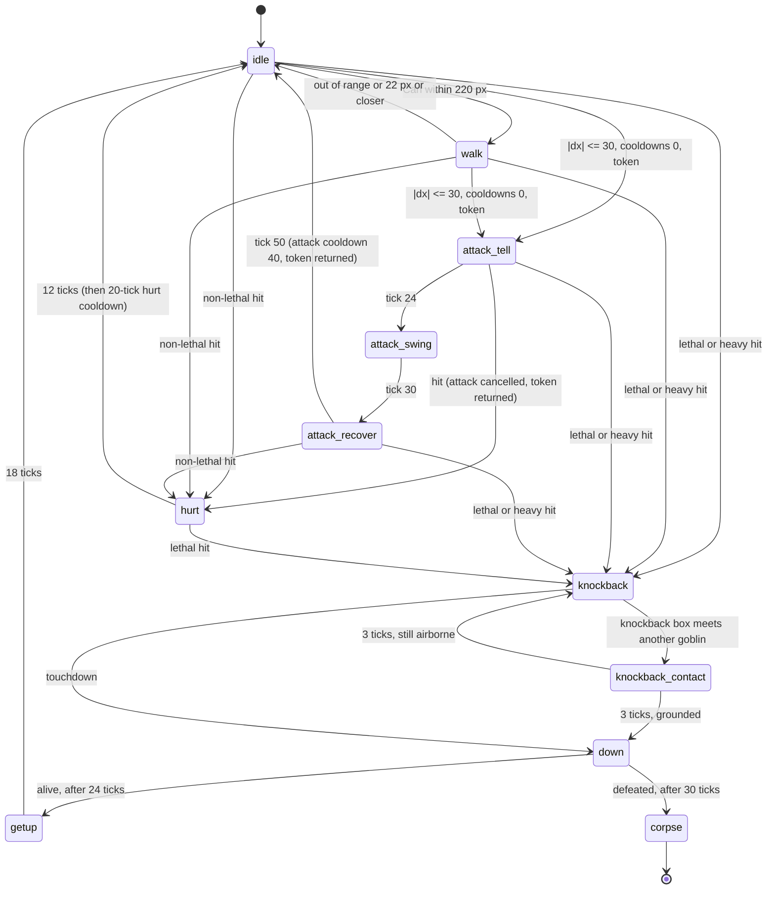

# GOB-01: common goblin design spec

**Status:** Opus review PASSED 2026-11-17 (design: Claude Opus; size decision and review: a separate Claude Opus; execution: Claude Sonnet); awaiting owner review; Bevy integration pending. Keys (phases 1 and 2) by Opus; the 16 in-betweens per variant, the 27-frame atlases, validators and evidence (phase 3) by Sonnet. Nothing here is wired into Bevy.

**Decision record:** height **36 px**, frame **64 × 56**, pivot **(28, 55)**. The height was proposed by the designing Opus agent and **decided by a separate, independent Opus agent**, under the owner's rule that enemy sizes are proposed by one Opus agent and decided by another. The tick windows in section 4 are a **proposal** for the combat work order, because WORK-021 has no goblin attack yet.

Model routing (AGENTS.md "Model routing for art work"): design and keys by Claude Opus (this document); in-betweens, atlases, validators and evidence by Claude Sonnet; review by a separate Claude Opus agent. Rights: fan-concept art under the owner-reported `ART-PUBLICATION-ALL-V1` scope, with no reuse licence and no game or asset-pack distribution right. The concept references under `assets/concept/floor-01/` were used for mood only; no pixel is traced or derived from them.

Evidence: [docs/evidence/gob-01/](../evidence/gob-01/README.md).

## 1. Canon and tone constraints

From the [opening encounter handoff](../07-agents/floor-01-opening-encounter-handoff.md) and the [Floor 1 opening direction](floor-01-opening-catacomb-goblins.md):

- Common goblins are green, about 4 ft tall, in leathery rag clothing, with sharp teeth and pointy ears.
- The early on-foot weapon is a **pineapple on a wooden stick**. It is not a studded or metal club.
- The two common goblins are a **visual** variation (A and B), not two combat classes. Same frames, same timing, same boxes.
- Tone ([antihero tone](../01-design/antihero-tone.md)): a scrappy, nasty, slightly ridiculous threat with a readable tell, never a heroic orc. Carl must stay believable when he knocks one away.

## 2. Size study and decision

Carl is 52 px, treated as about 6 ft, so a 4 ft goblin is 52 × 4 / 6 = **34.7 px**.

| Option | Idle opaque height | Ratio to Carl | Implied height if Carl is 6 ft | Opaque area (idle) |
| --- | --- | --- | --- | --- |
| **h36 (decided)** | 36 px | 0.69 | 4.2 ft (about 4.4 ft upright) | 666 px |
| h40 | 40 px | 0.77 | 4.6 ft | 830 px |
| h44 | 44 px | 0.85 | 5.1 ft | 988 px |

Reference: Carl idle 52 px with an area of 837 px; Donut idle 40 px with an area of 1,305 px. One parametric idle pose is rasterized natively at each height (`scripts/author_goblin_gob01.py size-study`). These are block-ins, not production pixels.

Why 36 px:

- **Readability:** a big head, about the size of Carl's, so the face reads at 1x, and the biggest idle-to-tell change (36 to 55 px).
- **Threat:** 80 % of Carl's area, and the tell towers above him.
- **Hit box:** the idle fits the WORK-021 enemy box (24 × 38).
- **Knockback flight:** a 4 ft goblin punted about 90 px stays a believable shove.

Accepted trade-off: the goblin is 4 px shorter than Donut (whose 40 px includes her tiara).

## 3. Frame, pivot, boxes and atlas

- **Frame 64 × 56, pivot (28, 55)**, with the same bottom-row convention as Carl (48 × 56 / (25, 55)) and Donut (72 × 44 / (46, 43)). Pivot x is the midpoint between the idle soles; pivot y is the contact row.
- **Grounded tags** have their lowest opaque row on 55 (0 px foot sink): `idle`, `walk`, `attack_tell`, `attack_swing`, `attack_recover`, `hurt`, `down`, `getup` and `corpse`.
- **Airborne tags** (`knockback` and `knockback_contact`) have **no pixel on row 55**. The knockback key's lowest row is 46 and the contact key's is 44. Never snap them to the floor.
- **Recorded deviation (ART-INT-02, runtime placement of the airborne tags):** the Floor 1 scene draws `knockback` frames with the **lowest opaque row of the frame (frame 18: row 53, frame 19: row 46, frame 26: row 44) on the bottom of the sim body**, not the pivot. Reason: the sim body is the 24 x 38 standing box in flight (the 28 x 18 knockback box arrives with CP-02), and the pivot rule would hover the goblin 2, 9 and 11 px above its own body at launch and touchdown and pop when `down` takes over. The bottom follows the body up and down, so it is not a floor snap. No art changed; the torso-centred 28 x 18 placement above is still the CP-02 plan. See [floor01-scene.md](../03-tech/floor01-scene.md#combat-animation-art-int-02).
- **Standing box:** 24 × 38 (the WORK-021 enemy AABB); the proposed hurtbox is 22 × 34 on the body, excluding the ear tip and the weapon.
- **Knockback box:** while airborne (frames 18, 19 and 26), the physics body is a **28 × 18 box centred on the torso**. That is frame-space x 14 to 41 and rows 31 to 48, centred at (28, 40) and drawn with the torso centre there. It is used both for being hit and for collision with other goblins, walls and props (CP-02). On touchdown the runtime switches back to the standing box with the pivot on the floor.
- Authored facing right. The runtime mirrors around the pivot column. The variant B bandana tails hang down and back, so they read either way.
- **One atlas per variant: 27 frames** (0 to 26), row-major, with the layers `body` and `weapon`, plus `accessory` for B.

## 4. WORK-021 domain (what exists) and the tick contract (proposal)

From `src/prototype.rs` at 60 Hz:

- goblin health 2;
- AABB 24 × 38;
- chase at 62 px/s while 22 px < |dx| < 220 px;
- damage to Carl is **contact only** (|dx| < 23 and |dy| < 36), followed by 55 ticks of hero invulnerability;
- Carl's melee is an instant hit with -9 to 54 px of reach and a 14-tick cooldown;
- `GRAVITY` is 1050 px/s²;
- there is **no** knockback, stagger or goblin attack window yet.

Proposed contract for the combat work order (COMBAT-PHYS-01 / CP-01 / CP-02). It replaces contact damage with a telegraphed bonk:

| Phase | Ticks (tell start = 0) | Gameplay meaning |
| --- | --- | --- |
| tell | 0 to 23 (24) | trigger when \|dx\| ≤ 30, grounded, cooldowns at 0 and an **attack token** held; **interruptible** (a hit cancels the attack and goes to `hurt`) |
| swing smear | 24 to 25 (2) | hitbox inactive |
| swing impact | 26 to 29 (4) | **hitbox active**: x +8 to +30 px forward of the pivot, y 0 to 30 px up; at most one hit per attack |
| recover | 30 to 49 (20) | vulnerable punish window |
| attack cooldown | 40 ticks in idle or walk | before the next tell |
| hurt | 12 | non-lethal hit; then a **20-tick hurt cooldown** before any new tell (walking is allowed) |
| knockback | launch 4, then airborne until touchdown | lethal or heavy hit. Reference launch: vx 200, vy 240 px/s gives about 27 ticks and about 90 px |
| knockback contact | 3 | starts on the tick the flying goblin's knockback box first overlaps another goblin's box; then airborne again, or down if grounded |
| down | 4 + 8 + hold | if alive, hold 24 ticks then get up (18); if defeated, hold 30 ticks then corpse |

**Attack token (group rule for the combat work order):**

- At most **2 goblins** may be in `attack_tell` or `attack_swing` at once.
- A goblin takes a token to start its tell, and two tell starts are at least **8 ticks** apart.
- The token is returned when the swing ends or the attack is cancelled.
- Token grants are deterministic: the lowest distance to Carl wins, ties go to the lower entity id.
- Goblins without a token keep walking or idle at 34 to 60 px from Carl.

**Alignment rule:**

- Every frame lasts a whole number of ticks.
- The atlas `duration_ms` is `round(ticks * 1000 / 60)` and is used for previews only.
- The runtime advances frames from simulation ticks and state, never from wall-clock time.
- Frame 13 is shown on exactly the hitbox-active ticks.
- Animation never feeds back into the simulation.

## 5. Animation list (27 frames per variant)

The keys are **done** (Opus). Every other frame is Sonnet's, following section 9.

| # | Tag | Frame | Ticks | Playback | Author |
| --- | --- | --- | --- | --- | --- |
| 0 | `idle` | hunched breath, stick forward | 12 | loop | **key** |
| 1 | `idle` | breath in | 8 | loop | Sonnet |
| 2 | `idle` | hold, ear twitch | 12 | loop | Sonnet |
| 3 | `idle` | breath out | 8 | loop | Sonnet |
| 4 | `walk` | contact, near foot forward | 5 | loop | **key** |
| 5 | `walk` | down | 5 | loop | Sonnet |
| 6 | `walk` | pass | 5 | loop | Sonnet |
| 7 | `walk` | contact, far foot forward | 5 | loop | **key** |
| 8 | `walk` | down | 5 | loop | Sonnet |
| 9 | `walk` | pass | 5 | loop | Sonnet |
| 10 | `attack_tell` | lead-in | 6 | once | Sonnet |
| 11 | `attack_tell` | wind-up hold | 18 | once | **key** |
| 12 | `attack_swing` | smear: stick vertical, pineapple overhead, arc trail | 2 | once | **key** |
| 13 | `attack_swing` | impact: overhead bonk | 4 | once | **key** |
| 14 | `attack_recover` | follow-through, pineapple on the floor | 12 | once | Sonnet |
| 15 | `attack_recover` | yank back | 8 | once | Sonnet |
| 16 | `hurt` | recoil | 4 | once | **key** |
| 17 | `hurt` | stagger | 8 | once | Sonnet |
| 18 | `knockback` | launch | 4 | once | Sonnet |
| 19 | `knockback` | airborne | until touchdown | hold | **key** |
| 20 | `down` | floor impact | 4 | once | Sonnet |
| 21 | `down` | settle | 8 | once | Sonnet |
| 22 | `down` | lying, dazed | hold | hold | **key** |
| 23 | `getup` | push up | 8 | once | Sonnet |
| 24 | `getup` | kneel, grab the stick | 10 | once | Sonnet |
| 25 | `corpse` | lying, X eyes, the pineapple rolled 6 px off the stick | hold | hold | **key** |
| 26 | `knockback_contact` | crumpled squash on hitting another goblin | 3 | once | **key** |

**Walk:** 6 × 5 ticks is a 30-tick cycle. At the 62 px/s chase speed that is 31 px per cycle and 15.5 px per step. The planted foot travels 5 px per frame (60 px/s). The keys put the stride at about ±8 px around the pivot.

## 6. State diagram

`attack_swing` cannot be interrupted. `knockback`, `knockback_contact`, `down` and `corpse` have no hurtbox for Carl's melee; the knockback box still collides with goblins and props. Corpse contact (CP-04) stays presentation-only, as in option A.

## 7. Palette `goblin-floor01-v0` (at most 20 colours per atlas)

A uses 19 colours and B 20. The colours are tuned for the A1 lighting (warm torch light falling into cold blue ambient).

| Key | Name | Hex | Role |
| --- | --- | --- | --- |
| K | outline_plum | `#1b1124` | shared with Carl |
| a / s / m / l | skin deep / shade / mid / light | `#263a26` `#46682e` `#7a9e36` `#b2cc56` | yellow-green skin; cool shadows, warm lights |
| r / t / u | rag dark / mid / light | `#2c1e28` `#4c3436` `#73524a` | cool, dark leather that separates from the orange brick |
| e | eye_yellow (accent) | `#ffd23a` | glaring eyes |
| w | tooth_white (accent) | `#efe4c4` | teeth; eye whites in hurt, knockback and down |
| o | mouth_dark | `#5c1426` | |
| R | red_mid | `#b8322e` | tongue; variant B bandana |
| x / y | wood dark / mid | `#4a2c1c` `#8c5c32` | stick, rope belt |
| F / G / H | pineapple dark / mid / light | `#7a3c12` `#d08826` `#f4c84a` | checker-pattern fruit; H is an accent (single facet highlights, and the smear arc) |
| V / v | leaf dark / mid | `#1d4a3c` `#3e8a5c` | teal crown, kept off the skin hue |
| B | rag_red_dark (variant B only) | `#6e1a22` | bandana shadow |

## 8. Key poses (as authored)

- **0 idle (accepted, polished).** Hunched, with a big bald head ahead of the leather-vest hump. A long ear sweeps back. Glaring yellow eyes, a hooked nose and an upper row of teeth. The stick is held forward with the pineapple upright at chest height. Polish: a `u` rim on the hump top and 2 notches in the vest hem.
- **4 / 7 walk contacts.** The idle upper body sits 1 px lower. The leading foot strikes with the heel on row 55 and the trailing foot pushes off its toes; frame 7 mirrors the legs. The stride is about ±8 px around the pivot.
- **11 tell (accepted, polished).** The torso leans back with a braced stance. The arm rises from a thickened shoulder at about (24, 30); a 2 × 2 far hand sits higher on the stick. The pineapple is the highest point (row 1, 21 px above the head), and the mouth is open in a yell.
- **12 smear (design fix D3/D4).** The stick is vertical, held by both arms. The pineapple is overhead and the **same size as in 11 and 13**: the idle pineapple (same diamond pattern), with its fruit interior at x 26 to 31 and rows 4 to 10 inside an outline from x 25 and row 3, and a 3-row crown pointing up (rows 0 to 2). The `H` arc is **only the trailing half**. It runs from behind the head (tail at about x 11, row 17; 1 px wide) up to the fruit (2 px wide over its last stretch, ending at x 24), and nothing lies at x 25 or more. Squeezed eyes and clenched teeth.
- **13 swing impact (overhead bonk).**
  - The hump is high and the head is down under the arms.
  - Both arms reach forward-up, with the far arm visible in `s`. The fists are at x 38 to 41, rows 25 to 28.
  - The stick angles 37 degrees down and forward. The pineapple's centre is at about (51, 33), with the crown leading at x 53 to 57, rows 35 to 39 (Carl's hip and belly).
  - The front foot is on row 55 at x 36 to 41, and the back leg pushes off its toes.
  - Squeezed eyes and clenched teeth.
- **16 hurt.** The torso leans 3 px further back, and the head is thrown back with the chin up (crown 1 px back, jaw 1 px forward). White eyes and an O mouth. The front heel is up, so only the toe touches row 55. The near arm flings up and back with the hand above the shoulder, and the stick trails down-back to the pineapple.
- **19 knockback.**
  - The torso is tilted about 20 degrees, with the head low on the side away from Carl (left) and the feet high toward him.
  - A **new thrown-back profile head**: chin up, nose spike up, a 2 × 2 eye white with a `K` pupil, an open mouth with a 2 × 3 `R` tongue, and the ear swept back.
  - The thighs are 3 px wide, the knees bent, the feet 3 × 2.
  - The near arm is flung toward Carl, with the hand by the hip at x 31 to 33, rows 29 to 31. **Design fix D2:** the weapon trails. The stick runs up and to the right from the hand (about (34, 28) to (40, 21)). The pineapple's centre is at about (42, 16.5): fruit interior x 40 to 44, rows 14 to 19, with the crown pointing up and away from the head (leaves x 40 to 46, rows 10 to 13).
  - Compact: 34 × 31 px, lowest row 46, with the head as the clean leading edge.
- **22 down.** Lying on the back, head left and face up, eyes dazed, mouth open. The knees are up, the arm has flopped onto the stick, and the pineapple is still attached.
- **25 corpse.** As 22, but with X eyes and the tongue out. The pineapple has come off and rolled 6 px away; the stick lies bare.
- **26 knockback contact.** The knockback pose crumpled into a ball (27 × 34 px, airborne, lowest row 44). The head is squashed against the side it hit, the eyes are shut, and the knees and arm are bunched. **Design fix D2:** the weapon trails exactly as in 19, slightly tighter: the stick runs from about (35, 24) to (39, 19), the fruit interior is at x 39 to 42, rows 11 to 17, and the crown points up and away (rows 7 to 10).

## 9. In-between list for Sonnet (no design decisions needed)

General rules:

- Copy from the neighbouring keys; translate whole parts, and do not resample or rotate pixels except by 90 degrees.
- Keep the palette, the pivot (28, 55) and the layer split (weapon keys on `weapon`).
- Grounded frames end on row 55; airborne frames stay off it.
- Run the lint and the validators in section 10 on every frame.

| # | Pose notes |
| --- | --- |
| 1 | Frame 0 with everything above row 47 (head, vest, arm, stick, pineapple) up 1 px; legs and feet unchanged; shorts hem stretched 1 px |
| 2 | Frame 0 unchanged except the ear tip: move the outermost 3 ear pixels up 1 px (twitch); add `K` behind them |
| 3 | Frame 0 with the head only (rows 20 to 33) down 1 px; jaw outline merges into the vest collar |
| 5 | Frame 4 upper body 1 px lower (2 px below idle); near (front) foot flat on row 55, 5 px behind its frame-4 heel position; trailing far foot lifted 2 px, toe still down |
| 6 | Frame 4 upper body at idle height (1 px above frame 4); near foot planted under the pivot (x 28 to 36); far foot passing at rows 51 to 53, x 24 to 30, behind the near shin; pineapple 1 px higher |
| 8 | Frame 7 with the same changes as 5, legs swapped (far foot flat, near foot trailing) |
| 9 | Frame 7 with the same changes as 6, legs swapped |
| 10 | Halfway from 0 to 11: torso and head 1 px back; arm raised to shoulder height; the stick points up-back at 45 degrees; the pineapple at x 10 to 18, rows 14 to 22; mouth half open (one `o` row) |
| 14 | Follow-through: frame 13's body 2 px lower and 1 px further forward; arms straight down-forward; **pineapple on the floor**, crown leading, lowest row 55, centre x 46 to 50; stick from the fists at about (38, 40) down to it; face unchanged |
| 15 | Halfway from 14 to 0: torso upright, stick pulled back across the body, pineapple at x 40 to 46, rows 36 to 44; eyes open (yellow) again |
| 17 | Halfway from 16 to 0: head back to 2 px behind idle with no shear; eyes still white; arm lowered to shoulder height; front heel down on row 55; pineapple hanging low behind at x 2 to 10 |
| 18 | Launch, halfway from 16 to 19: body tilted 45 degrees back, feet leaving the floor (lowest row 53); head is the frame-19 profile head turned to face up-right; tongue not yet out (`o` mouth); arm flung forward. **Weapon (design fix D2):** the hand keeps its frame-16 place above the shoulder. The stick stands **vertical above the hand** (about 6 px, 1 px `y` with `K` sides). The fruit is **upright, crown up**, with its interior at about x 10 to 15, rows 10 to 17: the idle pineapple stamp. This is the start of the weapon's arc 16 → 18 → 19 → 20: low behind, then straight up, then trailing up-right, then down on the floor in front |
| 20 | Floor impact: frame 22 squashed 2 px (body rows 1 px lower, knees 1 px lower); a 1 px squash wider on both ends; eyes shut. **Weapon (design fix D2):** the stick lies along the floor from the flopped hand toward the feet, and the pineapple is on the floor beyond the feet on the same side it trailed to in 19, still attached, crown pointing away from the head: interior x 47 to 53, rows 50 to 54, crown x 54 to 57, lowest row 55. This is the frame-22 weapon, so 20, 21 and 22 keep it in place |
| 21 | Settle: frame 22 with the head lifted 1 px and the far knee 1 px lower; eyes dazed |
| 23 | Push up: torso rotated to about 45 degrees (sitting up), head an upright idle head (dazed eyes, a `K` line over `w`); arms behind as props; stick on the floor |
| 24 | Kneel: frame 0's upper body 4 px lower, the near knee on the floor at (34, 55), far foot planted; the fist closing on the stick, pineapple on the floor in front |
| All 27, variant B | Copy the A frame and draw the `accessory` layer: bandana (2-row `R`/`B` band over the forehead, knot at the back of the skull, two tails: one `R` down and back, one `B` hanging lower), ear notch (2 `K` pixels across the ear 2 px from the tip), missing front upper tooth (`o`), and a 3 × 3 vest patch (`uuu` / `uKu` / `uKu`). Translate the overlay with the head and vest of each frame (offsets used by the keys: 0/1/2/3 as frame 0; walk +1 row; 10 and 11 +2,+2; 12 +3,+3; 13 +1,+9; 14 and 15 interpolated; 16 and 17 follow the head; profile-head frames as frames 19, 22, 25 and 26). Body-coloured tidy pixels may go on `accessory`; the B `body` and `weapon` cels stay identical to A |

## 10. Validators and readability rules

All of these are automated in `tests/test_art_goblin_gob01.py` for the keys. Extend them to all 27 frames per variant.

- **R1 Tell.** In `attack_tell` the pineapple is the highest opaque point, at least 12 px above the idle head top (row 20); key 11 reaches row 1. **Amended:** the pineapple may also be above the head in frame 12 (the smear), and nowhere else among the grounded frames.
- **R2 Tell body.** The mouth is open (at least 4 × 2 dark pixels) and the torso leans back at least 2 px.
- **R3 Idle and walk.** The pineapple is in front at chest height, below row 20, with at least a 3 px gap to the nose.
- **R4 Impact.** The pineapple's centre is at x 50 to 53, rows 31 to 37, at least 16 px ahead of the pivot; the front foot is on row 55 at x 36 to 41; the frame shows on the active ticks only.
- **R5 Hurt.** Eye whites (`w`) and no yellow eyes; the front heel is lifted with only the toe on row 55. A hurt goblin never reads as a tell.
- **R6 Airborne.** `knockback` and `knockback_contact` have no pixel on row 55. The knockback air frame is at most 36 px wide and at least 22 px tall, its lowest row is 50 or above, and the head is the leading edge (no weapon pixel in the leftmost column).
- **R7 Cast separation.** Goblin green appears only on goblins. Check at 1x in front of both the warm brick and the cold arch.
- **R8 Contact and cleanliness.** Grounded frames end on row 55. Lint has **0 isolated pixels** and **fewer than 10 orphan pixels per frame**. `e`, `w` and `H` are accents; `K` pupils and brows count, so keep them few.
- **R9 Variant B** reads at 1x from the red bandana alone. The B `body` and `weapon` cels equal A's.
- **R10 Tone.** Nasty and slightly ridiculous (grins, yells, a lolling tongue, a pineapple), never a heroic-orc physique. Carl's knockback of a goblin must read as a believable shove.
- **Palette:** at most 20 colours per atlas (A 19, B 20). Layers are disjoint, and weapon keys live on `weapon`.

## 11. Evidence list (for the Sonnet execution PR)

- Per-tag GIFs at x3 and x6 (A and B), from tick durations.
- A contact sheet of all 27 frames per variant, at 1x and x6, with the contact row and pivot marked.
- A lit Floor 1 composition with **3 A and 2 B goblins** around Carl at 640 × 360 and 1920 × 1080.
- Tell and hurt side by side at 1x (A and B).
- A **CP-02 strip**: kick, launch, flight, contact, the second goblin hurt, down, with tick numbers.
- A layout, pivot and timing diagram: the frame grid with the pivot, standing box, knockback box, the hitbox on frame 13, and a tick bar for the attack (24 + 2 + 4 + 20) and the cooldowns.
- `measurements.json` and `SHA256SUMS`.

Phase 2 updates the key-pose sheet and the lit key scene only.

## 12. Files

| File | Role |
| --- | --- |
| `assets/source/characters/goblin/goblin_a_h36.grid.json` / `.ase` | variant A, all 27 frames (11 frozen Opus keys + 16 in-betweens), layers `body` and `weapon`; `duration_ms` is the tick table at 60 Hz |
| `assets/source/characters/goblin/goblin_b_h36.grid.json` / `.ase` | variant B: A's `body` and `weapon` cels plus an `accessory` layer on every frame |
| `assets/source/characters/goblin/goblin_size_study.grid.json` / `.ase` | block-ins at 36, 40 and 44 px |
| `assets/manifests/goblin_a_h36.json`, `goblin_b_h36.json`, `goblin_size_study.json` | candidate manifests (`prototype_fixture_unapproved`); `goblin.frames` is the per-frame tag, ticks, preview duration and author (`key` or `sonnet`) |
| `tests/fixtures/goblin_gob01_keys.json` | the 11 frozen Opus keys (body, weapon and the B accessory); never edit, with two recorded exceptions: the key 11 stick fix and the key 25 pinhole fix (section 13) |
| `scripts/author_goblin_gob01.py` | palette, layer split, size-study generator |
| `scripts/author_goblin_frames.py` | deterministic authoring record of the 16 in-betweens and the B overlay (`--check` verifies the committed grids and manifests) |
| `scripts/make_goblin_gob01_review.py`, `scripts/make_goblin_gob01_set_review.py` | size-study, key-pose and full-set evidence (GIFs, contact sheets, lit scenes, CP-02 strip, layout diagram) |
| `tests/test_art_goblin_gob01.py` | contract tests: frozen keys, tags and ticks, pivot, contact rows, airborne frames, palette, lint, R1 to R10 on all 27 frames of A and B, B = A + accessory |
| `tests/fixtures/carl_kick_cp02_frames.json` | four Carl kick frames (ANIM-CARL-02 candidate) used only by the CP-02 evidence strip |

## 13. Execution notes (Sonnet, phase 3)

How the in-betweens were built and where the notes of section 9 were ambiguous. None of these changes a key, a tag or a tick.

- **Method.** Parts of a key are cut with a rectangle or a row rule and pasted translated; legs use a row-wise integer shear; a few hand-placed pixels and ASCII stamps close the seams; a deterministic despeckle pass recolours orphan pixels. No pixel is resampled or rotated. Frames 18 and 23 lean the torso by translating whole rows by an integer that grows with height (a shear of about 0.6 and 0.7), which is the only way to get a lean without rotating.
- **R1 and frame 10.** The pineapple of frame 10 (fruit rows 15 to 22, leaf from row 9) is the highest opaque point and above the idle head (row 20), but not 12 px above it as in key 11, because section 9 fixes its rows at 14 to 22. The test therefore applies "at least 12 px above the head" to frame 11 and "highest point, above the head" to frame 10.
- **R2 and frame 10.** Frame 10's mouth is half open (one `o` row, 7 pixels) as section 9 says; the 4 x 2 block is tested on frame 11 only.
- **Frame 10 head.** Section 9 says "head 1 px back" while the B offsets say frames 10 and 11 share the same (+2, +2) head offset. The frame is built from the key 11 body, shifted 1 px up and back, with the head and overlay moving together.
- **Frame 14 fists.** Section 9 puts the fists at about (38, 40), which is the clenched mouth of frame 13's face ("face unchanged"). The fists sit just under the chin instead (about (38, 46)) so the face stays visible; the stick runs from there to the pineapple on the floor.
- **Frame 17 head.** The head is frame 16's head moved 2 px forward (no rotation is allowed, and an upright idle head would not carry the white eyes of the key).
- **Frame 18 head.** Rotating the frame 19 profile head is not allowed, so the thrown-back head of frame 16 (already facing up-right, with an `o` mouth) is leaned with the body; the arm of key 16 is kept.
- **Frame 20 and 21 knees.** "Far knee" is read as the left small knee strip at x 33 to 36.
- **Walk passing frames (review D1).** The planted front foot travels back 5 px per frame: row-55 left edge x 33, 28, 23 for frames 4 to 6 and x 31, 26, 21 for 7 to 9 (frame 6 foot x 23 to 30, frame 9 foot x 21 to 28). The leg is the key's hip rows, a drawn 2 px shin and the key's foot rows shifted 10 px. The swinging leg is a 2 px shin with a 5 x 2 foot (7 x 4 with outline) on rows 49 to 52 at x 27 to 33; it is drawn behind the planted shin in frame 6 and in front of it in frame 9. The back feet of keys 4 and 7 are frozen, so frames 6 and 9 still jump to them on the next frame.
- **Frame 17 feet (review D6).** Back foot x 15 to 22 (frame 16's back leg 4 px forward), front foot x 28 to 36 (frame 0's front leg 1 px back).
- **Frame 18 weapon (review fix, spec section 9).** The idle pineapple stamp stands upright with its fruit interior from (10, 10) and a vertical stick under it; the hand keeps its frame-16 place after the lean (about row 21), so the visible stick is about 3 px, not 6, unless the fruit rows move.
- **Frames 23 and 24 legs (review D5).** Frame 23 has a bent near leg (knee up at (38, 47), shin to a 3 x 2 foot at x 41 to 45, row 55). Frame 24 has a knee bump at x 32 to 35 and a shin tapering to an upturned toe at x 17 to 19, rows 52 to 55, with a plum top edge and an `s` shade row.
- **Rope belt (review D7).** In the 16 in-betweens the belt (a run of 7 or more wood pixels) is on the `body` layer. The frozen Opus keys carry it on `weapon` and are unchanged; that is for the designer to decide.
- **Variant B.** Each key overlay is split into a head part and a vest-patch part; each part translates with the part of the body it sits on (head, vest). Frame 2 moves the two notch pixels with the twitching ear tip. Orphan pixels created by the overlay are recoloured on the `accessory` layer only, so B's `body` and `weapon` cels stay equal to A's.
- **Key 11 fist-to-stick fix (DOZ-01, the first of two edits of a frozen key).** The Opus decider of DOZ-01 asked for this minimal edit: in key 11 the stick was a lone dark `x` pixel at (14, 17) below and right of the fist, so at 1x the fist and the stick did not touch. Three `weapon` pixels changed in both variants: (10, 14) `K` to `y` (a 1 px stick between the fruit's bottom and the fist) and (13, 17) `K` and (14, 17) `x` to `y` (the stick leaves the fist and its butt joins it). Both stick runs keep `K` edges all round. Nothing else in key 11 moved; `tests/test_art_goblin_gob01.py` reverts exactly these three pixels and compares the result with the SHA-256 of the Opus original. Frames 10 and 12 to 26 are unchanged, and frame 11's lint counts do not rise (the lone `x` orphan is gone and one `y` orphan appears).
- **Key 25 corpse pinhole fix (second deliberate key exception; follow-up of the independent review of PR #148).** The `corpse` key had a 1 px transparent pinhole at (19, 43), ringed entirely by outline `K` pixels, which at 1x on lit brick reads as a speck, not as negative space. It is the same pinhole that the review of ART-GOB-CF02 had the `stomped_rest` key close at (19, 45). The fix sets that one `body` pixel to `K`, in both variants, and nothing else in key 25 moves (the `accessory` layer of B is untouched). The pixel is carried into every derived source: `goblin_a_h36` / `goblin_b_h36` frame 25 and the mirrored `crushed_remains` pose of the GOB-02 death sets at (40, 43) (x' = 59 - x). Frame 25 reaches 453 opaque pixels (one more than before). `tests/test_art_goblin_gob01.py` reverts exactly this pixel and compares with the SHA-256 of the Opus original, as for key 11; the V17 hole check (`python3 -m scripts.pixelart holes`) no longer lists key 25. The hem gaps at (23, 46) and (32, 46) of idle 0 to 3 stay: the same review classified them as intentional negative space (`assets/source/pixel_hole_allowlist.json`).
- **GIF timing.** GIF delays are centiseconds; they are rounded on the cumulative tick count so cycles keep their exact length.

## 14. Follow-ups after the review

- Walk keys 4 and 7: the back foot of the frozen keys makes a 3 to 4 px slip at the 6 to 7 and 9 to 4 transitions; judge it in Bevy.
- Frame 18 (launch): the stick above the hand is about 3 px instead of 6.
- Belt layer: the frozen keys carry the rope belt on `weapon`, the in-betweens on `body`.
