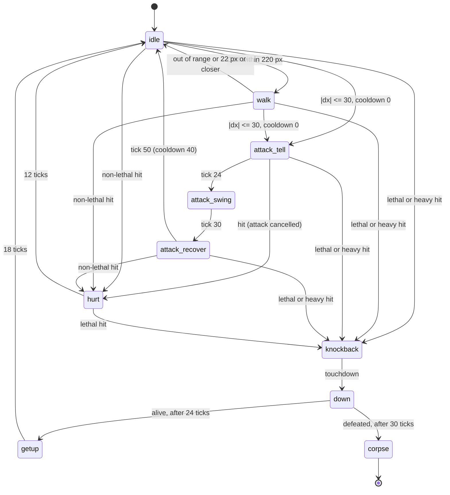

# GOB-01: common goblin design spec (phase 1: size study, design, keys)

**Status:** candidate design, 2026-11-17. Phase 1 of GOB-01 (design). Nothing here is approved or wired into Bevy. The goblin height is a **proposal**: by owner rule, enemy sizes are proposed by one Opus agent and decided by a different Opus agent. The tick windows below are **proposals** for the combat work order; the WORK-021 greybox has no goblin attack yet (see section 4).

Model routing (AGENTS.md "Model routing for art work"): design and phase-1 keys by Claude Opus (this document); execution of the remaining frames by Claude Sonnet; review by a separate Claude Opus agent. Rights: fan-concept art under the owner-reported `ART-PUBLICATION-ALL-V1` scope; no reuse licence and no game or asset-pack distribution right. The concept references under `assets/concept/floor-01/` were looked at for mood only. No pixel is traced or derived from them.

Evidence: [docs/evidence/gob-01/](../evidence/gob-01/README.md).

## 1. Canon and tone constraints

From the [opening encounter handoff](../07-agents/floor-01-opening-encounter-handoff.md) and the [Floor 1 opening direction](floor-01-opening-catacomb-goblins.md):

- Common goblins are green, about 4 ft tall, in leathery rag clothing, with sharp teeth and pointy ears.
- The early on-foot weapon is a **pineapple on a wooden stick**. It is not a studded or metal club.
- The two common goblins are a **visual** variation (A and B), not two combat classes. Same frames, same timing, same hitbox.
- Tone ([antihero tone](../01-design/antihero-tone.md)): a scrappy, nasty, slightly ridiculous threat with a readable tell. It is never a heroic orc. Carl must stay believable when he knocks one away, so the goblin cannot be so big that launching it looks superhuman.

## 2. Size study

**Range.** Carl is 52 px and is treated as about 6 ft. A 4 ft goblin at the same scale is 52 × 4 / 6 = **34.7 px**. The goblin stands hunched, so its standing height is about 2 to 3 px more than its idle height. The options bracket the literal value and allow for pixel-art inflation:

| Option | Idle opaque height | Ratio to Carl | Implied height if Carl is 6 ft | Opaque area (idle) | Note |
| --- | --- | --- | --- | --- | --- |
| h36 | 36 px | 0.69 | 4.2 ft (about 4.4 ft upright) | 666 px | closest to canon; fits the WORK-021 enemy AABB (24 × 38) |
| h40 | 40 px | 0.77 | 4.6 ft | 830 px | same height as Donut |
| h44 | 44 px | 0.85 | 5.1 ft | 988 px | nearly Carl's size |

Reference: Carl idle 52 px with an area of 837 px; Donut idle 40 px with an area of 1,305 px.

**Method.** One parametric idle pose (`scripts/author_goblin_gob01.py size-study`) is rasterized **natively** at each height. It is not a resample. Each version has a 1 px plum outline, a simple rim light and a fixed face stamp. These are block-ins, so the comparison is fair across the three heights. They are not production pixels. The finished 36 px variant A idle key is shown beside them in the key-pose sheet. Images: `size_study_sheet.png`, `floor01_size_h{36,40,44}_{640x360,1920x1080}.png` and `floor01_lineup_*`.

**Recommendation: h36.** Reasons:

1. **Readability.** The goblin's head is about 13 × 15 px at 36 px, roughly the size of Carl's head. So the yellow eyes, the toothy grin and the long nose still read at 1x. Its green is unique in the cast and separates clearly from both the warm brick and the cold arch in the lit Floor 1 renders. At 36 px the idle and the tell differ by 19 px of height (36 against 55). That is the largest silhouette change of the three options, and it is what makes the tell readable.
2. **Threat.** The 36 px goblin already covers 80 % of Carl's opaque area, because the hunch, the ear and the forward stick make it wide. In the tell it towers to 55 px, above Carl's head. The threat comes from the tell and from numbers, not from body size. That fits "scrappy, nasty, slightly ridiculous". At 44 px the goblin reads as a near-peer brute, which pushes toward the heroic-orc look the canon rejects.
3. **Combat hitbox clarity.** The idle body fits the existing greybox enemy AABB (`ENEMY_HALF_WIDTH` 12, `ENEMY_HALF_HEIGHT` 19, so 24 × 38) with 2 px to spare. Hits that look like hits are hits, and no gameplay constant has to change. Proposed hurtbox: 22 × 34 on the body, excluding the ear tip and the weapon.
4. **Knockback flight.** A 4 ft goblin punted 90 px by a 6 ft man is believable, which keeps Carl an everyman. A small body in flight reads as a big launch. Two airborne goblins colliding (CP-02) stay legible without filling the 640 × 360 view. At 44 px two goblins plus Carl crowd the screen.

**Known trade-off for the decider.** At 36 px the goblin is 4 px shorter than Donut's 40 px. Donut's 40 px includes her tiara and ears; her skull top is about 36 px. Read honestly, a goblin about as tall as the cat is the cost of following the canon against an inflated Donut. h40 is the fallback if the decider weighs parity with Donut over the canon and the tell contrast. h44 is not recommended.

## 3. Frame, pivot and atlas

- **Frame 64 × 56, pivot (28, 55)**, using the same bottom-row convention as Carl (48 × 56 / (25, 55)) and Donut (72 × 44 / (46, 43)). Pivot x is the midpoint between the two idle soles (far sole x 20 to 25, near sole x 30 to 38). Pivot y is the contact row.
- The frame is wide because of the weapon. The tell pineapple reaches x 9 and row 1, the swing crown reaches x 57, and the side-on pineapple in the hurt key reaches x 0.
- **Grounded tags:** the lowest opaque row is row 55 in every frame (0 px foot sink, as in the Floor 1 contract). These are `idle`, `walk`, `attack_tell`, `attack_swing`, `attack_recover`, `hurt`, `down`, `getup` and `corpse`.
- **Airborne tag** (`knockback`): the pivot stays on the physics foot line, which is the bottom of the AABB. The body is drawn above it (the phase-1 key's lowest row is 50). Do not snap these frames to the floor.
- Authored facing right. The runtime mirrors around the pivot column, the same rule as Carl and Donut. Goblins mostly face left toward Carl. Variant B's bandana tails are symmetric enough to flip.
- **One atlas per variant**, 26 frames row-major, with the layers `body`, `weapon` and, for B, `accessory`.

## 4. WORK-021 combat domain (what exists) and the tick contract (proposal)

From `src/prototype.rs` at 60 Hz (`TICK_SECONDS` 1/60):

| Fact | Value |
| --- | --- |
| Goblin health | 2 (Carl's melee removes 1 per hit, instantly) |
| Goblin AABB | 24 × 38 (half extents 12 / 19) |
| Chase | 62 px/s while 22 px < \|dx\| < 220 px |
| Damage to Carl | **contact only**: \|dx\| < 23 and \|dy\| < 36, then 55 ticks of hero invulnerability |
| Carl melee | instant hit, reach -9 to 54 px forward, ±44 px vertical, 14-tick cooldown |
| Physics | `GRAVITY` 1050 px/s² |
| Knockback, stagger, goblin attack windows | **none yet** |

So no goblin attack windows exist to line up with. The following tick contract is proposed for the combat work order (COMBAT-PHYS-01 / CP-01, CP-02). It replaces contact damage with a telegraphed bonk:

| Phase | Ticks (relative to the tell start) | Gameplay meaning |
| --- | --- | --- |
| tell | 0 to 23 (24 ticks, 400 ms) | trigger when \|dx\| ≤ 30 px and grounded with the cooldown at 0; **interruptible**: any Carl hit cancels the attack and goes to `hurt` |
| swing smear | 24 to 25 (2) | hitbox inactive |
| swing impact | 26 to 29 (4) | **hitbox active**: x +8 to +30 px forward of the pivot, y 0 to 30 px above the floor; at most one hit per attack |
| recover | 30 to 49 (20) | vulnerable punish window; no hitbox |
| cooldown | 40 ticks in idle or walk | before the next tell |
| hurt | 12 | non-lethal hit; attacks blocked; presentation push of about 9 px (gameplay impulse to be tuned) |
| knockback | launch 4, then airborne until touchdown | lethal or heavy hit. Reference launch: vx 200, vy 240 px/s gives about 27 ticks of flight and about 90 px with greybox gravity |
| down | 4 + 8 + hold | if alive, hold 24 ticks then get up (18 ticks); if defeated, hold 30 ticks then show the corpse |

With the WORK-021 baseline of 2 HP, the first hit plays `hurt` and the second, lethal hit plays knockback, then down, then corpse. A bomb blast plays knockback and is lethal.

**Alignment rule.** Every frame lasts a whole number of ticks. The atlas `duration_ms` is `round(ticks * 1000 / 60)` and is used for previews only. The runtime advances frames from simulation ticks and state, never from wall-clock milliseconds, and frame changes fall on tick boundaries. The impact frame (13) is shown on exactly the ticks where the hitbox is active (26 to 29). Animation never feeds back into the simulation.

## 5. Animation list (26 frames per variant)

Key = Opus. Phase 1 delivers keys 0, 11, 13, 16 and 19 (variant A). Phase 2 Opus delivers keys 4, 7, 22, 25 and the variant B overlay design. Every other frame is Sonnet's.

| # | Tag | Frame | Ticks | ms | Playback | Author |
| --- | --- | --- | --- | --- | --- | --- |
| 0 | `idle` | hunched breath, stick forward | 12 | 200 | loop | **Opus key (done)** |
| 1 | `idle` | breath in, body 1 px up | 8 | 133 | loop | Sonnet |
| 2 | `idle` | hold, ear twitch (tip 1 px) | 12 | 200 | loop | Sonnet |
| 3 | `idle` | breath out | 8 | 133 | loop | Sonnet |
| 4 | `walk` | contact, near foot forward | 5 | 83 | loop | Opus key (phase 2) |
| 5 | `walk` | down | 5 | 83 | loop | Sonnet |
| 6 | `walk` | pass / up | 5 | 83 | loop | Sonnet |
| 7 | `walk` | contact, far foot forward | 5 | 83 | loop | Opus key (phase 2) |
| 8 | `walk` | down | 5 | 83 | loop | Sonnet |
| 9 | `walk` | pass / up | 5 | 83 | loop | Sonnet |
| 10 | `attack_tell` | lead-in: crouch, stick rising past the shoulder | 6 | 100 | once | Sonnet |
| 11 | `attack_tell` | **wind-up hold**: pineapple high behind the head, yelling | 18 | 300 | once | **Opus key (done)** |
| 12 | `attack_swing` | smear: stick vertical overhead, body tipping forward | 2 | 33 | once | Sonnet |
| 13 | `attack_swing` | **impact**: lunge, pineapple forward, grimace | 4 | 67 | once | **Opus key (done)** |
| 14 | `attack_recover` | overbalanced, pineapple on the floor | 12 | 200 | once | Sonnet |
| 15 | `attack_recover` | yanks the stick back | 8 | 133 | once | Sonnet |
| 16 | `hurt` | **recoil**: head snapped back, white eyes, O mouth | 4 | 67 | once | **Opus key (done)** |
| 17 | `hurt` | stagger: half-way back to idle | 8 | 133 | once | Sonnet |
| 18 | `knockback` | launch: body leaving the floor, tilted back 45 degrees | 4 | 67 | once | Sonnet |
| 19 | `knockback` | **airborne**: horizontal, head leading, limbs flailing, tongue out | until touchdown | 100 | hold | **Opus key (done)** |
| 20 | `down` | floor impact, squash | 4 | 67 | once | Sonnet |
| 21 | `down` | bounce or slide settle | 8 | 133 | once | Sonnet |
| 22 | `down` | lying flat, dazed | hold | 200 | hold | Opus key (phase 2) |
| 23 | `getup` | push up on the arms | 8 | 133 | once | Sonnet |
| 24 | `getup` | kneel, grab the stick | 10 | 167 | once | Sonnet |
| 25 | `corpse` | lying flat; the pineapple has come off the stick and rolled 6 px away (gag) | hold | 200 | hold | Opus key (phase 2) |

The walk is designed for the chase speed of 62 px/s: 6 frames × 5 ticks is a 30-tick cycle, which covers 31 px, so each step is 15.5 px. The planted foot travels **5 px per frame** (60 px/s), which leaves 0.17 px of slip per frame. Keep the pineapple in front at chest height and let it bob 1 px.

## 6. State diagram

`attack_swing` cannot be interrupted, so the bonk always lands or misses. Any state can be hit except `knockback`, `down` (presentation only, no hurtbox) and `corpse`. Corpse contact (CP-04) stays variant A: presentation only.

## 7. Palette `goblin-floor01-v0`

Variant A uses 19 colours; B adds 1 for 20. Carl uses 23 and the largest per-layer palette in the ADR-0007 spike was 26. The palette is tuned for the A1 lighting, where warm torch pools fall into cold blue ambient light.

| Key | Name | Hex | Role |
| --- | --- | --- | --- |
| K | outline_plum | `#1b1124` | shared with Carl |
| a / s / m / l | skin deep / shade / mid / light | `#263a26` `#46682e` `#7a9e36` `#b2cc56` | yellow-green skin; the shadows lean blue for cold ambient, the lights lean warm for the torch side |
| r / t / u | rag dark / mid / light | `#2c1e28` `#4c3436` `#73524a` | cool, dark leather so the body does not merge with orange brick |
| e | eye_yellow (accent) | `#ffd23a` | glaring eyes |
| w | tooth_white (accent) | `#efe4c4` | teeth, and the eye whites in `hurt` |
| o | mouth_dark | `#5c1426` | |
| R | tongue_red | `#b8322e` | knockback tongue; variant B bandana mid |
| x / y | wood dark / mid | `#4a2c1c` `#8c5c32` | stick, rope belt |
| F / G / H | pineapple dark / mid / light | `#7a3c12` `#d08826` `#f4c84a` | diamond-pattern fruit |
| V / v | leaf dark / mid | `#1d4a3c` `#3e8a5c` | teal crown, kept off the skin hue |
| B | rag_red_dark (variant B only) | `#6e1a22` | bandana shadow |

## 8. Key poses (phase 1, variant A, as authored)

- **Idle (0), 36 × 36 px.** Hunched, with a big bald head pushed ahead of the leather-vest hump. The near ear sweeps back and up. A heavy brow sits over glaring yellow eyes, the long nose hooks down, and the wide mouth shows an upper row of teeth. The near hand holds the stick forward at chest height; the pineapple is upright with its crown up, 4 px clear of the nose. A rope belt sits over ragged shorts, the legs are skinny and bowed, and the bare green feet are big.
- **Attack tell (11), 55 px tall.** The torso leans back and the stance is braced wide, with the back foot 8 px further back. The near arm is thrown up behind the head. The pineapple is the highest point, its crown 21 px above the head top (row 1 against row 22), and the mouth is open in a yell. It is the only frame family where the pineapple rises above the head.
- **Swing impact (13).** A lunge: the hump is high and the head goes down and forward. Both arms drive the stick forward. The side-on pineapple sits 16 to 29 px ahead of the pivot at Carl's knee-to-belt height, crown leading. The teeth are clenched and the eyes squeezed.
- **Hurt (16).** The head snaps 4 px back. Yellow eyes become white eyes with pinprick pupils and the mouth is an O. The weapon arm flings back, and the pineapple trails low behind, crown pointing away. Both feet stay on row 55.
- **Knockback (19).** The body is horizontal with the belly up. The head (the variant A head turned 90 degrees, lossless, then re-lit) leads the flight with the face up and the tongue out. The legs kick toward the hitter, one arm is flung up, and the far hand still drags the pineapple. Lowest row 50.

## 9. Variants A and B (visual only)

B uses the same frames, timing, pivot and hitbox as A. It adds an `accessory` overlay layer plus three tiny per-frame edits:

1. **A red rag bandana** (`R` with `B` shadow) tied round the brow ridge, 2 to 3 px tall, with two 3 to 4 px tails trailing behind the ear. This is the 1x identifier: red on green.
2. **A notched ear:** 2 px missing near the tip (the same edit in every frame).
3. **One missing upper tooth** (`o` in place of a `w`).
4. **A stitched vest patch** on the hump (a 3 × 3 `u` square with `K` stitches).

B is not heavier, does not have more HP and does not use a different attack.

## 10. Readability rules and acceptance targets

- **R1 Tell at 1x.** In `attack_tell` the pineapple is the highest opaque point, at least 12 px above the head top (key 11: 21 px). It is held for at least 18 ticks. In no other tag does the pineapple rise above row 20, the idle head top.
- **R2 Tell body.** The mouth is open (dark mouth at least 4 × 2 px) and the torso leans back at least 2 px compared with idle.
- **R3 Idle and walk.** The pineapple is in front at chest height, below the head top, with a gap of at least 3 px to the nose.
- **R4 Impact.** The pineapple is fully ahead of the pivot by at least 16 px, the front foot is planted on row 55, and the frame shows on the active ticks only.
- **R5 Hurt.** Eye whites (`w`) replace the yellow eyes and no weapon is in front of the body. A hurt goblin must never be mistaken for a goblin in the tell.
- **R6 Knockback.** No pixel on the contact row, the body is horizontal and the head leads.
- **R7 Cast separation.** Goblin green appears only on goblins. The rags stay cool and dark against the warm brick. Check at 1x in front of both the brick and the arch on the lit Floor 1 composition.
- **R8 Contact.** Every grounded frame has its lowest opaque row on 55. Lint has 0 isolated pixels; aim for fewer than 10 orphan pixels per production frame.
- **R9 Variant B** reads at 1x from the bandana alone.
- **R10 Tone.** Nasty and slightly ridiculous: grins, yells, a lolling tongue and a pineapple, never a heroic-orc physique. Carl's knockback of a goblin must look like a believable shove.

## 11. Phase-1 weaknesses (for the independent review and phase 2)

1. The orphan pixel counts are 18, 17, 19, 12 and 16 per key. Most are deliberate texture (pineapple highlights, the end of the rope belt, vest folds) plus a few face accents. Production frames should go below 10.
2. **The swing reads more as a thrust than an overhead smash.** The pineapple is horizontal with its crown leading. A 30 to 45 degree downward fruit, or a 2 px lower body, would sell the bonk better. This is a design call for the phase-1 reviewer.
3. In the knockback, the turned head reads at 1x but the face is weak at 3x and above. The re-lit head and the thin limbs are block-in quality.
4. The leather vest is a large flat shape. It has fold lines but no rim light or hem detail, and variant B's patch will help.
5. The far arm is hidden in the idle and the tell. The "two-handed" tell grip shows one arm.
6. The hurt pose could be more off-balance, for example with the front heel lifting.
7. No human has judged game feel. Everything here is a candidate.

## 12. Files

| File | Role |
| --- | --- |
| `assets/source/characters/goblin/goblin_a_h36_keys.grid.json` / `.ase` | variant A phase-1 keys (5 frames, layers `body` and `weapon`); the grid is the source of truth |
| `assets/source/characters/goblin/goblin_size_study.grid.json` / `.ase` | block-ins at 36, 40 and 44 px (tags `h36`, `h40`, `h44`) |
| `assets/manifests/goblin_a_h36_keys.json`, `assets/manifests/goblin_size_study.json` | candidate manifests (`prototype_fixture_unapproved`) |
| `scripts/author_goblin_gob01.py` | palette, layer split and the size-study generator (`size-study [--check]`) |
| `scripts/make_goblin_gob01_review.py` | review sheets and lit Floor 1 compositions |
| `tests/test_art_goblin_gob01.py` | contract tests for the phase-1 sources |
