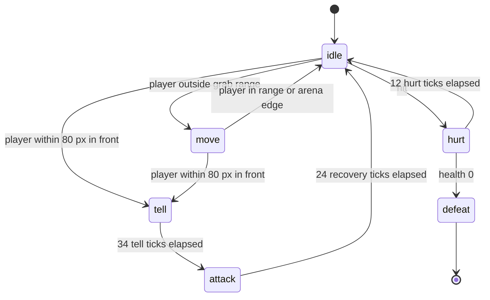

# HOARD-01: The Hoarder (boss) readability set, design spec

**Status:** keys 0, 3, 8, 10, 12, 15 drawn and frozen (key 0 passed the silhouette gate). In-betweens drawn (pose dicts), manifest, evidence and review pack produced; validators pass. Independent review pending.

**Bevy integration (FA-Q23, PR-E):** the committed frames are wired, unchanged, into the Hoarder's room as a labelled **stand-in** (the sheet's mapping, `docs/01-design/enemy-gameplay-hoarder.md` section 4): every frame of her carries the visible label "STAND-IN UNTIL HOARD-02" until the review passes and HOARD-02 adds the shove, jam, pinned, get-up and emerge poses. The sources, the manifest, the atlas and the validators are untouched; the integration is `src/hoarder_art.rs` and `src/bin/floor01_scene/hoarder_art.rs` (presentation only, no sim hash moves). Screenshots at 1x and 1080p: `docs/evidence/f01-hoarder-presentation/`. Model record for this integration: Claude Sonnet (integration only; the art stays the HOARD-01 candidate designed by Claude Opus).

**Decision record:** height 112 px, frame 160 x 128, pivot (70, 127). Proposed by the HOARD-01 designer; decided by the independent silhouette-gate review on key 0 (pending).

The sections follow `docs/02-art/gob-01-goblin-spec.md`. The design step stops at the keys and this spec (see the top-tier budget in `docs/07-agents/agent-orchestration.md`).

## 1. Canon and tone constraints

- Approved concept: `assets/concept/floor-01/enemies/floor01-hoarder-individual-study.png` (primary). `docs/02-art/floor-01-late-enemy-boss-concepts.md` records it as an approved *reference/exploration sheet*; `docs/02-art/floor-01-enemy-concept-roster.md` records the Hoarder as dedicated boss design-to-production interpretation pending. **No single A/B/C variant has been selected as the final production master.**
- Tone (`docs/01-design/antihero-tone.md`, enemies row): threatening yet eccentric, with motivated behaviors and readable tells and some absurd visual contrasts; never a purely serious faceless army and never comedic with no danger. 1980s-1990s action cinema is used for attitude only, never copied designs.
- Canon facts that must survive in pixels (from the approved docs and the concept board, not design decisions):
  - **A transformed human woman**, individual and tragic: long dark disheveled hair, severe facial damage (half the face burned), everyday torn clothing (ragged T-shirt, worn sweatpants, barefoot), surrounded by and covered in refuse. Fear, loss of humanity and horror alongside grotesque action-comedy.
  - **She is not a goblin with a backpack.** Retain her individuality and tragedy.
  - Horror without gratuitous gore.
  - Massive boss build; the printed `15 ft`, `35 years` and `96 px` are not decisions.
- Design reading of the tone: she reads as a frightened, ruined person first: stooped, head sunk between the shoulders, eyes wide, mouth slack, half the face burned into scar tissue (dark plum and raised rose, never open wounds or blood). The danger comes from her mass and her open, clawed hands; the slight absurdity comes from the junk that clings to her (a tin-foil scrap in the hair, filth dripping from the hem) and from the hoard pile around her, never from mocking her body or face. Her heavy body is draped in a baggy plain shirt and sweatpants: nothing heroic, nothing sexualised.

### Guardrails (copied from the roster and late-enemy docs)

- **The Hoarder is not a goblin with a backpack.** The ensemble board `floor01-enemy-lineup-approved.png` draws a green goblin-/orc-like monster with a backpack and rubber ducks; that depiction contradicts the source identity and is **deliberately not cropped into this packet**. Use only the individual study.
- Remove brand-like or real-world shirt logos (the study's T-shirt carries a recognisable fitness-brand logo) from original production pixel art, without altering the reference file.
- Names, captions, production-class labels, exact sizes, invented attacks and mechanics printed in the image panels (for example "reach / grab", "flinch", the thrown junk of the lineup board) are not canon or balance decisions.
- Do not present the composite as a finished sprite. Convert from original editable pixel grids / `.aseprite`, never by tracing or cropping the board.
- Boss scale on screen is a design decision; Carl and Donut appear on the board only as a scale reference.

### Packet inputs

- Concept crops in `docs/evidence/hoard-01/packet/` (x,y,w,h in the 1672x941 concept):
  - `concept_crop_1.png` = `60,140,360,425`: variant A (calmest, standing)
  - `concept_crop_2.png` = `430,125,375,435`: variant B (trash piled on the back; a refuse reference only, not a backpack)
  - `concept_crop_3.png` = `855,95,480,465`: variant C (roaring, reaching)
  - `concept_crop_4.png` = `20,655,255,225`: key animation study, reach / grab
  - `concept_crop_5.png` = `285,640,220,240`: key animation study, flinch / react
  - `concept_crop_6.png` = `540,645,255,235`: key animation study, step / advance with falling trash
  - `concept_crop_7.png` = `1395,485,255,115`: face details (three expressions)
  - `concept_crop_8.png` = `1295,648,377,242`: the Hoarder in the board's in-game composition (not an accepted scale)
- `scale_lineup.png`: Carl 52, Donut 40, goblin 36, plus three empty candidate slots at 96, 112 and 128 px. 96 px is the board's printed lineup label, 128 px is the by-eye ratio of 15 ft to a 52 px, 6 ft Carl; both are estimates, not approved sizes. The default 64 x 56 frame in `frame_pivot_template.json` is a placeholder only and far too small for any candidate; the designer sets every number.
- Readability set (tags): `idle` (2-4), `move` (4-6), `tell` (1-2), `attack` (2-3), `hurt` (1), `defeat` (2-3); about 12 to 20 frames. Concrete tag names and frame counts are the designer's choice (section 4 and `frame_pivot_template.json` carry the toolkit defaults).

## Difficulty and route

**Score 4 of 4 (3 certain, 1 arguable): Boss, route A + silhouette gate** (top tier designs and draws every key; a fresh top-tier silhouette check on the idle key before anything else is drawn; budget one extra review round). Any boss lands in this class regardless of the score.

| Point | Met | Note |
| --- | --- | --- |
| 1. New design, not a variant | yes | Dedicated boss; the goblin-style ensemble depiction is not a base |
| 2. Native height above about 40 px | yes | Candidates 96 to 128 px |
| 3. Complex anatomy or construction | yes | Large humanoid with long hair, layered rags and loose refuse |
| 4. VFX, projectiles, special states | arguable | Falling and thrown trash may or may not belong in the sprite; a design question |

Reasoning: new boss design at about 2 to 2.5 times Carl's height with hair, clothing and refuse to organise; the silhouette gate matters most here because the main risk is drifting back to a goblin read.

## 2. Size decision

Carl is 52 px (about 6 ft), Donut 40 px, the goblin 36 px (see `scale_lineup.png`). The idle key is hunched, so the idle opaque height is her stooped height; the tell key stands her up 13 px taller.

| Option | Idle opaque height | Ratio to Carl | Implied real height (stooped) | Why / why not |
| --- | --- | --- | --- | --- |
| A | 96 px | 1.85 | 11.1 ft | Cheapest, but only 8 px above the adult Mongo study (88 px) and below the Dozer hull (120 px): she reads as a large brute, not the floor boss. The head shrinks to about 15 px, too small for the burned half face and the eye whites at 1x. |
| B | 112 px | 2.15 | 12.9 ft | Chosen. 31 % of the 360 px screen when idle, about 34 % in the tell. The head is 21 px tall, enough for two eye whites, an open mouth and a readable burned half. Leaves headroom above her for the hoard pile and Carl's jump arc. |
| C | 128 px | 2.46 | 14.8 ft | Closest to the printed 15 ft (not a decision). In the tell she would reach about 138 px, 38 % of the screen; with the hoard pile behind her the arena loses its upper third. About 30 % more pixels per key on a 16-frame set, with no readability gain over B at 1x. |

Decision: **112 px idle opaque height (rows 16 to 127)**. B is the smallest height at which the face, which carries her individuality and tragedy, stays readable at 1x, while she still towers clearly above every other Floor 1 actor. Proposed by the HOARD-01 designer; the independent silhouette-gate review confirms or rejects it on key 0.

### Master variant

No A/B/C variant was selected in the concept. This spec takes **variant A as the master** for the body, costume and idle: it is the calmest pose, it shows the whole face (fear, not rage), and its stooped, wide stance converts directly into a looping idle. Variant **C** supplies the tell and attack (roar, one arm flung forward to grab), and the animation studies supply move (crop 6), hurt (crop 5) and the grab (crop 4). **Variant B is rejected as a master**: the refuse heaped on her back produces the backpack silhouette that the guardrail forbids. Refuse stays off her outline, except two tiny clinging details (a tin-foil scrap in the hair, filth drips below the hem); the hoard pile is a separate prop (section 13).

## 3. Frame, pivot, boxes and atlas

- Frame **160 x 128**, pivot **(70, 127)**, contact row **127** (the lowest opaque row of every grounded frame). The pivot is the midpoint of the two feet in idle (x 28 to 117). Room: 70 px behind the pivot (hair flung back in the tell, the defeat sprawl), 89 px in front (the grab reaches x 150).
- Grounded tags: `idle`, `walk`, `attack_tell`, `attack_swing`, `hurt`, `down`. Airborne tags: none (she never leaves the floor).
- Standing box 56 x 104 (x 42 to 97, y 24 to 127): torso, hips and legs; hair strands, fingers and the hoard are outside it.
- Hurtbox: the standing box plus a head box 20 x 22 (x 71 to 90, y 18 to 39). Hair tips and fingers never take hits. In `hurt` and `down` the boxes follow the body core of each frame (execution derives them from the frame bbox minus hair).
- Attack hitbox (frame 10, impact): x 112 to 150, y 84 to 127 (39 x 44), the two slamming hands and the floor directly under them. Active on exactly the 6 ticks of frame 10; never during the smear or the recovery.
- Authored facing right; the runtime mirrors around the pivot column x 70.
- One atlas, 16 frames (0 to 15), one layer `body`. Overlaps (hair over the back, near arm over the torso, front locks over the chest) are resolved by part order in `scripts/author_hoard01.py`, so one flattened layer is enough.

## 4. Readability-set animation list

Readability set: idle, move, tell, attack, hurt, defeat; 16 frames. Tick windows at 60 Hz. She is heavy: every window is slower than GOB-01's.

| Role | Tag | Frames | Playback | Ticks | Total |
| --- | --- | --- | --- | --- | --- |
| idle | `idle` | 0-2 | loop | 16 + 12 + 16 | 44 (laboured breathing) |
| move | `walk` | 3-6 | loop | 8 + 8 + 8 + 8 | 32 (step-drag shuffle: one lead step and one dragged rear foot per loop; ground travel 6 px per frame, 24 px per loop, 45 px/s) |
| tell | `attack_tell` | 7-8 | once | 8 + 26 | 34 (readable hold 26 >= 18) |
| attack | `attack_swing` | 9-11 | once | 3 + 6 + 24 | 33 (smear 3, impact 6 = hitbox ticks, recovery 24 = punish window) |
| hurt | `hurt` | 12 | once | 12 | 12 |
| defeat | `down` | 13-15 | hold | 8 + 12 + hold | 20, then a state-driven hold (staged: buckle 8, floor impact 12, settled hold) |

Frame table:

| # | Tag | Pose | Ticks | Author |
| --- | --- | --- | --- | --- |
| 0 | `idle` | stooped, wide stance, arms hanging, clawed hands open, wide eyes | 16 | key (drawn, frozen) |
| 1 | `idle` | exhale: torso and head 1 px down, belly 1 px out, hands 1 px lower | 12 | in-between (drawn, pose dict `INB`) |
| 2 | `idle` | inhale: shoulders and head 1 px up from key 0, hair tips sway 1 px left | 16 | in-between (drawn, pose dict `INB`) |
| 3 | `walk` | contact: far foot lands forward, near foot dragged behind on its toes, torso lurches 4 px | 8 | key (drawn, frozen) |
| 4 | `walk` | drag 1: weight drops 2 px onto the far leg, near foot scrapes forward | 8 | in-between (drawn, pose dict `INB`) |
| 5 | `walk` | drag 2: feet together, near foot planted flat and taking the weight | 8 | in-between (drawn, pose dict `INB`) |
| 6 | `walk` | lift: far heel lifts for the next step, body rises | 8 | in-between (drawn, pose dict `INB`) |
| 7 | `attack_tell` | gather: crouches 4 px below idle, arms drawn back and in, head down | 8 | in-between (drawn, pose dict `INB`) |
| 8 | `attack_tell` | rear-up hold: stands tall, both arms over the head, mouth wide, eyes wide | 26 | key (drawn, frozen) |
| 9 | `attack_swing` | smear: torso pitching forward, arms a 2-frame arc smear | 3 | in-between (drawn, pose dict `INB`) |
| 10 | `attack_swing` | impact: both hands slammed onto the floor in front, grabbing | 6 | key (drawn, frozen) |
| 11 | `attack_swing` | recovery: hands still on the floor, head lifts, hair settles | 24 | in-between (drawn, pose dict `INB`) |
| 12 | `hurt` | flinch: head snaps back and away, arms pulled to the chest, eyes shut | 12 | key (drawn, frozen) |
| 13 | `down` | buckle: knees give, torso drops 18 px, one hand out | 8 | in-between (drawn, pose dict `INB`) |
| 14 | `down` | impact: knees and near hand on the floor, head down | 12 | in-between (drawn, pose dict `INB`) |
| 15 | `down` | settled: collapsed forward, prone on her belly with the legs folded under her, head turned to the side, one hand reaching for a scrap, eyes shut | hold | key (drawn, frozen) |

## 5. State diagram



The 80 px range is an art-side estimate for the tell trigger (the grab reaches 80 px in front of the pivot). Damage, health, super-armour during the tell and the boss phase structure belong to a gameplay work order.

## 6. Palette

19 colours (limit 20). The packet candidates are median-cut shares of the crop, about two thirds background navy; creature colours were picked by eye and pushed for the A1-lit catacomb.

| Key | Name | RGBA | Role | Nearest candidate |
| --- | --- | --- | --- | --- |
| `K` | outline | `#1c1218` | outer and part outline, eye pupils, mouth | `#040309` (lifted, warm) |
| `d` | skin_deep | `#5c2e2a` | mouth interior, cast shadow on skin | `#62312c` |
| `s` | skin_shade | `#94523f` | skin core shadow | `#85402f` |
| `m` | skin_mid | `#c67c5a` | skin midtone | `#d1744f` |
| `h` | skin_light | `#e6a982` | skin torch light | `#de926c` |
| `x` | scar_dark | `#5e3442` | burned near half of the face, dark plum | `#6d161d` (pushed to plum: scar, not blood or a mask) |
| `y` | scar_light | `#8f5a5e` | raised scar clusters, rose-brown | `#b14231` (desaturated) |
| `a` | hair_deep | `#241e2c` | hair mass | `#292738` |
| `b` | hair_mid | `#3c3550` | hair lit side | `#443e52` |
| `c` | hair_rim | `#5a6078` | 1 px blue-grey rim on the top and back hair edges, sparse sheen strands (reads against the navy arch) | none |
| `t` | shirt_shade | `#6e604e` | shirt shadow, chest fold | `#63484b` |
| `u` | shirt_mid | `#a39276` | shirt midtone (largest mass), pants side stripe | `#87645e` |
| `v` | shirt_light | `#d4c4a2` | shirt torch light | `#dbae8d` |
| `p` | pants_deep | `#262944` | sweatpants shadow | `#2c3249` |
| `q` | pants_mid | `#3e4468` | sweatpants midtone | `#443e52` |
| `r` | pants_light | `#626a94` | sweatpants light | none |
| `g` | grime | `#5a4a2c` | stains, filth drips | none |
| `w` | eye_white | `#ece2ca` | eye whites, teeth (accent) | `#f9c091` (neutralised) |
| `n` | tin_scrap | `#94a4a8` | tin-foil scrap caught in the hair (accent) | none |

The pale shirt is the largest and lightest mass, so her body separates from the orange brick and the navy arch at 1x; the cool hair sheen and the violet-leaning sweatpants keep her outline readable against the warm wall. No colour exists for a print: **the shirt is plain** and the study's brand-like logo has no pixels.

## 7. Key poses

Six keys, one per readability role, all drawn and frozen. Every key is rendered by `hoarder(pose)` in `scripts/author_hoard01.py` from one construction: the body group (torso, hips, sleeves, shirt details) moves by a rigid transform about the hip centre (68, 100), the head group (head, hair, face, tin scrap) by a second transform about the neck (82, 40), and the limbs follow explicit joint points. The identity pose is key 0. Bboxes below are measured.

| Frame | Tag | Silhouette and pose notes | Readability reason |
| --- | --- | --- | --- |
| 0 | `idle` | bbox x 22-117, y 16-127. Stooped three-quarter view facing right; the upper-back hump (y 33) is higher than the chin (y 42). Head 24 x 23 (centre (81, 29)), face turned about 25 degrees toward the camera, the lower jaw narrowed 2 px to a soft chin. Hair: notched, ragged top (rows 16-22) with a 1 px blue-grey rim on the top and back edges; a root band over the near shoulder splitting into three uneven strand groups (x 44-71, tips at y 71, 74 and 81, plus a wisp) with about 3 px of shirt between them and a blue-grey highlight on each lit edge; three locks in front of the far shoulder (x 90-98) down to y 56-62; two thin strands across the near cheek; a 5 px tin-foil scrap in the back hair. Face: two eye whites 3 px apart (the burned eye keeps a 2 x 1 white, no lid or brow), a 3 x 2 open mouth. The burn is an irregular patch on the near half only: dark plum with a soft rose-brown edge on the nose side and five raised rose-brown clusters of 1-2 px, each with a dark shadow pixel below; about 11 px of unburned skin. Torn neckline 8 px wide; a chest mass above the belly read through light (a lit upper curve) and a 2 px shade underneath, with no cleavage line and no outline change. Near arm hangs back-left, hand at (30, 94); far shoulder pulled in, hand at (108, 91). Wide stance: near foot x 28-54, far foot x 92-117. Plain stained shirt with a ragged hem; navy sweatpants with a faded side stripe from hip to ankle and cuffs gathered over bare feet. | A ruined woman, not a creature or a heavy man: long disheveled hair frames the face on both sides and falls past the chest, the face is human and frightened, the burn reads as old scar tissue, the clothes are everyday. Nothing sits on her back but hair. |
| 3 | `walk` | Contact of a step-drag shuffle. bbox x 35-123, y 17-127 (width 89). Body leaned forward 4 degrees, 4 px forward, 2 px down; far foot lands forward (ankle (107, 117), toes to x 123); near foot dragged behind on its toes under the body (ankle (61, 113), foot turned 20 degrees, x 46-71); arms hang heavy with a small sway (near hand (44, 94), far hand (105, 93)); hair swung 3 px back. | One leg leads and the other is dragged: a ruined body that can barely carry itself, which reads heavier and more tragic than a striding gait. The dragged foot never leaves the floor line, so the loop seam stays continuous. |
| 8 | `attack_tell` | Rear-up hold, the highest pose: bbox x 23-118, y 3-127. Body straightened, leaning back 6 degrees and lifted 6 px; head tipped back a further 6 degrees; both arms raised, hands open with the fingers up (near palm (56, 17), far palm (100, 15)); hair flung 12 px back; roar face: 2 x 2 eye whites, raised brow, a 5 x 5 mouth with upper and lower teeth (12 white px). Feet 2 px wider each side. | Three independent cues at 1x: the silhouette rises 13 px above idle with the hands framing the head, the face changes to white teeth and wide eyes, and the stance widens. Held 26 ticks. |
| 10 | `attack_swing` | Impact. bbox x 9-152, y 36-127. Torso pitched forward 35 degrees about the hips (moved 4 px back, 6 px down); head counter-rotated 25 degrees so the roaring face looks forward (head centre about (111, 54)); hair swung 6 px forward; both hands slammed onto the floor in front, fingers on row 127 (near palm (126, 117), far palm (141, 117), fingertips to x 152); near leg extended back on its toes (ankle (24, 116)). | The silhouette drops 20 px and stretches 47 px forward of idle; the hands land exactly where the hitbox is. |
| 12 | `hurt` | Flinch. bbox x 24-106, y 13-127. Body leaned back 5 degrees, 4 px back, 1 px up (shoulders up); head snapped back a further 12 degrees and 3 px; both arms pulled to the chest (near hand at (68, 54), far forearm crossing in front of the chest, hand at (88, 50)); eyes squeezed shut, knitted brow, a pained mouth line, no eye white; hair whipped 4 px forward. | The only key with the arms in and no eye white: a hit reads as pain, not anger, which keeps her tragic. |
| 15 | `down` | Settled, prone. bbox x 20-147, y 83-127 (height 45, width 128). Collapsed forward onto her belly: torso turned 90 degrees, flattened to 0.55 of its depth and sunk 6 px into the floor line (the belly spreads), legs folded under her with the feet tucked on their toes (no raised hips), back and hair up, head turned 45 degrees and resting on the floor, eyes shut, near arm stretched along the floor (fingertips x 147) toward the scrap the hoard prop places. No blood. | Flat, still and human; the reaching hand is the last beat of the hoarding tragedy. Decision: prone, not curled on her side (the earlier frame-table wording is withdrawn); the forward collapse continues the attack direction and keeps the face visible. |

## 8. In-between list

For the execution tier, derived from the keys above; no design decisions. The in-between slots 1, 2, 4-7, 9, 11, 13 and 14 are now drawn as new pose dicts for `hoarder()` (the `INB` table in `scripts/author_hoard01.py`: interpolated joint points, body and head transforms and hair swing of the neighbouring keys), not by editing pixels; keys 0, 3, 8, 10, 12, 15 stay frozen and `unique_frames` is `true` in the config. See "Executor notes" below.

| # | Pose notes |
| --- | --- |
| 1 | Key 0 with the body 1 px down (`body` dy +1), hands 1 px lower; feet unchanged. |
| 2 | Key 0 with the body 1 px up and hair swing -1; feet unchanged. |
| 4 | Drag 1: `body` (3, dx 3, dy 4); swing -2; far leg knee (99, 111), ankle (101, 117), flat; near leg knee (68, 110), ankle (66, 114), foot angle 12 (toes scraping); near arm (44, 72) / (45, 89) / palm (44, 95) angle -4; far arm (101, 70) / (104, 88) / (105, 93) angle 6. |
| 5 | Drag 2, feet together: `body` (1, dx 2, dy 1); swing -1; far leg knee (93, 111), ankle (95, 117), flat; near leg knee (70, 111), ankle (72, 117), flat; near arm (42, 71) / (43, 88) / (42, 94) angle -2; far arm (101, 69) / (105, 87) / (106, 92) angle 4. |
| 6 | Lift: `body` (3, dx 3, dy 0); swing -2; far leg knee (100, 108), ankle (99, 114), foot angle 25 (heel up); near leg knee (66, 111), ankle (66, 117), flat; arms as frame 4. Foot path over the loop: far ankle x 107, 101, 95, 99 (lifted), 107; near ankle x 61, 66, 72, 66, 61; every planted foot moves 5-6 px per frame. |
| 7 | Gather: body 4 px lower than key 0 (top >= 20), arms drawn back to the hips, head down 6 degrees. |
| 9 | Smear between keys 8 and 10: body angle about 15 degrees, arms halfway down as one arc; no hitbox. |
| 11 | Key 10 with the head lifted 4 px (head dy -4) and hair swing 2; hands stay on the floor. |
| 13 | Buckle: knees bend, body 18 px down and angle 20 degrees (top >= 34), near hand out. |
| 14 | Floor impact: `body` (60, dx -18, dy 26, squash 0.75); head -25; near leg knee (60, 119), ankle (36, 120), foot angle 60; far leg knee (68, 121), ankle (46, 122), foot angle 60; near hand on the floor (top >= 60). |

### Design decisions after the blind review (FAIL-DESIGN on the walk)

- **Walk: option B, step-drag shuffle** (key 3 re-keyed). A two-step stride (option A) reads as a capable walker; one leading step with the rear foot dragged after it reads heavier and more tragic for a 112 px boss who can barely carry her body, and it keeps a 4-frame, 32-tick loop. The loop is continuous: no planted foot moves more than 6 px per frame (section 8 frame 6 lists the foot path).
- **Woman read at 1x:** the back hair is three uneven strand groups with shirt showing between them and blue-grey lit edges (no slab, no cape or pack read); the lower jaw is 2 px narrower; the chest reads as a lit mass above the belly with a 2 px shade underneath (no cleavage line). Outline and scale are as gate-approved (at most a few hair-tip pixels differ per key).
- **Defeat:** prone (collapsed forward), not curled on her side; key 15 is re-keyed lower (top 83) so the hips no longer rise.
- All six keys are re-frozen (every key shares the hair, jaw and chest construction).

### Executor items

Done in round 2 (pose dicts and tick table only; keys, rig and design unchanged):

- Walk in-betweens 4, 5, 6 and defeat in-between 14 redrawn with the section 8 values; 13 re-checked against the re-frozen key 15 (no change needed).
- Recovery frame 11: body squash (scale 0.97, 2 px lower, 1 degree more pitch), head lifted 4 px and hair swing 3, hands on the floor. The 11a/11b split was not taken: it would renumber the frozen keys 12 and 15 (V09 fixture indices, tags, config), so it stays an option for a design pass.
- Defeat staged and longer: 13 held 8 ticks, 14 held 12 ticks (20 ticks before the hold, was 14); the body top goes 38, 66, 83 for frames 13, 14, 15 (test `test_defeat_is_staged_and_recovery_is_not_a_freeze`).
- Loop-seam foot-drift validator **V16** (`rules.foot_drift` in a config, `{"max_px": 9, "tags": ["walk"]}` here; without `tags` it checks every grounded loop tag). It compares the contact-row foot runs of each frame pair of a loop tag, the last-to-first seam included, and fails when a planted foot moves more than `max_px`. Measured walk drifts: 3 to 4: 7 px, 4 to 5: 6, 5 to 6: 6, 6 to 3 (seam): 2.
- Review images and `validator_summary.txt` are in `docs/evidence/hoard-01/review-pack/`.

Deferred polish, not blocking (re-review PASS WITH EXECUTION ITEMS):

- Make the skin-through-hole patches on the shirt and knee irregular, with a 1 px torn dark edge. They come from the shared rig (`TEAR_IN`/`TEAR_OUT`, the knee tear), so a change alters every key and needs a re-freeze.
- Optional: 11a/11b split of the recovery (it would renumber the frozen keys 12 and 15).

### Executor notes

The ten in-betweens are the `INB` pose dicts in `scripts/author_hoard01.py`; no pixel was edited, and the keys, rig, palette, size, boxes and ticks are unchanged. Readings taken where this section was ambiguous (most conservative first):

- Frame 1: "belly 1 px out" is not drawn (the rig has no belly parameter; body scale `sx` stays 1.0). Body dy +1 and hands 1 px lower only.
- Frame 2: the frame-table says "head and shoulders up, hair sways left"; the list above says body dy -1 and swing -1, which is what was drawn. The arms keep key 0's joint points (they hang from the raised shoulder).
- Frame 4, 5, 6 (round 2): the section 8 values are used verbatim (the walk is the step-drag shuffle); sleeves use the `cap` style of key 3.
- Frame 7: head dy +3 was added to head-down 6 degrees (the tilt alone raised the hair to row 17; the list requires top >= 20; drawn top is 20). Face stays `idle` (the roar starts at key 8); sleeves `cap` as in key 8.
- Frame 9: "arms as one arc" is two arm poses on the swing arc, hands rotated about 110 to 130 degrees; the 2-frame smear itself is not drawn as extra pixels (no pixel edits). Face `roar` (as keys 8 and 10).
- Frame 13: body (20, -6, 18), tops 38 (rule H6). Frame 14: section 8 values (body (60, -18, 26), squash 0.75), top 66; arms are my reading (hands on the floor, one near-hand reach), not listed in section 8. Angle/squash step toward the prone key 15 (20 / 60 / 90, 1.0 / 0.75 / 0.55). Face `shut` from frame 13 on (the whites rule only constrains frames 12 and 15).

- **Rig change after the re-review (reviewer-prescribed, keys re-frozen):** the four back-hair lock groups (`LOCK_GROUPS`) were evenly spaced and equally tapered (a comb or claw read, mainly frames 8-11). They now differ in width (10, 4 and 8 px roots), length (rows 74, 87 and 64 head-local, plus a 4 px straggler to row 80), tips (two, one and a notched one) and gaps (4 and 5 px). Only hair pixels inside the old hair silhouette changed; every key bbox is unchanged (frame 0 x 22-117, y 16-127; 8 y 3; 10 x 9-152; 12 x 24-106; 15 y 83) and the walk drift is still 7 px max (seam 2 px). All six keys were re-frozen (`freeze --force`); the dark-hair and all other V14 counts still pass.

The walk seam question of round 1 is closed by the step-drag redesign and checked by V16 (largest planted-foot drift 7 px, seam 2 px).

## 9. Validators and readability rules

Run by `python3 -m scripts.pixelart validate assets/source/characters/hoarder/hoard-01.pixelart.json`.

- V04 palette: at most 20 colours (19 used). V05 isolated pixels: 0. V06 orphan pixels: at most 6 per frame (the scar-cluster shadow pixels are deliberate single pixels; `y` scar_light and `w`, `n` are accents).
- V07 contact rows: every frame ends on row 127. V08: no airborne tags. V12 unique frames: on (all 16 frames differ).
- V16 foot drift (loop seam): `rules.foot_drift` max 9 px for `walk`, see the executor items. V09 frozen keys: SHA-256 per key frame for frames 0, 3, 8, 10, 12, 15, fixture `tests/fixtures/hoard-01_keys.json`.
- V13 bbox rules (in the config): H1 idle top 16 bottom 127 and width 90 to 100; H1 walk contact top 16 to 20 and width <= 112; H2 frame 8 top <= 6; H3 frame 10 right >= 145 and top >= 30; H4 frame 12 right <= 108; H5 frame 15 top >= 80 and width <= 140. Executor rules H6 (in the config): frame 7 top >= 20, frame 13 top >= 34, frame 14 top >= 60.
- V14 key counts (in the config): eye whites `w` >= 3 in frames 0, 3, 8, 10 and >= 8 in frame 8; `w` = 0 in frames 12 and 15; burn `x` >= 12 in frames 0, 3, 8, 10, 12 and <= 60 in every key (near half only); raised clusters `y` >= 8 in frame 0; dark hair `a` >= 300 and shirt `u` >= 600 in frame 0; tin `n` <= 6 in every key (a detail, never a pack).

Silhouette gate acceptance for key 0 (passed; key 0 frozen), checked at 1x next to Carl: reads as a woman with long disheveled hair, not a heavy man with a slicked cap; the hair top is ragged and rimmed against the navy arch; hair frames the face on both sides; two separate eye whites and an open mouth; the burn reads as old scar tissue on the near half, not as a mask, an eye patch or blood; the sweatpants read as sweatpants, not jeans; no backpack read; body mass, stance, hands and 112 px scale as gate-passed. The six re-gate interior fixes (irregular burn with a soft nose-side edge, raised clusters with shadows, a white in the burned eye, rounded jaw corner, 2 px chest curves, partly filled gaps between the hair ends) changed no outline pixel.

## 10. Evidence

```text
python3 scripts/author_hoard01.py --scale <dir>        # key 0 next to Carl at 1x and 4x
python3 -m scripts.pixelart validate assets/source/characters/hoarder/hoard-01.pixelart.json
python3 -m scripts.pixelart evidence assets/source/characters/hoarder/hoard-01.pixelart.json --out <dir>
python3 -m scripts.pixelart review-pack assets/source/characters/hoarder/hoard-01.pixelart.json --out <dir>
```

Phase 1 evidence: `docs/evidence/hoard-01/key0-scale.png` (top: the 1x scene, key 0 next to Carl on a brick-toned and an arch-toned panel; below: the same scene at 4x). Key design sheet: `docs/evidence/hoard-01/keys-x3.png` (keys 0, 3, 8, 10, 12, 15 at 3x on alternating brick and arch panels). Execution evidence (in-betweens drawn): contact sheets, GIFs per tag, `tell_attack_strip.png`, the 1x scene with Carl (`scene_640x360.png`), `SHA256SUMS` and the review pack in `docs/evidence/hoard-01/review-pack/` (`01_contact_sheet_x4.png`, `02_lit_scene_640x360_x3.png`, `03_tell_attack_strip.png`, `validator_report.json`, `validator_summary.txt`) are in `docs/evidence/hoard-01/`.

## 11. Files

| File | Role |
| --- | --- |
| `scripts/author_hoard01.py` | deterministic authoring script (rules plus explicit detail pixels) |
| `assets/source/characters/hoarder/hoard-01.grid.json` / `.ase` | pixel-grid source and Aseprite master |
| `assets/source/characters/hoarder/hoard-01.pixelart.json` | the asset config |
| `tests/fixtures/hoard-01_keys.json` | frozen keys |
| `tests/test_art_hoard01.py` | reproducibility, frozen key, size, palette |
| `assets/manifests/hoard-01.json` | manifest (written by `scripts/author_hoard01.py`) |

## 12. Rights and provenance

Fan-concept art under the owner-reported `ART-PUBLICATION-ALL-V1` scope (see `docs/04-production/rights-and-release.md`). No tracing of the concept, no image-model raster output: every pixel comes from `scripts/author_hoard01.py`.

### Rights/Provenance

- Concept: owner-approved reference under `ART-PUBLICATION-ALL-V1`; crops are for reference only, never traced or exported.
- Packet: script output plus a medium-tier executor (stage P).
- Spec + keys: Claude Opus. Execution (in-betweens, manifest, evidence): Claude Sonnet. Independent review: silhouette gate on key 0 pending.
- No third-party assets, no copied designs or dialogue, no brand marks, no image-model raster output.

## 13. Note for a separate VFX/prop work order: hoard pile and falling trash

Not drawn here and not part of the character atlas. Proposed work order: hoard pile and refuse props and VFX.

- **Hoard pile (prop):** a static arena backdrop layer behind her, 2 to 3 sizes, up to about 96 px tall so it never hides her head; generic junk (bags, crates, cans, a broken screen, rags). No real brands, logos or readable text. Uses this palette plus at most 4 prop colours.
- **Shed refuse (VFX):** on each walk contact (frames 3 and 6) and on the attack impact, 2 to 4 chunks of 3 to 5 px fall from her hem and hair; visual only, 20 to 30 tick lifetime, no collision.
- **Falling trash (hazard, only if a gameplay spec approves it):** a floor shadow telegraph at least 30 ticks before impact, impact puff 8 ticks; spawn positions from the seeded gameplay RNG in the gameplay layer, so rendering never changes outcomes.
- **Guardrail:** junk must never attach to her back as a pack or sack; it lies on the floor, falls, or clings as single small scraps.
