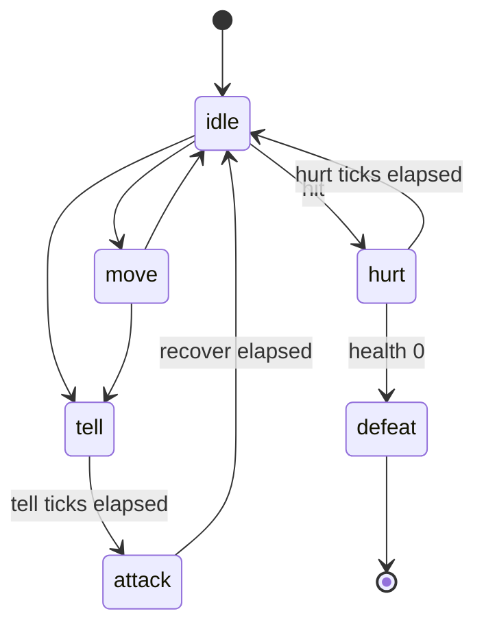

# HOARD-01: The Hoarder (boss) readability set, design spec

**Status:** packet ready; design pending. Execution pending. Review pending.

**Decision record:** height <fill> px, frame <fill> x <fill>, pivot (<fill>, <fill>). Proposed by <fill>; decided by <fill>.

The sections follow `docs/02-art/gob-01-goblin-spec.md`. Replace every `<fill: ...>`; write numbers, not adjectives. The design step stops at the keys and this spec (see the top-tier budget in `docs/07-agents/agent-orchestration.md`).

## 1. Canon and tone constraints

- Approved concept: `assets/concept/floor-01/enemies/floor01-hoarder-individual-study.png` (primary). `docs/02-art/floor-01-late-enemy-boss-concepts.md` records it as an approved *reference/exploration sheet*; `docs/02-art/floor-01-enemy-concept-roster.md` records the Hoarder as dedicated boss design-to-production interpretation pending. **No single A/B/C variant has been selected as the final production master.**
- Tone (`docs/01-design/antihero-tone.md`, enemies row): threatening yet eccentric, with motivated behaviors and readable tells and some absurd visual contrasts; never a purely serious faceless army and never comedic with no danger. 1980s-1990s action cinema is used for attitude only, never copied designs.
- Canon facts that must survive in pixels (from the approved docs and the concept board, not design decisions):
  - **A transformed human woman**, individual and tragic: long dark disheveled hair, severe facial damage (half the face burned), everyday torn clothing (ragged T-shirt, worn sweatpants, barefoot), surrounded by and covered in refuse. Fear, loss of humanity and horror alongside grotesque action-comedy.
  - **She is not a goblin with a backpack.** Retain her individuality and tragedy.
  - Horror without gratuitous gore.
  - Massive boss build; the printed `15 ft`, `35 years` and `96 px` are not decisions.
- Design reading of the tone: <fill: how the Hoarder reads as tragic and frightening yet still slightly absurd, never a heroic or sexualized design>.

### Guardrails (copied from the roster and late-enemy docs)

- **The Hoarder is not a goblin with a backpack.** The ensemble board `floor01-enemy-lineup-approved.png` draws a green goblin-/orc-like monster with a backpack and rubber ducks; that depiction contradicts the source identity and is **deliberately not cropped into this packet**. Use only the individual study.
- Remove brand-like or real-world shirt logos (the study's T-shirt carries a recognisable fitness-brand logo) from original production pixel art, without altering the reference file.
- Names, captions, production-class labels, exact sizes, invented attacks and mechanics printed in the image panels (for example "reach / grab", "flinch", the thrown junk of the lineup board) are not canon or balance decisions.
- Do not present the composite as a finished sprite. Convert from original editable pixel grids / `.aseprite`, never by tracing or cropping the board.
- Boss scale on screen is a design decision; Carl and Donut appear on the board only as a scale reference.

### Packet inputs

- Concept crops in `docs/evidence/hoard-01/packet/` (x,y,w,h in the 1672x941 concept):
  - `concept_crop_1.png` = `60,140,360,425`: variant A (calmest, standing)
  - `concept_crop_2.png` = `430,125,375,435`: variant B (trash piled on the back; a refuse reference only, not a backpack)
  - `concept_crop_3.png` = `855,95,480,465`: variant C (roaring, reaching)
  - `concept_crop_4.png` = `20,655,255,225`: key animation study, reach / grab
  - `concept_crop_5.png` = `285,640,220,240`: key animation study, flinch / react
  - `concept_crop_6.png` = `540,645,255,235`: key animation study, step / advance with falling trash
  - `concept_crop_7.png` = `1395,485,255,115`: face details (three expressions)
  - `concept_crop_8.png` = `1295,648,377,242`: the Hoarder in the board's in-game composition (not an accepted scale)
- `scale_lineup.png`: Carl 52, Donut 40, goblin 36, plus three empty candidate slots at 96, 112 and 128 px. 96 px is the board's printed lineup label, 128 px is the by-eye ratio of 15 ft to a 52 px, 6 ft Carl; both are estimates, not approved sizes. The default 64 x 56 frame in `frame_pivot_template.json` is a placeholder only and far too small for any candidate; the designer sets every number.
- Readability set (tags): `idle` (2-4), `move` (4-6), `tell` (1-2), `attack` (2-3), `hurt` (1), `defeat` (2-3); about 12 to 20 frames. Concrete tag names and frame counts are the designer's choice (section 4 and `frame_pivot_template.json` carry the toolkit defaults).

## Difficulty and route

**Score 4 of 4 (3 certain, 1 arguable): Boss, route A + silhouette gate** (top tier designs and draws every key; a fresh top-tier silhouette check on the idle key before anything else is drawn; budget one extra review round). Any boss lands in this class regardless of the score.

| Point | Met | Note |
| --- | --- | --- |
| 1. New design, not a variant | yes | Dedicated boss; the goblin-style ensemble depiction is not a base |
| 2. Native height above about 40 px | yes | Candidates 96 to 128 px |
| 3. Complex anatomy or construction | yes | Large humanoid with long hair, layered rags and loose refuse |
| 4. VFX, projectiles, special states | arguable | Falling and thrown trash may or may not belong in the sprite; a design question |

Reasoning: new boss design at about 2 to 2.5 times Carl's height with hair, clothing and refuse to organise; the silhouette gate matters most here because the main risk is drifting back to a goblin read.

## 2. Size decision

Carl is 52 px (about 6 ft), Donut 40 px, the goblin 36 px (see `scale_lineup.png`).

| Option | Idle opaque height | Ratio to Carl | Implied real height | Why / why not |
| --- | --- | --- | --- | --- |
| A | 96 px | <fill> | <fill> | <fill> |
| B | 112 px | <fill> | <fill> | <fill> |
| C | 128 px | <fill> | <fill> | <fill> |

Decision: <fill: height and the reason, one paragraph; the proposer and the decider are different agents>.

## 3. Frame, pivot, boxes and atlas

- Frame <fill> x <fill>, pivot (<fill>, <fill>), contact row <fill> (the lowest opaque row of every grounded frame).
- Grounded tags: <fill>. Airborne tags (no pixel on the contact row): <fill or none>.
- Standing box <fill> x <fill>; hurtbox <fill>; attack hitbox <fill> on the impact frame.
- Authored facing right; the runtime mirrors around the pivot column.
- One atlas, frames 0 to <fill>, layers: <fill: for example body, weapon>.

## 4. Readability-set animation list

Readability set: idle, move, tell, attack, hurt, defeat (about 12 to 20 frames until the asset has a gameplay work order). Tick windows are at 60 Hz.

| Role | Tag | Frames | Playback | Tick-window proposal | Reference |
| --- | --- | --- | --- | --- | --- |
| idle | `idle` | 2-4 | loop | 8-12 ticks per frame, a 32-40 tick breathing cycle | GOB-01: 12 + 8 + 12 + 8 |
| move | `walk` | 4-6 | loop | 5 ticks per frame, speed from the gameplay spec | GOB-01: 6 x 5 = 30 ticks |
| tell | `attack_tell` | 1-2 | once | at least 18 ticks of readable hold, about 24 total | GOB-01: 6 + 18 |
| attack | `attack_swing` | 2-3 | once | smear 2, impact 3-4 (shown on exactly the hitbox-active ticks) | GOB-01: 2 + 4, then recover 20 |
| hurt | `hurt` | 1 | once | 8-12 ticks | GOB-01: 4 + 8 |
| defeat | `down` | 2-3 | hold | floor impact 4, settle 8, then a state-driven hold | GOB-01: 4 + 8 + hold |

Frame table (`frame_pivot_template.json` carries the same rows):

| # | Tag | Pose | Ticks | Author |
| --- | --- | --- | --- | --- |
| 0 | `idle` | <fill: pose> | 12 | <fill: key or Sonnet> |
| 1 | `idle` | <fill: pose> | 8 | <fill: key or Sonnet> |
| 2 | `idle` | <fill: pose> | 12 | <fill: key or Sonnet> |
| 3 | `walk` | <fill: pose> | 5 | <fill: key or Sonnet> |
| 4 | `walk` | <fill: pose> | 5 | <fill: key or Sonnet> |
| 5 | `walk` | <fill: pose> | 5 | <fill: key or Sonnet> |
| 6 | `walk` | <fill: pose> | 5 | <fill: key or Sonnet> |
| 7 | `attack_tell` | <fill: pose> | 6 | <fill: key or Sonnet> |
| 8 | `attack_tell` | <fill: pose> | 18 | <fill: key or Sonnet> |
| 9 | `attack_swing` | <fill: pose> | 2 | <fill: key or Sonnet> |
| 10 | `attack_swing` | <fill: pose> | 4 | <fill: key or Sonnet> |
| 11 | `hurt` | <fill: pose> | 4 | <fill: key or Sonnet> |
| 12 | `hurt` | <fill: pose> | 8 | <fill: key or Sonnet> |
| 13 | `down` | <fill: pose> | 4 | <fill: key or Sonnet> |
| 14 | `down` | <fill: pose> | 8 | <fill: key or Sonnet> |
| 15 | `down` | <fill: pose> | hold | <fill: key or Sonnet> |

## 5. State diagram



## 6. Palette

At most <fill: 20> colours. Candidates from the concept crop (median cut, by pixel share; see `palette_candidates.json`). These are candidates, not decisions.

| # | Candidate | Share | Decision (key, name, role) |
| --- | --- | --- | --- |
| 1 | `#111925` | 10.1 % | <fill: key, name, role> |
| 2 | `#de926c` | 8.3 % | <fill: key, name, role> |
| 3 | `#101823` | 5.8 % | <fill: key, name, role> |
| 4 | `#111c2e` | 5.7 % | <fill: key, name, role> |
| 5 | `#d1744f` | 5.1 % | <fill: key, name, role> |
| 6 | `#292738` | 4.9 % | <fill: key, name, role> |
| 7 | `#0e1621` | 4.7 % | <fill: key, name, role> |
| 8 | `#040309` | 4.5 % | <fill: key, name, role> |
| 9 | `#443e52` | 4.5 % | <fill: key, name, role> |
| 10 | `#85402f` | 4.3 % | <fill: key, name, role> |
| 11 | `#b14231` | 4.1 % | <fill: key, name, role> |
| 12 | `#87645e` | 4.0 % | <fill: key, name, role> |
| 13 | `#080e19` | 3.8 % | <fill: key, name, role> |
| 14 | `#62312c` | 3.7 % | <fill: key, name, role> |
| 15 | `#131c27` | 3.6 % | <fill: key, name, role> |
| 16 | `#f9c091` | 3.6 % | <fill: key, name, role> |
| 17 | `#29181f` | 3.6 % | <fill: key, name, role> |
| 18 | `#2c3249` | 3.0 % | <fill: key, name, role> |
| 19 | `#63484b` | 3.0 % | <fill: key, name, role> |
| 20 | `#dbae8d` | 2.6 % | <fill: key, name, role> |
| 21 | `#11121c` | 2.3 % | <fill: key, name, role> |
| 22 | `#0e1a2b` | 2.2 % | <fill: key, name, role> |
| 23 | `#6d161d` | 1.8 % | <fill: key, name, role> |
| 24 | `#181926` | 1.0 % | <fill: key, name, role> |

The chosen palette must separate this asset from the warm brick and the cold arch of Floor 1 at 1x, and fit the A1 lighting.

## 7. Key poses

One key per readability tag (about 6 to 8 keys): idle 0, move contact, tell hold, attack impact, hurt, defeat. Each key lists silhouette, joint positions, palette use and the readability reason. Keys are frozen once the review passes (`pixelart freeze`).

| Frame | Tag | Silhouette and pose notes | Readability reason |
| --- | --- | --- | --- |
| <fill> | <fill> | <fill> | <fill> |

## 8. In-between list

For the execution tier; no design decisions needed. One row per non-key frame, as in section 9 of the GOB-01 spec.

| # | Pose notes |
| --- | --- |
| <fill> | <fill> |

## 9. Validators and readability rules

Run by `python3 -m scripts.pixelart validate <asset-config>` (rules V01 to V15 in `scripts/pixelart/validators.py`). Parametrize in the asset config:

- V04 palette: at most <fill> colours; V05 isolated pixels: 0; V06 orphan pixels: at most <fill> per frame.
- V07/V08 contact rows: grounded tags end on the contact row, airborne tags never touch it.
- V09 frozen keys: SHA-256 per key frame, fixture `tests/fixtures/hoard-01_keys.json`.
- V13/V14 readability rules (write each as a bbox or key-count rule): <fill: for example the tell is the highest point, the hurt eyes are white>.

## 10. Evidence

```text
python3 -m scripts.pixelart validate <asset-config> --out <dir>
python3 -m scripts.pixelart evidence <asset-config> --out <dir>
python3 -m scripts.pixelart review-pack <asset-config> --out <dir>
```

The review pack holds exactly three images (contact sheet x4, lit scene 640 x 360 shown x3, tell to attack strip) and the validator report.

## 11. Files

| File | Role |
| --- | --- |
| `assets/source/<fill>/hoard-01.grid.json` / `.ase` | pixel-grid source and Aseprite master |
| `assets/manifests/hoard-01.json` | manifest |
| `<fill>/hoard-01.pixelart.json` | the asset config (from `frame_pivot_template.json`) |
| `tests/fixtures/hoard-01_keys.json` | frozen keys |

## 12. Rights and provenance

Fan-concept art under the owner-reported `ART-PUBLICATION-ALL-V1` scope (see `docs/04-production/rights-and-release.md`). Record in the PR's `Rights/Provenance` section which model designed, executed and reviewed the art. No tracing of the concept, no image-model raster output.

### Rights/Provenance stub

- Concept: owner-approved reference under `ART-PUBLICATION-ALL-V1`; crops are for reference only, never traced or exported.
- Packet: script output plus a medium-tier executor (stage P).
- Designed by: pending. Executed by: pending. Independently reviewed by: pending.
- No third-party assets, no copied designs or dialogue, no image-model raster output.
