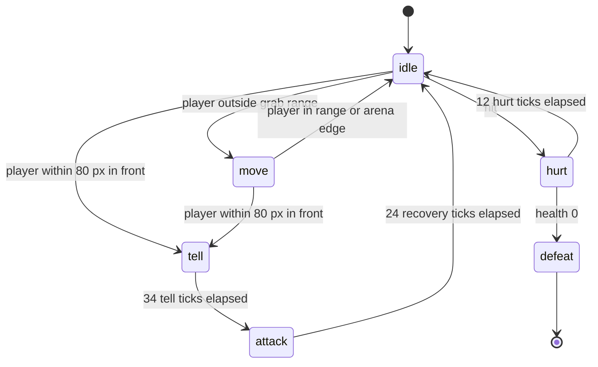

# HOARD-01: The Hoarder (boss) readability set, design spec

**Status:** phase 1: idle key 0 drawn and frozen; silhouette gate pending. Keys 3, 8, 10, 12, 15 pending the gate. Execution pending. Review pending.

**Decision record:** height 112 px, frame 160 x 128, pivot (70, 127). Proposed by the HOARD-01 designer; decided by the independent silhouette-gate review on key 0 (pending).

The sections follow `docs/02-art/gob-01-goblin-spec.md`. The design step stops at the keys and this spec (see the top-tier budget in `docs/07-agents/agent-orchestration.md`).

## 1. Canon and tone constraints

- Approved concept: `assets/concept/floor-01/enemies/floor01-hoarder-individual-study.png` (primary). `docs/02-art/floor-01-late-enemy-boss-concepts.md` records it as an approved *reference/exploration sheet*; `docs/02-art/floor-01-enemy-concept-roster.md` records the Hoarder as dedicated boss design-to-production interpretation pending. **No single A/B/C variant has been selected as the final production master.**
- Tone (`docs/01-design/antihero-tone.md`, enemies row): threatening yet eccentric, with motivated behaviors and readable tells and some absurd visual contrasts; never a purely serious faceless army and never comedic with no danger. 1980s-1990s action cinema is used for attitude only, never copied designs.
- Canon facts that must survive in pixels (from the approved docs and the concept board, not design decisions):
  - **A transformed human woman**, individual and tragic: long dark disheveled hair, severe facial damage (half the face burned), everyday torn clothing (ragged T-shirt, worn sweatpants, barefoot), surrounded by and covered in refuse. Fear, loss of humanity and horror alongside grotesque action-comedy.
  - **She is not a goblin with a backpack.** Retain her individuality and tragedy.
  - Horror without gratuitous gore.
  - Massive boss build; the printed `15 ft`, `35 years` and `96 px` are not decisions.
- Design reading of the tone: she reads as a frightened, ruined person first: stooped, head sunk between the shoulders, eyes wide, mouth slack, half the face burned into scar tissue (dark plum and raised rose, never open wounds or blood). The danger comes from her mass and her open, clawed hands; the slight absurdity comes from the junk that clings to her (a tin-foil scrap in the hair, filth dripping from the hem) and from the hoard pile around her, never from mocking her body or face. Her heavy body is draped in a baggy plain shirt and sweatpants: nothing heroic, nothing sexualised.

### Guardrails (copied from the roster and late-enemy docs)

- **The Hoarder is not a goblin with a backpack.** The ensemble board `floor01-enemy-lineup-approved.png` draws a green goblin-/orc-like monster with a backpack and rubber ducks; that depiction contradicts the source identity and is **deliberately not cropped into this packet**. Use only the individual study.
- Remove brand-like or real-world shirt logos (the study's T-shirt carries a recognisable fitness-brand logo) from original production pixel art, without altering the reference file.
- Names, captions, production-class labels, exact sizes, invented attacks and mechanics printed in the image panels (for example "reach / grab", "flinch", the thrown junk of the lineup board) are not canon or balance decisions.
- Do not present the composite as a finished sprite. Convert from original editable pixel grids / `.aseprite`, never by tracing or cropping the board.
- Boss scale on screen is a design decision; Carl and Donut appear on the board only as a scale reference.

### Packet inputs

- Concept crops in `docs/evidence/hoard-01/packet/` (x,y,w,h in the 1672x941 concept):
  - `concept_crop_1.png` = `60,140,360,425`: variant A (calmest, standing)
  - `concept_crop_2.png` = `430,125,375,435`: variant B (trash piled on the back; a refuse reference only, not a backpack)
  - `concept_crop_3.png` = `855,95,480,465`: variant C (roaring, reaching)
  - `concept_crop_4.png` = `20,655,255,225`: key animation study, reach / grab
  - `concept_crop_5.png` = `285,640,220,240`: key animation study, flinch / react
  - `concept_crop_6.png` = `540,645,255,235`: key animation study, step / advance with falling trash
  - `concept_crop_7.png` = `1395,485,255,115`: face details (three expressions)
  - `concept_crop_8.png` = `1295,648,377,242`: the Hoarder in the board's in-game composition (not an accepted scale)
- `scale_lineup.png`: Carl 52, Donut 40, goblin 36, plus three empty candidate slots at 96, 112 and 128 px. 96 px is the board's printed lineup label, 128 px is the by-eye ratio of 15 ft to a 52 px, 6 ft Carl; both are estimates, not approved sizes. The default 64 x 56 frame in `frame_pivot_template.json` is a placeholder only and far too small for any candidate; the designer sets every number.
- Readability set (tags): `idle` (2-4), `move` (4-6), `tell` (1-2), `attack` (2-3), `hurt` (1), `defeat` (2-3); about 12 to 20 frames. Concrete tag names and frame counts are the designer's choice (section 4 and `frame_pivot_template.json` carry the toolkit defaults).

## Difficulty and route

**Score 4 of 4 (3 certain, 1 arguable): Boss, route A + silhouette gate** (top tier designs and draws every key; a fresh top-tier silhouette check on the idle key before anything else is drawn; budget one extra review round). Any boss lands in this class regardless of the score.

| Point | Met | Note |
| --- | --- | --- |
| 1. New design, not a variant | yes | Dedicated boss; the goblin-style ensemble depiction is not a base |
| 2. Native height above about 40 px | yes | Candidates 96 to 128 px |
| 3. Complex anatomy or construction | yes | Large humanoid with long hair, layered rags and loose refuse |
| 4. VFX, projectiles, special states | arguable | Falling and thrown trash may or may not belong in the sprite; a design question |

Reasoning: new boss design at about 2 to 2.5 times Carl's height with hair, clothing and refuse to organise; the silhouette gate matters most here because the main risk is drifting back to a goblin read.

## 2. Size decision

Carl is 52 px (about 6 ft), Donut 40 px, the goblin 36 px (see `scale_lineup.png`). The idle key is hunched, so the idle opaque height is her stooped height; the tell key stands her up about 10 px taller.

| Option | Idle opaque height | Ratio to Carl | Implied real height (stooped) | Why / why not |
| --- | --- | --- | --- | --- |
| A | 96 px | 1.85 | 11.1 ft | Cheapest, but only 8 px above the adult Mongo study (88 px) and below the Dozer hull (120 px): she reads as a large brute, not the floor boss. The head shrinks to about 15 px, too small for the burned half face and the eye whites at 1x. |
| B | 112 px | 2.15 | 12.9 ft | Chosen. 31 % of the 360 px screen when idle, about 34 % in the tell. The head is 21 px tall, enough for two eye whites, an open mouth and a readable burned half. Leaves headroom above her for the hoard pile and Carl's jump arc. |
| C | 128 px | 2.46 | 14.8 ft | Closest to the printed 15 ft (not a decision). In the tell she would reach about 138 px, 38 % of the screen; with the hoard pile behind her the arena loses its upper third. About 30 % more pixels per key on a 16-frame set, with no readability gain over B at 1x. |

Decision: **112 px idle opaque height (rows 16 to 127)**. B is the smallest height at which the face, which carries her individuality and tragedy, stays readable at 1x, while she still towers clearly above every other Floor 1 actor. Proposed by the HOARD-01 designer; the independent silhouette-gate review confirms or rejects it on key 0.

### Master variant

No A/B/C variant was selected in the concept. This spec takes **variant A as the master** for the body, costume and idle: it is the calmest pose, it shows the whole face (fear, not rage), and its stooped, wide stance converts directly into a looping idle. Variant **C** supplies the tell and attack (roar, one arm flung forward to grab), and the animation studies supply move (crop 6), hurt (crop 5) and the grab (crop 4). **Variant B is rejected as a master**: the refuse heaped on her back produces the backpack silhouette that the guardrail forbids. Refuse stays off her outline, except two tiny clinging details (a tin-foil scrap in the hair, filth drips below the hem); the hoard pile is a separate prop (section 13).

## 3. Frame, pivot, boxes and atlas

- Frame **160 x 128**, pivot **(70, 127)**, contact row **127** (the lowest opaque row of every grounded frame). The pivot is the midpoint of the two feet in idle (x 28 to 117). Room: 70 px behind the pivot (hair flung back in the tell, the defeat sprawl), 89 px in front (the grab reaches x 150).
- Grounded tags: `idle`, `walk`, `attack_tell`, `attack_swing`, `hurt`, `down`. Airborne tags: none (she never leaves the floor).
- Standing box 56 x 104 (x 42 to 97, y 24 to 127): torso, hips and legs; hair strands, fingers and the hoard are outside it.
- Hurtbox: the standing box plus a head box 20 x 22 (x 71 to 90, y 18 to 39). Hair tips and fingers never take hits. In `hurt` and `down` the boxes follow the body core of each frame (execution derives them from the frame bbox minus hair).
- Attack hitbox (frame 10, impact): x 112 to 150, y 84 to 127 (39 x 44), the two slamming hands and the floor directly under them. Active on exactly the 6 ticks of frame 10; never during the smear or the recovery.
- Authored facing right; the runtime mirrors around the pivot column x 70.
- One atlas, 16 frames (0 to 15), one layer `body`. Overlaps (hair over the back, near arm over the torso, front locks over the chest) are resolved by part order in `scripts/author_hoard01.py`, so one flattened layer is enough.

## 4. Readability-set animation list

Readability set: idle, move, tell, attack, hurt, defeat; 16 frames. Tick windows at 60 Hz. She is heavy: every window is slower than GOB-01's.

| Role | Tag | Frames | Playback | Ticks | Total |
| --- | --- | --- | --- | --- | --- |
| idle | `idle` | 0-2 | loop | 16 + 12 + 16 | 44 (laboured breathing) |
| move | `walk` | 3-6 | loop | 8 + 8 + 8 + 8 | 32 (lumbering shuffle, one step per 16 ticks) |
| tell | `attack_tell` | 7-8 | once | 8 + 26 | 34 (readable hold 26 >= 18) |
| attack | `attack_swing` | 9-11 | once | 3 + 6 + 24 | 33 (smear 3, impact 6 = hitbox ticks, recovery 24 = punish window) |
| hurt | `hurt` | 12 | once | 12 | 12 |
| defeat | `down` | 13-15 | hold | 6 + 8 + hold | 14, then a state-driven hold |

Frame table:

| # | Tag | Pose | Ticks | Author |
| --- | --- | --- | --- | --- |
| 0 | `idle` | stooped, wide stance, arms hanging, clawed hands open, wide eyes | 16 | key (drawn, phase 1) |
| 1 | `idle` | exhale: torso and head 1 px down, belly 1 px out, hands 1 px lower | 12 | in-between |
| 2 | `idle` | inhale: shoulders and head 1 px up from key 0, hair tips sway 1 px left | 16 | in-between |
| 3 | `walk` | contact: far foot planted forward, torso lurches forward 4 px | 8 | key |
| 4 | `walk` | down: weight drops 2 px onto the far leg, near foot drags | 8 | in-between |
| 5 | `walk` | passing: near leg swings through, torso back to idle height | 8 | in-between |
| 6 | `walk` | up: near foot lands forward, far foot heel lifts | 8 | in-between |
| 7 | `attack_tell` | gather: crouches 4 px below idle, arms drawn back and in, head down | 8 | in-between |
| 8 | `attack_tell` | rear-up hold: stands tall, both arms over the head, mouth wide, eyes wide | 26 | key |
| 9 | `attack_swing` | smear: torso pitching forward, arms a 2-frame arc smear | 3 | in-between |
| 10 | `attack_swing` | impact: both hands slammed onto the floor in front, grabbing | 6 | key |
| 11 | `attack_swing` | recovery: hands still on the floor, head lifts, hair settles | 24 | in-between |
| 12 | `hurt` | flinch: head snaps back and away, arms pulled to the chest, eyes shut | 12 | key |
| 13 | `down` | buckle: knees give, torso drops 18 px, one hand out | 6 | in-between |
| 14 | `down` | impact: knees and near hand on the floor, head down | 8 | in-between |
| 15 | `down` | settled: curled on her side among the junk, one hand reaching for a scrap, eyes shut | hold | key |

## 5. State diagram



The 80 px range is an art-side estimate for the tell trigger (the grab reaches 80 px in front of the pivot). Damage, health, super-armour during the tell and the boss phase structure belong to a gameplay work order.

## 6. Palette

19 colours (limit 20). The packet candidates are median-cut shares of the crop, about two thirds background navy; creature colours were picked by eye and pushed for the A1-lit catacomb.

| Key | Name | RGBA | Role | Nearest candidate |
| --- | --- | --- | --- | --- |
| `K` | outline | `#1c1218` | outer and part outline, eye pupils, mouth | `#040309` (lifted, warm) |
| `d` | skin_deep | `#5c2e2a` | mouth interior, cast shadow on skin | `#62312c` |
| `s` | skin_shade | `#94523f` | skin core shadow | `#85402f` |
| `m` | skin_mid | `#c67c5a` | skin midtone | `#d1744f` |
| `h` | skin_light | `#e6a982` | skin torch light | `#de926c` |
| `x` | scar_dark | `#6e2232` | burned half of the face, dark | `#6d161d` (desaturated toward plum: scar, not blood) |
| `y` | scar_light | `#a8464a` | burned half of the face, raised tissue | `#b14231` |
| `a` | hair_deep | `#241e2c` | hair mass | `#292738` |
| `b` | hair_mid | `#3c3550` | hair lit side | `#443e52` |
| `c` | hair_sheen | `#635b78` | wet sheen strands (cool, separates hair from the warm brick) | none |
| `t` | shirt_shade | `#6e604e` | shirt shadow, chest fold | `#63484b` |
| `u` | shirt_mid | `#a39276` | shirt midtone (largest mass), pants side stripe | `#87645e` |
| `v` | shirt_light | `#d4c4a2` | shirt torch light | `#dbae8d` |
| `p` | pants_deep | `#262944` | sweatpants shadow | `#2c3249` |
| `q` | pants_mid | `#3e4468` | sweatpants midtone | `#443e52` |
| `r` | pants_light | `#626a94` | sweatpants light | none |
| `g` | grime | `#5a4a2c` | stains, filth drips | none |
| `w` | eye_white | `#ece2ca` | eye whites, teeth (accent) | `#f9c091` (neutralised) |
| `n` | tin_scrap | `#94a4a8` | tin-foil scrap caught in the hair (accent) | none |

The pale shirt is the largest and lightest mass, so her body separates from the orange brick and the navy arch at 1x; the cool hair sheen and the violet-leaning sweatpants keep her outline readable against the warm wall. No colour exists for a print: **the shirt is plain** and the study's brand-like logo has no pixels.

## 7. Key poses

Six keys, one per readability role. Key 0 is drawn (phase 1, silhouette gate); keys 3, 8, 10, 12 and 15 follow after the gate.

| Frame | Tag | Silhouette and pose notes | Readability reason |
| --- | --- | --- | --- |
| 0 | `idle` | bbox x 22-117, y 16-127. Stooped three-quarter view facing right; the upper-back hump (y 33) is higher than the sunk head's chin. Head centre (81, 30), hair cap from y 16, long hair down the back to y 77. Near (right) arm hangs back-left, hand at (30, 94), four curled fingers to y 106; far arm hangs forward of the belly, hand at (108, 91). Wide stance: near foot x 28-54, far foot x 92-117. Plain shirt with a ragged hem (y 92-98), a side tear, stains; navy sweatpants with one faded side stripe, a torn near knee; bare feet. Face: burned near half (scar_dark/light), two eye whites, slack open mouth, no brow over the burned eye. | A ruined woman, not a creature: long hair, a human face with fear, everyday clothes. The mass and the open clawed hands carry the threat; the hump-and-sunk-head line keeps the goblin-backpack read away because nothing sits on her back but hair. |
| 3 | `walk` | Contact. Top 18-20, width <= 112. Far foot planted forward (toes to x 124), near foot behind on the toes, torso lurched forward 4 px, head 2 px lower, near arm swinging forward, far arm back, hair swinging back 3 px. | The lurch and the dragged back foot sell weight; the hands stay open so the threat stays readable in motion. |
| 8 | `attack_tell` | Rear-up hold, the highest pose: top <= 6. Torso straightened and leaning back 4 px, both arms raised over the head with hands open (x 60-100, y 6-30), hair flung back to x 20, mouth wide open with teeth (variant C roar), both eye whites enlarged. Feet planted 4 px wider than idle. | Three independent cues at 1x: the silhouette doubles its vertical extent above the head, the raised hands frame it, and the face changes (white teeth, wide eyes). Held 26 ticks. |
| 10 | `attack_swing` | Impact. Torso pitched forward about 35 degrees, head forward at x about 112, hair falling forward over it; both hands slammed onto the floor in front (fingers on row 127, x 120-150), grabbing; near leg extended back. min_right 145. | The hands land exactly where the hitbox is; the floor contact makes the danger zone obvious. |
| 12 | `hurt` | Flinch (crop 5). Head snapped back and turned away (face 3 px left of idle), shoulders up, both arms pulled to the chest, eyes squeezed shut (no eye white), body shifted back 4 px: max_right <= 108. | The only key with the arms in and the eyes shut: a hit reads as pain, not anger, which keeps her tragic. |
| 15 | `down` | Settled. Curled on her side, knees drawn up, hair spread on the floor, near hand stretched toward a small scrap (part of the hoard prop, not the sprite), eyes shut. top >= 92, width <= 140. No blood. | Flat, still and human; the reaching hand is the last beat of the hoarding tragedy. |

## 8. In-between list

For the execution tier, derived from the keys above; no design decisions.

| # | Pose notes |
| --- | --- |
| 1 | Key 0 with torso, head, arms and hair shifted 1 px down, belly outline 1 px out; feet unchanged. |
| 2 | Key 0 with shoulders and head 1 px up; hair tips 1 px left; feet unchanged. |
| 4 | Between keys 3 and 0: weight 2 px down on the far leg, near foot dragging flat. |
| 5 | Passing: legs together under the hips, torso at idle height, arms crossing the body line. |
| 6 | Mirror timing of 3: near foot lands forward, far heel lifts; torso lurch 2 px. |
| 7 | Gather: 4 px lower than key 0 (top >= 20), arms drawn back to the hips, head down. |
| 9 | Smear between keys 8 and 10: torso halfway, arms as one 2-frame arc smear in skin colours, no hitbox. |
| 11 | Key 10 with the head lifted 4 px and the hair settling; hands stay on the floor. |
| 13 | Buckle: knees bend, torso 18 px down (top >= 34), one hand out. |
| 14 | Floor impact: knees and near hand on the floor, head down (top >= 70). |

## 9. Validators and readability rules

Run by `python3 -m scripts.pixelart validate assets/source/characters/hoarder/hoard-01.pixelart.json`.

- V04 palette: at most 20 colours (19 used). V05 isolated pixels: 0. V06 orphan pixels: at most 6 per frame (key 0 has 0).
- V07 contact rows: every frame ends on row 127. V08: no airborne tags.
- V09 frozen keys: SHA-256 per key frame, fixture `tests/fixtures/hoard-01_keys.json` (phase 1: frame 0; later 0, 3, 8, 10, 12, 15).
- V13 bbox rules: H1 idle top 16 bottom 127 and width 90 to 100 (in the config now); H2 frame 8 max_top 6 and frame 7 min_top 20; H3 frame 10 min_right 145, frame 9 min_right 125; H4 frame 12 max_right 108; H5 frame 13 min_top 34, frame 14 min_top 70, frame 15 min_top 92 and max_width 140.
- V14 key counts: H0 eye whites `w` >= 3 in frames 0-11 (in the config for frame 0); H0 burned half `x` >= 12 in every frame where the face is visible; H0 shirt `u` >= 600 in frame 0; H2 frame 8 `w` >= 8 (teeth plus eyes); H4 frame 12 `w` = 0; H5 frames 13-15 `w` = 0; tin `n` <= 6 in every frame (a detail, never a pack).

## 10. Evidence

```text
python3 scripts/author_hoard01.py --scale <dir>        # key 0 next to Carl at 1x and 4x
python3 -m scripts.pixelart validate assets/source/characters/hoarder/hoard-01.pixelart.json
python3 -m scripts.pixelart evidence assets/source/characters/hoarder/hoard-01.pixelart.json --out <dir>
python3 -m scripts.pixelart review-pack assets/source/characters/hoarder/hoard-01.pixelart.json --out <dir>
```

Phase 1 evidence: `docs/evidence/hoard-01/key0-scale.png` (top: the 1x scene, key 0 next to Carl on a brick-toned and an arch-toned panel; below: the same scene at 4x). The review pack (three images plus the validator report) follows when the set is complete.

## 11. Files

| File | Role |
| --- | --- |
| `scripts/author_hoard01.py` | deterministic authoring script (rules plus explicit detail pixels) |
| `assets/source/characters/hoarder/hoard-01.grid.json` / `.ase` | pixel-grid source and Aseprite master |
| `assets/source/characters/hoarder/hoard-01.pixelart.json` | the asset config |
| `tests/fixtures/hoard-01_keys.json` | frozen keys |
| `tests/test_art_hoard01.py` | reproducibility, frozen key, size, palette |
| `assets/manifests/hoard-01.json` | manifest (when the set is complete) |

## 12. Rights and provenance

Fan-concept art under the owner-reported `ART-PUBLICATION-ALL-V1` scope (see `docs/04-production/rights-and-release.md`). No tracing of the concept, no image-model raster output: every pixel comes from `scripts/author_hoard01.py`.

### Rights/Provenance

- Concept: owner-approved reference under `ART-PUBLICATION-ALL-V1`; crops are for reference only, never traced or exported.
- Packet: script output plus a medium-tier executor (stage P).
- Spec + keys: Claude Opus. Execution (in-betweens, manifest, evidence): pending. Independent review: silhouette gate on key 0 pending.
- No third-party assets, no copied designs or dialogue, no brand marks, no image-model raster output.

## 13. Note for a separate VFX/prop work order: hoard pile and falling trash

Not drawn here and not part of the character atlas. Proposed work order: hoard pile and refuse props and VFX.

- **Hoard pile (prop):** a static arena backdrop layer behind her, 2 to 3 sizes, up to about 96 px tall so it never hides her head; generic junk (bags, crates, cans, a broken screen, rags). No real brands, logos or readable text. Uses this palette plus at most 4 prop colours.
- **Shed refuse (VFX):** on each walk contact (frames 3 and 6) and on the attack impact, 2 to 4 chunks of 3 to 5 px fall from her hem and hair; visual only, 20 to 30 tick lifetime, no collision.
- **Falling trash (hazard, only if a gameplay spec approves it):** a floor shadow telegraph at least 30 ticks before impact, impact puff 8 ticks; spawn positions from the seeded gameplay RNG in the gameplay layer, so rendering never changes outcomes.
- **Guardrail:** junk must never attach to her back as a pack or sack; it lies on the floor, falls, or clings as single small scraps.
