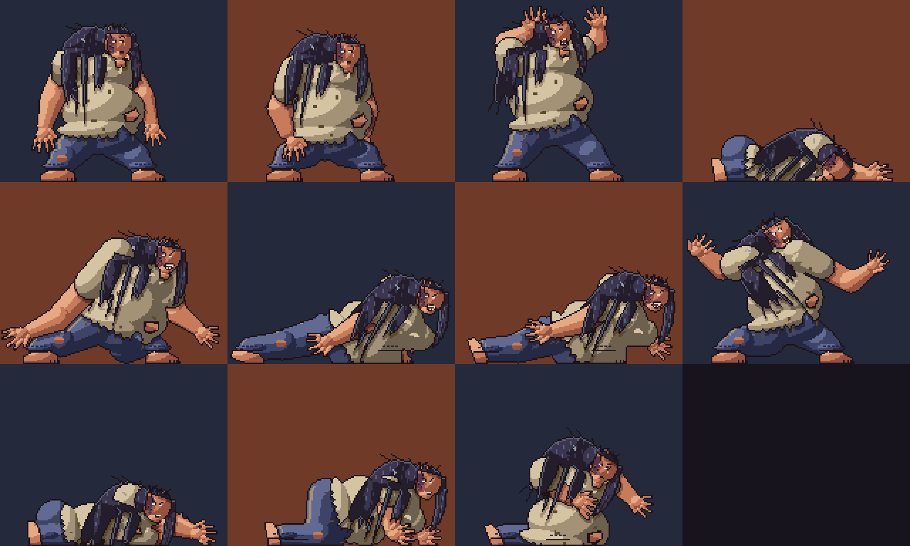

# HOARD-02: The Hoarder production art and room kit (AREA-HOARDER-01), design spec

**Status:** drawn and wired. Boss keys 17, 18, 19, 20, 22, 24 and 26 are drawn and frozen together with the six HOARD-01 keys (fixture `tests/fixtures/hoard-02_keys.json`); the six in-betweens 16, 21, 23, 25, 27 and 28 are drawn as pose dicts of the same rig, so V12 (all 29 frames unique) and H1-H13 pass. The room kit has seven atlases (the mound with its `sealed` and `opened` states, bank A, the J-B post and stack, the door, the gate and three dressing heaps). The presenter shows the Hoarder from the HOARD-02 atlas and every kit piece in room 1 with no stand-in label left. Bank A's slide states, the post's cracked and broken states and the stack's released, falling and landed states are drawn from the HRD-B and HRD-C machines (#260). Independent art-director review passed (2026-11-24; E1 and E2 adopted, section 11); owner review and game feel pending.

**Scope:** this spec replaces every stand-in in room 1 (`--f01-room hoarder`). That covers the 16 HOARD-01 frames labelled "STAND-IN UNTIL HOARD-02", the missing shove, jam, pinned, get-up and emerge poses, and the greybox door, entry gate, bank A, J-B post, J-B stack and lair mound. The sim does not change. Every rule, tick window and box below is read from `src/pile_boss.rs`, `assets/data/gameplay/enemy_pile_boss_v0.json` and `docs/01-design/enemy-gameplay-hoarder.md`. The state hash stays byte-identical.

**Difficulty and route** (`docs/07-agents/pixel-art-pipeline.md#routing-by-difficulty`):

- **Boss poses:** new design, height above 40 px, complex anatomy and special states, so the score is **4/4**. That gives **route A plus the silhouette gate**: every key is drawn at the design stage.
- **Room props:** kit-extension environment pieces are **Easy, route C**: this spec plus one hero key (the lair mound).

Design images: `docs/evidence/hoard-02-design/` (`keys-x3.png`, `keys-1x.png`, `mound-scene-x3.png`, and lit Floor 1 composites at 640 x 360 and 1920 x 1080: `lit-brace-lunge_*`, `lit-drag-getup_*`, `lit-mound-emerge_*`, built by `scripts/make_hoard02_design_scene.py`; offline composites, not runtime captures).

## 1. Canon and tone

All of `docs/02-art/hoard-01-spec.md` sections 1 and 6 holds:

- She is a transformed human woman, frightening and tragic. Dread, never comedy.
- No junk on her back or body; the hoard is the room.
- No logos, no gore, no invented biography or quote.
- Hurt, jam and pinned read as pain and effort, never as slapstick.
- **Pinned** is alive and furious: eyes open, teeth gritted, one hand clawing toward the heroes. It must never be mistaken for defeat.
- **Emerge** is a person dragging herself out of her own nest. It is slow and heavy, head bowed, eyes up.

The room follows the AREA-HOARDER-01 row of `docs/07-agents/floor-01-area-kits-plan.md`:

- The junk is **localized** in the mound, bank A, the J-B stack and a few low dressing heaps.
- Passages are never covered.
- It is not a universal garbage or sewer look.
- The hoard is *kept*: wood, iron, copper, brass, cold glass and grey rag, stacked by someone. It is not rot or sludge.

## 2. Sheet layout, pivot and boxes

- **Atlas:** `hoard-02`. Frame 160 x 128, pivot (70, 127), contact row 127, facing right (the sim flips for -x).
- **Palette:** the 19-colour HOARD-01 palette `hoarder-floor01-v1`, unchanged.
- **Frames:**
  - Frames 0-15 are the HOARD-01 frames, pixel-identical (copied from `hoard-01.grid.json`).
  - Frames 16-28 are new. They are built by `scripts/author_hoard02.py` on the HOARD-01 rig (`author_hoard01.hoarder(pose)`).
  - One new face is added: `pinned` (whites open, brows knitted, teeth gritted).
- **Boxes (sim, pivot-relative, y up):**

  | Box | Extent | Canvas pixels |
  |---|---|---|
  | Standing body | `[-28, 28) x [0, 104)` | x 42..97, y 24..127 |
  | Head | `[1, 21) x [88, 110)` | |
  | Prone (Exposed, Get-up) | `[-48, 72) x [0, 48)` | x 22..141, y 80..127 |
  | Swipe | `[42, 81) x [0, 44)` | |
  | Shove | `[20, 48) x [0, 48)` | |

- **Fitting the boxes:** arms and hands may reach past a body box, as in HOARD-01. The torso, hips and head stay inside the box of their mode, within 4 px.
  - Pinned: the torso and head stay in the prone box (top row 78 against 80). The clawing hand reaches 11 px past its front, toward the heroes, on purpose.
  - Get-up key 24: 65 px tall against the 48 px prone box, because she is up on hands and knees. This is accepted, since the sim keeps the prone box for all 24 ticks and the frame shows the lift out of it (H11 allows a top row of 60 or lower).

## 3. HOARD-01 frames: keep, rework or replace

| Frames | Content | Decision | Use after HOARD-02 |
|---|---|---|---|
| 0-2 | idle breath | **keep** | Neutral, Turn, Cooldown, the last 30 Reveal ticks' hand-off |
| 3-6 | walk | **keep** | Walk (8 ticks per frame) |
| 7 | swipe gather | **keep** | SwipeTell ticks 1..8 only; **no longer** the shove tell |
| 8 | swipe rear-up | **keep** | SwipeTell ticks 9..34 |
| 9 | smear | **keep** | SwipeSmear; **no longer** the lunge |
| 10 | impact | **keep** | SwipeImpact |
| 11 | recovery | **keep** (authored 24, held 48) | SwipeRecover and ShoveRecover; **no longer** Exposed, Get-up or the jam hold |
| 12 | hurt | **keep** | Flinch; **no longer** the jam impact |
| 13-15 | defeat | **keep** | Defeated (8, 12, hold) |

No HOARD-01 frame is reworked or replaced at this stage: the new states get their own frames. HOARD-01's independent review is still pending, so the HOARD-02 review covers frames 0-15 as well. A defect it finds there becomes a rework row in this table, and the frozen fixture is re-pinned in the same PR.

## 4. State and frame table (sim tick windows)

`mode_tick` is 1 on a mode's entry tick. "Frame (ticks)" is what `src/hoarder_art.rs::frame_for` shows.

| Sim mode | Length (ticks) | Frame (ticks) | Notes |
|---|---|---|---|
| Dormant | until the gate closes | none drawn | The mound `sealed` (back plus front) hides her |
| Reveal | 90 (retry 30) | **26** (1..30), **27** (31..60), **28** (61..90); retry: 10 each | Replaces the 30-tick fade (`REVEAL_FADE_TICKS`), which is removed. The front lip is drawn in front of her until the last Reveal tick, then the mound switches to `opened`. R7 applies: she must not look hittable before that tick |
| Neutral, Turn, Cooldown | | 0-2 loop | unchanged |
| Walk | | 3-6 loop | unchanged |
| SwipeTell | 34 | 7 (1..8), 8 (9..34) | unchanged |
| SwipeSmear / Impact / Recover | 3 / 6 / 48 | 9 / 10 / 11 | unchanged |
| **ShoveTell** | 40 | **16** (1..10), **17** (11..40) | `SHOVE_WINDUP_PX` (4 px draw offset) is removed; the pose carries the wind-up |
| **Lunge** | 1..48 | **18 / 19** alternating, 6 ticks each, starting on 18 | Loop; the dragged foot is on 19 |
| ShoveRecover | 48 | 11 | |
| **Jammed** | 72 | **20** (1..12), **21** (13..72) | 20 is the impact; 21 is the dazed stagger hold |
| Flinch | 12 | 12 | unchanged |
| **Exposed** | 150 | **22 / 23** alternating, 20 ticks each | Pinned struggle loop under the landed J-B remnant (drawn in front). Reachable only once HRD-C lands; mapped now |
| **GetUp** | 24 | **24** (1..12), **25** (13..24) | Reachable after HRD-C |
| Defeated | | 13 (8), 14 (12), 15 hold | unchanged |

The new atlas tags are `shove_tell` 16-17, `lunge` 18-19 (loop), `jammed` 20-21, `pinned` 22-23 (loop), `get_up` 24-25 and `emerge` 26-28. Their authored ticks are in `TICKS` of `scripts/author_hoard02.py`.

## 5. New frames: poses and who draws them

| Frame | Kind | Pose |
|---|---|---|
| 16 shove settle | in-between | Idle → 17: body pitched about 12°, crouched 4 px, arms leaving the sides and opening low. **Width at least 120 px at once** (H13), so it never reads as the narrow, upright swipe gather 7 |
| **17 shove brace** | key | Low wide brace: torso pitched 26°, lead shoulder ahead, both arms spread low (hands at shin height, palms out), feet wide, snarl face (glaring eyes under knitted brows, a wide mouth with bared upper and lower teeth, never a round "o"). 94 px tall, 154 px wide |
| **18 lunge heave** | key | Torso near flat at hip height (60°), head thrust forward and up so it leads the silhouette, back leg straight, far arm tucked under; snarl face. The pitched-torso rig options (`PITCHED`: near shoulder lower in the torso, small sleeve cap, skin of the upper arm showing below it, no shirt tear, stains or neckline under the head) keep every sleeve pixel at least 4 px below the head top. 67 px tall |
| **19 lunge drag** | key | Same drive and rig options; the back foot dragged on its toes, far arm thrown forward-low; snarl face. 69 px tall |
| **20 jammed impact** | key | Stopped dead on the obstacle face: torso crumpled back (-10°, squash 0.92), head snapped back, arms flung wide, mouth open. 107 px tall, below the rear-up |
| 21 jammed stagger | in-between | 20 → 0: body upright (-3°), head hanging 10° forward, near hand pressed to the head, far arm hanging; shut face. The held frame of the 60-tick stagger |
| **22 pinned** | key | Prone (body 80°, squash 0.62); head raised, eyes open, teeth gritted; the near arm claws forward along the floor, the far forearm props the chest. 50 px tall |
| 23 pinned strain | in-between | 22 with the chest lifted 2 px, the clawing hand drawn back 6 px (fingers curled), hair swing +2. Same face |
| **24 get-up push** | key | Hands and knees: the near thigh drops from the raised hip to a knee planted under it (a visible thigh angle), the shins trail, both palms are planted flat under the shoulders, the head is raised toward the target with gritted teeth (the pinned face). Same rig options as 18. 65 px tall |
| 25 get-up rise | in-between | 24 → 0: one foot planted, torso 30°, hands leaving the floor; ends on idle's feet |
| **26 emerge** | key | Kneeling deep in the mound, shoulders first, palms planted on the rim, head bowed, eyes up. **No arm above the head** (the swipe tell's signal) |
| 27 emerge rise | in-between | Torso 6°, body 18 px down (instead of 34), hands pushing off the rim, head level |
| 28 emerge stand | in-between | Body 6 px down, arms hanging and spread, hair swing +3; hands off to idle frame 0 |

Every in-between is a pose dict for `hoarder()` built from its neighbouring keys, as in HOARD-01 section 8. The rule is no pixel edits.

Junk that spills on a jam is a **prop** effect (section 7, bank A `disturbed` and post `cracked`), never pixels on her frame.

## 6. Readability targets (checked at 1x)

- **R1 swipe vs shove, before they land:**
  - The swipe tell rises: the rear-up (8) is at least 122 px tall (H2) with both arms over the head.
  - The shove tell sinks and widens: the brace (17) is at most 98 px tall (top row 30 or lower, H7) and at least 140 px wide, with both hands below the hips.
  - The two tells also diverge from their first frame: the gather (7) is upright and narrow; the shove settle (16) is already at least 120 px wide (H13).
  - Height difference of at least 24 px.
- **R2 the lunge is jumpable:** frames 18-19 are at most 70 px tall (top row 58 or lower, H8), so a jumping Carl (apex 88.5 px) visibly passes over her.
- **R3 pinned is not defeat:**
  - Frames 22-23 show at least 4 eye-white pixels (`w`). Frame 15 shows 0, and frame 22 shows 7 today.
  - The head is raised and a hand claws forward.
  - Torso and head stay inside the prone band (top row 76 or lower, H10).
- **R4 the jam stops her:** frame 20 is upright and pushed back, never pitched forward like the lunge. It is lower than the rear-up (H9).
- **R5 the emerge teaches no false tell:** no arm rises above the head in frames 26-28.
- **R6 the hoard is not the floor:**
  - Solid junk (bank A, J-B remnants) has a flat, lit top edge (a plank or crate lid line, brightest values of its ramp).
  - Non-solid junk (mound, dressing) has a ragged rag top, no flat lit line, and values about 1 step darker.
  - Every drawn element's look matches its collision role (table in section 7, column "Collision"). Nothing that heroes walk through may have a flat lit top or a solid front face at lane level, and nothing solid may have a ragged or dark top.
- **R7 not hittable until she is:** during Reveal she has no hurtbox and no body (90 ticks, 30 on retry). Until the last Reveal tick:
  - she is drawn inside the junk: the `sealed` front lip covers her below about 31 px in all of frames 26-28;
  - her sprite is drawn at the mound's shadow value (a presentation tint of about 1 ramp step darker, the same step R6 uses for non-solid junk), with junk dust and scraps sliding off her (cosmetic);
  - a hero hit that lands in her area during Reveal shows no hit flash, no hit spark and no hit-stop on her (the sim already returns no reaction).

  On the last Reveal tick, the first tick with a hurtbox, the lip collapses (`opened`), the tint drops to full value, and a 4-tick dust burst marks "she is out". From then on she is drawn exactly like any hittable state. This is presentation only and never reads or changes the sim.

## 7. Room kit (AREA-HOARDER-01)

**Palette:** the `floor01-catacomb-v2` ramps only (`author_floor01_kit.RAMPS`).

| Material | Ramp |
|---|---|
| wood | `wood` |
| iron | `iron` |
| copper | `copper` |
| brass | `brass` indices 0-3 (no gold glare) |
| cold glass | `gal` |
| rag | `floor` |
| outline | `mortar_00` |
| floor-side flecks only | `lichen` |

- No new colours; each atlas holds at most 63 colours. The mound key uses 37.
- **Light:** the torch key is upper left, as on the boss and the ENV-01 kit.
- **Sources:** pixel-grid-v1 plus `.ase` under `assets/source/props/floor01/hoarder_*.grid.json`, built by `scripts/author_hoarder_room.py`.

Collision is the sim's, unchanged. Room coordinates: x in px, y up from the floor (layout floor y 580).

| Prop | Sprite and pivot | Collision (unchanged) | States (sim trigger) | Wired in HOARD-02? |
|---|---|---|---|---|
| **Lair mound** `hoarder_mound` | 176 x 72 `sealed`, 176 x 24 at most `opened`; pivot (88, 71) at x 608 | none (DV-3): low background dressing | `sealed` (Dormant, Reveal): layer `back` behind her **and behind the heroes**, plus the `front` lip drawn in front of her and the heroes, hiding her below about 31 px; `opened` (from the last Reveal tick to the end of the fight): a low spill at most 24 px high, the hollowed heap gone, ragged top, 1 step darker, behind her and the heroes. HRD-CUES-01 adds the `stir_heave`, `stir_heave_hi` and `stir_slump` back frames (3 to 5) that breathe the sealed mound before she wakes, see [the spec](hrd-cues-01-spec.md) | **yes** |
| **Bank A** `hoarder_bank_a` | 64 x 48 standing, pivot bottom-left at x 352 | solid `[352, 416) x [0, 48)`, heroes and boss collide, top standable (HRD-B) | `stable`; `disturbed` (24 ticks: 2-frame shudder of ±1 px plus 3-6 falling scraps); `slid` (16 ticks, the mass moves 3 px/tick to `[304, 368)`, 2-frame tumble); `settled` remnant 80 x 16 at `[296, 376)` | **yes**, every state from the HRD-B machine |
| **J-B post** `hoarder_post_b` | 16 x 64, pivot bottom-left at x 808 | hit target `[808, 824) x [0, 64)`, **not solid**: heroes pass in front of it; 2 qualifying hits release the stack (HRD-C) | `intact`, `cracked` (first qualifying hit; split plus splinters), `broken` (second hit, the release tick). HRD-CUES-01 adds `shored` (3, while she is not out) and `give` (4, her first 8 ticks out), see [the spec](hrd-cues-01-spec.md) | **yes**, every state from the HRD-C machine |
| **J-B stack** `hoarder_stack_b` | 128 x 64 hanging, `[752, 880) x [96, 160)` (the sprite is 128 x 104: it adds the 32 px strut down to the post's head, E1 in section 11) | none while hanging | `supported` (intact); `released` (24 ticks: sag 1 px every 6 ticks to 3 px and a 1 px shudder, dust); `falling` (8 ticks on the sim's drop curve; the strut snapped to 20 px, E6); `landed` (fallen) junk rubble 128 x 16 at `[752, 880) x [0, 16)` (E6), drawn **in front of** the pinned boss | **yes**, every state from the HRD-C machine |
| **Exit door** `hoarder_door` | 16 x 228 in a stone jamb, at x 928 | solid until her defeat tick | `closed` (iron-banded planks, barred); `open` (jamb only, doorway dark) | **yes** |
| **Entry gate** `hoarder_gate` | 16 x 228 at x 208 | solid while closed (HRD-Q41) | `open` (bars raised into the ceiling, grooves in the floor); `closed` (iron bars to the floor) | **yes** |
| **Dressing heaps** `hoarder_heap_a..c` | at most 48 x 24 each | none | static | **yes** |

**Rules for the room kit:**

- **Bank A's top** reads as a standable shelf: the crate lids are flush at 48 px and the top row is lit, because heroes perch on it (section 5 of the design doc). Its front face (x 416) is a vertical wall of crate sides and a door plank, so her clamped shove visibly stops on it.
  - The top edge is one unbroken row across all 64 px at y 47, the brightest value of its ramp, with a 1 px dark lip under it. Nothing pokes above y 48, so the eye finds the standing line.
  - Both side faces are vertical and fully opaque from 0 to 48. No rag, drape or loose item hangs outside the rectangle.
  - Hero feet resting on it touch the lit row exactly (A5).
- **J-B post** reads as hittable but not solid:
  - It is a single thin upright (a split timber prop, 10-12 px wide inside its 16 px box), set on the back plane: its foot sits on a stone shim against the back wall, and the heroes draw in front of it.
  - It has no flat lit top and no horizontal shelf a hero could stand on. Its top ends in the beam lashing under the stack.
  - The hittable cue is the rope lashing and a pale fresh split on the side facing the lane (light `wood` values). `cracked` widens the split and adds splinters; each qualifying hit adds a 2-frame white-wood flash and splinter spray (cosmetic).
  - No text label ("POST B" or any other).
- **J-B:**
  - The post reads as the single support of the stack.
  - The stack visibly rests on a beam lashed to the post: a broken shelf unit, crates and a pram frame, roped.
  - Clear floor stays under it at 0..96 px.
  - The stack and its remnant are heavy and readable as "this falls".
- **Dressing heaps:**
  - Place them against the back wall at x about 250, 470 and 700, never between 416..880 at floor level in front of the playfield.
  - They use the rag top and a darker value (R6), so they are never read as solids.
- **The lair mound** is low background dressing with no collision (DV-3). The `sealed` heap may be tall because she is inside it, but it sits behind the heroes, has a ragged top and no lit line, and the heroes visibly pass in front of its back layer and behind its front lip, so it never reads as a slab or a step. After the reveal it drops to the `opened` spill (at most 24 px). No text label.
- **The door and the gate** are kit-family pieces (stone jamb from ENV-01, `iron` bars).
  - The door replaces the always-closed `guild_portal_closed` stand-in in this room only.
  - The exit at x 976 keeps its existing logic.

**Hero key:** `hoarder_mound` `sealed` (`assets/source/props/floor01/hoarder_mound.grid.json`).

- **Composition:** a rag body binds a crate, a broken bed rail, an iron pot on its side, a dented copper kettle, an empty brass mirror frame (black void, no reflection) and cold bottles. The front lip is a second rag ridge with a crate, a pot, planks and two stones.
- **Silhouette:** only the bent copper pipe breaks it (`POKES`); every other item is clipped to the heap body grown by 2 px, so the mass reads as one heap.
- **Checked in scene:** `mound-scene-x3.png` shows the emerge key behind the lip, idle in front of the back layer, and pinned.

Bank A, the J-B pieces, the door, the gate, the dressing heaps and the `opened` mound follow this key's materials and outline rule.

## 8. Acceptance targets

- **A1:** `python3 -m scripts.pixelart validate assets/source/characters/hoarder/hoard-02.pixelart.json` passes, including:
  - V12 (all 29 frames unique);
  - H1-H13;
  - the frozen-key fixture (13 keys) unchanged.
- **A2:** `python3 scripts/author_hoard02.py --check` and `python3 scripts/author_hoarder_room.py --check` reproduce the committed grids. `.ase` files match their grids.
- **A3:** frames 0-15 of `hoard-02.grid.json` are byte-identical to `hoard-01.grid.json`.
- **A4:** R1-R6 hold on a 1x contact sheet and on 640 x 360 in-scene stills.
- **A5:** every prop sprite matches its collision rectangle within 1 px (solid faces and tops exactly), at most 63 colours per atlas, `scripts/validate_assets.py` passes.
- **A6:** after wiring, the following hold:
  - no "STAND-IN" text or greybox `Piece` remains in room 1;
  - `the_presenter_does_not_change_the_state_hash` and every existing golden stay byte-identical;
  - `frame_for` unit tests cover every row of section 4.
- **A7:** dread, not comedy (reviewer judgement against section 1).
- **A8 collision read:** a 640 x 360 in-scene still per state shows that the look matches the collision role (R6, R7): Carl standing on bank A's lit top; Carl walking in front of the post and in front of the mound's back layer; the stack `supported`, `falling` and `landed`; Reveal frames 26-28 tinted and lip-covered, and the first hittable tick at full value.

## 9. Known design notes for the reviewer

- Silhouette gate fixes: in 18, 19 and 24 the near sleeve cap no longer rises above the head (sleeve top at least 4 px below the head top, measured per part); 24 now reads as hands and knees; 17-19 use the snarl face. The rig options (`near_sh`, `near_cap`, `tear`, `stains`, `neckline`) default to the HOARD-01 values, so frames 0-15 stay byte-identical.
- The pinned hand passes the prone box by 11 px (section 2). This is intended: it claws toward the heroes.

## 10. Files

- `scripts/author_hoard02.py`: boss frames 16-28. Run with `--check` and `--sheet`.
- `scripts/author_hoarder_room.py`: room kit. Run with `--check` and `--preview`.
- `assets/source/characters/hoarder/hoard-02.grid.json`, `.ase`, `.pixelart.json`.
- `tests/fixtures/hoard-02_keys.json`.
- `assets/source/props/floor01/hoarder_{mound,bank_a,post_b,stack_b,door,gate,heap}.grid.json`, `.ase`, and `assets/manifests/floor01_hoarder_*.json`, `assets/manifests/hoard-02.json`.
- `tests/test_art_hoard02.py`, `tests/test_art_hoarder_room.py`.
- `docs/evidence/hoard-02/`, `docs/evidence/f01-hoarder-presentation/`.
- `docs/evidence/hoard-02-design/`: design images with `SHA256SUMS`.

## 11. Execution record and open items

**Done (execution tier):**

- In-betweens 16, 21, 23, 25, 27, 28 (`scripts/author_hoard02.py`, pose dicts only), the manifest `assets/manifests/hoard-02.json` (id `hoarder_boss_h112_v2`), the `.ase` and `tests/test_art_hoard02.py`.
- The room kit (`scripts/author_hoarder_room.py`): seven atlases `assets/source/props/floor01/hoarder_*` with manifests `assets/manifests/floor01_hoarder_*.json` and `tests/test_art_hoarder_room.py`. The editor flattens layers, so each state is one frame; the mound's `back` and `front` draw layers are frames 0 and 1 (pixel-identical to the design stage's hero key), `opened` is frame 2.
- Wiring (`src/hoarder_art.rs`, `src/bin/floor01_scene/hoarder_art.rs`): the section 4 table in `frame_for`, one function per prop from its state to its frame (`bank_prop`, `post_prop`, `stack_prop`), and the R7 rules (shadow tint, dust, burst, no hit flash on her during the Reveal).
- Evidence: `docs/evidence/hoard-02/` (contact sheets, enlarged frames, GIFs, frame layout and timing diagram, offline composites of unwired states, all labelled "composite, not runtime") and `docs/evidence/f01-hoarder-presentation/` (in-room stills at 640 x 360 and 1920 x 1080).

**Deviations and adopted defaults (execution tier; each can be changed in a follow-up):**

- **E1, the stack carries its own leg.** The sim's post top is at 64 and the stack's footprint starts at 96, a 32 px gap. The stack sprite is 128 x 104: the 128 x 64 body plus a 32 px strut under the beam that ends on the post's head, and its bottom-left corner is placed at world y 64. The collision stays `[752, 880) x [96, 160)`. When the post breaks, the leg falls with the stack. **Adopted default (independent review, 2026-11-24):** the short strut that joins the stack to its post is drawn **on the stack**, as executed. The post keeps its 16 x 64 sprite and its sim rect `[808, 824) x [0, 64)`; neither the post's art nor any collision rect changes. HRD-C's `released`/`falling` frames carry the strut with the stack.
- **E2, "she is out" is the first tick she is neither Dormant nor in the Reveal.** The spec (R7) says the last Reveal tick, but the sim gives her a hurtbox only from the first Neutral tick (`hurt_rects` is empty through the whole Reveal). The tint, the lip and the dust burst follow the hurtbox so she never looks hittable early; the difference is one tick. **Adopted default (independent review, 2026-11-24):** R7's "last Reveal tick" reads as "the first tick with a hurtbox"; section 6 R7 is superseded on this point.
- **E3, the shudder of the disturbed bank** is a 1 px presenter offset on the two `disturbed` frames, as in HRD-B's stand-in; frames 1 and 2 also differ in the falling scraps.
- **E4, the sprite of bank A's `settled` remnant and the stack's `landed` remnant** have a flat lit top, vertical sides and 16 px height, because the sim makes them solid and standable (HRD-Q30).

- **E5, the HRD-B and HRD-C wiring (this PR landed second, after #260).** `static_props` reads the env machines: the bank is drawn on the sim's rectangle of its state (the standing solid, the moving mass while `slid`, the remnant once `settled`); the post is `intact`, `cracked` while the mass is `Weakened`, and `broken` (drawn, not hidden) from the release on; the stack is drawn on the sim's mass rectangle (`supported`, `released`, `falling`; the strut 32 px under it) and on the remnant once `landed`, in front of the actors. HRD-C's floor shadow of the footprint (at most 8 px, translucent black) is kept while the stack is released or falling. #260's interim reveal silhouette is replaced by `Shade::Shadow`, and its low translucent stand-in mound by the `sealed`/`opened` art. The sag and the strut's dip on the last falling tick were follow-ups, done in E6.
- **E6, the PR #258 review follow-ups (HOARD-02 polish, presentation only; sim, hashes and goldens unchanged).**
  - **Landed rubble:** the stack's `landed` frame is redrawn from the stack's own junk inside the 128 x 16 band: a crate caved in at one corner, the iron pot on its side, the dropped shelf board and the snapped strut, two bottles, a burst crate with a sprung plank, the copper kettle, and the pram's crushed hood with one round and one buckled wheel, separated by dark voids. E4 still holds: one unbroken lit top row (the beam lying flat), the dark lip, opaque vertical sides, a dark foot; same rectangle.
  - **The strut on the last falling ticks:** the `falling` frame carries the strut snapped to 20 px with a splintered end (the post is broken). The body's bottom is 23 px over the floor on the last falling tick (drop 96 x 7² / 8² = 73), so the stub never dips under the floor line (`STACK_FALL_LEG_PX`, tested on every falling tick). The fall is drawn no higher than the full sag, so the body never jumps back up on the first falling ticks.
  - **The warning moves:** while the stack is `released` the presenter shudders it 1 px each way (flipping every 2 ticks) and sags it 1 px every 6 ticks to 3 px (`stack_warning_offset`). The age comes from the presenter's render-local memo (`HoarderMemo::observe_released`, the same pattern as the out-of-mound age); no sim timer is added or read. This supersedes E5's "not drawn" note about the sag.
  - **Heap b** (x 470) stands right behind the dark rounded floor shapes of the lane edge and read as one more dark blob: it gets the torch's rim light (the pixels under its outline lifted 3, 2 and 1 ramp steps). It keeps its ragged top and stays a non-solid dressing piece.
  - **Runtime stills of the shove and J-B states:** the existing EVID-ROOM `direct` plan (`--room-pilot direct`, `src/room_pilots.rs`) baits her shove into the J-B post in this room, so the shove, lunge, jam, the warning, the fall, the landing, pinned and the get-up now have window stills (`docs/evidence/f01-hoarder-presentation/`), plus one still with the whole J-B post and stack in frame. No sim change and no new flag. Bank A's slide still has no runtime still (no existing plan disturbs it); its offline composite stays.

**Open:**

- Owner review of frames 0-28 and the kit (the independent art-director review passed on 2026-11-24; the E6 polish passed its own independent review on the same day).

## Rights/Provenance

- Original art, generated from geometric rules on the HOARD-01 rig and the floor01 kit ramps. No raster image-model output, no tracing, no resampling of concept or reference pixels, no third-party assets.
- Published under owner-reported scope `ART-PUBLICATION-ALL-V1` (fan-concept layer). There is no public reuse licence and no game or asset-pack distribution right (`docs/04-production/rights-and-release.md`).
- Model record:
  - Design, boss keys 17, 18, 19, 20, 22, 24 and 26, the mound hero key and this spec: Claude Opus.
  - Execution (in-betweens, other prop states, wiring, evidence): Claude Sonnet.
  - Independent review: a separate Claude Opus agent (art-director review of frames 0-28, the room kit and the in-room stills, 2026-11-24).
  - E6 polish (landed rubble, snapped strut, the warning's shudder and sag, heap b's rim light, the shove and J-B runtime stills): designed and executed by Claude Opus; independent art-director review by a separate Claude Opus agent (passed, 2026-11-24).
