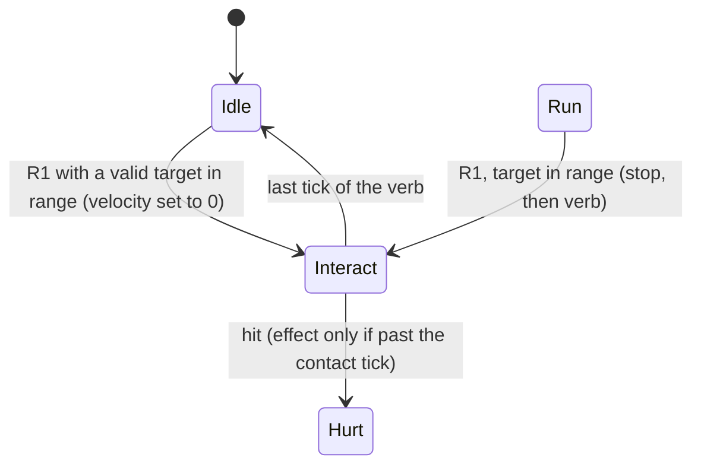

# ANIM-INTERACT-01: Carl and Princess Donut interact animations, design spec

**Status:** design phase: spec and key poses drawn and frozen; in-betweens are still copies of their nearest key and are drawn in the execution phase; independent review and owner review pending. Nothing is wired into a Bevy binary. Rights basis for publishing: owner-reported `ART-PUBLICATION-ALL-V1` ([rights register](../04-production/rights-and-release.md)). No reuse licence, no game or asset-pack distribution right.

Read with: [MVP controller contract](../01-design/mvp-controller-contract.md) (Interact row, R1/RB), [asymmetric traversal and gates](../01-design/asymmetric-traversal-and-gates.md), [antihero tone](../01-design/antihero-tone.md), [Carl bible](carl-character-bible.md), [Donut bible](donut-character-bible.md), [ANIM-CARL-02 melee spec](carl-melee-anim-02-spec.md) (structure, helpers and identity rules this spec inherits), [pixel-art pipeline](../07-agents/pixel-art-pipeline.md).

| File | Role |
| --- | --- |
| `assets/source/characters/carl/carl_h52_interact.grid.json` | pixel-grid-v1 source, 12 frames (keys at 1, 2, 5, 9) |
| `assets/source/characters/donut/donut_h40_interact.grid.json` | pixel-grid-v1 source, 8 frames (keys at 1, 5) |
| `assets/source/characters/{carl/carl_h52,donut/donut_h40}_interact.ase` | built from the grids by `scripts/pixel_grid_to_ase.py` |
| `assets/source/characters/{carl/carl_h52,donut/donut_h40}_interact.pixelart.json` | toolkit configs: the **machine-readable tick contract** (`tags.*.frames` = `[frame, ticks]`), frozen-key rule |
| `scripts/author_interact01.py` | deterministic authoring record (`--check`, `--evidence`) |
| `tests/test_art_interact01.py`, `tests/fixtures/anim-interact-01-{carl,donut}_keys.json` | contract tests and the frozen keys |
| `docs/evidence/anim-interact-01/keys-scale.png`, `keys-scale-x4.png` | the keys at 1× on lit Floor 1 with placeholder props, and a 4× copy |

## 1. Scope and acting brief

Interact is **R1/RB**. It is never an enemy grab (the contract keeps grabs out of interact). The set is a small group of **reusable verbs** that any prop, door, switch or pickup can use. The verb is chosen by the prop's height class (section 4), not by the prop. Props are separate art; these frames contain no prop pixels. The runtime attaches a carried item to the hand anchor from the contact tick on.

- **Carl** is a plain guy doing chores in a dungeon. He grabs a handle a bit too eagerly, hauls it down with his whole weight and sags back on his heels. He squats to pick something up the way a man with a sore back does: heels up, one hand braced on his knee, a grunt. He shoves heavy things with his fists and his weight, back leg straining on its toe. No heroic stance, no flourish, no posing for the camera.
- **Princess Donut** does only what a cat plausibly does: she **pats** a low switch or small item with a front paw, and she **nudges** a small thing with her muzzle and forehead. She never grips, pulls a lever, turns a handle or opens a door with a "hand". Anything above her low class is Carl's job or a gate for her jump (asymmetric traversal: Donut conquers space, Carl transforms it).

## 2. Frame size and pivot (integration contract)

- **Carl: 48 × 56, pivot (25, 55)**, Donut: **72 × 44, pivot (46, 43)**: identical to each character's approved locomotion atlas (and Carl's melee atlas). Same palette (23 / 22 colours) and the same layers in the same order. The atlases can be loaded next to locomotion with no pivot math.
- All tags are **grounded**: the lowest opaque row is the pivot row in every frame. Columns 0 and W-1 and row 0 stay empty.
- **Facing:** all frames face right; mirror around the pivot column for left.
- **Root motion:** none. Velocity is zero during every interact verb; the feet stay planted. Gameplay positions the actor at the verb's **stand-off distance** (section 4) before the verb starts.

## 3. Tick windows (60 Hz)

Tick 0 is the fixed tick on which R1 is accepted for a valid target. Frame selection is a pure function of the verb clock. The **contact tick** is the first tick of the contact frame: the runtime applies the effect (switch toggles, item attaches, prop impulse) on that tick, never on the press. `duration_ms` in the grid is only for previews (`round(ticks × 1000 / 60)`).

### Carl

| Frame | Tag | Name | Ticks | Window | Role |
| --- | --- | --- | --- | --- | --- |
| 0 | `interact_hand` | u0 | 5 | t0-4 | reach start (in-between) |
| 1 | `interact_hand` | **u1** | 8 | **t5**-12 | **KEY, contact**: grip on the handle |
| 2 | `interact_hand` | **u2** | 10 | t13-22 | **KEY**: haul down, sag back |
| 3 | `interact_hand` | u3 | 8 | t23-30 | let go, settle (in-between) |
| 4 | `interact_floor` | p0 | 8 | t0-7 | bend start (in-between) |
| 5 | `interact_floor` | **p1** | 10 | **t8**-17 | **KEY, contact**: hand on the item |
| 6 | `interact_floor` | p2 | 10 | t18-27 | push up off the knee (in-between) |
| 7 | `interact_floor` | p3 | 8 | t28-35 | stand, item at the hip (in-between) |
| 8 | `interact_push` | s0 | 6 | t0-5 | set: lean in (in-between) |
| 9 | `interact_push` | **s1** | 8 | **t6**-13 | **KEY, contact**: fists on the face, back leg driving |
| 10 | `interact_push` | s2 | 12 | t14-25 | strain, the prop gives (in-between) |
| 11 | `interact_push` | s3 | 8 | t26-33 | step back, shake it off (in-between) |

Totals: `interact_hand` 31 ticks (517 ms), contact t5; `interact_floor` 36 (600 ms), contact t8; `interact_push` 34 (567 ms), contact t6.

### Donut

| Frame | Tag | Name | Ticks | Window | Role |
| --- | --- | --- | --- | --- | --- |
| 0 | `interact_paw` | d0 | 6 | t0-5 | paw lifts, weight back (in-between) |
| 1 | `interact_paw` | **d1** | 6 | **t6**-11 | **KEY, contact**: paw pats the target |
| 2 | `interact_paw` | d2 | 8 | t12-19 | paw lifts off, head stays on the target (in-between) |
| 3 | `interact_paw` | d3 | 6 | t20-25 | paw down, back to idle (in-between) |
| 4 | `interact_nudge` | n0 | 8 | t0-7 | head lowers (in-between) |
| 5 | `interact_nudge` | **n1** | 8 | **t8**-15 | **KEY, contact**: muzzle on the item |
| 6 | `interact_nudge` | n2 | 10 | t16-25 | push through: head forward 1-2 px, tail flicks (in-between) |
| 7 | `interact_nudge` | n3 | 8 | t26-33 | head up, back to idle (in-between) |

Totals: `interact_paw` 26 ticks (433 ms), contact t6; `interact_nudge` 34 (567 ms), contact t8.

Interrupts: a hit during any verb cancels it into hurt (no armour); if the cancel comes before the contact tick, the effect does not happen. Whether an interrupted push still applies its impulse after t6 is a gameplay decision (proposal: yes, the effect already happened).

## 4. Object-height classes and contact boxes

Pivot-relative, x forward, y up from the floor, inclusive, measured from the keys (`tests/test_art_interact01.py` checks them).

| Class | Prop contact band (y) | Carl verb | Donut verb | Key contact part | x | y |
| --- | --- | --- | --- | --- | --- | --- |
| **floor** | 0-8 | `interact_floor` (pickups, floor levers) | `interact_nudge` (small item, floor plate) | Carl p1 hand | +14..+19 | 4..7 (hand), sleeve up to 13 |
| | | | | Donut n1 muzzle and cheek | +19..+24 | 7..25 (head front) |
| **low** | 4-12 | (uses `interact_floor`) | `interact_paw` (low switch, small item on a step) | Donut d1 paw | +18..+23 | 5..11 |
| **waist** | 14-26 | `interact_push` (crates and heavy props at least 26 px tall; face at +20) | none | Carl s1 near fist | +14..+19 | 24..29 (far fist 31..36) |
| **hand** | 24-34 | `interact_hand` (switch, lever, door handle, chain) | none (a cat cannot use it) | Carl u1 grip | +12..+17 | 26..31 |
| | | | | Carl u2 fist (lever thrown) | +8..+13 | 19..24 |

**Stand-off distances** (pivot to the prop's near face): `interact_hand` +17 to +18 (the handle at +17..+22), `interact_floor` +15 (item 4-6 px wide), `interact_push` +20, `interact_paw` +18 (switch 5 px wide), `interact_nudge` +21. A prop above Donut's low class has no Donut verb: the prompt is not shown to her.

**Hand anchor for carried items (Carl p1 onwards):** the far hand centre, (+16, 5) at p1; the execution phase records it per frame for p2 and p3 in the config (`anchors`).

## 5. Keys and executor notes

**Keys are final for pose, silhouette and contact pixels**; they are frozen (`tests/fixtures/anim-interact-01-*_keys.json`) and the execution phase keeps them pixel-identical. Design problems found while drawing in-betweens go back to the designer.

Construction (same rules as ANIM-CARL-02 section 9): Carl's hair, head, torso, jacket, pin and boxer seat are the master's pixels translated by **U(dx, dy)** from locomotion idle 0 (`author_carl_melee.upper`), heads from the existing variants (v0 neutral, v3 effort closed mouth), head offset at most 2 px. Arms, legs and boxer thighs are rasterised tubes with the master ramps; Crocs and fists are stamps (`CROC_FLAT`, `CROC_TOE`, `FIST_BIG`, `FIST_SMALL`). Donut's tail, body, head, face and tiara are her idle 0 pixels translated; the tapping foreleg is a rasterised cream tube; collar pixels hidden under her lowered head are dropped.

| Key | Construction | Executor notes |
| --- | --- | --- |
| **u1** reach contact | U(+2, +1), head v0 (dumb "huh" mouth), b3 standing legs, idle near arm hanging, far arm straight forward-down, `FIST_BIG` grip at x37-42, rows 24-29 | Reads as reaching, not a jab: no lunge, no back-swung arm, the fist sits lower than the jab fist (rows 21-26). Keep the near arm slack. |
| **u2** haul down | U(0, +2), head v3 offset (0, +1), legs 1 px wider and back, far arm pulled to the belt, fist x33-38, rows 31-36 | The everyman beat: he uses his body weight, not his arm. Don't add a cheer or a fist pump on release (u3). |
| **p1** pickup contact | U(+1, +13), head v3 offset (+1, 0); deep squat with the back heel up (`CROC_TOE`), front `CROC_FLAT` at x30; near arm across the chest, `FIST_SMALL` braced on the front knee, watch on its cuff; far arm down past the knee, `FIST_SMALL` on the item at x39-44, rows 48-51 | The hand on the knee is the joke and the tone. The squat must not read as sitting: at p0 and p2 keep the seat at least 4 px off the floor. |
| **s1** shove contact | U(+8, +3), head v3 offset (+1, +1); back leg a long diagonal to `CROC_TOE` at x12, front leg planted under the hips (`CROC_FLAT` at x33); both fists stacked on the prop face at x39-45 | The torso cannot rotate (identity lock), so the lean is carried by the U offset and the back leg. s2 strains (head offset +1 more, back heel 1 px lower); s3 steps the back foot in and drops the arms. |
| **d1** paw tap contact | head, face and tiara (0, +1); front foreleg removed from the body and closed with a `K` belly line; new foreleg reaches forward at chest height, paw x63-69, rows 32-38, resting on a low switch top | One paw only. d0 lifts the same paw 2-3 px higher and tucks it (a cat's wind-up); d2 lifts it off 2 px. The other paws do not move. |
| **n1** nose nudge contact | head, face and tiara (+2, +10); body and tail unchanged; collar hidden under the chin | Rump and tail stay up so the silhouette is "head down, nose in", not lying down. n2 pushes the head +1..+2 px forward, the tail tip flicks. |

### In-between table (execution phase)

| Frame | From key | Change |
| --- | --- | --- |
| u0 | idle → u1 | U(+1, 0), far arm half raised (elbow bent, fist at rows 30-33, x33-37), head v0 |
| u3 | u2 → idle | U(+1, +1), far arm drops to the idle far-arm position, head v1 glance (checks if it worked) |
| p0 | idle → p1 | U(+1, +6): half squat (the land frame 14 legs are a good start), far arm hanging forward, near arm going to the knee |
| p2 | p1 → p3 | U(+1, +7), near hand still on the knee pushing up, far hand at the hip (rows 38-41) |
| p3 | p2 → idle | U(+1, +1), standing, far hand at the hip (the item rides there), head v3 |
| s0 | idle → s1 | U(+4, +2), back foot steps back 4 px, both arms bent up in front of the chest |
| s2 | s1 hold | head offset (+1, +2), back heel 1 px lower, fists unchanged (the contact holds) |
| s3 | s2 → idle | U(+3, +1), back foot steps in, arms drop to idle, head v1 |
| d0 | idle → d1 | head (0, +1), the front paw lifted and tucked at rows 33-37, x57-61 |
| d2 | d1 → d3 | paw lifted 2 px off the target, head still lowered |
| d3 | d2 → idle | paw back on the floor (idle front leg), head at idle |
| n0 | idle → n1 | head, face and tiara (+1, +5) |
| n2 | n1 hold | head (+3, +10), tail tip 1 px up |
| n3 | n2 → idle | head (+1, +4) |

After the in-betweens: set `unique_frames` to `true` in both configs, replace `test_inbetweens_are_key_copies_in_the_design_phase` with per-frame checks of this table, add per-tag GIFs with `python3 -m scripts.pixelart evidence`, and add a contact sheet and `SHA256SUMS` to the evidence folder.

## 6. State flow

The verb is chosen by the target's class and the active character (section 4). Target priority, prompt and the no-accidental-pickup rule during combat stay with the controller contract.

## 7. Integration notes and open decisions (gameplay and input owners)

1. **Effect on the contact tick**, not on the press (section 3).
2. **Stand-off snap:** the actor walks to the stand-off distance or the prompt only shows inside a small tolerance (proposal: ±3 px). The art assumes no slide.
3. **Push is a single shove** (an impulse at t6), not a sustained push-walk. A held push with a walking loop would need new frames.
4. **Doors:** doors at hand height use `interact_hand`; no separate door-opening verb is drawn.
5. **Donut and high props:** no verb. A Donut-only route uses the low class (G1 in the gates doc: a small credible interaction that opens a shared route).

## 8. Acceptance targets

1. Frame size, pivot, palette and layers identical to each locomotion atlas; all frames grounded on the pivot row; edge columns and row 0 empty.
2. The six keys pixel-identical to the frozen fixtures in every later phase.
3. Tick windows in the configs equal section 3; contact ticks u1 t5, p1 t8, s1 t6, d1 t6, n1 t8.
4. Contact boxes inside the section 4 bands (`tests/test_art_interact01.py`).
5. At 1× on lit Floor 1 next to a placeholder prop: each verb reads without the prop (silhouettes distinct from idle, from each other and from the melee keys; u1 is not a jab, p1 is not sitting, s1 is not a punch).
6. Tone gate: Carl plain and a bit clumsy, never heroic; Donut does only cat actions (no grip, no pull, no handle).
7. Identity: hair, head, torso, jacket, pin and boxers (Carl); tail, head, face and tiara (Donut) are translated master pixels in every frame.
8. Toolkit validators pass for both configs; `python3 scripts/author_interact01.py --check` passes.

## 9. Difficulty score and route

Per [routing by difficulty](../07-agents/pixel-art-pipeline.md#routing-by-difficulty): Carl scores **1** (native height above 40 px; not a new design, the approved master; no complex construction; no VFX). Donut scores **0** (40 px, approved master). Both are **Easy, route C**: the design phase wrote this spec and drew every key (more than the one hero key the route needs, because the keys define the verbs); the execution phase draws the eight Carl and six Donut in-betweens; an independent review checks the keys first. No silhouette gate is needed (not a new design), but the reviewer should apply acceptance target 5 to the keys before in-betweens are accepted.

**Living-horizon fit:** the verbs are generic and reusable and add no ability; they fit [character-progression-horizon.md](../01-design/character-progression-horizon.md) (Carl transforms space, Donut acts on small things) and the gates doc. No horizon update needed.

## 10. Rights and provenance

Derived from the owner-approved Carl 52 px master (via the ANIM-CARL-01 locomotion canvas) and the owner-approved Donut 40 px master (via her locomotion canvas); master parts translated only, new parts hand-placed or rasterised by `scripts/author_interact01.py`. No image-model raster output, no tracing, no third-party assets. The placeholder lever, switch, crate and item rectangles in the evidence are context only, not art. Spec and keys: Claude Opus.
