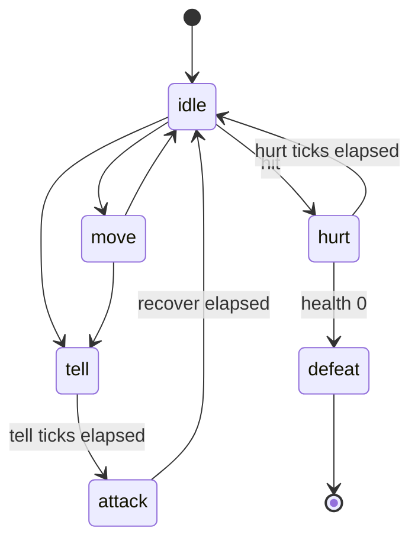

# JUICE-01: The Juicer (boss) readability set, design spec

**Status:** packet ready; design pending. Execution pending. Review pending.

**Decision record:** height <fill> px, frame <fill> x <fill>, pivot (<fill>, <fill>). Proposed by <fill>; decided by <fill>.

The sections follow `docs/02-art/gob-01-goblin-spec.md`. Replace every `<fill: ...>`; write numbers, not adjectives. The design step stops at the keys and this spec (see the top-tier budget in `docs/07-agents/agent-orchestration.md`).

## 1. Canon and tone constraints

- Approved concept: the Juicer panels of `assets/concept/floor-01/enemies/floor01-troglodyte-family-approved.png` (1448x1086 troglodyte family sheet; the Pygmy, Basher and Virtuoso panels are cropped out and belong to TROG-01). `assets/concept/floor-01/juicer-gym/` holds only the gym panorama (an environment reference with no Juicer figure); the encounter notes are `docs/02-art/floor-01-juicer-gym-standalone-concept.md`. No Juicer-only sheet and no dedicated Juicer face panel exist.
- Tone (`docs/01-design/antihero-tone.md`, enemies row): threatening yet eccentric, with motivated behaviors and readable tells and some absurd visual contrasts; never a purely serious faceless army and never comedic with no danger. 1980s-1990s action cinema is used for attitude only, never copied designs.
- Canon facts that must survive in pixels (from the approved docs and the concept board, not design decisions):
  - The same troglodyte species cues as the family (pale reddish-pink skin, long dark hair, pointed ears, wide fanged mouth with drool, ragged loincloth, barefoot), grotesquely enlarged.
  - Immense muscle mass swollen with red boils and swollen purple veins, chain cuffs or shackles at the wrists and a chain at the waist, a roaring open mouth.
  - Boss silhouette: a hunched, wide block with very large fists that reads as heavy at 1x.
- Design reading of the tone: <fill: how the Juicer reads as a grotesque, pitiful and absurd 1990s-gym bruiser who is still dangerous, never heroic>.

### Where the canon, size and mechanics are defined (checked 2026-11-18)

| Topic | Source | What it says |
| --- | --- | --- |
| Visual approval | `docs/02-art/floor-01-late-enemy-boss-concepts.md` line 15 and line 36; `docs/04-production/backlog.md` line 13 | The Juicer is an owner-approved exaggerated-muscle grotesque family boss, with the same troglodyte species cues; the concept covers lunge, pound, roar and facial poses, **not** engine-ready moves |
| Source scale | late-enemy doc line 25 | The book describes an immensely muscular troglodyte only **a little taller than Carl**; the concept's huge proportions are a presentation exaggeration; record the mismatch and decide a gameplay-readable scale independently |
| Scale authority | `docs/02-art/floor-01-juicer-gym-standalone-concept.md` ("Boss scaling note", "Art direction and continuity") | Verify the eventual runtime height against the novel and the approved character scales (Carl 52, Donut 40); the concept art deliberately exaggerates relative size |
| Boss arc | same doc ("Proposed Juicer boss arc") | Three beats (warm-up with stomp and charge, use the room, no rest) are a **design hypothesis**; "move lists and apparent weaknesses are gameplay adaptations, not verified book facts" |
| Combat role | `docs/01-design/combat-feel-hybrid-physics.md` line 81; `docs/01-design/combat-first-encounter-design.md` line 80; `docs/01-design/floor-01-gameplay-progression-v0.md` line 82 | Boss/heavy: strong telegraph and conditional stagger, not unlimited launch; physical spectacle; an overwhelming opponent that rewards props, timing and openings; moving features must stay comprehensible without show lighting |
| Rewards | `docs/01-design/character-progression-horizon.md` line 80; `docs/01-design/mvp-controller-contract.md` lines 49 and 65 | A cooperative climax; the gauntlet modifies Carl's fist attacks and Donut gains Puddle Jumper **after** the encounter. These are Carl and Donut abilities, not Juicer art |
| Setting | `docs/02-art/floor-01-art-atlas-v1.md` lines 14, 47 and 55 | Troglodyte territory in a gym with reception, turnstile, equipment, mirrors and heavy weights; do not infer a business logo, copyrighted signage or unverified gym gameplay |
| Size | none | No native size is recorded anywhere; the sheet's lineup shows the Juicer far larger than the other types, a printed scale that is not accepted |
| Production slot | `docs/07-agents/pixel-art-pipeline.md` lines 21, 51, 101 | Batch 9 (Gym), with AREA-GYM-01; every boss is route A + silhouette gate |
| Mechanics, hit points, damage, hitboxes | none | Not defined in any doc |

### What is NOT approved

- Native size, boss height, collider and hitbox dimensions; the sheet's proportions and the printed Carl 52 / Donut 40 labels.
- Move list, damage, hit points, weaknesses, stagger rules and the three-beat boss arc (a hypothesis). The lunge, pound and roar studies are poses, not an attack set.
- Any steroid, injection, "juice" or aura effect: none is drawn on the sheet and none is approved; do not invent one from the name.
- Environmental interactions with the gym props (candidate effects in the gym doc are not implemented or numerically approved), L3 structural collapse and corpse projectiles.
- The gym panorama is an environment reference. Its wall mural of a flexing bodybuilder and the banner and poster figures are set dressing, **not** the Juicer; do not take his design from them, and do not copy the banner text as final signage.
- Book accuracy of the sheet's anatomy; the sheet takes humanoid/horror liberties (late-enemy doc line 24).

### Guardrails (copied from the late-enemy and gym docs)

- Preserve the owner-approved troglodyte family cues; keep the Juicer distinct from the Ball of Swine arena and its rings.
- Record the book-versus-concept scale mismatch in the design (the book: a little taller than Carl; the sheet: several times his size) and decide a gameplay-readable size independently.
- Convert from original editable pixel grids / `.aseprite`, never by tracing or cropping the sheet. Do not repaint the approved image.

### Dependencies

- The family base design (TROG-01, PR #73: proposed base the Pygmy) fixes the shared skin, hair, ear and fang construction; the Juicer should derive from it rather than be drawn first. Whether TROG-01 lands first is an orchestration decision.

### VFX and props to treat as separate work orders

- Pound impact: the sheet shows a ground-impact debris burst on the pound; a shockwave or debris effect is a separate VFX work order.
- Gym environment kit (AREA-GYM-01): reception desk and terminal, turnstile, bench press, dumbbells and plates, squat and cable machines, hanging punching bag, cracked mirrors, tires, banner, mural and neon tube. None of it belongs in the Juicer sprite set.
- Prop interaction states (toppled bench, swinging bag, shattering mirror, released weights): environment work orders tied to gameplay approval.
- Drool and sweat are small and may stay in the sprite; boils and veins are body detail.

### Packet inputs

- Concept crops in `docs/evidence/juice-01/packet/` (x,y,w,h in the 1448x1086 sheet):
  - `concept_crop_1.png` = `1005,135,435,335`: The Juicer, hero figure
  - `concept_crop_2.png` = `1045,515,395,165`: key study, lunge / pound / roar
  - `concept_crop_3.png` = `1180,745,268,295`: the Juicer in the sheet's scale panel (Carl and Donut cropped out)
  - No facial-study panel exists for the Juicer, and the gym panorama is not cropped.
- `scale_lineup.png`: Carl 52, Donut 40, goblin 36, plus three empty candidate slots at 72, 96 and 120 px for a boss next to Carl. 72 px is about 1.4 times Carl (nearest the book's "a little taller"), 96 px matches the Hoarder candidate range, 120 px matches the Dozer's body height. By eye the sheet draws the Juicer about 140 px tall at Carl's 52 px (about 190 px against Carl's 70 px in the 1448x1086 image); that is an exaggeration to be decided, not an approved size. The default 64 x 56 frame is a placeholder only.
- Readability set (tags): `idle` (2-4), `move` (4-6), `tell` (1-2), `attack` (2-3), `hurt` (1), `defeat` (2-3); about 12 to 20 frames. Concrete tag names and frame counts are the designer's choice (section 4 and `frame_pivot_template.json` carry the toolkit defaults).

## Difficulty and route

**Score 4 of 4 (3 certain, 1 depends on TROG-01): Boss, route A + silhouette gate** (top tier designs and draws every key; a fresh top-tier silhouette check on the idle key before any other key; budget one extra review round). Any boss lands in this class regardless of the score.

| Point | Met | Note |
| --- | --- | --- |
| 1. New design, not a variant | yes now | A dedicated boss; it would be a derivative of the troglodyte base if TROG-01 is merged first, so the point may fall away |
| 2. Native height above about 40 px | yes | Candidates 72 to 120 px |
| 3. Complex anatomy or construction | yes | Large mass with boils, veins, chains and a loincloth; very large fists |
| 4. VFX, projectiles, special states | yes | The pound shows a debris burst; the roar and charge are boss states beyond the readability set |

Reasoning: a boss at the largest size in the family with several overlapping parts and an impact effect; the silhouette gate matters because the risk is a Basher recolour or a generic bodybuilder read.

## 2. Size decision

Carl is 52 px (about 6 ft), Donut 40 px, the goblin 36 px (see `scale_lineup.png`).

| Option | Idle opaque height | Ratio to Carl | Implied real height | Why / why not |
| --- | --- | --- | --- | --- |
| A | 72 px | <fill> | <fill> | <fill> |
| B | 96 px | <fill> | <fill> | <fill> |
| C | 120 px | <fill> | <fill> | <fill> |

Decision: <fill: height and the reason, one paragraph; the proposer and the decider are different agents>.

## 3. Frame, pivot, boxes and atlas

- Frame <fill> x <fill>, pivot (<fill>, <fill>), contact row <fill> (the lowest opaque row of every grounded frame).
- Grounded tags: <fill>. Airborne tags (no pixel on the contact row): <fill or none>.
- Standing box <fill> x <fill>; hurtbox <fill>; attack hitbox <fill> on the impact frame.
- Authored facing right; the runtime mirrors around the pivot column.
- One atlas, frames 0 to <fill>, layers: <fill: for example body, weapon>.

## 4. Readability-set animation list

Readability set: idle, move, tell, attack, hurt, defeat (about 12 to 20 frames until the asset has a gameplay work order). Tick windows are at 60 Hz.

| Role | Tag | Frames | Playback | Tick-window proposal | Reference |
| --- | --- | --- | --- | --- | --- |
| idle | `idle` | 2-4 | loop | 8-12 ticks per frame, a 32-40 tick breathing cycle | GOB-01: 12 + 8 + 12 + 8 |
| move | `walk` | 4-6 | loop | 5 ticks per frame, speed from the gameplay spec | GOB-01: 6 x 5 = 30 ticks |
| tell | `attack_tell` | 1-2 | once | at least 18 ticks of readable hold, about 24 total | GOB-01: 6 + 18 |
| attack | `attack_swing` | 2-3 | once | smear 2, impact 3-4 (shown on exactly the hitbox-active ticks) | GOB-01: 2 + 4, then recover 20 |
| hurt | `hurt` | 1 | once | 8-12 ticks | GOB-01: 4 + 8 |
| defeat | `down` | 2-3 | hold | floor impact 4, settle 8, then a state-driven hold | GOB-01: 4 + 8 + hold |

Frame table (`frame_pivot_template.json` carries the same rows):

| # | Tag | Pose | Ticks | Author |
| --- | --- | --- | --- | --- |
| 0 | `idle` | <fill: pose> | 12 | <fill: key or Sonnet> |
| 1 | `idle` | <fill: pose> | 8 | <fill: key or Sonnet> |
| 2 | `idle` | <fill: pose> | 12 | <fill: key or Sonnet> |
| 3 | `walk` | <fill: pose> | 5 | <fill: key or Sonnet> |
| 4 | `walk` | <fill: pose> | 5 | <fill: key or Sonnet> |
| 5 | `walk` | <fill: pose> | 5 | <fill: key or Sonnet> |
| 6 | `walk` | <fill: pose> | 5 | <fill: key or Sonnet> |
| 7 | `attack_tell` | <fill: pose> | 6 | <fill: key or Sonnet> |
| 8 | `attack_tell` | <fill: pose> | 18 | <fill: key or Sonnet> |
| 9 | `attack_swing` | <fill: pose> | 2 | <fill: key or Sonnet> |
| 10 | `attack_swing` | <fill: pose> | 4 | <fill: key or Sonnet> |
| 11 | `hurt` | <fill: pose> | 4 | <fill: key or Sonnet> |
| 12 | `hurt` | <fill: pose> | 8 | <fill: key or Sonnet> |
| 13 | `down` | <fill: pose> | 4 | <fill: key or Sonnet> |
| 14 | `down` | <fill: pose> | 8 | <fill: key or Sonnet> |
| 15 | `down` | <fill: pose> | hold | <fill: key or Sonnet> |

## 5. State diagram



## 6. Palette

Family palette: skin, hair and loincloth ramps should stay derivable from the troglodyte family palette (TROG-01); the Juicer's extra keys (boil red, vein purple, chain iron) are design decisions (<fill>). The gym's magenta accent light belongs to the environment, not to the sprite.

At most <fill: 20> colours. Candidates from the concept crop (median cut, by pixel share; see `palette_candidates.json`). These are candidates, not decisions.

| # | Candidate | Share | Decision (key, name, role) |
| --- | --- | --- | --- |
| 1 | `#0f1926` | 7.5 % | <fill: key, name, role> |
| 2 | `#e59170` | 6.6 % | <fill: key, name, role> |
| 3 | `#302b3a` | 6.6 % | <fill: key, name, role> |
| 4 | `#8b4135` | 6.2 % | <fill: key, name, role> |
| 5 | `#e67456` | 6.2 % | <fill: key, name, role> |
| 6 | `#0f1a28` | 6.0 % | <fill: key, name, role> |
| 7 | `#182031` | 5.0 % | <fill: key, name, role> |
| 8 | `#b26a53` | 4.9 % | <fill: key, name, role> |
| 9 | `#a54938` | 4.9 % | <fill: key, name, role> |
| 10 | `#0c1724` | 4.4 % | <fill: key, name, role> |
| 11 | `#030207` | 4.2 % | <fill: key, name, role> |
| 12 | `#e9ac86` | 4.0 % | <fill: key, name, role> |
| 13 | `#612d2a` | 3.8 % | <fill: key, name, role> |
| 14 | `#101e2e` | 3.8 % | <fill: key, name, role> |
| 15 | `#c84a39` | 3.7 % | <fill: key, name, role> |
| 16 | `#2a1b25` | 3.3 % | <fill: key, name, role> |
| 17 | `#663f3a` | 3.1 % | <fill: key, name, role> |
| 18 | `#f7dbb8` | 3.0 % | <fill: key, name, role> |
| 19 | `#18121a` | 2.8 % | <fill: key, name, role> |
| 20 | `#0a1522` | 2.7 % | <fill: key, name, role> |
| 21 | `#070c17` | 2.4 % | <fill: key, name, role> |
| 22 | `#611a1d` | 2.1 % | <fill: key, name, role> |
| 23 | `#0c1a28` | 2.0 % | <fill: key, name, role> |
| 24 | `#0f111c` | 0.9 % | <fill: key, name, role> |

The chosen palette must separate this asset from the warm brick and the cold arch of Floor 1 at 1x, and fit the A1 lighting.

## 7. Key poses

One key per readability tag (about 6 to 8 keys): idle 0, move contact, tell hold, attack impact, hurt, defeat. Each key lists silhouette, joint positions, palette use and the readability reason. Keys are frozen once the review passes (`pixelart freeze`).

| Frame | Tag | Silhouette and pose notes | Readability reason |
| --- | --- | --- | --- |
| <fill> | <fill> | <fill> | <fill> |

## 8. In-between list

For the execution tier; no design decisions needed. One row per non-key frame, as in section 9 of the GOB-01 spec.

| # | Pose notes |
| --- | --- |
| <fill> | <fill> |

## 9. Validators and readability rules

Run by `python3 -m scripts.pixelart validate <asset-config>` (rules V01 to V15 in `scripts/pixelart/validators.py`). Parametrize in the asset config:

- V04 palette: at most <fill> colours; V05 isolated pixels: 0; V06 orphan pixels: at most <fill> per frame.
- V07/V08 contact rows: grounded tags end on the contact row, airborne tags never touch it.
- V09 frozen keys: SHA-256 per key frame, fixture `tests/fixtures/juice-01_keys.json`.
- V13/V14 readability rules (write each as a bbox or key-count rule): <fill: for example the tell is the highest point, the hurt eyes are white>.

## 10. Evidence

```text
python3 -m scripts.pixelart validate <asset-config> --out <dir>
python3 -m scripts.pixelart evidence <asset-config> --out <dir>
python3 -m scripts.pixelart review-pack <asset-config> --out <dir>
```

The review pack holds exactly three images (contact sheet x4, lit scene 640 x 360 shown x3, tell to attack strip) and the validator report.

## 11. Files

| File | Role |
| --- | --- |
| `assets/source/<fill>/juice-01.grid.json` / `.ase` | pixel-grid source and Aseprite master |
| `assets/manifests/juice-01.json` | manifest |
| `<fill>/juice-01.pixelart.json` | the asset config (from `frame_pivot_template.json`) |
| `tests/fixtures/juice-01_keys.json` | frozen keys |

## 12. Rights and provenance

Fan-concept art under the owner-reported `ART-PUBLICATION-ALL-V1` scope (see `docs/04-production/rights-and-release.md`). Record in the PR's `Rights/Provenance` section which model designed, executed and reviewed the art. No tracing of the concept, no image-model raster output.

### Rights/Provenance stub

- Concept: owner-approved reference under `ART-PUBLICATION-ALL-V1`; crops are for reference only, never traced or exported.
- Packet: script output plus a medium-tier executor (stage P).
- Designed by: pending. Executed by: pending. Independently reviewed by: pending.
- No third-party assets, no copied designs or dialogue, no image-model raster output.
