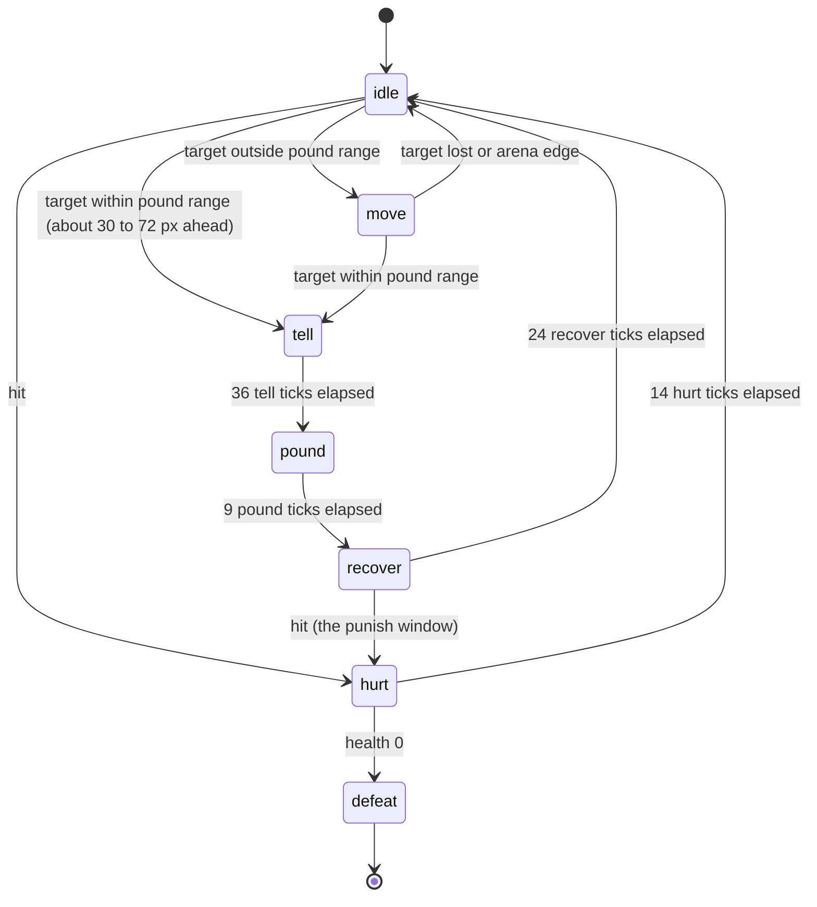

# JUICE-01: The Juicer (boss) readability set, design spec

**Status:** phase 1 designed: spec and idle key 0 drawn and frozen, awaiting the silhouette gate. Keys 3, 8, 10, 12, 15 and execution pending. Review pending.

**Decision record:** height 100 px, frame 160 x 136, pivot (72, 135). Proposed by the JUICE-01 designer within the orchestrator default (96 to 112 px); decided by: orchestrator default, pending owner confirmation.

The sections follow `docs/02-art/gob-01-goblin-spec.md`. The design step stops at the keys and this spec (see the top-tier budget in `docs/07-agents/agent-orchestration.md`).

## 1. Canon and tone constraints

- Approved concept: the Juicer panels of `assets/concept/floor-01/enemies/floor01-troglodyte-family-approved.png` (1448x1086 troglodyte family sheet; the Pygmy, Basher and Virtuoso panels are cropped out and belong to TROG-01). `assets/concept/floor-01/juicer-gym/` holds only the gym panorama (an environment reference with no Juicer figure); the encounter notes are `docs/02-art/floor-01-juicer-gym-standalone-concept.md`. No Juicer-only sheet and no dedicated Juicer face panel exist.
- Tone (`docs/01-design/antihero-tone.md`, enemies row): threatening yet eccentric, with motivated behaviors and readable tells and some absurd visual contrasts; never a purely serious faceless army and never comedic with no danger. 1980s-1990s action cinema is used for attitude only, never copied designs.
- Canon facts that must survive in pixels (from the approved docs and the concept board, not design decisions):
  - The same troglodyte species cues as the family (pale reddish-pink skin, long dark hair, pointed ears, wide fanged mouth with drool, ragged loincloth, barefoot), grotesquely enlarged.
  - Immense muscle mass swollen with red boils and swollen purple veins, chain cuffs or shackles at the wrists and a chain at the waist, a roaring open mouth.
  - Boss silhouette: a hunched, wide block with very large fists that reads as heavy at 1x.
- Design reading of the tone: a swollen gym bruiser gone wrong, the late-80s action-movie heavy who has been in the weight room too long: the muscle is lumpy and diseased (boils, veins), not sculpted; the head is small and sunk between the shoulders, the mouth hangs open and drools, the wrists still carry the iron he was chained with. He is pitiful and absurd up close and dangerous at range: the two huge fists and the slow, readable overhead pound are the threat. No heroic chest-out stance, no clean definition, no glamour lighting, no steroid or "juice" effect.

### Where the canon, size and mechanics are defined (checked 2026-11-18)

| Topic | Source | What it says |
| --- | --- | --- |
| Visual approval | `docs/02-art/floor-01-late-enemy-boss-concepts.md` line 15 and line 36; `docs/04-production/backlog.md` line 13 | The Juicer is an owner-approved exaggerated-muscle grotesque family boss, with the same troglodyte species cues; the concept covers lunge, pound, roar and facial poses, **not** engine-ready moves |
| Source scale | late-enemy doc line 25 | The book describes an immensely muscular troglodyte only **a little taller than Carl**; the concept's huge proportions are a presentation exaggeration; record the mismatch and decide a gameplay-readable scale independently |
| Scale authority | `docs/02-art/floor-01-juicer-gym-standalone-concept.md` ("Boss scaling note", "Art direction and continuity") | Verify the eventual runtime height against the novel and the approved character scales (Carl 52, Donut 40); the concept art deliberately exaggerates relative size |
| Boss arc | same doc ("Proposed Juicer boss arc") | Three beats (warm-up with stomp and charge, use the room, no rest) are a **design hypothesis**; "move lists and apparent weaknesses are gameplay adaptations, not verified book facts" |
| Combat role | `docs/01-design/combat-feel-hybrid-physics.md` line 81; `docs/01-design/combat-first-encounter-design.md` line 80; `docs/01-design/floor-01-gameplay-progression-v0.md` line 82 | Boss/heavy: strong telegraph and conditional stagger, not unlimited launch; physical spectacle; an overwhelming opponent that rewards props, timing and openings; moving features must stay comprehensible without show lighting |
| Rewards | `docs/01-design/character-progression-horizon.md` line 80; `docs/01-design/mvp-controller-contract.md` lines 49 and 65 | A cooperative climax; the gauntlet modifies Carl's fist attacks and Donut gains Puddle Jumper **after** the encounter. These are Carl and Donut abilities, not Juicer art |
| Setting | `docs/02-art/floor-01-art-atlas-v1.md` lines 14, 47 and 55 | Troglodyte territory in a gym with reception, turnstile, equipment, mirrors and heavy weights; do not infer a business logo, copyrighted signage or unverified gym gameplay |
| Size | none | No native size is recorded anywhere; the sheet's lineup shows the Juicer far larger than the other types, a printed scale that is not accepted |
| Production slot | `docs/07-agents/pixel-art-pipeline.md` lines 21, 51, 101 | Batch 9 (Gym), with AREA-GYM-01; every boss is route A + silhouette gate |
| Mechanics, hit points, damage, hitboxes | none | Not defined in any doc |

### What is NOT approved

- Native size, boss height, collider and hitbox dimensions; the sheet's proportions and the printed Carl 52 / Donut 40 labels.
- Move list, damage, hit points, weaknesses, stagger rules and the three-beat boss arc (a hypothesis). The lunge, pound and roar studies are poses, not an attack set.
- Any steroid, injection, "juice" or aura effect: none is drawn on the sheet and none is approved; do not invent one from the name.
- Environmental interactions with the gym props (candidate effects in the gym doc are not implemented or numerically approved), L3 structural collapse and corpse projectiles.
- The gym panorama is an environment reference. Its wall mural of a flexing bodybuilder and the banner and poster figures are set dressing, **not** the Juicer; do not take his design from them, and do not copy the banner text as final signage.
- Book accuracy of the sheet's anatomy; the sheet takes humanoid/horror liberties (late-enemy doc line 24).

### Guardrails (copied from the late-enemy and gym docs)

- Preserve the owner-approved troglodyte family cues; keep the Juicer distinct from the Ball of Swine arena and its rings.
- Record the book-versus-concept scale mismatch in the design (the book: a little taller than Carl; the sheet: several times his size) and decide a gameplay-readable size independently.
- Convert from original editable pixel grids / `.aseprite`, never by tracing or cropping the sheet. Do not repaint the approved image.

### Dependencies

- The family base design (TROG-01, PR #73, merged into this branch for phase 1) fixes the shared skin, hair, ear and fang construction; the Juicer should derive from it rather than be drawn first. Whether TROG-01 lands first is an orchestration decision.

### VFX and props to treat as separate work orders

- Pound impact: the sheet shows a ground-impact debris burst on the pound; a shockwave or debris effect is a separate VFX work order.
- Gym environment kit (AREA-GYM-01): reception desk and terminal, turnstile, bench press, dumbbells and plates, squat and cable machines, hanging punching bag, cracked mirrors, tires, banner, mural and neon tube. None of it belongs in the Juicer sprite set.
- Prop interaction states (toppled bench, swinging bag, shattering mirror, released weights): environment work orders tied to gameplay approval.
- Drool and sweat are small and may stay in the sprite; boils and veins are body detail.

### Packet inputs

- Concept crops in `docs/evidence/juice-01/packet/` (x,y,w,h in the 1448x1086 sheet):
  - `concept_crop_1.png` = `1005,135,435,335`: The Juicer, hero figure
  - `concept_crop_2.png` = `1045,515,395,165`: key study, lunge / pound / roar
  - `concept_crop_3.png` = `1180,745,268,295`: the Juicer in the sheet's scale panel (Carl and Donut cropped out)
  - No facial-study panel exists for the Juicer, and the gym panorama is not cropped.
- `scale_lineup.png`: Carl 52, Donut 40, goblin 36, plus three empty candidate slots at 72, 96 and 120 px for a boss next to Carl. 72 px is about 1.4 times Carl (nearest the book's "a little taller"), 96 px matches the Hoarder candidate range, 120 px matches the Dozer's body height. By eye the sheet draws the Juicer about 140 px tall at Carl's 52 px (about 190 px against Carl's 70 px in the 1448x1086 image); that is an exaggeration to be decided, not an approved size. The default 64 x 56 frame is a placeholder only.
- Readability set (tags): `idle` (2-4), `move` (4-6), `tell` (1-2), `attack` (2-3), `hurt` (1), `defeat` (2-3); about 12 to 20 frames. Concrete tag names and frame counts are the designer's choice (section 4 and `frame_pivot_template.json` carry the toolkit defaults).

## Difficulty and route

**Score 4 of 4 (3 certain, 1 depends on TROG-01): Boss, route A + silhouette gate** (top tier designs and draws every key; a fresh top-tier silhouette check on the idle key before any other key; budget one extra review round). Any boss lands in this class regardless of the score.

| Point | Met | Note |
| --- | --- | --- |
| 1. New design, not a variant | yes now | A dedicated boss; it would be a derivative of the troglodyte base if TROG-01 is merged first, so the point may fall away |
| 2. Native height above about 40 px | yes | Candidates 72 to 120 px |
| 3. Complex anatomy or construction | yes | Large mass with boils, veins, chains and a loincloth; very large fists |
| 4. VFX, projectiles, special states | yes | The pound shows a debris burst; the roar and charge are boss states beyond the readability set |

Reasoning: a boss at the largest size in the family with several overlapping parts and an impact effect; the silhouette gate matters because the risk is a Basher recolour or a generic bodybuilder read.

## 2. Size decision

Carl is 52 px (about 6 ft), Donut 40 px, the goblin 36 px (see `scale_lineup.png`); the troglodyte ladder (`trog-01-spec.md` 2b) is Pygmy 40, Basher and Virtuoso about 66, Juicer 84 or more and at least 20 % taller than the Basher (79 px or more). The idle opaque height is the top of the trapezius hump to the soles (the hunched head sits below it).

**Scale mismatch, recorded:** the book describes an immensely muscular troglodyte only a little taller than Carl (about 60 to 65 px); the approved sheet draws him about 140 px at Carl's 52 px (2.7x). The concept's proportions are a presentation exaggeration; the runtime height below sits between the two.

| Option | Idle opaque height | Ratio to Carl | Implied real height | Why / why not |
| --- | --- | --- | --- | --- |
| A | 72 px | 1.38 | about 8.3 ft hunched | Nearest the book, but below the family rule (79 px or more over a 66 px Basher): the boss would barely out-size his own minions. Rejected. |
| B | 96 px | 1.85 | about 11 ft hunched | Inside the orchestrator range; clearly the biggest troglodyte (1.45x the Basher); 27 % of the 360 px screen. |
| C | 120 px | 2.31 | about 13.8 ft hunched | Closest to the sheet, but above the Hoarder boss (112 px), a third of the screen before the tell raises the fists another 30 px, and frames of about 176 x 160. |

Decision: **100 px idle opaque height** (frame 160 x 136, pivot (72, 135)). Orchestrator default, pending owner confirmation. Reasoning: 100 px is 1.92x Carl and 1.52x the Basher, so the family ladder 40 / 66 / 100 has an even jump at each step and the boss out-masses the brutes by 34 px; it follows the approved concept's "several times bigger" read without the sheet's 2.7x; the tell's raised fists reach 128 px, still inside the 360 px screen with headroom for the gym ceiling; and it stays 12 px under the Hoarder's 112. Proposed by the JUICE-01 designer from the orchestrator's 96 to 112 px recommendation; decided by the owner (pending).

## 3. Frame, pivot, boxes and atlas

- Frame **160 x 136**, pivot **(72, 135)**, contact row **135** (the lowest opaque row of every grounded frame). Idle key 0 spans x -31 to +56 from the pivot and rows 36 to 135. Room: 72 px behind the pivot for the backward fall, 87 px ahead for the pound reach; rows 0 to 35 hold the raised fists of the tell.
- Grounded tags: `idle`, `walk`, `attack_tell`, `attack_pound`, `attack_recover`, `hurt`, `down`. Airborne tags: none (the pound is a standing smash; the lunge study is reserved for the boss-arc charge, a separate boss-state work order).
- Boxes are placeholders in px from the pivot (x forward, y up), to be re-measured on the drawn keys; not approved mechanics:

| Box | x | y | Frames |
| --- | --- | --- | --- |
| Standing (opaque extent, key 0) | -31 to 56 | 0 to 99 | idle |
| Hurtbox idle/walk (trunk, head, arms; not the hair ropes) | -24 to 44 | 0 to 96 | 0 to 6 |
| Hurtbox tell (arms up) | -24 to 36 | 0 to 120 | 7, 8 |
| Hurtbox pound and recover (folded low) | -20 to 60 | 0 to 70 | 9 to 11 |
| Attack hitbox (impact frame only) | 30 to 72 | 0 to 26 | 10 |
| Hurtbox hurt | -36 to 30 | 0 to 100 | 12 |
| Hurtbox down | -70 to 30 | 0 to 34 | 13 to 15 |

- Authored facing right; the runtime mirrors around the pivot column.
- One atlas `juice_01`, frames 0 to 15, one layer: `body` (the iron chains are part of the body layer, like the family's rag).

## 4. Readability-set animation list

Readability set: idle, move, tell, attack, hurt, defeat; 16 frames, 6 keys. Tick windows are at 60 Hz. A boss is slower and heavier than the family: longer holds, a 36-tick tell and a 24-tick recover (the punish window).

| Role | Tag | Frames | Playback | Ticks |
| --- | --- | --- | --- | --- |
| idle | `idle` | 0, 1, 2 | loop | 14 + 10 + 14 = 38 (slow heavy breathing) |
| move | `walk` | 3, 4, 5, 6 | loop | 4 x 8 = 32 (a heavy stomp, half the Pygmy's cadence) |
| tell | `attack_tell` | 7, 8 | once | 8 + 28 = 36 |
| attack | `attack_pound` | 9, 10 | once | smear 3, impact 6 (the hitbox is active on exactly the impact ticks) |
| attack recover | `attack_recover` | 11 | once | 24 |
| hurt | `hurt` | 12 | once | 14 |
| defeat | `down` | 13, 14, 15 | hold | 6 + 10 + hold |

Attack timeline (ticks from the tell start): tell 0 to 35, smear 36 to 38, impact and hitbox 39 to 44, recover 45 to 68.

Frame table:

| # | Tag | Pose | Ticks | Author |
| --- | --- | --- | --- | --- |
| 0 | `idle` | Settled hunch, fists hanging at knee height ahead of the feet, growl (drawn, frozen) | 14 | key |
| 1 | `idle` | Breath in: trunk, head and hump 1 px up, fists 1 px back, ropes 1 px down | 10 | in-between |
| 2 | `idle` | Breath out: as 0 with the gut 1 px lower and the fists swung 1 px forward | 14 | in-between |
| 3 | `walk` | Contact: near foot planted forward, far foot back, near fist swung back, far fist forward, trunk dropped 2 px | 8 | key |
| 4 | `walk` | Passing: feet together under the hips, trunk up 2 px, fists level | 8 | in-between |
| 5 | `walk` | Contact B: mirror of 3 (far foot forward, near fist forward) | 8 | in-between |
| 6 | `walk` | Passing B: as 4 with the fists crossing the other way | 8 | in-between |
| 7 | `attack_tell` | Rise: torso straightening, both fists pulled to the chest, mouth opening | 8 | in-between |
| 8 | `attack_tell` | Roar hold: both fists raised overhead, chest up, head back, 4-row roar | 28 | key |
| 9 | `attack_pound` | Smear: fists half-way down in front of the face, body folding | 3 | in-between |
| 10 | `attack_pound` | Impact: both fists on the floor ahead of the feet, trunk folded flat, head low | 6 | key |
| 11 | `attack_recover` | Spent: fists still on the floor, rump up, head lifted, panting mouth | 24 | in-between |
| 12 | `hurt` | Recoil back, head above the hump, eye slit | 14 | key |
| 13 | `down` | Fall beat: knees buckling, arms flung, falling backward | 6 | in-between |
| 14 | `down` | Floor impact: back on the floor, legs up | 10 | in-between |
| 15 | `down` | Settled on his back, crossed eye, tongue out | hold | key |

## 5. State diagram



Whether the tell can be interrupted (stagger) is a gameplay decision, not set here (`combat-feel-hybrid-physics.md`: conditional stagger only).

## 6. Palette

`trog-family-v0` core (15 colours, imported from `scripts/author_trog01.py`, never recoloured) plus 4 Juicer keys: **19 of 20**, one slot left free. The packet's 24 candidates are mostly background navy; the warm pinks and reds of the sheet are already covered by the family skin ramp, so no candidate is taken directly. `#c84a39` and `#a54938` informed the boil red (cooled and pushed toward crimson so it separates from the eye-red accent `e` and from the orange brick); the purple veins and grey iron are picked by eye from the hero panel.

| Key | Name | Hex | Role |
| --- | --- | --- | --- |
| `K` `d` `s` `m` `l` | family outline and skin ramp | see `trog-01-spec.md` 6 | outline, skin volumes (lit upper left) |
| `H` `I` | hair | family | mop and rope dreads |
| `c` `C` | cloth | family | the ragged loincloth |
| `w` `e` `t` `T` `o` `q` | accents and mouth | family | eye white and drool, red eye rim, teeth, mouth, boil highlight (`q`) |
| `b` | boil_red | `#b3283a` | swollen boils: 2 to 3 px discs on the shoulders, back, arms and thigh, `q` highlight on the torch side |
| `v` | vein_purple | `#5d3878` | 1 px swollen vein strands on lit and mid skin (forearm, biceps, chest, thigh) |
| `i` | iron_deep | `#353a48` | wrist cuffs and chains, shade and dark links |
| `j` | iron_light | `#8b93a6` | lit chain links (alternating every 2 px so the iron reads as links) |

No steroid, injection, "juice" or aura colour; the gym's magenta light belongs to the environment.

## 7. Key poses

Design units are px right of the pivot column and up from the contact row. Construction (2b, redrawn at 100 px): head width about 0.21 H (skull radius 7.5, jaw 7.0; smaller than the Basher's 0.25 H), jaw centre 19 px below the hump top and 26 px ahead of it, sunk between the trapezius and the near deltoid; spine hips (-8, 36) to hump (-1, 82), about 80 degrees but buried under the hump and gut masses, so the silhouette reads as a forward-leaning block; arms reach the knee line, not the floor (the boss hangs his fists, he does not knuckle-walk); six rope dreads, rope radius 1.5; every muscle mass is a disc or thick line shaded from its own surface normal, so the body reads as lumps and creases.

| Frame | Tag | Silhouette and pose notes | Readability reason |
| --- | --- | --- | --- |
| 0 (drawn) | `idle` | Top row 36 (100 px), x -31 to 56. Short bowed legs planted wide: far foot at (-11, 1), near foot at (21, 1), knees at (-23, 18) and (13, 19). Trunk: glute (-15, 38), gut (8, 45), pec (13, 63), lat (-10, 68), trapezius hump (2, 87) as the top of the silhouette. Head jaw centre (28, 80) with the mop and six ropes down the back, ear swept back. Near arm deltoid (7, 73) to the fist (36, 26), radius 11.5 (as wide as the head); far fist (47, 33) peeks out ahead and above it. Iron cuffs on both wrists, a broken chain hanging from the near cuff to (23, 13), a chain sagging across the hips over the rag. 11 boils, 5 veins, 10 grime smudges. Growl face: bloodshot eye, 2-row open mouth with upper teeth and lower fangs, two drool strands. | A hunched wide block with a small sunk head and two very large fists at the front: the boss reads as heavy at 1x, distinct from the Basher by mass, boils, iron and the hanging fists. |
| 3 | `walk` | Contact: trunk 2 px lower and 3 px forward; near foot forward at (26, 1), far foot back at (-24, 1); near fist swung back to (24, 30), far fist forward to (52, 30); ropes swing back 2 px. Top row about 38. | A wide stride with alternating fists: a heavy stomp, never a run. |
| 8 | `attack_tell` | Roar: torso straightened to about 70 degrees, hump (0, 92); both forearms up with the fists overhead at about (8, 118) and (22, 114), radius 11 (top row 7 or higher, 128 px tall); head tipped back, jaw (26, 88) with the 4-row roar (`o` at least 2x the idle count), lower fangs and two drool strands; legs braced wider. | The tallest pose of the set and the only one with the fists above the head: "the hammer is up", a full 36 ticks before anything lands. |
| 10 | `attack_pound` | Impact: both fists on the floor at about (44, 10) and (56, 10); trunk folded flat forward, hump down to about y 70; head low between the shoulders at about (32, 40); legs bent, rump up; roar mouth. Top row 66 or lower, width at least 100 px. The debris burst is a separate VFX order. | The lowest, widest grounded pose, with the fists at the floor ahead: the hit lands where the fists are. |
| 12 | `hurt` | Recoil: trunk tilted back from the hips, head above the hump at about (8, 96) with the eye squeezed to a `K` slit (no red), pain mouth; fists flung up and back, opened, nothing pointing at the player; weight on the back foot. | The only pose with the head higher than the hump and the fists open: a recoil. |
| 15 | `down` | On his back, fallen backward (the hurt direction): hips (10, 8), hump (-30, 12), head (-50, 10) with the mop spilled on the floor; knees up at (20, 26); fists slack on the floor; crossed eye, tongue out. Top row 100 or lower. | Lowest and longest; the red eye is gone; continuous with the hurt recoil. |

## 8. In-between list

For the execution of in-betweens after the keys; drawn from the same part rules (blend the pose dicts of the neighbouring keys), no design decisions.

| # | Pose notes |
| --- | --- |
| 1 | Idle breath in: trunk blobs, head and hump +1 px, fists 1 px back, ropes 1 px lower |
| 2 | Idle breath out: frame 0 with the gut disc 1 px lower and the fists 1 px forward |
| 4 | Walk passing: feet together under the hips, trunk +2 px, fists level |
| 5 | Walk contact B: frame 3 with feet and fists swapped |
| 6 | Walk passing B: frame 4 with the fists crossing the other way |
| 7 | Tell rise: blend 0 to 8 at 0.4, fists at the chest, the mouth at 3 rows |
| 9 | Pound smear: blend 8 to 10 at 0.6, fists in front of the face |
| 11 | Recover: frame 10 with the head lifted 6 px, the rump raised, a closed panting mouth (`o` at most the idle count) |
| 13 | Fall beat: blend 12 to 15 at 0.35 |
| 14 | Floor impact: blend 12 to 15 at 0.8, legs up 4 px |

## 9. Validators and readability rules

Run by `python3 -m scripts.pixelart validate assets/source/characters/troglodyte/juicer/juice_01.pixelart.json`. Phase 1 configures frame 0 only; phase 2 adds the rest.

- V04 palette: at most 20 colours (19 used); V05 isolated pixels: 0; V06 orphan pixels: at most 24 per frame (boil highlights and eye pixels are single-pixel accents).
- V07 contact rows: every frame is grounded and ends on row 135.
- V09 frozen keys: SHA-256 per key frame, fixture `tests/fixtures/juice-01_keys.json` (frame 0 frozen in phase 1).
- V13/V14 readability rules: `size-idle-100px` (frame 0 rows 36 to 135); R1 the idle eye has at least 3 `e`; R6 at least 40 `b` boil pixels in every non-defeat frame; R7 at least 20 `j` iron pixels; phase 2: R-tell-tallest (frame 8 top row 16 or less), R-pound-low-wide (frame 10 top row 70 or more, width 100 or more), R2 the tell `o` count at least twice the idle count, R-recover-no-roar (frame 11 `o` at most the idle count), R5 hurt and defeat have no `e`, defeat has at least 4 `q`.

**Acceptance targets (for the independent review):**

1. At 1x on lit Floor 1 brick next to Carl and the Pygmy (`key0-scale.png`), the idle reads as a troglodyte (pink skin, black dreads, fanged open mouth, pointed ear, rag) and as the family's boss: hunched, wide, two huge fists, never a Basher recolour and never a clean bodybuilder.
2. Boils, veins and the iron cuffs and chains are visible at 1x as texture without turning into noise; no steroid, injection or aura.
3. The tell (fists overhead, roar) is the tallest frame and the pound impact the lowest and widest: the tell-to-attack read works in silhouette alone.
4. Grounded, grimy and pitiful-absurd: the swollen mass, small sunk head and drool undercut any heroic read.

## 10. Evidence

- Phase 1: `docs/evidence/juice-01/key0-scale.png` (key 0 at 1x on lit Floor 1 with Carl and the Pygmy, plus a 4x copy on the side). Regenerate: `python3 scripts/author_juice01.py key0-scale` (needs `bash scripts/export_assets.sh`).
- Phase 2: the toolkit review pack (contact sheet x4, lit scene, tell-to-attack strip) and the validator report:

```text
python3 -m scripts.pixelart validate assets/source/characters/troglodyte/juicer/juice_01.pixelart.json --out <dir>
python3 -m scripts.pixelart review-pack assets/source/characters/troglodyte/juicer/juice_01.pixelart.json --out <dir>
```

## 11. Files

| File | Role |
| --- | --- |
| `scripts/author_juice01.py` | deterministic authoring script (`frames [--check]`, `key0-scale`) |
| `assets/source/characters/troglodyte/juicer/juice_01.grid.json` / `.ase` | pixel-grid source and Aseprite master (`scripts/pixel_grid_to_ase.py build`) |
| `assets/manifests/juice-01.json` | manifest |
| `assets/source/characters/troglodyte/juicer/juice_01.pixelart.json` | the asset config |
| `tests/fixtures/juice-01_keys.json` | frozen keys |
| `tests/test_art_juice01.py` | generator, size, frame and palette-core tests |

## 12. Rights and provenance

Fan-concept art under the owner-reported `ART-PUBLICATION-ALL-V1` scope (see `docs/04-production/rights-and-release.md`). No tracing of the concept, no image-model raster output.

### Rights/Provenance

- Concept: owner-approved reference under `ART-PUBLICATION-ALL-V1`; crops are for reference only, never traced or exported.
- Packet: script output plus a medium-tier executor (stage P).
- Spec and keys: Claude Opus (phase 1: spec and idle key 0). Executed by: pending. Silhouette gate and independent review: pending.
- No third-party assets, no copied designs or dialogue, no image-model raster output.

### Separate work orders (noted, not drawn)

- Pound impact debris burst or shockwave (VFX).
- AREA-GYM-01 gym prop kit (reception, turnstile, bench, weights, machines, punching bag, mirrors, tires, banner, mural, neon).
- Prop interaction states (toppled bench, swinging bag, shattering mirror, released weights).
- Boss-arc states beyond the readability set: the lunge (charge) and the standalone roar.
