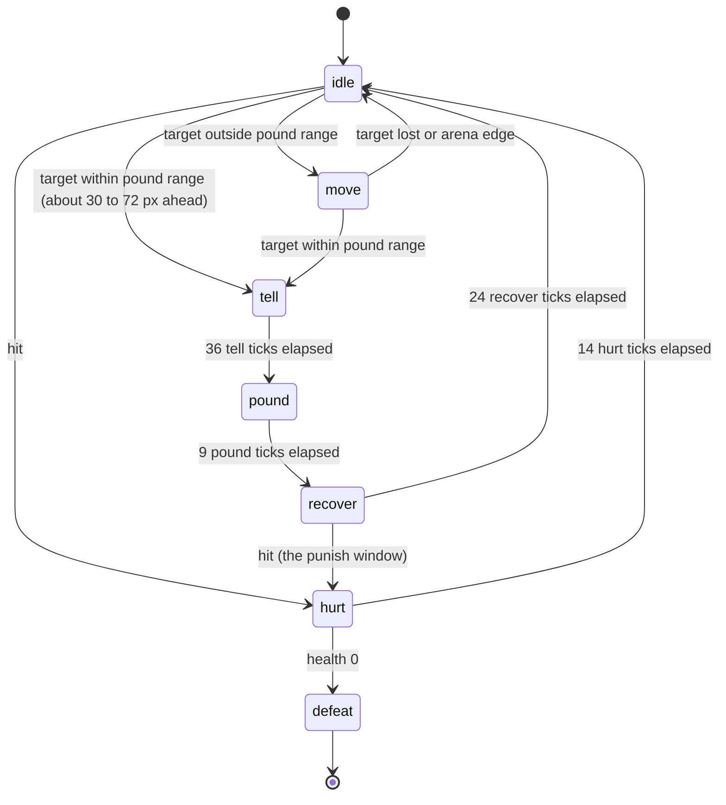

# JUICE-01: The Juicer (boss) readability set, design spec

**Status:** designed: spec and all six keys (0, 3, 8, 10, 12, 15) drawn and frozen; key 0 passed the silhouette gate after the FIX-KEY0 pixel fixes (section 9). In-betweens (section 8) and execution pending. Independent review pending.

**Decision record:** height 100 px, frame 160 x 136, pivot (72, 135). Proposed by the JUICE-01 designer within the orchestrator default (96 to 112 px); decided by: orchestrator default, pending owner confirmation.

The sections follow `docs/02-art/gob-01-goblin-spec.md`. The design step stops at the keys and this spec (see the top-tier budget in `docs/07-agents/agent-orchestration.md`).

## 1. Canon and tone constraints

- Approved concept: the Juicer panels of `assets/concept/floor-01/enemies/floor01-troglodyte-family-approved.png` (1448x1086 troglodyte family sheet; the Pygmy, Basher and Virtuoso panels are cropped out and belong to TROG-01). `assets/concept/floor-01/juicer-gym/` holds only the gym panorama (an environment reference with no Juicer figure); the encounter notes are `docs/02-art/floor-01-juicer-gym-standalone-concept.md`. No Juicer-only sheet and no dedicated Juicer face panel exist.
- Tone (`docs/01-design/antihero-tone.md`, enemies row): threatening yet eccentric, with motivated behaviors and readable tells and some absurd visual contrasts; never a purely serious faceless army and never comedic with no danger. 1980s-1990s action cinema is used for attitude only, never copied designs.
- Canon facts that must survive in pixels (from the approved docs and the concept board, not design decisions):
  - The same troglodyte species cues as the family (pale reddish-pink skin, long dark hair, pointed ears, wide fanged mouth with drool, ragged loincloth, barefoot), grotesquely enlarged.
  - Immense muscle mass swollen with red boils and swollen purple veins, chain cuffs or shackles at the wrists and a chain at the waist, a roaring open mouth.
  - Boss silhouette: a hunched, wide block with very large fists that reads as heavy at 1x.
- Design reading of the tone: a swollen gym bruiser gone wrong, the late-80s action-movie heavy who has been in the weight room too long: the muscle is lumpy and diseased (boils, veins), not sculpted; the head is small and sunk between the shoulders, the mouth hangs open and drools, the wrists still carry the iron he was chained with. He is pitiful and absurd up close and dangerous at range: the two huge fists and the slow, readable overhead pound are the threat. No heroic chest-out stance, no clean definition, no glamour lighting, no steroid or "juice" effect.

### Where the canon, size and mechanics are defined (checked 2026-11-18)

| Topic | Source | What it says |
| --- | --- | --- |
| Visual approval | `docs/02-art/floor-01-late-enemy-boss-concepts.md` line 15 and line 36; `docs/04-production/backlog.md` line 13 | The Juicer is an owner-approved exaggerated-muscle grotesque family boss, with the same troglodyte species cues; the concept covers lunge, pound, roar and facial poses, **not** engine-ready moves |
| Source scale | late-enemy doc line 25 | The book describes an immensely muscular troglodyte only **a little taller than Carl**; the concept's huge proportions are a presentation exaggeration; record the mismatch and decide a gameplay-readable scale independently |
| Scale authority | `docs/02-art/floor-01-juicer-gym-standalone-concept.md` ("Boss scaling note", "Art direction and continuity") | Verify the eventual runtime height against the novel and the approved character scales (Carl 52, Donut 40); the concept art deliberately exaggerates relative size |
| Boss arc | same doc ("Proposed Juicer boss arc") | Three beats (warm-up with stomp and charge, use the room, no rest) are a **design hypothesis**; "move lists and apparent weaknesses are gameplay adaptations, not verified book facts" |
| Combat role | `docs/01-design/combat-feel-hybrid-physics.md` line 81; `docs/01-design/combat-first-encounter-design.md` line 80; `docs/01-design/floor-01-gameplay-progression-v0.md` line 82 | Boss/heavy: strong telegraph and conditional stagger, not unlimited launch; physical spectacle; an overwhelming opponent that rewards props, timing and openings; moving features must stay comprehensible without show lighting |
| Rewards | `docs/01-design/character-progression-horizon.md` line 80; `docs/01-design/mvp-controller-contract.md` lines 49 and 65 | A cooperative climax; the gauntlet modifies Carl's fist attacks and Donut gains Puddle Jumper **after** the encounter. These are Carl and Donut abilities, not Juicer art |
| Setting | `docs/02-art/floor-01-art-atlas-v1.md` lines 14, 47 and 55 | Troglodyte territory in a gym with reception, turnstile, equipment, mirrors and heavy weights; do not infer a business logo, copyrighted signage or unverified gym gameplay |
| Size | none | No native size is recorded anywhere; the sheet's lineup shows the Juicer far larger than the other types, a printed scale that is not accepted |
| Production slot | `docs/07-agents/pixel-art-pipeline.md` lines 21, 51, 101 | Batch 9 (Gym), with AREA-GYM-01; every boss is route A + silhouette gate |
| Mechanics, hit points, damage, hitboxes | none | Not defined in any doc |

### What is NOT approved

- Native size, boss height, collider and hitbox dimensions; the sheet's proportions and the printed Carl 52 / Donut 40 labels.
- Move list, damage, hit points, weaknesses, stagger rules and the three-beat boss arc (a hypothesis). The lunge, pound and roar studies are poses, not an attack set.
- Any steroid, injection, "juice" or aura effect: none is drawn on the sheet and none is approved; do not invent one from the name.
- Environmental interactions with the gym props (candidate effects in the gym doc are not implemented or numerically approved), L3 structural collapse and corpse projectiles.
- The gym panorama is an environment reference. Its wall mural of a flexing bodybuilder and the banner and poster figures are set dressing, **not** the Juicer; do not take his design from them, and do not copy the banner text as final signage.
- Book accuracy of the sheet's anatomy; the sheet takes humanoid/horror liberties (late-enemy doc line 24).

### Guardrails (copied from the late-enemy and gym docs)

- Preserve the owner-approved troglodyte family cues; keep the Juicer distinct from the Ball of Swine arena and its rings.
- Record the book-versus-concept scale mismatch in the design (the book: a little taller than Carl; the sheet: several times his size) and decide a gameplay-readable size independently.
- Convert from original editable pixel grids / `.aseprite`, never by tracing or cropping the sheet. Do not repaint the approved image.

### Dependencies

- The family base design (TROG-01, PR #73, merged into this branch for phase 1) fixes the shared skin, hair, ear and fang construction; the Juicer should derive from it rather than be drawn first. Whether TROG-01 lands first is an orchestration decision.

### VFX and props to treat as separate work orders

- Pound impact: the sheet shows a ground-impact debris burst on the pound; a shockwave or debris effect is a separate VFX work order.
- Gym environment kit (AREA-GYM-01): reception desk and terminal, turnstile, bench press, dumbbells and plates, squat and cable machines, hanging punching bag, cracked mirrors, tires, banner, mural and neon tube. None of it belongs in the Juicer sprite set.
- Prop interaction states (toppled bench, swinging bag, shattering mirror, released weights): environment work orders tied to gameplay approval.
- Drool and sweat are small and may stay in the sprite; boils and veins are body detail.

### Packet inputs

- Concept crops in `docs/evidence/juice-01/packet/` (x,y,w,h in the 1448x1086 sheet):
  - `concept_crop_1.png` = `1005,135,435,335`: The Juicer, hero figure
  - `concept_crop_2.png` = `1045,515,395,165`: key study, lunge / pound / roar
  - `concept_crop_3.png` = `1180,745,268,295`: the Juicer in the sheet's scale panel (Carl and Donut cropped out)
  - No facial-study panel exists for the Juicer, and the gym panorama is not cropped.
- `scale_lineup.png`: Carl 52, Donut 40, goblin 36, plus three empty candidate slots at 72, 96 and 120 px for a boss next to Carl. 72 px is about 1.4 times Carl (nearest the book's "a little taller"), 96 px matches the Hoarder candidate range, 120 px matches the Dozer's body height. By eye the sheet draws the Juicer about 140 px tall at Carl's 52 px (about 190 px against Carl's 70 px in the 1448x1086 image); that is an exaggeration to be decided, not an approved size. The default 64 x 56 frame is a placeholder only.
- Readability set (tags): `idle` (2-4), `move` (4-6), `tell` (1-2), `attack` (2-3), `hurt` (1), `defeat` (2-3); about 12 to 20 frames. Concrete tag names and frame counts are the designer's choice (section 4 and `frame_pivot_template.json` carry the toolkit defaults).

## Difficulty and route

**Score 4 of 4 (3 certain, 1 depends on TROG-01): Boss, route A + silhouette gate** (top tier designs and draws every key; a fresh top-tier silhouette check on the idle key before any other key; budget one extra review round). Any boss lands in this class regardless of the score.

| Point | Met | Note |
| --- | --- | --- |
| 1. New design, not a variant | yes now | A dedicated boss; it would be a derivative of the troglodyte base if TROG-01 is merged first, so the point may fall away |
| 2. Native height above about 40 px | yes | Candidates 72 to 120 px |
| 3. Complex anatomy or construction | yes | Large mass with boils, veins, chains and a loincloth; very large fists |
| 4. VFX, projectiles, special states | yes | The pound shows a debris burst; the roar and charge are boss states beyond the readability set |

Reasoning: a boss at the largest size in the family with several overlapping parts and an impact effect; the silhouette gate matters because the risk is a Basher recolour or a generic bodybuilder read.

## 2. Size decision

Carl is 52 px (about 6 ft), Donut 40 px, the goblin 36 px (see `scale_lineup.png`); the troglodyte ladder (`trog-01-spec.md` 2b) is Pygmy 40, Basher and Virtuoso about 66, Juicer 84 or more and at least 20 % taller than the Basher (79 px or more). The idle opaque height is the top of the trapezius hump to the soles (the hunched head sits below it).

**Scale mismatch, recorded:** the book describes an immensely muscular troglodyte only a little taller than Carl (about 60 to 65 px); the approved sheet draws him about 140 px at Carl's 52 px (2.7x). The concept's proportions are a presentation exaggeration; the runtime height below sits between the two.

| Option | Idle opaque height | Ratio to Carl | Implied real height | Why / why not |
| --- | --- | --- | --- | --- |
| A | 72 px | 1.38 | about 8.3 ft hunched | Nearest the book, but below the family rule (79 px or more over a 66 px Basher): the boss would barely out-size his own minions. Rejected. |
| B | 96 px | 1.85 | about 11 ft hunched | Inside the orchestrator range; clearly the biggest troglodyte (1.45x the Basher); 27 % of the 360 px screen. |
| C | 120 px | 2.31 | about 13.8 ft hunched | Closest to the sheet, but above the Hoarder boss (112 px), a third of the screen before the tell raises the fists another 30 px, and frames of about 176 x 160. |

Decision: **100 px idle opaque height** (frame 160 x 136, pivot (72, 135)). Orchestrator default, pending owner confirmation. Reasoning: 100 px is 1.92x Carl and 1.52x the Basher, so the family ladder 40 / 66 / 100 has an even jump at each step and the boss out-masses the brutes by 34 px; it follows the approved concept's "several times bigger" read without the sheet's 2.7x; the tell's raised fists reach 128 px, still inside the 360 px screen with headroom for the gym ceiling; and it stays 12 px under the Hoarder's 112. Proposed by the JUICE-01 designer from the orchestrator's 96 to 112 px recommendation; decided by the owner (pending).

## 3. Frame, pivot, boxes and atlas

- Frame **160 x 136**, pivot **(72, 135)**, contact row **135** (the lowest opaque row of every grounded frame). Idle key 0 spans x -31 to +60 from the pivot and rows 36 to 135; the six keys together span x -65 to +67 and rows 5 to 135. Room: 72 px behind the pivot for the backward fall, 87 px ahead for the pound reach; rows 0 to 35 hold the raised fists of the tell.
- Grounded tags: `idle`, `walk`, `attack_tell`, `attack_pound`, `attack_recover`, `hurt`, `down`. Airborne tags: none (the pound is a standing smash; the lunge study is reserved for the boss-arc charge, a separate boss-state work order).
- Boxes are placeholders in px from the pivot (x forward, y up), to be re-measured on the drawn keys; not approved mechanics:

| Box | x | y | Frames |
| --- | --- | --- | --- |
| Standing (opaque extent, key 0) | -31 to 60 | 0 to 99 | idle |
| Hurtbox idle/walk (trunk, head, arms; not the hair ropes) | -24 to 44 | 0 to 96 | 0 to 6 |
| Hurtbox tell (arms up) | -24 to 30 | 0 to 120 | 7, 8 |
| Hurtbox pound and recover (folded low) | -20 to 60 | 0 to 70 | 9 to 11 |
| Attack hitbox (impact frame only) | 32 to 67 | 0 to 22 | 10 |
| Hurtbox hurt | -40 to 26 | 0 to 104 | 12 |
| Hurtbox down | -60 to 50 | 0 to 30 | 13 to 15 |

- Authored facing right; the runtime mirrors around the pivot column.
- One atlas `juice_01`, frames 0 to 15, one layer: `body` (the iron chains are part of the body layer, like the family's rag).

## 4. Readability-set animation list

Readability set: idle, move, tell, attack, hurt, defeat; 16 frames, 6 keys. Tick windows are at 60 Hz. A boss is slower and heavier than the family: longer holds, a 36-tick tell and a 24-tick recover (the punish window).

| Role | Tag | Frames | Playback | Ticks |
| --- | --- | --- | --- | --- |
| idle | `idle` | 0, 1, 2 | loop | 14 + 10 + 14 = 38 (slow heavy breathing) |
| move | `walk` | 3, 4, 5, 6 | loop | 4 x 8 = 32 (a heavy stomp, half the Pygmy's cadence) |
| tell | `attack_tell` | 7, 8 | once | 8 + 28 = 36 |
| attack | `attack_pound` | 9, 10 | once | smear 3, impact 6 (the hitbox is active on exactly the impact ticks) |
| attack recover | `attack_recover` | 11 | once | 24 |
| hurt | `hurt` | 12 | once | 14 |
| defeat | `down` | 13, 14, 15 | hold | 6 + 10 + hold |

Attack timeline (ticks from the tell start): tell 0 to 35, smear 36 to 38, impact and hitbox 39 to 44, recover 45 to 68.

Frame table:

| # | Tag | Pose | Ticks | Author |
| --- | --- | --- | --- | --- |
| 0 | `idle` | Settled hunch, fists hanging at knee height ahead of the feet, growl (drawn, frozen) | 14 | key |
| 1 | `idle` | Breath in: trunk, head and hump 1 px up, fists 1 px back, ropes 1 px down | 10 | in-between |
| 2 | `idle` | Breath out: as 0 with the gut 1 px lower and the fists swung 1 px forward | 14 | in-between |
| 3 | `walk` | Contact: near foot planted forward, far foot back, near fist swung back, far fist forward, trunk dropped 2 px | 8 | key |
| 4 | `walk` | Passing: feet together under the hips, trunk up 2 px, fists level | 8 | in-between |
| 5 | `walk` | Contact B: mirror of 3 (far foot forward, near fist forward) | 8 | in-between |
| 6 | `walk` | Passing B: as 4 with the fists crossing the other way | 8 | in-between |
| 7 | `attack_tell` | Rise: torso straightening, both fists pulled to the chest, mouth opening | 8 | in-between |
| 8 | `attack_tell` | Roar hold: both fists raised overhead, chest up, head back, 4-row roar | 28 | key |
| 9 | `attack_pound` | Smear: fists half-way down in front of the face, body folding | 3 | in-between |
| 10 | `attack_pound` | Impact: both fists on the floor ahead of the feet, trunk folded flat, head low | 6 | key |
| 11 | `attack_recover` | Spent: fists still on the floor, rump up, head lifted, panting mouth | 24 | in-between |
| 12 | `hurt` | Recoil back, head above the hump, eye slit | 14 | key |
| 13 | `down` | Fall beat: knees buckling, arms flung, falling backward | 6 | in-between |
| 14 | `down` | Floor impact: back on the floor, legs up | 10 | in-between |
| 15 | `down` | Settled on his back, crossed eye, tongue out | hold | key |

## 5. State diagram



Whether the tell can be interrupted (stagger) is a gameplay decision, not set here (`combat-feel-hybrid-physics.md`: conditional stagger only).

## 6. Palette

`trog-family-v0` core (15 colours, imported from `scripts/author_trog01.py`, never recoloured) plus 4 Juicer keys: **19 of 20**, one slot left free. The packet's 24 candidates are mostly background navy; the warm pinks and reds of the sheet are already covered by the family skin ramp, so no candidate is taken directly. `#c84a39` and `#a54938` informed the boil red (cooled and pushed toward crimson so it separates from the eye-red accent `e` and from the orange brick); the purple veins and grey iron are picked by eye from the hero panel.

| Key | Name | Hex | Role |
| --- | --- | --- | --- |
| `K` `d` `s` `m` `l` | family outline and skin ramp | see `trog-01-spec.md` 6 | outline, skin volumes (lit upper left) |
| `H` `I` | hair | family | mop and rope dreads |
| `c` `C` | cloth | family | the ragged loincloth |
| `w` `e` `t` `T` `o` `q` | accents and mouth | family | eye white and drool, red eye rim, teeth, mouth, boil highlight (`q`) |
| `b` | boil_red | `#b3283a` | swollen boils: 2 to 3 px discs on the shoulders, back, arms and thigh, `q` highlight on the torch side |
| `v` | vein_purple | `#5d3878` | 1 px swollen vein strands on lit and mid skin (forearm, biceps, chest, thigh) |
| `i` | iron_deep | `#353a48` | wrist cuffs and chains, shade and dark links |
| `j` | iron_light | `#8b93a6` | lit chain links (alternating every 2 px so the iron reads as links) |

No steroid, injection, "juice" or aura colour; the gym's magenta light belongs to the environment.

## 7. Key poses

Design units are px right of the pivot column and up from the contact row. All six keys are drawn by `scripts/author_juice01.py` (`POSES`) and frozen (`tests/fixtures/juice-01_keys.json`). The grid now holds the full 16-frame atlas: the keys sit at their atlas indices 0, 3, 8, 10, 12, 15 (`juicer.key_atlas_index` in the manifest) and the fixture entries were moved to those indices; the SHA-256 values did not change.

Construction (2b, redrawn at 100 px): head width about 0.21 H (skull radius 7.5, jaw 7.0; smaller than the Basher's 0.25 H); in the idle the jaw centre sits 19 px below the hump top and 26 px ahead of it, sunk between the trapezius and the near deltoid. Every muscle mass is a disc or thick line shaded from its own surface normal, so the body reads as lumps and creases. Hair: a mop with two 1 px notches in the dome and a ragged 3-strand fringe over the brow, seven rope dreads of radius 1.5 (three down the back of the skull, two draped over the hump that break its back outline, one short front lock, one falling in front of the cheek behind the mouth). Ear: swept back and up, tip 4 to 5 px outside the mop, inner line `s`. Fists: radius 11 to 11.5 (as wide as the head), three `d` knuckle creases (`K` where they cross shadow) on the knuckle face, a thumb wrapped over the index knuckle as its own outlined part; the far fist uses the `farfist` ramp (`K d s m`, one step darker than the near fist) with two `K` creases. Iron: a cuff on each wrist, a broken chain from the back end of the near cuff dropping behind the fist, a chain across the hips. Boils, veins and grime are anchored to the named masses (`BOILS`, `VEINS`, `GRIME`) so every key carries the same body detail; boils of radius 2 or more have a light-skin highlight upper left, a `q` inner rim and a `d` rim under the lower edge.

| Atlas frame (grid) | Tag | Silhouette and pose notes (as drawn) | Readability reason |
| --- | --- | --- | --- |
| 0 (0) | `idle` | Rows 36 to 135 (100 px), x -31 to 60. Legs planted wide (feet (-11, 1.5), (21, 1.5); knees (-23, 18), (13, 19)); trunk hips (-8, 36) to (-1, 82); masses glute (-15, 38), lat (-10, 68), gut (8, 45), pec (13, 63), trapezius hump (2, 87) as the top; head jaw (28, 80); near arm (9, 70) to (31, 38), fist (36, 26) r 11.5 knuckles at -20 degrees; far arm (14, 68) to (45, 42), far fist (51, 36) r 9 ahead of and above the near one. Growl: 3-row gape, 2 px lower fangs, two drool strands (35 `o`). | A hunched wide block, a small sunk head with dreads and a pointed ear, two countable fists at the front. |
| 3 (1) | `walk` | Rows 38 to 135, x -32 to 63. Trunk 2 px lower, 3 px forward; near foot planted forward at (31, 1.5), far foot pushing off at (-19, 1.5) with the ankle back at (-27, 5); near fist (32, 24) at -35 degrees, far fist swung forward to (54, 33); head (31, 78); ropes sweep 0.4. | The stride opens the legs into a wide A under the same block: a heavy stomp, never a run. |
| 8 (2) | `attack_tell` | Rows 5 to 135 (131 px), x -34 to 36. Torso straightened (hips (-6, 38) to (-1, 84)), hump (0, 90); near arm straight up (6, 82) to (14, 110), fist (16, 118) r 11; far arm (-6, 84) to (-12, 110), far fist (-10, 118) r 9.5: a V of fists over the head; head (28, 86) with the dropped jaw and the 7-row roar (82 `o`, tongue, fangs, drool); hair turned 12 degrees back; legs braced (feet (-16, 1.5), (27, 1.5)). | The tallest frame by 31 px and the only one with both fists above the head: "the hammer is up", held 28 ticks. |
| 10 (3) | `attack_pound` | Rows 65 to 135 (71 px), x -40 to 67 (108 px wide). Trunk folded flat forward from the raised rump (-14, 40) to the shoulders (14, 56); near arm (22, 52) to (40, 18), fist on the floor (44, 11) r 11, knuckles down; far fist (57, 10) r 9.5 ahead of it; head low at (40, 46) between the arms, still roaring (83 `o`); far leg stretched back to (-35, 6); ropes thrown forward (sweep -0.3). | The lowest standing frame and the widest: the fists are on the floor exactly where the hit lands. |
| 12 (4) | `hurt` | Rows 23 to 135, x -51 to 32. Trunk tilted back from the hips (-4, 36) to (-14, 80), neck mass (-3, 88); head thrown up and back to (4, 96), above the hump, hair turned 18 degrees with the ropes whipped forward (sweep -0.6); both arms flung back at shoulder height, open fanned hands at (-38, 86) and (-36, 100); eye a `K` slit, no red, pain mouth; weight on the back foot (-13, 1.5), near foot light at (28, 1.5). | Arms and hands go back, the head goes up: the only frame whose silhouette leans away from the player; open hands, nothing points forward. |
| 15 (5) | `down` | Rows 100 to 135 (36 px), x -65 to 54. On his back, fallen backward: hips (10, 10), hump (-30, 12), trapezius (-34, 12); head (-44, 9) behind with the chin toward the chest and the mop turned 75 degrees and spilled on the floor; near knee up at (24, 25), far leg flat out to (50, 1.5); near arm slack along the floor, fist (6, 8) by the hips; far fist (-56, 8) behind the head; crossed eye, tongue out. | Lowest and longest; the red eye is gone; continuous with the backward recoil. |

## 8. In-between list

Values for the executor, in the same `POSES` dict format (design units); no design decisions. Every in-between keeps the key's masses, boils, veins, grime, cuffs and chains (they follow the anchors). Shift = add (dx, dy) to every point of the listed parts.

| Atlas # | From | Pose values |
| --- | --- | --- |
| 1 | `idle0` | Breath in: torso, blobs, near_arm, arm_blobs, far_arms, head_at +(0, 1); fist and far_fist +(-1, 1); hair `sway`-free (ropes follow the head); legs, loin and feet unchanged. Ticks 10. |
| 2 | `idle0` | Breath out: blob `gut` +(0, -1); fist and far_fist +(1, 0); everything else as key 0. Ticks 14. |
| 4 | `walk3` | Passing A: near leg planted [(2, 34), (10, 20), (2, 5), (12, 1.5)]; far leg swinging and lifted [(-12, 34), (-4, 18), (-8, 9.5), (0, 6)] (no pixel on the contact row); trunk, blobs, arms and head +(-1, 2) from `walk3`; fist (30, 27), far fist (52, 35); hair sweep 0.2. Ticks 8. |
| 5 | `walk3` | Contact B (the mirror of key 3's stride, about 28 px toe to toe): far leg planted forward [(-11, 32), (2, 18), (12, 5), (20, 1.5)]; near leg back [(3, 32), (-4, 17), (-18, 5), (-8, 1.5)] with the ankle behind the toe as in key 3; fist (40, 30) forward, far fist (46, 26) back; rest as `walk3`. Ticks 8. |
| 6 | `walk3` | Passing B (not a copy of 4): far leg planted [(-12, 34), (-4, 20), (-8, 5), (0, 1.5)]; near leg swinging and lifted [(2, 34), (12, 19), (2, 9.5), (12, 6)]; trunk as atlas 4; fist (35, 26), far fist (49, 33); hair sweep 0.2. Ticks 8. |

Walk gait (blind review D1): key 3 keeps its frozen wide stride. The planted foot travels evenly, toe points near 31, 12, -8 and far 0, 20, 0, -19, so each 8-tick frame moves the planted foot 19 to 20 px back, including the 6 to 3 seam (far foot 0 to -19). The swinging foot is lifted (toe at y 6, about 2 px clear of the contact row) on both passing frames. Matching runtime walk speed: about 2.4 px per tick, about 146 px/s at 60 Hz. V16 walk `max_px` is 20 (the Pygmy-proportional limit would be 22.5).
| 7 | `idle0` to `tell8` | Rise: torso, blobs, legs at the midpoint of the two keys; near_arm [(8, 76), (16, 74), (18, 84)], fist (20, 90) at 60 degrees; far_arm [(-2, 80), (-6, 88), (-2, 92)], far fist (2, 96) at 80 degrees; head (28, 84), tilt -1, face `growl` with `jaw_drop`. Ticks 8. |
| 9 | `tell8` to `pound10` | Smear: torso at 0.6 of the way to `pound10` (hips (-11, 39), shoulders (8, 66)); near_arm [(16, 70), (30, 66), (40, 56)], fist (44, 48) at 0 degrees; far_arm [(18, 74), (36, 66), (50, 56)], far fist (54, 50); head (36, 66), face `roar`, `jaw_drop`; legs as `pound10`. Ticks 3. |
| 11 | `pound10` | Recover (punish window): as `pound10` with the head +(0, 6), tilt -2, face `growl` without `jaw_drop` (`o` at most the idle count), traps and lat +(0, 3), rump (glute) +(0, 2); fists stay planted. Ticks 24. |
| 13 | `hurt12` to `down15` | Fall beat: the midpoint (t 0.35) of every listed point of the two keys; face `pain`; hair turn 40. Ticks 6. |
| 14 | `hurt12` to `down15` | Floor impact: t 0.8 of every point; near knee +(0, 4); face `dead`; hair turn 65. Ticks 10. |

## 9. Validators and readability rules

Run by `python3 -m scripts.pixelart validate assets/source/characters/troglodyte/juicer/juice_01.pixelart.json` (16 frames; the rules are indexed by atlas frame).

- V04 palette: at most 20 colours (19 used); V05 isolated pixels: 0; V06 orphan pixels: at most 40 per frame (boil highlights, knuckle creases and eye pixels are single-pixel details on a 100 px body).
- V07 contact rows: every frame is grounded and ends on row 135.
- V09 frozen keys: SHA-256 per key frame, fixture `tests/fixtures/juice-01_keys.json` (all six keys).
- V13 bbox: `size-idle-100px` (rows 36 to 135); walk not taller than the idle; the tell top row 16 or less (drawn 5); the pound top row 62 or more and width 100 or more (drawn 65, 108); the hurt top between rows 17 and 30 (drawn 23, so it never matches the tell); the defeat top row 100 or more.
- V14 key counts: R1 the idle and walk eye has at least 3 `e`; R2 the tell and pound have at least 70 `o`, the idle and walk at most 40 (drawn 82 to 83 against 35); R5 hurt and defeat have no `e`, defeat has at least 4 `q`; R6 at least 40 `b` boil pixels in every frame but the defeat; R7 at least 20 `j` iron pixels in every frame but the defeat.

**Acceptance targets (for the independent review):**

1. At 1x on lit Floor 1 brick next to Carl and the Pygmy (`key0-scale.png`), the idle reads as a troglodyte (pink skin, black dreads, fanged open mouth, pointed ear, rag) and as the family's boss: hunched, wide, two huge fists, never a Basher recolour and never a clean bodybuilder.
2. Boils, veins and the iron cuffs and chains are visible at 1x as texture without turning into noise; no steroid, injection or aura.
3. The tell (fists overhead, roar) is the tallest frame and the pound impact the lowest and widest: the tell-to-attack read works in silhouette alone (`keys-x3.png`).
4. Grounded, grimy and pitiful-absurd: the swollen mass, small sunk head and drool undercut any heroic read.

### Silhouette gate on key 0 (FIX-KEY0), applied

Mass, 100 px size and tone passed; the head and the fists failed. Applied: (1) ragged 3-strand fringe and two 1 px notches in the dome; (2) ropes past the head: one in front of the cheek to about y 73, two draped over the hump breaking its back outline; (3) the ear tip 4 to 5 px outside the mop with an inner `s` line; (4) near fist knuckle creases, an outlined thumb over the index knuckle, the fist as its own outlined part; (5) the broken chain re-routed from the back end of the cuff, behind the fist; (6) far fist moved to (51, 36) on a lighter far-fist ramp with two creases; (7) raised boils (highlight, inner rim, lower dark rim); (8) the growl gape is 3 rows with 2 px lower fangs (35 `o`, well under half the roar's 82).

## 10. Evidence

- `docs/evidence/juice-01/key0-scale.png`: key 0 at 1x on lit Floor 1 with Carl and the Pygmy, plus a 4x copy on the side (`python3 scripts/author_juice01.py key0-scale`, needs `bash scripts/export_assets.sh`).
- `docs/evidence/juice-01/keys-x3.png`: the six keys in atlas order, three per row at 1x on lit Floor 1, enlarged 3x (`python3 scripts/author_juice01.py keys-x3`).
- Phase 2 (done): `docs/evidence/juice-01/` holds the toolkit evidence (GIFs, contact sheets, strip, lit scenes, SHA256SUMS) and `review-pack/` holds the three review images plus `validator_summary.txt`; commands: (contact sheet x4, lit scene, tell-to-attack strip) and the validator report:

```text
python3 -m scripts.pixelart validate assets/source/characters/troglodyte/juicer/juice_01.pixelart.json --out <dir>
python3 -m scripts.pixelart review-pack assets/source/characters/troglodyte/juicer/juice_01.pixelart.json --out <dir>
```

### Executor notes (in-betweens, 16 frames)

- Pose rig in `scripts/author_juice01.py` (`lerp`, `shift`, `arms_follow`, `set_calf`, `fit_arm_blobs`); each in-between is a `POSES` entry built from the section 8 values, no hand pixel edits. Loin and waist chain follow the trunk shift or the hips midpoint; the calf disc is placed between knee and ankle; arm blobs follow the arm points (the keys' rule).
- Walk (V16 opt-in): `rules.foot_drift` is on for `walk` with `max_px` 12. The section 8 foot values give a measured worst planted-foot step of exactly 12 px (contact 3 to passing 4, and the seam 6 to 3); the family's Pygmy limit is 9 at a 40 px height. 12 px per 8 ticks (90 px/s) is the stride of the listed values for a 100 px body; the limit was set to the measured value rather than moving the feet. Open point for the designer: a shorter contact stride would allow 9.
- Walk weight: the passing frames rise 2 px over the contacts (bob, as section 8) and the arm ends, forearm blob and far arm follow the fist swing (section 8 lists fists only) so the arm swing is visible; contact B 5 keeps the trunk of key 3 (as listed), so 3 and 5 differ by legs and fists only.
- Frame 7 (rise): the listed near arm and fist (x 8 to 20) put the wrist cuff across the mouth, since the head is at (28, 84). Both were drawn 6 px further back (arm (2, 76), (10, 74), (12, 84), fist (14, 90)); every other value as listed. Designer may re-set this.
- Frames 13 and 14: the keys differ in hand form (open hands in 12, fists in 15). Frame 13 keeps the open hands at the t 0.35 position; frame 14 uses the fists at t 0.8 (the hand palm and the fist centre interpolated, radii and angles blended). The `neck` blob of key 12 is dropped (it has no counterpart in key 15). Hair sweep goes from -0.6 to its blend.
- Frame 11 uses the growl face without `jaw_drop` (35 `o`, the idle count); frame 7 also uses the growl with `jaw_drop` (35 `o`).
- Review fixes (E1 to E3, walk and keys untouched): E1 the lit scene actors moved (idle x 550, tell 660, pound 770, down 890) so the idle Juicer stands about 25 px clear of Carl's right side instead of covering him. E2 frame 13: the head sits at t 0.25 (above the shoulders), the near arm is flung back and down with the open hand clear of the face, and the rag is a tapered hanging cloth (`tapered_rag`). E3 frame 14: the face is `dead_quiet` (key 15's crossed eye and tongue without the loose tooth pixels), and both hands are loose, half-closed fists, the near one drawn in front of the hips on a re-set arm and the far one behind the head.
- Validator rules re-indexed to the atlas: the R2 roar minimum applies to frames 8 to 10, the growl maximum to 0 to 7 and 11; R5 to 12 to 15; the tongue rule to 14 and 15; R6 and R7 to 0 to 12. New bbox guards for frames 7, 9, 11, 14 (measured with margin). V08 and V10 are not configured (every tag is grounded; one layer).

## 11. Files

| File | Role |
| --- | --- |
| `scripts/author_juice01.py` | deterministic authoring script (`frames [--check]`, `key0-scale`, `keys-x3`) |
| `assets/source/characters/troglodyte/juicer/juice_01.grid.json` / `.ase` | pixel-grid source and Aseprite master (`scripts/pixel_grid_to_ase.py build`) |
| `assets/manifests/juice-01.json` | manifest |
| `assets/source/characters/troglodyte/juicer/juice_01.pixelart.json` | the asset config |
| `tests/fixtures/juice-01_keys.json` | frozen keys |
| `tests/test_art_juice01.py` | generator, frozen keys, size, frame, tell/pound silhouette and palette-core tests |

## 12. Rights and provenance

Fan-concept art under the owner-reported `ART-PUBLICATION-ALL-V1` scope (see `docs/04-production/rights-and-release.md`). No tracing of the concept, no image-model raster output.

### Rights/Provenance

- Concept: owner-approved reference under `ART-PUBLICATION-ALL-V1`; crops are for reference only, never traced or exported.
- Packet: script output plus a medium-tier executor (stage P).
- Spec and keys: Claude Opus (spec, all six keys, the FIX-KEY0 fixes). Silhouette gate on key 0: an independent top-tier reviewer (FIX-KEY0, fixes applied). In-betweens and execution: Claude Sonnet. Independent review: pending.
- No third-party assets, no copied designs or dialogue, no image-model raster output.

### Separate work orders (noted, not drawn)

- Pound impact debris burst or shockwave (VFX).
- AREA-GYM-01 gym prop kit (reception, turnstile, bench, weights, machines, punching bag, mirrors, tires, banner, mural, neon).
- Prop interaction states (toppled bench, swinging bag, shattering mirror, released weights).
- Boss-arc states beyond the readability set: the lunge (charge) and the standalone roar.
