# LLAMA-01: Bad Llama readability set, design spec

**Status:** fix round 2 done (sections 16 and 17): the pinned ears lie along the neck (keys 8, 9, 11 re-frozen), the far ear is one step lighter, the plume tail tip is consistent, and the scene-only mirror-lit grid is removed. Validators pass; independent re-review of this round pending. Roles and models are recorded only in section 12.

**Decision record:** height 64 px, frame 96 x 72, pivot (44, 71), unchanged by fix round 1. Proposed and keyed by the design tier; decided by the independent top-tier review, then the owner at the end (see section 2).

The sections follow `docs/02-art/gob-01-goblin-spec.md`. The design step stops at the keys and this spec (see the top-tier budget in `docs/07-agents/agent-orchestration.md`).

## 1. Canon and tone constraints

- Approved concept: `assets/concept/floor-01/enemies/bad-llama-c-plus-a-approved.png`; the roster (`docs/02-art/floor-01-enemy-concept-roster.md`) records the **C+A approved blend** (dynamic aggressive body from C, long expressive neck from A, yellow teeth, glowing-throat wind-up) and lists native pixel master, scale and animations as pending. `bad-llama-abc-exploration.png` is historical and superseded.
- Tone (`docs/01-design/antihero-tone.md`, enemies row): threatening yet eccentric, with motivated behaviors and readable tells and some absurd visual contrasts; never a purely serious faceless army and never comedic with no danger. 1980s-1990s action cinema is used for attitude only, never copied designs. In pixels: a mangy, matted farm animal with a permanent snarl and bad teeth, not a mascot and not a demon; the danger is entirely in the throat glow.
- Canon facts that must survive in pixels (from the approved docs and the concept board, not design decisions):
  - Llama silhouette: long expressive neck, long ears, muzzle in profile (board checklist, copied as concept intent).
  - Large ugly yellow teeth; mean, darkly funny face.
  - Glowing throat as the wind-up telegraph before the lava spit.
  - Shaggy tan fur with dark mangy patches; the board calls it horse-sized and dungeon-appropriate (not a size decision).

### Guardrails (copied from the roster and minor-enemy docs)

- Scales printed in the board (Carl about 1.8 m, llama about 2.7 to 3.0 m at the head, silhouette comparison) are **not** approved native sprite sizes.
- Board text calling the throat "hot, vulnerable" is a concept caption, not an approved weak-point mechanic. Spit range, speed, damage, projectile behavior and stagger rules are not approved by the concept.
- The "hit reaction / stagger (strong kick, Carl style)" panel and the spit projectile are concept illustrations; do not derive combat rules from them.
- **Scope decision (orchestrator):** one minimal spit projectile (tag `spit`, 2 frames) is part of LLAMA-01 because the attack does not read without it. Impact splash and floor residue VFX are out of scope.
- Convert from original editable pixel grids / `.aseprite`, never by tracing or cropping the illustrated board into runtime sprites.
- No pre-Guild Donut spells, Carl shotgun, or story-premature equipment may be introduced because the board suggests it.

### Packet inputs

- Concept crops in `docs/evidence/llama-01/packet/` (x,y,w,h in the 1672x941 concept): `concept_crop_1.png` idle stance, `concept_crop_2.png` wind-up (throat glows), `concept_crop_3.png` spit launch.

## 2. Size decision

Carl is 52 px (about 6 ft), Donut 40 px, the goblin 36 px (see `scale_lineup.png`). The three options are the same idle rig rasterized natively at each height (`assets/source/characters/llama/llama-01_size_study.grid.json`, frames 0 to 2; `python3 scripts/author_llama01.py size-study`). Measured heights include the unscaled face stamps.

| Option | Idle opaque height | Ratio to Carl | Implied real height | Why / why not |
| --- | --- | --- | --- | --- |
| A | 56 px (57 measured) | 1.08 | about 2.0 m at the ears | Back line sits at Carl's chest; reads as a large dog or goat. The head is only 1 px larger than Carl's, so the teeth and eye collapse to 2 to 3 px. Rejected. |
| B | **64 px** | **1.23** | **about 2.25 m at the ears** | Back line (row 34 after fix round 1, was 31) at Carl's upper chest, ears 12 rows above Carl's head top (row 20), so the long neck and head tower over Carl; a 67 px long idle body: a dangerous quadruped. 20 % of the 360 px screen height, so two llamas plus Carl and Donut still fit a 640 px wide fight. Teeth 7 px wide, eye socket 6 px, throat glow 50 to 130 px of hot pixels. **Chosen.** |
| C | 72 px (72 measured) | 1.38 | about 2.55 m | Closest to the board's printed horse scale, but 80 px long; at 640 x 360 it fills a quarter of the screen width in the attack pose (90 px) and starts to read as a mini-boss, which Floor 1 common enemies are not. Rejected. |

Decision: **64 px idle opaque height** (rows 8 to 71 of frame 0). It is the smallest height at which the face (teeth, socketed eye) and the throat stripe stay readable at 1x, and it keeps a clear class gap above Carl (52) without the screen-filling mass of option C. Proposed by the design agent; the decider is the independent top-tier review, then the owner at final review.

## 3. Frame, pivot, boxes and atlas

- **Frame 96 x 72, pivot (44, 71), contact row 71** (the lowest opaque row of every grounded frame). Pivot x is midway between the idle hind and fore hooves (x 28 to 61), so the body mass is centred when mirrored.
- Grounded tags: `idle`, `walk`, `attack_tell`, `attack_swing`, `hurt`, `down`. Airborne tags: none. Free (not contact-checked): `spit`.
- **Standing box** 46 x 39 at frame x 18 to 63, rows 33 to 71 (fix round 1) (barrel and legs; neck and head excluded so the llama does not body-block with its face).
- **Hurtbox** (proposal, two rects): body = the standing box; head and neck = 22 x 33 at frame x 54 to 75, rows 8 to 40 in idle (fix round 1). Both follow the pose bbox of the current frame in a later gameplay work order; the throat is **not** a weak point (not approved).
- **Attack hitbox:** the llama itself has no melee hitbox in this work order. The **spit projectile** has an 8 x 6 hitbox at frame x 86 to 93, rows 23 to 28 (its hot core), live while the projectile entity exists.
- **Spit spawn contract:** on the first tick of frame 9 the runtime spawns a separate projectile entity drawn with the `spit` tag using the **same pivot (44, 71)** at the llama's position; the glob is authored at its spawn point (core about (90, 26), pivot offset (+46, -45)), and the entity then translates on its own. Mirror with the llama's facing. Speed, range and damage are gameplay decisions, not art.
- Authored facing right; the runtime mirrors around the pivot column.
- **One atlas, frames 0 to 16, one layer `body`.**

## 4. Readability-set animation list

Tick windows at 60 Hz (`llama-01.pixelart.json` is the source of truth).

| Role | Tag | Frames | Playback | Tick windows | Note |
| --- | --- | --- | --- | --- | --- |
| idle | `idle` | 3 | loop | 14 + 10 + 14 = 38 | slow, heavy breathing with a chew |
| move | `walk` | 4 | loop | 4 x 6 = 24 | diagonal gait; one stride per 24 ticks |
| tell | `attack_tell` | 2 | once | 8 + **22** = 30 | glow peak held 22 ticks (at least 18 required) |
| attack | `attack_swing` | 2 | once | 6 + 14 = 20 | projectile spawns on tick 0 of frame 9; frame 10 is the recover |
| hurt | `hurt` | 1 | once | 12 | |
| defeat | `down` | 3 | hold | 6 + 8 + hold | frame 14 is the state-driven hold |
| (fx) | `spit` | 2 | loop | 4 + 4 | separate projectile entity |

| # | Tag | Pose | Ticks | Author |
| --- | --- | --- | --- | --- |
| 0 | `idle` | snarl, neck upright S-curve, head high, ears pricked forward | 14 | **key** |
| 1 | `idle` | inhale: barrel and head up 1 px | 10 | executor |
| 2 | `idle` | exhale, jaw drops 1 px, head back 1 px | 14 | executor |
| 3 | `walk` | contact A: near fore forward, near hind back, body down 1 px | 6 | **key** |
| 4 | `walk` | passing A: far fore and near hind lifted | 6 | executor |
| 5 | `walk` | contact B: far fore forward, far hind back | 6 | executor |
| 6 | `walk` | passing B: near fore and far hind lifted | 6 | executor |
| 7 | `attack_tell` | anticipation: half-rear, glow starting | 8 | executor |
| 8 | `attack_tell` | **glow peak**: reared, cheeks and throat puffed, clenched teeth | 22 | **key** |
| 9 | `attack_swing` | **spit release**: neck thrust level, jaw dropped, mouth flash | 6 | **key** |
| 10 | `attack_swing` | recover: mouth half shut, glow cooling | 14 | executor |
| 11 | `hurt` | head thrown back, eye squeezed, fore hoof lifted | 12 | **key** |
| 12 | `down` | fore knees fold onto the floor, rump sags, head and ears drop | 6 | executor |
| 13 | `down` | floor impact, head and tail still up | 8 | executor |
| 14 | `down` | **final**: flat on the belly, neck and head on the floor, X eye, teeth out | hold | **key** |
| 15 | `spit` | **glob**: hot core, cooling skin, crust tail, one drip | 4 | **key** |
| 16 | `spit` | glob wobble: stretched 1 px, tail 1 px longer | 4 | executor |

## 5. State diagram

```mermaid
stateDiagram-v2
    [*] --> idle
    idle --> move: target outside spit range, path clear
    move --> idle: target lost or blocked
    idle --> tell: target in spit range and line of sight, cooldown ready
    move --> tell: target in spit range and line of sight, cooldown ready
    tell --> attack: 30 tell ticks elapsed (frame 9 tick 0 spawns the spit)
    attack --> idle: 20 attack ticks elapsed
    idle --> hurt: hit
    move --> hurt: hit
    tell --> hurt: hit (cancels the spit; no projectile)
    hurt --> idle: 12 hurt ticks elapsed
    hurt --> defeat: health 0
    defeat --> [*]
```



Ranges and the cooldown are gameplay parameters for a later work order; whether a hit during `tell` cancels the spit is a proposal for the gameplay spec, drawn here because the art supports it (frame 11 has no glow).

## 6. Palette `llama-floor01-v0` (17 of at most 20 colours)

Chosen by eye for the A1 lighting (warm torch key from the upper left, cold ambient). Fur is pale and desaturated so it separates from the saturated orange brick by value; shadows cool toward plum. The glow ramp is the only saturated hot family on the body, and its core `Y` is the brightest key in the atlas, so the tell reads first.

| Key | Name | Hex | Role |
| --- | --- | --- | --- |
| K | outline | `#1a1016` | 1 px outline outside the fill; brow, eye socket, tooth gaps |
| a / s / m / l / L | fur deep / shade / mid / light / top | `#3a2a32` `#6e4e44` `#a37c58` `#cfab7c` `#ecd3a4` | wool ramp; L only on torch-facing edges |
| p | mange | `#4f2c26` | ragged matted streaks (rump, flank, haunch) |
| h | hoof | `#4a3c44` | hooves |
| T / t | tooth / tooth_shade | `#e6c447` (accent) `#9c7a26` | big yellow buck teeth, K gaps between them |
| o / g | mouth / gum | `#4a1020` `#a2404a` | mouth interior; g reserved for the gum line and tongue in in-betweens |
| e | eye | `#f1ead0` (accent) | eye white, always framed by K |
| r / R / O / Y | glow deep / mid / hot / core | `#8c1e12` `#e2491c` `#ff9d2e` `#ffe680` (Y accent) | throat glow, mouth flash, spit projectile |

Packet candidates: the 15 navy candidates (#1-5, 8, 10, 12, 15, 18, 20, 21, 24) are background and rejected. The orange-brown candidates `#753d29`, `#a24727`, `#d47d48`, `#651b17` sit too close to the brick and were rejected for fur. `#e09a63`, `#edb175`, `#a76640` informed the fur ramp but were lightened and desaturated; `#0e0d12` informed the outline; `#3e272a`, `#251c20`, `#453537` informed `a` and `p`. No colour is sampled from the concept.

## 7. Key poses (as authored, frozen; design fix round 1)

All keys are generated by `scripts/author_llama01.py keys` from one rig (pose dicts `IDLE`, `WALK_CONTACT`, `TELL`, `SPIT`, `HURT`, `DEAD`, function `spit()`); coordinates below are frame pixels. Rig rules shared by every frame since fix round 1:

- **Neck** is a chain of 2 or 3 points (`poly()`); `neck_r` gives one radius per point (or start and end). The mane shag sits on the back edge of every segment and the glow axis runs over the whole chain. Standing frames use 3 points (S-curve: the lower neck leans forward out of the withers, the upper neck is near-vertical, the head bends forward); the tell, release and down frames use 2.
- **Ears** are 3-point bananas (base in the skull, bend, tip), radius 1.8 to 1.0 (`ear_r`), far ear 0.2 thinner in the `far` group, filled with the flat `s` shade (fix round 2: one step lighter than the former `s`/`a` mix). Ear attitude is part of the acting: **pricked up and forward** (tips forward of the bend) in idle and walk; **pinned back** (fix round 2: about 6 px long, laid along the back of the skull and the upper neck below the skull's top line, tip at or just behind the neck outline, with a 1 px dark ring on the neck side) only on tell, release and hurt; limp on the floor in defeat.
- **Body** is lean: barrel capsule radius 5.5 at the rump to 6.5 at the chest (`barrel_rr`), a small chest-forward belly (8 x 4), and separate hip (6.5 x 7) and shoulder (5.5 x 7.5) masses whose tops sit 1 to 1.5 px above the back line, so the hip bone and withers read. The underline tucks up from the deep chest to the flank.
- **Legs** taper to 1.2 to 1.3 px shins with a 1.9 to 2.1 px knob at the knee (front) and hock (hind), so the joints read at 1x; hocks point back.
- **Coat:** irregular tuft sequence `TUFT` (clumpy locks, not an even comb) on every shaggy edge; the barrel is ragged all round (back line included); the tail is a thin-rooted shaggy plume (radius 1.4 to 2.4, shag 2.6). Mange (`MANGE`, relative to the rump) = 4 streaks that follow the hair down and back (2 px wide at the root, 1 px at the tip, `a` root pixel, `p` body) plus 2 bald patches (flat `s`, broken `p` rim). No round spots.

| Frame | Tag | Silhouette and pose notes | Readability reason |
| --- | --- | --- | --- |
| 0 | `idle` | Lean barrel rump (29, 41) to chest (51, 41); hip and withers bumps at rows 34 and 34.5; tucked belly. Neck S-curve (54, 40) to (59, 31) to (60, 23), radii 4.8, 3.5, 3.1, with the ragged mane on its back. Skull (62, 19); muzzle forward to x 75, mouth open a crack with both rows of yellow teeth; socketed angry eye. Ears pricked forward: near (60, 16) to (59.5, 12.5) to (61.5, 10), far (62.5, 16) to (63, 13) to (65.5, 10.5). Braced stance, hooves on row 71 at x 27, 33, 55, 62; ragged plume tail raised. bbox x 9-75, rows 8-71 (64 px). | Long upright neck, head carried high and two tall ears read "llama" at 1x; the snarl lives in the head and teeth, not in a lowered neck; mange streaks and the ragged outline read grimy. No hot colours. |
| 3 | `walk` | Contact A: body 1 px down, near fore forward (hoof x 61), near hind back (x 21), far legs under the body (x 34, 57); head and neck 1 px forward and down; ears stay pricked. bbox x 6-76, rows 8-71. | Long stride (40 px between outer hooves), angled knees and hocks sell weight. |
| 8 | `attack_tell` | Reared back: rump (27, 42) lower than chest (49, 39); 2-point neck nearly vertical (52, 36) to (59, 12), radii 5.0 to 3.8; throat sac (60.5, 22.5, 3.4 x 6.2) puffs 3 to 4 px out of the thin neck, Y core, O, R; head highest (skull (60, 9)); ears pinned along the back of the skull and neck (near ear (56.5, 9) to (52, 13.2), about 6 px); jaws clenched, Y glint in the eye. bbox top row 3. | Rises 5 px above idle; the puffed sac on a thin neck is the brightest, most distinct shape for 22 ticks. |
| 9 | `attack_swing` | Lunge: body forward (rump (31, 40), chest (54, 40)), hind hooves pushed back (x 19, 28); neck thrust level (57, 38) to (74, 25), glow 0.67; jaw dropped, mouth filled with Y/O flash; ears pinned along the top of the neck (near ear (73, 21.5) to (67.8, 23.8), about 6 px). bbox right x 91, top row 16. | Head, neck, ears and flash all point at the target. |
| 11 | `hurt` | Recoil: body back (rump (26, 42)); 3-point neck (51, 39) to (54, 27) to (54, 15) flung up; muzzle points up-right; mouth open with upper teeth; eye squeezed shut; ears pinned along the back of the skull and neck (near ear (51.5, 11) to (48, 16), about 6 px); near fore hoof lifted to row 64; tail tucked down. bbox right x 67. | Different silhouette from every other frame; no glow, so a hit visibly cancels the tell. |
| 14 | `down` | Flat on the belly: barrel rows 55-67, legs splayed, neck and head flat on the floor (skull (76, 64.5)), teeth out, X eye, ears limp along the floor behind the head, plume tail flat. bbox x 12-90, rows 53-71. | Unmistakably out of the fight and still darkly funny. |
| 15 | `spit` | Unchanged: glob core at (90, 26), Y core, O, R skin, r tail to x 78, one drip, 2 `a` crust pixels, K outline. 17 x 11 px. | Hot core plus dark outline reads on brick and dark arches. |

## 8. In-between list for the executor (no design decisions needed)

General rules: add each in-between as a pose dict in `scripts/author_llama01.py` (use `shifted()` from the named key), add its frame number to `POSES` and render it like the keys, but **do not add it to `KEY_FRAMES`** or to `rules.frozen_keys` (render in-betweens through the `INBETWEENS` tuple). Keep the palette, the pivot and contact row 71, the stamps (`EYES`, `TEETH`) and `MANGE` (it follows the rump). Values not listed stay as in the source key. A leg is `[(x, y, r), ...]` from hip/shoulder down; `*_hoof` is the hoof anchor (row 69 = on the ground). "Head" means: every neck point except the first, skull, muzzle, jaw, mouth, every ear point, teeth, `eye_at`, nostril (`move_head()` does this). Replace the pre-fix `POSE_*` dicts; do not keep their numbers.

| # | Pose notes |
| --- | --- |
| 1 | Inhale. From `IDLE`: rump, chest, belly, haunch, shoulder y -1; head y -1; first point of each leg y -1 (hooves stay); tail end (13, 27). Top row 7 is allowed (L1 band 7 to 10). |
| 2 | Exhale and chew. From `IDLE`: head x -1; then jaw end y +1, mouth third point y +1, lower teeth y +1, and both ear **tips** a further x -1 (the ears twitch); tail end (14, 30). |
| 4 | Passing A. From `IDLE` body, head x +1. far_front `[(56, 46, 3.0), (58, 52, 2.2), (60.5, 57, 1.9), (60, 63, 1.2)]` hoof (60, 65); near_hind `[(29, 45, 4.5), (31, 51, 3.0), (27, 56, 2.1), (28, 62, 1.3)]` hoof (28, 64); near_front and far_hind as `IDLE`. (Lifted hooves clear the floor by 4 to 5 px, which answers review item E3.) |
| 5 | Contact B. From `WALK_CONTACT` (body and head): far_front `[(56, 47, 3.0), (59, 53, 2.2), (62, 59, 1.9), (64, 67, 1.2)]` hoof (64, 69); near_front `[(52, 47, 3.6), (51, 53, 2.4), (50, 59, 2.1), (50, 67, 1.3)]` hoof (50, 69); far_hind `[(34, 46, 3.5), (33, 53, 2.5), (27, 59, 1.9), (26, 67, 1.2)]` hoof (26, 69); near_hind `[(29, 46, 4.5), (32, 53, 3.0), (28, 59, 2.1), (29, 67, 1.3)]` hoof (29, 69). |
| 6 | Passing B. From frame 4 (head x +1) with the lifted pair swapped: near_front `[(52, 46, 3.6), (54, 52, 2.4), (56.5, 57, 2.1), (56, 63, 1.3)]` hoof (56, 65); far_hind `[(34, 45, 3.5), (36, 51, 2.5), (32.5, 56, 1.9), (33.5, 62, 1.2)]` hoof (33, 64); far_front and near_hind as `IDLE`. |
| 7 | Anticipation. Every body, leg, hoof and tail value = the mean of `IDLE` and `TELL`, rounded to 0.5 (`mean_pose`, `INBETWEEN_BODY`). Head: 2-point neck ((53, 38), (60, 16)), neck_r (4.9, 3.6), glow 0.4, throat None; skull (61, 13, 5.0, 4.2); muzzle ((63, 14), (71.5, 16.5)); jaw ((63, 18), (70.5, 20)); muzzle_r (3.7, 2.85); mouth None; teeth `[("clench", (68, 15))]`; ears going back (fix round 2, along the neck): near ((58, 11), (56, 12.5), (54, 15.5)), far ((58, 10), (55.5, 11.4), (53, 14)); eye "tell" at (59, 12); nostril (72, 13). Must satisfy L2 anticipation (R at least 8, Y at most 6, top row at most 7). |
| 10 | Recover. From `SPIT`: glow 0.33; neck end (73, 24); skull, muzzle, jaw, every ear point, eye_at, nostril x -1, y -1, and both ear **tips** a further y -1 (they start to come up); jaw end (85, 29.5); mouth ((78, 25), (87, 24.5), (85, 28)), mouth_glow 0 (dark mouth); teeth upper (84, 24), lower (82, 27); extra = [] (no flash). Y at most 4; right edge at least 84. |
| 12 | Buckle (**must clearly leave idle**: fore knees on the floor, rump down 3 px, head 12 px lower, ears limp). From `IDLE`: rump (29, 44), haunch (28, 44, 6.5, 7.0), chest (51, 49), belly (44, 51, 8, 4.0), shoulder (52, 50, 5.5, 6.5); near_front `[(52, 54, 3.4), (55, 60, 2.3), (58, 67, 2.1), (53, 68.5, 1.3)]` hoof (51, 68); far_front `[(56, 54, 3.0), (60, 60, 2.2), (62, 67, 2.0), (57, 68.5, 1.2)]` hoof (55, 68); near_hind `[(29, 48, 4.5), (33, 55, 3.0), (26, 61, 2.1), (27, 67, 1.3)]` hoof (27, 69); far_hind `[(34, 48, 3.5), (37, 55, 2.5), (31.5, 61, 1.9), (33, 67, 1.2)]` hoof (33, 69); neck ((54, 48), (61, 40), (67, 33)), neck_r (4.8, 3.5, 3.1); skull (69, 31, 5.2, 4.2); muzzle ((71, 33), (78, 37)); jaw ((70, 38), (76, 40)); mouth ((72, 36), (80, 38), (76, 40)); ears (fix round 2, lying along the neck) ((65.5, 29.5), (63.5, 31.3), (61, 33.3)) and ((66, 28.5), (63.8, 29.9), (61.2, 31.8)); eye "shut" at (66, 29); teeth upper (75, 35), lower (74, 39); nostril (78, 33); tail ((22, 40), (15, 44), (-1, 0.4)). Top row at least 18 (expected about 24); the bent fore knees must be visible on rows 66 to 70. |
| 13 | Impact. From `DEAD`: rump (30, 59), chest (54, 60), belly (42, 62.5, 11, 5.0); neck end (73, 61); skull (76, 60.5, 4.4, 3.6); muzzle ((78, 61.5), (86, 63)); jaw ((78, 64.2), (85, 65.2)); mouth ((79, 63), (87, 64), (85, 66)); ears still half up, flopping: ((74, 57.5), (70, 55), (66, 55)) and ((76, 57.5), (72, 55.5), (68, 56)); eye "shut" at (74, 59); teeth upper (84, 63); nostril (85, 61); near_front `[(56, 63, 2.8), (61, 66, 2.0), (66, 68.5, 1.3)]` hoof (67, 69); tail ((24, 58), (19, 53), (-1, 0)) (still up). Top row at least 44. |
| 16 | Unchanged: `spit(c, phase=1)`. |

Then: regenerate `assets/manifests/llama-01.json`, the `.ase` (`scripts/pixel_grid_to_ase.py build`), run `validate`, `evidence` and `review-pack`, and update READMEs/checksums. Also apply review items E1 (lit scene: Carl and Donut unobstructed next to an idle llama, one glob in flight) and E2 (note on mirrored lighting) and add a walk-loop GIF (E3). A pose that cannot meet its rule goes back to the design tier; do not re-decide it.

## 9. Validators and readability rules

`python3 -m scripts.pixelart validate assets/source/characters/llama/llama-01.pixelart.json` (V01 to V15). Parameters:

- V04 palette: at most 20 colours (17 used); V05 isolated pixels: 0; V06 orphan pixels: at most 9 per frame (keys: 0 to 7).
- V07/V08: every tag except `spit` is grounded on row 71; no airborne tags; `spit` is `free`.
- V09 frozen keys: frames 0, 3, 8, 9, 11, 14, 15, layer `body`, fixture `tests/fixtures/llama-01_keys.json`.
- V13 bbox rules: L1 idle 64 px (frame 0 rows 8 to 71) and the standing band (frames 1 to 6 top 7 to 10); L2 the tell is the highest pose (frame 8 top at most 4, frame 7 at most 7); L3 the spit thrust reaches x 88 (frame 9) and the recover keeps x 84 (frame 10); L4 the hurt head is thrown back (frame 11 right edge at most 70); L5 defeat goes low (frames 12, 13, 14 tops at least 18, 44, 50; final width at most 82); L6 the spit glob is compact (at most 18 x 12, left edge at least 76).
- V14 key-count rules: L2 tell glow (frame 8: Y at least 20, O at least 30; frame 7: R at least 8, Y at most 6); no Y or O outside the attack and spit frames; L3 release flash (frame 9: Y at least 10) and cooling (frame 10: Y at most 4); L0 yellow teeth on every llama frame (T at least 6) and a visible eye on frames 0 to 10 (e at least 2); L4/L5 eye shut in hurt and defeat (e = 0); L6 spit core (Y at least 4) and no fur keys in the glob.
- All 17 frames are drawn and every rule above passes (see section 13).

## 10. Evidence

```text
python3 -m scripts.pixelart validate assets/source/characters/llama/llama-01.pixelart.json --out docs/evidence/llama-01/validate
python3 -m scripts.pixelart evidence assets/source/characters/llama/llama-01.pixelart.json --out docs/evidence/llama-01/evidence
python3 -m scripts.pixelart review-pack assets/source/characters/llama/llama-01.pixelart.json --out docs/evidence/llama-01/review-pack
```

The review pack holds exactly three images (contact sheet x4, lit scene 640 x 360 shown x3, tell to attack strip including `spit`) and the validator report.

## 11. Files

| File | Role |
| --- | --- |
| `assets/source/characters/llama/llama-01.grid.json` / `.ase` | pixel-grid source and Aseprite master (`.ase` built by `scripts/pixel_grid_to_ase.py`) |
| `assets/source/characters/llama/llama-01_size_study.grid.json` | size study, 56/64/72 px (not production) |
| `scripts/author_llama01.py` | deterministic authoring record (rig, palette, stamps, key poses) |
| `assets/manifests/llama-01.json` | manifest with the 60 Hz tick table (written by `scripts/author_llama01.py keys`) |
| `tests/test_art_llama01.py` | reproducibility, `.ase`, timing and strip tests for rules the toolkit does not cover |
| `docs/evidence/llama-01/` | evidence, `review-pack/` (3 images and the validator report), `SHA256SUMS`, README |
| `assets/source/characters/llama/llama-01.pixelart.json` | the asset config |
| `tests/fixtures/llama-01_keys.json` | frozen keys |

## 12. Rights and provenance

Fan-concept art under the owner-reported `ART-PUBLICATION-ALL-V1` scope (see `docs/04-production/rights-and-release.md`). Packet: Claude Sonnet. Design, size decision, palette and keys: Claude Opus. Execution (10 in-betweens, manifest, `.ase`, validators, evidence): Claude Sonnet, redone after fix round 1 by Claude Sonnet (section 15). Review round 1: a separate Claude Opus agent (FAIL-DESIGN). Design fix round 1 (key redesign, re-freeze, sections 7, 8 and 14): Claude Opus. Re-review of round 1: PASS WITH EXECUTION ITEMS (20/25), by a separate Claude Opus agent. Fix round 2 (D5 ear prescription applied exactly, key re-freeze authorised by that reviewer as design authority for this change; execution E5, E6, mirror-lit removal, evidence): Claude Sonnet. Re-review of round 2: pending. The keys are rasterized from a parametric rig plus literal stamps in `scripts/author_llama01.py`; no tracing of the concept, no image-model raster output, no colour sampled from the concept.

## 13. Execution record (pre-fix in-betweens)

Executor: medium tier (see section 12). This record describes the pre-fix round and is superseded by section 15; the in-betweens must be redrawn from the new section 8 (see section 14). The ten in-betweens (frames 1, 2, 4, 5, 6, 7, 10, 12, 13, 16) are the pose dicts `POSE_1` to `POSE_13` plus `spit(phase=1)` in `scripts/author_llama01.py`, listed in `INBETWEENS` (never in `KEY_FRAMES` or `rules.frozen_keys`) and rasterized by the same rig as the keys. The seven frozen keys are pixel-identical (V09 passes against `tests/fixtures/llama-01_keys.json`). Every numeric value in section 8 was used as written; no pose had to go back to the design tier.

Results: `python3 -m scripts.pixelart validate` gives 13 PASS, 0 FAIL, 2 SKIPPED (V08 airborne and V10 layers are not configured for a one-layer set without airborne tags). `rules.manifest_tick_rows` is on, so V03 also checks the manifest tick rows. Review pack: `docs/evidence/llama-01/review-pack/` (contact sheet x4, lit scene 640 x 360 shown x3, tell to attack strip with release, recover and both `spit` frames).

### Executor choices for the reviewer

Where section 8 was silent, the smallest reading was taken; none changes a spec number.

1. **Head shifts carry the mouth.** Frame 2's list shifts the head x -1 but does not name `mouth`, and frame 4 says "head x +1" without a list. In both the mouth triangle moves with the head (otherwise it detaches from the muzzle). In frames 1, 2, 4 and 6 the neck start stays on the shoulder; only the neck end moves.
2. **Frame 1 legs.** Only the first point of each leg moves (as written), so hooves and lower legs stay planted and the upper legs stretch by 1 px.
3. **Frame 7 mean.** "Body, leg and hoof value" was read to include `barrel_r`, the neck start and `tail`; all are averaged and rounded to 0.5, hooves included. The throat sac is removed and the neck carries glow 0.4, which renders as a red stripe with no core (the only Y is the eye glint of the `tell` stamp).
4. **Frame 6** takes its head from frame 4 (x +1) and the unlisted legs (far front, near hind) from `IDLE`, as written.
5. **Frame 10** keeps everything from `SPIT` that the list does not name (neck start, body, tail, `neck_r`); the mouth is dark and the two flash stamps are removed. The frame 9 to 10 change is large (head 1 px back and up, jaw 1.5 px up, no flash); this is the spec's own recover pose.
6. **Frames 12 and 13 keep unlisted values** (frame 12: rump, haunch, hind legs and tail from `IDLE`; frame 13: everything unlisted from `DEAD`). In frame 12 only the chest, fore legs and neck go down, so it reads as a fore-knee buckle with the hindquarters still standing. If the art director wants the rump to sag, that is a design change for the top tier.
7. **Frame 16** keeps the core radii (3.4 x 2.4) and moves the core centre to (89.7, 26.5); the glob ellipse centre stays (89.5, 26.5). Frame 15 goes through the same function with `phase` 0 and is unchanged.
8. **Manifest.** `llama_bad_llama_h64_candidate_v1`; `input_reference_ids` names the approved concept PNG by path (the enemy concept manifest has no id field). `attack_ticks` records tell 0 to 29, spit release and spawn 30 to 35 (frame 9), recover 36 to 49. The `.ase` is built by `scripts/pixel_grid_to_ase.py` and was not opened in an Aseprite GUI.
9. **Evidence layout.** `evidence` writes into `docs/evidence/llama-01/` and the review pack into `review-pack/`; `SHA256SUMS` covers every file except `packet/` and itself.

## 14. Design fix round 1

The independent review of the first key set returned FAIL-DESIGN: at 1x the creature read as a spotted goat or deer, not a mangy, aggressive llama. The seven keys were redrawn through the rig (not hand-patched) and re-frozen with `python3 -m scripts.pixelart freeze --force`; `validate` passes (13 PASS, 2 not applicable) with the pre-fix in-betweens still in the atlas.

| Defect | What changed |
| --- | --- |
| D1 long ears lost | Ears are 3-point banana chains, 7 to 8 px long, that break the head silhouette. Pricked up and forward in idle and walk; pinned flat back only on tell (8), release (9) and hurt (11); limp in defeat. The far ear is a dark, thinner second ear, so the pair reads. |
| D2 neck short and low | The neck is a thin 3-point S-curve (radii 4.8, 3.5, 3.1, was 6.2 to 4.4): forward out of the withers, near-vertical, the head bent forward at the top. The head is carried high (skull row 19 over a back line at row 34), close to the hurt-frame silhouette the review pointed at; the snarl is in the head and teeth. |
| D3 mange as clean spots | The oval patches are gone. Mange is now 4 streaks that follow the hair down and back plus 2 bald patches with a broken rim; every shaggy edge uses an irregular tuft sequence, the barrel outline (back line included) is ragged, and the tail is a thin-rooted shaggy plume instead of a club. |
| D4 round barrel on tubes | Lean barrel (radius 5.5 to 6.5, was 8.5), tucked belly, hip-bone and withers masses that rise above the back line, knobby knees and backward hocks, and a braced stance (hind hooves back, fore hooves forward). |

**Kept:** palette `llama-floor01-v0` (17 colours, no change), throat-glow tell (sac now puffs 3 to 4 px out of the thinner neck), release flash and spit glob (frame 15 pixel-identical), 1 px outline, size 64 px, frame 96 x 72, pivot (44, 71), contact row 71, tick windows. The back line drops from row 31 to row 34 so that the 64 px height holds with the taller ears and higher head; the size-study file was regenerated with the new rig (A 57, B 64, C 72 px measured), the decision itself is unchanged.

**Execution notes for the next round:** redraw all ten in-betweens from the new section 8 (they are still the pre-fix ones and do not match the new keys); frame 12 must clearly leave idle (fore knees folded on the floor, rump down, head low, ears limp), which also answers review item E4; frame 4 and 6 lift the hooves 4 to 5 px (E3); then E1, E2 and the evidence.

## 15. Execution record, fix round 1

The ten in-betweens (frames 1, 2, 4, 5, 6, 7, 10, 12, 13, 16) were redrawn exactly from section 8 as pose dicts `POSE_1` to `POSE_13` plus `spit(phase=1)` in `scripts/author_llama01.py` (old numbers discarded). The seven frozen keys are pixel-identical (V09 passes). `python3 -m scripts.pixelart validate`: 13 PASS, 0 FAIL, 2 SKIPPED (V08, V10 not configured). `pytest -k "llama or pixelart"`, `scripts/validate_assets.py` and `scripts/check_docs.py` pass. Every section 8 number rendered a frame that meets its bbox and glow rules, so no spec number was changed. Frame 12 now clearly leaves idle (bbox top row 24, folded fore knees on rows 66 to 70), frames 4 and 6 lift hooves 4 to 5 px (the walk loop GIF `gif_walk_x1.gif` / `gif_walk_x3.gif` is in the evidence), and frame 13 is a flopping-ear impact between 12 and 14.

Review execution items:

- **E1 lit scene.** `scene.actors` in `llama-01.pixelart.json` now places, from the left of the 640 x 360 view: Donut and Carl alone (nothing overlaps them), a spit glob (frame 16) in flight at x 592, a llama in the release pose (frame 9, x 660) whose mouth flash is about 65 px behind the glob, an idle llama (frame 0, x 780) and a tell llama (frame 8, x 890). No llama covers Carl or Donut. The first llama stands 140 px from Carl, so the 1.23 scale ratio reads next to the idle llama; the walk, hurt and down poses are in the contact sheet and GIFs.
- **E2 mirrored lighting.** The authored frames are lit from the upper left. Enemies face Carl on their left, so the scene mirrors them (runtime rule: flip around the pivot column), which put `L` highlights on the right edge against the upper-left torch. Fixed in the scene composition, not in the atlas: `scripts/author_llama01.py mirror-lit` renders the same 17 poses with the light vector mirrored in x into `llama-01_mirror_lit.grid.json`, and the toolkit's scene composer (`scripts/pixelart/scene.py`, optional `scene.mirror_lit_grid`) uses it for mirrored actors only. Flipped, the highlights face the torch and the shade sits on the right. The atlas, manifest and keys are unchanged by this. Convention for the runtime: until a lit-sprite pipeline exists, mirrored enemy sprites carry highlights on the wrong side; this is an accepted limitation outside the scene composition. **Superseded in fix round 2 (section 17):** the scene-only mirror-lit grid, its command and the `scene.mirror_lit_grid` toolkit option were removed; the scene shows the runtime flip.
- **E3 walk amplitude.** Frames 4 and 6 lift hooves 4 to 5 px per section 8; the loop GIF is in the evidence. I did not check a slide numerically; the contact row stays at 71 and the hoof of each planted leg is on row 69 in frames 3 and 5.
- **E4 frame 12.** Addressed by the section 8 buckle.

Far ear check: the far ear is the dark `ear_in` ramp (`s` `#6e4e44`, `a` `#3a2a32`) drawn in the `far` group behind the head and outlined; the compose order is correct. On idle and walk frames it reads as a dark brown-red banana behind the near ear, which is the key's colour choice, not a render bug. Listed for the reviewer: if a reddish far ear is unwanted, that is a key colour change for the design tier.

### Executor choices for the reviewer

1. Section 8 gives the head shift for frame 4 and 6 only as "head x +1"; `move_head()` also carries the mouth, teeth, eye and nostril, which the old round did too.
2. Frame 2 "ear tips a further x -1" and frame 10 "ear tips a further y -1" were read as the third point of each ear chain.
3. Frame 7: the neck start is the mean of the `IDLE` and `TELL` neck starts ((53, 38)), as the section lists the neck as two points; `barrel_rr` stays the `IDLE` value.
4. Frame 1 "tail end (13, 27)" and frame 2 "(14, 30)" were applied to the tail's middle point (the tip of the plume), as in the pre-fix round.
5. The scene composition reorder (glob, release llama, idle llama, tell llama) drops the previous hurt, walk and down actors; they stay covered by the contact sheet and GIFs.
6. `llama-01.ase` was rebuilt by `scripts/export_assets.sh` with LibreSprite; it was not opened in a GUI.

## 16. Fix round 2 design change (D5, E6)

The independent top-tier reviewer is the design authority for exactly this change; no other pose, palette entry, size or pivot moved.

- **D5, pinned ears read as ibex horns.** In the aggressive frames the ears no longer sweep back at or above the skull line. They drop along the back of the skull and the upper neck, about 6 px long (was 8 to 10), with the tip at or just behind the neck outline and every ear point below the skull's top row. A 1 px dark ring on the neck side (`ear_ring` in the pose dict) keeps the pale ear legible on the pale neck fur. Keys 8, 9 and 11 are redrawn through the rig and re-frozen (`python3 -m scripts.pixelart freeze --force`); in-betweens 7, 10 and 12 follow. New ear points (near ear, base, bend, tip): frame 7 (58, 11), (56, 12.5), (54, 15.5); frame 8 (56.5, 9), (54.5, 10.3), (52, 13.2); frame 9 (73, 21.5), (70.8, 22.6), (67.8, 23.8); frame 10 = frame 9 shifted (-1, -1) with the tip a further y -1; frame 11 (51.5, 11), (49.5, 12.5), (48, 16); frame 12 (65.5, 29.5), (63.5, 31.3), (61, 33.3). The far ear sits a little behind and above or below the near ear so a pair still shows.
- **E6, far ear value.** The `ear_in` ramp returns `s` everywhere (was `s` or `a`), so the far ear is fur in shadow, not a separate dark object. Palette unchanged (17 colours). Every frame with a far ear is affected, so keys 0, 3, 8, 9, 11 and 14 were re-frozen together; key 15 (spit) is unchanged.
- **Mirrored lighting (owner-default decision, 2026-11-18).** Mirrored facing uses the runtime flip; baked highlights then sit on the far side. Accepted project-wide, like Carl and the goblins (decision 2026-11-18). The evidence therefore shows the mirrored sprite as the game will draw it.

## 17. Execution record, fix round 2

- **D5, E6:** done as in section 16; keys 0, 3, 8, 9, 11, 14 re-frozen (7 keys in the fixture, key 15 byte-identical to before).
- **E5, tail tip.** The plume tuft index was counted from the tail root, so the tip shag depended on the tail length and popped between ragged and smooth. In-betweens 1, 2 and 5 now set `tail_sync`, which offsets the tuft phase so the tip pattern matches the idle (frame 0) tail. Keys are untouched. **Residual for the next design touch:** key 3 (frozen) still ends in a round club, so the walk loop 3, 4, 5, 6 still pops once at 3 (frame 5 shared its tail with frame 3 before this fix).
- **Mirror-lit removal.** Deleted `assets/source/characters/llama/llama-01_mirror_lit.grid.json`, the `mirror-lit` command in `scripts/author_llama01.py` and the `scene.mirror_lit_grid` config entry; `scripts/pixelart/scene.py` is reverted to `origin/main` (no diff in the shared toolkit).
- **Regenerated:** grid, manifest (unchanged), `.ase` (`scripts/pixel_grid_to_ase.py build`), `validate` (13 PASS, 0 FAIL, 2 SKIPPED), evidence, review pack, `SHA256SUMS`, evidence README.
- **Executor choices:** the ring is drawn only in poses 7 to 12 (the pinned-ear frames); the ears are low-contrast at 1x by design (they lie on the neck), so the aggression now rests on the glow, teeth and eye. The reviewer should judge whether that is enough or whether the ears should stand a little further off the neck.

### Fix round 3: key 3 tail tip (E5 residual)

Key 3 (`WALK_CONTACT`) now ends in the same shaggy tail tip as key 0: `tail_sync=True` on the pose, which offsets the tuft phase so the tip pattern matches the idle tail, positioned per key 3's own tail pose (unchanged). Nothing else in key 3 changed. Key 3 was re-frozen alone in effect (`python3 -m scripts.pixelart freeze --force`; only the frame 3 hash differs in `tests/fixtures/llama-01_keys.json`). Grid, `.ase`, evidence, review pack and `SHA256SUMS` regenerated; the walk loop 3, 4, 5, 6 no longer pops at the tail tip.
