# LLAMA-01: Bad Llama readability set, design spec

**Status:** keys frozen; in-betweens, manifest, `.ase`, evidence and independent review pending. Packet prepared by Claude Sonnet (medium tier). Design and keys: Claude Opus (top tier); execution: Claude Sonnet (pending); review: a separate Claude Opus agent (pending).

**Decision record:** height 64 px, frame 96 x 72, pivot (44, 71). Proposed and keyed by the design agent (Claude Opus); decided by the independent top-tier review, then the owner at the end (see section 2).

The sections follow `docs/02-art/gob-01-goblin-spec.md`. The design step stops at the keys and this spec (see the top-tier budget in `docs/07-agents/agent-orchestration.md`).

## 1. Canon and tone constraints

- Approved concept: `assets/concept/floor-01/enemies/bad-llama-c-plus-a-approved.png`; the roster (`docs/02-art/floor-01-enemy-concept-roster.md`) records the **C+A approved blend** (dynamic aggressive body from C, long expressive neck from A, yellow teeth, glowing-throat wind-up) and lists native pixel master, scale and animations as pending. `bad-llama-abc-exploration.png` is historical and superseded.
- Tone (`docs/01-design/antihero-tone.md`, enemies row): threatening yet eccentric, with motivated behaviors and readable tells and some absurd visual contrasts; never a purely serious faceless army and never comedic with no danger. 1980s-1990s action cinema is used for attitude only, never copied designs. In pixels: a mangy, matted farm animal with a permanent snarl and bad teeth, not a mascot and not a demon; the danger is entirely in the throat glow.
- Canon facts that must survive in pixels (from the approved docs and the concept board, not design decisions):
  - Llama silhouette: long expressive neck, long ears, muzzle in profile (board checklist, copied as concept intent).
  - Large ugly yellow teeth; mean, darkly funny face.
  - Glowing throat as the wind-up telegraph before the lava spit.
  - Shaggy tan fur with dark mangy patches; the board calls it horse-sized and dungeon-appropriate (not a size decision).

### Guardrails (copied from the roster and minor-enemy docs)

- Scales printed in the board (Carl about 1.8 m, llama about 2.7 to 3.0 m at the head, silhouette comparison) are **not** approved native sprite sizes.
- Board text calling the throat "hot, vulnerable" is a concept caption, not an approved weak-point mechanic. Spit range, speed, damage, projectile behavior and stagger rules are not approved by the concept.
- The "hit reaction / stagger (strong kick, Carl style)" panel and the spit projectile are concept illustrations; do not derive combat rules from them.
- **Scope decision (orchestrator):** one minimal spit projectile (tag `spit`, 2 frames) is part of LLAMA-01 because the attack does not read without it. Impact splash and floor residue VFX are out of scope.
- Convert from original editable pixel grids / `.aseprite`, never by tracing or cropping the illustrated board into runtime sprites.
- No pre-Guild Donut spells, Carl shotgun, or story-premature equipment may be introduced because the board suggests it.

### Packet inputs

- Concept crops in `docs/evidence/llama-01/packet/` (x,y,w,h in the 1672x941 concept): `concept_crop_1.png` idle stance, `concept_crop_2.png` wind-up (throat glows), `concept_crop_3.png` spit launch.

## 2. Size decision

Carl is 52 px (about 6 ft), Donut 40 px, the goblin 36 px (see `scale_lineup.png`). The three options are the same idle rig rasterized natively at each height (`assets/source/characters/llama/llama-01_size_study.grid.json`, frames 0 to 2; `python3 scripts/author_llama01.py size-study`). Measured heights include the unscaled face stamps.

| Option | Idle opaque height | Ratio to Carl | Implied real height | Why / why not |
| --- | --- | --- | --- | --- |
| A | 56 px (60 measured) | 1.08 | about 2.0 m at the ears | Back line sits at Carl's chest; reads as a large dog or goat. The head is only 1 px larger than Carl's, so the teeth and eye collapse to 2 to 3 px. Rejected. |
| B | **64 px** | **1.23** | **about 2.25 m at the ears** | Back line (row 31) at Carl's shoulder height, ears 12 rows above Carl's head top (row 20), a 71 px long body: a dangerous quadruped. 20 % of the 360 px screen height, so two llamas plus Carl and Donut still fit a 640 px wide fight. Teeth 7 px wide, eye socket 6 px, throat glow 50 to 130 px of hot pixels. **Chosen.** |
| C | 72 px (71 measured) | 1.38 | about 2.55 m | Closest to the board's printed horse scale, but 80 px long; at 640 x 360 it fills a quarter of the screen width in the attack pose (90 px) and starts to read as a mini-boss, which Floor 1 common enemies are not. Rejected. |

Decision: **64 px idle opaque height** (rows 8 to 71 of frame 0). It is the smallest height at which the face (teeth, socketed eye) and the throat stripe stay readable at 1x, and it keeps a clear class gap above Carl (52) without the screen-filling mass of option C. Proposed by the design agent; the decider is the independent top-tier review, then the owner at final review.

## 3. Frame, pivot, boxes and atlas

- **Frame 96 x 72, pivot (44, 71), contact row 71** (the lowest opaque row of every grounded frame). Pivot x is midway between the idle hind and fore hooves (x 28 to 61), so the body mass is centred when mirrored.
- Grounded tags: `idle`, `walk`, `attack_tell`, `attack_swing`, `hurt`, `down`. Airborne tags: none. Free (not contact-checked): `spit`.
- **Standing box** 46 x 41 at frame x 16 to 61, rows 31 to 71 (barrel and legs; neck and head excluded so the llama does not body-block with its face).
- **Hurtbox** (proposal, two rects): body = the standing box; head and neck = 26 x 32 at frame x 56 to 81, rows 8 to 39 in idle. Both follow the pose bbox of the current frame in a later gameplay work order; the throat is **not** a weak point (not approved).
- **Attack hitbox:** the llama itself has no melee hitbox in this work order. The **spit projectile** has an 8 x 6 hitbox at frame x 86 to 93, rows 23 to 28 (its hot core), live while the projectile entity exists.
- **Spit spawn contract:** on the first tick of frame 9 the runtime spawns a separate projectile entity drawn with the `spit` tag using the **same pivot (44, 71)** at the llama's position; the glob is authored at its spawn point (core about (90, 26), pivot offset (+46, -45)), and the entity then translates on its own. Mirror with the llama's facing. Speed, range and damage are gameplay decisions, not art.
- Authored facing right; the runtime mirrors around the pivot column.
- **One atlas, frames 0 to 16, one layer `body`.**

## 4. Readability-set animation list

Tick windows at 60 Hz (`llama-01.pixelart.json` is the source of truth).

| Role | Tag | Frames | Playback | Tick windows | Note |
| --- | --- | --- | --- | --- | --- |
| idle | `idle` | 3 | loop | 14 + 10 + 14 = 38 | slow, heavy breathing with a chew |
| move | `walk` | 4 | loop | 4 x 6 = 24 | diagonal gait; one stride per 24 ticks |
| tell | `attack_tell` | 2 | once | 8 + **22** = 30 | glow peak held 22 ticks (at least 18 required) |
| attack | `attack_swing` | 2 | once | 6 + 14 = 20 | projectile spawns on tick 0 of frame 9; frame 10 is the recover |
| hurt | `hurt` | 1 | once | 12 | |
| defeat | `down` | 3 | hold | 6 + 8 + hold | frame 14 is the state-driven hold |
| (fx) | `spit` | 2 | loop | 4 + 4 | separate projectile entity |

| # | Tag | Pose | Ticks | Author |
| --- | --- | --- | --- | --- |
| 0 | `idle` | snarl, neck forward, ears back | 14 | **key** |
| 1 | `idle` | inhale: barrel and head up 1 px | 10 | Sonnet |
| 2 | `idle` | exhale, jaw drops 1 px, head back 1 px | 14 | Sonnet |
| 3 | `walk` | contact A: near fore forward, near hind back, body down 1 px | 6 | **key** |
| 4 | `walk` | passing A: far fore and near hind lifted | 6 | Sonnet |
| 5 | `walk` | contact B: far fore forward, far hind back | 6 | Sonnet |
| 6 | `walk` | passing B: near fore and far hind lifted | 6 | Sonnet |
| 7 | `attack_tell` | anticipation: half-rear, glow starting | 8 | Sonnet |
| 8 | `attack_tell` | **glow peak**: reared, cheeks and throat puffed, clenched teeth | 22 | **key** |
| 9 | `attack_swing` | **spit release**: neck thrust level, jaw dropped, mouth flash | 6 | **key** |
| 10 | `attack_swing` | recover: mouth half shut, glow cooling | 14 | Sonnet |
| 11 | `hurt` | head thrown back, eye squeezed, fore hoof lifted | 12 | **key** |
| 12 | `down` | buckle onto the fore knees, head dropping | 6 | Sonnet |
| 13 | `down` | floor impact, head and tail still up | 8 | Sonnet |
| 14 | `down` | **final**: flat on the belly, neck and head on the floor, X eye, teeth out | hold | **key** |
| 15 | `spit` | **glob**: hot core, cooling skin, crust tail, one drip | 4 | **key** |
| 16 | `spit` | glob wobble: stretched 1 px, tail 1 px longer | 4 | Sonnet |

## 5. State diagram

```mermaid
stateDiagram-v2
    [*] --> idle
    idle --> move: target outside spit range, path clear
    move --> idle: target lost or blocked
    idle --> tell: target in spit range and line of sight, cooldown ready
    move --> tell: target in spit range and line of sight, cooldown ready
    tell --> attack: 30 tell ticks elapsed (frame 9 tick 0 spawns the spit)
    attack --> idle: 20 attack ticks elapsed
    idle --> hurt: hit
    move --> hurt: hit
    tell --> hurt: hit (cancels the spit; no projectile)
    hurt --> idle: 12 hurt ticks elapsed
    hurt --> defeat: health 0
    defeat --> [*]
```



Ranges and the cooldown are gameplay parameters for a later work order; whether a hit during `tell` cancels the spit is a proposal for the gameplay spec, drawn here because the art supports it (frame 11 has no glow).

## 6. Palette `llama-floor01-v0` (17 of at most 20 colours)

Chosen by eye for the A1 lighting (warm torch key from the upper left, cold ambient). Fur is pale and desaturated so it separates from the saturated orange brick by value; shadows cool toward plum. The glow ramp is the only saturated hot family on the body, and its core `Y` is the brightest key in the atlas, so the tell reads first.

| Key | Name | Hex | Role |
| --- | --- | --- | --- |
| K | outline | `#1a1016` | 1 px outline outside the fill; brow, eye socket, tooth gaps |
| a / s / m / l / L | fur deep / shade / mid / light / top | `#3a2a32` `#6e4e44` `#a37c58` `#cfab7c` `#ecd3a4` | wool ramp; L only on torch-facing edges |
| p | mange | `#4f2c26` | ragged matted streaks (rump, flank, haunch) |
| h | hoof | `#4a3c44` | hooves |
| T / t | tooth / tooth_shade | `#e6c447` (accent) `#9c7a26` | big yellow buck teeth, K gaps between them |
| o / g | mouth / gum | `#4a1020` `#a2404a` | mouth interior; g reserved for the gum line and tongue in in-betweens |
| e | eye | `#f1ead0` (accent) | eye white, always framed by K |
| r / R / O / Y | glow deep / mid / hot / core | `#8c1e12` `#e2491c` `#ff9d2e` `#ffe680` (Y accent) | throat glow, mouth flash, spit projectile |

Packet candidates: the 15 navy candidates (#1-5, 8, 10, 12, 15, 18, 20, 21, 24) are background and rejected. The orange-brown candidates `#753d29`, `#a24727`, `#d47d48`, `#651b17` sit too close to the brick and were rejected for fur. `#e09a63`, `#edb175`, `#a76640` informed the fur ramp but were lightened and desaturated; `#0e0d12` informed the outline; `#3e272a`, `#251c20`, `#453537` informed `a` and `p`. No colour is sampled from the concept.

## 7. Key poses (as authored, frozen)

All keys are generated by `scripts/author_llama01.py keys` from one rig (pose dicts `IDLE`, `WALK_CONTACT`, `TELL`, `SPIT`, `HURT`, `DEAD`, function `spit()`); coordinates below are frame pixels.

| Frame | Tag | Silhouette and pose notes | Readability reason |
| --- | --- | --- | --- |
| 0 | `idle` | Barrel rump (27, 39) to chest (53, 41); neck leans forward from (56, 37) to (66, 19) with a shaggy mane on its back edge; head at (67, 16), muzzle forward to x 80; mouth open a crack (o) with both rows of yellow teeth; socketed eye under a K brow; ears back; plume tail raised. Hooves on row 71 at x 28, 34, 54, 61. bbox x 10-80, rows 8-71. | Snarl and teeth read at 1x; mangy streaks make it grimy, not cute; no hot colours anywhere. |
| 3 | `walk` | Contact A: body 1 px down, near fore hoof forward at x 62, near hind back at x 21, far legs under the body (x 35, 58); head 1 px forward and down. | Long stride (41 px between outer hooves) sells weight and aggression. |
| 8 | `attack_tell` | Reared back: rump (25, 41) lower than chest (51, 38); neck nearly vertical (54, 34) to (59, 12); head is the highest point (row 2, ears pinned back); fore legs braced forward (hooves x 59, 64); jaws clenched (8 px tooth block); throat sac puffed (ellipse at (60.5, 22.5)) glowing Y core, O, R; a Y glint in the eye. 28 Y, 50 O, 54 R pixels. | The silhouette rises 6 px above idle and the throat becomes the brightest shape on screen for 22 ticks. |
| 9 | `attack_swing` | Lunge: body 2 to 3 px forward, hind legs pushed back (hooves x 19, 28); neck thrust nearly level (59, 37) to (74, 25); jaw dropped to (86, 31); mouth filled with Y/O flash; throat glow cooling to R/r; ears flat. bbox right edge x 91. | Direction of the shot is unambiguous (head, neck and mouth flash all point at the target). |
| 11 | `hurt` | Recoil: body 2 to 3 px back, head flung up and back (skull (54, 12), muzzle pointing up-right), mouth open with upper teeth, eye squeezed to a K chevron, near fore hoof lifted to row 64, tail tucked down. bbox right edge x 67 (13 px behind idle). | A different silhouette from every other frame; no glow, so a hit visibly cancels the tell. |
| 14 | `down` | Flat on the belly: barrel rows 52-71, near fore leg stretched forward, near hind back, neck and head flat on the floor (head at (76, 64.5)), mouth open with teeth out, X eye, tail limp. bbox x 12-90, rows 52-71. | Unmistakably out of the fight and still darkly funny (teeth out, X eye). |
| 15 | `spit` | Glob core at (90, 26): Y core, O, R skin, r tail trailing left to x 78, one drip below at (83, 31), 2 `a` crust pixels, K outline. 17 x 11 px. | Hot core plus dark outline reads on both torch-lit brick and dark arches. |

## 8. In-between list for Sonnet (no design decisions needed)

General rules: add each in-between as a pose dict in `scripts/author_llama01.py` (use `shifted()` from the named key), add its frame number to `POSES` and render it like the keys, but **do not add it to `KEY_FRAMES`** or to `rules.frozen_keys` (render in-betweens through a separate `INBETWEENS` tuple). Keep the palette, the pivot and contact row 71, and the stamps (`EYES`, `TEETH`). Values not listed stay as in the source key. A leg is `[(x, y, r), ...]` from hip/shoulder down; `*_hoof` is the hoof's top-left-ish anchor (row 69 = on the ground).

| # | Pose notes |
| --- | --- |
| 1 | From `IDLE`: rump, chest, belly, haunch, shoulder y -1; neck end, skull, muzzle, jaw, mouth, ears, teeth, eye_at, nostril y -1; tail end (14, 27). Legs and hooves unchanged (the upper leg points move with the body: first point of each leg y -1). |
| 2 | From `IDLE`: neck end, skull, muzzle, jaw, ears, teeth, eye_at, nostril x -1; jaw end y +1, mouth third point y +1, lower teeth y +1; tail end (15, 29). |
| 4 | From `IDLE` body (not the contact body), head x +1: far_front `[(58, 47, 3.0), (60, 53, 2.2), (62, 58, 1.7), (61, 64, 1.4)]`, far_front_hoof (61, 66); near_hind `[(29, 46, 4.5), (30, 53, 3.0), (28, 57, 2.0), (29, 63, 1.5)]`, near_hind_hoof (29, 65); near_front and far_hind as `IDLE`. |
| 5 | From `WALK_CONTACT` (body and head): far_front `[(58, 48, 3.0), (61, 54, 2.2), (63, 60, 1.7), (65, 67, 1.4)]` hoof (65, 69); near_front `[(54, 48, 3.5), (53, 54, 2.4), (52, 60, 1.8), (52, 67, 1.5)]` hoof (52, 69); far_hind `[(35, 47, 3.5), (34, 54, 2.5), (29, 59, 1.8), (28, 67, 1.4)]` hoof (27, 69); near_hind `[(29, 47, 4.5), (31, 54, 3.0), (29, 59, 2.0), (30, 67, 1.5)]` hoof (30, 69). |
| 6 | From frame 4 with the lifted pair swapped: near_front `[(53, 47, 3.5), (55, 53, 2.4), (57, 58, 1.8), (56, 64, 1.5)]` hoof (56, 66); far_hind `[(35, 46, 3.5), (37, 53, 2.5), (35, 57, 1.8), (36, 63, 1.4)]` hoof (36, 65); far_front and near_hind as `IDLE`. |
| 7 | Every body, leg and hoof value = the mean of `IDLE` and `TELL`, rounded to 0.5. Head: neck end (62, 15), neck_r (6.1, 4.3), skull (63, 12, 5.0, 4.3), muzzle ((65, 13), (73, 15.5)), jaw ((65, 18), (72, 20)), mouth None, teeth `[("clench", (70, 14))]`, ears ((61, 9), (56, 6.5)) and ((63, 9), (58, 7)), eye "tell" at (61, 10), nostril (73, 12); glow 0.4, throat None. Must satisfy L2-anticipation rules (R at least 8, Y at most 6, top row at most 7). |
| 10 | From `SPIT`: glow 0.33; neck end (73, 24); skull, muzzle, jaw, ears, eye_at, nostril x -1, y -1; jaw end (85, 29.5); mouth ((78, 25), (87, 24.5), (85, 28)), mouth_glow 0 (dark mouth); teeth upper (84, 24), lower (82, 27); extra = [] (no flash). Y at most 4; right edge at least 84. |
| 12 | From `IDLE`: chest (53, 50), belly (40, 48, 14, 7.5), shoulder (54, 52, 6, 7); near_front `[(53, 55, 3.5), (50, 61, 2.4), (55, 67, 1.8)]` hoof (56, 69); far_front `[(57, 55, 3.0), (54, 61, 2.2), (59, 67, 1.6)]` hoof (60, 69); neck ((55, 47), (66, 30)); skull (68, 28, 5.4, 4.4); muzzle ((70, 29), (78, 32)); jaw ((70, 34), (77, 36)); mouth ((71, 33), (80, 33), (78, 36)); ears ((66, 25), (61, 23)) and ((68, 25), (63, 23.2)); eye "shut" at (65, 26); teeth upper (74, 32), lower (75, 36); nostril (78, 29). Top row at least 18. |
| 13 | From `DEAD`: rump (30, 58), chest (54, 59), belly (42, 63, 13, 6.5); neck end (73, 61), skull (76, 60.5, 4.4, 3.6), muzzle ((78, 61.5), (86, 63)), jaw ((78, 64.2), (85, 65.2)), mouth ((79, 63), (87, 64), (85, 66)), ears ((74, 57.5), (69, 55.5)) and ((76, 57.5), (71, 56)), eye "shut" at (74, 59), teeth upper (84, 63), nostril (85, 61); near_front `[(56, 63, 2.8), (61, 66, 2.0), (66, 68.5, 1.5)]` hoof (67, 69); tail ((24, 57), (18, 54), (-1, 0)). Top row at least 44. |
| 16 | `spit()` with a `phase` argument: phase 1 = glob ellipse rx 4.4, ry 3.0, core centre (89.7, 26.5); tail end (79, 27.5); drip (83.5, 29) to (82.5, 32); crust stamps at (79, 27) and (82, 32). Must satisfy L6 (at most 18 x 12, left edge at least 76, at least 4 Y). |

Then: write `assets/manifests/llama-01.json` (frame rows and ticks from the config), convert to `.ase` with `scripts/pixel_grid_to_ase.py`, run `validate`, `evidence` and `review-pack`, add a `--check` test for the authoring script, and update READMEs/checksums. A pose that cannot meet its rule goes back to the design tier; do not re-decide it.

## 9. Validators and readability rules

`python3 -m scripts.pixelart validate assets/source/characters/llama/llama-01.pixelart.json` (V01 to V15). Parameters:

- V04 palette: at most 20 colours (17 used); V05 isolated pixels: 0; V06 orphan pixels: at most 9 per frame (keys: 0 to 7).
- V07/V08: every tag except `spit` is grounded on row 71; no airborne tags; `spit` is `free`.
- V09 frozen keys: frames 0, 3, 8, 9, 11, 14, 15, layer `body`, fixture `tests/fixtures/llama-01_keys.json`.
- V13 bbox rules: L1 idle 64 px (frame 0 rows 8 to 71) and the standing band (frames 1 to 6 top 7 to 10); L2 the tell is the highest pose (frame 8 top at most 4, frame 7 at most 7); L3 the spit thrust reaches x 88 (frame 9) and the recover keeps x 84 (frame 10); L4 the hurt head is thrown back (frame 11 right edge at most 70); L5 defeat goes low (frames 12, 13, 14 tops at least 18, 44, 50; final width at most 82); L6 the spit glob is compact (at most 18 x 12, left edge at least 76).
- V14 key-count rules: L2 tell glow (frame 8: Y at least 20, O at least 30; frame 7: R at least 8, Y at most 6); no Y or O outside the attack and spit frames; L3 release flash (frame 9: Y at least 10) and cooling (frame 10: Y at most 4); L0 yellow teeth on every llama frame (T at least 6) and a visible eye on frames 0 to 10 (e at least 2); L4/L5 eye shut in hurt and defeat (e = 0); L6 spit core (Y at least 4) and no fur keys in the glob.
- Until Sonnet draws frames 1, 2, 4 to 7, 10, 12, 13 and 16, V15 (non-empty) and the rules on those frames fail by design.

## 10. Evidence

```text
python3 -m scripts.pixelart validate assets/source/characters/llama/llama-01.pixelart.json --out docs/evidence/llama-01/validate
python3 -m scripts.pixelart evidence assets/source/characters/llama/llama-01.pixelart.json --out docs/evidence/llama-01/evidence
python3 -m scripts.pixelart review-pack assets/source/characters/llama/llama-01.pixelart.json --out docs/evidence/llama-01/review
```

The review pack holds exactly three images (contact sheet x4, lit scene 640 x 360 shown x3, tell to attack strip including `spit`) and the validator report.

## 11. Files

| File | Role |
| --- | --- |
| `assets/source/characters/llama/llama-01.grid.json` / `.ase` | pixel-grid source and Aseprite master (`.ase` pending) |
| `assets/source/characters/llama/llama-01_size_study.grid.json` | size study, 56/64/72 px (not production) |
| `scripts/author_llama01.py` | deterministic authoring record (rig, palette, stamps, key poses) |
| `assets/manifests/llama-01.json` | manifest (pending, Sonnet) |
| `assets/source/characters/llama/llama-01.pixelart.json` | the asset config |
| `tests/fixtures/llama-01_keys.json` | frozen keys |

## 12. Rights and provenance

Fan-concept art under the owner-reported `ART-PUBLICATION-ALL-V1` scope (see `docs/04-production/rights-and-release.md`). Packet: Claude Sonnet. Design, size decision, palette and keys: Claude Opus. Execution: Claude Sonnet (pending). Review: a separate Claude Opus agent (pending). The keys are rasterized from a parametric rig plus literal stamps in `scripts/author_llama01.py`; no tracing of the concept, no image-model raster output, no colour sampled from the concept.
