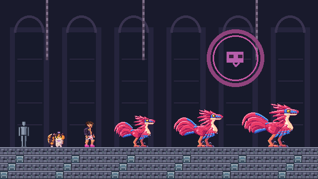
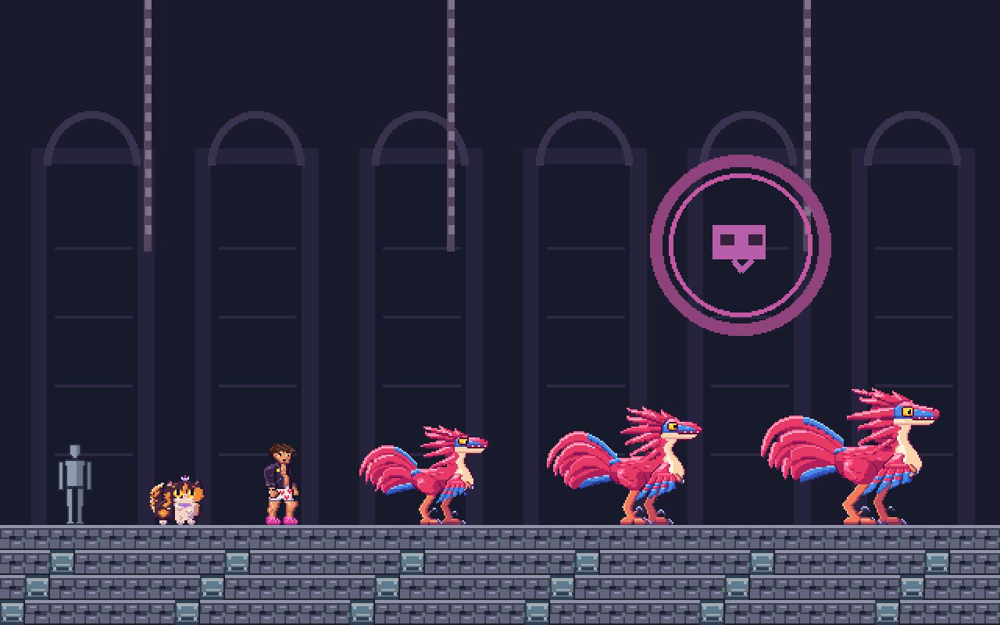
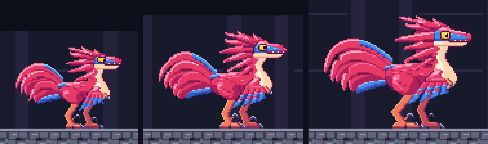
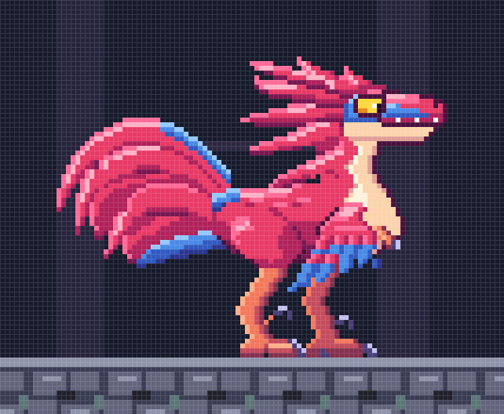
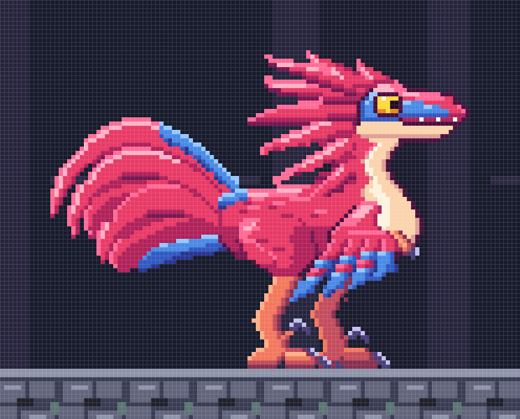
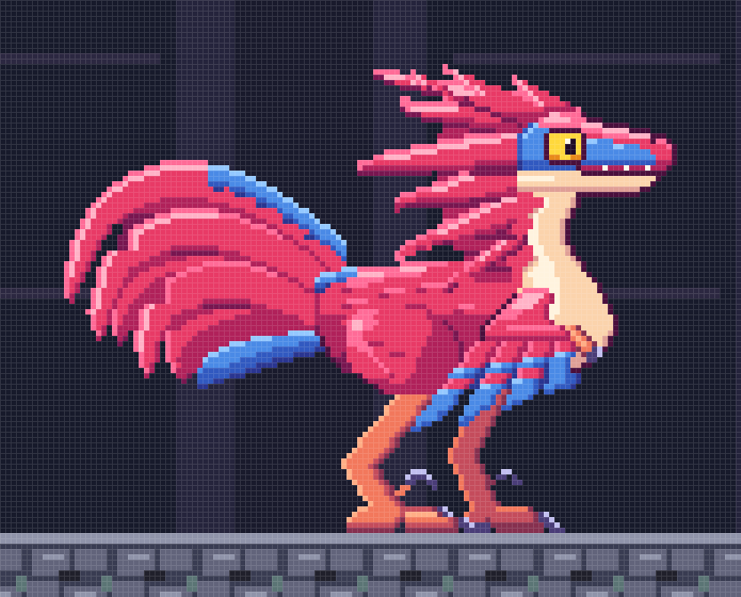
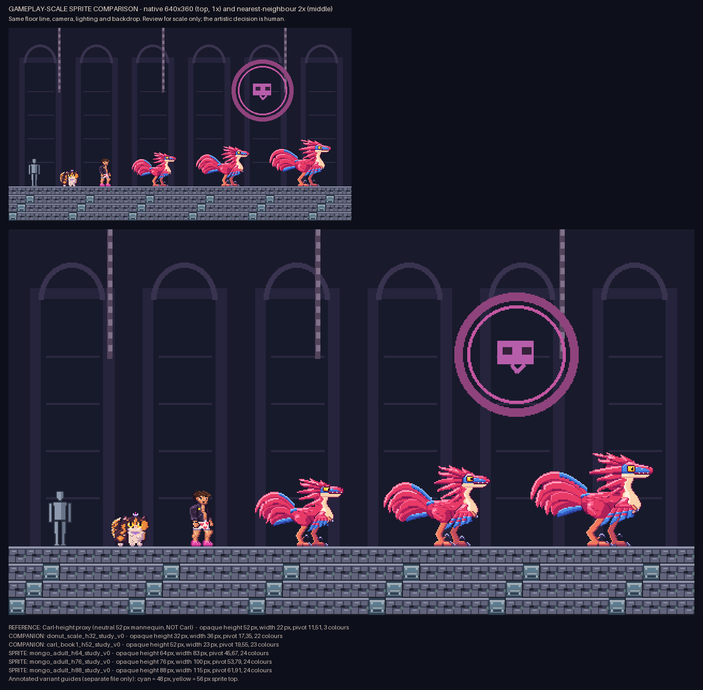
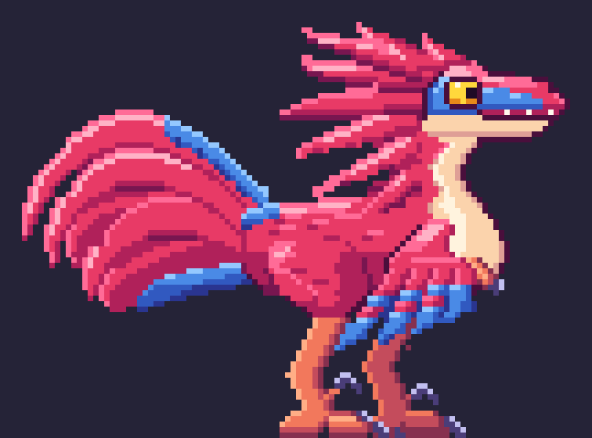
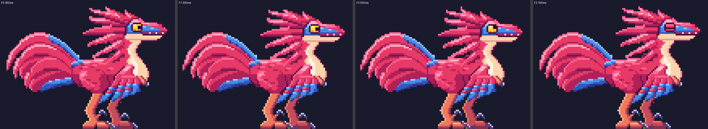
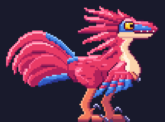

# Mongo (adult / mount): native pixel scale study

**Status:** three native-resolution studies (64, 76, 88 px) and one four-frame idle prototype at 76 px, **awaiting human artistic review**. Nothing here is a locked production sprite, and this document does not decide the scale. The scale below is a **proposal** for the reviewer.
**Branch:** `art/mongo-adult-sprite-scale` (stacked on `art/carl-book1-sprite-scale`, PR #19, which is stacked on `art/donut-floor1-scale-study`, PR #18). **Evidence commit:** `c0bae86`.
**Rights:** publication of these sources and renders is covered by the owner-reported record `ART-PUBLICATION-ALL-V1` in [`rights-and-release.md`](../04-production/rights-and-release.md). That record is not verified rightsholder consent and grants no reuse licence.
**Creative canon:** Mongo is the approved adult concept (`assets/concept/mongo/approved/`, see [`mongo-character-bible.md`](mongo-character-bible.md)): an upright, feathered raptor-like mount with a pink crest fan and mane, a blue face mask with a gold eye, a pink plume tail and blue-tipped wing feathers. Names and franchise-derived traits are a replaceable fan-concept layer.

## Method

- **Source format:** `pixel-grid-v1` text grids (`mongo_adult_h{64,76,88}.grid.json`), layers bottom to top `tail, far_leg, far_arm, body, near_leg, head, crest, near_arm`. `scripts/pixel_grid_to_ase.py` builds the editable `.ase` master from each grid, and `scripts/export_assets.sh` exports atlas PNG and metadata through the existing toolchain.
- **Per-size native authoring:** each size was drawn separately on its own grid. No size is a resample of another and no pixel comes from the concept boards, including the small sprite mocks at the bottom of the adult board. The boards were viewed only as enlarged crops (LATERAL view, Neutral and Curioso heads, details, scale and swatch panels, growth board).
- **Rounds:** round 1 (Sonnet) was **rejected**: parts of the masses were generated by script rather than drawn, the body read as a flat, horizontal striped lizard, the crest fan was missing, the wing feathers were missing and there was no blue face mask. Round 2 (Opus) replaced every pixel of round 1 and is the committed work. It was hand-typed pixel runs painted back to front, feather by feather. Two caveats are recorded in [`STYLE_NOTES.md`](../../assets/source/characters/mongo/STYLE_NOTES.md): the straight shin and metatarsus rows were a hand-chosen per-row left position plus a fixed skin pattern expanded by a one-line loop, and some orphan clean-up passes (mostly crest and tail edge pixels at 88) used helper-proposed majority colours that were reviewed and applied as explicit run lines. The per-round critique log is in `STYLE_NOTES.md`.
- **Gates:** `lint --strict --expect-height N` passes for all three (exact opaque heights, contact row equals pivot y, 0 orphans, 0 isolated pixels in every frame, 0 px bottom-row drift). All three share one 24-colour palette (limit 28). Every pixel is fully opaque and there is no antialiasing. 13 enclosed 1 px pinholes were filled after round 2 (5 at 64, 5 at 76, 3 at 88).
- **Shared design:** the same upright, compact side pose at every size (shallow S neck, head high, body tilted forward, near leg back and far leg forward, plume counterbalancing), the same colour map, crest direction, mask, wing map and tail tip count, and the same light direction (upper left front). Outline is a lighter magenta plum (`#4a0f3c`) used on shadow sides only, because Carl's and Donut's near-black plum would vanish into the `#191a2c` backdrop. This is a deliberate deviation that needs a cast-wide decision.
- **Rendering:** all renders are nearest-neighbour integer enlargements of the exported pixels. No smoothing is applied.

## Sources, manifests and reproduction

| Size | Grid source | Editable master | Manifest |
| --- | --- | --- | --- |
| 64 | `assets/source/characters/mongo/mongo_adult_h64.grid.json` | `assets/source/characters/mongo/mongo_adult_h64.ase` | `assets/manifests/mongo_adult_h64.json` |
| 76 | `assets/source/characters/mongo/mongo_adult_h76.grid.json` | `assets/source/characters/mongo/mongo_adult_h76.ase` | `assets/manifests/mongo_adult_h76.json` |
| 88 | `assets/source/characters/mongo/mongo_adult_h88.grid.json` | `assets/source/characters/mongo/mongo_adult_h88.ase` | `assets/manifests/mongo_adult_h88.json` |

The three manifests join the scale-study group `mongo_adult`. Commits: masters `ea1de02`, 76 px idle and pinhole fill `c0bae86`, width-aware scene spacing `e00fc4b` (the Mongo candidates are 83 to 115 px wide, so the group needs it).

Reproduce everything (from the repository root; `ART_CLI` is an Aseprite or LibreSprite CLI executable):

```bash
ART_CLI=/path/to/aseprite-or-libresprite bash scripts/export_assets.sh
python3 -m unittest discover -s tests -p 'test_art_*.py'
python3 scripts/check_docs.py
```

The export rebuilds the `.ase` files from the grids, exports atlases, validates them, and writes the comparison scene, close-ups, contact sheet, `comparison.json` and the idle GIFs under `generated/art/` (git-ignored). The group render can be rerun alone with `python3 scripts/make_scale_comparison.py --group mongo_adult --out generated/art/scale_study/mongo_adult`. The committed review images, regeneration notes and checksums are in [`docs/evidence/mongo-adult-scale-study/`](../evidence/mongo-adult-scale-study/README.md).

## Evidence

All three candidates stand on the same floor line, under the same camera and backdrop, beside **both real companions**: the Donut 32 px study master (PR #18's proposal) and the Carl 52 px study master (PR #19's proposal), plus the neutral 52 px mannequin (not Carl). Left to right: mannequin, Donut 32, Carl 52, Mongo 64, 76, 88. This is a native-scale pixel review, not gameplay capture and not an in-engine check.

Native 640x360 scene at 1x:



The same scene at nearest-neighbour 2x (1280x720):


Steam Deck-class framing (640x400 native, 2x):



6x close-ups side by side (64, 76, 88), no smoothing:



Per-size 6x close-ups with a pixel grid, for pixel-level review:

| 64 px | 76 px | 88 px |
| --- | --- | --- |
|  |  |  |

Contact sheet (1x and 2x scenes with actor labels):



What is visible in the 2x scene and the side-by-side close-ups:

- At all three sizes the pink crest fan, the blue mask with the gold eye, the hot-pink plume and the blue wing tips are present and distinguishable from Carl and Donut. In the scene the crest fan and plume are the first things the eye lands on.
- The blue covert band along the top of the tail, the blue under-tail feather and the blue wing tips repeat the mask colour, so the blue reads as a motif and not a stray accent.
- The 64 px eye is a 5x3 gold patch, the 76 px eye is 5x4 with a catchlight, and 88 is 6x5. Claws and teeth are marks of a few pixels at every size.
- The plume is a round, layered fan of broad feathers, shorter and rounder than the board's long sweeping plume (see weaknesses).

## Evaluation matrix

Measured values come from `generated/art/scale_study/mongo_adult/comparison.json` (opaque height, width, canvas) and the exported atlases (frame-0 opaque pixels). Seat, crest and foot measurements come from [`STYLE_NOTES.md`](../../assets/source/characters/mongo/STYLE_NOTES.md). Companion figures are the real study masters: Carl 52 px (23 px wide) and Donut 32 px (36 px wide). Footprints are against the 640x360 virtual screen. Appearance cells are visual review notes, not verdicts.

| Criterion | 64 px | 76 px (proposed) | 88 px |
| --- | --- | --- | --- |
| Identity read at 1x (crest fan, blue mask with gold eye, blue wing tips, plume) | All four read in the scene. Fan is thinnest (7 feathers, one merged lower mane tuft). Eye is a 5x3 gold patch in the mask, so the gold dominates but there is no catchlight room. Wing tips are 3 px feathers with one pink band. Plume has 6 tips and a 3-row covert band. | All four read clearly. Fan has 8 feathers plus 3 neck tufts, eye 5x4 with a 1 px catchlight and pupil, wing feathers 4 px with a staggered blue band, 4-row covert band. The face is charming from 3x. This is the reference design. | All four read best. Extra crest spike, 6x5 eye with a 2x3 pupil, wing feathers 5 px, bigger sickle hook. The extra room went into feather structure, not texture. |
| Silhouette / pose | Compact upright side pose, width 83 px (1.30 x height). Fan reaches 21 px behind the head. The smallest crest (6 rows above the skull) is the least shaggy edge. | Width 100 px (1.32 x). Crest 7 rows above the skull, fan reach 25 px, head 28 px long. Neck is long and upright with a straight cream throat. | Width 115 px (1.31 x). Crest 8 rows, fan reach 29 px, head 31 px. Richest crest layering and the clearest neck-to-wing form. |
| Rider-seat readability for Donut 32 | Seat line at rows 31-32, 36 px above the contact row. Donut 32 on the seat gives a 68 px stack, so her head is 4 px above Mongo's crest top (64). The clear seat run is not measured at this size. Seat anchor (49, 31), that is (-8, -36) from the pivot. | Seat line at rows 36-37, 43 px above the contact row. Stack 75 px, so Donut's head is level with the crest top (76). The clear flat seat run is x 48-63 (16 px, body layer). Donut 32 is 36 px wide and overhangs it. Seat anchor (57, 36), that is (-11, -43). Lower mane tips come to 1-2 rows above the back line near x 57-66. | Seat line at rows 41-42, 50 px above the contact row. Stack 82 px, 6 px under Mongo's height. The clear seat run is not measured at this size. Donut 32 is only 36 % of Mongo's height, so she would look small on it. Seat anchor (66, 41), that is (-13, -50). |
| Contact / pivot | Canvas 92x68, manifest pivot [57, 67] (midpoint of the feet at x 50 and 64). Two planted feet, near and far, on the contact row; contact row 295 in the scene; 0 px bottom-row drift. | Canvas 108x80, pivot [68, 79] (feet at x 60 and 76). Same contact row 295. 0 px drift across all four idle frames and the pivot is fixed. | Canvas 126x92, pivot [79, 91] (feet at x 69 and 88). Same contact row 295. Foot centres are 19 px apart (14 at 64, 16 at 76). |
| Size vs Carl 52 (23 wide) and Donut 32 (36 wide) | 1.23x Carl's height, width 3.6x Carl's. Donut 32 is 50 % of Mongo's height, Mongo is 2.0x Donut's height and 2.3x her width. Mongo is only 12 px taller than Carl, so the mount hardly towers over him. | 1.46x Carl, width 4.3x. Donut is 42 % of Mongo, Mongo is 2.4x her height and 2.8x her width. Mass is clearly above Carl without dominating a room. | 1.69x Carl, width 5.0x. Donut is 36 % of Mongo, Mongo is 2.75x her height and 3.2x her width. Dominates Carl and the scene. |
| Screen footprint on 640x360 | 64 px tall (17.8 % of height), 83 px wide (13.0 % of width). | 76 px tall (21.1 %), 100 px wide (15.6 %). | 88 px tall (24.4 %), 115 px wide (18.0 %). A quarter of the screen height; platforming rooms feel narrow beside it. |
| Clutter / separation from magenta magic and the dark backdrop | Lit pink and blue top and left edges, no outline on lit sides, so the figure separates from `#191a2c` by value and saturation. The thin 1 px fan feather tips are the most fragile edge at this size. Not tested against magenta VFX. | Same colour logic. The crest fan is busy at 1x but separated from the backdrop. Plume pink (`#e83a66`, `#ff6b97`, `#ffb2c6`) sits close in hue to Donut's magenta magic (`#e2309f`, `#ff95d3`), so VFX could merge into the plume. Not tested. | Same colour logic as 76, with an extra crest spike and longer wing feathers. The same magenta-magic risk and the largest pink mass. Not tested. |
| Authoring cost (opaque pixels, frame 0) | 2,436 px (71 % of 76). Cheapest. | 3,450 px (the reference, 4.1x Carl 52's 837). Already carries a four-frame idle. | 4,604 px (133 % of 76, +1,154 px). Highest cost for every future frame, mount state and animation set. |

Opaque pixel counts are measured on the exported frame-0 atlas. `STYLE_NOTES.md` still lists 2,431 / 3,445 / 4,601 from before the 13 pinhole fills (5 / 5 / 3 pixels), which accounts for the difference.

## Proposed scale: 76 px (not locked)

**Proposal:** 76 px opaque height (contact row to crest top), for **human artistic review**. It is not accepted, not locked, and no production animation set should be started on it until a human decides.

Reasoning:

- At 76 the full identity set reads: the crest fan, the gold eye in the blue mask with a catchlight, the blue wing tips and the plume. It is the size that received the most review rounds and the only one with evidence that the design holds through an animation (the 4-frame idle).
- It is 1.46x Carl 52 and 2.4x Donut 32, so the cast stays in order (Donut smaller, Carl middle, Mongo bigger) and Mongo is clearly a mount, using about a fifth of the screen height and 16 % of its width.
- A Donut 32 rider on the 43 px seat gives a 75 px stack, level with the crest top, so the mount reads as one tall unit rather than a rider lost on a giant bird.
- It costs about 25 % fewer opaque pixels per frame than 88 and about 42 % more than 64.

**Alternatives:**

- **64 px is viable if Donut lands at 32.** It is the cheapest (2,436 px), still identifiable, with a 68 px stack (seat at 36 px). Its eye is a 5x3 patch, the fan is the thinnest, claws and teeth are 2 to 3 px marks, and at 1.23x Carl it reads less like a mount. Choose it if screen footprint and production cost outweigh identity.
- **88 px** has the richest feathers and best clarity, but takes 24 % of the screen height, costs about 33 % more per frame than 76, and a Donut 32 rider is 36 % of its height. It fits better if Donut ends up near 40 to 48 px, or if mounted play is central.

Whichever way the Donut and Carl decisions go, recheck these ratios: if Carl lands at 56 (not 52), 64 px is only 1.14x taller than him.

## Idle prototype (76 px only)

Four frames in `mongo_adult_h76.grid.json`, tag `idle` 0-3 forward, durations 450 / 300 / 550 / 160 ms (1460 ms loop). Every frame is derived from frame 0 by scripted, listed edits (rigid 1 px shifts and a few pixel writes). No frame is redrawn independently and no feather group is rotated. The 64 and 88 masters have one frame (1000 ms).

| Frame | Duration | Change from frame 0 | Top row / height |
| --- | --- | --- | --- |
| 0 | 450 ms | master: chest and head up, crest lifted, eyes forward | 4 / 76 |
| 1 | 300 ms | exhale: head, the whole crest layer and the neck move down 1 px as one rigid group; two crest tip pixels removed; the lowest 4 rows of one tail tip trail 1 px back | 6 / 74 |
| 2 | 550 ms | frame 1 plus a curious glance (pupil 1 px up), one crest tip lifted back to the master top row, a second tail tip trailing 1 px | 4 / 76 |
| 3 | 160 ms | frame 0 (inhale) with a quick blink and only one tail tip still trailing, returning to rest at the loop | 4 / 76 |

- **Beat:** a relaxed breath with the mane settling, a curious look up while the plume drifts, then a blink as he draws breath.
- **Fixed parts:** legs, feet, claws, wing, body below the neck and the contact row do not change in any frame. The pivot stays [68, 79] and lint reports 0 px bottom-row drift.
- **Changed pixels against frame 0:** 787 / 795 / 32. The large counts are the rigid 1 px shift of head and crest.
- **Lint:** 0 orphans and 0 isolated pixels in all four frames. Frame 1 measures 74 px (head down plus settled crest); frames 0, 2 and 3 measure 76.
- Reviewed as GIFs at 1x and 3x on dark and stone backdrops: no jitter in feet, claws, wing or legs and no shimmer, because the moving parts shift rigidly. The 1 px head bob and the blink read at 1x; the crest and tail sway are subtle at 1x and clear at 3x. No human has judged game feel.

Exported preview from the pipeline (the exporter's preview scale):



Scratch review renders (not produced by a committed script): the four frames at 6x, then the loop at 3x on a dark background.





## Run readiness

**A 6-frame run is not done and is not started.** The 76 px master is an upright idle pose, not a locomotion pose. From `STYLE_NOTES.md`, a 6-frame run would need:

- **Pose:** a lower, more horizontal body and a forward-thrust neck and head. The tail must sweep out flat behind. This is the natural place to fix the rooster-like plume, as new key poses and not a rotated idle tail.
- **Tail sweep:** lengthening the plume toward the board's horizontal sweep means redrawing the three main tail feathers, the two filler feathers and the covert band at every size and widening the canvas (pivot, manifests and scene spacing change with it). It is a redesign, so it was deliberately not attempted in the idle.
- **Legs:** complete `far_leg` cels (currently hidden under the near leg) and full thigh-to-toe drawings for contact, down, pass and up positions on both legs, with foot contacts locked to the ground row on contact frames. The same applies to the far wing, which is only a few blue tips.
- **Wing and crest:** wing fan tucked tighter against the body; the crest and mane streaming back as redrawn tip groups (2 to 3 variants per frame), keeping their separate layers.
- **Bob and timing:** reuse the idle's rigid 1 px group-shift for the body bob; 6 frames at about 80 to 100 ms, with hit and collision data outside the art.

## Known weaknesses

- **Rooster-like tail:** the plume is shorter and rounder than the board's long sweeping plume, because of the width cap (about 1.3 x height). In the scene the layered fan reads as a rooster tail. A run pose can stretch it; the idle does not.
- **Mane tips near the seat:** at 76 the lowest mane tips come to 1-2 rows above the back line around x 57-66, and the crest fan overhangs the seat higher up. A rider sits in front of the lower mane tips, so mount states may need the mane folded or lifted (the crest is a separate layer). The seat anchors above are measurements, not a decided socket.
- **Tiny claws and teeth at 1x:** claws are readable from 3x and are only a few pixels at 1x. Teeth are three accent pixels and hints only.
- **Crest shape:** feathers C3, C4 and M1 are still fairly straight and horizontal; the board's crest is shaggier with more curved, overlapping tips.
- **Neck and legs:** the neck is long and upright with a straight cream throat, while the board's neck is thicker and more forward. The near shin and metatarsus are plain skin ramps with no scale or tendon detail.
- **Outline colour:** the lighter magenta plum is a deliberate deviation from Carl and Donut and needs a cast-wide colour decision.
- **Idle:** only the 76 px master has one. It is a 1 px head bob, not an ease. 64 and 88 have a single static frame. The pose is an idle, not a mount state.
- **Evidence limits:** no human has judged game feel at these scales. The scene is a generated scale study, not the real game camera. There is no check against magenta magic VFX, no mounted check with Donut on the seat, no in-engine (Bevy) check, and no performance or Steam Deck claim is made. Donut 32 and Carl 52 are proposals from PRs #18 and #19, so the relations may change. The two scratch idle renders are not produced by a committed script.

## Open canon questions

1. **Toes and the sickle claw:** each foot draws one near toe, one far-side toe and a raised sickle claw above the foot. This is an artistic reading of the board, not verified canon. Confirm the toe count and the raised-claw design when lore research lands.
2. **Teeth and mouth:** the neutral head keeps a closed, relaxed mouth with three tooth hints (accent pixels), matching the board's Neutral and Curioso heads. Is the tooth count canon, and should the default neutral mouth be closed?
3. **Board captions:** the size captions on the board (18 cm, 1.2 to 1.5 m) are non-canon AI annotations. The 64, 76 and 88 px sizes are scale candidates only.

## Next steps

1. **Human artistic review** of the 1x scene, the 2x scenes and the close-ups, and a decision on the scale (64, 76, 88 or a rework). Record the decision as an ADR or in the backlog.
2. **Settle Donut and Carl first.** The Donut 32 and Carl 52 proposals (PRs #18 and #19) set the seat stack and the Carl ratio, so recheck the matrix after both are decided.
3. **Resolve the canon questions** above (toes, sickle claw, teeth, mouth).
4. **Run a mounted mock-up:** place Donut on the 76 px seat, decide the seat socket and mane state, and test the plume against magenta magic VFX.
5. **Plan the 6-frame run** (see Run readiness), including the tail sweep, far leg and far wing, before committing to a larger animation set.
6. **Cast-wide colour test** for Mongo's lighter outline against Carl's and Donut's near-black plum.
7. **In-engine check:** view the chosen size in a Bevy pixel-camera scene on real backgrounds and under FX once the runtime exists, and keep the work order open until a human signs off at 1x and 2x.
