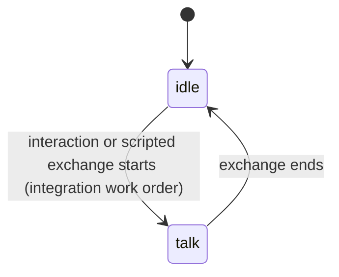

# MORDECAI-01: Mordecai (Rat Hooligan guide) native sprite, design spec (draft)

**Status:** draft keys and spec, pre-edit. Two keys drawn (idle key, talk-gesture key). Not frozen, no in-betweens, no manifest. Validator PASS on the two keys. Silhouette gate and independent review pending.

**Decision record (proposals, bounded by the work order and confirmed or rejected by the editor and review):** idle opaque height **44 px** (rows 4 to 47), frame **52 x 48**, pivot **(24, 47)**, 4-frame idle loop, one talk-gesture key, 19 palette keys.

The sections follow `docs/02-art/bard-01-spec.md`. This is a **non-combatant guide NPC**: no combat, locomotion, hurt or defeat set is in scope (`docs/02-art/floor-01-mordecai-concept.md` forbids unapproved animations).

## 1. Canon and tone constraints

- Approved concept direction: option **C, the Reluctant Mentor**, `assets/concept/floor-01/mordecai/01-mordecai-selected-c.png` (primary) and `02-mordecai-turnaround-acting.png` (supporting); `docs/02-art/floor-01-mordecai-concept.md`. The concept is a **mood and construction reference only**; nothing is traced, cropped or sampled, and the printed "~44 px" on the board is a proposal, not a measurement.
- Tone (`docs/01-design/antihero-tone.md`): a plain, tired, believable veteran. No heroic stance, no bulky biceps, no cape, weapon, staff or insignia. Gruff and sarcastic on the surface, guarded and responsible underneath.
- Canon facts that must survive in pixels:
  - Rat Hooligan: natural rat anatomy (long tapering muzzle, whiskers, large pink ears, thin pink tail), notably shorter than Carl.
  - Black vest (worn, open), faded blue trousers (torn hem and knee patch), worn sandals; muted brass buttons and belt buckle as wear cues.
  - Heavy tired eyelids over alert yellow eyes, ragged chin beard, ragged face fringe, slight forward stoop with low shoulders, hands in pockets at rest.
- Not approved and not drawn: the Floor 02 Bugaboo form, urn or photo props, mug or drinking poses, seated poses, any dialogue. The mug, urn and photo belong to the room kit (AREA-REFUGE-01), not to this sprite.

## Difficulty and route

**Score 2 of 4: Medium, route B plus silhouette gate** (`docs/07-agents/pixel-art-pipeline.md`, Routing by difficulty).

| Point | Met | Note |
| --- | --- | --- |
| 1. New design, not a variant | yes | New character, no approved base body |
| 2. Native height above about 40 px | yes | 44 px |
| 3. Complex anatomy or construction | no | Tail and a pose-dependent arm, no multi-limb rig |
| 4. VFX, projectiles, special states | no | None |

## 2. Size decision

| Option | Idle opaque height | Ratio to Carl (52) | Ratio to Donut (40) | Why / why not |
| --- | --- | --- | --- | --- |
| A | 40 px | 0.77 | 1.00 | Same as Donut; the stoop and large head would make him read as a pet, not a guide |
| B | 44 px | 0.85 | 1.10 | Book anchor "notably shorter than Carl"; stoop costs about 3 px of standing height, so he stands about 47 px if straightened (still below Carl's 52); taller than Donut so he never reads as the companion |
| C | 48 px | 0.92 | 1.20 | Too close to Carl; loses the "short rat" read and the low-shoulder stoop |

Decision: **B, 44 px** (rows 4 to 47 inclusive, outline included, sole row on 47). Confirmed or rejected by the lit cast lineup (`docs/evidence/mordecai-01/lineup/cast_lineup_1x.png` and `cast_lineup_4x.png`). Carl 52 and Donut 40 are unchanged.

## 3. Frame, pivot, boxes and atlas

- **Frame 52 x 48, pivot (24, 47), contact row 47.** Pivot x is the midpoint of the two sole runs (far sole x 13 to 22, near sole x 25 to 35, outline x 12 to 36 gives centre 24). The tail adds about 7 px behind (x 3 to 12) and the muzzle and whiskers 10 px in front (to x 45), so the frame is wider than the standing box; 2 px of margin remain on the right for whiskers.
- **Grounded** in every frame; lowest opaque row on 47 (0 px foot sink). No airborne tags.
- **Height cap:** no opaque pixel above row 3 in any frame (45 px). Idle top row is 4 (ear).
- **Authored facing right**; runtime mirrors around the pivot column (x 24). In the guild room the runtime mirrors him to face the party.
- **Boxes:** none. He is a non-combatant: no hurtbox, no hitbox. Proposal for the integrator, not a requirement: an interaction anchor at pivot offset (+6, -45) (above the head, near the muzzle) and a 24 x 38 standing footprint equal to the enemy AABB, frame x 12 to 35, rows 10 to 47.
- **Layers (bottom to top):** `tail`, `far_arm`, `torso`, `near_arm`, `legs`, `head`. The torso sits under the near arm and the near arm under the trousers, which is what puts the idle hand "in the pocket"; `head` is on top so the beard clears the vest. Layers are not required to be disjoint.
- **One atlas**, frames 0 to 1 now (keys); frames 2 to 4 are in-betweens added after the keys are frozen.

## 4. Animation list

At 60 Hz. Draft config: `assets/source/characters/mordecai/mordecai_h44.pixelart.json` (2 frames now, extended after the keys freeze).

| Role | Tag | Frames | Playback | Ticks | Total |
| --- | --- | --- | --- | --- | --- |
| idle | `idle` | 0, 2, 3, 4 | loop | 44 + 22 + 14 + 22 | 102 (1.7 s) |
| talk | `talk` | 1 | once, then back to `idle` | 60 hold, state-driven | about 60 |

Frame table (K = key drawn now, I = in-between, section 8):

| # | Tag | Pose | Ticks | Type |
| --- | --- | --- | --- | --- |
| 0 | `idle` | rest: slumped stoop, both hands in the pockets, closed mouth, one fang peeking | 44 | K |
| 1 | `talk` | one-handed explanatory gesture: near forearm out, palm up, mouth open, brow raised | 60 | K |
| 2 | `idle` | inhale: head, torso and near arm (rows 4 to 30) up 1 px, legs and tail fixed | 22 | I |
| 3 | `idle` | inhale hold: as 2 plus the ear tip 1 px lower (twitch), eyelid row 1 px lower | 14 | I |
| 4 | `idle` | exhale: head rows 4 to 22 down 1 px from key 0, body as key 0, tail tip rows 44 to 46 shifted 1 px | 22 | I |

Idle returns to frame 0 after 4, so the loop reads 0, 2, 3, 4, 0. Breathing is deliberately slow and shallow (tired, not bored); no foot moves, so there is no foot drift. The talk key is a single state-driven pose; a talk loop (mouth and hand cycle) is out of scope until a dialogue work order exists.

## 5. State diagram



Triggers are an integration proposal; nothing here is wired and no dialogue is authored.

## 6. Palette `mordecai-floor01-v0` (19 of 20)

Compatible with the in-use character palettes and with the Floor 1 kit (`floor01-catacomb-v2`, no new colours needed in the kit): the outline is the shared plum `#1b1124` (Carl, goblin); the eye, tooth and brass accents reuse the goblin hexes. The fur ramp is a **warm ashen grey** that stays below the torch-lit brick highlight and apart from the cool violet-grey of the iron props; skin and ears use a dusty pink ramp (Donut's inner-ear pink is a different hex on purpose).

| Key | Name | Hex | Role |
| --- | --- | --- | --- |
| K | outline_plum | `#1b1124` | outline (shared) |
| a / c / f / g | fur deep / shade / mid / light | `#3a323e` `#675b5f` `#908373` `#beb09a` | ashen fur; g also beard and whiskers |
| p / q / r | skin dark / mid / light | `#8a4a5a` `#c77f8a` `#eaa9a9` | ears, nose, tail, palm pad |
| v / V / u | vest dark / mid / light | `#251c2b` `#3e3139` `#5e4b4d` | black vest and belt, kept above the plum outline |
| i / I / j | indigo dark / mid / light | `#2a2c58` `#41498a` `#6571b0` | faded blue trousers |
| s | sandal_leather | `#7c5a3e` | sandal soles and straps (straps use `v`) |
| e | eye_yellow (accent) | `#ffd23a` | eye (shared with goblin) |
| w | tooth_white (accent) | `#efe4c4` | fangs (shared) |
| b | brass_mid (accent) | `#b8862e` | buttons, buckle (shared) |
| o | mouth_dark | `#5c1426` | open mouth (talk key) |

One slot is free. Lighting fit (by eye, to be judged in the lit scene): hearth-amber light warms the fur ramp, the indigo trousers and vest cool to blue-violet in shadow, so the three big colour areas separate from the warm brick behind them. Fur is the lightest large area on purpose so that a 44 px figure does not sink into the brick.

## 7. Key poses

Coordinates in frame space (x right, y down, pivot (24, 47)). Both keys are produced by `scripts/author_mordecai01.py` from parametric shapes, an automatic plum outline, 1 px rim light and shade rules and literal touches.

| Frame | Silhouette and pose notes | Readability reason |
| --- | --- | --- |
| 0 idle | Head forward of the body (skull centre x 29, torso centre x 20): the stoop. Ear top row 4 (large pink disc, x 22 to 29); muzzle tapers to the nose tip at x 42, rows 13 to 15, three short whiskers; yellow eye at row 10 under a dark heavy-lid row (row 9) and a bag row; chin beard rows 17 to 25. Torso rows 17 to 31: vest back panel x 12 to 19 with a ragged hem on row 28, open front with chest tufts and a lapel at x 26 to 28 (two brass buttons), belt on rows 29 to 30 with a brass buckle. Near arm hangs from the vest cap (x 17 to 23) to the hip and into the pocket behind the trouser top; far elbow juts back (x 11 to 16, rows 22 to 30). Trousers rows 31 to 41, near leg flaring forward, ragged hem, torn knee patch on the near thigh; fur shins rows 41 to 44; sandals on rows 45 to 47. Tail leaves the hip at x 15 and curls down and back along the floor to x 12 on row 46. | Three reads at 1x: a big pink ear on a long grey muzzle (rat, not cat or dog), a low hunched dark vest with blue trousers (down-at-heel veteran), the long pink tail. |
| 1 talk | Body, legs, tail and head construction identical to key 0 (so the frames cut in place). Near arm leaves the shoulder, elbow at about (22, 29), forearm extends forward to x 32 at row 28, open hand x 32 to 43, rows 25 to 31: pink palm pad, thumb up, finger gaps. Mouth opens (dark `o`, two upper fangs, one lower fang), jaw dropped 3 rows, brow row raised 1 px. Hand stays below the beard (top row 22) so it never covers the face. Far hand still in the pocket. | Dry-sarcasm gesture from the concept ("one-handed explanatory gesture"), readable as a hand held out, not a punch. |

### Known weaknesses of this draft (for the editor)

- The vest back panel still reads as a dark hump or backpack; it needs a collar line, a visible hem edge and a shoulder-to-chest read so it looks like an open vest, not a shell.
- Torso volume is thin: chest tufts, belly and the arm separation are weak; the near arm is mostly separated by the `a` edge only.
- Face: the beard is a large pale wedge and the muzzle underside is flat; wants shaggier edges, a cheek shade and a clearer muzzle-to-skull transition. Whiskers are three pixels only.
- Talk hand is a mitten: the finger separation is two pixels. Consider a 3-finger fan that does not turn into a black clump after the outline pass.
- Sandal straps and toes are minimal (feet are grey blobs on a brown line). Trouser hem tear is subtle.
- Fur ramp may still be slightly low in contrast against the lit brick at 1x; check in the scene before freezing.

## 8. In-between list

For the execution tier; no design decisions needed. Shifts are relative to key 0.

| # | Pose notes |
| --- | --- |
| 2 | Rows 4 to 30 (head, torso, near arm, far arm, vest) move up 1 px; trousers, legs, sandals and tail unchanged. The neck join (rows 17 to 19) is redrawn so the outline stays continuous. |
| 3 | Frame 2 with the ear tip row lowered 1 px and the eyelid row (row 9 in key 0) lowered 1 px (a slower blink, eye row shrinks to 1 px high); nothing else. |
| 4 | Key 0 with head rows 4 to 22 moved down 1 px (exhale, the head drops into the stoop) and the tail tip (rows 44 to 46) shifted 1 px forward. Body, arms and legs exactly key 0. |

No in-between moves a foot or the tail root, so the loop has zero foot drift. The tail tip change is the only tail motion.

## 9. Validators and acceptance targets

Draft state (keys only): `python3 -m scripts.pixelart validate assets/source/characters/mordecai/mordecai_h44.pixelart.json` gives PASS (11 pass, 0 fail, 6 skipped), including V04 palette (19 of 20), V05 isolated pixels 0, V06 orphan pixels at most 9 per frame (the lint count is 1 per frame), V07 contact row 47, V13 bounding boxes `M1-size-idle-44px` (top 4, bottom 47) and `M1-height-cap-45px`. `scripts/pixel_grid_to_ase.py lint ... --strict --expect-height 44` gives silhouette height 44. After the editor freezes the keys: add V09 frozen keys, V16 foot drift on `idle`, key counts (`e` at least 2 px in frames 0 and 1) and the in-between bbox rules.

### Acceptance targets

1. At 1x next to Carl and Donut on lit Floor 1 brick, Mordecai reads as a rat guide, not a cat, dog or goblin: pink ear, long tapering muzzle with whiskers, pink tail.
2. Idle opaque height is exactly 44 px (rows 4 to 47) in the idle key; every frame is 45 px or less; he is visibly shorter than Carl and taller than Donut.
3. Silhouette reads tired and plain (stooped, low shoulders, hands in pockets), with no heroic anatomy, weapon, cape, staff or insignia.
4. The talk key cuts in place from the idle key (same legs, tail and head construction) and the hand never covers the eye or the mouth.
5. Palette at most 20 keys, shared outline, eye, tooth and brass accents; no new colour outside the table.
6. Fur keeps contrast against the warm brick at 1x (check in the lit scene, not on the flat preview).
7. No concept pixel is cropped, traced or sampled; grid, `.ase` and evidence reproducible from `scripts/author_mordecai01.py`.

## 10. Evidence

```text
python3 scripts/author_mordecai01.py keys --preview <png>
python3 scripts/author_mordecai01.py lineup docs/evidence/mordecai-01/lineup
python3 -m scripts.pixelart validate assets/source/characters/mordecai/mordecai_h44.pixelart.json
python3 -m scripts.pixelart evidence assets/source/characters/mordecai/mordecai_h44.pixelart.json --out docs/evidence/mordecai-01/evidence
```

- `docs/evidence/mordecai-01/lineup/cast_lineup_1x.png` and `cast_lineup_4x.png`: Donut, Carl and the idle key on the same floor line (unlit Floor 1 walking line).
- `docs/evidence/mordecai-01/evidence/scene_640x360.png` and `scene_1920x1080.png`: idle key and talk key in the lit ENV-02 corridor frame, mirrored to face Carl.
- `docs/evidence/mordecai-01/evidence/contact_sheet_x1.png` and `contact_sheet_x4.png`, per-tag GIFs and `SHA256SUMS`.

## 11. Files

| File | Role |
| --- | --- |
| `scripts/author_mordecai01.py` | authoring record: palette, shapes, both keys, grid and `.ase` writer, lineup renderer |
| `assets/source/characters/mordecai/mordecai_h44.grid.json` / `.ase` | pixel-grid source and Aseprite master (2 keys) |
| `assets/source/characters/mordecai/mordecai_h44.pixelart.json` | asset config (2 frames, extended after the freeze) |
| `docs/evidence/mordecai-01/` | lineup and toolkit evidence |

## 12. Rights and provenance

Fan-concept art under the owner-reported `ART-PUBLICATION-ALL-V1` scope (`docs/04-production/rights-and-release.md`). Which model designed, executed and reviewed each stage is recorded in the PR's Rights/Provenance section. No tracing of the concept, no image-model raster output, no third-party Rat Hooligan imagery.

## 13. Open questions

1. Confirm 44 px in the lit scene against the cast (target 2); the alternative is 46 if the stoop makes him read smaller than Donut's visual mass.
2. Should the idle rest pose have the hands in the pockets (concept front view) or arms folded (listed candidate)? Drafted as hands in pockets.
3. Facing: authored facing right; the room work order decides whether he is mirrored.
