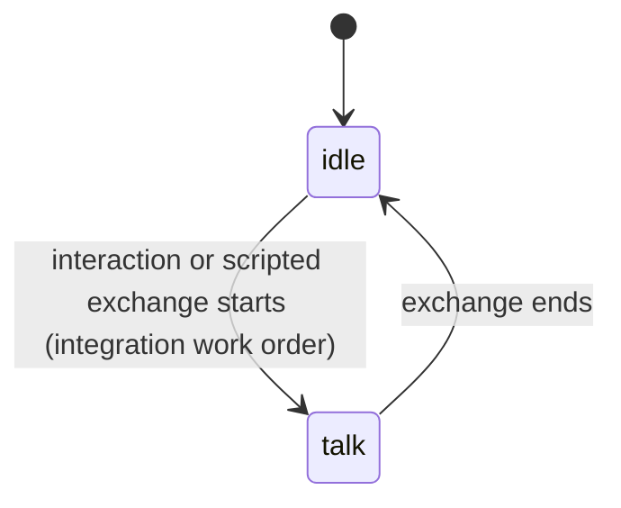

# MORDECAI-01: Mordecai (Rat Hooligan guide) native sprite, design spec (keys frozen)

**Status:** keys **frozen** (frame 0 idle key, frame 4 talk key, `tests/fixtures/mordecai-01_keys.json`, validator V09); silhouette gate PASS (round 2); idle in-betweens 1 to 3 drawn; atlas exported and manifest written (`assets/manifests/mordecai_h44.json`). Validator PASS. Independent review pending; not wired into Bevy.

**Decision record (adopted by the editor):** idle opaque height **44 px** (rows 4 to 47, MORD-Q1), frame **52 x 48**, pivot **(24, 47)**, hands-in-pockets rest pose (MORD-Q2), authored facing right with runtime mirroring around the pivot column (MORD-Q3), 4-frame idle loop, one talk-gesture key, 19 palette keys.

The sections follow `docs/02-art/bard-01-spec.md`. This is a **non-combatant guide NPC**: no combat, locomotion, hurt or defeat set is in scope (`docs/02-art/floor-01-mordecai-concept.md` forbids unapproved animations).

## 1. Canon and tone constraints

- Approved concept direction: option **C, the Reluctant Mentor**, `assets/concept/floor-01/mordecai/01-mordecai-selected-c.png` (primary) and `02-mordecai-turnaround-acting.png` (supporting); `docs/02-art/floor-01-mordecai-concept.md`. The concept is a **mood and construction reference only**; nothing is traced, cropped or sampled, and the printed "~44 px" on the board is a proposal, not a measurement.
- Tone (`docs/01-design/antihero-tone.md`): a plain, tired, believable veteran. No heroic stance, no bulky biceps, no cape, weapon, staff or insignia. Gruff and sarcastic on the surface, guarded and responsible underneath.
- Canon facts that must survive in pixels:
  - Rat Hooligan: natural rat anatomy (long tapering muzzle, whiskers, large pink ears, thin pink tail), notably shorter than Carl.
  - Black vest (worn, open), faded blue trousers (torn hem and knee patch), worn sandals; muted brass buttons and belt buckle as wear cues.
  - Heavy tired eyelids over alert yellow eyes, ragged chin beard, ragged face fringe, slight forward stoop with low shoulders, hands in pockets at rest.
- Not approved and not drawn: the Floor 02 Bugaboo form, urn or photo props, mug or drinking poses, seated poses, any dialogue. The mug, urn and photo belong to the room kit (AREA-REFUGE-01), not to this sprite.

## Difficulty and route

**Score 2 of 4: Medium, route B plus silhouette gate** (`docs/07-agents/pixel-art-pipeline.md`, Routing by difficulty).

| Point | Met | Note |
| --- | --- | --- |
| 1. New design, not a variant | yes | New character, no approved base body |
| 2. Native height above about 40 px | yes | 44 px |
| 3. Complex anatomy or construction | no | Tail and a pose-dependent arm, no multi-limb rig |
| 4. VFX, projectiles, special states | no | None |

## 2. Size decision

| Option | Idle opaque height | Ratio to Carl (52) | Ratio to Donut (40) | Why / why not |
| --- | --- | --- | --- | --- |
| A | 40 px | 0.77 | 1.00 | Same as Donut; the stoop and large head would make him read as a pet, not a guide |
| B | 44 px | 0.85 | 1.10 | Book anchor "notably shorter than Carl"; stoop costs about 3 px of standing height, so he stands about 47 px if straightened (still below Carl's 52); taller than Donut so he never reads as the companion |
| C | 48 px | 0.92 | 1.20 | Too close to Carl; loses the "short rat" read and the low-shoulder stoop |

Decision (adopted, MORD-Q1): **B, 44 px** (rows 4 to 47 inclusive, outline included, sole row on 47). Confirmed by the editor in the lit cast lineup (`docs/evidence/mordecai-01/lineup/cast_lineup_1x.png` and `cast_lineup_4x.png`). Carl 52 and Donut 40 are unchanged.

## 3. Frame, pivot, boxes and atlas

- **Frame 52 x 48, pivot (24, 47), contact row 47.** Pivot x is the midpoint of the two sole runs (far sole x 13 to 22, near sole x 25 to 35, outline x 12 to 36 gives centre 24). The tail adds about 7 px behind (x 3 to 12) and the muzzle and whiskers 10 px in front (to x 45), so the frame is wider than the standing box; 2 px of margin remain on the right for whiskers.
- **Grounded** in every frame; lowest opaque row on 47 (0 px foot sink). No airborne tags.
- **Height cap:** no opaque pixel above row 3 in any frame (45 px). Idle top row is 4 (ear).
- **Authored facing right**; runtime mirrors around the pivot column (x 24). In the guild room the runtime mirrors him to face the party.
- **Boxes:** none. He is a non-combatant: no hurtbox, no hitbox. Proposal for the integrator, not a requirement: an interaction anchor at pivot offset (+6, -45) (above the head, near the muzzle) and a 24 x 38 standing footprint equal to the enemy AABB, frame x 12 to 35, rows 10 to 47.
- **Layers (bottom to top):** `tail`, `far_arm`, `torso`, `near_arm`, `legs`, `head`. The torso sits under the near arm and the near arm under the trousers, which is what puts the idle hand "in the pocket"; `head` is on top so the beard clears the vest. Layers are not required to be disjoint.
- **One atlas**, 5 frames: idle loop 0 to 3 (key plus 3 breathing in-betweens), talk key 4. Exported to `generated/art/mordecai_h44.png` and `.json` (LibreSprite json-array, rows) from `assets/manifests/mordecai_h44.json`.

## 4. Animation list

At 60 Hz. Draft config: `assets/source/characters/mordecai/mordecai_h44.pixelart.json` (2 frames now, extended after the keys freeze).

| Role | Tag | Frames | Playback | Ticks | Total |
| --- | --- | --- | --- | --- | --- |
| idle | `idle` | 0, 1, 2, 3 | loop | 40 + 22 + 14 + 22 | 98 (about 1.6 s) |
| talk | `talk` | 4 | once, then back to `idle` | 60 hold, state-driven | about 60 |

Frame table (K = key drawn now, I = in-between, section 8):

| # | Tag | Pose | Ticks | Type |
| --- | --- | --- | --- | --- |
| 0 | `idle` | rest: slumped stoop, both hands in the pockets, closed mouth, one fang peeking | 40 | K |
| 1 | `idle` | inhale: head, torso and near arm (rows 4 to 30) up 1 px (top row 3), legs and tail fixed | 22 | I |
| 2 | `idle` | inhale hold: as 1 plus the ear tip 1 px lower (twitch) and a half-closed lid | 14 | I |
| 3 | `idle` | exhale: head 1 px down from key 0 (top row 5), body as key 0, tail tip rows 44 to 46 shifted 1 px | 22 | I |
| 4 | `talk` | one-handed explanatory gesture: near forearm out, palm up, mouth open, brow raised | 60 | K |

Idle returns to frame 0 after 3, so the loop reads 0, 1, 2, 3, 0. The talk key was renumbered from 1 to 4 so each atlas tag is a contiguous frame range (the Bevy atlas loader reads `from`/`to` of each frame tag); its pixels are unchanged apart from gate round 2. Breathing is deliberately slow and shallow (tired, not bored); no foot moves, so there is no foot drift. The talk key is a single state-driven pose; a talk loop (mouth and hand cycle) is out of scope until a dialogue work order exists.

## 5. State diagram



Triggers are an integration proposal; nothing here is wired and no dialogue is authored.

## 6. Palette `mordecai-floor01-v0` (20 of 20)

Compatible with the in-use character palettes and with the Floor 1 kit (`floor01-catacomb-v2`, no new colours needed in the kit): the outline is the shared plum `#1b1124` (Carl, goblin); the eye, tooth and brass accents reuse the goblin hexes. The fur ramp is a **warm ashen grey** that stays below the torch-lit brick highlight and apart from the cool violet-grey of the iron props; skin and ears use a dusty pink ramp (Donut's inner-ear pink is a different hex on purpose).

| Key | Name | Hex | Role |
| --- | --- | --- | --- |
| K | outline_plum | `#1b1124` | outline (shared) |
| a / c / f / g | fur deep / shade / mid / light | `#42343b` `#735f64` `#9b827a` `#cbb4a8` | warm ashen gray-brown fur with a mauve tint (gate round 1); g also beard and whiskers |
| p / q / r | skin dark / mid / light | `#8a4a5a` `#c77f8a` `#eaa9a9` | ears, nose, tail, palm pad |
| v / V / u | vest dark / mid / light | `#28222c` `#382f38` `#52474f` | charcoal vest and belt, every step darker than the darkest fur `a`; u is the worn collar and front edge |
| h | amber_rim | `#d9a04a` | 1 px hearth-facing (back and top) rim on the vest and shoulder cap (gate round 1) |
| i / I / j | indigo dark / mid / light | `#2a2c58` `#41498a` `#6571b0` | faded blue trousers |
| s | sandal_leather | `#4b3024` | dark-brown sandal soles and straps (gate round 1) |
| e | eye_yellow (accent) | `#ffd23a` | eye (shared with goblin) |
| w | tooth_white (accent) | `#efe4c4` | fangs (shared) |
| b | brass_mid (accent) | `#b8862e` | buttons, buckle (shared) |
| o | mouth_dark | `#5c1426` | open mouth (talk key) |

No slot is free (20 of 20); any new key needs a spec change. Lighting fit (by eye, to be judged in the lit scene): hearth-amber light warms the fur ramp, the indigo trousers and vest cool to blue-violet in shadow, so the three big colour areas separate from the warm brick behind them. Fur is the lightest large area on purpose so that a 44 px figure does not sink into the brick.

## 7. Key poses

Coordinates in frame space (x right, y down, pivot (24, 47)). Both keys are produced by `scripts/author_mordecai01.py` from parametric shapes, an automatic plum outline, 1 px rim light and shade rules and literal touches.

| Frame | Silhouette and pose notes | Readability reason |
| --- | --- | --- |
| 0 idle | Head forward of the body (skull centre x 29, torso centre x 20): the stoop. Ear top row 4 (large pink disc, x 22 to 29); muzzle tapers to the nose tip at x 42, rows 13 to 15, three short whiskers; yellow eye at row 10 under a dark heavy-lid row (row 9) and a bag row; chin beard rows 17 to 25. Torso rows 17 to 31: vest back panel x 12 to 19 with a ragged hem on row 28, open front with chest tufts and a lapel at x 26 to 28 (two brass buttons), belt on rows 29 to 30 with a brass buckle. Near arm hangs from the vest cap (x 17 to 23) to the hip and into the pocket behind the trouser top; far elbow juts back (x 11 to 16, rows 22 to 30). Trousers rows 31 to 41, near leg flaring forward, ragged hem, torn knee patch on the near thigh; fur shins rows 41 to 44; sandals on rows 45 to 47. Tail leaves the hip at x 15 and curls down and back along the floor to x 12 on row 46. | Three reads at 1x: a big pink ear on a long grey muzzle (rat, not cat or dog), a low hunched dark vest with blue trousers (down-at-heel veteran), the long pink tail. |
| 1 talk | Body, legs, tail and head construction identical to key 0 (so the frames cut in place). Near arm leaves the shoulder, elbow at about (23, 30), forearm extends forward to x 33 at row 28; open pink hand, palm up, x 33 to 41, rows 24 to 31: palm with a light pad, three separate fingers on rows 26/27, 29 and 31 with outline gaps between them, thumb up at x 37. Mouth opens (dark `o`, two upper fangs, one lower fang), jaw and beard drop 2 rows, brow row raised 1 px. Hand stays below the beard tips (row 26) so it never covers the face. Far hand still in the pocket. | Dry-sarcasm gesture from the concept ("one-handed explanatory gesture"), readable as a hand held out, not a punch. |

### Editor corrections (frozen state)

The draft weaknesses were corrected in `scripts/author_mordecai01.py` before the freeze:

- **Vest, not hump:** the separate dark back panel and the jutting far elbow are gone. The vest is one faded side panel from the spine to a worn front edge (`u` edge column, two brass buttons), with a `u` collar along the top, a ragged hem that hangs 2 rows past the belt over the trouser top, and creases. A fur nape fills the step between skull and shoulders, so the back is one stooped curve. The fur near arm lies over the vest, so it reads as an open sleeveless vest with the arm in front.
- **Torso volume:** a scrawny chest and a soft pot belly fill the open front (x 23 to 30) with `g` tufts and a `c` belly fold; the belt and buckle show only in the open front.
- **Beard:** grey-white chin beard with shaded partings and an uneven strand tip line (rows 17 to 24 idle), a `c` cheek shade under the muzzle, and a 1 px beard shadow on the chest so the two light areas never merge.
- **Talk hand:** three separated pink fingers and a raised thumb on a pink palm (outline pixels are the finger gaps), so it reads as an open hand at 1x.
- **Feet and wear:** pink rat feet with toe highlights in leather sandals with dark straps; a fur-showing tear on the near knee and a far-shin tear.
- **Whiskers:** three 3 px light bristles drawn after the outline pass, so they read as whiskers rather than outlined blobs.
- **Fur contrast:** the fur ramp was lifted and cooled slightly (section 6). In the lit scene the fur is the lightest large area on both the torch-lit brick and the dark lower wall.

### Gate round 1 (silhouette gate, FIX-KEYS, applied to both keys)

The gate read the idle key at 1x in the lit scene: a rat, but not yet Mordecai (one cool gray torso mass, no grizzled face). Five palette and identity-mark fixes, applied through `scripts/author_mordecai01.py` to the idle and the talk key with pose, silhouette, pivot and boxes unchanged:

1. **Fur hue:** ramp moved from cool gray to warm ashen gray-brown with a mauve tint, value steps kept (`a` `#42343b`, `c` `#735f64`, `f` `#9b8678`, `g` `#cbb9a5`).
2. **Vest:** charcoal ramp (`v` `#28222c`, `V` `#382f38`, `u` `#52474f`) darker than the darkest fur; new key `h` amber rim, 1 px on the back and top outer edge of the vest and shoulder cap; the open front still shows 5 to 6 px of fur chest and belly.
3. **Beard and fringe:** the chin beard hangs 4 px below the jaw with a jagged tip line and a few pale `w` strands; cheek tufts (x 20 to 22, rows 11 to 18) and brow tufts (x 35 to 38, rows 6 to 9) break the head outline.
4. **Ear:** enlarged and rounder (disc about 9 x 9 px from 8 x 7, inner ear a separate pale disc with a dark rim); stray crown-fur pixels at (28, 6), (30, 5 to 6) and (32, 5 to 6). The ear outline stays on row 4, so the top row and the 44 px height are unchanged.
5. **Sandals:** dark-brown sole and straps (`s` `#4b3024`), pale pink toes (`r`) in front of the strap on both feet with `q` toe gaps.

The re-freeze rewrote `tests/fixtures/mordecai-01_keys.json` for frames 0 and 1; the script is now the source of truth for the grid (a few editor hand pixels in the frozen grid, such as vest and hem rim cells, had drifted from the script and were absorbed by the regeneration). Evidence regenerated.

**Height measurement.** The measurement rule of section 3 and MORD-Q1 is opaque rows including the plum outline, from the highest opaque row to the sole row 47. Measured on the regenerated keys: frames 0 and 1 both span rows 4 to 47 = **44 px** (rows 5 to 47 = 43 px without the outline row). The gate's "about 41 px" is therefore not a shortfall: it is consistent with a measurement that starts at the skull fill (row 7, 41 px) instead of the ear and crown tufts, which rise 2 px above it; the stooped head sits low, so he also reads shorter than his opaque height. The spec's measurement rule is unchanged, so the height stays 44 px (MORD-Q1).

### Gate round 2 notes (applied)

The re-gate passed and listed two optional notes, both applied to both keys: the beard checkerboard became a short pale band with three 2 px hanging strands (the middle one longest) and a jagged lower edge, and the fur mid and light steps moved about 7 degrees toward the concept's mauve gray-brown (`f` `#9b827a`, `g` `#cbb4a8`, values kept). Silhouette and 44 px height unchanged; keys re-frozen.

### In-betweens, atlas and export

In-betweens 1 to 3 are drawn by `scripts/author_mordecai01.py` as transforms of key 0 (shifted upper-body layers, ear and lid edit, head drop and tail-tip shift); the legs layer is identical in all four idle frames, so V16 foot drift is 0 px including the loop seam. Orphan pixels are at most 4 per frame. Export: `libresprite -b --list-tags` on the `.ase`, the same command `scripts/export_assets.sh` runs for every manifest; two runs give identical PNG and JSON bytes. The manifest `assets/manifests/mordecai_h44.json` carries pivot (24, 47), frame size (52, 48), the tags `idle` (frames 0 to 3, loop) and `talk` (frame 4, once), per-frame ticks, SHA-256 of the grid, the `.ase` and the exported atlas and metadata, and the provenance. Nothing is wired into Bevy; the room PR places him through the existing atlas pattern (manifest `frame_size` and `pivot`, atlas JSON frames and `frameTags`, duration 667, 367, 233, 367 and 1000 ms read as ticks at 60 Hz).

### Freeze

Frames 0 and 4 (idle key and talk key, formerly 0 and 1) are **frozen**: `python3 -m scripts.pixelart freeze` wrote `tests/fixtures/mordecai-01_keys.json` (SHA-256 per frame over all six layers) and V09 checks it. Key counts (V14) pin the yellow eye (at least 2 px in both keys), a closed mouth in the idle key and an open mouth in the talk key. Any change to a key needs `freeze --force` and a new review.

The idle-loop plan of sections 4 and 8 is still valid on the frozen key 0: rows 4 to 30 still hold head, torso, both arms and the vest; the trousers start at row 31 (the vest hem flap on rows 31 and 32 sits on the `legs` layer and stays fixed); the eyelid row is still row 9 and the ear tip row 4; no foot or tail-root pixel moves. The only refinement: the 1 px inhale lift in frame 2 also lifts the whiskers, which are part of the head.

## 8. In-between list

For the execution tier; no design decisions needed. Shifts are relative to key 0.

| # | Pose notes |
| --- | --- |
| 1 | Rows 4 to 30 (head, torso, near arm, far arm, vest) move up 1 px; trousers, legs, sandals and tail unchanged. The neck join (rows 17 to 19) is redrawn so the outline stays continuous. |
| 2 | Frame 1 with the ear tip row lowered 1 px and the eyelid row lowered 1 px over the eye (a slow half blink); nothing else. |
| 3 | Key 0 with the head moved down 1 px (exhale, the head drops into the stoop) and the tail tip (rows 44 to 46) shifted 1 px forward. Body, arms and legs exactly key 0. |

No in-between moves a foot or the tail root, so the loop has zero foot drift. The tail tip change is the only tail motion.

## 9. Validators and acceptance targets

Frozen keys: `python3 -m scripts.pixelart validate assets/source/characters/mordecai/mordecai_h44.pixelart.json` gives PASS (13 pass, 0 fail, 4 skipped; re-checked after gate round 1), including V09 frozen keys and V14 key counts, and, including V04 palette (19 of 20), V05 isolated pixels 0, V06 orphan pixels at most 9 per frame (the lint count is 1 per frame), V07 contact row 47, V13 bounding boxes `M1-size-idle-44px` (top 4, bottom 47) and `M1-height-cap-45px`. `scripts/pixel_grid_to_ase.py lint ... --strict --expect-height 44` gives silhouette height 44. When the in-betweens land: add V16 foot drift on `idle` (seam included) and the in-between bbox rules; V09 and V14 are already active.

### Acceptance targets

1. At 1x next to Carl and Donut on lit Floor 1 brick, Mordecai reads as a rat guide, not a cat, dog or goblin: pink ear, long tapering muzzle with whiskers, pink tail.
2. Idle opaque height is exactly 44 px (rows 4 to 47) in the idle key; every frame is 45 px or less; he is visibly shorter than Carl and taller than Donut.
3. Silhouette reads tired and plain (stooped, low shoulders, hands in pockets), with no heroic anatomy, weapon, cape, staff or insignia.
4. The talk key cuts in place from the idle key (same legs, tail and head construction) and the hand never covers the eye or the mouth.
5. Palette at most 20 keys, shared outline, eye, tooth and brass accents; no new colour outside the table.
6. Fur keeps contrast against the warm brick at 1x (check in the lit scene, not on the flat preview).
7. No concept pixel is cropped, traced or sampled; grid, `.ase` and evidence reproducible from `scripts/author_mordecai01.py`.

## 10. Evidence

```text
python3 scripts/author_mordecai01.py keys --preview <png>
python3 scripts/author_mordecai01.py lineup docs/evidence/mordecai-01/lineup
python3 -m scripts.pixelart validate assets/source/characters/mordecai/mordecai_h44.pixelart.json
python3 -m scripts.pixelart evidence assets/source/characters/mordecai/mordecai_h44.pixelart.json --out docs/evidence/mordecai-01/evidence
```

- `docs/evidence/mordecai-01/lineup/cast_lineup_1x.png` and `cast_lineup_4x.png`: Donut, Carl and the idle key on the same floor line (unlit Floor 1 walking line).
- `docs/evidence/mordecai-01/evidence/scene_640x360.png` and `scene_1920x1080.png`: idle key and talk key in the lit ENV-02 corridor frame, mirrored to face Carl.
- `docs/evidence/mordecai-01/evidence/contact_sheet_x1.png` and `contact_sheet_x4.png`, per-tag GIFs and `SHA256SUMS`.

## 11. Files

| File | Role |
| --- | --- |
| `scripts/author_mordecai01.py` | authoring record: palette, shapes, both keys, grid and `.ase` writer, lineup renderer |
| `assets/source/characters/mordecai/mordecai_h44.grid.json` / `.ase` | pixel-grid source and Aseprite master (2 keys) |
| `assets/source/characters/mordecai/mordecai_h44.pixelart.json` | asset config (2 frames, extended after the freeze) |
| `docs/evidence/mordecai-01/` | lineup and toolkit evidence |

## 12. Rights and provenance

Fan-concept art under the owner-reported `ART-PUBLICATION-ALL-V1` scope (`docs/04-production/rights-and-release.md`). Which model designed, executed and reviewed each stage is recorded in the PR's Rights/Provenance section. No tracing of the concept, no image-model raster output, no third-party Rat Hooligan imagery.

## 13. Decisions on the draft's open questions (adopted by the editor)

| ID | Question | Adopted value | Reason |
| --- | --- | --- | --- |
| MORD-Q1 | 44 or 46 px idle height | **44 px** | In the lit cast lineup he is clearly taller than Donut (40) and well below Carl (52), with his ear tip at Carl's eye level, as on the approved scale check. 46 would push him toward Carl and weaken the "short, stooped rat" read; Donut's wider mass does not make him read smaller. |
| MORD-Q2 | hands in pockets or folded arms at rest | **hands in pockets** | Both approved concept figures show it. Folded arms would close the open vest, hide the chest that separates it from a hump, and make the talk key a two-arm change instead of a one-arm cut in place. |
| MORD-Q3 | facing and mirroring | **authored facing right; mirroring allowed** around the pivot column x 24 | Nothing on the sprite is handed (no text, insignia or weapon), so a mirror is exact. The room work order (AREA-REFUGE-01) sets his facing per scene; the default is to face the party. |
