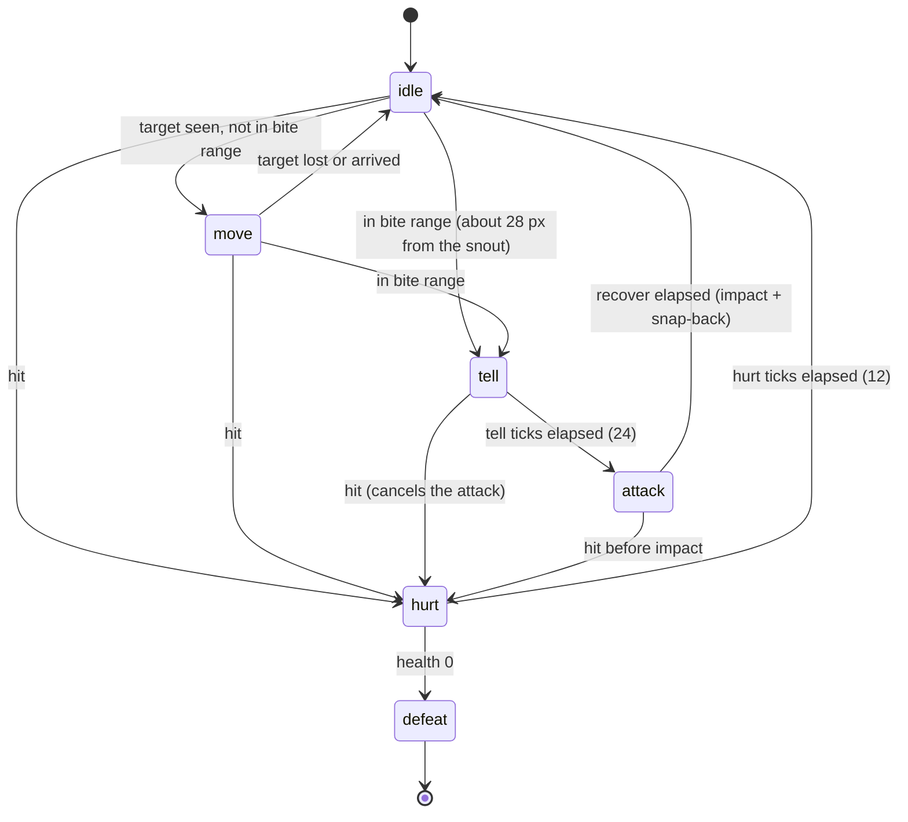

# RAT-01: Dungeon Rat readability set, design spec

**Status:** draft keys (Sonnet), awaiting top-tier edit. Packet and draft design: Claude Sonnet (medium tier). Edit/review: pending, a separate top-tier model. Keys are not frozen; no in-betweens are drawn.

**Decision record (draft):** height 18 px, frame 64 x 28, pivot (30, 27). Proposed and decided by the Sonnet draft designer; subject to the top-tier editor.

The sections follow `docs/02-art/gob-01-goblin-spec.md`. Every former `<fill>` is now a draft value; write numbers, not adjectives. The design step stops at the keys and this spec (see the top-tier budget in `docs/07-agents/agent-orchestration.md`).

## 1. Canon and tone constraints

- Approved concept: `assets/concept/floor-01/enemies/floor01-dungeon-rat-concept-approved.png`; `docs/02-art/floor-01-minor-enemy-concepts.md` records it as an owner-approved visual design direction (Level-2 dungeon rat), upload identity verified against the manifest.
- Tone (`docs/01-design/antihero-tone.md`, enemies row): threatening yet eccentric, with motivated behaviors and readable tells and some absurd visual contrasts; never a purely serious faceless army and never comedic with no danger. 1980s-1990s action cinema is used for attitude only, never copied designs.
- Canon facts that must survive in pixels (from the approved docs and the concept board, not design decisions):
  - Isolated, recognizable small-vermin silhouette: long wiry torso, arched mangy back.
  - Patchy gray-brown fur with pink bald patches, torn ears, yellow teeth, whip-like tail.
  - Reads against ordinary brick-and-torch catacombs; it must not imply every room is an underground sewer.
  - The one-sheet explores low stalking, sprinting, leaping, a bite and a defeated pose.

### Guardrails (copied from the roster and minor-enemy docs)

- Visual concept approved only: no automatic approval of AI-in-image numeric labels, narrative claims, level mechanics or exactly depicted behavior (speed, leap distance, bite damage, "Level 2" tiering).
- Convert from original editable pixel grids / `.aseprite` rather than cropping the illustrated panel into runtime sprites.
- Rat readability needs native 640x360 review against Carl 52 px and Donut 40 px (minor-enemy doc, shared direction).
- The mood panel (flooded channel, grate, skull, bones) is environment context, not a sewer-only mandate and not a sprite requirement.
- The shared direction is THE CRAWL gritty 80s/90s sensibility with the existing catacomb grammar (warm torch pools, cool recessed stone), not a blanket neon filter.

### Packet inputs

- Concept crops in `docs/evidence/rat-01/packet/` (x,y,w,h in the 1672x941 concept):
  - `concept_crop_1.png` = `475,165,340,150`: stalk / crouch
  - `concept_crop_2.png` = `855,160,410,155`: sprint
  - `concept_crop_3.png` = `45,375,395,185`: leap / pounce
  - `concept_crop_4.png` = `500,425,375,140`: bite attack
  - `concept_crop_5.png` = `895,395,385,170`: defeated / squashed
- Readability set (tags): `idle`, `move` (`walk`), `tell` (`attack_tell`), `attack` (`attack_swing`), `hurt`, `defeat` (`down`). About 12 to 20 frames until the asset has a gameplay work order. Frame counts and tick windows are decided in section 4 (draft).
- Frame size and pivot were set by the draft designer (section 3); the template's 64 x 56 / (28, 55) were placeholders.

## 2. Size decision

Carl is 52 px (about 6 ft), Donut 40 px, the goblin 36 px (see `scale_lineup.png`). Opaque height is measured on the idle key (ears and tufts included, tail excluded). The three candidates are flat-lit block-ins of the same idle pose (`rat_size_study.grid.json`, picture `docs/evidence/rat-01/draft/size_study.png`).

| Option | Idle opaque height | Ratio to Carl | Implied real height | Why / why not |
| --- | --- | --- | --- | --- |
| A | 14 px | 0.27 | about 20 in (1 px = 1.4 in) | Below Carl's knee. Eyes, ears and teeth collapse to 1 px each, the arched back is a 3 px bump, and the crouch (tell) would be about 9 px tall: unreadable next to a 36 px goblin. |
| B | 18 px | 0.35 | about 25 in | Mid-thigh on Carl. Ember eyes (2 x 1), torn ear, two yellow teeth, pink bald patches and a visible arch all survive at 1x. Half the goblin's height. |
| C | 22 px | 0.42 | about 31 in | Hip height on Carl, 61 % of the goblin. Reads very well, but a "repeated nuisance" this big starts to compete with the goblin for the same role and crowds Carl's attack reach. |

Decision: **B, 18 px** (frame 64 x 28, idle width 53 px from tail tip to nose, 36 px without the tail). The concept board shows an oversized rat; guardrail: that is not the gameplay scale. 18 px is a giant-rat-but-still-vermin read next to a 6 ft man (a real rat is about 8 in, this one is about 3 times that), small enough to stay a nuisance and big enough to keep a face at 1x. Proposed and decided by the same draft agent (Claude Sonnet, draft); the top-tier editor owns the final call, in particular whether 20 px would be a better compromise.

## 3. Frame, pivot, boxes and atlas

- Frame **64 x 28**, pivot **(30, 27)**, contact row **27** (the lowest opaque row of every grounded frame). Frame width is driven by the lunge (idle body x 2..54, bite x 1..57); height 28 leaves 6 rows of margin over the 22 px rear-up of the hurt key. Pivot x is the midpoint of the idle feet (rear foot at about x 20, front foot at about x 42).
- Grounded tags: all six (`idle`, `walk`, `attack_tell`, `attack_swing`, `hurt`, `down`). Airborne tags: none. The bite is a lunge with the rear claws still on the floor; a true leap (concept crop 3) is left to a later gameplay work order.
- Boxes, in pixels relative to the pivot (x right, y up from the contact row):
  - Standing box 28 x 12: x -13 to +15, y 0 to 12 (torso, no tail, no snout, no ear tips).
  - Hurtbox 34 x 12: x -14 to +20, y 0 to 12 on idle/move/tell; on `hurt` the box follows the reared body (x -13 to +14, y 0 to 20). Excludes tail and ear tips.
  - Attack hitbox, active only on the bite impact frame: x +14 to +27, y 6 to 15 (13 x 9, the open jaws, the head and the leading claws). Frame 3 nose tip is at x +26, claws at x +22.
- Authored facing right; the runtime mirrors around the pivot column.
- One atlas, 19 frames (0 to 18, section 4), layer `body` only (no weapon).

## 4. Readability-set animation list

Tick windows are at 60 Hz. The rat is a fast nuisance, so cycles are shorter than the goblin's, but the tell keeps the 18-tick readable hold of the common rules.

| Role | Tag | Frames | Playback | Ticks | Notes |
| --- | --- | --- | --- | --- | --- |
| idle | `idle` | 3 | loop | 10 + 8 + 10 = 28 | quick twitchy breathing, tail tip flick |
| move | `walk` | 6 | loop | 6 x 4 = 24 | sprint cycle; speed from the gameplay spec; the tag is named `walk` for toolkit parity |
| tell | `attack_tell` | 2 | once | 6 + 18 = 24 | settle into the stalk, then hold 18 ticks |
| attack | `attack_swing` | 3 | once | lunge smear 2 + bite impact 4 (hitbox ticks) + snap-back 6 = 12 | hitbox active only on the impact frame |
| hurt | `hurt` | 2 | once | 4 + 8 = 12 | |
| defeat | `down` | 3 | hold | 4 + 8 + hold | |

Frame table (19 frames; keys are the draft keys in `rat_h18.grid.json`, in-betweens are not drawn):

| # | Tag | Pose | Ticks | Author |
| --- | --- | --- | --- | --- |
| 0 | `idle` | arched hunch, head low, tail S-curve on the floor | 10 | key (draft) |
| 1 | `idle` | inhale: back 1 px higher, tail tip up 1 px | 8 | in-between |
| 2 | `idle` | as 0 with the head 1 px lower, ear flicked back | 10 | in-between |
| 3 | `walk` | sprint contact A: front paws reach, hind toes push off, body stretched | 4 | key (draft) |
| 4 | `walk` | passing A: all four feet gathered under the body, back arched | 4 | in-between |
| 5 | `walk` | airborne-looking gather (one foot still on the floor row), spine peak | 4 | in-between |
| 6 | `walk` | sprint contact B: legs swapped (mirror of 3 on legs, new fur streaks) | 4 | in-between |
| 7 | `walk` | passing B | 4 | in-between |
| 8 | `walk` | gather B | 4 | in-between |
| 9 | `attack_tell` | onset: body drops 3 px, haunches rise, tail starts to lift | 6 | in-between |
| 10 | `attack_tell` | stalk hold: belly low, hind legs coiled, jaws open, tail curled high | 18 | key (draft) |
| 11 | `attack_swing` | lunge smear: body extended along 15 degrees, jaws opening, rear feet pushing | 2 | in-between |
| 12 | `attack_swing` | bite impact: stretched, jaws wide, claws forward | 4 | key (draft) |
| 13 | `attack_swing` | snap-back: jaws shut, head 4 px back, body recoiling | 6 | in-between |
| 14 | `hurt` | recoil: reared back, head thrown up, eyes squeezed | 4 | key (draft) |
| 15 | `hurt` | settle: 3 px lower, head coming down, one eye reopened (white) | 8 | in-between |
| 16 | `down` | flop: sideways tumble, legs out | 4 | in-between |
| 17 | `down` | bounce: belly-up, legs half raised | 8 | in-between |
| 18 | `down` | final: belly-up, legs stiff, head lolled, X eye, tongue out | hold | key (draft) |

The draft grid and `rat-01.pixelart.json` carry only the six keys with key-only indices 0 to 5 (idle, walk, attack_tell, attack_swing, hurt, down). The executor inserts the in-betweens and re-indexes to the 0 to 18 table above, rewriting the tag table and the bbox/key-count rule frames.

## 5. State diagram



Bite range, hit points and the cancel rules are proposals for the gameplay work order; none of them is approved.

## 6. Palette `rat-floor01-v0`

15 colours (at most 20). The concept crop candidates are mostly the background navy (15 of 24) and are not used as is; they were read by eye. The concept fur is warm brown-gray; the draft deliberately shifts it **cool and neutral** (blue-gray) because Floor 1's brick is saturated orange and a brown rat disappears into it (concept candidates `#4c342f`, `#221a20` map to the dark end of the fur ramp). The pink patches, tail and ear colour come from the concept's reds (`#8a4034`, `#d4986d`, `#521e20`) pushed toward pink so they read as bare skin rather than blood or brick.

| Key | Name | RGBA | Role |
| --- | --- | --- | --- |
| `K` | outline_plum | `#1a1218` | 1 px outline, shared with the goblin family |
| `a` | fur_deep | `#2b2830` | fur ramp 1: deep shadow, far limbs |
| `s` | fur_shade | `#4a4550` | fur ramp 2: shade, streaks |
| `m` | fur_mid | `#6e6670` | fur ramp 3: body |
| `l` | fur_light | `#9a8f86` | fur ramp 4: warm rim on the torch side |
| `p` | pink_deep | `#74303f` | skin ramp 1: patch edge, tail base |
| `q` | pink_mid | `#b8576a` | skin ramp 2: bald patches, tail |
| `r` | pink_light | `#e39a96` | skin ramp 3: ear, nose, patch light |
| `e` | eye_ember | `#ff5a24` | accent: awake eyes (absent when hurt or dead) |
| `h` | eye_hot | `#ffd84a` | accent: reserved for the pupil highlight (unused in the draft) |
| `t` | tooth_yellow | `#e2b83e` | accent: teeth |
| `T` | tooth_shade | `#9a7424` | tooth shade, claw shadow |
| `o` | mouth_dark | `#4a1020` | open mouth interior |
| `c` | claw_bone | `#cbb890` | claws |
| `w` | eye_white | `#efe4c4` | accent: hurt eye whites (reserved, unused in the draft) |

Ramps: fur `a -> s -> m -> l`; skin `p -> q -> r`. Only 13 of the 15 keys are used by the six draft keys (`h` and `w` are reserved for the in-betweens). Separation from the scene: the blue-gray fur sits between the orange brick and the cold arch; the ember eyes and pink skin are the only warm/saturated pixels on the body.

## 7. Key poses (draft)

Idle opaque heights: idle 18, move 16, tell 18 (tail up; body 11), attack 19, hurt 21, defeat 14.

| Frame | Tag | Silhouette and pose notes | Readability reason |
| --- | --- | --- | --- |
| 0 | `idle` | Long wiry torso arched like a bridge, apex 14 px over the hips, head low and forward at x +12 to +22, snout 3 px above the floor. Far ear forward, near ear torn (pink wedge). Pink bald patches on the flank and shoulder, 4 fur tufts on the spine, whip tail S-curve on the floor behind. Ember eye, two yellow teeth hanging from the snout. | The only pose with a bridge-shaped back; reads "vermin, threat low" at 1x. |
| 3 | `walk` | Sprint contact: body 16 px tall, stretched flat (spine nearly horizontal), head forward, ears pinned back. Front paw reaches out ahead (x +18), hind leg trails back with toes on the floor (x -19). Tail streams straight back and a little up. | Longest, lowest silhouette; clearly different from the arched idle. |
| 10 | `attack_tell` | Low stalk: belly 3 px above the floor, haunch up 11 px, hind legs coiled under the rump, front legs flat forward, chin near the floor, jaws open with the teeth showing and a dark mouth wedge. The tail curls up high behind the rump (the highest point, 18 px above the floor over an 11 px body). | The tail raised over a flat body is the signal; body crouched lower than idle. |
| 12 | `attack_swing` | Bite lunge: body rising along 20 degrees from the planted rear claws, jaws wide open (dark mouth, upper and lower yellow teeth, pink nose), front claws extended forward, tail trailing straight back. Reach: nose at x +26; the bite key is 19 px tall. | The single widest-mouth, longest-reach pose; the hitbox lives here. |
| 14 | `hurt` | Reared back about 40 degrees, head thrown up with open mouth, eyes squeezed (two outline pixels, no ember), front legs flung forward and up, tail whipped up in front. Hind feet on the floor. | Tallest silhouette of the set and the only one with no ember eyes before defeat. |
| 18 | `down` | Belly-up on the floor, pink belly facing the camera, four legs stiff in the air, head lolled right with open mouth, tongue out, X eye, tail limp on the floor. 14 px tall. | Flat and symmetrical, pink belly and no ember eyes: unmistakably dead. |

## 8. In-between list

For the execution tier; no design decisions needed. Frame numbers follow the section 4 table.

| # | Pose notes |
| --- | --- |
| 1 | Idle 0 with the spine apex 1 px higher, the tail tip 1 px up |
| 2 | Idle 0 with the head 1 px lower, the near ear 1 px back |
| 4 | Walk gather: hind feet advance under the hips, spine arched 2 px higher than key 3, front paws pull back under the chest |
| 5 | Walk peak: all paws clear of the floor except one hind toe (keep a pixel on row 27), spine peak, tail raised 2 px |
| 6 | Mirror of key 3 on the legs only (near and far swapped, the far leg drawn in `a`), fur streaks kept |
| 7 | As 4 with the legs swapped |
| 8 | As 5 with the legs swapped, tail 1 px lower |
| 9 | Tell onset: key 10 raised 3 px with the jaws shut, the tail halfway up |
| 11 | Lunge smear: key 12 with the jaws half open, the body 4 px back, a 1 px `l` streak behind the haunch |
| 13 | Snap-back: jaws shut, head 4 px behind key 12, front claws retracted, body 1 px lower |
| 15 | Hurt settle: key 14 lowered 3 px, head coming down, near eye reopened as `w` pixels, mouth half open |
| 16 | Down flop: body tilted 30 degrees on its side, legs out, eyes shut |
| 17 | Down bounce: belly-up, back on the floor, legs half raised, tail curled |

## 9. Validators and readability rules

Run by `python3 -m scripts.pixelart validate assets/source/characters/rat/rat-01.pixelart.json` (rules V01 to V15). Draft config values:

- V04 palette: at most 20 colours (15 defined); V05 isolated pixels: 0; V06 orphan pixels: at most 9 per frame. The authoring script runs a deterministic despeckle (recolours non-outline, non-accent orphans), so the keys are clean; the editor may remove it when hand-polishing.
- V07/V08 contact rows: all tags grounded, contact row 27.
- V09 frozen keys: not configured in the draft (keys are not frozen); at freeze, fixture `tests/fixtures/rat-01_keys.json`, frames 0, 3, 10, 12, 14, 18 (final indices).
- V13 bbox rules: idle top at row 10 (18 px); walk key at least 11 rows from the top (lower than idle); tell key top at row 9 or lower with width at most 50; down key at row 13 or lower and at most 56 wide.
- V14 key-count rules: tell has at least 3 yellow tooth pixels; bite has at least 4 tooth pixels and at least 6 dark-mouth pixels; hurt and down have 0 ember-eye pixels; the awake keys (idle, walk, tell, bite) have at least 2 ember-eye pixels.

## 10. Evidence

```text
python3 -m scripts.pixelart validate assets/source/characters/rat/rat-01.pixelart.json --out docs/evidence/rat-01/draft
python3 -m scripts.pixelart review-pack assets/source/characters/rat/rat-01.pixelart.json --out docs/evidence/rat-01/draft --allow-failing
python3 -m scripts.pixelart compare --source assets/source/characters/rat/rat_size_study.grid.json --out docs/evidence/rat-01/draft/size_study.png
```

Draft pictures (the review pack holds the contact sheet x4, the lit scene 640 x 360 shown x3 with Carl and Donut, and the tell to attack strip; validators currently PASS 12 of 12 applicable):

- `docs/evidence/rat-01/draft/01_contact_sheet_x4.png`
- `docs/evidence/rat-01/draft/02_lit_scene_640x360_x3.png`
- `docs/evidence/rat-01/draft/03_tell_attack_strip.png`
- `docs/evidence/rat-01/draft/size_study.png`

Scene note: the scene tool mirrors enemies to face Carl, so the rats there face left.

## 11. Files

| File | Role |
| --- | --- |
| `scripts/author_rat01.py` | deterministic authoring script (`keys`, `size-study`; rules and literal stamps, no raster input) |
| `assets/source/characters/rat/rat_h18.grid.json` / `.ase` | the six draft keys (pixel-grid-v1 and Aseprite master) |
| `assets/source/characters/rat/rat_size_study.grid.json` / `.ase` | 14, 18 and 22 px block-ins |
| `assets/source/characters/rat/rat-01.pixelart.json` | the draft asset config (key-only indices) |
| `assets/manifests/rat-01.json` | manifest: not written yet (execution tier) |
| `tests/fixtures/rat-01_keys.json` | frozen keys: not written yet (after the review) |

## 12. Rights and provenance

Fan-concept art under the owner-reported `ART-PUBLICATION-ALL-V1` scope (see `docs/04-production/rights-and-release.md`). Packet: Claude Sonnet. Draft keys, size study, palette, spec: Claude Sonnet (medium tier, draft designer). Top-tier edit and review: pending (separate agents). No tracing of the concept, no image-model raster output; the rasterizer is a rule-based polygon/capsule script plus literal stamps.

## 13. Open questions for the top-tier editor

- Fur hue: cool blue-gray was chosen for brick separation; the concept is warmer brown-gray. Warm it up if the "gray-brown" canon matters more than separation.
- Size: 18 px (B). Consider 20 px if the face (eye, teeth, torn ear) reads weak at 1x.
- The hurt key looks like a diagonal rear-up and its upper body is close to the bite key in angle; it may need a stronger distinction (more arch, less lean) and a clearer pink flinch.
- The tell key lowers the body but the mouth wedge is only 3 px; the tail curl is the main signal. Check that it is readable against the idle in motion.
- The face and ears are 1 px stamps and ear tears are not yet drawn as a notch; this is the main polish task.
- The torso is a uniform thick polyline: more rib/spine character (wiry) and fur-patch placement per key need an artist's eye.
