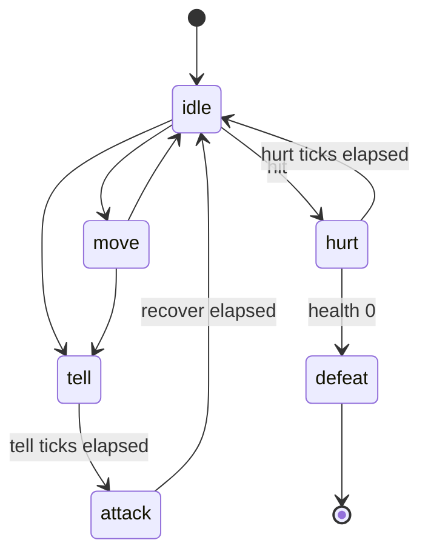

# RAT-01: Dungeon Rat readability set, design spec

**Status:** packet only; design pending. Packet prepared by Claude Sonnet (medium tier). Design: <fill: model>; execution: <fill: model>; review: <fill: a separate top-tier model>.

**Decision record:** height <fill> px, frame <fill> x <fill>, pivot (<fill>, <fill>). Proposed by <fill>; decided by <fill>.

The sections follow `docs/02-art/gob-01-goblin-spec.md`. Replace every `<fill: ...>`; write numbers, not adjectives. The design step stops at the keys and this spec (see the top-tier budget in `docs/07-agents/agent-orchestration.md`).

## 1. Canon and tone constraints

- Approved concept: `assets/concept/floor-01/enemies/floor01-dungeon-rat-concept-approved.png`; `docs/02-art/floor-01-minor-enemy-concepts.md` records it as an owner-approved visual design direction (Level-2 dungeon rat), upload identity verified against the manifest.
- Tone (`docs/01-design/antihero-tone.md`, enemies row): threatening yet eccentric, with motivated behaviors and readable tells and some absurd visual contrasts; never a purely serious faceless army and never comedic with no danger. 1980s-1990s action cinema is used for attitude only, never copied designs.
- Canon facts that must survive in pixels (from the approved docs and the concept board, not design decisions):
  - Isolated, recognizable small-vermin silhouette: long wiry torso, arched mangy back.
  - Patchy gray-brown fur with pink bald patches, torn ears, yellow teeth, whip-like tail.
  - Reads against ordinary brick-and-torch catacombs; it must not imply every room is an underground sewer.
  - The one-sheet explores low stalking, sprinting, leaping, a bite and a defeated pose.

### Guardrails (copied from the roster and minor-enemy docs)

- Visual concept approved only: no automatic approval of AI-in-image numeric labels, narrative claims, level mechanics or exactly depicted behavior (speed, leap distance, bite damage, "Level 2" tiering).
- Convert from original editable pixel grids / `.aseprite` rather than cropping the illustrated panel into runtime sprites.
- Rat readability needs native 640x360 review against Carl 52 px and Donut 40 px (minor-enemy doc, shared direction).
- The mood panel (flooded channel, grate, skull, bones) is environment context, not a sewer-only mandate and not a sprite requirement.
- The shared direction is THE CRAWL gritty 80s/90s sensibility with the existing catacomb grammar (warm torch pools, cool recessed stone), not a blanket neon filter.

### Packet inputs

- Concept crops in `docs/evidence/rat-01/packet/` (x,y,w,h in the 1672x941 concept):
  - `concept_crop_1.png` = `475,165,340,150`: stalk / crouch
  - `concept_crop_2.png` = `855,160,410,155`: sprint
  - `concept_crop_3.png` = `45,375,395,185`: leap / pounce
  - `concept_crop_4.png` = `500,425,375,140`: bite attack
  - `concept_crop_5.png` = `895,395,385,170`: defeated / squashed
- Readability set (tags): `idle`, `move` (`walk`), `tell` (`attack_tell`), `attack` (`attack_swing`), `hurt`, `defeat` (`down`). About 12 to 20 frames until the asset has a gameplay work order. Frame counts and tick windows in section 4 are the toolkit's GOB-01 defaults, placeholders and not decisions.
- Template frame size (64 x 56) and pivot (28, 55) are the toolkit defaults, not decisions; the designer sets both.
- Everything else (size, palette choice, poses, timing, hitboxes) is left blank for the designer.

## 2. Size decision

Carl is 52 px (about 6 ft), Donut 40 px, the goblin 36 px (see `scale_lineup.png`).

| Option | Idle opaque height | Ratio to Carl | Implied real height | Why / why not |
| --- | --- | --- | --- | --- |
| A | <fill> px | <fill> | <fill> | <fill> |
| B | <fill> px | <fill> | <fill> | <fill> |
| C | <fill> px | <fill> | <fill> | <fill> |

Decision: <fill: height and the reason, one paragraph; the proposer and the decider are different agents>.

## 3. Frame, pivot, boxes and atlas

- Frame <fill> x <fill>, pivot (<fill>, <fill>), contact row <fill> (the lowest opaque row of every grounded frame).
- Grounded tags: <fill>. Airborne tags (no pixel on the contact row): <fill or none>.
- Standing box <fill> x <fill>; hurtbox <fill>; attack hitbox <fill> on the impact frame.
- Authored facing right; the runtime mirrors around the pivot column.
- One atlas, frames 0 to <fill>, layers: <fill: for example body, weapon>.

## 4. Readability-set animation list

Readability set: idle, move, tell, attack, hurt, defeat (about 12 to 20 frames until the asset has a gameplay work order). Tick windows are at 60 Hz.

| Role | Tag | Frames | Playback | Tick-window proposal | Reference |
| --- | --- | --- | --- | --- | --- |
| idle | `idle` | 2-4 | loop | 8-12 ticks per frame, a 32-40 tick breathing cycle | GOB-01: 12 + 8 + 12 + 8 |
| move | `walk` | 4-6 | loop | 5 ticks per frame, speed from the gameplay spec | GOB-01: 6 x 5 = 30 ticks |
| tell | `attack_tell` | 1-2 | once | at least 18 ticks of readable hold, about 24 total | GOB-01: 6 + 18 |
| attack | `attack_swing` | 2-3 | once | smear 2, impact 3-4 (shown on exactly the hitbox-active ticks) | GOB-01: 2 + 4, then recover 20 |
| hurt | `hurt` | 1 | once | 8-12 ticks | GOB-01: 4 + 8 |
| defeat | `down` | 2-3 | hold | floor impact 4, settle 8, then a state-driven hold | GOB-01: 4 + 8 + hold |

Frame table (`frame_pivot_template.json` carries the same rows):

| # | Tag | Pose | Ticks | Author |
| --- | --- | --- | --- | --- |
| 0 | `idle` | <fill: pose> | 12 | <fill: key or Sonnet> |
| 1 | `idle` | <fill: pose> | 8 | <fill: key or Sonnet> |
| 2 | `idle` | <fill: pose> | 12 | <fill: key or Sonnet> |
| 3 | `walk` | <fill: pose> | 5 | <fill: key or Sonnet> |
| 4 | `walk` | <fill: pose> | 5 | <fill: key or Sonnet> |
| 5 | `walk` | <fill: pose> | 5 | <fill: key or Sonnet> |
| 6 | `walk` | <fill: pose> | 5 | <fill: key or Sonnet> |
| 7 | `attack_tell` | <fill: pose> | 6 | <fill: key or Sonnet> |
| 8 | `attack_tell` | <fill: pose> | 18 | <fill: key or Sonnet> |
| 9 | `attack_swing` | <fill: pose> | 2 | <fill: key or Sonnet> |
| 10 | `attack_swing` | <fill: pose> | 4 | <fill: key or Sonnet> |
| 11 | `hurt` | <fill: pose> | 4 | <fill: key or Sonnet> |
| 12 | `hurt` | <fill: pose> | 8 | <fill: key or Sonnet> |
| 13 | `down` | <fill: pose> | 4 | <fill: key or Sonnet> |
| 14 | `down` | <fill: pose> | 8 | <fill: key or Sonnet> |
| 15 | `down` | <fill: pose> | hold | <fill: key or Sonnet> |

## 5. State diagram



## 6. Palette

At most <fill: 20> colours. Candidates from the concept crop (median cut, by pixel share; see `palette_candidates.json`). These are candidates, not decisions.

| # | Candidate | Share | Decision (key, name, role) |
| --- | --- | --- | --- |
| 1 | `#12131e` | 12.2 % | <fill: key, name, role> |
| 2 | `#11121d` | 8.4 % | <fill: key, name, role> |
| 3 | `#12131f` | 6.6 % | <fill: key, name, role> |
| 4 | `#9f6249` | 6.3 % | <fill: key, name, role> |
| 5 | `#13141f` | 5.9 % | <fill: key, name, role> |
| 6 | `#040308` | 5.6 % | <fill: key, name, role> |
| 7 | `#4c342f` | 5.5 % | <fill: key, name, role> |
| 8 | `#11131e` | 5.4 % | <fill: key, name, role> |
| 9 | `#8a4034` | 5.4 % | <fill: key, name, role> |
| 10 | `#d4986d` | 5.3 % | <fill: key, name, role> |
| 11 | `#12141f` | 4.9 % | <fill: key, name, role> |
| 12 | `#521e20` | 4.2 % | <fill: key, name, role> |
| 13 | `#221a20` | 3.9 % | <fill: key, name, role> |
| 14 | `#0e0f18` | 3.3 % | <fill: key, name, role> |
| 15 | `#141520` | 3.2 % | <fill: key, name, role> |
| 16 | `#12141e` | 2.7 % | <fill: key, name, role> |
| 17 | `#12131d` | 2.6 % | <fill: key, name, role> |
| 18 | `#11131f` | 2.4 % | <fill: key, name, role> |
| 19 | `#1f0f17` | 2.1 % | <fill: key, name, role> |
| 20 | `#11131d` | 1.5 % | <fill: key, name, role> |
| 21 | `#110f19` | 1.4 % | <fill: key, name, role> |
| 22 | `#17131e` | 0.6 % | <fill: key, name, role> |
| 23 | `#10131e` | 0.5 % | <fill: key, name, role> |
| 24 | `#12151f` | 0.2 % | <fill: key, name, role> |

The chosen palette must separate this asset from the warm brick and the cold arch of Floor 1 at 1x, and fit the A1 lighting.

## 7. Key poses

One key per readability tag (about 6 to 8 keys): idle 0, move contact, tell hold, attack impact, hurt, defeat. Each key lists silhouette, joint positions, palette use and the readability reason. Keys are frozen once the review passes (`pixelart freeze`).

| Frame | Tag | Silhouette and pose notes | Readability reason |
| --- | --- | --- | --- |
| <fill> | <fill> | <fill> | <fill> |

## 8. In-between list

For the execution tier; no design decisions needed. One row per non-key frame, as in section 9 of the GOB-01 spec.

| # | Pose notes |
| --- | --- |
| <fill> | <fill> |

## 9. Validators and readability rules

Run by `python3 -m scripts.pixelart validate <asset-config>` (rules V01 to V15 in `scripts/pixelart/validators.py`). Parametrize in the asset config:

- V04 palette: at most <fill> colours; V05 isolated pixels: 0; V06 orphan pixels: at most <fill> per frame.
- V07/V08 contact rows: grounded tags end on the contact row, airborne tags never touch it.
- V09 frozen keys: SHA-256 per key frame, fixture `tests/fixtures/rat-01_keys.json`.
- V13/V14 readability rules (write each as a bbox or key-count rule): <fill: for example the tell is the highest point, the hurt eyes are white>.

## 10. Evidence

```text
python3 -m scripts.pixelart validate <asset-config> --out <dir>
python3 -m scripts.pixelart evidence <asset-config> --out <dir>
python3 -m scripts.pixelart review-pack <asset-config> --out <dir>
```

The review pack holds exactly three images (contact sheet x4, lit scene 640 x 360 shown x3, tell to attack strip) and the validator report.

## 11. Files

| File | Role |
| --- | --- |
| `assets/source/<fill>/rat-01.grid.json` / `.ase` | pixel-grid source and Aseprite master |
| `assets/manifests/rat-01.json` | manifest |
| `<fill>/rat-01.pixelart.json` | the asset config (from `frame_pivot_template.json`) |
| `tests/fixtures/rat-01_keys.json` | frozen keys |

## 12. Rights and provenance

Fan-concept art under the owner-reported `ART-PUBLICATION-ALL-V1` scope (see `docs/04-production/rights-and-release.md`). Record in the PR's `Rights/Provenance` section which model designed, executed and reviewed the art (packet: Claude Sonnet; design, execution, review: pending). No tracing of the concept, no image-model raster output.
