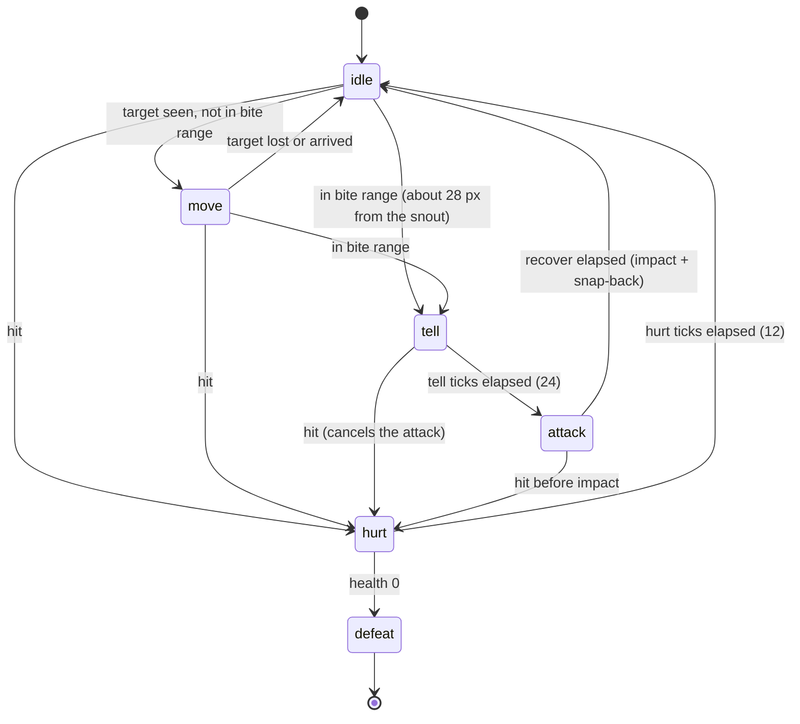

# RAT-01: Dungeon Rat readability set, design spec

**Status:** keys final (top-tier edit). Packet and draft: Claude Sonnet (medium tier). Design edit and final keys: Claude Opus (top tier). In-betweens, export and evidence: Claude Sonnet (medium tier, execution record in section 15). Independent top-tier art review: pending. The six keys are frozen in `tests/fixtures/rat-01_keys.json` (pixel-identical after the in-betweens were added); the 13 in-betweens are drawn.

**Decision record (final):** height 18 px, frame 64 x 28, pivot (30, 27), palette `rat-floor01-v1` (15 colours). Proposed by the Sonnet draft, confirmed (size, frame, pivot) and corrected (palette, four keys) by the top-tier editor; see section 13.

The sections follow `docs/02-art/gob-01-goblin-spec.md`. Every former `<fill>` is now a draft value; write numbers, not adjectives. The design step stops at the keys and this spec (see the top-tier budget in `docs/07-agents/agent-orchestration.md`).

## 1. Canon and tone constraints

- Approved concept: `assets/concept/floor-01/enemies/floor01-dungeon-rat-concept-approved.png`; `docs/02-art/floor-01-minor-enemy-concepts.md` records it as an owner-approved visual design direction (Level-2 dungeon rat), upload identity verified against the manifest.
- Tone (`docs/01-design/antihero-tone.md`, enemies row): threatening yet eccentric, with motivated behaviors and readable tells and some absurd visual contrasts; never a purely serious faceless army and never comedic with no danger. 1980s-1990s action cinema is used for attitude only, never copied designs.
- Canon facts that must survive in pixels (from the approved docs and the concept board, not design decisions):
  - Isolated, recognizable small-vermin silhouette: long wiry torso, arched mangy back.
  - Patchy gray-brown fur with pink bald patches, torn ears, yellow teeth, whip-like tail.
  - Reads against ordinary brick-and-torch catacombs; it must not imply every room is an underground sewer.
  - The one-sheet explores low stalking, sprinting, leaping, a bite and a defeated pose.

### Guardrails (copied from the roster and minor-enemy docs)

- Visual concept approved only: no automatic approval of AI-in-image numeric labels, narrative claims, level mechanics or exactly depicted behavior (speed, leap distance, bite damage, "Level 2" tiering).
- Convert from original editable pixel grids / `.aseprite` rather than cropping the illustrated panel into runtime sprites.
- Rat readability needs native 640x360 review against Carl 52 px and Donut 40 px (minor-enemy doc, shared direction).
- The mood panel (flooded channel, grate, skull, bones) is environment context, not a sewer-only mandate and not a sprite requirement.
- The shared direction is THE CRAWL gritty 80s/90s sensibility with the existing catacomb grammar (warm torch pools, cool recessed stone), not a blanket neon filter.

### Packet inputs

- Concept crops in `docs/evidence/rat-01/packet/` (x,y,w,h in the 1672x941 concept):
  - `concept_crop_1.png` = `475,165,340,150`: stalk / crouch
  - `concept_crop_2.png` = `855,160,410,155`: sprint
  - `concept_crop_3.png` = `45,375,395,185`: leap / pounce
  - `concept_crop_4.png` = `500,425,375,140`: bite attack
  - `concept_crop_5.png` = `895,395,385,170`: defeated / squashed
- Readability set (tags): `idle`, `move` (`walk`), `tell` (`attack_tell`), `attack` (`attack_swing`), `hurt`, `defeat` (`down`). About 12 to 20 frames until the asset has a gameplay work order. Frame counts and tick windows are decided in section 4 (draft).
- Frame size and pivot were set by the draft designer (section 3); the template's 64 x 56 / (28, 55) were placeholders.

## 2. Size decision

Carl is 52 px (about 6 ft), Donut 40 px, the goblin 36 px (see `scale_lineup.png`). Opaque height is measured on the idle key (ears and tufts included, tail excluded). The three candidates are flat-lit block-ins of the same idle pose (`rat_size_study.grid.json`, picture `docs/evidence/rat-01/draft/size_study.png`).

| Option | Idle opaque height | Ratio to Carl | Implied real height | Why / why not |
| --- | --- | --- | --- | --- |
| A | 14 px | 0.27 | about 20 in (1 px = 1.4 in) | Below Carl's knee. Eyes, ears and teeth collapse to 1 px each, the arched back is a 3 px bump, and the crouch (tell) would be about 9 px tall: unreadable next to a 36 px goblin. |
| B | 18 px | 0.35 | about 25 in | Mid-thigh on Carl. Ember eyes (2 x 1), torn ear, two yellow teeth, pink bald patches and a visible arch all survive at 1x. Half the goblin's height. |
| C | 22 px | 0.42 | about 31 in | Hip height on Carl, 61 % of the goblin. Reads very well, but a "repeated nuisance" this big starts to compete with the goblin for the same role and crowds Carl's attack reach. |

Decision: **B, 18 px** (frame 64 x 28, idle width 53 px from tail tip to nose, 36 px without the tail). The concept board shows an oversized rat; guardrail: that is not the gameplay scale. 18 px is a giant-rat-but-still-vermin read next to a 6 ft man (a real rat is about 8 in, this one is about 3 times that), small enough to stay a nuisance and big enough to keep a face at 1x. Proposed and decided by the same draft agent (Claude Sonnet, draft); the top-tier editor confirmed 18 px: at 20 px the rat would need a 30-row frame and starts to crowd the goblin's 36 px role, while the edited face (2 px ember eye, 2 x 2 yellow incisors, torn ear, pink nose) already reads at 1x in the lit scene.

## 3. Frame, pivot, boxes and atlas

- Frame **64 x 28**, pivot **(30, 27)**, contact row **27** (the lowest opaque row of every grounded frame). Frame width is driven by the lunge (idle body x 2..54, bite x 1..57); height 28 leaves 6 rows of margin over the 22 px rear-up of the hurt key. Pivot x is the midpoint of the idle feet (rear foot at about x 20, front foot at about x 42).
- Grounded tags: all six (`idle`, `walk`, `attack_tell`, `attack_swing`, `hurt`, `down`). Airborne tags: none. The bite is a lunge with the rear claws still on the floor; a true leap (concept crop 3) is left to a later gameplay work order.
- Boxes, in pixels relative to the pivot (x right, y up from the contact row):
  - Standing box 28 x 12: x -13 to +15, y 0 to 12 (torso, no tail, no snout, no ear tips).
  - Hurtbox 34 x 12: x -14 to +20, y 0 to 12 on idle/move/tell; on `hurt` the box follows the upright body (x -13 to +5, y 0 to 21). Excludes tail and ear tips.
  - Attack hitbox, active only on the bite impact frame: x +14 to +27, y 6 to 15 (13 x 9, the open jaws, the head and the leading claws). Frame 3 nose tip is at x +26, claws at x +22.
- Authored facing right; the runtime mirrors around the pivot column.
- One atlas, 19 frames (0 to 18, section 4), layer `body` only (no weapon).

## 4. Readability-set animation list

Tick windows are at 60 Hz. The rat is a fast nuisance, so cycles are shorter than the goblin's, but the tell keeps the 18-tick readable hold of the common rules.

| Role | Tag | Frames | Playback | Ticks | Notes |
| --- | --- | --- | --- | --- | --- |
| idle | `idle` | 3 | loop | 10 + 8 + 10 = 28 | quick twitchy breathing, tail tip flick |
| move | `walk` | 6 | loop | 6 x 4 = 24 | sprint cycle; speed from the gameplay spec; the tag is named `walk` for toolkit parity |
| tell | `attack_tell` | 2 | once | 6 + 18 = 24 | settle into the stalk, then hold 18 ticks |
| attack | `attack_swing` | 3 | once | lunge smear 2 + bite impact 4 (hitbox ticks) + snap-back 6 = 12 | hitbox active only on the impact frame |
| hurt | `hurt` | 2 | once | 4 + 8 = 12 | |
| defeat | `down` | 3 | hold | 4 + 8 + hold | |

Frame table (19 frames, all in `rat_h18.grid.json`; keys are the final keys, in-betweens are drawn by the executor):

| # | Tag | Pose | Ticks | Author |
| --- | --- | --- | --- | --- |
| 0 | `idle` | arched hunch, head low, tail S-curve on the floor | 10 | key (final) |
| 1 | `idle` | inhale: back 1 px higher, tail tip up 1 px | 8 | in-between |
| 2 | `idle` | as 0 with the head 1 px lower, ear flicked back | 10 | in-between |
| 3 | `walk` | sprint contact A: front paws reach, hind toes push off, body stretched | 4 | key (final) |
| 4 | `walk` | passing A: all four feet gathered under the body, back arched | 4 | in-between |
| 5 | `walk` | airborne-looking gather (one foot still on the floor row), spine peak | 4 | in-between |
| 6 | `walk` | sprint contact B: legs swapped (mirror of 3 on legs, new fur streaks) | 4 | in-between |
| 7 | `walk` | passing B | 4 | in-between |
| 8 | `walk` | gather B | 4 | in-between |
| 9 | `attack_tell` | onset: front drops toward the floor, rump rises, hackles half up, jaws still shut, tail halfway up | 6 | in-between |
| 10 | `attack_tell` | coiled wedge hold: rump high, chin low, hackles up, jaws gaping, tail hooked high | 18 | key (final) |
| 11 | `attack_swing` | lunge smear: body extended along 15 degrees, jaws opening, rear feet pushing | 2 | in-between |
| 12 | `attack_swing` | bite impact: stretched, jaws wide, claws forward | 4 | key (final) |
| 13 | `attack_swing` | snap-back: jaws shut, head 4 px back, body recoiling | 6 | in-between |
| 14 | `hurt` | knocked onto the haunches: torso upright, nose to the ceiling, pink belly flashed, eyes shut | 4 | key (final) |
| 15 | `hurt` | settle: torso tipping 2 px forward and 2 px lower, head coming down to horizontal, near eye reopened as one `w` pixel | 8 | in-between |
| 16 | `down` | flop: sideways tumble, legs out | 4 | in-between |
| 17 | `down` | bounce: belly-up, legs half raised | 8 | in-between |
| 18 | `down` | final: belly-up, legs stiff, head lolled, X eye, tongue out | hold | key (final) |

The grid and `rat-01.pixelart.json` now carry the full 0 to 18 table above (tag table, bbox and key-count rule frames, `rules.frozen_keys.frames` = `[0, 3, 10, 12, 14, 18]`). The fixture was re-written with `freeze --force` after the re-index; the six SHA-256 values are unchanged, only the fixture's frame numbers moved (0 to 5 became 0, 3, 10, 12, 14, 18).

## 5. State diagram



Bite range, hit points and the cancel rules are proposals for the gameplay work order; none of them is approved.

## 6. Palette `rat-floor01-v1`

15 colours (at most 20). The concept crop candidates are mostly the background navy (15 of 24) and were read by eye. **Decision (editor): split-temperature fur.** The shadow end of the ramp (`a`, `s`) stays cool blue-gray, so the underside, far limbs and streaks separate from the orange brick and floor; the lit end (`m`, `l`) is the concept's warm gray-brown, so the canon "patchy gray-brown" survives where the torch hits. This matches the A1 lighting grammar (warm torch, cold ambient) and keeps the separation the draft wanted. The pink patches, tail and ear come from the concept's reds pushed toward pink so they read as bare skin rather than blood or brick.

| Key | Name | RGBA | Role |
| --- | --- | --- | --- |
| `K` | outline_plum | `#1a1218` | 1 px outline, shared with the goblin family |
| `a` | fur_deep | `#2b2830` | fur ramp 1 (cool): deep shadow, far limbs, hackle spikes |
| `s` | fur_shade | `#4a4550` | fur ramp 2 (cool): shade, streaks, ribs |
| `m` | fur_mid | `#716760` | fur ramp 3 (warm gray-brown): body |
| `l` | fur_light | `#a39581` | fur ramp 4 (warm): rim on the torch side |
| `p` | pink_deep | `#74303f` | skin ramp 1: patch edge, tail base |
| `q` | pink_mid | `#b8576a` | skin ramp 2: bald patches, tail |
| `r` | pink_light | `#e39a96` | skin ramp 3: ear, nose, patch light, flashed belly |
| `e` | eye_ember | `#ff5a24` | accent: awake eyes (absent when hurt or dead) |
| `h` | eye_hot | `#ffd84a` | accent: reserved (not used by the keys; do not add a glint without a review) |
| `t` | tooth_yellow | `#e2b83e` | accent: teeth |
| `T` | tooth_shade | `#9a7424` | tooth shade, claw shadow |
| `o` | mouth_dark | `#4a1020` | open mouth interior |
| `c` | claw_bone | `#cbb890` | claws |
| `w` | eye_white | `#efe4c4` | accent: one-pixel reopened eye in the hurt settle (frame 15) only |

Ramps: fur `a -> s -> m -> l`; skin `p -> q -> r`. The keys use 13 of the 15 keys.

## 7. Key poses (final)

Opaque heights (contact row 27 to the top row): idle 18, walk 16, tell 19 (tail hook; body 13), bite 20, hurt 22, defeat 14. Face constants on every awake key: eye = 2 px `e` with a 2 px `K` brow above it, near ear = pink triangle about 4 x 5 px with a chewed-flat tip (the tear), pink 2 x 2 px nose at the snout tip.

| Frame | Tag | Silhouette and pose notes | Readability reason |
| --- | --- | --- | --- |
| 0 | `idle` | **Bridge arch.** Thin hips (radius 2.0) and neck (2.1), apex of the back 12 units over the floor above the ribs, a clear gap of daylight under the belly between the front and hind legs. Blunt wedge head low and forward, snout 3 px above the floor, 2 x 2 yellow incisors hanging below the nose (rows 25-26). Near ear torn: tip chewed flat plus a 1 px nick in the back edge. Pink bald saddle on top of the hump (reads in the silhouette), a smaller patch on the shoulder, three rib strokes (`s`) on the flank under the apex, five ragged tufts along the spine (1-2 px). Whip tail S-curve on the floor. | The only symmetric bridge silhouette in the set: "vermin, wiry, mangy" at 1x. |
| 3 | `walk` | (kept from the draft) sprint contact: spine nearly horizontal, head forward, ear pinned back with the chewed tip, front paw reaching to x +18, hind leg trailing to x -19, tail streaming straight back. | Longest, flattest silhouette. |
| 10 | `attack_tell` | **Coiled wedge.** Rump high (spine peak x -5, 10.4 units), chest and chin low, no daylight under the belly, hind legs piled under the rump (two near hind segments), front legs flat forward. Hackles: five spikes on the rump, rising to 3 px at the centre. Jaws gaping: dark maw (6 `o` px) between upper incisors at the nose and lower incisors under it (4 `t` px). Tail hooked high over the rump (the highest point). | Forward-sloping wedge + bristled hackles + open maw + raised tail: four signals that differ from the idle bridge, readable in motion and at 1x. |
| 12 | `attack_swing` | (kept from the draft, ear torn) bite lunge rising about 20 degrees from the planted hind claws, jaws wide (dark maw, upper and lower teeth), front claws forward, tail straight back. Nose at x +26. | Longest reach and widest mouth; the hitbox lives here. |
| 14 | `hurt` | **Knocked onto the haunches.** Torso nearly upright (about 70 degrees, leaning 2 units backward at the top), head snapped back with the nose to the ceiling, mouth open at the tip with two tooth pixels, eyes squeezed (2 `K` px, no ember). The pink underbelly is flashed at the camera along the front of the torso. Front paws splayed forward and up, hind feet still on the floor, tail kinked upward behind. Body 18 px wide without the tail. | Vertical and compact where the bite is a long diagonal (the draft's flag), pink flash and no ember eyes. |
| 18 | `down` | (kept from the draft) belly-up, pink belly to the camera, legs stiff in the air, head lolled with open mouth, tongue out, X eye, tail limp. | Flat, legs up, no ember eyes: dead. |

## 8. In-between list

Instruction list for the execution tier (done; see section 15 for the executor choices). Frame numbers follow the section 4 table. Rules for all in-betweens: keep the face constants from section 7 (2 px eye, chewed-tip ear, 2 x 2 incisors when the mouth is shut), keep the contact row 27 on at least one foot, use only the 13 palette keys the keys use plus `w` on frame 15, and keep orphans at most 9 per frame. Author them in `scripts/author_rat01.py` as new pose dicts built from the neighbouring key by moving the named points; do not redraw the keys.

| # | Derive from | Pose notes (design units: x right, y up) |
| --- | --- | --- |
| 1 | key 0 | inhale: spine points 2 to 5 +1 y (apex 13), tufts follow, tail tip (-27.5, 5.5) -> (-27.5, 6.5); legs and head unchanged |
| 2 | key 0 | head points -1 y (snout 1 px lower), near ear tip moved -0.8 x (flicked back), tail tip (-27.5, 4.5) |
| 4 | key 3 | gather A: hind feet advance to x -10, front paws pull back under the chest to x +12, spine arched: middle point +2 y; tail +1 y |
| 5 | key 3 | peak A: spine middle +3 y, all paws off the floor except the near hind toe (keep a pixel on row 27), tail +2 y |
| 6 | key 3 | contact B: swap near and far legs (the far leg drawn in the `far` ramp, `a`), same spine and head as key 3 |
| 7 | 4 | as 4 with the legs swapped |
| 8 | 5 | as 5 with the legs swapped, tail 1 px lower |
| 9 | key 10 | tell onset: spine +2 y at the head end and -1 y at the rump (halfway from idle to the wedge), jaws shut (no `o`, incisors 2 x 2 as idle), hackles 1 px, tail at the halfway point of key 0 -> key 10 |
| 11 | key 12 | lunge smear: whole body 4 units back and 4 units lower at the head end, jaws half open (3 `o` px), a 1 px `l` streak 3 px long behind the haunch |
| 13 | key 12 | snap-back: jaws shut, head 4 units behind key 12, front claws retracted to the chest, body 1 unit lower |
| 15 | key 14 | hurt settle: torso tipped 2 units forward and 2 units lower, head rotated to horizontal, near eye reopened as one `w` pixel, mouth half open (1 `o`), belly pink still showing |
| 16 | key 18 | down flop: body rolled 30 degrees onto its side (belly half visible), legs out sideways, eyes shut (`K`), tail limp |
| 17 | key 18 | down bounce: belly-up, back on the floor, legs half raised (2 px lower than key 18), tail curled |

## 9. Validators and readability rules

Run by `python3 -m scripts.pixelart validate assets/source/characters/rat/rat-01.pixelart.json` (rules V01 to V15). Values (full frame indices; the toolkit result is PASS, 13 pass, 0 fail, 2 skipped; in addition to the spec the config pins the onset and snap-back jaws shut and the reopened eye on frame 15):

- V04 palette: at most 20 colours (15 defined); V05 isolated pixels: 0; V06 orphan pixels: at most 9 per frame. The authoring script's despeckle stays (deterministic).
- V07 contact rows: all tags grounded, contact row 27.
- V09 frozen keys: fixture `tests/fixtures/rat-01_keys.json`, the six keys, layer `body`.
- V13 bbox rules: idle top at row 10, bottom 27 (18 px); walk top at row 11 or lower (lower than idle; apply to frames 3 to 8); tell top at row 9 or lower and at most 50 wide (frames 9 and 10); down top at row 13 or lower and at most 56 wide (frames 16 to 18); **hurt top at row 8 or higher and at most 30 wide** (`R-hurt-upright-compact`, frame 14 only).
- V14 key counts: tell has at least 3 `t` and **at least 4 `o`** (`R2-tell-maw-open`, frame 10 only); bite at least 4 `t` and 6 `o`; hurt and down 0 `e` (frames 14 to 18); awake frames 0 to 13 at least 2 `e`.

## 10. Evidence

```text
python3 scripts/author_rat01.py frames              # grid + manifest (--check verifies)
python3 scripts/pixel_grid_to_ase.py build assets/source/characters/rat/rat_h18.grid.json assets/source/characters/rat/rat_h18.ase
python3 -m scripts.pixelart validate assets/source/characters/rat/rat-01.pixelart.json
bash scripts/export_assets.sh                          # the Floor 1 kit atlases the lit scene needs
python3 -m scripts.pixelart evidence assets/source/characters/rat/rat-01.pixelart.json --out docs/evidence/rat-01
python3 -m scripts.pixelart review-pack assets/source/characters/rat/rat-01.pixelart.json --out docs/evidence/rat-01/review-pack
python3 -m scripts.pixelart compare --source assets/source/characters/rat/rat_size_study.grid.json --out docs/evidence/rat-01/size_study.png
```

The outdated `docs/evidence/rat-01/draft/` pictures (pre-edit keys) were removed. Evidence from the final 19-frame set, all in `docs/evidence/rat-01/` (index and hashes: `README.md`, `SHA256SUMS`). The review pack (`review-pack/`) holds exactly the three images the independent reviewer looks at, plus the validator report (PASS):

- `docs/evidence/rat-01/review-pack/01_contact_sheet_x4.png` (all 19 frames, keys marked)
- `docs/evidence/rat-01/review-pack/02_lit_scene_640x360_x3.png` (the rat set with Carl and Donut on lit Floor 1, shown x3)
- `docs/evidence/rat-01/review-pack/03_tell_attack_strip.png` (tell, bite, snap-back in tick order)
- `docs/evidence/rat-01/size_study.png` (the 14, 18 and 22 px block-ins, regenerated)

Scene note: the scene tool mirrors enemies to face Carl, so the rats there face left.

## 11. Files

| File | Role |
| --- | --- |
| `scripts/author_rat01.py` | deterministic authoring script (`frames` writes grid and manifest, `size-study`; `--check` verifies; rules and literal stamps, no raster input) |
| `assets/source/characters/rat/rat_h18.grid.json` / `.ase` | the 19 frames: six final keys plus 13 in-betweens (pixel-grid-v1 and Aseprite master) |
| `assets/source/characters/rat/rat_size_study.grid.json` / `.ase` | 14, 18 and 22 px block-ins |
| `assets/source/characters/rat/rat-01.pixelart.json` | the asset config (19-frame tag table, tick rows, rules, frozen keys) |
| `assets/manifests/rat-01.json` | candidate manifest: 19 frames with the 60 Hz tick table, boxes and attack ticks (`review_status`: `prototype_fixture_unapproved`) |
| `tests/fixtures/rat-01_keys.json` | frozen keys (SHA-256 of the six final key frames, numbered 0, 3, 10, 12, 14, 18) |
| `tests/test_art_rat01.py` | spec rules the toolkit does not cover (generator parity, tick windows, hitbox frame, `w` pixel, walk side swap) |

## 12. Rights and provenance

Fan-concept art under the owner-reported `ART-PUBLICATION-ALL-V1` scope (see `docs/04-production/rights-and-release.md`). Packet and draft keys (size study, palette v0, spec draft): Claude Sonnet (medium tier). Key edit, final palette and final design: Claude Opus (top tier, design editor). In-betweens, export, validators and evidence: Claude Sonnet (medium tier, executor). Independent top-tier review: pending (a separate agent). No tracing of the concept, no image-model raster output; the rasterizer is a rule-based polygon/capsule script plus literal stamps.

## 13. Editor changes (top-tier edit versus the draft)

Kept: size 18 px, frame 64 x 28, pivot (30, 27), contact row 27, idle/move/attack boxes, tags, timing and the state diagram; the walk, bite and defeat keys (walk and bite only gained the torn ear). Redrawn: idle, tell and hurt (three of six keys); retouched: walk and bite (ear).

- Palette `v0` -> `v1`: lit fur `m` `#6e6670` -> `#716760` and `l` `#9a8f86` -> `#a39581` (warm gray-brown, canon), shadows stay cool (separation). Answers the fur-hue question.
- Size: 18 px confirmed (reasons in section 2). Answers the size question.
- Idle: a real bridge arch with daylight under the belly, thinner hips and neck (wiry), rib strokes, five ragged spine tufts, bald saddle on the hump, 2 x 2 incisors under the nose (the draft's teeth collapsed onto one row), torn ear.
- Tell: replaced the flat crouch with a coiled wedge (rump high, chin low), hackle spikes on the rump, a 6 px dark maw with 4 teeth; tail hook kept. New rule `R2-tell-maw-open`. Answers the weak-tell-mouth flag.
- Hurt: replaced the diagonal rear-up (too close to the bite) with an upright knock-back onto the haunches, nose to the ceiling, flashed pink belly, splayed paws. Hurt box updated; new rule `R-hurt-upright-compact`. Answers the hurt-angle flag.
- Ear tears: chewed-flat tip on every awake key plus a back-edge nick on idle (`ear(..., notch=True)` and literal stamps). Rib/spine character: new `ribs` pose field and per-key tufts.
- Keys frozen; in-between list made numeric (section 8); validator list extended (section 9).

## 14. Open questions for the review

- The hurt pose reads as "upright, flinching" at 1x; the reviewer should confirm it does not read as a begging/sniffing rat once the runtime hit flash is on.
- The torn-ear nick is one pixel; at 1x the chewed tip carries the read. If the reviewer wants a louder tear, enlarge the near ear to 6 px tall in the idle key only.

## 15. Execution record (Sonnet)

Medium-tier executor, from the frozen keys and sections 4, 8 and 9. Nothing was redesigned; the six keys are pixel-identical (checked frame by frame against the committed key grid, and the six fixture hashes are unchanged).

- Drawn: frames 1, 2, 4 to 9, 11, 13, 15, 16, 17 in `scripts/author_rat01.py` as pose dicts derived (deep copies) from the key poses, with the section 8 point moves; the key `POSES` are never mutated. Re-indexed the config and the fixture to 0 to 18; exported grid, `.ase` and `assets/manifests/rat-01.json` (tick table at 60 Hz: idle 28, walk 24, tell 24, attack 12, hurt 12, down 12 plus hold). `python3 -m scripts.pixelart validate` passes every applicable rule (13 pass, 0 fail, 2 skipped: V08 and V10 are not configured for a grounded single-layer asset).
- Validators I added to the config on top of the spec list: onset (frame 9) and snap-back (frame 13) jaws shut (`o` at most 0), the reopened eye on frame 15 (`w` at least 1), and the awake / no-ember checks now cover every in-between.

### Executor choices for the reviewer

1. **Walk gather and peak (frames 4, 5, 7, 8).** The walk key already sits at the V13 headroom limit (top row 12, rule: top row 11 or lower on frames 3 to 8). "Spine middle +2 / +3" would breach it by 2 to 3 rows, so it is spent as a relative arch: the whole body (head, ears, face) drops 1 (frame 4) or 2 (frame 5) units and the spine middle rises 2 or 3, a net +1 at the apex and lower ends. Tails use the written +1 / +2 above the key.
2. **Tell onset (frame 9).** Spine: -1 at the rump to +2 at the head end as written. The head, ear and face move only +1 (not +2): +2 puts the head above the idle head, reading as a head-up stalk instead of "the front drops toward the floor". Hackles are all 1 px; tail is the point-wise halfway of the idle and wedge tails.
3. **Lunge smear (frame 11).** "4 back, 4 lower at the head end" is a linear ramp over the spine span (0 at x = -13 to full at x = +13) applied to every point; the hind claws stay on the contact row (clamped). The three-pixel `l` streak sits 1 px above the haunch rather than on the tail.
4. **Snap-back (frame 13).** Head and ear 4 back and 1 lower, front claws drawn short against the chest, spine tail end pulled to the head; the two teeth rows are a closed 2 x 2 mouth.
5. **Hurt settle (frame 15).** One `w` pixel as the reopened near eye with a `K` squint next to it, one `o` and two teeth at the horizontal snout; belly pink stays on the front of the torso.
6. **Down flop and bounce (frames 16, 17).** Flop is a flat side roll (opaque height 12) with the belly strip on the upper side; bounce is key 18 with the leg ends lowered 2 px and 1.2 units and the tail curled up. The two read close to each other at 1x (the bounce is mainly the leg and tail difference); the reviewer may ask for a stronger difference.
7. **Walk contact B (frame 6).** The extended legs are the far ramp (`a`) and the gathered legs are the near fur ramp, with a new fur seed.
8. **Authoring command.** `keys` was renamed `frames` (it now writes the grid and the manifest). The manifest `input_reference_ids` names the approved concept PNG by repository path.

### Evidence status

Evidence images were generated, not hand-checked beyond the contact sheet at x4 (the other review-pack images are for the independent reviewer). No game-feel claim is made: a human reviews timing and feel before any acceptance.

## 16. Review fix round (approved by the independent review 2026-11-18)

The independent review passed the set with execution items (no design defect, 18 px size confirmed). Six items were fixed in `scripts/author_rat01.py`; the changes below to frozen keys are exactly those the review approved as design authority for this round. The keys were re-frozen with `python3 -m scripts.pixelart freeze assets/source/characters/rat/rat-01.pixelart.json --force` (`tests/fixtures/rat-01_keys.json` now holds the new hashes). All six keys changed pixels (item 1 touches every frame); the geometry, silhouette boxes, tags, ticks and rules are unchanged.

| # | Finding | Change | Frozen keys changed |
| --- | --- | --- | --- |
| 1 | `l` used as speckle, not light | The random `l` flecks are gone; the second fleck rule now writes `a` (dark mange). `l` appears only as the torch-side rim the renderer already places on the top and left edges of each part: spine, skull, haunch, thighs. Stamped `l` speed streak on frame 11 kept. | all six (0, 3, 10, 12, 14, 18) and every in-between |
| 2 | Walk legs read as 1 px strokes | Near legs of the walk are drawn as their own part (`leg_part`), so the thigh gets a K outline against the torso. Radii raised (hind 2.8 / 1.6 / 1.2, front 2.2 / 1.5 / 1.1), shins made more diagonal (hind knee y 2.8, front knee y 3.0). Frames 4 to 8 use the same radii for near and far legs; gathered paws stay bunched under the chest; the x +18 reach and x -19 push are unchanged. | 3 (walk) |
| 3 | Rigid walk tail | New `run_tail(phase, lift)`: a six-point tail with a wave that travels from base to tip (one frame of lag, amplitude 2 px at the tip): tip down on the contacts (3, 6), up on the gathers and peaks (4, 5, 7, 8). The old straight lift values stay as the `lift` argument. | 3 (walk) |
| 4 | Tell maw near-invisible | Maw is 3 rows tall (12 `o` px instead of 6): rows 23 to 25, upper incisors on row 23, lower incisors moved down to row 26 (the floor-adjacent row), 3 `q` gum pixels above the maw. V14 (at least 4 `o`, at least 3 `t`) still holds. | 10 (tell) |
| 5 | Hurt belly flash thin | Belly flash radii 1.3 / 1.6 / 1.2 -> 1.9 / 2.2 / 1.7 (a column of 4 px or more along the torso front); near front paw reaches 1.3 px further and the far paw 1.2 px further (wider splay). Pose, angle and V13 hurt rule unchanged. Frame 15 (settle) follows with the same belly radii. | 14 (hurt) |
| 6 | Torn ear not readable at 1x | Idle near ear is now 6 px tall (was 5) with a deeper, wider back-edge bite (`ear(..., deep=True)`). The four literal nick stamps on idle (and frame 2) were dropped because the ear shape carries the tear. Other keys keep the 5 / 4.4 px chewed ear. Open question 2 answered. | 0 (idle); in-betweens 1 and 2 |

Evidence regenerated: grid, `.ase`, manifest, size-study grid, contact sheets, GIFs, scenes, tell/attack strip, review pack, `SHA256SUMS`. Validators: toolkit PASS (13 pass, 0 fail, 2 skipped); `pytest tests -q -k "rat or pixelart"`; asset and docs checks as recorded in the PR body. Execution: Claude Sonnet (medium tier). Re-review of the fixes: pending (a separate agent); the pending hurt-pose question (open question 1) still needs the runtime hit flash.
