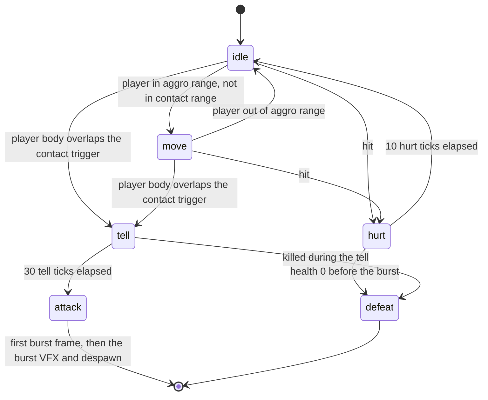

# ROT-01: Rot Sticker readability set, design spec

**Status:** packet ready; six keys designed, senior design edit done, keys re-frozen. In-betweens drawn and validated (`unique_frames` on). Independent review pending.

**Decision record:** an **oblique disc** (dark ringed shell on the wall side, pleated red face toward the room), 20 px along the wall, frame 32 x 32, pivot (6, 16), authored wall-mounted; ceiling, floor and right wall by runtime rotation or mirror of the one set; shading is direction-neutral (section 3). Decided in the design edit.

The sections follow `docs/02-art/gob-01-goblin-spec.md`. Replace every `<fill: ...>`; write numbers, not adjectives. The design step stops at the keys and this spec (see the top-tier budget in `docs/07-agents/agent-orchestration.md`).

## 1. Canon and tone constraints

- Approved concept: `assets/concept/floor-01/enemies/scatterers-rot-sticker-slime-bestiary.png` (Rot Sticker panels). The roster (`docs/02-art/floor-01-enemy-concept-roster.md`) records the Rot Sticker as a **small dark rounded wall/ceiling-running threat**, native production pending; "don't default to a large spider silhouette". The board is shared with the Scatterer, Brood Guardian and the other creature; only this creature's panels are cropped, and the Scatterer panels are skipped.
- Tone (`docs/01-design/antihero-tone.md`, enemies row): threatening yet eccentric, with motivated behaviors and readable tells and some absurd visual contrasts; never a purely serious faceless army and never comedic with no danger. 1980s-1990s action cinema is used for attitude only, never copied designs.
- Canon facts that must survive in pixels (from the approved docs and the concept board, not design decisions):
  - Small, dark, rounded, disc/ravioli-like body that clings to walls and ceilings; the board shows a dark ringed shell with red spikes and a glowing red centre or underside.
  - A contact hazard that explodes (atlas line 54); the glow brightening is the board's telegraph.
  - A parasite identity separate from the Green Slime; not a conventional spider and not a large tentacled ooze.
- Design reading of the tone: a squat black shell the size of a pizza, tilted off the wall like a half-opened ravioli, its pleated maroon face turned toward you with one ember in the middle; a rotten olive stain where it meets the brick, short red spikes on the rim. It looks like a bad mushroom you should not touch, which makes the threat unsettling and a little absurd. The danger is the telegraph: it lights up like a fuse before it goes. There is no face, no legs and no heroic styling; the only "attitude" is a dead patient stare from a glowing core.

### Where the canon, size and mechanics are defined (checked 2026-11-18)

| Topic | Source | What it says |
| --- | --- | --- |
| Visual approval | `docs/04-production/backlog.md` line 11; `docs/02-art/floor-01-art-atlas-v1.md` line 10; `docs/02-art/floor-01-enemy-concept-roster.md` line 17 | The Rot Sticker visual concept is owner-approved: a **small dark rounded wall/ceiling-running threat**; native production pending; "don't default to a large spider silhouette" |
| Canon | `docs/02-art/floor-01-art-atlas-v1.md` lines 45 and 54 | **Small dark round/ravioli-like creatures** that run across walls and ceilings and explode on contact, not large tentacled oozes; the atlas cites book chapters 15 and 19 and separates the "parasite" treatment from slime |
| Mechanics | `docs/01-design/floor-01-gameplay-progression-v0.md` line 78; `docs/01-design/combat-feel-hybrid-physics.md` line 79; `docs/01-design/combat-first-encounter-design.md` line 79 | A sticky/contact hazard with unusual wall/ceiling motion (not ordinary biped knockback), deliberate trigger and avoidance, explosive hazard. No hit points, damage, blast radius, speed or trigger rules exist |
| Production order | `docs/02-art/floor-01-enemy-concept-roster.md` line 60 | "Small native silhouette, wall/ceiling telegraph and contact readability" |
| Size | none | The only number is the lineup label (about 36 px) printed on `floor01-enemy-lineup-approved.png`, drawn as a large spider, which the roster says is not an accepted native size |
| Area art | `docs/07-agents/floor-01-area-kits-plan.md` line 21 (AREA-HAZARDS-01) | Ceiling and wall Rot Sticker tells belong to the hazards environment kit |

### Guardrails (copied from the roster and atlas)

- **Not a spider.** The ensemble board `floor01-enemy-lineup-approved.png` draws the Rot Sticker as a multi-legged spider with orange eyes; the roster says Rot Stickers are small, black, rounded wall/ceiling creatures and to use the boards for mood, not every anatomical detail. That board is not cropped here.
- The board's explosion burst and glowing states are concept illustrations; blast radius, damage, trigger rules and death behaviour are not approved. The tan human silhouettes in the lower rows are generic victims, not a character.
- Printed scale labels are not accepted native sizes. Convert from original editable pixel grids / `.aseprite`, never by tracing or cropping the board.

### Separate work orders suggested (not in scope here)

- The red explosion burst (and any rot or acid splash it leaves): a separate hazard-VFX work order; the crop of that panel is included only as a reference.
- Ceiling and wall tell markers, drip stains and decals: AREA-HAZARDS-01 (`docs/07-agents/floor-01-area-kits-plan.md` line 21).
- Wall, ceiling and floor orientation variants (rotation, mirrored frames, surface-specific anchors) need a design decision on whether they are frames of this asset or separate runtime transforms; the combat grammar for them lives in `docs/01-design/combat-feel-hybrid-physics.md` line 79.

### Packet inputs

- Concept crops in `docs/evidence/rot-01/packet/` (x,y,w,h in the 1672x941 concept):
  - `concept_crop_1.png` = `895,205,150,215`: hero, wall-clinging Rot Sticker
  - `concept_crop_2.png` = `1050,225,150,105`: ceiling-hanging Rot Sticker
  - `concept_crop_3.png` = `870,540,340,135`: state row 1 (wall sticker, glow rising)
  - `concept_crop_4.png` = `875,665,335,120`: state row 2 (latched onto a figure, "!" alert, glowing)
  - `concept_crop_5.png` = `875,785,335,120`: state row 3 (the explosion burst; VFX reference only)
- `scale_lineup.png`: Carl 52, Donut 40, goblin 36 and the merged Scatterer idle (15 px) plus three empty candidate slots at 16, 20 and 24 px. By eye the wall disc is about 150 px across in the 1672x941 board against about 90 px height for the Scatterer, which suggests about 25 px at the Scatterer's 15 px; the book and roster call it small, so the candidates go lower. An estimate, not an approved size. The default 64 x 56 frame is a placeholder only.
- Readability set (tags): `idle` (2-4), `move` (4-6), `tell` (1-2), `attack` (2-3), `hurt` (1), `defeat` (2-3); about 12 to 20 frames. Concrete tag names and frame counts are the designer's choice (section 4 and `frame_pivot_template.json` carry the toolkit defaults).

## Difficulty and route

**Score 2 of 4: Medium, route B** (medium tier drafts size, palette, all keys and the spec; a fresh top-tier editor corrects and freezes them).

| Point | Met | Note |
| --- | --- | --- |
| 1. New design, not a variant | yes | A new creature, not a variant of an approved asset |
| 2. Native height above about 40 px | no | Candidates 16, 20, 24 px |
| 3. Complex anatomy | no | A small rounded shell with spikes; no limb rig (the wall/ceiling orientation question is noted above) |
| 4. VFX, projectiles, special states | yes | Red glow telegraph and an explosion burst beyond the readability set |

Reasoning: new design with a glow telegraph and an explosion, but a very small body; counting the orientation variants as a rig would raise it to 3.

## 2. Size decision

Carl is 52 px (about 6 ft), Donut 40 px, the goblin 36 px, the Scatterer 15 px (see `scale_lineup.png`). "Height" below is the idle opaque extent **along the surface** (the disc diameter); the dome stands about 14 px off the surface.

| Option | Idle opaque height | Ratio to Carl | Implied real height | Why / why not |
| --- | --- | --- | --- | --- |
| A | 16 px | 0.31 | about 22 in (56 cm) disc | Smallest. A 3 px core plus a 1 px rim glow leaves almost no shell to read as dark against brick; spikes collapse into the outline |
| B | 20 px | 0.38 | about 28 in (70 cm) disc | Dark shell, 8 rib rays, 6 spikes, a 4 px glow core and a 1 px cold rim all fit; still clearly smaller than Donut and about a third of Carl |
| C | 24 px | 0.46 | about 33 in (84 cm) disc | Reads as a big pizza on the wall, closer to the goblin; loses "small" from the roster and competes with the Scatterer's role as the swarm unit |

Decision: **B, 20 px** along the wall (rows 6 to 25 at the wall column), disc depth 12 px (columns 6 to 17, up to 19 with spikes; the tell reaches 21, the burst 22). Confirmed in the design edit. 20 px is the smallest size at which the tell can be a colour change of a dark body (ribs and core light up) instead of a lone pixel blink, and it stays under the 24 to 26 px the board's proportions suggest, which the roster calls "small". It is 5 px above the Scatterer, so a Rot Sticker on a wall next to Scatterers on the floor still reads as its own thing.

## 3. Frame, pivot, boxes and atlas

- **Frame 32 x 32, pivot (6, 16).** Square so that a 90 degree rotation about the pivot is lossless pixel-for-pixel. The pivot is the wall-contact point: column 6 is the wall plane (the glowing seam), row 16 is the disc centre.
- **View: oblique disc (design edit).** The draft's profile dome read as a half-disc or a dark slot, not the concept's ravioli. The concept hero (`concept_crop_1.png`) is a disc tilted off the wall: dark ringed shell behind, pleated red face toward the viewer. A face-on disc reads only on the back wall, and its ceiling version would be a different sprite. The oblique view keeps the shell (contact side) and the face (threat side) both visible, and rotated 90 degrees it becomes the concept's ceiling read (`concept_crop_2.png`: an oval hanging down with a red underside) without new frames. Layout in key 0 (after the silhouette gate): an **oval outline**: only rows 10 to 21 touch the wall column 6, rows 8-9 and 22-23 start at column 7, rows 6-7 and 24-25 at column 8, with `K` round the rounded back. The shell is a 5 px `a` band with one 1 px `b` ring just inside the outline (the ringed shell), then a 1 px `c` lip (the crimped ravioli edge). The cold `v` sits on both lip ends and runs 3 px along each end of the shell ring. The face is an ellipse (4.4 x 7 semi-axes, 1 px further into the room than the first edit) with 10 alternating pleats and the ember core at rows 15 and 16.
- **Orientation, one set only.** Authored **wall-mounted**: attached to a vertical wall on the left, face toward the room on the right, creeping toward **-y (up the wall)**. Variants are runtime transforms about the pivot, no extra frames:
  - ceiling: rotate 90 degrees clockwise (the face hangs down, creep direction becomes +x);
  - floor: rotate 90 degrees counter-clockwise (the face points up, creep direction becomes +x as well);
  - right-hand wall, or creeping the other way: mirror horizontally or vertically about the pivot.
- **Lighting: direction-neutral (design edit).** The 2026-11-18 decision accepts baked light on the far side for **mirrored** sprites. Rotation is different: a light baked on the upper edge would end up on the side or the bottom, which reads as lit from below on a ceiling. So no directional light is baked: the shell value depends only on the distance from the wall (the surface normal), the `v` cold accent sits on both ends of the lip and the shell ring, and the shading is mirror-symmetric along the wall. The silhouette is deliberately **not** symmetric: spike lengths (top to bottom 2, 1, 3, 2, 1, 2 px in key 0, +1 each in the tell and burst), spike spacing (angles -64, -30, -12, 14, 36, 64 degrees) and the olive stain (rows 18 to 20, 2 to 3 px off the centre on the low side) are uneven. That is shape and texture, not light, so rotation and mirroring stay correct. The creature's strongest light is its own core, which is direction-free. Mirror and rotation therefore both stay correct. The cost is a slightly flatter shell; the cold `v` lip ends and the warm-on-dark core carry the 1x read.
- **No grounded contact row.** All tags are `contact: free`; the validators V07 and V08 are not used. Contact is the **column 6** (V13 `left: 6` on key 0 checks it). `contact_row` 16 only satisfies V01 (equal to the pivot y).
- **Hurtbox:** `[6, 6, 14, 20]` in frame pixels (pivot-relative x 0 to 13, y -10 to +9) on the shell, excluding spikes.
- **Contact trigger (placeholder):** `[6, 4, 18, 24]` (pivot-relative x 0 to 17, y -12 to +11). The player's body overlapping it starts the tell. Not an approved mechanic.
- **Blast radius (placeholder):** a circle of **40 px** radius (twice the disc diameter) around the dome centre (12, 16), active from the first burst frame (frame 10). No damage or radius is approved; the full burst is a separate hazard-VFX work order.
- Authored facing: wall left, creeping up; the runtime rotates or mirrors around the pivot.
- One atlas, frames 0 to 14, layer: `body` only.

## 4. Readability-set animation list

Readability set: idle, move, tell, attack, hurt, defeat. Tick windows are at 60 Hz.

| Role | Tag | Frames | Playback | Ticks | Notes |
| --- | --- | --- | --- | --- | --- |
| idle | `idle` | 3 | loop | 14 + 12 + 14 = 40 | a slow pulse of the core and the dome |
| move | `walk` | 4 | loop | 4 x 8 = 32 | slow creep along the surface, one lean-and-drag cycle |
| tell | `attack_tell` | 2 | once | 6 + 24 = 30 (500 ms) | glow rises, then hold |
| attack | `attack_swing` | 2 | once | 2 + 4 | detonation up to the first burst frame; the explosion itself is a separate VFX work order |
| hurt | `hurt` | 1 | once | 10 | white flash, shell clenches |
| defeat | `down` | 3 | hold | 4 + 8 + hold | a dud: deflates without exploding |

Frame table. Keys and in-betweens are all drawn by the rule-based script (`KEYS` and `INBETWEENS` in `scripts/author_rot01.py`).

| # | Tag | Pose | Ticks | Author |
| --- | --- | --- | --- | --- |
| 0 | `idle` | oblique disc, dark shell, dim maroon pleated face, ember core, short spikes (KEY) | 14 | key |
| 1 | `idle` | pulse up: dome 1 px deeper, core one step brighter | 12 | in-between |
| 2 | `idle` | pulse down: back to 0 with the core one step dimmer | 14 | in-between |
| 3 | `walk` | stretch: leading half reaches up the wall, trailing half drags short, core dimmer (KEY) | 8 | key |
| 4 | `walk` | pull: dome pushes 1 px up, compresses 1 px in depth | 8 | in-between |
| 5 | `walk` | drag: lower edge catches up, shear the other way | 8 | in-between |
| 6 | `walk` | settle: close to key 0, 1 px higher on the wall | 8 | in-between |
| 7 | `attack_tell` | onset: ribs half lit, spikes 3 px, no halo yet | 6 | in-between |
| 8 | `attack_tell` | hold: face pleats ember, core hot, red halo, spikes 3 px with lit tips; the shell stays dark (KEY) | 24 | key |
| 9 | `attack_swing` | pre-burst: shell swells, first crack, core `G` | 2 | in-between |
| 10 | `attack_swing` | first burst frame: shell cracked open, hot core blown out, bright spikes (KEY) | 4 | key |
| 11 | `hurt` | clenched: dome squashed, spikes flat, white core and rim flash (KEY) | 10 | key |
| 12 | `down` | glow dies, dome sags | 4 | in-between |
| 13 | `down` | halfway: dome half deflated, spikes drooping | 8 | in-between |
| 14 | `down` | settled dud: a deflated dark skin 5 px deep against the wall, olive rot running down the wall (KEY) | hold | key |

## 5. State diagram



Triggers are placeholders; no aggro range, health or fuse rule is approved.

**Proposal for gameplay (not decided here):** a hit during the tell does **not** cancel it; the fuse keeps counting and the hit shows only as a 2-tick runtime tint, not as the `hurt` frame, so the 30-tick tell stays readable and uninterrupted. Only a kill during the tell ends it, in the `down` dud (no burst). That makes "kill it before it pops" the deliberate counterplay the mechanics docs ask for. Gameplay owns the rule.

## 6. Palette `rot-sticker-floor01-v1`

13 of 20 colours used, 7 slots reserved. The near-black shell is warm-purple so it separates from the cold navy of the arches and the orange of the brick. Navy candidates (about 15 of the 24) were treated as background and skipped. Candidates reused: `#0b0b11` (as `K`, nudged to `#0d0a10`), `#a51418` (exact, as `r`); `#9f2e23` and `#b57f58` informed the spike tip and the glow ramp; `#1f181e`, `#282933` and `#392d33` informed the shell ramp.

| Key | Name | Colour | Role |
| --- | --- | --- | --- |
| `K` | outline_soot | `#0d0a10` | outline, silhouette |
| `a` | shell_0_deep | `#1c1722` | shell shadow, dud skin |
| `b` | shell_1_shade | `#2b2230` | shell mid-dark |
| `c` | shell_2_mid | `#3f3243` | shell lit top |
| `v` | rim_cold | `#6a6682` | cold rim on the upper-right edge, the 1x separation from warm brick |
| `x` | rot_olive | `#4e4a28` | parasite rot stains, the dud's drip |
| `m` | rib_dead | `#5a1218` | dim ribs, seam, dead glow, tell halo outer |
| `r` | rib_red | `#a51418` | spike roots, seam centre, halo inner |
| `p` | spike_tip | `#e2583a` | spike tips |
| `o` | glow_ember | `#ec3a1c` | live core ring and lit ribs |
| `g` | glow_hot | `#ff8a3c` | hot core, burst ring |
| `G` | glow_core | `#ffdc8a` | hottest core (tell and burst only) |
| `w` | flash_white | `#efe3d3` | hurt flash only |

Glow keys (`r`, `p`, `o`, `g`, `G`, `w`) are accents. The idle body is deliberately dark; the brightest pixel group in idle is `o`, and `G` appears only in the tell and burst, so the brightening is the telegraph.

## 7. Key poses

Six keys (V09 frozen in `tests/fixtures/rot-01_keys.json`): 0, 3, 8, 10, 11, 14. Frames 32 x 32, wall on the left. All keys come from one parametric renderer (`render()` in `scripts/author_rot01.py`); the parameters per key are in `KEYS`.

| Frame | Tag | Silhouette and pose notes | Readability reason |
| --- | --- | --- | --- |
| 0 | `idle` | Oval oblique disc, 20 px along the wall (12 px of wall contact, rows 10 to 21), 12 deep (superellipse n = 2.3). Dark `a` shell with a `b` ring inside the outline, `c` lip, `v` accents on both ends, face ellipse (4.4 x 7 px semi-axes) with 10 alternating `m`/`b` pleats, ember core 2 x 2 `g` in an `o` ring, 6 uneven `K`/`r` spikes (1 to 3 px), an off-centre olive `x` stain low on the wall side. | An oval dark disc with a ringed rim and one warm point: dark, not bright, and it separates from dark stone via the `b` ring and the `v` ends. Not a spider: no legs, no eyes |
| 3 | `walk` | The leading (upper) half stretches to 11 px, the trailing half drags short to 8 px, depth 11, the face rides 1.5 px up, core dims to `o`/`r`. | Stretch and drag along the surface reads as creeping; the asymmetry is the only motion cue |
| 8 | `attack_tell` | 22 px along the wall, 13 deep: face pleats `o`/`r`, a `G`/`g` core, `r` lip, a 1 px halo (`r` on the face side, `m` behind), 3 px spikes with `p` tips. The shell stays dark. | The whole face lights up and a halo appears around a still-dark shell: the highest glow before the burst (44 `o`, 6 `G`) |
| 10 | `attack_swing` (first burst frame) | The largest pose (24 px shell, 26 px with spikes, 14.5 deep): face blown out `G`/`g`, 5 `G` fissures through the shell to the wall, `g`/`o` halo, `G`-tipped spikes. | The brightest, widest frame (124 `G`); the VFX work order takes over here |
| 11 | `hurt` | Squashed to 10 deep and 18 tall, face dimmed to `m`/`a`, a `w` crescent on the lip and a `w` core, 1 px `K` spike nubs. | A white flash on a darker, smaller body reads as a flinch and never as the tell |
| 14 | `down` | The dud: a deflated skin 5 px deep, dead `m`/`a` face, `K` spike nubs, olive `x` rot running 4 px down the wall below it. | No `o`, `g`, `G` or `w` anywhere: dark and dead, the opposite of the tell; the drip says "spent" without an explosion |

### Design-edit checks

- **Tell read (30 ticks).** 6 onset + 24 hold = 30 ticks (500 ms) before the burst onset; the change from key 0 to key 8 is a value jump of the whole face (maroon to ember) plus a halo, readable at 1x without colour vision help (the face's value rises from dark to mid-bright). Kept.
- **1x on brick next to Carl.** Key 0 reads as a dark disc with a single warm point on the lit wall (`key0-scale.png`); it does not compete with Carl's brightness. The draft's red seam is removed: it made the wall contact glow and read as part of the brick mortar.
- **Palette.** 13 colours kept unchanged; `p` now appears only in the tell, `w` only in the hurt, `G` only in the tell and the burst.
- **Dud defeat.** Kept: killing it leaves a spent skin and a rot drip, no burst. It shows the player that the kill defused it.
- **Silhouette gate (FIX-KEYS) applied.** The flat wall edge read as a D or slot at 1x: the wall side is now rounded (12 px contact), the shell has a ring and longer `v` ends for dark stone, and the spikes and stain are uneven. Key 0's right edge is 20 with the 3 px spike (V13 allows 17 to 21). Checked at 1x on brick and on dark stone (`key0-scale.png`).
- **Noise.** Ribs no longer cross shading bands: the shell is two value bands plus the lip, and the pleats live only inside the face. Orphan pixels per frame: at most 8 (was 12).

## 8. In-between list

Drawn (`INBETWEENS` in `scripts/author_rot01.py`); `unique_frames` is on. Deviations from these notes are listed in the executor notes (section 12).

| # | Pose notes |
| --- | --- |
| 1 | Key 0 with the disc 1 px deeper, core `o`/`g` one step brighter. Height stays 20 |
| 2 | Key 0 with the core's centre dropped from `g` to `o` and the ring to `r`. Dimmer |
| 4 | Dome 1 px up the wall, 1 px shallower, shear -1.5 |
| 5 | Shear +1.5 (the other way), dome 1 px low, core `r` |
| 6 | Close to key 0, the whole dome 1 px higher than 0, so the loop returns to 3 on a rise |
| 7 | Key 8 at 60 percent glow: pleats alternate `m`/`o`, core `o`/`g` about 5 px, spikes 2 px, no halo |
| 9 | Key 10 at about 90 percent: dome 1 px smaller, ribs `o`, one crack, core `G` about 8 px, no spike tip highlight |
| 12 | Key 0 with the core gone to `m`, disc 2 px shallower, spikes 1 px, pleats `m`/`a` |
| 13 | Dome about 7 px deep, spikes drooping 2 px, no glow, a short `x` drip beginning |

## 9. Validators and readability rules

Run by `python3 -m scripts.pixelart validate assets/source/characters/rot_sticker/rot_01.pixelart.json` (rules V01 to V15):

- V04 palette: at most 20 colours (13 used); V05 isolated pixels: 0; V06 orphan pixels: at most 8 per frame (the face pleats cause them); V12 unique frames: on.
- V07/V08 are off: contact is a column, not a row (section 3).
- V09 frozen keys: SHA-256 per key frame, fixture `tests/fixtures/rot-01_keys.json`.
- V13 bounding boxes (size and silhouette): key 0 is 20 px tall, rows 6 to 25, left column 6, right edge 17 to 21 (19 with spikes); the tell reaches column 21 or more and is at most 24 tall; the burst is the largest pose (right edge 22 or more, height 23 to 26); the hurt is compact (right edge at most 18); the dud frames stay flat (right edge at most 12).
- V14 key counts (glow rules): idle and walk frames have at least 2 `o` and idle has no `G`; the tell has at least 20 `o` and at least 4 `G`; the burst has at least 40 `G`; the hurt has at least 3 `w`; the dud frames have no `G`, `w` or `o`.

## 10. Evidence

```text
python3 -m scripts.pixelart validate assets/source/characters/rot_sticker/rot_01.pixelart.json --out <dir>
python3 -m scripts.pixelart evidence assets/source/characters/rot_sticker/rot_01.pixelart.json --out <dir>
python3 -m scripts.pixelart review-pack assets/source/characters/rot_sticker/rot_01.pixelart.json --out <dir>
python3 scripts/make_rot01_scale.py   # needs the Floor 1 kit atlases: scripts/export_assets.sh
```

The review pack holds exactly three images (contact sheet x4, lit scene 640 x 360 shown x3, tell to attack strip) and the validator report. `docs/evidence/rot-01/key0-scale.png` shows key 0 at 1x on the lit catacomb wall next to Carl, then at 4x as authored, rotated for the ceiling and mirrored for a right wall (all lit on the same wall). A second row shows key 0 at 1x and 4x on the dark blue stone. `docs/evidence/rot-01/keys-x3.png` shows the six keys at 3x, each rendered on the same lit brick spot.

## 11. Files

| File | Role |
| --- | --- |
| `assets/source/characters/rot_sticker/rot_01.grid.json` / `.ase` | pixel-grid source and Aseprite master |
| `assets/manifests/rot-01.json` | manifest |
| `assets/source/characters/rot_sticker/rot_01.pixelart.json` | the asset config |
| `scripts/author_rot01.py` | deterministic authoring script (keys and in-betweens by rules) |
| `scripts/make_rot01_scale.py` | `key0-scale.png` and `keys-x3.png` evidence |
| `tests/fixtures/rot-01_keys.json` | frozen keys |
| `tests/test_art_rot01.py` | asset-specific tests |

## 12. Notes and open questions

- **Not in scope, noted:** the explosion burst (and any rot splash) is a separate hazard-VFX work order; this set stops at the first burst frame. Wall and ceiling tells, drip stains and decals belong to AREA-HAZARDS-01.
- Settled in the design edit: oblique view, one set plus runtime rotation and mirror, direction-neutral shading (section 3); key 0 cleaned (section 7).
- Proposal only, for gameplay: a hit does not cancel the tell, a kill does (section 5). Open for gameplay: does an exploding sticker hurt other enemies?
### Executor notes (in-betweens)

Conservative readings; no key, palette entry, box or validator rule was changed (orphan limit stays 8, `unique_frames` on).

- **Frame 12 depth.** Section 8 says "disc 2 px shallower" than key 0 (right edge about 17), but rule Z6 caps frames 12 to 14 at right edge 12. Z6 wins: frame 12 is drawn about 7 px deep (right edge 12), 13 about 6, key 14 5. The sag therefore reads as a quick collapse over frames 12 to 14. Design may relax Z6 if a slower deflate is wanted.
- **Frame 13 depth.** Section 8 says about 7 px; drawn 6 so that the depth stays monotonic after 12 (7) and before 14 (5).
- **Shear (frames 4, 5).** The renderer has no shear parameter, so "shear" is the face offset (`face_dy` +-1.5) plus a longer half on the sheared side (`ry_up` / `ry_dn` 11 and 9); the outline stays an oval and the oval wall-contact rule is untouched.
- **"One step brighter" (frame 1).** Idle may carry no `G` (Z2), so the step is a larger core (centre and ring `g`/`o`, radius 0.45) and a 1 px deeper disc, not a `G` pixel.
- **Core `r` (frame 5).** Z0 needs at least 2 `o` in idle and walk frames, so the core keeps `o` in the centre and `r` in the ring.
- **Frame 7 spikes.** Same lengths as key 0 (1 to 3 px), which is "2 px" on average; no halo, lip `m`.
- **Frame 9.** `G` core radius 0.55 (about 6 px across, the widest the 5.6 px face allows; "about 8 px" is not reachable without passing key 10's core); one crack on the wall side, halo `r`/`o` (dimmer than key 10's `o`/`g`), spike tips `p` instead of `G`.
- **Review scene.** The scene tool seats actors on a floor-lift line at the foot of the wall (`lift: 20`), not on the mid-wall brick; frames 0, 3 and 8 sit against brick or pillar base, the others against the pillar. The tool has no wall-mount mode, noted for the toolkit owner.

## 13. Rights and provenance

Fan-concept art under the owner-reported `ART-PUBLICATION-ALL-V1` scope (see `docs/04-production/rights-and-release.md`). Record in the PR's `Rights/Provenance` section which model designed, executed and reviewed the art. No tracing of the concept, no image-model raster output.

### Rights/Provenance stub

- Concept: owner-approved reference under `ART-PUBLICATION-ALL-V1`; crops are for reference only, never traced or exported.
- Packet: script output plus a medium-tier executor (stage P).
- Draft spec + keys: Claude Sonnet. Design edit: Claude Opus. In-betweens + execution: Claude Sonnet. Independently reviewed by: pending.
- No third-party assets, no copied designs or dialogue, no image-model raster output.
