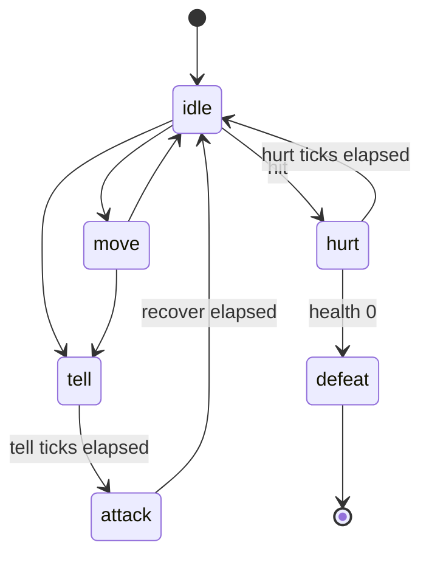

# ROT-01: Rot Sticker readability set, design spec

**Status:** packet ready; design pending. Execution pending. Review pending.

**Decision record:** height <fill> px, frame <fill> x <fill>, pivot (<fill>, <fill>). Proposed by <fill>; decided by <fill>.

The sections follow `docs/02-art/gob-01-goblin-spec.md`. Replace every `<fill: ...>`; write numbers, not adjectives. The design step stops at the keys and this spec (see the top-tier budget in `docs/07-agents/agent-orchestration.md`).

## 1. Canon and tone constraints

- Approved concept: `assets/concept/floor-01/enemies/scatterers-rot-sticker-slime-bestiary.png` (Rot Sticker panels). The roster (`docs/02-art/floor-01-enemy-concept-roster.md`) records the Rot Sticker as a **small dark rounded wall/ceiling-running threat**, native production pending; "don't default to a large spider silhouette". The board is shared with the Scatterer, Brood Guardian and the other creature; only this creature's panels are cropped, and the Scatterer panels are skipped.
- Tone (`docs/01-design/antihero-tone.md`, enemies row): threatening yet eccentric, with motivated behaviors and readable tells and some absurd visual contrasts; never a purely serious faceless army and never comedic with no danger. 1980s-1990s action cinema is used for attitude only, never copied designs.
- Canon facts that must survive in pixels (from the approved docs and the concept board, not design decisions):
  - Small, dark, rounded, disc/ravioli-like body that clings to walls and ceilings; the board shows a dark ringed shell with red spikes and a glowing red centre or underside.
  - A contact hazard that explodes (atlas line 54); the glow brightening is the board's telegraph.
  - A parasite identity separate from the Green Slime; not a conventional spider and not a large tentacled ooze.
- Design reading of the tone: <fill: how the Rot Sticker reads as a creepy, slightly absurd and dangerous threat>.

### Where the canon, size and mechanics are defined (checked 2026-11-18)

| Topic | Source | What it says |
| --- | --- | --- |
| Visual approval | `docs/04-production/backlog.md` line 11; `docs/02-art/floor-01-art-atlas-v1.md` line 10; `docs/02-art/floor-01-enemy-concept-roster.md` line 17 | The Rot Sticker visual concept is owner-approved: a **small dark rounded wall/ceiling-running threat**; native production pending; "don't default to a large spider silhouette" |
| Canon | `docs/02-art/floor-01-art-atlas-v1.md` lines 45 and 54 | **Small dark round/ravioli-like creatures** that run across walls and ceilings and explode on contact, not large tentacled oozes; the atlas cites book chapters 15 and 19 and separates the "parasite" treatment from slime |
| Mechanics | `docs/01-design/floor-01-gameplay-progression-v0.md` line 78; `docs/01-design/combat-feel-hybrid-physics.md` line 79; `docs/01-design/combat-first-encounter-design.md` line 79 | A sticky/contact hazard with unusual wall/ceiling motion (not ordinary biped knockback), deliberate trigger and avoidance, explosive hazard. No hit points, damage, blast radius, speed or trigger rules exist |
| Production order | `docs/02-art/floor-01-enemy-concept-roster.md` line 60 | "Small native silhouette, wall/ceiling telegraph and contact readability" |
| Size | none | The only number is the lineup label (about 36 px) printed on `floor01-enemy-lineup-approved.png`, drawn as a large spider, which the roster says is not an accepted native size |
| Area art | `docs/07-agents/floor-01-area-kits-plan.md` line 21 (AREA-HAZARDS-01) | Ceiling and wall Rot Sticker tells belong to the hazards environment kit |

### Guardrails (copied from the roster and atlas)

- **Not a spider.** The ensemble board `floor01-enemy-lineup-approved.png` draws the Rot Sticker as a multi-legged spider with orange eyes; the roster says Rot Stickers are small, black, rounded wall/ceiling creatures and to use the boards for mood, not every anatomical detail. That board is not cropped here.
- The board's explosion burst and glowing states are concept illustrations; blast radius, damage, trigger rules and death behaviour are not approved. The tan human silhouettes in the lower rows are generic victims, not a character.
- Printed scale labels are not accepted native sizes. Convert from original editable pixel grids / `.aseprite`, never by tracing or cropping the board.

### Separate work orders suggested (not in scope here)

- The red explosion burst (and any rot or acid splash it leaves): a separate hazard-VFX work order; the crop of that panel is included only as a reference.
- Ceiling and wall tell markers, drip stains and decals: AREA-HAZARDS-01 (`docs/07-agents/floor-01-area-kits-plan.md` line 21).
- Wall, ceiling and floor orientation variants (rotation, mirrored frames, surface-specific anchors) need a design decision on whether they are frames of this asset or separate runtime transforms; the combat grammar for them lives in `docs/01-design/combat-feel-hybrid-physics.md` line 79.

### Packet inputs

- Concept crops in `docs/evidence/rot-01/packet/` (x,y,w,h in the 1672x941 concept):
  - `concept_crop_1.png` = `895,205,150,215`: hero, wall-clinging Rot Sticker
  - `concept_crop_2.png` = `1050,225,150,105`: ceiling-hanging Rot Sticker
  - `concept_crop_3.png` = `870,540,340,135`: state row 1 (wall sticker, glow rising)
  - `concept_crop_4.png` = `875,665,335,120`: state row 2 (latched onto a figure, "!" alert, glowing)
  - `concept_crop_5.png` = `875,785,335,120`: state row 3 (the explosion burst; VFX reference only)
- `scale_lineup.png`: Carl 52, Donut 40, goblin 36 and the merged Scatterer idle (15 px) plus three empty candidate slots at 16, 20 and 24 px. By eye the wall disc is about 150 px across in the 1672x941 board against about 90 px height for the Scatterer, which suggests about 25 px at the Scatterer's 15 px; the book and roster call it small, so the candidates go lower. An estimate, not an approved size. The default 64 x 56 frame is a placeholder only.
- Readability set (tags): `idle` (2-4), `move` (4-6), `tell` (1-2), `attack` (2-3), `hurt` (1), `defeat` (2-3); about 12 to 20 frames. Concrete tag names and frame counts are the designer's choice (section 4 and `frame_pivot_template.json` carry the toolkit defaults).

## Difficulty and route

**Score 2 of 4: Medium, route B** (medium tier drafts size, palette, all keys and the spec; a fresh top-tier editor corrects and freezes them).

| Point | Met | Note |
| --- | --- | --- |
| 1. New design, not a variant | yes | A new creature, not a variant of an approved asset |
| 2. Native height above about 40 px | no | Candidates 16, 20, 24 px |
| 3. Complex anatomy | no | A small rounded shell with spikes; no limb rig (the wall/ceiling orientation question is noted above) |
| 4. VFX, projectiles, special states | yes | Red glow telegraph and an explosion burst beyond the readability set |

Reasoning: new design with a glow telegraph and an explosion, but a very small body; counting the orientation variants as a rig would raise it to 3.

## 2. Size decision

Carl is 52 px (about 6 ft), Donut 40 px, the goblin 36 px (see `scale_lineup.png`).

| Option | Idle opaque height | Ratio to Carl | Implied real height | Why / why not |
| --- | --- | --- | --- | --- |
| A | 16 px | <fill> | <fill> | <fill> |
| B | 20 px | <fill> | <fill> | <fill> |
| C | 24 px | <fill> | <fill> | <fill> |

Decision: <fill: height and the reason, one paragraph; the proposer and the decider are different agents>.

## 3. Frame, pivot, boxes and atlas

- Frame <fill> x <fill>, pivot (<fill>, <fill>), contact row <fill> (the lowest opaque row of every grounded frame).
- Grounded tags: <fill>. Airborne tags (no pixel on the contact row): <fill or none>.
- Standing box <fill> x <fill>; hurtbox <fill>; attack hitbox <fill> on the impact frame.
- Authored facing right; the runtime mirrors around the pivot column.
- One atlas, frames 0 to <fill>, layers: <fill: for example body, weapon>.

## 4. Readability-set animation list

Readability set: idle, move, tell, attack, hurt, defeat (about 12 to 20 frames until the asset has a gameplay work order). Tick windows are at 60 Hz.

| Role | Tag | Frames | Playback | Tick-window proposal | Reference |
| --- | --- | --- | --- | --- | --- |
| idle | `idle` | 2-4 | loop | 8-12 ticks per frame, a 32-40 tick breathing cycle | GOB-01: 12 + 8 + 12 + 8 |
| move | `walk` | 4-6 | loop | 5 ticks per frame, speed from the gameplay spec | GOB-01: 6 x 5 = 30 ticks |
| tell | `attack_tell` | 1-2 | once | at least 18 ticks of readable hold, about 24 total | GOB-01: 6 + 18 |
| attack | `attack_swing` | 2-3 | once | smear 2, impact 3-4 (shown on exactly the hitbox-active ticks) | GOB-01: 2 + 4, then recover 20 |
| hurt | `hurt` | 1 | once | 8-12 ticks | GOB-01: 4 + 8 |
| defeat | `down` | 2-3 | hold | floor impact 4, settle 8, then a state-driven hold | GOB-01: 4 + 8 + hold |

Frame table (`frame_pivot_template.json` carries the same rows):

| # | Tag | Pose | Ticks | Author |
| --- | --- | --- | --- | --- |
| 0 | `idle` | <fill: pose> | 12 | <fill: key or Sonnet> |
| 1 | `idle` | <fill: pose> | 8 | <fill: key or Sonnet> |
| 2 | `idle` | <fill: pose> | 12 | <fill: key or Sonnet> |
| 3 | `walk` | <fill: pose> | 5 | <fill: key or Sonnet> |
| 4 | `walk` | <fill: pose> | 5 | <fill: key or Sonnet> |
| 5 | `walk` | <fill: pose> | 5 | <fill: key or Sonnet> |
| 6 | `walk` | <fill: pose> | 5 | <fill: key or Sonnet> |
| 7 | `attack_tell` | <fill: pose> | 6 | <fill: key or Sonnet> |
| 8 | `attack_tell` | <fill: pose> | 18 | <fill: key or Sonnet> |
| 9 | `attack_swing` | <fill: pose> | 2 | <fill: key or Sonnet> |
| 10 | `attack_swing` | <fill: pose> | 4 | <fill: key or Sonnet> |
| 11 | `hurt` | <fill: pose> | 4 | <fill: key or Sonnet> |
| 12 | `hurt` | <fill: pose> | 8 | <fill: key or Sonnet> |
| 13 | `down` | <fill: pose> | 4 | <fill: key or Sonnet> |
| 14 | `down` | <fill: pose> | 8 | <fill: key or Sonnet> |
| 15 | `down` | <fill: pose> | hold | <fill: key or Sonnet> |

## 5. State diagram



## 6. Palette

Palette reference: the Scatterer palette `scatterer-floor01-v1` is reddish-brown and does not apply. The packet candidates are the only colour input; the near-black shell, red spikes and glow ramp are design decisions (<fill>).

At most <fill: 20> colours. Candidates from the concept crop (median cut, by pixel share; see `palette_candidates.json`). These are candidates, not decisions.

| # | Candidate | Share | Decision (key, name, role) |
| --- | --- | --- | --- |
| 1 | `#161f29` | 9.0 % | <fill: key, name, role> |
| 2 | `#18202a` | 7.2 % | <fill: key, name, role> |
| 3 | `#5b4745` | 6.9 % | <fill: key, name, role> |
| 4 | `#181f29` | 6.6 % | <fill: key, name, role> |
| 5 | `#89644f` | 5.8 % | <fill: key, name, role> |
| 6 | `#392d33` | 5.5 % | <fill: key, name, role> |
| 7 | `#463232` | 5.4 % | <fill: key, name, role> |
| 8 | `#31191f` | 4.9 % | <fill: key, name, role> |
| 9 | `#18202b` | 4.5 % | <fill: key, name, role> |
| 10 | `#b57f58` | 4.1 % | <fill: key, name, role> |
| 11 | `#1e1f28` | 3.8 % | <fill: key, name, role> |
| 12 | `#a51418` | 3.8 % | <fill: key, name, role> |
| 13 | `#141f2a` | 3.7 % | <fill: key, name, role> |
| 14 | `#0b0b11` | 3.6 % | <fill: key, name, role> |
| 15 | `#8d533e` | 3.5 % | <fill: key, name, role> |
| 16 | `#282933` | 3.4 % | <fill: key, name, role> |
| 17 | `#20222c` | 3.3 % | <fill: key, name, role> |
| 18 | `#ab6945` | 2.9 % | <fill: key, name, role> |
| 19 | `#1f181e` | 2.7 % | <fill: key, name, role> |
| 20 | `#1c212a` | 2.4 % | <fill: key, name, role> |
| 21 | `#dfaf74` | 2.2 % | <fill: key, name, role> |
| 22 | `#121a24` | 2.0 % | <fill: key, name, role> |
| 23 | `#9f2e23` | 1.8 % | <fill: key, name, role> |
| 24 | `#181b24` | 1.0 % | <fill: key, name, role> |

The chosen palette must separate this asset from the warm brick and the cold arch of Floor 1 at 1x, and fit the A1 lighting.

## 7. Key poses

One key per readability tag (about 6 to 8 keys): idle 0, move contact, tell hold, attack impact, hurt, defeat. Each key lists silhouette, joint positions, palette use and the readability reason. Keys are frozen once the review passes (`pixelart freeze`).

| Frame | Tag | Silhouette and pose notes | Readability reason |
| --- | --- | --- | --- |
| <fill> | <fill> | <fill> | <fill> |

## 8. In-between list

For the execution tier; no design decisions needed. One row per non-key frame, as in section 9 of the GOB-01 spec.

| # | Pose notes |
| --- | --- |
| <fill> | <fill> |

## 9. Validators and readability rules

Run by `python3 -m scripts.pixelart validate <asset-config>` (rules V01 to V15 in `scripts/pixelart/validators.py`). Parametrize in the asset config:

- V04 palette: at most <fill> colours; V05 isolated pixels: 0; V06 orphan pixels: at most <fill> per frame.
- V07/V08 contact rows: grounded tags end on the contact row, airborne tags never touch it.
- V09 frozen keys: SHA-256 per key frame, fixture `tests/fixtures/rot-01_keys.json`.
- V13/V14 readability rules (write each as a bbox or key-count rule): <fill: for example the tell is the highest point, the hurt eyes are white>.

## 10. Evidence

```text
python3 -m scripts.pixelart validate <asset-config> --out <dir>
python3 -m scripts.pixelart evidence <asset-config> --out <dir>
python3 -m scripts.pixelart review-pack <asset-config> --out <dir>
```

The review pack holds exactly three images (contact sheet x4, lit scene 640 x 360 shown x3, tell to attack strip) and the validator report.

## 11. Files

| File | Role |
| --- | --- |
| `assets/source/<fill>/rot-01.grid.json` / `.ase` | pixel-grid source and Aseprite master |
| `assets/manifests/rot-01.json` | manifest |
| `<fill>/rot-01.pixelart.json` | the asset config (from `frame_pivot_template.json`) |
| `tests/fixtures/rot-01_keys.json` | frozen keys |

## 12. Rights and provenance

Fan-concept art under the owner-reported `ART-PUBLICATION-ALL-V1` scope (see `docs/04-production/rights-and-release.md`). Record in the PR's `Rights/Provenance` section which model designed, executed and reviewed the art. No tracing of the concept, no image-model raster output.

### Rights/Provenance stub

- Concept: owner-approved reference under `ART-PUBLICATION-ALL-V1`; crops are for reference only, never traced or exported.
- Packet: script output plus a medium-tier executor (stage P).
- Designed by: pending. Executed by: pending. Independently reviewed by: pending.
- No third-party assets, no copied designs or dialogue, no image-model raster output.
