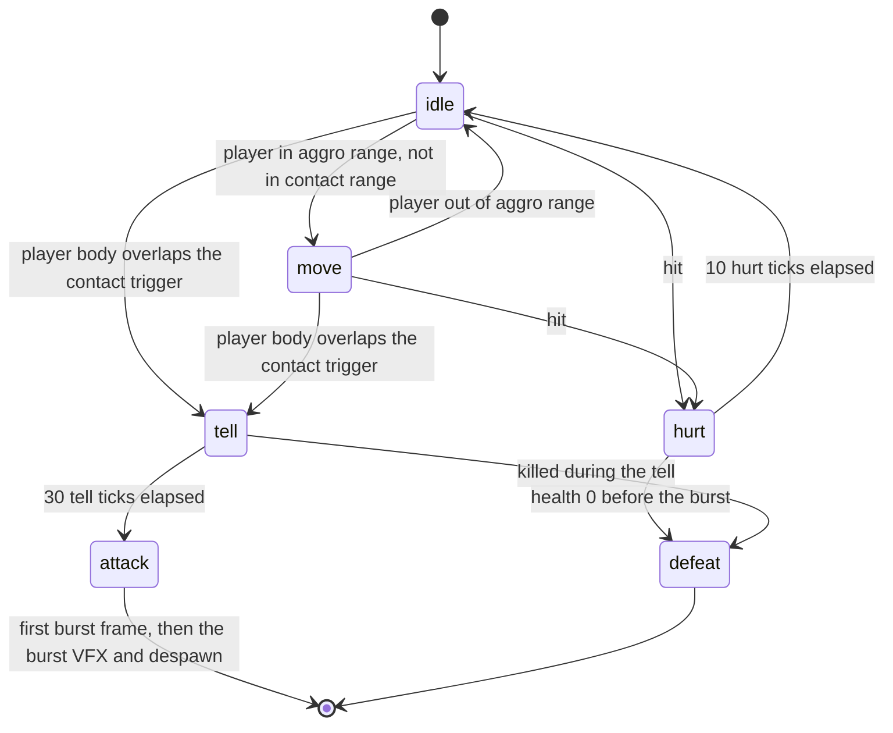

# ROT-01: Rot Sticker readability set, design spec

**Status:** packet ready; first-draft design and six keys done; senior edit pending. Independent review pending.

**Decision record:** height 20 px (along the wall), frame 32 x 32, pivot (6, 16), wall-mounted orientation, ceiling and floor by runtime rotation. Proposed by the draft designer; decision pending the senior editor.

The sections follow `docs/02-art/gob-01-goblin-spec.md`. Replace every `<fill: ...>`; write numbers, not adjectives. The design step stops at the keys and this spec (see the top-tier budget in `docs/07-agents/agent-orchestration.md`).

## 1. Canon and tone constraints

- Approved concept: `assets/concept/floor-01/enemies/scatterers-rot-sticker-slime-bestiary.png` (Rot Sticker panels). The roster (`docs/02-art/floor-01-enemy-concept-roster.md`) records the Rot Sticker as a **small dark rounded wall/ceiling-running threat**, native production pending; "don't default to a large spider silhouette". The board is shared with the Scatterer, Brood Guardian and the other creature; only this creature's panels are cropped, and the Scatterer panels are skipped.
- Tone (`docs/01-design/antihero-tone.md`, enemies row): threatening yet eccentric, with motivated behaviors and readable tells and some absurd visual contrasts; never a purely serious faceless army and never comedic with no danger. 1980s-1990s action cinema is used for attitude only, never copied designs.
- Canon facts that must survive in pixels (from the approved docs and the concept board, not design decisions):
  - Small, dark, rounded, disc/ravioli-like body that clings to walls and ceilings; the board shows a dark ringed shell with red spikes and a glowing red centre or underside.
  - A contact hazard that explodes (atlas line 54); the glow brightening is the board's telegraph.
  - A parasite identity separate from the Green Slime; not a conventional spider and not a large tentacled ooze.
- Design reading of the tone: a squat black limpet the size of a pizza that pulses like something breathing inside a wall, with a rotten olive stain, red spikes and one ember in the middle. It looks like a bad mushroom you should not touch, which makes the threat unsettling and a little absurd. The danger is the telegraph: it lights up like a fuse before it goes. There is no face, no legs and no heroic styling; the only "attitude" is a dead patient stare from a glowing core.

### Where the canon, size and mechanics are defined (checked 2026-11-18)

| Topic | Source | What it says |
| --- | --- | --- |
| Visual approval | `docs/04-production/backlog.md` line 11; `docs/02-art/floor-01-art-atlas-v1.md` line 10; `docs/02-art/floor-01-enemy-concept-roster.md` line 17 | The Rot Sticker visual concept is owner-approved: a **small dark rounded wall/ceiling-running threat**; native production pending; "don't default to a large spider silhouette" |
| Canon | `docs/02-art/floor-01-art-atlas-v1.md` lines 45 and 54 | **Small dark round/ravioli-like creatures** that run across walls and ceilings and explode on contact, not large tentacled oozes; the atlas cites book chapters 15 and 19 and separates the "parasite" treatment from slime |
| Mechanics | `docs/01-design/floor-01-gameplay-progression-v0.md` line 78; `docs/01-design/combat-feel-hybrid-physics.md` line 79; `docs/01-design/combat-first-encounter-design.md` line 79 | A sticky/contact hazard with unusual wall/ceiling motion (not ordinary biped knockback), deliberate trigger and avoidance, explosive hazard. No hit points, damage, blast radius, speed or trigger rules exist |
| Production order | `docs/02-art/floor-01-enemy-concept-roster.md` line 60 | "Small native silhouette, wall/ceiling telegraph and contact readability" |
| Size | none | The only number is the lineup label (about 36 px) printed on `floor01-enemy-lineup-approved.png`, drawn as a large spider, which the roster says is not an accepted native size |
| Area art | `docs/07-agents/floor-01-area-kits-plan.md` line 21 (AREA-HAZARDS-01) | Ceiling and wall Rot Sticker tells belong to the hazards environment kit |

### Guardrails (copied from the roster and atlas)

- **Not a spider.** The ensemble board `floor01-enemy-lineup-approved.png` draws the Rot Sticker as a multi-legged spider with orange eyes; the roster says Rot Stickers are small, black, rounded wall/ceiling creatures and to use the boards for mood, not every anatomical detail. That board is not cropped here.
- The board's explosion burst and glowing states are concept illustrations; blast radius, damage, trigger rules and death behaviour are not approved. The tan human silhouettes in the lower rows are generic victims, not a character.
- Printed scale labels are not accepted native sizes. Convert from original editable pixel grids / `.aseprite`, never by tracing or cropping the board.

### Separate work orders suggested (not in scope here)

- The red explosion burst (and any rot or acid splash it leaves): a separate hazard-VFX work order; the crop of that panel is included only as a reference.
- Ceiling and wall tell markers, drip stains and decals: AREA-HAZARDS-01 (`docs/07-agents/floor-01-area-kits-plan.md` line 21).
- Wall, ceiling and floor orientation variants (rotation, mirrored frames, surface-specific anchors) need a design decision on whether they are frames of this asset or separate runtime transforms; the combat grammar for them lives in `docs/01-design/combat-feel-hybrid-physics.md` line 79.

### Packet inputs

- Concept crops in `docs/evidence/rot-01/packet/` (x,y,w,h in the 1672x941 concept):
  - `concept_crop_1.png` = `895,205,150,215`: hero, wall-clinging Rot Sticker
  - `concept_crop_2.png` = `1050,225,150,105`: ceiling-hanging Rot Sticker
  - `concept_crop_3.png` = `870,540,340,135`: state row 1 (wall sticker, glow rising)
  - `concept_crop_4.png` = `875,665,335,120`: state row 2 (latched onto a figure, "!" alert, glowing)
  - `concept_crop_5.png` = `875,785,335,120`: state row 3 (the explosion burst; VFX reference only)
- `scale_lineup.png`: Carl 52, Donut 40, goblin 36 and the merged Scatterer idle (15 px) plus three empty candidate slots at 16, 20 and 24 px. By eye the wall disc is about 150 px across in the 1672x941 board against about 90 px height for the Scatterer, which suggests about 25 px at the Scatterer's 15 px; the book and roster call it small, so the candidates go lower. An estimate, not an approved size. The default 64 x 56 frame is a placeholder only.
- Readability set (tags): `idle` (2-4), `move` (4-6), `tell` (1-2), `attack` (2-3), `hurt` (1), `defeat` (2-3); about 12 to 20 frames. Concrete tag names and frame counts are the designer's choice (section 4 and `frame_pivot_template.json` carry the toolkit defaults).

## Difficulty and route

**Score 2 of 4: Medium, route B** (medium tier drafts size, palette, all keys and the spec; a fresh top-tier editor corrects and freezes them).

| Point | Met | Note |
| --- | --- | --- |
| 1. New design, not a variant | yes | A new creature, not a variant of an approved asset |
| 2. Native height above about 40 px | no | Candidates 16, 20, 24 px |
| 3. Complex anatomy | no | A small rounded shell with spikes; no limb rig (the wall/ceiling orientation question is noted above) |
| 4. VFX, projectiles, special states | yes | Red glow telegraph and an explosion burst beyond the readability set |

Reasoning: new design with a glow telegraph and an explosion, but a very small body; counting the orientation variants as a rig would raise it to 3.

## 2. Size decision

Carl is 52 px (about 6 ft), Donut 40 px, the goblin 36 px, the Scatterer 15 px (see `scale_lineup.png`). "Height" below is the idle opaque extent **along the surface** (the disc diameter); the dome stands about 14 px off the surface.

| Option | Idle opaque height | Ratio to Carl | Implied real height | Why / why not |
| --- | --- | --- | --- | --- |
| A | 16 px | 0.31 | about 22 in (56 cm) disc | Smallest. A 3 px core plus a 1 px rim glow leaves almost no shell to read as dark against brick; spikes collapse into the outline |
| B | 20 px | 0.38 | about 28 in (70 cm) disc | Dark shell, 8 rib rays, 6 spikes, a 4 px glow core and a 1 px cold rim all fit; still clearly smaller than Donut and about a third of Carl |
| C | 24 px | 0.46 | about 33 in (84 cm) disc | Reads as a big pizza on the wall, closer to the goblin; loses "small" from the roster and competes with the Scatterer's role as the swarm unit |

Decision: **B, 20 px** along the wall (rows 6 to 25), dome depth 14 px (columns 6 to 19; up to 22 with spikes and the tell halo). Proposed by the draft designer; the senior editor decides. 20 px is the smallest size at which the tell can be a colour change of a dark body (ribs and core light up) instead of a lone pixel blink, and it stays under the 24 to 26 px the board's proportions suggest, which the roster calls "small". It is 5 px above the Scatterer, so a Rot Sticker on a wall next to Scatterers on the floor still reads as its own thing.

## 3. Frame, pivot, boxes and atlas

- **Frame 32 x 32, pivot (6, 16).** Square so that a 90 degree rotation about the pivot is lossless pixel-for-pixel. The pivot is the wall-contact point: column 6 is the wall plane (the glowing seam), row 16 is the disc centre.
- **Orientation, one set only.** Authored **wall-mounted**: attached to a vertical wall on the left, dome bulging right into the room, creeping toward **-y (up the wall)**. Variants are runtime transforms about the pivot, no extra frames:
  - ceiling: rotate 90 degrees clockwise (dome hangs down, creep direction becomes +x);
  - floor: rotate 90 degrees counter-clockwise (dome rises, creep direction becomes +x as well);
  - right-hand wall, or creeping the other way: mirror horizontally or vertically about the pivot.
  The baked cold rim and highlight sit on the dome's upper-right edge; after a rotation they sit on a different edge. That is accepted for a 20 px creature whose strongest light is its own glow, and noted for the area kit (AREA-HAZARDS-01). A separate hand-lit ceiling set is a later option if the review finds the rotated lighting wrong.
- **No grounded contact row.** All tags are `contact: free`; the validators V07 and V08 are not used. Contact is the **column 6** (V13 `left: 6` on key 0 checks it). `contact_row` 16 only satisfies V01 (equal to the pivot y).
- **Hurtbox:** `[6, 6, 14, 20]` in frame pixels (pivot-relative x 0 to 13, y -10 to +9) on the shell, excluding spikes.
- **Contact trigger (placeholder):** `[6, 4, 18, 24]` (pivot-relative x 0 to 17, y -12 to +11). The player's body overlapping it starts the tell. Not an approved mechanic.
- **Blast radius (placeholder):** a circle of **40 px** radius (twice the disc diameter) around the dome centre (12, 16), active from the first burst frame (frame 10). No damage or radius is approved; the full burst is a separate hazard-VFX work order.
- Authored facing: wall left, creeping up; the runtime rotates or mirrors around the pivot.
- One atlas, frames 0 to 14, layer: `body` only.

## 4. Readability-set animation list

Readability set: idle, move, tell, attack, hurt, defeat. Tick windows are at 60 Hz.

| Role | Tag | Frames | Playback | Ticks | Notes |
| --- | --- | --- | --- | --- | --- |
| idle | `idle` | 3 | loop | 14 + 12 + 14 = 40 | a slow pulse of the core and the dome |
| move | `walk` | 4 | loop | 4 x 8 = 32 | slow creep along the surface, one lean-and-drag cycle |
| tell | `attack_tell` | 2 | once | 6 + 24 = 30 (500 ms) | glow rises, then hold |
| attack | `attack_swing` | 2 | once | 2 + 4 | detonation up to the first burst frame; the explosion itself is a separate VFX work order |
| hurt | `hurt` | 1 | once | 10 | white flash, shell clenches |
| defeat | `down` | 3 | hold | 4 + 8 + hold | a dud: deflates without exploding |

Frame table. Keys are drawn by the rule-based script; in-betweens are, for now, copies of the nearest key (`SLOT_SOURCE` in `scripts/author_rot01.py`).

| # | Tag | Pose | Ticks | Author |
| --- | --- | --- | --- | --- |
| 0 | `idle` | relaxed dome, ember core, dark ribs, 2 px spikes (KEY) | 14 | key |
| 1 | `idle` | pulse up: dome 1 px deeper, core one step brighter | 12 | copy of 0 |
| 2 | `idle` | pulse down: back to 0 with the core one step dimmer | 14 | copy of 0 |
| 3 | `walk` | lean: top of the dome shears up the wall, core dimmer (KEY) | 8 | key |
| 4 | `walk` | pull: dome pushes 1 px up, compresses 1 px in depth | 8 | copy of 3 |
| 5 | `walk` | drag: lower edge catches up, shear the other way | 8 | copy of 3 |
| 6 | `walk` | settle: close to key 0, 1 px higher on the wall | 8 | copy of 3 |
| 7 | `attack_tell` | onset: ribs half lit, spikes 3 px, no halo yet | 6 | copy of 8 |
| 8 | `attack_tell` | hold: ribs ember, core hot, dim red halo, spikes 3 px with lit tips (KEY) | 24 | key |
| 9 | `attack_swing` | pre-burst: shell swells, first crack, core `G` | 2 | copy of 10 |
| 10 | `attack_swing` | first burst frame: shell cracked open, hot core blown out, bright spikes (KEY) | 4 | key |
| 11 | `hurt` | clenched: dome squashed, spikes flat, white core and rim flash (KEY) | 10 | key |
| 12 | `down` | glow dies, dome sags | 4 | copy of 14 |
| 13 | `down` | halfway: dome half deflated, spikes drooping | 8 | copy of 14 |
| 14 | `down` | settled dud: a flat dead skin against the wall, olive drip (KEY) | hold | key |

## 5. State diagram



Triggers are placeholders; no aggro range, health or fuse rule is approved. Whether a hit during the tell cancels it or only a kill does is an open question (section 12).

## 6. Palette `rot-sticker-floor01-v1`

13 of 20 colours used, 7 slots reserved. The near-black shell is warm-purple so it separates from the cold navy of the arches and the orange of the brick. Navy candidates (about 15 of the 24) were treated as background and skipped. Candidates reused: `#0b0b11` (as `K`, nudged to `#0d0a10`), `#a51418` (exact, as `r`); `#9f2e23` and `#b57f58` informed the spike tip and the glow ramp; `#1f181e`, `#282933` and `#392d33` informed the shell ramp.

| Key | Name | Colour | Role |
| --- | --- | --- | --- |
| `K` | outline_soot | `#0d0a10` | outline, silhouette |
| `a` | shell_0_deep | `#1c1722` | shell shadow, dud skin |
| `b` | shell_1_shade | `#2b2230` | shell mid-dark |
| `c` | shell_2_mid | `#3f3243` | shell lit top |
| `v` | rim_cold | `#6a6682` | cold rim on the upper-right edge, the 1x separation from warm brick |
| `x` | rot_olive | `#4e4a28` | parasite rot stains, the dud's drip |
| `m` | rib_dead | `#5a1218` | dim ribs, seam, dead glow, tell halo outer |
| `r` | rib_red | `#a51418` | spike roots, seam centre, halo inner |
| `p` | spike_tip | `#e2583a` | spike tips |
| `o` | glow_ember | `#ec3a1c` | live core ring and lit ribs |
| `g` | glow_hot | `#ff8a3c` | hot core, burst ring |
| `G` | glow_core | `#ffdc8a` | hottest core (tell and burst only) |
| `w` | flash_white | `#efe3d3` | hurt flash only |

Glow keys (`r`, `p`, `o`, `g`, `G`, `w`) are accents. The idle body is deliberately dark; the brightest pixel group in idle is `o`, and `G` appears only in the tell and burst, so the brightening is the telegraph.

## 7. Key poses

Six keys (V09 frozen in `tests/fixtures/rot-01_keys.json`): 0, 3, 8, 10, 11, 14. Frames 32 x 32, wall on the left.

| Frame | Tag | Silhouette and pose notes | Readability reason |
| --- | --- | --- | --- |
| 0 | `idle` | A flattened, squarish dome (superellipse, 20 px tall along the wall, 14 deep) with a crimped, ravioli-like outline. 8 thin radial ribs in `m` run from a hub at the dome's centre, where a 4 px ember core (`o` ring, `g` centre) sits. 6 short spikes (2 px, `r` roots, `p` tips) ring the rim. A cold `v` rim on the upper right, olive rot stains low on the shell and a glowing seam (`r`) down the wall edge. | Dark round disc on brick, read by its cold rim and the red core. Not a spider: no legs, no eyes |
| 3 | `walk` | Dome sheared 2 to 3 px up the wall and lifted 1 px, 1 px shallower, core dimmed to `r`. The top edge leads, the lower edge drags. | The shear is the only motion cue and reads as creeping along the surface rather than rolling |
| 8 | `attack_tell` | 3 px wider and 2 px taller than idle, a `G` 6 px core with `g` and `o` rings, all 8 ribs `o`, the seam `o`, a dim `m`/`r` halo ring around the dome and 3 px spikes. | The dark disc suddenly carries a red halo and a hot core: the highest glow before the burst (at least 20 `o` pixels and at least 4 `G`) |
| 10 | `attack_swing` (first burst frame) | The largest pose (about 24 px tall, 18 deep): cracked shell, 5 `G` crack lines from the core, a `G`/`g` blown-out core about 10 px wide, bright `g` spikes and a `g`/`o` halo. Wall seam `G`. | The brightest, widest frame of the set (at least 40 `G` pixels); the VFX work order takes over from here |
| 11 | `hurt` | Dome squashed to 10 px deep, spikes flat (1 px), core and rim flashed `w`, ribs and seam dim `m`. | White flash, a dimmer body and flattened spikes read as a flinch and never as the tell |
| 14 | `down` | A dud: a thin flat skin 5 to 6 px deep against the wall, 1 px drooping spikes, `a`/`m` dead ribs, no glow, an olive `x` drip down the wall. | No `o`, `G` or `w` anywhere: dead and dark, clearly the opposite of the tell |

## 8. In-between list

For the execution tier; no design decisions needed. Frames 1, 2, 4 to 7, 9, 12 and 13 are copies of the nearest key now (the validators run with `unique_frames` off until they are drawn; switch it on then).

| # | Pose notes |
| --- | --- |
| 1 | Key 0 with the dome 1 px deeper, core `o`/`g` one step brighter. Height stays 20 |
| 2 | Key 0 with the core's centre dropped from `g` to `o` and the ring to `r`. Dimmer |
| 4 | Dome 1 px up the wall, 1 px shallower, shear -1.5 |
| 5 | Shear +1.5 (the other way), dome 1 px low, core `r` |
| 6 | Close to key 0, the whole dome 1 px higher than 0, so the loop returns to 3 on a rise |
| 7 | Key 8 at 60 percent glow: ribs alternate `m`/`o`, core `o`/`g` about 5 px, spikes 2 px, no halo |
| 9 | Key 10 at about 90 percent: dome 1 px smaller, ribs `o`, one crack, core `G` about 8 px, no spike tip highlight |
| 12 | Key 0 with the core gone to `m`, dome 2 px shallower, spikes 1 px, ribs `m` |
| 13 | Dome about 7 px deep, spikes drooping 2 px, no glow, a short `x` drip beginning |

## 9. Validators and readability rules

Run by `python3 -m scripts.pixelart validate assets/source/characters/rot_sticker/rot_01.pixelart.json` (rules V01 to V15):

- V04 palette: at most 20 colours (13 used); V05 isolated pixels: 0; V06 orphan pixels: at most 12 per frame (a draft allowance; tighten once the keys are edited, since the rib and shading pixels cause most of them).
- V07/V08 are off: contact is a column, not a row (section 3).
- V09 frozen keys: SHA-256 per key frame, fixture `tests/fixtures/rot-01_keys.json`.
- V13 bounding boxes (size and silhouette): key 0 is 20 px tall, rows 6 to 25, left column 6, dome right edge 17 to 21; the tell reaches column 21 or more and is at most 24 tall; the burst is the largest pose (right edge 22 or more, height 23 to 26); the hurt is compact (right edge at most 18); the dud frames stay flat (right edge at most 12).
- V14 key counts (glow rules): idle and walk frames have at least 2 `o` and idle has no `G`; the tell has at least 20 `o` and at least 4 `G`; the burst has at least 40 `G`; the hurt has at least 3 `w`; the dud frames have no `G`, `w` or `o`.

## 10. Evidence

```text
python3 -m scripts.pixelart validate assets/source/characters/rot_sticker/rot_01.pixelart.json --out <dir>
python3 -m scripts.pixelart evidence assets/source/characters/rot_sticker/rot_01.pixelart.json --out <dir>
python3 -m scripts.pixelart review-pack assets/source/characters/rot_sticker/rot_01.pixelart.json --out <dir>
python3 scripts/make_rot01_scale.py
```

The review pack holds exactly three images (contact sheet x4, lit scene 640 x 360 shown x3, tell to attack strip) and the validator report. `docs/evidence/rot-01/key0-scale.png` shows key 0 at 1x on the lit catacomb wall next to Carl, plus a 4x copy (sprite placed 30 px above the walking line, unrotated). The senior editor should also check the ceiling transform (rotate 90 degrees clockwise) on a brick ceiling tile.

## 11. Files

| File | Role |
| --- | --- |
| `assets/source/characters/rot_sticker/rot_01.grid.json` / `.ase` | pixel-grid source and Aseprite master |
| `assets/manifests/rot-01.json` | manifest |
| `assets/source/characters/rot_sticker/rot_01.pixelart.json` | the asset config |
| `scripts/author_rot01.py` | deterministic authoring script (keys by rules, slots as key copies) |
| `scripts/make_rot01_scale.py` | key0-scale evidence |
| `tests/fixtures/rot-01_keys.json` | frozen keys |
| `tests/test_art_rot01.py` | asset-specific tests |

## 12. Draft notes and open questions for the senior editor

- **Not in scope, noted:** the explosion burst (and any rot splash) is a separate hazard-VFX work order; this set stops at the first burst frame. Wall and ceiling tells, drip stains and decals belong to AREA-HAZARDS-01.
- Open: is the profile-dome view the right "ravioli"? The concept hero is an oblique disc with radial red ribs; this draft reads as a dome attached edge-on. A face-on disc would make the ceiling variant a different sprite.
- Open: does a hit cancel the tell, or only a kill (section 5)? Does an exploding sticker hurt other enemies?
- Open: are the rotated bakes (rim light and highlight on a different edge) acceptable, or does the ceiling need its own lit set?
- The keys are rule-drawn and a little noisy where ribs meet the shading; the editor should hand-clean key 0 first, since every other pose is derived from it.
- The 1x read depends on the `v` cold rim and the `r` seam. If it fails on a lit brick, strengthen those two before touching the shell.

## 13. Rights and provenance

Fan-concept art under the owner-reported `ART-PUBLICATION-ALL-V1` scope (see `docs/04-production/rights-and-release.md`). Record in the PR's `Rights/Provenance` section which model designed, executed and reviewed the art. No tracing of the concept, no image-model raster output.

### Rights/Provenance stub

- Concept: owner-approved reference under `ART-PUBLICATION-ALL-V1`; crops are for reference only, never traced or exported.
- Packet: script output plus a medium-tier executor (stage P).
- Draft spec + keys: Claude Sonnet. Senior edit: pending. Independently reviewed by: pending.
- No third-party assets, no copied designs or dialogue, no image-model raster output.
