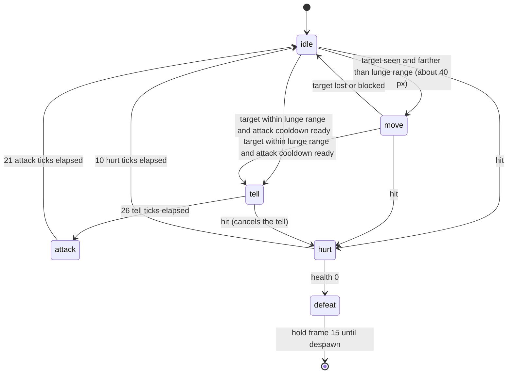

# SCAT-01: Scatterer readability set, design spec

**Status:** design done (spec plus the hero key `idle` frame 0, frozen); execution done (all 16 frames drawn, validators V01 to V15 pass, see section 13); independent review pending. Packet: Claude Sonnet (medium tier). Design and hero key: Claude Opus (top tier). Execution: Claude Sonnet (medium tier). Review: pending (a separate top-tier agent).

**Decision record:** idle opaque height 15 px (shell top to floor 12 px), frame 48 x 32, pivot (24, 31). Proposed by Claude Opus (design); decided by the independent top-tier review (pending), which may send it back.

The sections follow `docs/02-art/gob-01-goblin-spec.md`. The design step stops at the keys and this spec (see the top-tier budget in `docs/07-agents/agent-orchestration.md`).

## 1. Canon and tone constraints

- Approved concept: `assets/concept/floor-01/enemies/scatterers-rot-sticker-slime-bestiary.png`; the roster (`docs/02-art/floor-01-enemy-concept-roster.md`) records the Scatterer as a **small cockroach/insectoid visual direction**, native production pending. This work order covers the small Scatterer only; the Brood Guardian (a larger form of the same visual species), Rot Sticker and Green Slime are separate.
- Tone (`docs/01-design/antihero-tone.md`, enemies row): threatening yet eccentric, with motivated behaviors and readable tells and some absurd visual contrasts; never a purely serious faceless army and never comedic with no danger. 1980s-1990s action cinema is used for attitude only, never copied designs.
- Canon facts that must survive in pixels (from the approved docs and the concept board, not design decisions):
  - Small cockroach/insectoid creature, side view: segmented plated back, long curved antennae, spiny legs, red eye.
  - Reddish-brown chitin family look; the Brood Guardian will later be a larger form of the same visual species, so the family palette must stay derivable.
  - Reads against the Floor 01 catacomb stone; scale vs the Brood Guardian and printed sizes are not decisions.
- Design reading of the tone: a grimy, oily dungeon roach that is a nuisance one at a time and a threat in a pack. The eccentric note is the twitchy, "too interested" rear-up tell with the glowing eye and gaping mandibles; the danger is the fast, low ankle-bite. No cartoon face, no cute proportions.

### Guardrails (copied from the roster and minor-enemy docs)

- A generated label indicating **Scatterers explode on death** is not an approved gameplay feature; the bottom-row death panel (yellow splat) is deliberately left out of the crops and must not be read as an explosion mechanic. **The defeat frames have no splat, no burst, no particles, no yellow and no glow**: the roach flips onto its back and curls its legs.
- The speed-line dash, the flipped-with-"!" panel and the flattened panel are concept illustrations of states, not approved behaviors or stun mechanics. The design uses "on its back" only as the defeat pose, not as a stun state.
- Printed scale comparisons in the generated board are not accepted native sprite dimensions.
- Brood Guardian, Rot Sticker and Green Slime are out of scope here (no slime splitting, no Rot Sticker anatomy); use the board for mood only.
- Convert from original editable pixel grids / `.aseprite`, never by tracing or cropping the illustrated board.

### Packet inputs

- Concept crops in `docs/evidence/scat-01/packet/` (x,y,w,h in the 1672x941 concept):
  - `concept_crop_1.png` = `70,335,275,115`: hero Scatterer (top row)
  - `concept_crop_2.png` = `35,590,345,55`: small-Scatterer state row 1 (idle, idle, speed-lined dash)
  - `concept_crop_3.png` = `30,690,350,75`: small-Scatterer state row 2 (idle, flipped with "!", flattened)
- Readability set (tags): `idle`, `move` (`walk`), `tell` (`attack_tell`), `attack` (`attack_swing`), `hurt`, `defeat` (`down`): 16 frames (section 4).

## 2. Size decision

Carl is 52 px (about 6 ft), Donut 40 px, the goblin 36 px (see `scale_lineup.png`). The lineup is stylised (Donut is not 4.6 ft), so the "implied real height" column uses Carl's 1 px = about 1.4 in only as a rough guide. Heights are the idle opaque height including the antennae; the shell height is the dome top to the floor.

| Option | Idle opaque height | Ratio to Carl | Implied real height | Why / why not |
| --- | --- | --- | --- | --- |
| A | 11 px (shell 8, body 24 long) | 0.21 | about 15 in | Reads as a swarm, but at 1x the eye is 1 px, the legs merge into the mortar lines and the antennae vanish; the tell has only 3 to 4 px to rise. Rejected. |
| B | 15 px (shell 12, body 33 long, 45 px with legs and antennae) | 0.29 | about 21 in (shell 17 in) | Bites at Carl's ankles and shins; a 2 x 2 red eye, 3 visible near legs with spines and 2 antennae survive at 1x; leaves room for a 20 px tell. Four of them fit in front of Carl without hiding him. **Chosen.** |
| C | 20 px (shell 16, body 44 long) | 0.38 | about 28 in | Reads as a mid-size beast next to the 36 px goblin, no longer "small", and leaves the Brood Guardian little room to be clearly bigger without reaching Carl's size. Rejected. |

Decision: **B, 15 px idle height (rows 17 to 31), 12 px shell.** It is the smallest size at which the canon features (plated dome, two long antennae, spiny legs, red eye) stay readable at 1x on brick, and it puts the bite at Carl's ankle height, which motivates the crowd-pressure role. The Brood Guardian should be about 2x (shell about 24 px, height about 30 px) so that it reads as the same species, clearly bigger, and still smaller than Carl. Proposed by Claude Opus; the decider is the independent review.

## 3. Frame, pivot, boxes and atlas

- **Frame 48 x 32, pivot (24, 31), contact row 31** (the lowest opaque row of every frame; all tags are grounded). Pivot x 24 is the midpoint of the idle feet span (near rear foot x 2 to near front/far front feet x 43) rounded to the shell centre (shell x 9 to 41).
- Grounded tags: `idle`, `walk`, `attack_tell`, `attack_swing`, `hurt`, `down`. Airborne tags: none (the lunge stays on its feet; the defeat flip lands in frame 13 with the shell on row 31).
- **Standing (sim) box:** 28 x 10, frame x 10 to 37, rows 22 to 31 (pivot-relative x -14 to +13). Excludes antennae and the leg tips.
- **Hurtbox:** 30 x 9, frame x 9 to 38, rows 20 to 28 (shell and head), every frame except the `down` tag (no hurtbox once defeated). In `attack_tell` frame 8 the hurtbox follows the raised front: x 8 to 38, rows 16 to 28.
- **Attack hitbox:** 8 x 6 at frame x 40 to 47, rows 25 to 30 (pivot-relative x +16 to +23, rows -6 to -1: Carl's ankles and shins), active **only on frame 10** (5 ticks).
- Authored facing right. The runtime mirrors around the pivot column.
- **One atlas, frames 0 to 15**, row-major, single layer `body` (no weapon; the mandibles are part of the body).

## 4. Readability-set animation list

Tick windows are at 60 Hz. Roach timing is fast and twitchy except the tell, which is the one long readable hold.

| Role | Tag | Frames | Playback | Ticks | Notes |
| --- | --- | --- | --- | --- | --- |
| idle | `idle` | 0 to 2 | loop | 10 + 6 + 10 = 26 | the runtime starts each Scatterer at a seeded random phase so a pack does not twitch in sync |
| move | `walk` | 3 to 6 | loop | 4 x 4 = 16 | alternating tripod gait; ground speed about 2 px per tick (design proposal, the gameplay spec decides) so the feet do not slide visibly |
| tell | `attack_tell` | 7, 8 | once | 6 + 20 = 26 | the 20-tick hold is the readable window (at least 18) |
| attack | `attack_swing` | 9 to 11 | once | 2 + 5 + 14 = 21 | 9 dash, 10 bite impact (hitbox ticks), 11 recover |
| hurt | `hurt` | 12 | once | 10 | |
| defeat | `down` | 13 to 15 | hold | 4 + 8 + hold | flip, settle, curled hold |

Frame table (the config `scat-01.pixelart.json` carries the same rows):

| # | Tag | Pose | Ticks | Author |
| --- | --- | --- | --- | --- |
| 0 | `idle` | master silhouette (section 7) | 10 | **key, Claude Opus (frozen)** |
| 1 | `idle` | antennae flick | 6 | Sonnet |
| 2 | `idle` | dome settles 1 px | 10 | Sonnet |
| 3 | `walk` | contact A (tripod A down) | 4 | **key, Sonnet from section 7** |
| 4 | `walk` | passing, body up 1 px | 4 | Sonnet |
| 5 | `walk` | contact B (tripod B down) | 4 | Sonnet |
| 6 | `walk` | passing, body up 1 px | 4 | Sonnet |
| 7 | `attack_tell` | rearing, halfway | 6 | Sonnet |
| 8 | `attack_tell` | rear-up hold | 20 | **key, Sonnet from section 7** |
| 9 | `attack_swing` | dash | 2 | Sonnet |
| 10 | `attack_swing` | bite impact (hitbox) | 5 | **key, Sonnet from section 7** |
| 11 | `attack_swing` | recover | 14 | Sonnet |
| 12 | `hurt` | recoil | 10 | **key, Sonnet from section 7** |
| 13 | `down` | flip impact | 4 | Sonnet |
| 14 | `down` | settle | 8 | Sonnet |
| 15 | `down` | on its back, legs curled (hold) | hold | **key, Sonnet from section 7** |

## 5. State diagram



The triggers and ranges are proposals for the gameplay work order; the frame timing is the art contract. A hit during `attack_swing` does not cancel the bite (it is only 21 ticks); the hurt plays after it.

## 6. Palette

Palette `scatterer-floor01-v1`: **16 keys used, at most 20.** Four slots are reserved for the Brood Guardian family (same ramps, plus e.g. a deeper `chitin_00`, a pale scar/crust and a brood-sac tone), so a shared species palette never exceeds 20. The packet candidates were used by eye: the chitin ramp comes from `#7e2824`, `#944132`, `#d5713f`, `#4a272d`; the sheen from `#db9861`, `#f0cb90`; the leg browns from `#916955`; the cold belly from `#423a45`. The navy background candidates are not used.

| Key | Name | Hex | Ramp / role | Accent (orphan-exempt) |
| --- | --- | --- | --- | --- |
| `K` | outline_char | `#1c0e12` | warm near-black outline, belly line, pronotum seam | |
| `a` | chitin_0_deep | `#3d1519` | chitin ramp 0: plate seams, lowest shell band, far legs | |
| `b` | chitin_1_shade | `#5f1d1d` | chitin ramp 1: lower shell band (the far antenna is `d` since the review fix round, `b` only where it crosses the shell) | |
| `c` | chitin_2_mid | `#84291f` | chitin ramp 2: shell body colour | |
| `d` | chitin_3_light | `#ab4329` | chitin ramp 3: upper-mid band, pronotum mid | |
| `f` | chitin_4_lit | `#d0693a` | chitin ramp 4: torch-lit upper band | |
| `h` | sheen_torch | `#ea9c5c` | specular band on the dome and pronotum top | |
| `H` | glint_cream | `#f7dc9c` | single glints, eye glint, mandibles | yes |
| `g` | leg_dark | `#4a2a28` | leg ramp 0: near tibiae | |
| `j` | leg_mid | `#8a5240` | leg ramp 1: near femurs, near antenna | |
| `s` | leg_spine | `#b98660` | leg spines (1 px ticks) | yes |
| `u` | belly_cold | `#3e2f3a` | cold ambient belly; tell belly reveal; defeat belly | |
| `v` | rim_cold | `#66545e` | cold rim light on the rear underside | |
| `e` | eye_rim | `#b81c1c` | eye lower half | yes |
| `r` | eye_glow | `#ff4a32` | eye glow (the red eye); never on the hurt or defeat-hold frames | yes |
| `w` | eye_flash | `#efe3d3` | hurt flash eye only | yes |

Lighting: A1 Floor 1 (warm torch from above, cold ambient from below). The dome bands run, from top to bottom, `h`/`f`/`d`/`c`/`c`/`b`/`a`; the cold `v` rim sits only on the rear underside. Contrast against the warm brick comes from the `K` outline, the saturated chitin (more saturated than the brick) and the `h`/`H` sheen; against the cold arch from the warm ramp itself.

## 7. Key poses

Coordinates are frame pixels (x right, row down, 0-based), facing right. "Shell" is the outlined dome plus pronotum (rows 20 to 28, x 9 to 37); "head" is the 5 x 5 block x 37 to 41, rows 26 to 30. To move a part, translate its pixels whole; never resample or rotate except by 90 degrees or a mirror. After translating parts, close outline gaps with `K` and fill new interior pixels with the band colour of their row (section 6 order).

### Frame 0, `idle` (hero key, drawn and frozen by the designer)

Source: the `IDLE0` literal rows in `scripts/author_scat01.py`. Measured: bbox x 2 to 46, rows 17 to 31 (45 x 15), 0 orphans, 0 isolated.

- Shell outline: top row 20 (x 16 to 25), stepping down to the rear tip (x 9, rows 24 to 26) and forward to the pronotum (row 23 x 31 to 33, row 24 x 34 to 35, x 36 row 25, x 37 row 26). Belly line `K` on row 28, x 11 to 36.
- Plates: two wing seams in `a` slanting back as they go down (top at x 19 and x 24 on row 21, bottom at x 16 and x 21 on row 27); the pronotum seam in `K` bows forward (30,23) to (32,27). Single `H` glint at (21, 21).
- Head: tucked low under the pronotum lip. **Eye 2 x 2:** `r` (38,27), `H` (39,27), `e` (38,28), `r` (39,28). Mandibles `H` at (39,29), (40,29).
- Antennae: near `j` from the head (40,26) up-forward to the apex (44..45, 20) and down to the tip (46,22); far `d` (was `b`; recoloured in the review fix round, section 14) from (37,25) up and back over the pronotum to the apex (28..30, 17).
- Legs, near side (femur `j`, tibia `g`, spines `s`): rear: coxa (15,28), femur along row 29 back to x 10, knee raised at (7..8, 27) with a spine (7,26), tibia down to the foot (2..3, 31) with a spine (4,29). Mid: coxa (23,28), knee (21,29), foot (18..19, 31), spine (21,30). Front: coxa (32,28), femur (33..34, 29), spine (35,29), foot (37..38, 31). Far side in `a`: rear foot (14..15, 31), mid foot (29..30, 31), front foot (42..43, 31).
- The exact pixels are the `IDLE0` rows in `scripts/author_scat01.py` (rows 15 to 31, one string per row); use them as the base for every other frame.

### Frame 3, `walk` contact A (key; execution tier draws it)

- Body (shell, head and both antennae, rows 17 to 28): **+1 x** (forward lean), rows unchanged.
- Antennae swept back by speed: near antenna apex moves from (44..45, 20) to (43..44, 21) and the tip from (46,22) to (45,23); far antenna apex from (28..30, 17) to (26..28, 18).
- Tripod A on the floor (row 31), extended: near front foot at x 40 to 41 (femur `j` (34..36, 29), tibia `g` (37,30), (38,30), (39,31)); near rear foot at x 2 to 3 (unchanged; the leg stretches 1 px); far mid foot at x 29 to 30 (unchanged).
- Tripod B lifted (lowest pixel row 30, nothing on row 31): near mid foot forward at (25..26, 30), far front foot at (42..43, 30), far rear foot at (16..17, 30).
- Palette unchanged. Readability: the body leans forward and the feet are visibly split into two groups.

### Frame 8, `attack_tell` hold (key)

The roach rears its front up, flares the eye and gapes its mandibles: the highest, widest-mouthed pose in the set.

- Body slices, all moved **-1 x** (coiling back) and raised by: x 9 to 16 dy 0; x 17 to 23 dy -1; x 24 to 30 dy -2; pronotum x 30 to 37 dy -4; head x 37 to 41 dy -5 (the head lands at x 36 to 40, rows 21 to 25). Redraw the top outline as a smooth rising line; the rear tip stays on rows 24 to 26.
- **Belly reveal:** under the raised pronotum and the front shell, a `u` strip 1 px tall along the new belly line from x 26 to 35 (at least 4 `u` pixels; rule R2).
- **Mandibles open in a V:** upper `H` (41,22), (42,22); lower `H` (41,24), (42,25); `K` at (41,23) between them.
- **Eye flare:** `r` (37,22), (38,22), (38,23); `H` glint (37,21) stays; `e` (37,23).
- Antennae up and back, the highest point: near `j` from (39,20) up (39,19), (40,18), (40,17), (40,16), (41,15), (41,14), (40,13) to the apex (38..39, 12); far `b` from (35,20) up and back to the apex (31..33, 13) and the tip (28,14).
- Front legs lifted and pawing forward-up: near front femur `j` from the raised coxa (31,24) to the knee (35,23), tibia `g` up-forward to the tip (39,20), spine `s` (37,21); far front `a` parallel 2 px lower (tip (40,22)). Mid and rear legs planted wider: near rear foot x 1 to 2, near mid foot x 17 to 18, far feet unchanged.
- bbox target: top row 12, height 20, bottom 31.

```text
row 12  ......................................##........
row 16  ...............................#........#.......
row 20  ...............#############.##.###.######......
row 24  .........###########################.####.......
row 28  ......#..#.#################........##..........
row 31  .##.............##..##.......##.................
```

(Block-in only: the pixel positions above are the contract, the ASCII is approximate.)

### Frame 10, `attack_swing` bite impact (key)

A low, flat lunge that bites at ankle height.

- Shell and head **+5 x**, and the dome is **flattened by 1 row**: delete the row-22 band (`f`/`h`) and move rows 20 to 21 down 1, so the shell top is row 21 and the belly line stays on row 28.
- Head at x 42 to 46, rows 26 to 30, thrust forward. **Mandibles closed and pinching forward:** `H` (45,29), (46,29), (46,28). Eye `r`/`H`/`e`/`r` as idle, +5 x.
- Antennae streamed back flat: near `j` from the head (45,26) back along row 23 to the tip (35,22); far `b` from (42,24) back along row 22 to the tip (31,21). Nothing above row 21 (rule R3: top at least 20).
- Legs: rear legs straight back pushing off (near rear foot stays at x 2 to 3, femur and tibia now one long diagonal line of `j` then `g`); mid legs straight back (near mid foot x 20 to 21); near front leg reaching forward, foot at x 44 to 45 on row 31; far front lifted (lowest row 30).
- Hitbox (section 3) covers the head and mandibles: x 40 to 47, rows 25 to 30. The right edge is at least x 46 (rule R3).

### Frame 12, `hurt` (key)

- Shell, head and antennae **-2 x** (knocked back) and the front tilted up: pronotum and head dy -2, the slice x 24 to 30 dy -1, the rear unchanged.
- **Eye flash:** the 2 x 2 eye becomes `w` (3 px) with one `K` pupil pixel at its rear-bottom; no `r`, no `e` (rule R4).
- Mandibles gape: `H` 2 px up and 2 px down from the head front, 2 px apart.
- Antennae whiplashed: near antenna goes up 3 px from the head and then back horizontally to the tip at x 33; far antenna folded back flat along row 18.
- Legs splayed stiff: near rear foot x 0 to 1, near mid foot x 15 to 16, both on row 31; both front legs off the floor, pointing forward-down, tips on row 29. Right edge at most x 44 (rule R4).

### Frame 15, `down` hold (key)

On its back, legs curled. No splat, no particles, no glow.

- Shell flipped: copy frame 0 rows 20 to 28, x 9 to 41 (shell and head), mirror it vertically and place it on rows 23 to 31, so the dome rests on the contact row. Relight: the row under the new belly line (row 24) becomes `u` with `v` on every third pixel (segment ticks); the two dome rows nearest the floor (29, 30) become `a`; remove `h` and the `H` glint (the sheen faces the floor; recolour `h` to `c`).
- **Eye dark:** the eye pixels become `a` with one `K`; no `r`, `e` or `w` (rule R5). Mandibles closed (at most 1 `H`).
- Legs: from each near coxa (x 15, 23, 32 on the belly line, row 23) up 2 px (rows 22, 21) and then hooked 2 px toward the shell centre on row 20, with the tip 1 px down on row 21 (`j` femur, `g` hook). Far legs the same shape in `a`, 2 px to the right and 1 px lower.
- Antennae limp on the floor: near `j` row 31 from x 42 to 47; far `b` row 30 from x 43 to 46.
- bbox target: top row 20 (at least 18), width at most 46, bottom 31 (rule R6).

## 8. In-between list

For the execution tier; no design decisions needed. Copy from the neighbouring keys and translate whole parts; keep the palette, the pivot (24, 31) and the single `body` layer; every frame ends on row 31.

| # | Pose notes |
| --- | --- |
| 1 | Frame 0 with the antennae only: every near-antenna pixel above row 24 +1 x and -1 row (forward flick); every far-antenna pixel above row 21 -1 x (back). Top row stays 16 to 18. |
| 2 | Frame 0 with the dome settled: rows 17 to 21 between x 9 and x 30 (dome top and the far antenna) move down 1 px; the row-21 `h` band overwrites the row-22 `f` band where they overlap; the near antenna moves down 1 px. Legs, head and belly line unchanged. |
| 4 | Passing: frame 3 body (rows 17 to 28) up 1 px; the belly line moves to row 27 and the femurs stay attached (extend each tibia by 1 px). All six feet on row 30 or 31: tripod A feet slide 2 px back, tripod B feet halfway forward (row 30). |
| 5 | Contact B: frame 3 with the tripods swapped: near mid foot extended forward to x 27 to 28 and far front and far rear feet planted on row 31 (far front x 43 to 44, far rear x 13 to 14); near front, near rear and far mid lifted to row 30. Antennae and body as frame 3. |
| 6 | Passing: frame 5 with the same changes as frame 4 (body up 1 px, tripods mid-swing). |
| 7 | Halfway from 0 to 8: body slices -1 x with half of the frame-8 rise (dy 0, 0, -1, -2, -2 for the five slices); antennae apexes at row 15; front legs lifted to row 30; mandibles half open (`K` 1 px between the `H`); eye `r` 2 px. bbox top 13 to 15 (rule R1). |
| 9 | Dash: shell and head +3 x, dome at idle height; antennae halfway back (apexes at row 19); legs mid-stride: rear legs stretched back (near rear foot x 2 to 3), front legs reaching forward with the near front foot on row 30 at x 40 to 41. No speed lines, no smear pixels outside the body. |
| 11 | Recover: frame 0 shifted +3 x with the mandibles 1 px open (`K` between them); near rear foot re-planted at x 5 to 6; antennae as frame 1. |
| 13 | Flip impact: frame 15 with the shell squashed 1 row (delete the row-27 band; shell on rows 24 to 31) and the legs straight up, flailing: each near leg a vertical line of 4 px (rows 19 to 22) with a `s` spine at the top; the eye still `r` 2 px (it dims in 14); antennae arched up 2 px above the floor. bbox top at least 18. |
| 14 | Settle: frame 15 with the legs half curled (up 2 px, then 1 px over, no tip) and the eye `e` 2 px (dimming, no `r`). |

## 9. Validators and readability rules

Run by `python3 -m scripts.pixelart validate assets/source/characters/scatterer/scat-01.pixelart.json` (rules V01 to V15 in `scripts/pixelart/validators.py`). The config already carries every rule below; with all 16 frames drawn every rule passes.

- V04 palette: at most 20 colours (16 used); V05 isolated pixels: 0; V06 orphan pixels: at most 4 per frame (frame 0 has 0). Accent keys (orphan-exempt): `H`, `s`, `e`, `r`, `w`.
- V07 contact rows: every tag is grounded and ends on row 31. V08: no airborne tags.
- V09 frozen keys: SHA-256 per key frame, fixture `tests/fixtures/scat-01_keys.json`. Frozen keys: `[0, 3, 8, 10, 12, 15]` (frozen after the review fix round, section 14; frame 0's hash changed once, by the approved far-antenna recolour).
- V13 bbox rules: `S1-size-idle-15px` (frame 0 rows 17 to 31), `S1-idle-stays-low` (1, 2: top 16 to 18), `S2-walk-low` (3 to 6: top at least 16, height at most 16), `R1-tell-ramp` (7: top 13 to 15), `R1-tell-highest` (8: top at most 12, height at least 20), `R3-lunge-flat-reach` (10: top at least 20, right at least 46), `R4-hurt-recoils` (12: right at most 44), `R6-defeat-low-compact` (13 to 15: top at least 18, width at most 46; this also blocks any splat spreading past the body).
- V14 key-count rules: `R0-eye-glows-alive` (0 to 7 and 9 to 11: at least 2 `r`), `R2-tell-mandibles-open` (8: at least 5 `H`), `R2-tell-eye-flare` (8: at least 3 `r`), `R2-tell-belly-reveal` (8: at least 4 `u`), `R4-hurt-eye-flash` (12: at least 3 `w`, no `r`), `R5-defeat-eye-dark` (15: no `r`, `e` or `w`).
- Manual acceptance targets for the review: at 1x on the Floor 1 brick next to Carl, (1) the red eye and both antennae read on every alive frame; (2) the tell is readable from silhouette alone (highest point, open V mouth) within its 20-tick hold; (3) the lunge reads as low and forward, not a jump; (4) defeat reads as "flipped and finished" with no explosion cue; (5) four Scatterers in a row in front of Carl do not hide his legs above the knee.

## 10. Evidence

```text
python3 -m scripts.pixelart validate assets/source/characters/scatterer/scat-01.pixelart.json --out <dir>
python3 -m scripts.pixelart evidence assets/source/characters/scatterer/scat-01.pixelart.json --out <dir>
python3 -m scripts.pixelart review-pack assets/source/characters/scatterer/scat-01.pixelart.json --out <dir>
```

The review pack holds exactly three images (contact sheet x4, lit scene 640 x 360 shown x3, tell to attack strip) and the validator report. Execution tier, not the designer.

## 11. Files

| File | Role |
| --- | --- |
| `scripts/author_scat01.py` | deterministic authoring script (frame 0 literal rows; the execution tier adds frames 1 to 15) |
| `assets/source/characters/scatterer/scat-01.grid.json` / `.ase` | pixel-grid source and Aseprite master (generated by the script) |
| `assets/source/characters/scatterer/scat-01.pixelart.json` | the asset config |
| `assets/manifests/scat-01.json` | candidate manifest with the 60 Hz tick table and the boxes (written by the script; the config carries `manifest` and `manifest_tick_rows`) |
| `tests/test_art_scat01.py` | asset-specific tests (grid equals script output, tick table, hitbox reach, defeat without explosion cue) |
| `docs/evidence/scat-01/` | evidence, `review-pack/` and `SHA256SUMS` |
| `tests/fixtures/scat-01_keys.json` | frozen keys |

## 12. Rights and provenance

Fan-concept art under the owner-reported `ART-PUBLICATION-ALL-V1` scope (see `docs/04-production/rights-and-release.md`). Packet: Claude Sonnet. Design, spec and the hero key (frame 0): Claude Opus. Keys 3, 8, 10, 12, 15 and all in-betweens: Claude Sonnet (medium tier). Review: pending. Every pixel is placed by `scripts/author_scat01.py`; no tracing of the concept, no image-model raster output.

## 13. Execution record (Sonnet)

Executor: Claude Sonnet (medium tier). `scripts/author_scat01.py` separates frame 0 into body (shell and head), near antenna, far antenna and legs, then composes frames 1 to 15: body columns translated whole (spec sections 7 and 8), outline gaps sealed with `K`, legs and antennae drawn as short polylines (femur `j`, tibia `g`, far legs `a`), then a deterministic despeckle pass (a non-accent pixel with no same-key neighbour takes its commonest neighbour key; frame 0 is never touched). Result: `python3 -m scripts.pixelart validate` PASS (13 pass, 2 skipped as not configured), 16 colours, `python3 -m pytest tests -q -k "scat or pixelart"` pass. The keys 3, 8, 10, 12, 15 were frozen after the review fix round (section 14).

Executor choices for the reviewer (the spec was ambiguous or a pose could not be drawn as written):

1. **Frame 8, raised near front leg.** The spec's tibia tip (39,20) crosses the head, the eye (37,22) and the near antenna base (39,20). The paw is instead drawn forward of the belly and under the head: femur (31,24) to knee (34,26), tibia along rows 26 to 27 to (40,26), far front leg 2 px lower. The rear-up reads from the raised pronotum and head, the antennae, the eye flare and the open V mouth; the legs are thin, so the paw is a minor cue.
2. **Frame 8, slice dy.** The spec gives dy -2 for x 24 to 30 and -4 for the pronotum x 30 to 37; here x 30 is -3 and x 31 to 36 is -4, the head -5, so no outline gap exceeds 1 px.
3. **Frame 10, antennae.** Near antenna along row 22 and far antenna along row 21 (the spec has both on rows 22 to 23 over the pronotum); they lie on the dome and read as flat streamers. Nothing above row 21.
4. **Frame 11 (recover).** Frame 0 +3 x would put the near antenna tip at x 49 (off the 48 px canvas); the antennae are compressed to end at x 47. Rear foot at x 5 to 6 as specified.
5. **Frame 12, antennae.** The near antenna goes up 3 px then back along row 21 to x 33; the far antenna is a diagonal folded back along row 18 (a vertical would cross the near antenna twice).
6. **Frames 13 to 15, head and antennae.** The head is mirrored with the shell (rows 21 to 25, above the belly line), so the limp antennae start at the head and run down to the floor, ending on row 31 (near, x 42 to 47) and row 30 (far, x 43 to 46) as specified, instead of floating beside it. The head is relit to `a` (no `c` or `d` fill). Frame 13 keeps `r` on two eye pixels and `e` on the others; frame 14 is `e` only; frame 15 is dark (`a` and one `K`). The defeat belly row uses `v` in pairs (x mod 6 in 0, 1) and `u` elsewhere instead of single `v` ticks every third pixel, to avoid single-pixel orphans.
7. **Walk gait.** The spec fixes the feet of frames 3 and 5; the passing frames 4 and 6 slide the planted tripod 2 px back and swing the other tripod halfway on row 30. The lifted positions of frames 5 and 6 (near rear x 0 and 1, near front x 36 and 38, far mid x 26 and 28) were chosen so each leg moves monotonically through the loop 3, 4, 5, 6, 3. Far legs are thin `a` lines and are hard to read at 1x; near legs carry the gait.
8. **Manifest.** `assets/manifests/scat-01.json` lists the keys 0, 3, 8, 10, 12, 15 as `key` (frame 0 frozen Opus, the others Sonnet). Boxes are the section 3 values in frame pixels. Attack tick windows: tell 0 to 25, dash 26 to 27, bite 28 to 32 (the 5 hitbox ticks), recover 33 to 46.
9. **Despeckle.** The pass recolours a few single stray pixels (shell band edges, leg tips) in frames 2 to 14; it does not touch accents (`H`, `s`, `e`, `r`, `w`).

Open for the reviewer: the legs are thin enough at 1x that the walk reads mainly from the body lean and foot spread; the 15 px size decision (section 2) is still the reviewer's.

## 14. Review fix round (2026-11-18)

The independent review passed the set with execution items E1 to E5 (size 15 px approved, no design defect). Executor: Claude Sonnet (medium tier). Fixes, all in `scripts/author_scat01.py`:

- **E1, far antenna.** Review fix round: frame 0 far antenna recoloured to `d`, approved by the independent review 2026-11-18. The 12 far-antenna pixels of frame 0 (and the far antenna in every other frame) go from `b` to `d`; where the far antenna crosses shell pixels it stays `b`. This is the only change to frame 0 (no other pixel moved). Frame 0 re-frozen: SHA-256 `51cb69e0f9b1...` (hero key as first drawn) to `f998758c6448...` (`tests/fixtures/scat-01_keys.json`).
- **E2, mandibles (frames 8, 12).** Each mandible is now a connected 3 px `H` arm that starts on the head front, so the mouth reads as an open V, not as loose glints (frame 8: `H` (41,22) (42,22) (43,21) and (41,24) (42,25) (43,26) around the `K` at (41,23); frame 12: arms from (40,26) and (40,28) to (42,24) and (42,30)). Frame 8 keeps 6 mandible `H` (rule R2).
- **E3, frame 10.** The near antenna streams back along row 20, above the dome, and the far antenna is a short stub drawn behind the shell, so no antenna crosses the dome bands.
- **E4, frame 13.** Waving legs are uneven: the rear leans back and is the tallest, the mid is vertical and shortest, the front leans forward; the far legs lean differently. Top row 18 (spine tip), no comb.
- **E5, frames 14, 15.** Curled legs are taller (frame 15: femur `j` 4 px above the belly line, knee `s`, hook `j`/`g` toward the shell centre; frame 14: 3 px, one hook pixel, no tip) and the far legs reach 3 px. Top row 18 (rule R6). No splat, no particles, no glow.

Freeze and evidence: `rules.frozen_keys.frames` is `[0, 3, 8, 10, 12, 15]` and the fixture was re-frozen with `--force`. Evidence and the review pack were regenerated. `python3 -m scripts.pixelart validate`: PASS (13 pass, 0 fail, 2 skipped). A second independent review is not required for these fixes unless the reviewer asks.
