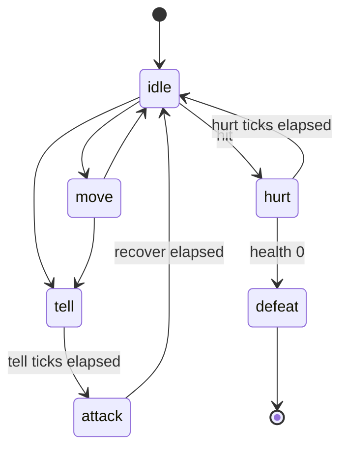

# SLIME-01: Green Slime readability set, design spec

**Status:** packet ready; design pending. Execution pending. Review pending.

**Decision record:** height <fill> px, frame <fill> x <fill>, pivot (<fill>, <fill>). Proposed by <fill>; decided by <fill>.

The sections follow `docs/02-art/gob-01-goblin-spec.md`. Replace every `<fill: ...>`; write numbers, not adjectives. The design step stops at the keys and this spec (see the top-tier budget in `docs/07-agents/agent-orchestration.md`).

## 1. Canon and tone constraints

- Approved concept: `assets/concept/floor-01/enemies/scatterers-rot-sticker-slime-bestiary.png` (Green Slime panels). The roster (`docs/02-art/floor-01-enemy-concept-roster.md`) records the Green Slime as a **corrosive gelatinous green creature**, native production pending. The board is shared with the Scatterer, Brood Guardian and the other creature; only this creature's panels are cropped, and the Scatterer panels are skipped.
- Tone (`docs/01-design/antihero-tone.md`, enemies row): threatening yet eccentric, with motivated behaviors and readable tells and some absurd visual contrasts; never a purely serious faceless army and never comedic with no danger. 1980s-1990s action cinema is used for attitude only, never copied designs.
- Canon facts that must survive in pixels (from the approved docs and the concept board, not design decisions):
  - A low gelatinous green mound with a translucent body; the board shows a skull and a rusted armor plate suspended or half-dissolved inside it, bright green drips and a puddle trail.
  - Corrosive: steam or smoke wisps over the dissolving plate and acid sheen are the corrosion cues; the roster asks for "gelatinous movement and obvious corrosion cues".
  - Distinct from the Scatterer family and the Rot Sticker (a separate hazard identity); reads against the Floor 01 catacomb stone, but the opening floor itself has no dripping slime.
- Design reading of the tone: <fill: how the Green Slime reads as a nasty, slightly absurd hazard, not a cute mascot>.

### Where the canon, size and mechanics are defined (checked 2026-11-18)

| Topic | Source | What it says |
| --- | --- | --- |
| Visual approval | `docs/04-production/backlog.md` line 11; `docs/02-art/floor-01-art-atlas-v1.md` line 10; `docs/02-art/floor-01-enemy-concept-roster.md` line 18 | The Green Slime visual concept is owner-approved: a **corrosive gelatinous green creature**; native production pending |
| Canon | `docs/02-art/floor-01-art-atlas-v1.md` lines 45 and 54 | A separate corrosive creature in its own area (book chapters 15 and 19 are cited there); atlas panel 07 is a concept comparison only, so do not infer adjacent locations |
| Mechanics | `docs/01-design/floor-01-gameplay-progression-v0.md` line 78; `docs/01-design/combat-first-encounter-design.md` line 79 | "Contact risk" hazard; avoid unsuitable melee, set up terrain; safe attack choices and deliberate triggering. No hit points, damage, speed or contact rules exist |
| Splitting | `docs/02-art/floor-01-enemy-concept-roster.md` line 47 | "Slimes split on hit" is **not** an approved feature merely because a caption says so; "no unapproved splitting" (line 61) |
| Size | none | The only number is the lineup label (about 32 px) printed on `floor01-enemy-lineup-approved.png`, which the roster says is not an accepted native size |
| Area art | `docs/07-agents/floor-01-area-kits-plan.md` line 21 (AREA-HAZARDS-01) | Slime decals and tells belong to the hazards environment kit |
| Opening floor | `docs/02-art/floor-01-opening-catacomb-goblins.md` line 35 | The opening floor has no dripping slime or toxic water |

### Guardrails (copied from the roster and atlas)

- **No unapproved splitting.** The roster says "Slimes split on hit" is not an approved feature; the ensemble board `floor01-enemy-lineup-approved.png` draws small split-off slimes and is not cropped here.
- The board's collapse-to-puddle row and the steaming-plate row are concept illustrations of states, not approved mechanics or damage rules. Printed scale labels are not accepted native sizes.
- Convert from original editable pixel grids / `.aseprite`, never by tracing or cropping the illustrated board.

### Separate work orders suggested (not in scope here)

- Puddle / acid trail decals and corrosion marks on stone: belong to AREA-HAZARDS-01 (`docs/07-agents/floor-01-area-kits-plan.md` line 21).
- Corrosion steam/smoke and acid-drip particles: a shared hazard-VFX work order (no projectile exists on the board).
- Any split-off mini-slimes: only after gameplay approves splitting.

### Packet inputs

- Concept crops in `docs/evidence/slime-01/packet/` (x,y,w,h in the 1672x941 concept):
  - `concept_crop_1.png` = `1190,245,445,200`: hero Green Slime (top row)
  - `concept_crop_2.png` = `1245,580,410,70`: state row 1 (three mound/flatten stages)
  - `concept_crop_3.png` = `1245,690,410,90`: state row 2 (slime over a plate, steam wisps)
  - `concept_crop_4.png` = `1245,805,410,85`: state row 3 (mound shrinking to a puddle)
- `scale_lineup.png`: Carl 52, Donut 40, goblin 36 and the merged Scatterer idle (15 px) plus three empty candidate slots at 24, 30 and 36 px. By eye the hero slime is about 430 x 190 px in the 1672x941 board against about 270 x 90 px for the Scatterer, which suggests about 30 px tall and 60 px wide at the Scatterer's 15 px; an estimate, not an approved size. The lineup shows height only; the width is a separate design decision. The default 64 x 56 frame is a placeholder only.
- Readability set (tags): `idle` (2-4), `move` (4-6), `tell` (1-2), `attack` (2-3), `hurt` (1), `defeat` (2-3); about 12 to 20 frames. Concrete tag names and frame counts are the designer's choice (section 4 and `frame_pivot_template.json` carry the toolkit defaults).

## Difficulty and route

**Score 2 of 4: Medium, route B** (medium tier drafts size, palette, all keys and the spec; a fresh top-tier editor corrects and freezes them).

| Point | Met | Note |
| --- | --- | --- |
| 1. New design, not a variant | yes | A new creature, not a variant of an approved asset |
| 2. Native height above about 40 px | no | Candidates 24, 30, 36 px |
| 3. Complex anatomy | no | An amorphous mound; no limbs or rig, only silhouette deformation per frame |
| 4. VFX, projectiles, special states | yes | Corrosion steam, drips and a puddle state beyond the readability set |

Reasoning: new design with corrosion effects but a small, partless body; a bigger size or an inner skull and plate rendered as separate parts would raise it to 3.

## 2. Size decision

Carl is 52 px (about 6 ft), Donut 40 px, the goblin 36 px (see `scale_lineup.png`).

| Option | Idle opaque height | Ratio to Carl | Implied real height | Why / why not |
| --- | --- | --- | --- | --- |
| A | 24 px | <fill> | <fill> | <fill> |
| B | 30 px | <fill> | <fill> | <fill> |
| C | 36 px | <fill> | <fill> | <fill> |

Decision: <fill: height and the reason, one paragraph; the proposer and the decider are different agents>.

## 3. Frame, pivot, boxes and atlas

- Frame <fill> x <fill>, pivot (<fill>, <fill>), contact row <fill> (the lowest opaque row of every grounded frame).
- Grounded tags: <fill>. Airborne tags (no pixel on the contact row): <fill or none>.
- Standing box <fill> x <fill>; hurtbox <fill>; attack hitbox <fill> on the impact frame.
- Authored facing right; the runtime mirrors around the pivot column.
- One atlas, frames 0 to <fill>, layers: <fill: for example body, weapon>.

## 4. Readability-set animation list

Readability set: idle, move, tell, attack, hurt, defeat (about 12 to 20 frames until the asset has a gameplay work order). Tick windows are at 60 Hz.

| Role | Tag | Frames | Playback | Tick-window proposal | Reference |
| --- | --- | --- | --- | --- | --- |
| idle | `idle` | 2-4 | loop | 8-12 ticks per frame, a 32-40 tick breathing cycle | GOB-01: 12 + 8 + 12 + 8 |
| move | `walk` | 4-6 | loop | 5 ticks per frame, speed from the gameplay spec | GOB-01: 6 x 5 = 30 ticks |
| tell | `attack_tell` | 1-2 | once | at least 18 ticks of readable hold, about 24 total | GOB-01: 6 + 18 |
| attack | `attack_swing` | 2-3 | once | smear 2, impact 3-4 (shown on exactly the hitbox-active ticks) | GOB-01: 2 + 4, then recover 20 |
| hurt | `hurt` | 1 | once | 8-12 ticks | GOB-01: 4 + 8 |
| defeat | `down` | 2-3 | hold | floor impact 4, settle 8, then a state-driven hold | GOB-01: 4 + 8 + hold |

Frame table (`frame_pivot_template.json` carries the same rows):

| # | Tag | Pose | Ticks | Author |
| --- | --- | --- | --- | --- |
| 0 | `idle` | <fill: pose> | 12 | <fill: key or Sonnet> |
| 1 | `idle` | <fill: pose> | 8 | <fill: key or Sonnet> |
| 2 | `idle` | <fill: pose> | 12 | <fill: key or Sonnet> |
| 3 | `walk` | <fill: pose> | 5 | <fill: key or Sonnet> |
| 4 | `walk` | <fill: pose> | 5 | <fill: key or Sonnet> |
| 5 | `walk` | <fill: pose> | 5 | <fill: key or Sonnet> |
| 6 | `walk` | <fill: pose> | 5 | <fill: key or Sonnet> |
| 7 | `attack_tell` | <fill: pose> | 6 | <fill: key or Sonnet> |
| 8 | `attack_tell` | <fill: pose> | 18 | <fill: key or Sonnet> |
| 9 | `attack_swing` | <fill: pose> | 2 | <fill: key or Sonnet> |
| 10 | `attack_swing` | <fill: pose> | 4 | <fill: key or Sonnet> |
| 11 | `hurt` | <fill: pose> | 4 | <fill: key or Sonnet> |
| 12 | `hurt` | <fill: pose> | 8 | <fill: key or Sonnet> |
| 13 | `down` | <fill: pose> | 4 | <fill: key or Sonnet> |
| 14 | `down` | <fill: pose> | 8 | <fill: key or Sonnet> |
| 15 | `down` | <fill: pose> | hold | <fill: key or Sonnet> |

## 5. State diagram



## 6. Palette

Palette reference: the Scatterer palette `scatterer-floor01-v1` is reddish-brown and does not apply. The packet candidates are the only colour input; the slime greens, the plate rust and the skull bone are design decisions (<fill>).

At most <fill: 20> colours. Candidates from the concept crop (median cut, by pixel share; see `palette_candidates.json`). These are candidates, not decisions.

| # | Candidate | Share | Decision (key, name, role) |
| --- | --- | --- | --- |
| 1 | `#17202a` | 9.8 % | <fill: key, name, role> |
| 2 | `#172430` | 9.5 % | <fill: key, name, role> |
| 3 | `#c1ca24` | 6.7 % | <fill: key, name, role> |
| 4 | `#52632b` | 6.3 % | <fill: key, name, role> |
| 5 | `#708b25` | 6.2 % | <fill: key, name, role> |
| 6 | `#3e4f2a` | 6.1 % | <fill: key, name, role> |
| 7 | `#161f29` | 5.4 % | <fill: key, name, role> |
| 8 | `#151e28` | 5.3 % | <fill: key, name, role> |
| 9 | `#293034` | 4.5 % | <fill: key, name, role> |
| 10 | `#141d26` | 4.4 % | <fill: key, name, role> |
| 11 | `#939d28` | 4.2 % | <fill: key, name, role> |
| 12 | `#182029` | 3.7 % | <fill: key, name, role> |
| 13 | `#f1f387` | 3.3 % | <fill: key, name, role> |
| 14 | `#62622a` | 3.0 % | <fill: key, name, role> |
| 15 | `#e2d94a` | 3.0 % | <fill: key, name, role> |
| 16 | `#0b1018` | 2.8 % | <fill: key, name, role> |
| 17 | `#172128` | 2.6 % | <fill: key, name, role> |
| 18 | `#965e3a` | 2.6 % | <fill: key, name, role> |
| 19 | `#bba33b` | 2.5 % | <fill: key, name, role> |
| 20 | `#19232e` | 2.5 % | <fill: key, name, role> |
| 21 | `#24242a` | 2.1 % | <fill: key, name, role> |
| 22 | `#171f29` | 2.0 % | <fill: key, name, role> |
| 23 | `#16222d` | 0.9 % | <fill: key, name, role> |
| 24 | `#18232e` | 0.6 % | <fill: key, name, role> |

The chosen palette must separate this asset from the warm brick and the cold arch of Floor 1 at 1x, and fit the A1 lighting.

## 7. Key poses

One key per readability tag (about 6 to 8 keys): idle 0, move contact, tell hold, attack impact, hurt, defeat. Each key lists silhouette, joint positions, palette use and the readability reason. Keys are frozen once the review passes (`pixelart freeze`).

| Frame | Tag | Silhouette and pose notes | Readability reason |
| --- | --- | --- | --- |
| <fill> | <fill> | <fill> | <fill> |

## 8. In-between list

For the execution tier; no design decisions needed. One row per non-key frame, as in section 9 of the GOB-01 spec.

| # | Pose notes |
| --- | --- |
| <fill> | <fill> |

## 9. Validators and readability rules

Run by `python3 -m scripts.pixelart validate <asset-config>` (rules V01 to V15 in `scripts/pixelart/validators.py`). Parametrize in the asset config:

- V04 palette: at most <fill> colours; V05 isolated pixels: 0; V06 orphan pixels: at most <fill> per frame.
- V07/V08 contact rows: grounded tags end on the contact row, airborne tags never touch it.
- V09 frozen keys: SHA-256 per key frame, fixture `tests/fixtures/slime-01_keys.json`.
- V13/V14 readability rules (write each as a bbox or key-count rule): <fill: for example the tell is the highest point, the hurt eyes are white>.

## 10. Evidence

```text
python3 -m scripts.pixelart validate <asset-config> --out <dir>
python3 -m scripts.pixelart evidence <asset-config> --out <dir>
python3 -m scripts.pixelart review-pack <asset-config> --out <dir>
```

The review pack holds exactly three images (contact sheet x4, lit scene 640 x 360 shown x3, tell to attack strip) and the validator report.

## 11. Files

| File | Role |
| --- | --- |
| `assets/source/<fill>/slime-01.grid.json` / `.ase` | pixel-grid source and Aseprite master |
| `assets/manifests/slime-01.json` | manifest |
| `<fill>/slime-01.pixelart.json` | the asset config (from `frame_pivot_template.json`) |
| `tests/fixtures/slime-01_keys.json` | frozen keys |

## 12. Rights and provenance

Fan-concept art under the owner-reported `ART-PUBLICATION-ALL-V1` scope (see `docs/04-production/rights-and-release.md`). Record in the PR's `Rights/Provenance` section which model designed, executed and reviewed the art. No tracing of the concept, no image-model raster output.

### Rights/Provenance stub

- Concept: owner-approved reference under `ART-PUBLICATION-ALL-V1`; crops are for reference only, never traced or exported.
- Packet: script output plus a medium-tier executor (stage P).
- Designed by: pending. Executed by: pending. Independently reviewed by: pending.
- No third-party assets, no copied designs or dialogue, no image-model raster output.
