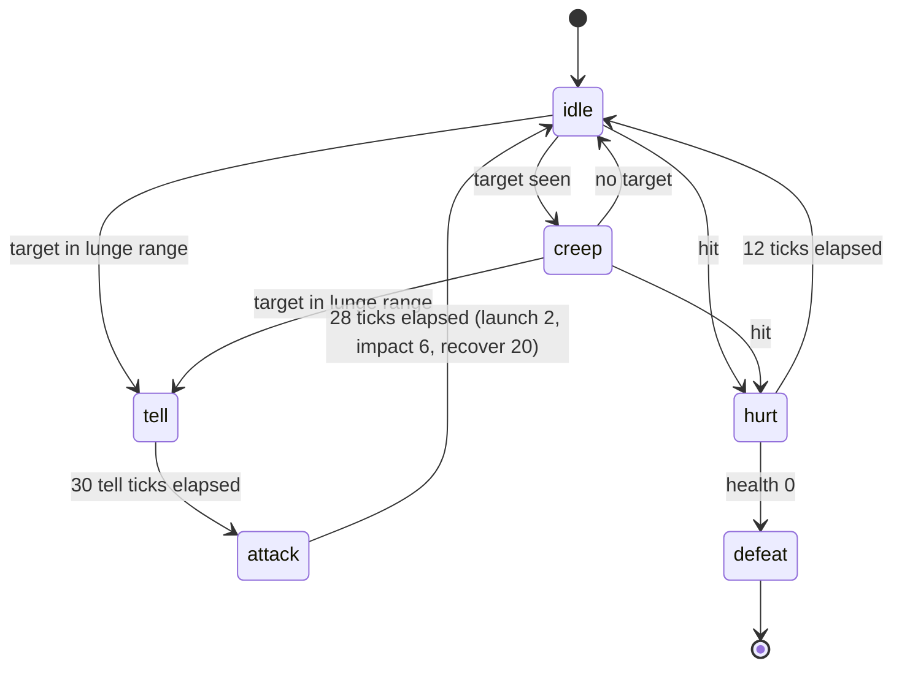

# SLIME-01: Green Slime readability set, design spec

**Status:** design edited; six keys frozen; ten in-betweens drawn; all 16 frames unique and validated; independent review pending.

**Decision record:** height 30 px, frame 80 x 40, pivot (40, 39). Proposed by the draft designer; confirmed by the senior design edit (section 2a).

The sections follow `docs/02-art/gob-01-goblin-spec.md`. Replace every `<fill: ...>`; write numbers, not adjectives. The design step stops at the keys and this spec (see the top-tier budget in `docs/07-agents/agent-orchestration.md`).

## 1. Canon and tone constraints

- Approved concept: `assets/concept/floor-01/enemies/scatterers-rot-sticker-slime-bestiary.png` (Green Slime panels). The roster (`docs/02-art/floor-01-enemy-concept-roster.md`) records the Green Slime as a **corrosive gelatinous green creature**, native production pending. The board is shared with the Scatterer, Brood Guardian and the other creature; only this creature's panels are cropped, and the Scatterer panels are skipped.
- Tone (`docs/01-design/antihero-tone.md`, enemies row): threatening yet eccentric, with motivated behaviors and readable tells and some absurd visual contrasts; never a purely serious faceless army and never comedic with no danger. 1980s-1990s action cinema is used for attitude only, never copied designs.
- Canon facts that must survive in pixels (from the approved docs and the concept board, not design decisions):
  - A low gelatinous green mound with a translucent body; the board shows a skull and a rusted armor plate suspended or half-dissolved inside it, bright green drips and a puddle trail.
  - Corrosive: steam or smoke wisps over the dissolving plate and acid sheen are the corrosion cues; the roster asks for "gelatinous movement and obvious corrosion cues".
  - Distinct from the Scatterer family and the Rot Sticker (a separate hazard identity); reads against the Floor 01 catacomb stone, but the opening floor itself has no dripping slime.
- Design reading of the tone: a low, heavy, grimy mound that has plainly eaten something. The lumpy domed crest over a sagging skirt, a rim that glows all round with a dark thick core and dark lenses inside (translucency and volume from five gel steps, no eyes, no face), the suspended grit and the rusted plate jutting from the skirt with hot acid where the gel eats it make it a nasty thing to touch; the skull riding in it and the way it rears up and beads acid before lunging are the absurd, motivated note. No eyes, no smile, no sheen of cuteness: the only highlights are wet glints on a dirty surface.

### Where the canon, size and mechanics are defined (checked 2026-11-18)

| Topic | Source | What it says |
| --- | --- | --- |
| Visual approval | `docs/04-production/backlog.md` line 11; `docs/02-art/floor-01-art-atlas-v1.md` line 10; `docs/02-art/floor-01-enemy-concept-roster.md` line 18 | The Green Slime visual concept is owner-approved: a **corrosive gelatinous green creature**; native production pending |
| Canon | `docs/02-art/floor-01-art-atlas-v1.md` lines 45 and 54 | A separate corrosive creature in its own area (book chapters 15 and 19 are cited there); atlas panel 07 is a concept comparison only, so do not infer adjacent locations |
| Mechanics | `docs/01-design/floor-01-gameplay-progression-v0.md` line 78; `docs/01-design/combat-first-encounter-design.md` line 79 | "Contact risk" hazard; avoid unsuitable melee, set up terrain; safe attack choices and deliberate triggering. No hit points, damage, speed or contact rules exist |
| Splitting | `docs/02-art/floor-01-enemy-concept-roster.md` line 47 | "Slimes split on hit" is **not** an approved feature merely because a caption says so; "no unapproved splitting" (line 61) |
| Size | none | The only number is the lineup label (about 32 px) printed on `floor01-enemy-lineup-approved.png`, which the roster says is not an accepted native size |
| Area art | `docs/07-agents/floor-01-area-kits-plan.md` line 21 (AREA-HAZARDS-01) | Slime decals and tells belong to the hazards environment kit |
| Opening floor | `docs/02-art/floor-01-opening-catacomb-goblins.md` line 35 | The opening floor has no dripping slime or toxic water |

### Guardrails (copied from the roster and atlas)

- **No unapproved splitting.** The roster says "Slimes split on hit" is not an approved feature; the ensemble board `floor01-enemy-lineup-approved.png` draws small split-off slimes and is not cropped here.
- The board's collapse-to-puddle row and the steaming-plate row are concept illustrations of states, not approved mechanics or damage rules. Printed scale labels are not accepted native sizes.
- Convert from original editable pixel grids / `.aseprite`, never by tracing or cropping the illustrated board.

### Separate work orders suggested (not in scope here)

- Puddle / acid trail decals and corrosion marks on stone: belong to AREA-HAZARDS-01 (`docs/07-agents/floor-01-area-kits-plan.md` line 21).
- Corrosion steam/smoke and acid-drip particles: a shared hazard-VFX work order (no projectile exists on the board).
- Any split-off mini-slimes: only after gameplay approves splitting.

### Packet inputs

- Concept crops in `docs/evidence/slime-01/packet/` (x,y,w,h in the 1672x941 concept):
  - `concept_crop_1.png` = `1190,245,445,200`: hero Green Slime (top row)
  - `concept_crop_2.png` = `1245,580,410,70`: state row 1 (three mound/flatten stages)
  - `concept_crop_3.png` = `1245,690,410,90`: state row 2 (slime over a plate, steam wisps)
  - `concept_crop_4.png` = `1245,805,410,85`: state row 3 (mound shrinking to a puddle)
- `scale_lineup.png`: Carl 52, Donut 40, goblin 36 and the merged Scatterer idle (15 px) plus three empty candidate slots at 24, 30 and 36 px. By eye the hero slime is about 430 x 190 px in the 1672x941 board against about 270 x 90 px for the Scatterer, which suggests about 30 px tall and 60 px wide at the Scatterer's 15 px; an estimate, not an approved size. The lineup shows height only; the width is a separate design decision. The default 64 x 56 frame is a placeholder only.
- Readability set (tags): `idle` (2-4), `move` (4-6), `tell` (1-2), `attack` (2-3), `hurt` (1), `defeat` (2-3); about 12 to 20 frames. Concrete tag names and frame counts are the designer's choice (section 4 and `frame_pivot_template.json` carry the toolkit defaults).

## Difficulty and route

**Score 2 of 4: Medium, route B** (medium tier drafts size, palette, all keys and the spec; a fresh top-tier editor corrects and freezes them).

| Point | Met | Note |
| --- | --- | --- |
| 1. New design, not a variant | yes | A new creature, not a variant of an approved asset |
| 2. Native height above about 40 px | no | Candidates 24, 30, 36 px |
| 3. Complex anatomy | no | An amorphous mound; no limbs or rig, only silhouette deformation per frame |
| 4. VFX, projectiles, special states | yes | Corrosion steam, drips and a puddle state beyond the readability set |

Reasoning: new design with corrosion effects but a small, partless body; a bigger size or an inner skull and plate rendered as separate parts would raise it to 3.

## 2. Size decision

Carl is 52 px (about 6 ft), Donut 40 px, the goblin 36 px, the Scatterer 15 px (see `scale_lineup.png`).

| Option | Idle opaque height | Ratio to Carl | Implied real height | Why / why not |
| --- | --- | --- | --- | --- |
| A | 24 px | 0.46 | about 2.8 ft | Too small to plan a route around; the 9 px skull would take 38 % of the height and the mound would read as a prop |
| B | 30 px | 0.58 | about 3.5 ft | Knee-to-thigh mound next to Carl, about twice the Scatterer. Leaves room for a 9 px skull and a 7 px plate inside a body with real gel above them. Matches the board's proportion (hero about 2.3 times as wide as tall, Scatterer at 15 px) |
| C | 36 px | 0.69 | about 4.2 ft | As tall as the goblin and, at the width the mound needs (about 75 px), a wall across a quarter of the 320 px view; the rear-up tell would need 42 px and break a 40 px frame |

Decision: **B, 30 px idle height, 64 px wide including the floor film and the jutting plate.** The creature is a hazard the player walks around, so it needs mass on screen, but it has to stay a low thing: the mound is half of Carl's height and wider than Carl's body, the right reading for a "contact risk" blob. The rear-up tell is the tallest pose at 36 px, 6 px above idle, so it is a pose change and not a change of scale. Confirmed by the senior design edit.

## 2a. Design edit decisions (senior edit, 2026-11-18)

The draft keys read as flat-topped, vertical-sided green boxes with an emoji-like skull: closer to a mascot block than the concept's sagging, translucent mound. The edit redraws all six keys with a new body method (blended floor-anchored ellipses: domed crest, sagging skirt, optional carve) and a new shading rule; the size, frame, pivot, tag list and tick table are kept.

| Question | Decision |
| --- | --- |
| Key 0 against the concept hero | Redrawn: domed lumpy crest leaning back-left, flared skirt with a 2 px wet film, rim glowing all round (`f` on the torch-lit upper left, `d` elsewhere, `c` on the shadowed right), lit upper skin `d`, mid `c`, shade `b`, thick core `a`, caustic band `d` on row 38, and four dark lenses with a refracted `d` lower-right edge (the concept's dark hollows). The skull is three-quarter (far socket 1 px, near socket 2 x 2, teeth row) and stained one bone step darker in its lower rows; the plate juts out of the front skirt as in the concept, with five `v` pixels where the gel eats it |
| 1. Defeat read | The defeat is the creature's **remains, not a stain**: a dull, deflated heap 10 px high (top row 30, rule `R6-defeat-remains-not-a-stain` asks for row 31 or higher) with a domed crust and wrinkles, no rim glow, no `h`, `H`, `v` or `w`; the skull has rolled out of the front onto the plate, which has slid out flat. **Boundary with AREA-HAZARDS-01:** this atlas owns the body and the debris it drops, up to the 1 to 3 px wet film on the contact row; any flat stain, acid pool or corrosion mark that stays on the floor after despawn is a decal in the hazards kit (its own layer, under actors). Despawn timing is gameplay's |
| 2. Tell | No longer a tower: a gathered base (40 px wide against idle 64) with the mass reared up and back into a crest that curls forward over a drawn-in front face (a carve under the lip), 37 px tall (rows 3 to 39); the skull is hauled up to mid-height (not into the crest, where it read as a hooded face); 10 crest `v` beads plus 4 on the plate |
| 3. Hurt | Strengthened: flattened to 18 px and recoiled back (mass shifted toward the rear), a dent punched into the front of the crest, the whole struck skin flashing (`w` on the rim and top rows, 84 px), the body one value step paler, skull jolted to the rear, no acid. It now differs from idle in height, centre of mass, outline and value |
| 4. Skull and plate in the body layer; `w` only in hurt | Confirmed both. The skull and plate are the concept's swallowed debris; they move with the gel per key and are drawn per key by rule, so separate layers buy nothing until a runtime needs to swap them. `w` stays reserved for the hurt frame (V14 `R4-flash-only-on-hurt`) |
| 5. Frame height | Kept 80 x 40. The new tell is 37 px with its crest at row 3; no pose needs more, and the in-between half-rise (frame 7) sits below it |
| Tell-to-lunge read, ticks | Kept: 6 + 24 tell, 2 launch, 6 impact, 20 recover (the hit lands 32 ticks after the tell starts). The tell leans the mass back, the lunge throws it forward along the floor (15 px high, reach to x 78): the anticipation reads as the opposite of the action |
| Size beside Carl and the Scatterer | Kept 30 px: knee-to-hip on Carl, about twice the Scatterer's height and several times its mass, wider than Carl (`key0-scale.png`) |
| Palette under A1 light | Kept 17 keys (19 after the round-2 skull tint); the gel ramp moved toward olive in the darks and acid yellow-green in the lights (grime, and closer to the concept); `acid_hot` moved to a hotter yellow (`#f0e61e`) so the tell beads separate from the sheen. The green is the only saturated green on the warm brick and stays readable against the cold blue backdrop |

### Silhouette-gate fixes (2026-11-18)

The silhouette gate passed the outlines, size and six-pose contrast and asked for interior fixes only; frame, pivot, boxes, ticks and bbox rules are unchanged.

1. Value structure inverted to read as light gel with dark hollows: on keys 0, 3, 8 and 10 the interior above the floor band is lifted one step (`a` to `b`, `b` to `c`); darkness stays only in the lenses and a small shadow under and behind the skull. Lit share of the gel pixels (`c`, `d`, `f`, `h`): key 0 56 %, creep 80 %, tell 68 %, lunge 95 %.
2. The curved bright lens edges (read as worms) are replaced by a 2 to 3 px vertical refraction tick on each lens's lower-right edge, plus 2 or 3 bubbles per alive key (a 2 px `d` dot over `c`). Drip runs are capped at 3 px.
3. The skull is sunk: top row and rear column overpainted with gel `c`, lower half one bone step darker, a 2 px `d` gel highlight across the cranium, the jaw set 1 px back with a gap in the teeth, and a dark shadow under and behind it (`q` stays 10 or more).
4. The plate is riveted metal: a lit `u` top edge, two `r` rivets in the lit plate and a corroded `K` notch at the acid bite; the flat defeat plate has the same top edge and rivets.
5. Tell: 5 acid beads stay on the crest; 5 hang under the curled lip as 1 x 2 drips with a dark pixel behind each, over the dark carve; one `H` glint on the lip edge (19 `v` in the key).
6. Defeat: three lumps with 1 to 2 px height steps (rows 31, 30, 32), three diagonal creases (dark `K` fold with a dull `c` lip, since the dead body is already `a`/`b`), three grit specks, and the slumped front lobe now overhangs the back edge of the plate by about 4 px.

Evidence: `key0-scale.png` now also places key 0 in front of lit brick (left of Carl) as well as dark stone.

### Review fix (2026-11-18)

The blind review passed the six keys and failed tag-wide rules that forced the in-betweens. Changes: the bbox rules are split per frame (section 9) and the redraw targets are in section 8. The plate is redrawn as riveted armour with a straight lit top edge, a squared corner, two rivets with glints and a dent; on idle, creep and hurt the front skirt runs over its back third (the top two rows stay gel, the rust below is shaded toward `r` and `n`); in the tell it stays clear on the floor, where the body has reared off it. The lit rim is one pixel thinner on the lower skirt (the second rim ring stops 8 rows above the floor) so the darker gel shows through. Defeat key 15 gets a `c`/`b` top plane on its tallest lump. Keys 0, 3, 8, 10, 12 and 15 are re-frozen.

## 3. Frame, pivot, boxes and atlas

- Frame **80 x 40**, pivot **(40, 39)**, contact row **39** (the lowest opaque row of every frame). The body is centred near the pivot column (idle spans x 6 to 69 with film and plate); the lunge reaches x 78 to the right (frame edge 79).
- Grounded tags: all (`idle`, `creep`, `attack_tell`, `attack_lunge`, `hurt`, `down`). Airborne tags: none.
- Boxes are in frame pixels (x, y, w, h) and become pivot-relative by subtracting (40, 39). Damage and the contact rule are not defined by any approved document and are not decided here.

| Box | Frame px | Pivot-relative | Use |
| --- | --- | --- | --- |
| Standing (movement footprint) | 12, 16, 51, 24 | x -28..22, y -23..0 | the mound without the floor film and without the crest |
| Hurtbox, idle, creep, hurt | 8, 10, 60, 30 | x -32..27, y -29..0 | whole body including the jutting plate, so a hit on the crest lands |
| Hurtbox, tell hold | 15, 3, 38, 37 | x -25..12, y -36..0 | narrower and taller while reared |
| Attack hitbox, frame 10 only | 58, 25, 21, 15 | x 18..38, y -14..0 | the leading bulb of the lunge, floor to knee height; active for the 6 impact ticks |

- Authored facing right; the runtime mirrors around the pivot column.
- One atlas, frames 0 to 15, one layer `body`. The skull and plate are baked into the body (no separate layers).

## 4. Readability-set animation list

Readability set: idle, move, tell, attack, hurt, defeat, 16 frames. Tick windows are at 60 Hz.

| Role | Tag | Frames | Playback | Ticks | Note |
| --- | --- | --- | --- | --- | --- |
| idle | `idle` | 3 | loop | 12 + 8 + 12 = 32 | slow heavy settle |
| move | `creep` | 4 | loop | 4 x 8 = 32 | a creep (squash-and-stretch); speed from the gameplay spec |
| tell | `attack_tell` | 2 | once | 6 + 24 = 30 | 24 ticks of readable hold at the tallest pose |
| attack | `attack_lunge` | 3 | once | 2 + 6 + 20 = 28 | contact lunge; hitbox on frame 10 (6 ticks) only |
| hurt | `hurt` | 1 | once | 12 | flash and flinch |
| defeat | `down` | 3 | hold | 6 + 10 + hold | collapse, settle, then a state-driven hold |

| # | Tag | Pose | Ticks | Author |
| --- | --- | --- | --- | --- |
| 0 | `idle` | Sagging lumpy mound, skull mid-body, plate jutting from the front skirt | 12 | key |
| 1 | `idle` | crest pinned at row 10, shoulder lump and body sink 1 px, skirt spreads, a bubble drifts up 1 px | 8 | in-between |
| 2 | `idle` | shoulder lump and body swell 1 px, skirt draws in, the bubble drifts up another px | 12 | in-between |
| 3 | `creep` | Stretch: long and low, leading lobe forward, tail film thinning behind | 8 | key |
| 4 | `creep` | gather: mass piled up to 27 to 30 px, 46 to 56 px wide, tail film anchored, skull lags one frame (to redraw, section 8) | 8 | in-between |
| 5 | `creep` | second stretch, 21 px, front lobe out to x 74, skull and plate shear forward | 8 | in-between |
| 6 | `creep` | gather again, dome forward, 27 to 30 px, 46 to 56 px wide, skull rides up with it (to redraw, section 8) | 8 | in-between |
| 7 | `attack_tell` | half-rise, 33 px, mass climbing, 11 `v` (crest beads, lip drips, plate), skull still low, plate halfway back | 6 | in-between |
| 8 | `attack_tell` | Reared up and back, 37 px, crest curling forward over a drawn-in front face, acid beads on the crest | 24 | key |
| 9 | `attack_lunge` | the launch: the tell's mass falling forward, 22 to 26 px, bulb at x 66, nothing past x 70 (to redraw, section 8) | 2 | in-between |
| 10 | `attack_lunge` | Flat reach to x 78, bulb at the leading edge, parts dragged behind | 6 | key |
| 11 | `attack_lunge` | recover: mass pulled back and bunched, 20 to 24 px, nothing past x 70 (to redraw, section 8) | 20 | in-between |
| 12 | `hurt` | Flinch: flat, recoiled back, dented front, whole struck skin flashing | 12 | key |
| 13 | `down` | slump: about 18 px, dark crust, rim glow gone, skull sunk at the rear, plate sliding out (may be redrawn taller, section 8) | 6 | in-between |
| 14 | `down` | deflate: 11 px, skull rolled out of the front, plate tipped flat | 10 | in-between |
| 15 | `down` | Dull deflated heap (the remains), skull rolled out onto the plate slid out flat | hold | key |

## 5. State diagram

Gameplay supplies ranges and speeds; the art only commits to the tick windows.



## 6. Palette

Palette `slime-floor01-v1`, **19 colours** (budget 20; `g` and `j` are the skull's gel tint, round 2). The packet candidates are median-cut noise over the concept (15 of 24 are background navy), so the greens were re-ramped by eye and not copied (the edit moved the darks toward olive and the lights toward acid yellow-green): a six-step gel ramp from murk to lit, a pale glint and a hot acid yellow-green taken from the board's brightest tones, a three-step bone, a three-step rust (candidate `#965e3a` informed `rust_lit`) and a grit green.

| Key | Name | RGBA | Role |
| --- | --- | --- | --- |
| `K` | outline_murk | `#121a0b` | outline and the skull's sockets, near-black green |
| `a` | gel_0_deep | `#222f14` | deepest core of thick gel, dark right edge |
| `b` | gel_1_shade | `#3a5219` | body shade, most of the interior |
| `c` | gel_2_mid | `#5d861c` | mid gel, caustic band at the floor, upper dome |
| `d` | gel_3_light | `#8eba24` | lit rim, streaks, bubbles |
| `f` | gel_4_lit | `#bddb37` | brightest rim on the top-left, bubble tops |
| `h` | sheen_torch | `#dcef7c` | crest sheen arc |
| `H` | glint_pale | `#f6f8c8` | specular glints (accent) |
| `v` | acid_hot | `#f0e61e` | corrosion cue: acid on the plate edge, tell beads (accent) |
| `o` `p` `q` | bone_dark, bone_mid, bone_lit | `#6e6a3c` `#b0a868` `#e0d898` | skull seen through the gel |
| `r` `s` `u` | rust_dark, rust_mid, rust_lit | `#4a2818` `#7c4526` `#a96a3c` | armour plate; `r` also as grit specks |
| `n` | debris_grit | `#2a3418` | suspended grit, grime |
| `w` | hurt_flash | `#f4f2dc` | hurt flash only (accent) |
| `g` `j` | bone_gel_lit, bone_gel_dark | `#b4be62` `#7d893c` | the skull's lower rows seen through gel |

Reading in the lit catacomb: the green is the only saturated cool hue on a warm brick and orange-lit floor, so the silhouette separates from Carl (pink shoes, dark jacket) and the red-brown Scatterer at 1x (`docs/evidence/slime-01/key0-scale.png`). The cold ambient at the right of the view dims the gel, but the lit rim and the skull still read.

## 7. Key poses

| Frame | Tag | Silhouette and pose notes | Readability reason |
| --- | --- | --- | --- |
| 0 | `idle` | 64 x 30 (with film and plate). Domed crest leaning back-left (top row 10), a lower second lump toward the front, sagging skirt flaring to a 2 px film both sides. Skull (9 x 8, three-quarter) mid-body at x 24 to 32, rows 21 to 28; plate (16 x 7) jutting from the front skirt at x 51 to 66 with 5 `v` where the gel eats it; four dark lenses, 6 grit specks, 3 drip runs, torch sheen `h` on the upper-left crest, two `H` glints | A sagging, grimy, translucent mound: glowing rim, dark core and dark lenses give the volume; skull and acid read as "corrosive, ate something" |
| 3 | `creep` | 67 x 22. Mass flowing forward into a front lobe, a 6 px film trailing behind, skull and plate sheared forward | Lower and longer than idle, so the motion reads as a flow and not a hop |
| 8 | `attack_tell` | 40 x 37. Base gathered in, mass reared up and back, the crest curling forward over a drawn-in front face, skull hauled up to mid-height, 10 crest `v` beads plus 4 on the plate | The tallest and narrowest pose, with a bright beaded crest leaning over the target: not mistakable for idle or the lunge, held 24 ticks |
| 10 | `attack_lunge` | 73 x 15. Flat reach to x 78 at floor height with a heavy bulb at the leading edge, skull and plate dragged behind, acid at the leading edge | Longest and flattest live pose: a contact lunge along the floor; the hitbox is the bulb |
| 12 | `hurt` | 55 x 18. Flattened and recoiled back, a dent in the front of the crest, the struck skin flashing `w` (84 px), body one step paler, skull jolted back, no acid | Differs from idle in height, centre of mass, outline and value; the flash is the only `w` in the set |
| 15 | `down` | 63 x 10. A dull deflated heap in three lumps with creases (no rim glow), its front lobe slumped over the plate, which lies flat; the skull rolled out onto the plate | Reads as the creature's remains (a body), not a floor stain; the stain that stays is a hazards-kit decal (section 2a) |

Corrosion steam and acid-drip particles, the puddle and acid decals on the floor, and split-off mini-slimes are not drawn here (see section 1).

## 8. In-between list

For the execution tier. All ten in-betweens are drawn (section 4 marks each); the pose notes below are the targets, and section 8a records where the validator rules overrode them:

| # | Pose notes |
| --- | --- |
| 1, 2 | idle breathing: the crest may now sink 1 px at frame 1 and rise 1 px at frame 2 (rows 9 to 11, rule `S1-idle-breath-29-31px`; key 0 stays exactly 30 px), one bubble drifts up 2 px. Optional redraw |
| 4, 6 | **redraw.** Gather: the mass piles up and draws in, 27 to 30 px high (top row 10 to 13) and 46 to 56 px wide; the tail film's left end stays within 2 px of key 3's so the footprint does not pop; skull rides up 3 to 5 px; the plate stays put on the floor and the gel runs over its back third (`plate_swallowed`). Frame 5 is the second stretch, as long as key 3 |
| 7 | half-rise to about 32 px, base starting to gather, crest not yet curled; at least 9 `v` (rule R2) |
| 9 | **redraw.** Launch (2 ticks): the tell's reared mass falling forward, 22 to 26 px high (top row 14 to 17), bulb at about x 66, **no pixel past x 70** and no `v` past x 66, so the full reach appears only on key 10 |
| 11 | **redraw.** Recover (20 ticks): a visible pull-back toward the creep stretch, 20 to 24 px high (top row 16 to 19), **no pixel past x 70**, plate and skull riding back. Only key 10 is full length |
| 13, 14 | defeat collapse: frame 13 may slump at about 18 px (top row 20 or lower, rule `R6-defeat-collapse`) with the rim glow gone, then 14 deflates toward key 15 while the skull rolls out of the front and the plate slides out |

**Rules the executor added to `slime_01.pixelart.json` with the redraw** (now configured and passing):

```json
{"id": "S2-creep-gather", "frames": [4, 6], "min_top": 10, "max_top": 13, "min_width": 46, "max_width": 56, "bottom": 39},
{"id": "R3-lunge-launch-lean", "frames": [9], "min_top": 14, "max_top": 17, "max_right": 70, "bottom": 39},
{"id": "R3-lunge-recover-pullback", "frames": [11], "min_top": 16, "max_top": 19, "max_right": 70, "bottom": 39}
```

## 8a. Executor notes (in-betweens and pocket fix)

The in-betweens use the key machinery (same shading, lenses, skull and plate, grit carried over from the neighbouring key). Where a section 8 note contradicts a configured validator rule, the rule won and nothing was weakened:

1. **Idle 1 and 2:** "crest sinks or rises 1 px" would break S1 (frames 0 to 2 are exactly 30 px high, top row 10). The crest is pinned at row 10; the breath is the shoulder lump, body and skirt (plus or minus 1 px) and one bubble drifting up 1 px per frame (it restarts when the loop wraps).
2. **Creep 4 and 6:** the "about 40 x 28" gather contradicts S2 (62 px or wider, at most 26 high). The gathers are 25 px high and 67 to 68 px wide: the body piles up while the thin tail film and the plate keep the footprint long.
3. **Tell 7:** "2 to 4 `v`" contradicts R2 (at least 9 `v` in frames 7 and 8). Frame 7 has 11 (crest beads, 2 lip drips, plate bite), still fewer than the tell's 19. Height is 33 px (32 asked).
4. **Lunge 9 and 11:** "26 px, no reach past x 70" contradicts R3 (top row 21 or lower and reach to x 76 or more on frames 9, 10 and 11). Frames 9 and 11 are 17 px high with the bulb at x 66 and x 60 and a thin floor strand reaching x 76; no `v` is past x 70, and the attack hitbox is still frame 10 only. Frame 11 is a little higher than 10 because the mass bunches as it pulls back.
5. **Down 13 and 14:** "slump to about 18 px" contradicts R6 (top row 26 or lower). Frame 13 is 14 px, frame 14 is 11 px, key 15 is 10 px; the plate steps through three drawings (jutting, tipped, flat) and the skull rolls from the rear to the front.
6. **Gel pockets:** the lens ellipses came out as small crosses (the 2 by 2 radius made a plus shape). They are now literal rounded 2 to 4 px shapes (`POCKET_SHAPES`) with the same refraction tick. Keys 0, 3, 8 and 10 changed only inside their silhouettes (no silhouette pixel moved) and were re-frozen; keys 12 and 15 have no pockets and are unchanged.
7. **Resolved by the designer (review fix):** R3, S2, S1 and R6 are now split per frame (section 9); items 1, 2, 4 and 5 above no longer bind and are superseded by the round-2 notes below.

### Round 2 (executor)

8. **Gathers 4 and 6:** redrawn as a pile-up, 29 px high (top row 11) and 55 to 56 px wide, tail film's left end at x 6 and x 7 (key 3 is at 7), skull risen to row 20 (key 3: 25) and lagging. Frame 4 piles toward the rear, frame 6 toward the front. The plate sits under the front skirt at x 46 in both, 9 px behind key 3's x 55: with the tail film held at key 3's left end, the width cap of 56 px leaves no room for the plate at x 55, so it is drawn in with the mass and slides back out on the stretch frames.
9. **Launch 9 and recover 11:** 9 is the reared mass falling forward, 26 px high (top row 14), peak at x 53, bulb at x 66, right edge x 70 and no `v` past x 66. 11 is a pull-back, 23 px high (top row 17), peak at x 42, bulb at x 57, right edge x 65. Key 10 is now the only frame that reaches x 76 or more.
10. **Idle 1 and 2** use the loosened breath: crest top row 11 (29 px) and row 9 (31 px), bubble drifting up 2 px. **Down 13 and 14** use the loosened collapse: 17 px (top row 23) and 13 px (top row 27), then key 15 at 10 px; the plate steps through the new riveted plate, a tipped version and the flat one.
11. **Grit:** the specks are half as many and drawn as diagonal 2 px chips (not flat squares), so they no longer read as holes.
12. **Skull tint:** two new palette keys, `g` bone_gel_lit (`#b4be62`) and `j` bone_gel_dark (`#7d893c`), replace the plain dim bone steps on the lower rows of a skull seen through gel, so it sits in the gel and not on it. The skull on the defeat heap is outside the gel and keeps plain bone. The palette is 19 colours (budget 20); the `q` count rule is unaffected (the upper rows keep `q`).
13. All six keys were re-frozen for the grit and skull tint (silhouettes unchanged). The plate in frames 1, 2, 4 to 6 uses `plate_swallowed` like keys 0, 3 and 12; frames 7 to 11 use the floor plate like keys 8 and 10.

## 9. Validators and readability rules

Run by `python3 -m scripts.pixelart validate assets/source/characters/slime/slime_01.pixelart.json`. The set passes V01 to V15 (V08 and V10 are not configured; V12 `unique_frames` is on again, all 16 frames are distinct):

- V04 palette: at most 20 colours (19 used); V05 isolated pixels: 0; V06 orphan pixels: at most 4 per frame.
- V07 contact rows: every tag is grounded, the lowest opaque row is 39.
- V09 frozen keys: SHA-256 per key frame, fixture `tests/fixtures/slime-01_keys.json` (re-frozen after the senior design edit).
- V13 bbox, per frame: key 0 exactly 30 px high and 58 to 64 px wide, idle 1 and 2 top row 9 to 11; creep key 3 at most 26 px high and 62 px wide or more, frames 4 to 6 top row 9 or lower and at most 70 px wide (plus `S2-creep-gather`: frames 4 and 6 top row 10 to 13, 46 to 56 px wide); the tell key at least 36 px high (top row 4 or higher) and at most 44 px wide; **only lunge key 10** reaches x 76 or more and starts at row 21 or lower, frames 9 and 11 are grounded with top row 12 or lower (plus `R3-lunge-launch-lean`: frame 9 top row 14 to 17, nothing past x 70; `R3-lunge-recover-pullback`: frame 11 top row 16 to 19, nothing past x 70); the hurt starts at row 18 or lower and stays within x 66; defeat key 15 starts at row 26 or lower, is at most 70 px wide and reaches row 31 or higher (remains, not a stain), frames 13 and 14 start at row 20 or lower.
- V14 key counts: acid `v` at least 4 in the alive frames and at least 9 in the tell; skull bone `q` at least 10 in the alive keys; hurt `w` at least 40 and no `w` in any other frame; no `v`, `H` or `w` in any defeat frame.
- `tests/test_art_slime01.py` adds: the grid equals the script output, the six keys are distinct and frozen, every frame is distinct and the in-betweens are drawn (not copies), the gel pockets are rounded, the tick table and attack windows, tell tallest and lunge longest, one connected body per key (no split-off pieces).

Acceptance targets for the review: the tell reads against idle at 1x (37 px tall, 40 px wide, 14 `v`, against 30 by 64 and 5), the lunge impact reads as a floor-level reach (15 px by 73 px), the hurt reads against idle at 1x (18 px, recoiled, 84 `w`), the defeat reads as remains and not a decal, and key 0 reads as a grimy translucent mound and not a mascot blob.

## 10. Evidence

```text
python3 -m scripts.pixelart validate assets/source/characters/slime/slime_01.pixelart.json --out <dir>
python3 -m scripts.pixelart evidence assets/source/characters/slime/slime_01.pixelart.json --out <dir>
python3 -m scripts.pixelart review-pack assets/source/characters/slime/slime_01.pixelart.json --out <dir>
python3 scripts/make_slime01_scale.py
```

`docs/evidence/slime-01/key0-scale.png` shows key 0 on the lit floor beside Carl and the Scatterer at 1x, with a 4x copy; `docs/evidence/slime-01/keys-x3.png` is the six keys at 3x with a 1x row (both from `scripts/make_slime01_scale.py`, which needs `bash scripts/export_assets.sh` first). The review pack (contact sheet x4, lit scene in front of torch-lit brick, tell to attack strip, validator summary) is in `docs/evidence/slime-01/review-pack/`.

## 11. Files

| File | Role |
| --- | --- |
| `assets/source/characters/slime/slime_01.grid.json` / `.ase` | pixel-grid source and Aseprite master |
| `assets/manifests/slime-01.json` | manifest |
| `assets/source/characters/slime/slime_01.pixelart.json` | the asset config |
| `scripts/author_slime01.py` | deterministic authoring script |
| `scripts/make_slime01_scale.py` | scale evidence and keys contact sheet |
| `tests/fixtures/slime-01_keys.json` | frozen keys |
| `tests/test_art_slime01.py` | asset-specific tests |

## 12. Rights and provenance

Fan-concept art under the owner-reported `ART-PUBLICATION-ALL-V1` scope (see `docs/04-production/rights-and-release.md`). Record in the PR's `Rights/Provenance` section which model designed, executed and reviewed the art. No tracing of the concept, no image-model raster output.

### Rights/Provenance stub

- Concept: owner-approved reference under `ART-PUBLICATION-ALL-V1`; crops are for reference only, never traced or exported.
- Packet: script output plus a medium-tier executor (stage P).
- Draft spec and keys, design edit and freeze: see the PR body. In-betweens and execution: Claude Sonnet. Independent review: pending.
- No third-party assets, no copied designs or dialogue, no image-model raster output.
