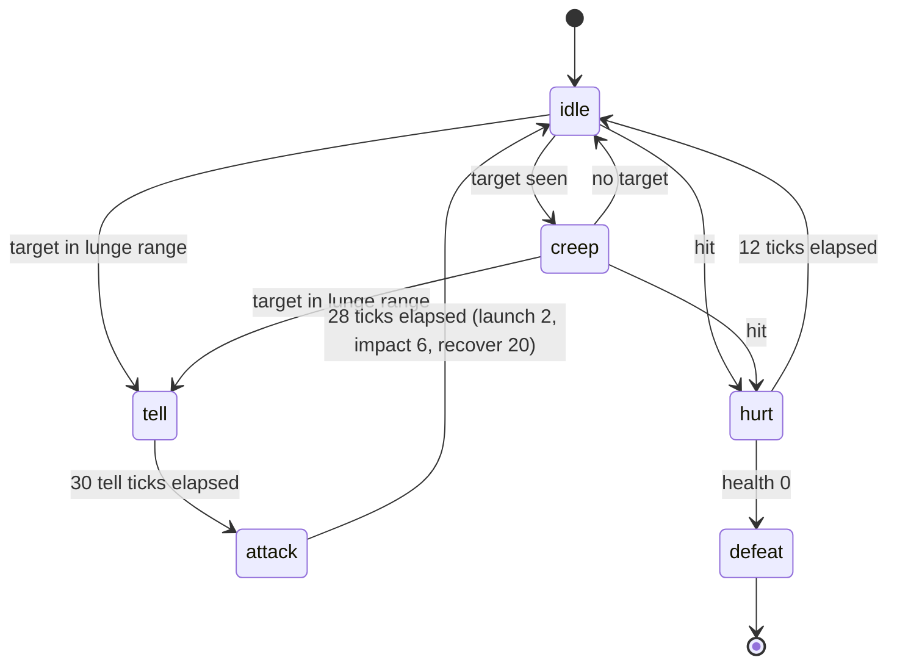

# SLIME-01: Green Slime readability set, design spec

**Status:** first-draft design and six keys drawn; in-between slots are copies of the nearest key; edit, freeze and review pending.

**Decision record:** height 30 px, frame 80 x 40, pivot (40, 39). Proposed by the draft designer; decided by the senior editor (pending).

The sections follow `docs/02-art/gob-01-goblin-spec.md`. Replace every `<fill: ...>`; write numbers, not adjectives. The design step stops at the keys and this spec (see the top-tier budget in `docs/07-agents/agent-orchestration.md`).

## 1. Canon and tone constraints

- Approved concept: `assets/concept/floor-01/enemies/scatterers-rot-sticker-slime-bestiary.png` (Green Slime panels). The roster (`docs/02-art/floor-01-enemy-concept-roster.md`) records the Green Slime as a **corrosive gelatinous green creature**, native production pending. The board is shared with the Scatterer, Brood Guardian and the other creature; only this creature's panels are cropped, and the Scatterer panels are skipped.
- Tone (`docs/01-design/antihero-tone.md`, enemies row): threatening yet eccentric, with motivated behaviors and readable tells and some absurd visual contrasts; never a purely serious faceless army and never comedic with no danger. 1980s-1990s action cinema is used for attitude only, never copied designs.
- Canon facts that must survive in pixels (from the approved docs and the concept board, not design decisions):
  - A low gelatinous green mound with a translucent body; the board shows a skull and a rusted armor plate suspended or half-dissolved inside it, bright green drips and a puddle trail.
  - Corrosive: steam or smoke wisps over the dissolving plate and acid sheen are the corrosion cues; the roster asks for "gelatinous movement and obvious corrosion cues".
  - Distinct from the Scatterer family and the Rot Sticker (a separate hazard identity); reads against the Floor 01 catacomb stone, but the opening floor itself has no dripping slime.
- Design reading of the tone: a low, heavy, grimy mound that has plainly eaten something. The lumpy crest, the dark thick core with a lit rim and a bright floor band (volume from six value steps, no eyes, no face), the suspended grit and the rusted plate with hot acid on its edge make it a nasty thing to touch; the skull riding in it and the way it rears up and beads acid before lunging are the absurd, motivated note. No eyes, no smile, no sheen of cuteness: the only highlights are wet glints on a dirty surface.

### Where the canon, size and mechanics are defined (checked 2026-11-18)

| Topic | Source | What it says |
| --- | --- | --- |
| Visual approval | `docs/04-production/backlog.md` line 11; `docs/02-art/floor-01-art-atlas-v1.md` line 10; `docs/02-art/floor-01-enemy-concept-roster.md` line 18 | The Green Slime visual concept is owner-approved: a **corrosive gelatinous green creature**; native production pending |
| Canon | `docs/02-art/floor-01-art-atlas-v1.md` lines 45 and 54 | A separate corrosive creature in its own area (book chapters 15 and 19 are cited there); atlas panel 07 is a concept comparison only, so do not infer adjacent locations |
| Mechanics | `docs/01-design/floor-01-gameplay-progression-v0.md` line 78; `docs/01-design/combat-first-encounter-design.md` line 79 | "Contact risk" hazard; avoid unsuitable melee, set up terrain; safe attack choices and deliberate triggering. No hit points, damage, speed or contact rules exist |
| Splitting | `docs/02-art/floor-01-enemy-concept-roster.md` line 47 | "Slimes split on hit" is **not** an approved feature merely because a caption says so; "no unapproved splitting" (line 61) |
| Size | none | The only number is the lineup label (about 32 px) printed on `floor01-enemy-lineup-approved.png`, which the roster says is not an accepted native size |
| Area art | `docs/07-agents/floor-01-area-kits-plan.md` line 21 (AREA-HAZARDS-01) | Slime decals and tells belong to the hazards environment kit |
| Opening floor | `docs/02-art/floor-01-opening-catacomb-goblins.md` line 35 | The opening floor has no dripping slime or toxic water |

### Guardrails (copied from the roster and atlas)

- **No unapproved splitting.** The roster says "Slimes split on hit" is not an approved feature; the ensemble board `floor01-enemy-lineup-approved.png` draws small split-off slimes and is not cropped here.
- The board's collapse-to-puddle row and the steaming-plate row are concept illustrations of states, not approved mechanics or damage rules. Printed scale labels are not accepted native sizes.
- Convert from original editable pixel grids / `.aseprite`, never by tracing or cropping the illustrated board.

### Separate work orders suggested (not in scope here)

- Puddle / acid trail decals and corrosion marks on stone: belong to AREA-HAZARDS-01 (`docs/07-agents/floor-01-area-kits-plan.md` line 21).
- Corrosion steam/smoke and acid-drip particles: a shared hazard-VFX work order (no projectile exists on the board).
- Any split-off mini-slimes: only after gameplay approves splitting.

### Packet inputs

- Concept crops in `docs/evidence/slime-01/packet/` (x,y,w,h in the 1672x941 concept):
  - `concept_crop_1.png` = `1190,245,445,200`: hero Green Slime (top row)
  - `concept_crop_2.png` = `1245,580,410,70`: state row 1 (three mound/flatten stages)
  - `concept_crop_3.png` = `1245,690,410,90`: state row 2 (slime over a plate, steam wisps)
  - `concept_crop_4.png` = `1245,805,410,85`: state row 3 (mound shrinking to a puddle)
- `scale_lineup.png`: Carl 52, Donut 40, goblin 36 and the merged Scatterer idle (15 px) plus three empty candidate slots at 24, 30 and 36 px. By eye the hero slime is about 430 x 190 px in the 1672x941 board against about 270 x 90 px for the Scatterer, which suggests about 30 px tall and 60 px wide at the Scatterer's 15 px; an estimate, not an approved size. The lineup shows height only; the width is a separate design decision. The default 64 x 56 frame is a placeholder only.
- Readability set (tags): `idle` (2-4), `move` (4-6), `tell` (1-2), `attack` (2-3), `hurt` (1), `defeat` (2-3); about 12 to 20 frames. Concrete tag names and frame counts are the designer's choice (section 4 and `frame_pivot_template.json` carry the toolkit defaults).

## Difficulty and route

**Score 2 of 4: Medium, route B** (medium tier drafts size, palette, all keys and the spec; a fresh top-tier editor corrects and freezes them).

| Point | Met | Note |
| --- | --- | --- |
| 1. New design, not a variant | yes | A new creature, not a variant of an approved asset |
| 2. Native height above about 40 px | no | Candidates 24, 30, 36 px |
| 3. Complex anatomy | no | An amorphous mound; no limbs or rig, only silhouette deformation per frame |
| 4. VFX, projectiles, special states | yes | Corrosion steam, drips and a puddle state beyond the readability set |

Reasoning: new design with corrosion effects but a small, partless body; a bigger size or an inner skull and plate rendered as separate parts would raise it to 3.

## 2. Size decision

Carl is 52 px (about 6 ft), Donut 40 px, the goblin 36 px, the Scatterer 15 px (see `scale_lineup.png`).

| Option | Idle opaque height | Ratio to Carl | Implied real height | Why / why not |
| --- | --- | --- | --- | --- |
| A | 24 px | 0.46 | about 2.8 ft | Too small to plan a route around; the 9 px skull would take 38 % of the height and the mound would read as a prop |
| B | 30 px | 0.58 | about 3.5 ft | Knee-to-thigh mound next to Carl, about twice the Scatterer. Leaves room for a 9 px skull and a 7 px plate inside a body with real gel above them. Matches the board's proportion (hero about 2.3 times as wide as tall, Scatterer at 15 px) |
| C | 36 px | 0.69 | about 4.2 ft | As tall as the goblin and, at the width the mound needs (about 75 px), a wall across a quarter of the 320 px view; the rear-up tell would need 42 px and break a 40 px frame |

Decision: **B, 30 px idle height, 61 px wide including the floor film.** The creature is a hazard the player walks around, so it needs mass on screen, but it has to stay a low thing: the mound is half of Carl's height and wider than Carl's body, the right reading for a "contact risk" blob. The rear-up tell is the tallest pose at 36 px, 6 px above idle, so it is a pose change and not a change of scale. Proposed by the draft designer; decided by the senior editor (pending).

## 3. Frame, pivot, boxes and atlas

- Frame **80 x 40**, pivot **(40, 39)**, contact row **39** (the lowest opaque row of every frame). The body is centred on the pivot column (idle spans x 11 to 71); the lunge reaches x 78 to the right (frame edge 79).
- Grounded tags: all (`idle`, `creep`, `attack_tell`, `attack_lunge`, `hurt`, `down`). Airborne tags: none.
- Boxes are in frame pixels (x, y, w, h) and become pivot-relative by subtracting (40, 39). Damage and the contact rule are not defined by any approved document and are not decided here.

| Box | Frame px | Pivot-relative | Use |
| --- | --- | --- | --- |
| Standing (movement footprint) | 14, 16, 53, 24 | x -26..26, y -23..0 | the mound without the floor film and without the crest peaks |
| Hurtbox, idle, creep, hurt | 12, 12, 57, 28 | x -28..28, y -27..0 | whole body, so a hit on the crest lands |
| Hurtbox, tell hold | 17, 4, 41, 36 | x -23..18, y -35..0 | narrower and taller while reared |
| Attack hitbox, frame 10 only | 56, 24, 22, 15 | x 16..38, y -15..0 | the leading lobe of the lunge, floor to knee height; active for the 6 impact ticks |

- Authored facing right; the runtime mirrors around the pivot column.
- One atlas, frames 0 to 15, one layer `body`. The skull and plate are baked into the body (no separate layers) in the draft.

## 4. Readability-set animation list

Readability set: idle, move, tell, attack, hurt, defeat, 16 frames. Tick windows are at 60 Hz.

| Role | Tag | Frames | Playback | Ticks | Note |
| --- | --- | --- | --- | --- | --- |
| idle | `idle` | 3 | loop | 12 + 8 + 12 = 32 | slow heavy settle |
| move | `creep` | 4 | loop | 4 x 8 = 32 | a creep (squash-and-stretch); speed from the gameplay spec |
| tell | `attack_tell` | 2 | once | 6 + 24 = 30 | 24 ticks of readable hold at the tallest pose |
| attack | `attack_lunge` | 3 | once | 2 + 6 + 20 = 28 | contact lunge; hitbox on frame 10 (6 ticks) only |
| hurt | `hurt` | 1 | once | 12 | flash and flinch |
| defeat | `down` | 3 | hold | 6 + 10 + hold | collapse, settle, then a state-driven hold |

| # | Tag | Pose | Ticks | Author |
| --- | --- | --- | --- | --- |
| 0 | `idle` | Heavy lumpy mound, two crest peaks, skull and plate inside | 12 | key |
| 1 | `idle` | copy of 0 (to redraw: crest sinks 1 px) | 8 | copy of key 0 |
| 2 | `idle` | copy of 0 (to redraw: crest rises 1 px) | 12 | copy of key 0 |
| 3 | `creep` | Stretch: long and low, leading lobe forward, tail film thinning behind | 8 | key |
| 4 | `creep` | copy of 3 (to redraw: gather, body shorter, 28 px) | 8 | copy of key 3 |
| 5 | `creep` | copy of 3 (to redraw: second stretch) | 8 | copy of key 3 |
| 6 | `creep` | copy of 3 (to redraw: gather again) | 8 | copy of key 3 |
| 7 | `attack_tell` | copy of 8 (to redraw: half-rise, 32 px, acid beads starting) | 6 | copy of key 8 |
| 8 | `attack_tell` | Reared up and back, 36 px, front face drawn in, acid beads on the crest | 24 | key |
| 9 | `attack_lunge` | copy of 10 (to redraw: the 2-tick smear, leaning forward, 26 px, no reach yet) | 2 | copy of key 10 |
| 10 | `attack_lunge` | Flat reach to x 78, bulb at the leading edge, parts dragged behind | 6 | key |
| 11 | `attack_lunge` | copy of 10 (to redraw: recover, pulled back toward the creep stretch of key 3) | 20 | copy of key 10 |
| 12 | `hurt` | Flinch: flat, slumped back, white flash on the crest | 12 | key |
| 13 | `down` | copy of 15 (to redraw: slump at 18 px, flash-free) | 6 | copy of key 15 |
| 14 | `down` | copy of 15 (to redraw: puddle spreads, skull settles) | 10 | copy of key 15 |
| 15 | `down` | Dull flat puddle, skull and plate left lying in it | hold | key |

## 5. State diagram

Gameplay supplies ranges and speeds; the art only commits to the tick windows.



## 6. Palette

Palette `slime-floor01-v1`, **17 colours** (budget 20). The packet candidates are median-cut noise over the concept (15 of 24 are background navy), so the greens were re-ramped by eye and not copied: a six-step gel ramp from murk to lit, a pale glint and a hot acid yellow-green taken from the board's brightest tones, a three-step bone, a three-step rust (candidate `#965e3a` informed `rust_lit`) and a grit green.

| Key | Name | RGBA | Role |
| --- | --- | --- | --- |
| `K` | outline_murk | `#0e1a0e` | outline and the skull's sockets, near-black green |
| `a` | gel_0_deep | `#1b3317` | deepest core of thick gel, dark right edge |
| `b` | gel_1_shade | `#2b4e1f` | body shade, most of the interior |
| `c` | gel_2_mid | `#44801f` | mid gel, caustic band at the floor, upper dome |
| `d` | gel_3_light | `#74ae2a` | lit rim, streaks, bubbles |
| `f` | gel_4_lit | `#a6d03a` | brightest rim on the top-left, bubble tops |
| `h` | sheen_torch | `#d3e868` | crest sheen arc |
| `H` | glint_pale | `#f3f7bc` | specular glints (accent) |
| `v` | acid_hot | `#c8dc22` | corrosion cue: acid on the plate edge, tell beads (accent) |
| `o` `p` `q` | bone_dark, bone_mid, bone_lit | `#6b6842` `#aaa56e` `#dcd69e` | skull seen through the gel |
| `r` `s` `u` | rust_dark, rust_mid, rust_lit | `#4a2818` `#7c4526` `#a96a3c` | armour plate; `r` also as grit specks |
| `n` | debris_grit | `#2a3a1e` | suspended grit, grime |
| `w` | hurt_flash | `#f4f2dc` | hurt flash only (accent) |

Reading in the lit catacomb: the green is the only saturated cool hue on a warm brick and orange-lit floor, so the silhouette separates from Carl (pink shoes, dark jacket) and the red-brown Scatterer at 1x (`docs/evidence/slime-01/key0-scale.png`). The cold ambient at the right of the view dims the gel, but the lit rim and the skull still read.

## 7. Key poses

| Frame | Tag | Silhouette and pose notes | Readability reason |
| --- | --- | --- | --- |
| 0 | `idle` | 61 x 30. Wide asymmetric mound, peak left of centre, two crest peaks (x 28 and 50) with a dip between, thin floor film both sides. Skull at the left (x 22 to 31), rust plate low right (x 45 to 64) with hot acid on its edge, bubbles, grit, attached drip runs, a pale glint pair on the crest | Heavy, grimy mound: a lumpy crest, a thick dark core, a bright lit rim and a bright caustic band at the floor give the translucent volume; skull and acid read as "corrosive, ate something" |
| 3 | `creep` | 66 x 24. Stretched forward: leading lobe on the right, tail film trailing 7 px to the left, crest lower and flatter, parts sheared forward | Lower and longer than idle, so the motion reads as a flow and not a hop |
| 8 | `attack_tell` | 41 x 36. Narrower and 6 px taller than idle, leaning back, front face steep, skull lifted to mid-body, 12 acid beads on the crest line | The tallest, narrowest pose with a bright beaded crest: not mistakable for idle or the lunge, held 24 ticks |
| 10 | `attack_lunge` | 69 x 17. Flat reach to x 78 at floor height, a bulb at the leading edge, skull and plate dragged behind, acid at the leading edge | Longest pose, little more than half the idle height: a contact lunge along the floor; the hitbox is the front lobe |
| 12 | `hurt` | 61 x 20. Squashed to 20 px, slumped left (recoil), crest rows flash white (`w`) | The flash is the only `w` in the set; flat and wide against the tell's tall |
| 15 | `down` | 64 x 12. Puddle 6 px high with the skull propped on it and the plate lying beside; dull (no acid, glint or flash), shading one step darker | Reads as a creature that is gone, leaving the remains. The decal that stays on the floor is a separate work order |

Corrosion steam and acid-drip particles, the puddle and acid decals on the floor, and split-off mini-slimes are not drawn here (see section 1).

## 8. In-between list

For the execution tier. All in-between slots are currently copies of the nearest key (section 4 marks each). Redraw targets:

| # | Pose notes |
| --- | --- |
| 1, 2 | idle breathing: crest sinks 1 px at frame 1, rises 1 px at frame 2, one bubble drifts up 2 px; keep the 30 px height rule on frames 0 to 2 |
| 4, 5, 6 | creep cycle between the stretch (key 3) and a gathered pose (about 40 x 28): gather, stretch, gather; skull and plate follow with a one-frame lag |
| 7 | half-rise to 32 px, acid beads starting (2 to 4 `v`), skull still low |
| 9 | the smear: leaning forward at 26 px with the leading lobe at x 66, no reach beyond x 70 so the hitbox is not shown early |
| 11 | recover: pull back through the creep stretch toward idle, no `v` pixels past x 70 |
| 13, 14 | defeat collapse: slump to 18 px, flash-free, then the puddle spreads and the skull sinks to its final place |

## 9. Validators and readability rules

Run by `python3 -m scripts.pixelart validate assets/source/characters/slime/slime_01.pixelart.json`. The draft passes V01 to V15 (V08 and V10 are not configured; V12 is off because the in-between slots are copies):

- V04 palette: at most 20 colours (17 used); V05 isolated pixels: 0; V06 orphan pixels: at most 4 per frame.
- V07 contact rows: every tag is grounded, the lowest opaque row is 39.
- V09 frozen keys: SHA-256 per key frame, fixture `tests/fixtures/slime-01_keys.json` (draft freeze; the senior edit may re-freeze with `--force`).
- V13 bbox: idle exactly 30 px high; the creep at most 26 px high and 62 px wide or more; the tell at least 34 px high and at most 48 px wide; the lunge reaches x 76 or more and starts at row 21 or lower; the hurt starts at row 18 or lower and stays within x 66; the defeat starts at row 26 or lower and is at most 70 px wide.
- V14 key counts: acid `v` at least 4 in the alive frames and at least 9 in the tell; skull bone `q` at least 10 in the alive keys; hurt `w` at least 8 and no `w` in any other frame; no `v`, `H` or `w` in any defeat frame.
- `tests/test_art_slime01.py` adds: the grid equals the script output, the six keys are distinct, in-between slots copy the nearest key, the tick table and attack windows, tell tallest and lunge longest, one connected body per key (no split-off pieces).

Acceptance targets for the senior edit: the tell reads against idle at 1x (36 px and 12 `v` against 30 px and 5), the lunge impact reads as a floor-level reach (17 px by 69 px), and the hurt flash is the only white in the set.

## 10. Evidence

```text
python3 -m scripts.pixelart validate assets/source/characters/slime/slime_01.pixelart.json --out <dir>
python3 -m scripts.pixelart evidence assets/source/characters/slime/slime_01.pixelart.json --out <dir>
python3 -m scripts.pixelart review-pack assets/source/characters/slime/slime_01.pixelart.json --out <dir>
python3 scripts/make_slime01_scale.py
```

`docs/evidence/slime-01/key0-scale.png` shows key 0 on the lit floor beside Carl and the Scatterer at 1x, with a 4x copy. The review pack (contact sheet x4, lit scene, tell to attack strip) is for the reviewer to generate after the senior edit.

## 11. Files

| File | Role |
| --- | --- |
| `assets/source/characters/slime/slime_01.grid.json` / `.ase` | pixel-grid source and Aseprite master |
| `assets/manifests/slime-01.json` | manifest |
| `assets/source/characters/slime/slime_01.pixelart.json` | the asset config |
| `scripts/author_slime01.py` | deterministic authoring script |
| `scripts/make_slime01_scale.py` | scale evidence |
| `tests/fixtures/slime-01_keys.json` | frozen keys (draft) |
| `tests/test_art_slime01.py` | asset-specific tests |

## 12. Rights and provenance

Fan-concept art under the owner-reported `ART-PUBLICATION-ALL-V1` scope (see `docs/04-production/rights-and-release.md`). Record in the PR's `Rights/Provenance` section which model designed, executed and reviewed the art. No tracing of the concept, no image-model raster output.

### Rights/Provenance stub

- Concept: owner-approved reference under `ART-PUBLICATION-ALL-V1`; crops are for reference only, never traced or exported.
- Packet: script output plus a medium-tier executor (stage P).
- Draft spec and keys: see the PR body. Edit, freeze and independent review: pending.
- No third-party assets, no copied designs or dialogue, no image-model raster output.
