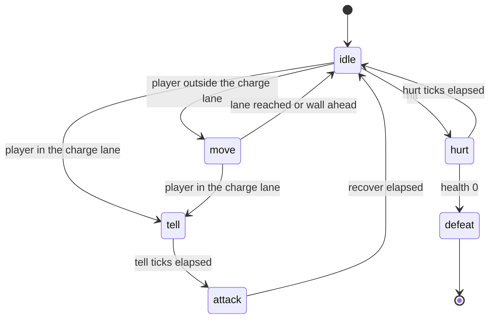

# SWINE-01: Ball of Swine boss readability set, design spec

**Status:** phase 1 of the boss route: design spec and idle key 0 drawn and frozen; waiting for the independent silhouette gate on key 0. Keys 3, 10, 12, 14, 17 follow the gate. Execution pending. Review pending.

**Decision record:** ball diameter 128 px (idle opaque 130 x 143 px with rim lumps), frame 176 x 144, pivot (88, 143). Proposed by the designer; decided by the silhouette gate reviewer (pending).

The sections follow `docs/02-art/gob-01-goblin-spec.md`. Replace every `<fill: ...>`; write numbers, not adjectives. The design step stops at the keys and this spec (see the top-tier budget in `docs/07-agents/agent-orchestration.md`).

## 1. Canon and tone constraints

- Approved concept: `assets/concept/floor-01/enemies/floor01-ball-of-swine-approved.png` (1672x941); `docs/02-art/floor-01-late-enemy-boss-concepts.md` records it as an owner-approved visual concept for the Ball of Swine and the Tusklings. This work order covers the **Ball of Swine** boss. The Tusklings are cropped and scored here for reference but are a separate, later work order (they derive from the same sheet and appear when the Ball breaks apart).
- Tone (`docs/01-design/antihero-tone.md`, enemies row): threatening yet eccentric, with motivated behaviors and readable tells and some absurd visual contrasts; never a purely serious faceless army and never comedic with no danger. 1980s-1990s action cinema is used for attitude only, never copied designs.
- Canon facts that must survive in pixels (from the approved docs and the concept board, not design decisions):
  - A grotesque, rolling sphere made of many Tusklings: dense pink flesh, many eyes, snouts, tusks and hair, with ragged aristocratic fragments (top hat, bow tie, red sequins, pearls, a purple flower, feathers) visible in the mass.
  - A violent rotational silhouette that reads as a ball at 1x; the board shows a dust trail and flying rubble while it rolls.
  - It breaks apart into individual Tusklings (tusked, pig-like, short-legged, aristocratic); the Ball and the Tusklings share one visual family.
- Design reading of the tone: sixteen Tuskling heads jammed into one mass, five of them upside down or sideways, half of them gaping with teeth and a red tongue, small sunk eyes under scowling brows, coarse bristle on every crown and four trotters kicking out of the rim: grotesque and crowded. The absurd note is the scraps of high society on swine (a crushed top hat, a bow tie with a soiled collar, a pearl string, a purple flower, red sequins). The danger is the mass and the ivory: every head carries two tusks, so the ball reads as a 128 px mace of hooks. Never cute: no big eyes, no smiling mouths, and no single central mascot face (the centre face is half buried by its neighbours).

### Where the canon, size and mechanics are defined (checked 2026-11-18)

| Topic | Source | What it says |
| --- | --- | --- |
| Visual approval | `docs/02-art/floor-01-late-enemy-boss-concepts.md` lines 16, 17 and 37; `docs/04-production/backlog.md` line 13 | The Ball of Swine and the Tusklings are owner-approved visual concepts: a grotesque rolling spherical composite of multiple Tusklings (dense pink flesh, multiple eyes, snouts, tusks, hair, fragments of aristocratic dress, violent rotational silhouette); the sheet includes impact/disassembly and individual Tusklings in contrasting aristocratic dress |
| Not approved | late-enemy doc line 16 | Exact sphere size, speed, separate Tuskling hitboxes, damage, rotation, arena-driven state changes and render scale are **not** approved engineering measurements |
| Source | late-enemy doc line 26 | The book describes a violently rolling formation of **30+ Tusklings** with aristocratic costumes mixed into the mass; the concentric/gated arena with changeable walls is a separate environment design, not proof that stage lighting or dimensions on the sheet are canonical |
| Tusklings | late-enemy doc line 17 | Tusked, pig-like, short-legged, aristocratic creatures, distinguishable both within the sphere and separately; knight/lady attire is visual direction; one later named Dominatrix appears in Chapter 27; individual combat archetypes and post-breakout abilities are **not** locked by captions |
| Combat role | `docs/01-design/combat-feel-hybrid-physics.md` line 81; `docs/01-design/combat-first-encounter-design.md` line 80; `docs/01-design/floor-01-gameplay-progression-v0.md` line 83; `docs/01-design/character-progression-horizon.md` line 81; `docs/01-design/mvp-controller-contract.md` line 66 | Boss/heavy: strong telegraph and conditional stagger, not unlimited launch; a mastery test that synthesises learned spatial rules under moving geometry, with split/rejoin choices and no camera or terrain softlock; not a barrage of new abilities; moving arena features must stay comprehensible without show lighting |
| Arena | `docs/02-art/floor-01-art-atlas-v1.md` lines 48, 56 and 80; `docs/04-production/backlog.md` line 100 | Circular/spiral arena with patterned grooves and rising/falling walls; UV and lasers only during the spectacle (a late exception); the arena has only a provisional atlas excerpt and needs its own geometry study; neither arena geometry nor sprite output is approved |
| Size | none | The sheet prints "about 15 ft (4.5 m)" beside the scale panel and Carl 52 / Donut 40 px; the late-enemy doc says render scale is not approved |
| Production slot | `docs/07-agents/pixel-art-pipeline.md` lines 18, 21, 52, 101, 103 | Batch 10 (Arena) with AREA-ARENA-01 (geometry concept first); the Ball is a boss (route A + silhouette gate); the Tusklings are a derived asset (Easy, route C) |
| Mechanics, hit points, damage, hitboxes | none | Not defined in any doc |

### What is NOT approved

- Sphere diameter, speed, rotation rate, native render scale (the printed 15 ft, Carl 52 and Donut 40 labels are not decisions), collider shape and hitboxes.
- Tuskling count (the book says 30+; the sheet shows about a dozen faces), separate Tuskling hitboxes, per-Tuskling combat archetypes, post-breakout abilities and the "Knights" and "Courtesans" captions as production classes.
- Damage, hit points, stagger rules, the roll/impact/break-apart sequence as gameplay, and any arena-driven state change.
- Arena geometry (concentric grooves, moving walls), the purple UV beams and lasers, banners and grates seen behind the Ball: they are a separate environment design and a late lighting exception.
- Book accuracy of every costume and caption; names, labels and exact depicted details printed in the panels are not canon.

### Guardrails (copied from the late-enemy and atlas docs)

- Do not present the composite as a finished sprite, and do not repaint the approved image.
- Keep the Ball distinct from the Juicer's gym and from the troglodyte family; the arena is a separate environment design.
- Show lighting (UV, lasers) is a late exception; the Ball must read with the lights off (atlas line 56).
- Convert from original editable pixel grids / `.aseprite`, never by tracing or cropping the sheet.

### Difficulty of the Tusklings (separate later work order)

**Score 1 of 4: Easy, route C** (top tier writes the spec and draws 1 hero key; medium tier draws the rest). Pipeline slot: derived asset (`docs/07-agents/pixel-art-pipeline.md` lines 18 and 103).

| Point | Met | Note |
| --- | --- | --- |
| 1. New design, not a variant | yes | No approved asset to derive from; one shared body with several costumes would keep it at 1 |
| 2. Native height above about 40 px | no | Placeholder range 36 to 44 px (goblin 36, Engineer 44); by eye they stand well under the Ball |
| 3. Complex anatomy | no | A short, stocky pig body; the six crops show three knights and three courtesans as costume variants |
| 4. VFX, projectiles, special states | no | None beyond the Ball's breakup, which belongs to the Ball |

Reasoning: matches the expected Easy. It would become 2 if each of the six costumes were drawn as a separate body or the height went above 40 px.

### VFX and props to treat as separate work orders

- Dust trail and rubble debris while rolling; the impact shockwave and rubble burst; the break-apart (Ball to Tusklings) sequence and its transition: each a VFX work order tied to gameplay approval.
- The arena (AREA-ARENA-01, a geometry concept first): concentric grooves and channel markers, movable gates and rising/falling walls, banners, grates, torches, warning lights, UV beams and lasers.
- The Tusklings (separate readability sets, route C), including any post-breakout abilities.
- A rolling sphere is a rotation problem: how the surface pattern turns, and whether any rotation happens at runtime (which would break pixel integrity), is a design question for the designer, not a given (decided in section 3.1: authored roll phases, no runtime rotation).

### Packet inputs

- Concept crops in `docs/evidence/swine-01/packet/` (x,y,w,h in the 1672x941 concept):
  - `concept_crop_1.png` = `180,95,600,570`: the Ball of Swine, hero view in the arena (the arena background is context, not an asset)
  - `concept_crop_2.png` = `985,90,655,215`: close-up detail strip (faces, tusks, pearls, flower, sequins)
  - `concept_crop_3.png` = `10,755,1030,180`: roll / impact / break-apart sequence (four stages; the last stage shows the Tusklings separating)
  - `concept_crop_4.png` = `1300,768,245,167`: the Ball in the in-game scale panel (Carl, Donut and the dimension label cropped out)
  - `concept_crop_5.png` = `1000,345,640,150`: Tuskling knights (three)
  - `concept_crop_6.png` = `1005,528,640,165`: Tuskling courtesans (three)
- `scale_lineup.png`: Carl 52, Donut 40, goblin 36, plus three empty candidate slots at 96, 128 and 160 px for the Ball's diameter. 128 px is about the printed 15 ft against a 6 ft, 52 px Carl; 96 and 160 px bracket it. The scale panel draws the Ball at about three times Carl's height; all of this is an estimate to decide, not an approved size. The lineup slots are 48 px wide, so the candidate boxes are not to scale in width. The default 64 x 56 frame is a placeholder only.
- Readability set (tags): `idle` (2-4), `move` (4-6), `tell` (1-2), `attack` (2-3), `hurt` (1), `defeat` (2-3); about 12 to 20 frames. Concrete tag names and frame counts are the designer's choice (section 4 and `frame_pivot_template.json` carry the toolkit defaults). For the Ball, the sheet shows roll (move), impact and break-apart (defeat); idle, tell and hurt states are not shown and are design decisions.

## Difficulty and route

**Score 4 of 4: Boss, route A + silhouette gate** (top tier designs and draws every key; a fresh top-tier silhouette check on the idle key before any other key; budget one extra review round). Any boss lands in this class regardless of the score.

| Point | Met | Note |
| --- | --- | --- |
| 1. New design, not a variant | yes | A dedicated boss |
| 2. Native height above about 40 px | yes | Diameter candidates 96, 128, 160 px |
| 3. Complex anatomy or construction | yes | A sphere composed of many faces, tusks and costume fragments, with a surface that must appear to roll |
| 4. VFX, projectiles, special states | yes | Dust trail, rubble, impact and the break-apart state |

Reasoning: the largest asset in the Floor 01 set with a composite surface and a rotation problem; the silhouette gate matters because the risk is an unreadable noisy blob instead of a ball made of pigs.

## 2. Size decision

Carl is 52 px (about 6 ft), Donut 40 px, the goblin 36 px (see `scale_lineup.png`). Heights are the ball diameter; the idle opaque box adds 2 to 6 px of rim lumps (ears, tusk tips, hat, trotters).

| Option | Idle opaque height | Ratio to Carl | Implied real height | Why / why not |
| --- | --- | --- | --- | --- |
| A | 96 px | 1.85 | 11.1 ft | Cheapest to draw; but heads shrink to radius 8 to 12 px, so the snout, eyes and tusks of a face drop to 1 to 2 px each and the ball becomes a speckled pink blob at 1x; it would also stand under the 112 px Hoarder |
| B | 128 px | 2.46 | 14.8 ft | Matches the printed 15 ft; head radius 11 to 24 px keeps a two-nostril snout, two eyes and two tusk crescents readable per face at 1x; 36 % of the 360 px view height leaves room to jump over and dodge |
| C | 160 px | 3.08 | 18.5 ft | Most detail, but 44 % of the view height, little air above it for jump-over play in a 360 px view, and about 1.6 times the pixel area of B for every key and roll phase |

Decision: **B, 128 px diameter.** It is the only option where each Tuskling face keeps its pig read (snout disc plus nostrils, tusks) at 1x while the ball still leaves the player room to jump and dodge; it matches the printed 15 ft and reads as the largest Floor 01 body next to the 112 px Hoarder. Proposed by the designer; the decision is confirmed or reversed by the independent silhouette gate.

## 3. Frame, pivot, boxes and atlas

- Frame 176 x 144, pivot (88, 143), contact row 143 (the lowest opaque row of every grounded frame). The disc centre is (88, 83), radii 64 x 62, cut flat at the contact row: a 32 px weight patch on the floor.
- Grounded tags: all (`idle`, `roll`, `attack_tell`, `attack_charge`, `hurt`, `down`). Airborne tags: none.
- Collision (placeholder): circle radius 60 centred on pivot + (0, -61). Hurtbox (placeholder): circle radius 56, same centre (the rim lumps never take hits). Roll contact hitbox (placeholder): circle radius 54 on every `roll` frame. Charge impact hitbox (placeholder): box pivot-relative x +36..+80, y -112..-10 on frame 12 only. Damage, knockback and stagger are not approved.
- Authored facing right; the runtime mirrors around the pivot column; a mirrored roll plays the same frames (the mirror turns clockwise into anticlockwise).
- One atlas, frames 0 to 17, one layer `body`.

### 3.1 Rolling sphere and pixel integrity (decision)

Rolling to the right in a side view is a rotation about the screen normal: the visible disc keeps the same features and turns them in the image plane. Rotating the sprite at runtime would resample the grid (mixed and dropped pixels, 1 px eyes and nostrils lost, stair-stepped outline) and would turn the light with it (the torch-lit upper left would end at the bottom). Both break the pixel-art and lighting rules, so **no runtime rotation and no runtime scale on this sprite**.

Approach: the Ball is a **feature model** in `scripts/author_swine01.py` (heads, trotters, tufts and costume scraps placed by polar position and facing angle on the disc). A roll phase is the same model with every angle advanced by theta and **re-rasterized** at native resolution, then shaded with the fixed screen-space light (upper left). The silhouette therefore stays a lumpy ball of constant size while the surface and the rim lumps travel around it.

- `roll` = 6 frames, theta = 0, 60, 120, 180, 240, 300 degrees (clockwise for a rightward roll), 4 ticks each: one turn per 24 ticks.
- Why 60 degree steps: 90 degree steps (4 frames) let the eye pair a feature with the wrong neighbour and see the ball turn backwards; 30 degree steps (12 frames) exceed the move budget of the readability set. The landmark layout is deliberately asymmetric (hat at -152 degrees, flower at -46, bow tie at 114, trotters at 26, 96, 150, -108): no 2-, 3- or 6-fold symmetry, so every 60 degree step has one unambiguous direction.
- The turn rate is a fixed cycle and is not matched to travel speed (a 128 px ball travels 402 px per true turn). The over-rotation is the fiction: the Tusklings in the mass run and scramble like a treadmill, which motivates the dust trail (separate VFX). Gameplay never reads the frame index for position.
- Frames 4 to 8 come from the frame-3 key by the theta rule; the executor only cleans them (orphans, crevices) and may not re-pose them.

### 3.2 Readability without show lighting

- Outline `K` all round, plus a crevice network (`c`, two pixels deep) that splits the disc into 16 lit domes: the "made of bodies" read survives with UV and lasers off.
- Ivory tusks (`v`, `u`) are the brightest values on the sprite and ring every face: the hooks read on warm brick and on the cold arch alike.
- Flesh sits pinker and lighter than the Floor 1 brick (`#d36e66` flesh_mid against the mid brown brick), and warm against the navy arch; the lower right falls to `d`/`c`, so the ball keeps a sphere read under one torch.
- No colour depends on the arena's purple light; the purple flower is a single small detail (at most 80 px).

## 4. Readability-set animation list

Readability set: 18 frames. Tick windows are at 60 Hz.

| Role | Tag | Frames | Playback | Ticks | Note |
| --- | --- | --- | --- | --- | --- |
| idle | `idle` | 0-2 | loop | 16 + 12 + 16 = 44 | the mass heaves: 1 px squash, a few eyes blink, a trotter twitches |
| move | `roll` | 3-8 | loop | 6 x 4 = 24 per turn | section 3.1 |
| tell | `attack_tell` | 9-10 | once | 8 + 28 = 36 | 28 ticks of readable coil hold |
| attack | `attack_charge` | 11-13 | once | 3 + 6 + 24 = 33 | launch smear, impact (hitbox exactly these 6 ticks), rebound / recover |
| hurt | `hurt` | 14 | once | 12 | |
| defeat | `down` | 15-17 | hold | 8 + 12 + hold | crack, slump, heap |

| # | Tag | Pose | Ticks | Author |
| --- | --- | --- | --- | --- |
| 0 | `idle` | settled ball on its flat weight patch, front head snarling right, hat upper left | 16 | key (drawn, frozen) |
| 1 | `idle` | heave in: disc 1 px lower and 1 px wider, three front eyes shut | 12 | Sonnet |
| 2 | `idle` | heave out: back to key 0 height, the lower-left trotter kicks 2 px | 16 | Sonnet |
| 3 | `roll` | theta 0, top leans 2 px forward, rim tufts streak back 2 px | 4 | key |
| 4-8 | `roll` | theta 60, 120, 180, 240, 300 from the frame-3 rule | 4 each | Sonnet (rule, cleanup only) |
| 9 | `attack_tell` | rock back: theta -20, 6 px back, 4 px lower | 8 | Sonnet |
| 10 | `attack_tell` | coil hold: squashed to 136 x 116, rim tufts +3 px, every eye wide, tusks level at the facing side | 28 | key |
| 11 | `attack_charge` | launch smear: stretched to 156 x 112, 14 px forward, tufts streaked back | 3 | Sonnet |
| 12 | `attack_charge` | impact: front flattened into a 40 px vertical face, the front heads squashed, tusks forward | 6 | key |
| 13 | `attack_charge` | rebound: back to round, 4 px back, mouths open (the punish window) | 24 | Sonnet |
| 14 | `hurt` | recoil: 4 px back, 2 px squash, eyes squeezed shut, mouths squealing | 12 | key |
| 15 | `down` | crack: dark seams split the mass between the heads, 2 px sag | 8 | Sonnet |
| 16 | `down` | slump: 150 x 90, heads loosening | 12 | Sonnet |
| 17 | `down` | heap: a limp pile 160 x 64, all eyes shut, the hat on top | hold | key |

The break-apart into live Tusklings is a separate transition work order; `down` ends on the heap.

## 5. State diagram



Triggers are design placeholders; the gameplay work order owns them.

## 6. Palette

The Ball and the Tusklings share one family palette, `tuskling-floor01-v1` (flesh, tusk, hair, cloth, sequin and flower ramps). The arena's purple UV and laser light is not in the sprite. 19 colours, at most 20.

| Key | Name | Hex | Nearest candidate | Role |
| --- | --- | --- | --- | --- |
| `K` | outline | `#1a0b12` | `#270912` (8) | outer outline, pupils, hoof cleft |
| `c` | crevice | `#3d1420` | `#591823` (3) | gaps between heads, mouths, nostrils, sockets |
| `d` | flesh_deep | `#6e2630` | `#7e1c2c` (7) | shadow side, jowls, ears, sequin shadow |
| `s` | flesh_shade | `#a8474a` | `#b84047` (9) | flesh shade, snout rim |
| `m` | flesh_mid | `#d36e66` | `#dc5b57` (4) | flesh mid |
| `l` | flesh_light | `#ef9c86` | `#ef7f6f` (2) | lit flesh, brow ridges |
| `h` | flesh_high | `#f8c4a6` | `#f0c3a2` (16) | lit snout discs only |
| `t` | tusk_shade | `#9a7a52` | `#d6a387` (23), darkened | tusk underside, pearl shadow |
| `u` | tusk_mid | `#d8c094` | `#f0c3a2` (16) | tusk, collar, teeth |
| `v` | tusk_light | `#f6ead0` | `#f8e5cc` (19) | brightest value: tusk tops, pearls, teeth |
| `a` | hair_dark | `#5a2e1e` | `#8a4441` (1), darkened | bristle, tufts |
| `b` | hair_tan | `#a86a38` | `#b05848` (11) | lit bristle, flower centre |
| `n` | cloth_black | `#231c2a` | `#272543` (15) | hat, jacket, bow tie, hooves |
| `o` | cloth_sheen | `#4e4660` | `#513f4f` (5) | lit cloth |
| `r` | sequin_red | `#a8142e` | `#b21a37` (24) | sequins, hat band, tongues |
| `g` | sequin_glint | `#f25a5e` | `#ef7f6f` (2), shifted | sequin glints (accent) |
| `p` | flower_deep | `#4e1f6e` | none (by eye) | flower shade |
| `q` | flower_mid | `#9b55c4` | none (by eye) | flower petals |
| `w` | eye_white | `#f0e2cc` | `#f8e5cc` (19) | eyes (accent) |

The navy candidates (6, 13, 17, 18, 20, 22) are background and are not used. The palette separates the Ball from the warm brick (lighter, pinker flesh; ivory hooks; a black outline) and from the cold arch (warm hue) at 1x in the A1 lighting (see `docs/evidence/swine-01/key0-scale.png`).

## 7. Key poses

| Frame | Tag | Silhouette and pose notes | Readability reason |
| --- | --- | --- | --- |
| 0 | `idle` | Disc 128 x 123 on a 32 px weight patch; 16 heads (radius 11 to 24 px) in depth order, the front head at 10 degrees snarls toward the facing side; rim heads, ears, four trotters, the hat and 20 bristle tufts make a lumpy outline (bbox 143 x 130); crevices split every head | reads as one ball made of many tusked pigs at 1x; tusks are the brightest ring |
| 3 | `roll` | key 0 model at theta 0, top leaning 2 px forward, tufts streaked back; same bbox +-2 px | the constant lumpy outline plus the travelling hat/flower/bow tie landmarks read as rolling |
| 10 | `attack_tell` | coil: squashed 136 x 116 and rocked 6 px back, tufts +3 px, every eye wide (`w` at least 40), facing-side tusks level | lower, wider and bristling: the "about to launch" read, 28 ticks |
| 12 | `attack_charge` | impact: 14 px forward, the front 40 px flattened vertical, front faces crushed, tusks forward | the hit lands where the shape is flat; the hitbox matches it |
| 14 | `hurt` | 4 px back, 2 px squash, every eye shut (`w` = 0), mouths open | the only frame with no eye whites outside `down` |
| 17 | `down` | a 160 x 64 heap of limp Tusklings, hat on top, eyes shut | defeat reads as a pile of bodies, ready for the break-apart transition |

Keys 3, 10, 12, 14, 17 are drawn by the designer after the silhouette gate passes on key 0.

## 8. In-between list

| # | Pose notes |
| --- | --- |
| 1, 2 | idle heave: key 0 with the disc 1 px lower and wider (1), back (2); 3 front eyes shut on 1, one trotter kicks on 2 |
| 4-8 | the frame-3 rule at theta 60 to 300; cleanup only |
| 9 | between 0 and 10: half the squash, theta -20 |
| 11 | between 10 and 12: stretched 156 x 112, tufts streaked |
| 13 | between 12 and 0: round again, 4 px back, mouths open |
| 15, 16 | between 0 and 17: dark seams (15), half-collapsed 150 x 90 (16) |

## 9. Validators and readability rules

Run by `python3 -m scripts.pixelart validate assets/source/characters/swine/swine-01.pixelart.json`. Phase 1 configures frame 0 only:

- V04 palette: at most 20 colours (19 used); V05 isolated pixels: 0; V06 orphan pixels: 0 per frame.
- V07 contact row: every grounded frame ends on row 143.
- V09 frozen keys: SHA-256 per key frame, fixture `tests/fixtures/swine-01_keys.json` (frame 0 now; 3, 10, 12, 14, 17 later).
- V13 bbox: S1 idle top 14 / bottom 143, width 128 to 148. Later: roll frames within +-2 px of the idle bbox; tell top at least idle top + 10 and left at most idle left - 4; impact right at least idle right + 12; defeat top at least 80.
- V14 key counts: idle `w` at least 24 (many faces), `h` at least 140 (lit snouts), `q` at most 80 (the flower is a detail). Later: tell `w` at least 40; hurt and defeat `w` = 0.

### Acceptance targets for the silhouette gate (key 0, 1x)

1. A filled black silhouette reads as a ball with a lumpy, bristly rim (heads, ears, trotters, hat), not a smooth orb; bbox aspect 0.9 to 1.1.
2. At 1x next to Carl at least 10 snouts and the tusk ring are identifiable; the ball reads as many pigs, not as noise.
3. It separates from the lit brick and the cold arch without show lighting.
4. Grotesque and absurd, not cute: no single central mascot face, no big eyes, no smile.

## 10. Evidence

```text
python3 scripts/author_swine01.py               # grid + .ase
python3 scripts/author_swine01.py key0-scale    # docs/evidence/swine-01/key0-scale.png (1x) and key0-scale-4x.png
python3 -m scripts.pixelart validate assets/source/characters/swine/swine-01.pixelart.json --out <dir>
```

Phase 1 evidence: `docs/evidence/swine-01/key0-scale.png` (key 0 at 1x on lit Floor 1, mirrored to face Carl and Donut, 640 x 360) and `key0-scale-4x.png`. The full review pack follows after all keys.

## 11. Files

| File | Role |
| --- | --- |
| `scripts/author_swine01.py` | deterministic authoring script (feature model, roll rule, scale evidence) |
| `assets/source/characters/swine/swine-01.grid.json` / `.ase` | pixel-grid source and Aseprite master |
| `assets/source/characters/swine/swine-01.pixelart.json` | the asset config |
| `tests/fixtures/swine-01_keys.json` | frozen keys |
| `tests/test_art_swine01.py` | phase-1 checks |
| `assets/manifests/swine-01.json` | manifest (execution tier, after the keys) |

### Separate work orders (not in this asset)

Rolling dust trail and rubble; impact shockwave and rubble burst; the break-apart transition into Tusklings (VFX); the Tusklings' own readability sets (route C); the arena AREA-ARENA-01 with its grooves, gates, walls, banners, grates, UV beams and lasers.

## 12. Rights and provenance

Fan-concept art under the owner-reported `ART-PUBLICATION-ALL-V1` scope (see `docs/04-production/rights-and-release.md`). Record in the PR's `Rights/Provenance` section which model designed, executed and reviewed the art. No tracing of the concept, no image-model raster output.

### Rights/Provenance stub

- Concept: owner-approved reference under `ART-PUBLICATION-ALL-V1`; crops are for reference only, never traced or exported.
- Packet: script output plus a medium-tier executor (stage P).
- Designed by: Claude Opus (spec + keys; phase 1: spec and key 0). Executed by: pending. Independently reviewed by: pending (silhouette gate on key 0 first).
- No third-party assets, no copied designs or dialogue, no image-model raster output.
