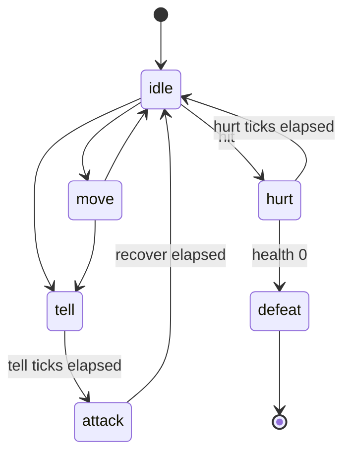

# SWINE-01: Ball of Swine boss readability set, design spec

**Status:** packet ready; design pending. Execution pending. Review pending.

**Decision record:** height <fill> px, frame <fill> x <fill>, pivot (<fill>, <fill>). Proposed by <fill>; decided by <fill>.

The sections follow `docs/02-art/gob-01-goblin-spec.md`. Replace every `<fill: ...>`; write numbers, not adjectives. The design step stops at the keys and this spec (see the top-tier budget in `docs/07-agents/agent-orchestration.md`).

## 1. Canon and tone constraints

- Approved concept: `assets/concept/floor-01/enemies/floor01-ball-of-swine-approved.png` (1672x941); `docs/02-art/floor-01-late-enemy-boss-concepts.md` records it as an owner-approved visual concept for the Ball of Swine and the Tusklings. This work order covers the **Ball of Swine** boss. The Tusklings are cropped and scored here for reference but are a separate, later work order (they derive from the same sheet and appear when the Ball breaks apart).
- Tone (`docs/01-design/antihero-tone.md`, enemies row): threatening yet eccentric, with motivated behaviors and readable tells and some absurd visual contrasts; never a purely serious faceless army and never comedic with no danger. 1980s-1990s action cinema is used for attitude only, never copied designs.
- Canon facts that must survive in pixels (from the approved docs and the concept board, not design decisions):
  - A grotesque, rolling sphere made of many Tusklings: dense pink flesh, many eyes, snouts, tusks and hair, with ragged aristocratic fragments (top hat, bow tie, red sequins, pearls, a purple flower, feathers) visible in the mass.
  - A violent rotational silhouette that reads as a ball at 1x; the board shows a dust trail and flying rubble while it rolls.
  - It breaks apart into individual Tusklings (tusked, pig-like, short-legged, aristocratic); the Ball and the Tusklings share one visual family.
- Design reading of the tone: <fill: how the Ball reads as grotesque, absurd and genuinely dangerous, never cute and never a heroic design>.

### Where the canon, size and mechanics are defined (checked 2026-11-18)

| Topic | Source | What it says |
| --- | --- | --- |
| Visual approval | `docs/02-art/floor-01-late-enemy-boss-concepts.md` lines 16, 17 and 37; `docs/04-production/backlog.md` line 13 | The Ball of Swine and the Tusklings are owner-approved visual concepts: a grotesque rolling spherical composite of multiple Tusklings (dense pink flesh, multiple eyes, snouts, tusks, hair, fragments of aristocratic dress, violent rotational silhouette); the sheet includes impact/disassembly and individual Tusklings in contrasting aristocratic dress |
| Not approved | late-enemy doc line 16 | Exact sphere size, speed, separate Tuskling hitboxes, damage, rotation, arena-driven state changes and render scale are **not** approved engineering measurements |
| Source | late-enemy doc line 26 | The book describes a violently rolling formation of **30+ Tusklings** with aristocratic costumes mixed into the mass; the concentric/gated arena with changeable walls is a separate environment design, not proof that stage lighting or dimensions on the sheet are canonical |
| Tusklings | late-enemy doc line 17 | Tusked, pig-like, short-legged, aristocratic creatures, distinguishable both within the sphere and separately; knight/lady attire is visual direction; one later named Dominatrix appears in Chapter 27; individual combat archetypes and post-breakout abilities are **not** locked by captions |
| Combat role | `docs/01-design/combat-feel-hybrid-physics.md` line 81; `docs/01-design/combat-first-encounter-design.md` line 80; `docs/01-design/floor-01-gameplay-progression-v0.md` line 83; `docs/01-design/character-progression-horizon.md` line 81; `docs/01-design/mvp-controller-contract.md` line 66 | Boss/heavy: strong telegraph and conditional stagger, not unlimited launch; a mastery test that synthesises learned spatial rules under moving geometry, with split/rejoin choices and no camera or terrain softlock; not a barrage of new abilities; moving arena features must stay comprehensible without show lighting |
| Arena | `docs/02-art/floor-01-art-atlas-v1.md` lines 48, 56 and 80; `docs/04-production/backlog.md` line 100 | Circular/spiral arena with patterned grooves and rising/falling walls; UV and lasers only during the spectacle (a late exception); the arena has only a provisional atlas excerpt and needs its own geometry study; neither arena geometry nor sprite output is approved |
| Size | none | The sheet prints "about 15 ft (4.5 m)" beside the scale panel and Carl 52 / Donut 40 px; the late-enemy doc says render scale is not approved |
| Production slot | `docs/07-agents/pixel-art-pipeline.md` lines 18, 21, 52, 101, 103 | Batch 10 (Arena) with AREA-ARENA-01 (geometry concept first); the Ball is a boss (route A + silhouette gate); the Tusklings are a derived asset (Easy, route C) |
| Mechanics, hit points, damage, hitboxes | none | Not defined in any doc |

### What is NOT approved

- Sphere diameter, speed, rotation rate, native render scale (the printed 15 ft, Carl 52 and Donut 40 labels are not decisions), collider shape and hitboxes.
- Tuskling count (the book says 30+; the sheet shows about a dozen faces), separate Tuskling hitboxes, per-Tuskling combat archetypes, post-breakout abilities and the "Knights" and "Courtesans" captions as production classes.
- Damage, hit points, stagger rules, the roll/impact/break-apart sequence as gameplay, and any arena-driven state change.
- Arena geometry (concentric grooves, moving walls), the purple UV beams and lasers, banners and grates seen behind the Ball: they are a separate environment design and a late lighting exception.
- Book accuracy of every costume and caption; names, labels and exact depicted details printed in the panels are not canon.

### Guardrails (copied from the late-enemy and atlas docs)

- Do not present the composite as a finished sprite, and do not repaint the approved image.
- Keep the Ball distinct from the Juicer's gym and from the troglodyte family; the arena is a separate environment design.
- Show lighting (UV, lasers) is a late exception; the Ball must read with the lights off (atlas line 56).
- Convert from original editable pixel grids / `.aseprite`, never by tracing or cropping the sheet.

### Difficulty of the Tusklings (separate later work order)

**Score 1 of 4: Easy, route C** (top tier writes the spec and draws 1 hero key; medium tier draws the rest). Pipeline slot: derived asset (`docs/07-agents/pixel-art-pipeline.md` lines 18 and 103).

| Point | Met | Note |
| --- | --- | --- |
| 1. New design, not a variant | yes | No approved asset to derive from; one shared body with several costumes would keep it at 1 |
| 2. Native height above about 40 px | no | Placeholder range 36 to 44 px (goblin 36, Engineer 44); by eye they stand well under the Ball |
| 3. Complex anatomy | no | A short, stocky pig body; the six crops show three knights and three courtesans as costume variants |
| 4. VFX, projectiles, special states | no | None beyond the Ball's breakup, which belongs to the Ball |

Reasoning: matches the expected Easy. It would become 2 if each of the six costumes were drawn as a separate body or the height went above 40 px.

### VFX and props to treat as separate work orders

- Dust trail and rubble debris while rolling; the impact shockwave and rubble burst; the break-apart (Ball to Tusklings) sequence and its transition: each a VFX work order tied to gameplay approval.
- The arena (AREA-ARENA-01, a geometry concept first): concentric grooves and channel markers, movable gates and rising/falling walls, banners, grates, torches, warning lights, UV beams and lasers.
- The Tusklings (separate readability sets, route C), including any post-breakout abilities.
- A rolling sphere is a rotation problem: how the surface pattern turns, and whether any rotation happens at runtime (which would break pixel integrity), is a design question for the designer, not a given (<fill>).

### Packet inputs

- Concept crops in `docs/evidence/swine-01/packet/` (x,y,w,h in the 1672x941 concept):
  - `concept_crop_1.png` = `180,95,600,570`: the Ball of Swine, hero view in the arena (the arena background is context, not an asset)
  - `concept_crop_2.png` = `985,90,655,215`: close-up detail strip (faces, tusks, pearls, flower, sequins)
  - `concept_crop_3.png` = `10,755,1030,180`: roll / impact / break-apart sequence (four stages; the last stage shows the Tusklings separating)
  - `concept_crop_4.png` = `1300,768,245,167`: the Ball in the in-game scale panel (Carl, Donut and the dimension label cropped out)
  - `concept_crop_5.png` = `1000,345,640,150`: Tuskling knights (three)
  - `concept_crop_6.png` = `1005,528,640,165`: Tuskling courtesans (three)
- `scale_lineup.png`: Carl 52, Donut 40, goblin 36, plus three empty candidate slots at 96, 128 and 160 px for the Ball's diameter. 128 px is about the printed 15 ft against a 6 ft, 52 px Carl; 96 and 160 px bracket it. The scale panel draws the Ball at about three times Carl's height; all of this is an estimate to decide, not an approved size. The lineup slots are 48 px wide, so the candidate boxes are not to scale in width. The default 64 x 56 frame is a placeholder only.
- Readability set (tags): `idle` (2-4), `move` (4-6), `tell` (1-2), `attack` (2-3), `hurt` (1), `defeat` (2-3); about 12 to 20 frames. Concrete tag names and frame counts are the designer's choice (section 4 and `frame_pivot_template.json` carry the toolkit defaults). For the Ball, the sheet shows roll (move), impact and break-apart (defeat); idle, tell and hurt states are not shown and are design decisions.

## Difficulty and route

**Score 4 of 4: Boss, route A + silhouette gate** (top tier designs and draws every key; a fresh top-tier silhouette check on the idle key before any other key; budget one extra review round). Any boss lands in this class regardless of the score.

| Point | Met | Note |
| --- | --- | --- |
| 1. New design, not a variant | yes | A dedicated boss |
| 2. Native height above about 40 px | yes | Diameter candidates 96, 128, 160 px |
| 3. Complex anatomy or construction | yes | A sphere composed of many faces, tusks and costume fragments, with a surface that must appear to roll |
| 4. VFX, projectiles, special states | yes | Dust trail, rubble, impact and the break-apart state |

Reasoning: the largest asset in the Floor 01 set with a composite surface and a rotation problem; the silhouette gate matters because the risk is an unreadable noisy blob instead of a ball made of pigs.

## 2. Size decision

Carl is 52 px (about 6 ft), Donut 40 px, the goblin 36 px (see `scale_lineup.png`).

| Option | Idle opaque height | Ratio to Carl | Implied real height | Why / why not |
| --- | --- | --- | --- | --- |
| A | 96 px | <fill> | <fill> | <fill> |
| B | 128 px | <fill> | <fill> | <fill> |
| C | 160 px | <fill> | <fill> | <fill> |

Decision: <fill: height and the reason, one paragraph; the proposer and the decider are different agents>.

## 3. Frame, pivot, boxes and atlas

- Frame <fill> x <fill>, pivot (<fill>, <fill>), contact row <fill> (the lowest opaque row of every grounded frame).
- Grounded tags: <fill>. Airborne tags (no pixel on the contact row): <fill or none>.
- Standing box <fill> x <fill>; hurtbox <fill>; attack hitbox <fill> on the impact frame.
- Authored facing right; the runtime mirrors around the pivot column.
- One atlas, frames 0 to <fill>, layers: <fill: for example body, weapon>.

## 4. Readability-set animation list

Readability set: idle, move, tell, attack, hurt, defeat (about 12 to 20 frames until the asset has a gameplay work order). Tick windows are at 60 Hz.

| Role | Tag | Frames | Playback | Tick-window proposal | Reference |
| --- | --- | --- | --- | --- | --- |
| idle | `idle` | 2-4 | loop | 8-12 ticks per frame, a 32-40 tick breathing cycle | GOB-01: 12 + 8 + 12 + 8 |
| move | `walk` | 4-6 | loop | 5 ticks per frame, speed from the gameplay spec | GOB-01: 6 x 5 = 30 ticks |
| tell | `attack_tell` | 1-2 | once | at least 18 ticks of readable hold, about 24 total | GOB-01: 6 + 18 |
| attack | `attack_swing` | 2-3 | once | smear 2, impact 3-4 (shown on exactly the hitbox-active ticks) | GOB-01: 2 + 4, then recover 20 |
| hurt | `hurt` | 1 | once | 8-12 ticks | GOB-01: 4 + 8 |
| defeat | `down` | 2-3 | hold | floor impact 4, settle 8, then a state-driven hold | GOB-01: 4 + 8 + hold |

Frame table (`frame_pivot_template.json` carries the same rows):

| # | Tag | Pose | Ticks | Author |
| --- | --- | --- | --- | --- |
| 0 | `idle` | <fill: pose> | 12 | <fill: key or Sonnet> |
| 1 | `idle` | <fill: pose> | 8 | <fill: key or Sonnet> |
| 2 | `idle` | <fill: pose> | 12 | <fill: key or Sonnet> |
| 3 | `walk` | <fill: pose> | 5 | <fill: key or Sonnet> |
| 4 | `walk` | <fill: pose> | 5 | <fill: key or Sonnet> |
| 5 | `walk` | <fill: pose> | 5 | <fill: key or Sonnet> |
| 6 | `walk` | <fill: pose> | 5 | <fill: key or Sonnet> |
| 7 | `attack_tell` | <fill: pose> | 6 | <fill: key or Sonnet> |
| 8 | `attack_tell` | <fill: pose> | 18 | <fill: key or Sonnet> |
| 9 | `attack_swing` | <fill: pose> | 2 | <fill: key or Sonnet> |
| 10 | `attack_swing` | <fill: pose> | 4 | <fill: key or Sonnet> |
| 11 | `hurt` | <fill: pose> | 4 | <fill: key or Sonnet> |
| 12 | `hurt` | <fill: pose> | 8 | <fill: key or Sonnet> |
| 13 | `down` | <fill: pose> | 4 | <fill: key or Sonnet> |
| 14 | `down` | <fill: pose> | 8 | <fill: key or Sonnet> |
| 15 | `down` | <fill: pose> | hold | <fill: key or Sonnet> |

## 5. State diagram



## 6. Palette

Palette reference: the pink flesh, ivory tusk, red-sequin, black-cloth and purple-flower ramps seen in the crops are the candidates; the Tusklings and the Ball must share one family palette (<fill>). The purple UV and laser light of the arena belongs to the environment, not to the sprite.

At most <fill: 20> colours. Candidates from the concept crop (median cut, by pixel share; see `palette_candidates.json`). These are candidates, not decisions.

| # | Candidate | Share | Decision (key, name, role) |
| --- | --- | --- | --- |
| 1 | `#8a4441` | 6.6 % | <fill: key, name, role> |
| 2 | `#ef7f6f` | 6.4 % | <fill: key, name, role> |
| 3 | `#591823` | 5.8 % | <fill: key, name, role> |
| 4 | `#dc5b57` | 5.3 % | <fill: key, name, role> |
| 5 | `#513f4f` | 5.0 % | <fill: key, name, role> |
| 6 | `#0d1626` | 4.9 % | <fill: key, name, role> |
| 7 | `#7e1c2c` | 4.9 % | <fill: key, name, role> |
| 8 | `#270912` | 4.4 % | <fill: key, name, role> |
| 9 | `#b84047` | 4.4 % | <fill: key, name, role> |
| 10 | `#bb7a6a` | 4.3 % | <fill: key, name, role> |
| 11 | `#b05848` | 4.3 % | <fill: key, name, role> |
| 12 | `#f6a488` | 4.2 % | <fill: key, name, role> |
| 13 | `#0d1d36` | 4.0 % | <fill: key, name, role> |
| 14 | `#070305` | 4.0 % | <fill: key, name, role> |
| 15 | `#272543` | 3.9 % | <fill: key, name, role> |
| 16 | `#f0c3a2` | 3.7 % | <fill: key, name, role> |
| 17 | `#0d1522` | 3.7 % | <fill: key, name, role> |
| 18 | `#080711` | 3.5 % | <fill: key, name, role> |
| 19 | `#f8e5cc` | 3.4 % | <fill: key, name, role> |
| 20 | `#030101` | 3.0 % | <fill: key, name, role> |
| 21 | `#2b1c20` | 2.8 % | <fill: key, name, role> |
| 22 | `#0b1220` | 2.8 % | <fill: key, name, role> |
| 23 | `#d6a387` | 2.5 % | <fill: key, name, role> |
| 24 | `#b21a37` | 2.2 % | <fill: key, name, role> |

The chosen palette must separate this asset from the warm brick and the cold arch of Floor 1 at 1x, and fit the A1 lighting.

## 7. Key poses

One key per readability tag (about 6 to 8 keys): idle 0, move contact, tell hold, attack impact, hurt, defeat. Each key lists silhouette, joint positions, palette use and the readability reason. Keys are frozen once the review passes (`pixelart freeze`).

| Frame | Tag | Silhouette and pose notes | Readability reason |
| --- | --- | --- | --- |
| <fill> | <fill> | <fill> | <fill> |

## 8. In-between list

For the execution tier; no design decisions needed. One row per non-key frame, as in section 9 of the GOB-01 spec.

| # | Pose notes |
| --- | --- |
| <fill> | <fill> |

## 9. Validators and readability rules

Run by `python3 -m scripts.pixelart validate <asset-config>` (rules V01 to V15 in `scripts/pixelart/validators.py`). Parametrize in the asset config:

- V04 palette: at most <fill> colours; V05 isolated pixels: 0; V06 orphan pixels: at most <fill> per frame.
- V07/V08 contact rows: grounded tags end on the contact row, airborne tags never touch it.
- V09 frozen keys: SHA-256 per key frame, fixture `tests/fixtures/swine-01_keys.json`.
- V13/V14 readability rules (write each as a bbox or key-count rule): <fill: for example the tell is the highest point, the hurt eyes are white>.

## 10. Evidence

```text
python3 -m scripts.pixelart validate <asset-config> --out <dir>
python3 -m scripts.pixelart evidence <asset-config> --out <dir>
python3 -m scripts.pixelart review-pack <asset-config> --out <dir>
```

The review pack holds exactly three images (contact sheet x4, lit scene 640 x 360 shown x3, tell to attack strip) and the validator report.

## 11. Files

| File | Role |
| --- | --- |
| `assets/source/<fill>/swine-01.grid.json` / `.ase` | pixel-grid source and Aseprite master |
| `assets/manifests/swine-01.json` | manifest |
| `<fill>/swine-01.pixelart.json` | the asset config (from `frame_pivot_template.json`) |
| `tests/fixtures/swine-01_keys.json` | frozen keys |

## 12. Rights and provenance

Fan-concept art under the owner-reported `ART-PUBLICATION-ALL-V1` scope (see `docs/04-production/rights-and-release.md`). Record in the PR's `Rights/Provenance` section which model designed, executed and reviewed the art. No tracing of the concept, no image-model raster output.

### Rights/Provenance stub

- Concept: owner-approved reference under `ART-PUBLICATION-ALL-V1`; crops are for reference only, never traced or exported.
- Packet: script output plus a medium-tier executor (stage P).
- Designed by: pending. Executed by: pending. Independently reviewed by: pending.
- No third-party assets, no copied designs or dialogue, no image-model raster output.
